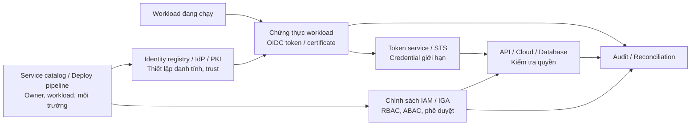
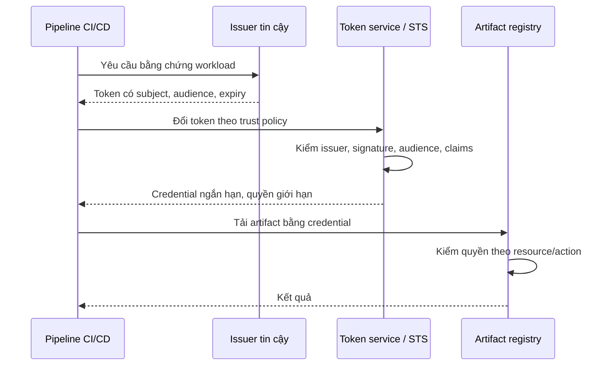

# Định danh máy (Machine Identity) trong IAM

Khi một người đăng nhập vào ứng dụng, hệ thống có thể dùng tài khoản người dùng, mật khẩu hoặc khóa bảo mật và chính sách MFA để xác minh họ. Nhưng khi một dịch vụ gọi API của dịch vụ khác, một pipeline CI/CD triển khai phần mềm hay một tác vụ tự động kết nối cơ sở dữ liệu, **ai đang đăng nhập và quyền đó thuộc về ai?**

Câu trả lời là **định danh máy (machine identity)**: một danh tính được dùng để xác thực và phân quyền cho một thành phần kỹ thuật thay vì một người thao tác trực tiếp. Trong hệ thống hiện đại, số lượng dịch vụ, container, job, bot và tích hợp có thể vượt xa số lượng nhân viên. Nếu chỉ quản lý danh tính con người mà bỏ quên nhóm này, tổ chức vẫn có thể tồn tại khóa API lâu năm, tài khoản dịch vụ dùng chung, chứng chỉ hết hạn hoặc quyền truy cập không còn chủ sở hữu.

Trong phạm vi **Identity and Access Management (IAM)**, định danh máy cũng phải trải qua vòng đời **xác minh nguồn gốc → tạo danh tính → cấp quyền → sử dụng và giám sát → thay đổi → thu hồi**. Những kỹ thuật như IdP, OAuth/OIDC, PKI, mTLS, workload identity, RBAC/ABAC và quản lý bí mật thường được kết hợp để thực hiện vòng đời đó.

## 1. Định danh máy là gì?

**Định danh máy** là thông tin nhận diện logic hoặc mật mã của một **thực thể phi con người** (non-human identity, NHI), cho phép hệ thống nhận biết chủ thể kỹ thuật đang yêu cầu truy cập và liên kết chủ thể ấy với chính sách, chủ sở hữu, lịch sử hoạt động và quyền được phép sử dụng.

Từ “máy” ở đây không chỉ nói đến một máy chủ vật lý. Chủ thể có thể là một ứng dụng, tiến trình, dịch vụ chạy trong container, pipeline tự động, thiết bị, bot hoặc workload tạm thời trên nền tảng đám mây.

Ví dụ:

- Dịch vụ `order-api` có danh tính riêng để gọi `inventory-api`.
- Job `nightly-report` đọc dữ liệu tổng hợp từ một kho dữ liệu.
- Pipeline `deploy-staging` lấy token ngắn hạn để triển khai đúng môi trường staging.
- Một thiết bị IoT dùng chứng chỉ thiết bị để kết nối an toàn tới nền tảng tiếp nhận dữ liệu.
- Bot tích hợp tạo phiếu công việc qua API với quyền giới hạn.

Những danh tính này **không nên bị đồng nhất với tài khoản của nhân viên đã tạo ra chúng**. Nhân viên có thể nghỉ việc nhưng dịch vụ còn hoạt động; khi đó định danh của dịch vụ vẫn cần một owner mới và quyền được đánh giá lại. Ngược lại, khi dịch vụ bị ngừng sử dụng, quyền của nó phải được thu hồi dù người từng tạo ra nó vẫn đang làm việc.

### 1.1. Phân biệt identity, principal, account và credential

| Thành phần | Ý nghĩa | Ví dụ |
|---|---|---|
| **Machine identity** | Danh tính logic ổn định của một thành phần kỹ thuật trong phạm vi quản trị. | `svc-inventory-prod` đại diện dịch vụ Inventory production. |
| **Principal** | Chủ thể mà hệ thống xác thực/phân quyền nhìn thấy trong một giao dịch. | Subject `spiffe://example.internal/ns/prod/sa/inventory` trong một thiết kế SPIFFE. |
| **Service account** | Một hình thức tài khoản dành cho ứng dụng hoặc dịch vụ. | Tài khoản dịch vụ cho job sao lưu dữ liệu. |
| **Credential** | Bằng chứng dùng xác thực hoặc yêu cầu token; có thể thay đổi mà identity vẫn giữ nguyên. | Khóa riêng, client secret, chứng chỉ X.509, token ngắn hạn. |
| **Workload** | Đơn vị công việc thực thi sử dụng identity. | Một Pod, container, serverless function hoặc job. |
| **Authorization grant/role** | Quyền được gán hoặc chính sách quyết định thao tác được phép. | Chỉ cho phép `orders:read` trong môi trường staging. |

Một identity có thể đi qua nhiều lần **rotation credential** mà không đổi định danh. Tương tự, hàng chục bản sao container của cùng một dịch vụ có thể dùng chung *danh tính logic của dịch vụ* theo thiết kế, nhưng phải có cơ chế chứng minh workload nào thực sự được phép mang danh tính ấy. Không nên chia sẻ tùy tiện một khóa tĩnh giữa tất cả các bản sao nếu có thể dùng danh tính workload ngắn hạn hoặc chứng chỉ được cấp động.

### 1.2. Machine identity và device identity có giống nhau không?

**Device identity** (định danh thiết bị) là trường hợp định danh một thiết bị cụ thể, ví dụ đầu đọc thẻ, máy chủ hoặc cảm biến. **Workload identity** gắn với ứng dụng/tiến trình đang chạy, có thể di chuyển giữa nhiều máy. **Service identity** thường gắn với dịch vụ logic, dù dịch vụ có nhiều instance.

Trong cách dùng rộng, cả ba có thể nằm trong nhóm machine/non-human identities, nhưng chúng có **đơn vị sở hữu và vòng đời khác nhau**:

- Thiết bị có thể được đăng ký, thay phần cứng và hủy đăng ký.
- Workload có thể được tạo và hủy trong vài giây theo hệ thống điều phối.
- Dịch vụ có thể tồn tại nhiều năm, trong khi token hoặc chứng chỉ cho từng lần chạy chỉ sống rất ngắn.

Việc chọn cấp định danh phải dựa vào **điều cần xác thực và giới hạn quyền**. Chỉ dùng định danh máy chủ để đại diện cho mọi ứng dụng trên máy chủ đó có thể khiến ứng dụng này sử dụng nhầm quyền của ứng dụng khác.

## 2. Những dạng định danh máy thường gặp

| Dạng | Mục đích phổ biến | Điểm cần kiểm soát |
|---|---|---|
| **Service account** | Ứng dụng truy cập database, thư mục, API hay tài nguyên cloud. | Quyền tối thiểu, owner, phương thức xác thực, giới hạn môi trường. |
| **OAuth/OIDC client** | Ứng dụng hoặc workload nhận access token để gọi API. | Đăng ký client, xác thực client, audience, scope, vòng đời secret/khóa. |
| **Workload identity** | Pod, VM, function hoặc job được nền tảng chứng thực. | Ánh xạ workload → principal, trust policy, token ngắn hạn. |
| **X.509 certificate identity** | Thiết bị hoặc dịch vụ chứng minh danh tính bằng chứng chỉ. | Private key, issuer, SAN/subject, thời hạn, rotation và thu hồi. |
| **API key identity** | Tích hợp dùng khóa để được nhận diện và có thể được phân quyền. | Người sở hữu, lưu trữ an toàn, phạm vi, hết hạn và khả năng thu hồi. |
| **Automation/bot account** | Chạy tác vụ, tự động hóa quản trị hoặc tích hợp công việc. | Tách tài khoản người, ghi nhật ký, giới hạn hành động. |

Một **API key không phải lúc nào cũng là danh tính độc lập**: nhiều hệ thống dùng khóa như một credential thuộc về một principal hoặc account đã tồn tại. Tương tự, một chứng chỉ X.509 không tự động chứng minh quyền được phép thực hiện hành động; hệ thống nhận phải kiểm tra chuỗi tin cậy, thuộc tính định danh, tình trạng chứng chỉ và chính sách phân quyền tương ứng.

Không có một chuẩn duy nhất buộc mọi doanh nghiệp phải dùng cùng dạng định danh. Điều quan trọng là mọi dạng được quản lý bằng **inventory**, chủ sở hữu rõ ràng, chính sách và quy trình thu hồi có thể kiểm chứng.

## 3. Vì sao danh tính máy dễ trở thành điểm mù bảo mật?

Danh tính máy có một số đặc điểm khác với người dùng:

1. **Hoạt động liên tục và tự động**: hệ thống có thể gọi API cả ngày đêm, không có bước đăng nhập tương tác hay MFA theo kiểu người dùng.
2. **Tồn tại nhiều lớp**: một dịch vụ có principal ở IdP, service account tại cloud, chứng chỉ mTLS ở service mesh và secret cho hệ thống cũ.
3. **Thời gian sống không đồng nhất**: workload rất ngắn hạn nhưng tài khoản và khóa đã cấp có thể tồn tại nhiều năm.
4. **Dễ bị gắn quyền rộng vì tiện vận hành**: đội phát triển đôi khi cấp quyền admin để xử lý nhanh lỗi tích hợp.
5. **Thiếu quy trình nghỉ việc tự nhiên**: không có bản ghi HRIS báo rằng một bot hoặc một cron job đã ngừng được sử dụng.

Một cấu hình điển hình có rủi ro là đặt **client secret hoặc khóa API dài hạn** trong mã nguồn hay biến môi trường được sao chép khắp nhiều máy. Nếu bí mật bị lộ, người khác có thể xác thực như dịch vụ mà không cần đăng nhập tài khoản nhân viên. Nếu cả tổ chức dùng chung một service account, nhật ký cũng khó truy ra workload chịu trách nhiệm.

Tuy nhiên, rủi ro không nằm ở việc “máy không có mật khẩu mạnh” đơn thuần. Vấn đề là **bằng chứng danh tính, phạm vi quyền và vòng đời của credential không được ràng buộc rõ với workload đang hoạt động**.

## 4. Danh tính máy tham gia IAM như thế nào?

Một mô hình có thể gồm bốn lớp:

- **Nguồn danh tính và inventory**: danh mục ứng dụng, hệ thống triển khai, thiết bị hoặc cấu hình quản lý dịch vụ; xác định workload có hợp lệ không và ai chịu trách nhiệm.
- **Cơ chế tin cậy/xác thực**: IdP, hệ thống cấp token, PKI hoặc nền tảng workload identity xác minh chủ thể.
- **Điểm thực thi phân quyền**: API gateway, resource server, cloud IAM, database hoặc service mesh kiểm tra quyền.
- **Governance và audit**: phê duyệt, kiểm kê, thay đổi quyền, rotation, chứng nhận định kỳ và đối soát.



Sơ đồ là minh họa khái niệm. Trong triển khai cụ thể, IdP và token service có thể là cùng một thành phần; PKI và IdP có thể dùng các giao thức khác nhau. Một danh tính máy cũng có thể không đi qua hệ thống SSO của người dùng.

### 4.1. Xác thực và phân quyền là hai bước khác nhau

Giả sử `billing-worker` có một certificate hợp lệ:

1. Hệ thống đích xác minh chứng chỉ từ CA được tin cậy và kiểm tra danh tính gắn với certificate.
2. Hệ thống ánh xạ danh tính chứng chỉ đến principal `billing-worker`.
3. Chính sách phân quyền quyết định principal này chỉ được gửi thông điệp tới hàng đợi `billing-events`.
4. Yêu cầu xóa dữ liệu khách hàng phải bị từ chối nếu không có quyền tương ứng.

**Chứng chỉ hợp lệ không đồng nghĩa với quyền admin**. Tương tự, access token đã được ký đúng vẫn cần được kiểm tra issuer, audience, thời hạn, các điều kiện khác và scope/claims theo cơ chế của resource server. Một hệ thống có thể xác thực thành công mà vẫn **từ chối truy cập**.

## 5. Các cách chứng thực machine identity

### 5.1. Bí mật tĩnh: password, API key và client secret

Cách đơn giản là lưu một thông tin bí mật cho ứng dụng, rồi ứng dụng gửi bí mật ấy khi kết nối. Cách này được nhiều hệ thống hỗ trợ, nhưng tạo chi phí vận hành lớn:

- Secret phải được cấp, phân phối, lưu trữ và luân chuyển an toàn.
- Việc sao chép secret khiến khó biết có bao nhiêu bản đang tồn tại.
- Secret bị lộ có thể được dùng từ môi trường khác nếu hệ thống không áp dụng ràng buộc bổ sung.
- Khi một chủ sở hữu rời dự án, rất khó xác định những secret họ từng có thể đọc.

Nếu buộc phải dùng secret tĩnh, cần lưu trong công cụ quản lý bí mật phù hợp, hạn chế quyền đọc, không ghi vào repository hoặc log, thiết lập ngày hết hạn/rotation và có quy trình thu hồi nhanh. **Rotation** phải được thiết kế với khả năng chấp nhận hai phiên bản trong khoảng chuyển đổi nếu hệ thống hỗ trợ, để tránh gián đoạn dịch vụ khi thay khóa.

### 5.2. Chứng chỉ X.509 và mTLS

Với **mutual TLS (mTLS)**, cả bên gọi và bên nhận có thể xác thực danh tính qua chứng chỉ. Danh tính dịch vụ có thể được gắn trong thuộc tính của certificate theo quy ước hoặc tiêu chuẩn phù hợp, và hệ thống phải xác minh CA, mục đích sử dụng, thời hạn cùng các ràng buộc liên quan.

Các vấn đề cần quản lý:

- Private key được tạo và lưu ở đâu? Ai hoặc tiến trình nào có thể truy cập?
- Ai được cấp chứng chỉ cho tên workload nào?
- Chứng chỉ sống bao lâu và gia hạn trước khi hết hạn ra sao?
- Khi workload bị thu hồi, hệ thống bên nhận phát hiện và chặn chứng chỉ cũ bằng cách nào?
- Cơ chế kiểm soát phải tính đến độ trễ cập nhật danh sách thu hồi/chính sách, chứ không giả định rằng thu hồi sẽ có hiệu lực tức thì trong mọi hệ thống.

mTLS có ích khi dịch vụ cần xác thực lẫn nhau ở tầng kết nối. Việc **phân quyền nghiệp vụ** vẫn cần kiểm tra thêm dựa trên danh tính và hành động.

### 5.3. Workload identity federation và token ngắn hạn

Một hướng tiếp cận hiện đại là để nền tảng chạy workload xác nhận **job, Pod hoặc service nào đang thực thi**, sau đó cho phép workload đổi bằng chứng ngắn hạn thành token phục vụ truy cập tài nguyên. Ví dụ có thể dùng cơ chế OIDC federation và Security Token Service (STS) của nhà cung cấp; chi tiết phụ thuộc nền tảng.

Ví dụ khái niệm:



Nhờ đó, pipeline có thể thực hiện công việc mà không cần mang theo một khóa cloud tồn tại hàng tháng. Tuy nhiên federation chỉ an toàn khi **trust policy đủ chặt**: phải ràng buộc đúng issuer, audience, repository/project, môi trường hoặc chủ thể workload theo thông tin đáng tin cậy mà issuer thực sự cung cấp.

Ví dụ, chỉ tin mọi token từ một issuer CI/CD mà không giới hạn pipeline nào được đại diện cho production có thể cho phép workload không mong muốn nhận quyền production.

### 5.4. SPIFFE/SPIRE và service identity

Trong một số kiến trúc phân tán, **SPIFFE** cung cấp mô hình định danh workload có dạng URI (SPIFFE ID) và các tài liệu chứng thực tương ứng; **SPIRE** là một triển khai có thể cấp và quản lý danh tính workload dựa trên việc xác minh workload/agent.

Ví dụ định danh minh họa:

```text
spiffe://example.internal/ns/payments/sa/billing-worker
```

Dạng này giúp biểu diễn workload bằng danh tính độc lập với IP tạm thời. Tuy nhiên, việc một workload nhận được SPIFFE ID phải dựa trên cơ chế attestation và chính sách đăng ký; chỉ tự khai báo một URI không tạo ra danh tính đáng tin cậy. Hệ thống nhận vẫn phải áp dụng authorization policy với danh tính đó.

## 6. Vòng đời định danh máy: tương ứng Joiner–Mover–Leaver

Mô hình **Joiner–Mover–Leaver (JML)** trong IAM thường được giới thiệu bằng sự kiện nhân sự. Với danh tính máy, có thể áp dụng tư duy tương tự, nhưng **nguồn phát sinh sự kiện** là vòng đời ứng dụng, workload, thiết bị, hợp đồng tích hợp hoặc hạ tầng.

| Giai đoạn | Sự kiện ở machine identity | Tác vụ chính |
|---|---|---|
| **Joiner / Onboard** | Dịch vụ được đăng ký, thiết bị được đưa vào sử dụng, integration được phê duyệt. | Xác minh workload/owner; tạo principal; cấp credential hoặc thiết lập federation; cấp quyền tối thiểu. |
| **Active / Operate** | Workload hoạt động bình thường. | Giám sát sử dụng; gia hạn token/chứng chỉ; rotation khi đến hạn; ghi audit và rà soát quyền. |
| **Mover / Change** | Dịch vụ đổi môi trường, di chuyển cluster, thay trách nhiệm hoặc tích hợp thêm API. | Tính lại quyền; thay trust/attribute; cấp quyền mới cần thiết và thu hồi quyền cũ. |
| **Suspended / Incident** | Workload có dấu hiệu bị xâm nhập hoặc chưa xác minh được owner. | Tạm khóa, revoke credential/phiên theo khả năng; đánh giá ảnh hưởng. |
| **Leaver / Offboard** | Dịch vụ bị hủy, job ngừng chạy, thiết bị thanh lý, integration kết thúc. | Chặn xác thực; thu hồi vai trò, token/khóa/chứng chỉ; dọn phụ thuộc và xác nhận không còn truy cập. |
| **Retained / Archived** | Chỉ còn hồ sơ phục vụ vận hành/kiểm toán. | Giữ thông tin cần thiết theo chính sách; không còn quyền truy cập. |

### 6.1. Joiner: chứng minh workload có thật và có chủ sở hữu

Khi tạo một định danh máy, cần trả lời:

1. Workload nào yêu cầu danh tính? Có mã ứng dụng hoặc đối tượng triển khai được quản lý hay không?
2. Nhóm nào chịu trách nhiệm về bảo mật và vận hành của danh tính?
3. Danh tính được sử dụng ở môi trường `dev`, `staging` hay `prod`? Có thực sự cần truy cập liên môi trường?
4. Cần thực hiện **hành động cụ thể** nào trên tài nguyên nào?
5. Sử dụng phương thức chứng thực nào, ai có thể phát hành hoặc truy xuất credential?
6. Khi nào danh tính cần rà soát hoặc tự động hết hiệu lực?

Thông tin tối thiểu trong inventory có thể biểu diễn như sau (YAML minh họa về dữ liệu quản trị, **không phải schema IAM chung**):

```yaml
identityId: svc-inventory-sync-prod
kind: workload
application: inventory-sync
environment: production
ownerTeam: supply-platform
technicalContact: platform-oncall
purpose: "Đồng bộ tồn kho sang dịch vụ báo cáo"
authentication:
  method: workload-federation
authorization:
  resource: inventory-events
  actions:
    - events.publish
reviewAfter: "2027-02-01"
lifecycle:
  state: ACTIVE
```

Trường owner cần phản ánh trách nhiệm hiện hành. Nếu nhóm bị giải thể hoặc hệ thống chuyển chủ, cần chuyển ownership chính thức. Không nên dùng email cá nhân làm thông tin owner duy nhất cho danh tính tồn tại lâu dài.

### 6.2. Mover: giảm quyền khi hệ thống thay đổi

Giả sử một job từng đọc trực tiếp dữ liệu nhạy cảm, sau đó kiến trúc chuyển sang nhận dữ liệu đã được làm sạch qua một API mới. Cập nhật Mover đúng nghĩa là:

- Cấp quyền gọi API mới theo chính sách.
- Thu hồi quyền đọc trực tiếp cơ sở dữ liệu cũ.
- Xóa các credential cũ hoặc quyền cloud không còn sử dụng.
- Thay trust policy khi workload chuyển sang nền tảng/cluster khác.
- Đối soát rằng tài nguyên cũ thực sự từ chối yêu cầu từ danh tính đó.

Nếu chỉ cấp thêm quyền mà không rà soát quyền cũ, tài khoản máy sẽ tích lũy **quyền tồn dư (residual access)** tương tự tài khoản nhân viên.

Trong mô hình **RBAC**, thay đổi có thể là gỡ role `db-reader`, cấp role `api-publisher`. Trong **ABAC**, quyền còn phụ thuộc nhãn môi trường, namespace, workload type, owner hoặc mức nhạy cảm tài nguyên. Các thuộc tính phải được lấy từ nguồn tin cậy, tránh cho workload tự tùy ý khai báo một nhãn được dùng để cấp quyền.

### 6.3. Leaver: ngừng dịch vụ không đồng nghĩa đã thu hồi định danh

Khi một dịch vụ bị xóa khỏi cluster, service account hoặc khóa API có thể vẫn tồn tại ở nhà cung cấp dịch vụ bên ngoài. Ngược lại, một principal có thể bị xóa nhưng các khóa được sao chép trước đó vẫn có tác dụng trong hệ thống không liên kết trạng thái.

Một luồng Leaver đáng tin cậy nên:

1. Nhận sự kiện ngừng sử dụng từ nguồn quản trị dịch vụ/workload hoặc quyết định của owner.
2. Chặn việc cấp **credential mới** cho danh tính đó, vô hiệu hóa trust hoặc account khi cần.
3. Thu hồi quyền trên từng ứng dụng đích; revoke/expire credential đang tồn tại theo cơ chế hỗ trợ.
4. Kiểm tra khả năng truy cập qua API key, refresh token, chứng chỉ, secret hoặc tài khoản cục bộ.
5. Ghi nhận kết quả theo từng hệ thống; tạo tác vụ khắc phục cho trường hợp thất bại.
6. Lưu bằng chứng và dọn các tài nguyên không còn sử dụng theo chính sách.

Với chứng chỉ/token **chưa thể thu hồi tức thì**, cần chú ý thời gian hết hạn còn lại và khả năng chặn tại resource server/gateway. Thời gian sống ngắn giảm cửa sổ rủi ro, nhưng không thay thế chính sách từ chối truy cập ở hệ thống đích khi yêu cầu khẩn cấp.

## 7. Quản lý quyền: least privilege, RBAC, ABAC và quyền đặc biệt

Trong quản lý định danh máy, **least privilege** không có nghĩa “cấp ít role nhất có thể” theo số lượng; nó có nghĩa chỉ cho phép các **hành động, tài nguyên, môi trường và thời hạn** thực sự cần.

Một policy đơn giản mang tính minh họa:

```json
{
  "subject": "svc-inventory-sync-prod",
  "resource": "inventory-events",
  "actions": ["events.publish"],
  "conditions": {
    "environment": "production"
  }
}
```

Đây là **JSON mô tả chính sách khái niệm**, không phải cú pháp cấu hình chung cho AWS, Azure, Google Cloud hoặc một cổng API cụ thể. Trong hệ thống thật, cần ánh xạ từng thành phần vào ngôn ngữ policy và cơ chế thực thi của sản phẩm đang sử dụng.

### 7.1. RBAC

**Role-Based Access Control (RBAC)** phù hợp khi nhiều workload có cùng nhiệm vụ. Ví dụ role `report-writer` chỉ có quyền tạo báo cáo trong khu vực được giao. Role có thể được gán cho từng principal của job hoặc dịch vụ.

Cần tránh cấp role quản trị toàn hệ thống chỉ để thực hiện một thao tác dữ liệu; cũng tránh dùng chung một role quá rộng cho cả workload sản xuất và thử nghiệm.

### 7.2. ABAC

**Attribute-Based Access Control (ABAC)** bổ sung điều kiện từ thuộc tính chủ thể và tài nguyên: `environment=prod`, `namespace=payments`, `dataClassification=internal` hoặc region được phép. Ví dụ, pipeline staging không được triển khai bản phát hành production dù cùng mang role “deployer”.

Vì các thuộc tính ảnh hưởng trực tiếp tới quyết định quyền, hệ thống phải xác định **ai được gắn thuộc tính và xác minh nó**, đặc biệt khi thuộc tính xuất phát từ token hoặc metadata của nền tảng triển khai.

### 7.3. JIT và quyền đặc quyền

Các tác vụ đặc biệt như chạy migration production, khôi phục dữ liệu hoặc quản trị cluster nên có quyền **Just-in-Time (JIT)**: cấp có thời hạn, kèm phê duyệt/ràng buộc tương ứng và tự hết hạn. Nếu bắt buộc phải dùng tài khoản đặc quyền lâu dài, cần tăng kiểm soát credential, scope, phiên truy cập và audit.

Một danh tính máy chỉ nên có quyền đại diện công việc của chính nó; không nên được “mượn” để vượt qua kiểm soát quyền người dùng hay quy trình phê duyệt.

## 8. Ví dụ thực tế: pipeline CI/CD triển khai staging

Giả sử một repository có pipeline tự động triển khai ứng dụng thử nghiệm. Mục tiêu là cho pipeline đẩy bản phát hành lên môi trường staging mà không lưu khóa quản trị cloud dài hạn trong biến môi trường.

**Bước 1 — Đăng ký:** đội nền tảng ghi nhận identity `ci-release-staging`, ứng dụng, owner, repository/workflow hợp lệ và môi trường staging.

**Bước 2 — Thiết lập trust:** token service chỉ chấp nhận bằng chứng OIDC từ issuer CI/CD đã xác minh; trust policy giới hạn đúng repository, workflow và môi trường staging theo claims có thể tin cậy.

**Bước 3 — Cấp quyền:** principal nhận role chỉ cho phép đẩy artifact và cập nhật tài nguyên staging cần thiết, không có quyền chạm production.

**Bước 4 — Thực thi:** mỗi lần pipeline chạy, nó lấy token từ issuer, đổi lấy credential ngắn hạn và thực hiện deployment. Tất cả hành động được gắn với principal cùng thông tin phiên chạy thích hợp.

**Bước 5 — Mover:** khi chuyển sang công cụ CI/CD khác hoặc đổi workflow, đội nền tảng cập nhật trust và thu hồi quyền của đường cũ.

**Bước 6 — Leaver:** khi pipeline bị hủy, trust cũ và role liên quan bị vô hiệu hóa; kiểm tra không còn token/credential đang sử dụng trái chính sách.

Điều khác biệt với giải pháp lưu một API key tĩnh là **mỗi lần chạy được chứng thực bằng ngữ cảnh workload** và credential có thời hạn ngắn. Tuy nhiên, bảo mật vẫn phụ thuộc vào chính sách issuer, cấu hình trust, quyền thao tác và khả năng kiểm tra các giao dịch thực tế.

## 9. Phối hợp IdP, SSO, SCIM và hệ thống danh tính máy

Trong IAM lifecycle, các cơ chế dành cho người dùng có thể liên quan đến machine identity nhưng không mặc nhiên quản lý được mọi workload.

| Cơ chế | Liên hệ với định danh máy | Giới hạn cần hiểu |
|---|---|---|
| **IdP** | Có thể lưu application/client principal, phát hành token hoặc thiết lập liên kết danh tính. | Cần xác định IdP nào có quyền cấp token cho workload và principal nào ở hệ thống đích. |
| **SSO** | Chủ yếu hỗ trợ đăng nhập tương tác của người dùng qua SAML/OIDC; đôi khi cùng hạ tầng IdP phục vụ ứng dụng. | SSO cho nhân viên không tự giải quyết xác thực của pipeline hoặc service-to-service. |
| **SCIM** | Có thể quản lý vòng đời đối tượng tài khoản/nhóm ở ứng dụng nếu hai bên hỗ trợ luồng tương ứng. | SCIM không phải giao thức phổ quát để cấp workload identity, rotation secret hay revoke token đang lưu hành. |
| **RBAC/ABAC** | Áp dụng quyền và điều kiện truy cập cho principal máy. | Cần nguồn thuộc tính đáng tin cậy và readback quyền thực tế. |
| **PKI/mTLS** | Chứng thực thiết bị/dịch vụ qua chứng chỉ và khóa riêng. | Quản lý chứng chỉ, khóa, trust, expiry và thu hồi là phần riêng của lifecycle. |
| **IGA / Governance** | Quản lý owner, approval, review, SoD, ngoại lệ và bằng chứng. | Công cụ chỉ hiệu quả khi inventory machine identity được cập nhật. |

Một ứng dụng có thể dùng SSO cho nhân viên, đồng thời dùng OAuth client credentials hoặc workload federation cho API. Hai loại danh tính phải được phân quyền và kiểm toán rõ ràng để tránh một service account có thể impersonate người dùng tùy ý.

## 10. Kiểm kê, giám sát và kiểm toán định danh máy

Muốn thu hồi được danh tính máy, trước tiên phải **biết nó tồn tại**. Inventory nên tổng hợp từ service catalog, tài khoản cloud, secrets manager, certificate authority, IdP, CI/CD, API gateway, cluster và hệ thống ứng dụng. Mỗi bản ghi cần có:

- Định danh/principal và mọi account hoặc credential có liên quan.
- Loại workload, ứng dụng, môi trường và owner chịu trách nhiệm.
- Mục đích nghiệp vụ, quyền được cấp, tài nguyên và điểm thực thi.
- Phương thức chứng thực, nơi quản lý credential, issuer và kỳ hạn.
- Ngày cấp, lần sử dụng cuối (nếu đo được), ngày review/rotation và thời hạn.
- Trạng thái vòng đời, yêu cầu/phê duyệt, sự kiện thu hồi và kết quả đối soát.

**Không đưa giá trị bí mật thực tế vào inventory hay audit log.** Chỉ lưu metadata tham chiếu đến vault hoặc trình quản lý chứng chỉ, fingerprint/ID phù hợp và thông tin phục vụ truy vết.

### 10.1. Các câu hỏi kiểm toán quan trọng

1. Danh tính `svc-x` do ai chịu trách nhiệm và vì sao còn hoạt động?
2. Quyền thực tế có vượt quá policy mục tiêu không?
3. Có service account nào không được sử dụng trong thời gian dài nhưng vẫn có quyền nhạy cảm?
4. Credential nào đã quá hạn rotation, hết hạn hoặc phát hành không đúng nguồn?
5. Có danh tính nào gắn với dự án, dịch vụ hoặc nhà thầu đã ngừng hoạt động?
6. Một sự kiện Leaver đã thực sự chặn quyền ở tất cả target hay mới tạo yêu cầu?
7. Có sự kiện truy cập nào sử dụng credential của dịch vụ từ môi trường hoặc phạm vi bất thường?

### 10.2. Một số chỉ số vận hành

| Chỉ số | Diễn giải |
|---|---|
| **Owned identity coverage** | Tỷ lệ danh tính máy có owner và purpose hợp lệ. |
| **Credential age / expiry exposure** | Số credential dài hạn, sắp hết hạn hoặc quá kỳ rotation. |
| **Overprivileged principal count** | Số danh tính bị xác định có quyền vượt nhu cầu hiện hành. |
| **Orphan machine identity count** | Số danh tính không còn gắn với workload hoặc owner hợp lệ. |
| **Offboarding latency** | Thời gian từ khi dịch vụ ngừng sử dụng đến lúc quyền thực tế bị chặn. |
| **Reconciliation coverage** | Tỷ lệ hệ thống đích có thể đối soát quyền và trạng thái thật. |
| **Failed revocation tasks** | Số tác vụ thu hồi thất bại hoặc chưa có bằng chứng hoàn tất. |

Một cảnh báo như “chứng chỉ còn 7 ngày sẽ hết hạn” là tín hiệu vận hành hữu ích; một phát hiện “principal production không có owner” là vấn đề governance. Cả hai thuộc cùng vòng đời danh tính máy, nhưng cách xử lý khác nhau.

## 11. Rotation và xử lý sự cố credential

**Rotation** là thay thế credential bằng credential mới. **Revocation** là làm cho credential hoặc quyền không còn được chấp nhận. **Deprovisioning** là thu hồi account/quyền khi danh tính không còn được phép hoạt động. Ba thao tác này liên quan nhưng không đồng nghĩa.

Ví dụ khi một API key bị nghi lộ:

1. Xác định identity, owner, hệ thống đích và phạm vi quyền mà khóa đang đại diện.
2. Đánh giá nguy cơ tiếp diễn; khi cần chặn ngay, revoke khóa hoặc hạn chế quyền trực tiếp tại hệ thống đích.
3. Cấp credential thay thế cho workload hợp lệ qua kênh an toàn.
4. Cập nhật ứng dụng sử dụng credential mới, xác minh chức năng và kiểm tra dấu hiệu sử dụng trái phép.
5. Tìm tất cả bản sao của khóa cũ; cập nhật chính sách để giảm nguy cơ tái diễn.
6. Lưu diễn biến và kết quả kiểm chứng theo quy trình ứng phó sự cố.

Nếu khóa cũ được phát hành cho nhiều dịch vụ dùng chung, việc thu hồi có thể làm gián đoạn hàng loạt. Đây là lý do cần **tách identity và credential theo workload/ứng dụng**, thay vì gom nhiều hệ thống dưới một khóa chung.

Với credential có vòng đời ngắn, rủi ro từ một lần lộ thường bị giới hạn theo thời hạn, nhưng token vẫn có thể bị lạm dụng cho tới khi hết hiệu lực nếu hệ thống đích không hỗ trợ chặn sớm. Vì vậy cần phối hợp **TTL hợp lý, kiểm soát quyền, phát hiện bất thường và phương án thu hồi**.

## 12. Những sai lầm thường gặp

| Sai lầm | Hậu quả | Cách cải thiện |
|---|---|---|
| Dùng tài khoản nhân viên cho automation. | Khi nhân viên đổi việc/nghỉ việc, job dễ hỏng hoặc tiếp tục có quyền cá nhân. | Dùng principal kỹ thuật riêng với owner theo nhóm. |
| Chia sẻ một service account toàn hệ thống. | Khó truy trách nhiệm và phạm vi sự cố lớn. | Tách danh tính theo ứng dụng, môi trường và mục đích. |
| Lưu client secret/API key trong repository. | Secret có thể bị sao chép, rò rỉ lâu dài. | Dùng vault; ưu tiên federation/credential ngắn hạn khi khả thi. |
| Gán role admin để “cho chắc chạy được”. | Workload bị xâm nhập có thể làm nhiều việc ngoài nhiệm vụ. | Xác định action/resource cụ thể, áp dụng least privilege. |
| Chỉ đổi secret mà không kiểm tra quyền. | Identity vẫn giữ quyền tồn dư. | Rà soát authorization policy cùng lịch rotation. |
| Chỉ xóa Pod/server khi ngừng dịch vụ. | Principal, cert, token và account ở hệ thống khác còn tồn tại. | Workflow Leaver xuyên các target và xác minh readback. |
| Chỉ tin vào danh sách tài khoản IdP. | Bỏ sót cloud principal, certificates, local accounts và API keys. | Kiểm kê từ nhiều nguồn, đối soát định kỳ. |
| Không kiểm tra audience/issuer/trust claims. | Workload ngoài phạm vi có thể được cấp token không mong muốn. | Ràng buộc chính xác chính sách tin cậy. |
| Không có chủ sở hữu hoặc ngày rà soát. | Identity bị bỏ quên và trở thành quyền tồn dư. | Bắt buộc owner, purpose, trạng thái và review/expiry. |

## 13. Bài tập tình huống

Một nhóm có dịch vụ `invoice-exporter` chạy mỗi đêm. Dịch vụ sử dụng API key không hết hạn để đọc tất cả dữ liệu hóa đơn trên cả staging lẫn production. Khóa được lưu trong biến môi trường của một máy chủ dùng chung. Người tạo tích hợp đã chuyển sang bộ phận khác. Sau khi chuyển sang kiến trúc mới, job cũ không còn được sử dụng nhưng API key vẫn hoạt động.

Hãy thử trả lời:

1. Đâu là **machine identity**, **credential**, **workload** và **owner** trong tình huống này? Thông tin nào chưa rõ?
2. Sự kiện nào tương đương **Mover** và **Leaver**?
3. Vì sao chỉ xóa mã nguồn/job sẽ không giải quyết đầy đủ rủi ro?
4. Cần xác minh điều gì ở API đích để kết luận quyền đã được thu hồi?
5. Nếu triển khai lại job, làm thế nào để giảm quyền và tránh phụ thuộc vào khóa tĩnh lâu dài?

**Gợi ý giải quyết:** nhóm cần xác minh account/principal mà API key đại diện, thiết lập owner mới để chịu trách nhiệm quyết định, đối soát việc sử dụng thực tế, thu hồi quyền và key của job cũ, xác minh API từ chối truy cập bằng credential cũ. Nếu xây dựng phiên bản mới, nên tách staging/production, cấp đúng quyền chỉ đọc tập dữ liệu cần thiết, ưu tiên credential ngắn hạn hoặc federation khi hệ thống hỗ trợ và gắn ngày rà soát.

## Kết luận

**Định danh máy** là danh tính dùng để nhận diện và phân quyền cho dịch vụ, workload, thiết bị hay tác vụ tự động. Nó có thể gắn với service account, OAuth client, workload identity, chứng chỉ hoặc API key, nhưng cần phân biệt **bản thân danh tính** với **credential dùng để chứng minh danh tính** và **quyền mà danh tính được cấp**.

Trong IAM lifecycle, quản lý machine identity phải trải dài từ **đăng ký, xác minh nguồn gốc, gắn owner, cấp quyền tối thiểu**, qua **rotation, thay đổi vai trò/thuộc tính và rà soát định kỳ**, đến **vô hiệu hóa, thu hồi credential/quyền và đối soát kết quả**. Tư duy Joiner–Mover–Leaver vẫn hữu ích, với sự kiện đến từ vòng đời workload thay vì chỉ từ hồ sơ nhân sự.

Một hệ thống được quản trị tốt có thể trả lời rõ: *định danh kỹ thuật này thuộc workload nào, ai chịu trách nhiệm, vì sao nó có quyền hiện tại, credential còn hiệu lực đến khi nào và làm sao chứng minh đã thu hồi khi không còn cần thiết?*
