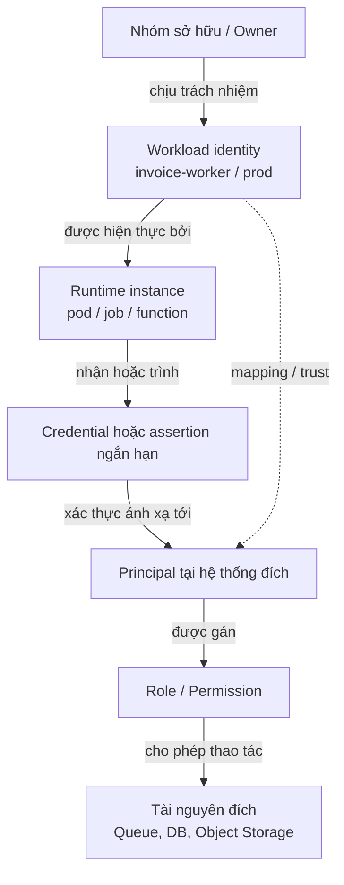
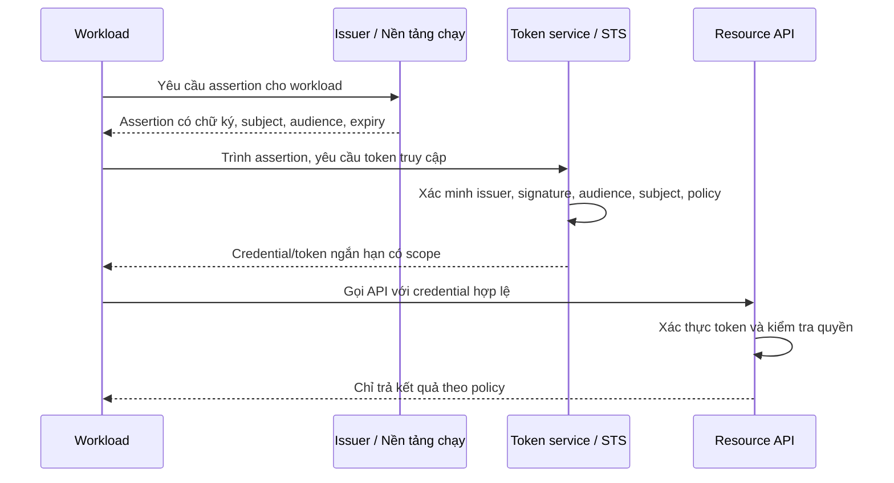
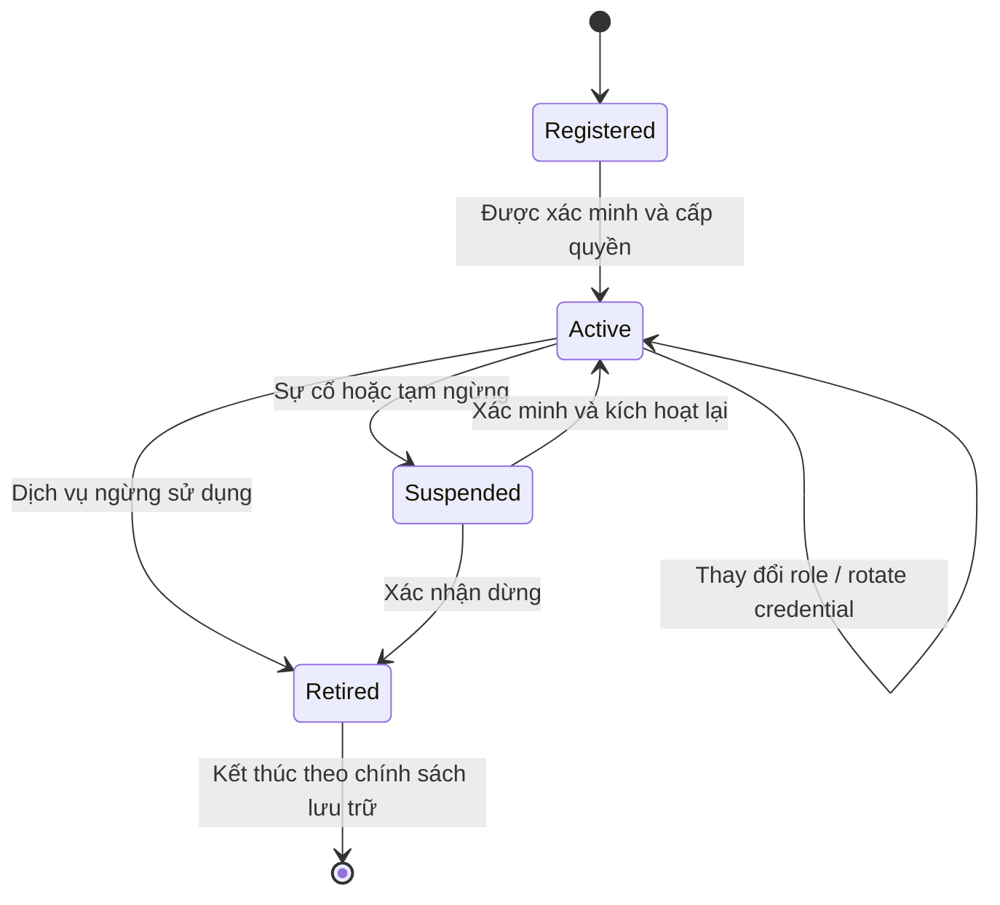
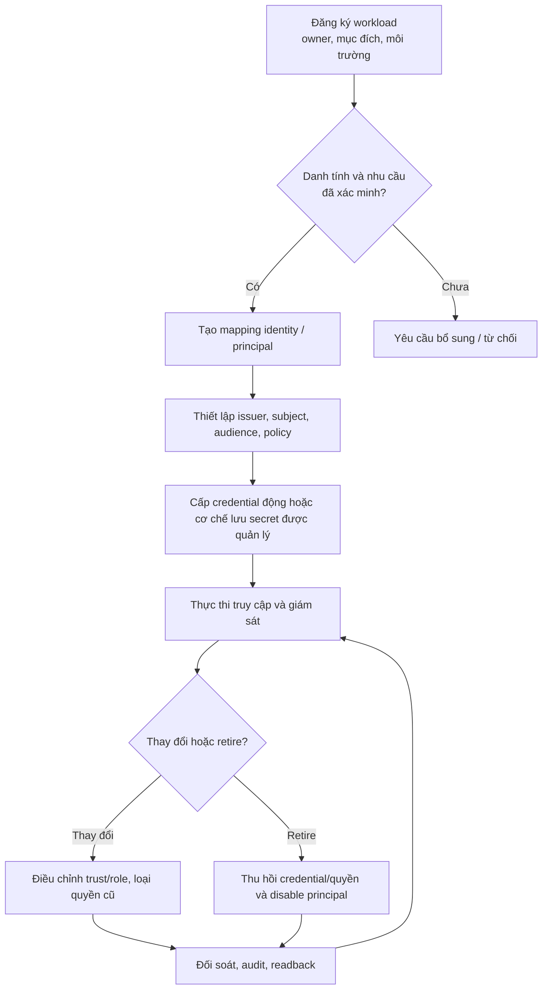

# Định danh workload trong mô hình Identity và vòng đời IAM

## Mục tiêu học tập

Sau bài này, người học có thể:

1. Giải thích **workload identity** là gì, phân biệt với tài khoản người dùng, service account, service principal, credential và instance đang chạy.
2. Mô tả cách một workload chứng minh danh tính để truy cập API, cơ sở dữ liệu, hàng đợi, kho bí mật hoặc tài nguyên đám mây.
3. So sánh khóa bí mật dài hạn, token ngắn hạn, managed identity, OIDC federation và chứng chỉ mTLS trong truy cập máy–máy.
4. Giải thích vai trò của issuer, trust relationship, subject, audience và chính sách RBAC/ABAC trong cấp quyền cho workload.
5. Thiết kế vòng đời đăng ký, cấp phát, luân chuyển, thay đổi quyền, giám sát và thu hồi danh tính workload.
6. Nhận diện các rủi ro như service account mồ côi, chia sẻ identity, lộ credential, quyền quá rộng và tin cậy sai nguồn phát hành.

## 1. Workload identity là gì?

Trong **Identity and Access Management (IAM)**, một **workload** là phần mềm hoặc đơn vị xử lý được triển khai để thực hiện công việc: một web service, microservice, batch job, container, pod, hàm serverless, máy ảo, tiến trình tự động hóa hoặc pipeline CI/CD.

**Workload identity (định danh workload)** là danh tính được hệ thống tin cậy gán hoặc xác lập cho workload, nhằm nhận diện workload đó và cho phép nó yêu cầu quyền truy cập tài nguyên. Đây là một loại **non-human identity (NHI)**, tức danh tính không đại diện trực tiếp cho con người.

Ví dụ: dịch vụ `invoice-worker` của hệ thống thanh toán cần đọc bản ghi hóa đơn từ một hàng đợi, lấy khóa mã hóa từ kho bí mật và ghi trạng thái xử lý vào cơ sở dữ liệu. Thay vì đăng nhập bằng username và mật khẩu của nhân viên phát triển, dịch vụ dùng một danh tính được quản trị riêng, chẳng hạn `payments/invoice-worker/prod`, để nhận credential và truy cập đúng những tài nguyên đã được phê duyệt.

Một workload identity tốt trả lời được các câu hỏi:

- **Ai đang gọi?** Workload logic nào, từ môi trường và nguồn thực thi nào?
- **Có thể tin lời khai đến mức nào?** Bằng chứng danh tính do nền tảng nào phát hành; nguồn đó có được tin cậy không?
- **Được phép làm gì?** Quyền nào được cấp, trên tài nguyên nào và trong điều kiện nào?
- **Ai chịu trách nhiệm?** Nhóm, chủ sở hữu dịch vụ hoặc hệ thống bảo trợ nào quản lý workload?
- **Khi nào phải thay đổi hoặc thu hồi?** Workload, môi trường, nhóm sở hữu hoặc nhu cầu truy cập thay đổi ra sao?

Trong bài này, **identity** là bản thể cần quản trị, còn **account/principal** là đối tượng mà một hệ thống nhận biết để thực thi xác thực và phân quyền. Một sản phẩm cụ thể có thể dùng từ “service account”, “application identity” hay “service principal” theo cách riêng; cần kiểm tra ngữ nghĩa của sản phẩm khi triển khai.

## 2. Các đối tượng liên quan dễ bị nhầm

| Khái niệm | Bản chất | Ví dụ | Điểm cần nhớ |
|---|---|---|---|
| **Workload** | Phần mềm hoặc công việc đang thực thi | API `order-service`, batch `invoice-worker` | Là chương trình, không nhất thiết là bản ghi IAM |
| **Workload identity** | Danh tính logic được cấp và quản trị | `payments/invoice-worker/prod` | Dùng để liên kết workload với owner, policy và vòng đời |
| **Runtime instance** | Một lần chạy cụ thể của workload | Pod `invoice-worker-7d8c`, một job CI | Nhiều instance có thể dùng chung identity logic |
| **Principal** | Chủ thể được hệ thống bảo mật nhận diện | Cloud service principal, principal từ chứng chỉ | Được đánh giá trong quyết định phân quyền |
| **Service account** | Account chuyên dụng phục vụ ứng dụng hoặc tự động hóa | Kubernetes ServiceAccount, account ứng dụng | Khả năng và cách cấp credential phụ thuộc nền tảng |
| **Credential** | Bằng chứng để xác thực hoặc lấy quyền truy cập | Private key, certificate, JWT, access token | Có thể bị lộ, hết hạn, xoay vòng hoặc thu hồi |
| **Role/entitlement** | Quyền được cấp cho principal | `queue.consume`, `database.write` | Có identity không có nghĩa được mọi quyền |
| **Owner/sponsor** | Cá nhân hoặc nhóm chịu trách nhiệm vòng đời | Team Thanh toán | Không đồng nghĩa credential được dùng bởi người đó |

Một service account có thể là **cách hiện thực workload identity** ở một nền tảng, nhưng không phải mọi workload identity đều bắt buộc lưu một username hoặc secret cố định. Managed identity và workload identity federation thường cho phép workload nhận credential động mà không cần duy trì một khóa dài hạn trong mã nguồn.

### 2.1. Danh tính logic và danh tính từng instance

Giả sử `invoice-worker` chạy 15 pod để xử lý lưu lượng. Có hai cấp nhận diện:

1. **Cấp workload logic:** `payments/invoice-worker/prod` biểu diễn mục đích nghiệp vụ, owner và tập quyền cần có.
2. **Cấp runtime instance:** mỗi pod có mã thực thể, thời gian tồn tại và credential phát hành riêng, có thể được ràng buộc với pod đó.

Nhiều pod cùng đại diện một workload logic là chuyện bình thường. Tuy nhiên, nếu tất cả pod dùng chung một secret không hạn thì khi một pod bị xâm nhập, credential đó có thể bị dùng lại ngoài ngữ cảnh của pod. Việc dùng credential ngắn hạn, audience cụ thể và ràng buộc với môi trường/instance làm giảm phạm vi tác động.

Tùy nhu cầu kiểm toán, một hệ thống có thể ghi nhận đồng thời **identity logic** và **instance ID**, thay vì chỉ có tên service chung.

### 2.2. Phân biệt workload, thiết bị và tài khoản người dùng

- **Human identity:** nhân viên, nhà thầu hoặc đối tác; gắn với quy trình Joiner–Mover–Leaver (JML), xác minh danh tính con người, MFA và vai trò tổ chức.
- **Workload identity:** tiến trình/phần mềm được triển khai; gắn với owner của dịch vụ, vòng đời triển khai và điều kiện runtime.
- **Device identity:** định danh thiết bị vật lý hoặc thiết bị được quản trị; có thể dùng chứng chỉ thiết bị hoặc các bằng chứng phần cứng.

Ba loại có thể liên quan. Nhân viên tạo pipeline; pipeline chạy trên runner; pipeline triển khai workload lên cluster. **Nhân viên không phải là danh tính của workload**, và runner cũng không nhất thiết là workload cần cấp quyền vào cơ sở dữ liệu. Cần xác định đúng chủ thể cho từng bước.

## 3. Vì sao cần định danh workload riêng?

Không ít hệ thống cũ dùng tài khoản nhân viên hoặc chuỗi `username/password` đặt trong file cấu hình cho các tác vụ nền. Điều này phát sinh nhiều vấn đề:

- **Khó quy trách nhiệm:** log chỉ thấy “admin” hoặc tên của một người đã rời tổ chức, không chỉ ra workload thực sự gây ra hành động.
- **Quyền quá rộng:** tài khoản được dùng chung bởi nhiều dịch vụ, nên phải cấp hợp quyền của tất cả dịch vụ.
- **Credential khó thu hồi:** cùng một secret có thể xuất hiện ở nhiều máy, pipeline và bản sao lưu.
- **Đứt gãy JML:** nhân viên nghỉ việc nhưng job còn dùng credential của họ, hoặc khóa account cá nhân vô tình làm ngừng hệ thống.
- **Khó cách ly:** workload dev và prod dùng chung account, tạo khả năng truy cập chéo môi trường.
- **Khó kiểm toán:** không biết ứng dụng nào còn cần quyền, ai phê duyệt hoặc thời điểm nào có thể tắt an toàn.

Định danh workload riêng giúp thiết lập nguyên tắc **mỗi workload có chủ sở hữu, bằng chứng danh tính, chính sách và thời hạn truy cập được xác định rõ**. Đó là cơ sở để chuyển từ quản lý secret thủ công sang xác thực được kiểm soát qua nền tảng.

## 4. Mô hình quan hệ trong IAM

Có thể hình dung quan hệ qua sơ đồ sau:



Sơ đồ là mô hình khái niệm. Trong hệ thống thực tế, credential có thể là bằng chứng để **đổi lấy** access token, hoặc bản thân nó có thể được đích tin cậy trực tiếp. Có hệ thống thực thi policy trên principal, có hệ thống thực thi trên các claim trong token, và có hệ thống kết hợp cả hai.

### 4.1. Một workload có thể có nhiều account/principal

Một workload triển khai lên hai đám mây có thể được nhận diện bởi principal khác nhau ở từng nhà cung cấp. Một workload cũng có thể cần role độc lập để đọc hàng đợi và ghi object storage. IAM phải giữ được ánh xạ từ principal ở đích về cùng workload logic và owner.

Ngược lại, **một principal dùng chung cho nhiều workload không liên quan** thường gây khó khăn cho least privilege và điều tra sự cố. Nếu bắt buộc dùng chung vì giới hạn sản phẩm, phải đánh giá rõ rủi ro, phạm vi và kế hoạch tách.

### 4.2. Ví dụ metadata quản trị

Ví dụ JSON sau **chỉ là schema minh họa**, không phải chuẩn của OIDC, SCIM hay một cloud provider:

```json
{
  "workloadIdentityId": "wid-payments-invoice-prod",
  "name": "invoice-worker",
  "environment": "production",
  "ownerTeam": "payments-platform",
  "sourceRepository": "payments/invoice-worker",
  "runtime": {
    "platform": "kubernetes",
    "namespace": "payments",
    "serviceAccount": "invoice-worker"
  },
  "trust": {
    "issuer": "https://issuer.example.internal",
    "expectedAudience": "urn:example:token-exchange",
    "subject": "system:serviceaccount:payments:invoice-worker"
  },
  "permissions": [
    "queue:invoice-events:consume",
    "storage:invoice-archive:write"
  ],
  "lifecycleState": "ACTIVE",
  "reviewIntervalDays": 90
}
```

Các trường này phục vụ **inventory, ownership, trust và policy**. Không lưu access token, private key, client secret vào hồ sơ quản trị hoặc log kiểm toán.

## 5. Workload chứng minh danh tính bằng cách nào?

Khi workload gọi một tài nguyên bảo vệ, cần phân biệt rõ hai bước:

1. **Authentication:** xác minh bằng chứng cho thấy bên gọi kiểm soát một identity đáng tin cậy.
2. **Authorization:** kiểm tra identity/principal đó được phép thực hiện hành động cụ thể trên tài nguyên mục tiêu hay không.

Một token có chữ ký đúng không tự động đồng nghĩa bên gọi được phép làm mọi hành động. Ứng dụng đích vẫn phải đánh giá chính sách, audience, thời hạn và phạm vi quyền.

### 5.1. Khóa hoặc mật khẩu tĩnh

Mô hình cổ điển:

```text
Ứng dụng → đọc API key/client secret → gửi tới API → API xác thực và phân quyền
```

Ưu điểm là dễ tích hợp với hệ thống cũ; nhược điểm là secret có thể tồn tại lâu, dễ bị sao chép, khó phát hiện việc sử dụng sai và cần cơ chế phân phối/xoay vòng/thu hồi chặt chẽ.

Nếu hệ thống buộc phải dùng secret, cần có **secret manager**, quyền đọc riêng cho workload, thời hạn phù hợp, luân chuyển định kỳ và khả năng thu hồi khi lộ. Tránh ghi secret vào Git, image container, biến môi trường bị dump, artifact CI hoặc log.

### 5.2. Credential ngắn hạn do nền tảng cấp

Trong mô hình hiện đại, nền tảng chạy workload cung cấp bằng chứng để workload nhận access token hoặc credential tạm thời. Credential này thường có phạm vi quyền, đối tượng nhận (**audience**) và thời gian hiệu lực giới hạn.

Luồng tổng quát:



Không phải mọi kiến trúc đều cần bước đổi token qua STS. Managed identity có thể phát hành token trực tiếp; mTLS có thể sử dụng chứng chỉ để xác thực peer và policy để quyết định quyền.

### 5.3. Những trường cần kiểm tra trong token

Nếu issuer phát hành **JWT** theo một cấu hình OIDC/federation, các claim thường gặp gồm:

| Claim | Vai trò | Ví dụ |
|---|---|---|
| `iss` | Bên phát hành token | URL của identity issuer |
| `sub` | Chủ thể mà token nói đến | Workload/service account hoặc job |
| `aud` | Bên nhận dự kiến | Token service hoặc API cụ thể |
| `exp` | Thời điểm hết hạn | Unix timestamp |
| `nbf` / `iat` | Mốc token bắt đầu hợp lệ / được phát hành | Hỗ trợ kiểm tra thời gian |
| Claims về môi trường | Context bổ sung nếu issuer bảo đảm | Namespace, repository, branch, environment |
| `jti` (nếu có) | ID token | Hỗ trợ một số kỹ thuật theo dõi/chống phát lại |

Một bộ claim minh họa:

```json
{
  "iss": "https://issuer.example.internal",
  "sub": "system:serviceaccount:payments:invoice-worker",
  "aud": "urn:example:token-exchange",
  "iat": 1790000000,
  "exp": 1790000600
}
```

Các giá trị số chỉ là ví dụ. Hệ thống nhận token phải xác minh chữ ký bằng khóa tin cậy, **issuer chính xác, audience chính xác, thời hạn hợp lệ**, và mọi điều kiện trust bắt buộc. Việc base64-decode payload chỉ giúp *đọc* claim, **không chứng minh token là thật**.

Cần phân biệt **assertion đầu vào cho STS** với **access token đầu ra cho API**: chúng có thể có `aud` và phạm vi sử dụng khác nhau. API không nên nhận bừa một assertion vốn chỉ dành cho token service.

### 5.4. Danh tính qua chứng chỉ và mTLS

Trong **mutual TLS (mTLS)**, cả client và server đều có thể xác minh chứng chỉ của nhau. Workload có thể được biểu diễn qua danh tính trong chứng chỉ được cấp bởi một hệ thống tin cậy. **SPIFFE** định nghĩa cách biểu diễn danh tính workload, thường ở dạng URI như:

```text
spiffe://example.org/ns/payments/sa/invoice-worker
```

Đây là ví dụ về tên danh tính; cấu trúc path cụ thể do tổ chức/quy trình cấp phát quy định. **SPIRE** là một cách triển khai có thể chứng thực workload và phát hành SVID (SPIFFE Verifiable Identity Document), trong đó có dạng X.509-SVID hoặc JWT-SVID.

Ưu điểm của mô hình này là workload không cần lưu khóa bí mật tĩnh trong mã. Tuy nhiên, **chứng chỉ mTLS cũng cần cơ chế cấp phát, gia hạn, bảo vệ khóa, thu hồi/giảm thời hạn hiệu lực và đánh giá policy**. mTLS xác thực danh tính peer; quyền gọi API vẫn phải được kiểm tra riêng.

## 6. Các mô hình triển khai phổ biến

| Mô hình | Cách thức | Thích hợp khi | Rủi ro phải quản lý |
|---|---|---|---|
| **Service account có secret** | Workload dùng username/password, API key hoặc client secret | Ứng dụng cũ chưa hỗ trợ phương án khác | Secret dài hạn, sao chép, thu hồi và luân chuyển |
| **Managed identity** | Nền tảng lưu danh tính và cấp token cho workload theo cơ chế của nó | Workload chạy trên nền tảng có hỗ trợ | Sai cấu hình quyền, metadata endpoint, phạm vi môi trường |
| **OIDC workload federation** | Workload trình assertion từ issuer bên ngoài để đổi token/credential ở đích | CI/CD, đa nền tảng, truy cập cloud không cần static secret | Trust quá rộng, sai `sub`/`aud`, issuer không được kiểm tra chặt |
| **mTLS / SPIFFE identity** | Workload nhận chứng chỉ/SVID và xác thực với peer | Microservice, service mesh, môi trường zero-trust | Quản trị trust domain, khóa, chứng chỉ và policy |
| **Identity qua Kubernetes ServiceAccount** | Pod dùng identity của ServiceAccount để xin token hoặc federation | Workload trên Kubernetes | Quyền gán SA, namespace, token bị lạm dụng, mount tự động |

**Không có mô hình tối ưu chung cho mọi hệ thống.** Tiêu chí chọn gồm: nền tảng vận hành, mức hỗ trợ của API đích, thời hạn credential, phạm vi tin cậy, khả năng xác minh runtime và năng lực vận hành.

### 6.1. Kubernetes ServiceAccount không phải một người dùng

Kubernetes ServiceAccount là identity dành cho quá trình chạy trong cluster. Trong mô hình thông dụng, pod được gán một ServiceAccount và có thể nhận projected token với audience/thời hạn được cấu hình, tùy phiên bản và chính sách cluster.

Cần lưu ý:

- ServiceAccount dùng để định danh workload trong Kubernetes, **không tự động có quyền vào dịch vụ cloud bên ngoài**. Cần trust/federation hoặc ánh xạ phù hợp.
- Quyền Kubernetes RBAC xác định ServiceAccount được gọi API server đến mức nào. Quyền truy cập object storage hay database là lớp phân quyền khác.
- Không cho mọi pod mặc định dùng ServiceAccount có quyền cao. Chỉ mount token khi workload cần; đánh giá khả năng tắt tự động mount token ở workload không cần.
- Token và service account nên được giới hạn theo namespace, audience, thời hạn và điều kiện liên kết với runtime khi nền tảng hỗ trợ.
- Cần kiểm soát ai được tạo pod dùng một ServiceAccount nhạy cảm, vì quyền chạy pod dưới danh tính đó có thể trở thành đường dùng quyền của nó.

### 6.2. OIDC federation cho CI/CD

Một pipeline triển khai thường cần ghi artifact hoặc triển khai dịch vụ lên cloud. Nếu lưu cloud access key trong biến môi trường CI lâu dài, người có quyền đọc secret hoặc chiếm runner có thể lấy key đó và sử dụng ngoài pipeline.

Với OIDC federation, hệ thống CI phát hành assertion có chữ ký về **job cụ thể**. Cloud/token service chỉ cấp credential khi assertion thỏa các điều kiện đã cấu hình. Điều kiện có thể dựa trên issuer, audience, repository, branch/tag, environment và danh tính workflow, tùy claim thực sự được issuer bảo đảm.

Ví dụ trust rule **minh họa ngữ nghĩa, không phải cú pháp của nhà cung cấp nào**:

```yaml
trust:
  issuer: "https://oidc.ci.example"
  audience: "urn:cloud:sts"
  allowed_subjects:
    - "repo:payments/invoice-worker:environment:production"
  require:
    environment_protection: true
grant:
  role: "deploy-invoice-worker"
  resources:
    - "service:invoice-worker-production"
  max_credential_minutes: 20
```

Ở triển khai thật, `require.environment_protection` không phải claim OIDC chuẩn: phải được thực thi bằng **cơ chế bảo vệ environment/job của nền tảng CI** hoặc một điều kiện đã được kiểm chứng, không tin một cờ tự khai trong token. Tương tự, nếu issuer dùng định dạng `sub` khác, phải cấu hình theo giá trị thực, không sao chép nguyên ví dụ.

Tránh trust policy kiểu “bất kỳ job của tổ chức” nếu chỉ một repository/workflow cần triển khai production. Chính sách cần tính cả khả năng thay đổi workflow, runner bị xâm nhập và quyền sửa repository.

## 7. Trust relationship: danh tính chỉ đáng tin khi được kiểm chứng

**Trust relationship** là thỏa thuận kỹ thuật rằng hệ thống nhận sẽ tin loại bằng chứng nào, do ai phát hành và trong điều kiện gì. Các yếu tố cần xác định:

1. **Issuer:** ai được phép phát hành assertion/token; khóa xác minh hoặc chuỗi CA nào được tin cậy?
2. **Subject:** workload hoặc job nào được issuer xác nhận? Có đúng namespace, repository, ServiceAccount, môi trường hay không?
3. **Audience:** token được phát hành cho bên nhận nào; có ngăn dùng token ở đích khác không?
4. **Proof và lifetime:** chữ ký/chứng chỉ hợp lệ, thời hạn còn hiệu lực, binding với runtime có được hỗ trợ?
5. **Authorization mapping:** subject/claim nào được ánh xạ thành principal/role tại đích và với quyền gì?
6. **Revocation/rotation:** thay đổi trust, xoay khóa và xử lý token đã phát hành ra sao khi phát hiện sự cố?

Nếu chỉ kiểm tra `iss` nhưng cho phép mọi `sub`, bất kỳ workload nào thuộc issuer đó có thể được nhận diện như đối tượng được tin cậy. Nếu bỏ qua `aud`, token dành cho dịch vụ A có nguy cơ bị mang sang dịch vụ B. Đây là ví dụ điển hình của **trust quá rộng** và **audience confusion**.

### 7.1. Xác thực mạnh chưa đủ để phân quyền đúng

Giả sử hai dịch vụ đều có chứng chỉ mTLS hợp lệ do cùng CA phát hành:

- `inventory-reader` cần đọc danh mục hàng hóa.
- `billing-writer` cần ghi giao dịch thanh toán.

Chứng chỉ hợp lệ chứng minh các dịch vụ thuộc phạm vi tin cậy, **không** có nghĩa `inventory-reader` được phép ghi vào billing database. API đích phải áp dụng RBAC hoặc ABAC cho identity đã xác thực.

### 7.2. Quyền theo RBAC và ABAC

- **RBAC (Role-Based Access Control):** gắn role vào workload principal, ví dụ `QueueConsumer` hoặc `ObjectStorageWriter`.
- **ABAC (Attribute-Based Access Control):** quyết định dựa vào thuộc tính workload, tài nguyên, môi trường và yêu cầu cụ thể. Ví dụ chỉ cho production invoice worker ghi vào bucket production của hệ thống thanh toán.

Quy tắc sau là **pseudocode**, không phải policy engine chính thức:

```text
ALLOW(request) WHEN
    request.principal.workload == "invoice-worker"
    AND request.principal.environment == "production"
    AND request.principal.hasRole("InvoiceArchiveWriter")
    AND request.action == "storage.write"
    AND request.resource == "invoice-archive-prod"
    AND request.token.audience == "invoice-storage-api"
    AND request.token.isVerified == true
```

Điều kiện về môi trường chỉ đáng tin nếu thuộc tính đó được xác minh qua nguồn tin cậy; không lấy trực tiếp một HTTP header do client tự gửi rồi xem là chứng cứ danh tính.

## 8. Vòng đời quản trị workload identity

Mô hình **Joiner–Mover–Leaver (JML)** chủ yếu dùng cho con người nhưng ý tưởng quản lý vòng đời có thể áp dụng cho workload: workload được **khởi tạo**, **thay đổi** và **ngừng hoạt động**. Điều quan trọng là trigger xuất phát từ vòng đời ứng dụng và việc quản lý owner, không phải chỉ từ HRIS.

| Giai đoạn | Sự kiện điển hình | Việc IAM phải bảo đảm |
|---|---|---|
| **Register / Joiner** | Dịch vụ mới được triển khai; pipeline mới cần token | Xác minh owner, tên/ID duy nhất, môi trường, trust source, thời hạn, mục đích và phê duyệt quyền |
| **Provision** | Tạo service principal, ServiceAccount hoặc federation | Liên kết đúng runtime, gán quyền tối thiểu, cấu hình audit và credential phù hợp |
| **Operate** | Workload hoạt động thường nhật | Phát hành credential an toàn, giám sát truy cập, phát hiện quyền ít sử dụng và sự cố |
| **Change / Mover** | Chuyển owner, đổi repository/namespace/cloud, thêm tính năng | Cập nhật trust và quyền mục tiêu, bỏ quyền cũ, xem xét xung đột và tác động đến phiên hiện có |
| **Suspend / Incident** | Nghi lộ token, runner bị chiếm, workload bất thường | Chặn cấp token mới, giảm hoặc thu hồi quyền, xử lý token/session còn hiệu lực, điều tra |
| **Retire / Leaver** | Ứng dụng bị xóa, job không còn dùng, migration hoàn tất | Gỡ role và trust, thu hồi key/chứng chỉ/token, disable/delete principal, xác minh không còn đường truy cập |
| **Retain / Audit** | Kết thúc vận hành | Lưu log, phê duyệt và dấu vết theo chính sách mà không giữ credential hoạt động |

### 8.1. Không gắn vòng đời workload vào nhân viên theo cách máy móc

Khi kỹ sư phụ trách `invoice-worker` nghỉ việc, ứng dụng vẫn có thể cần chạy. Không nên dừng service chỉ vì người tạo ban đầu rời tổ chức. Cách đúng là:

- Workload có **owner cấp đội nhóm** và ít nhất một người chịu trách nhiệm đang hoạt động.
- Leaver của nhân viên kích hoạt rà soát những identity, pipeline, secret hoặc role mà họ có thể quản trị.
- Quyền cá nhân của người nghỉ được thu hồi; ownership và quyền quản trị của workload được chuyển giao có kiểm soát.
- Nếu chính người đó giữ credential cũ ngoài cơ chế nền tảng, phải đánh giá luân chuyển/thu hồi theo mức rủi ro.

Trong trường hợp workload thực sự ngừng sử dụng, IAM mới thực hiện retire theo kế hoạch triển khai và vận hành.

### 8.2. Tránh cấp quyền cộng dồn sau thay đổi

Khi `report-generator` chuyển từ đọc bucket A sang bucket B, quy trình không dừng ở việc thêm quyền bucket B. Cần xác định quyền bucket A còn dùng không; nếu không, thu hồi và kiểm tra lại trạng thái ở đích.

Tình trạng **privilege accumulation** thường xuất hiện khi service thay đổi nhiều năm nhưng không có quy trình chứng thực nhu cầu quyền.

### 8.3. Vòng đời credential khác vòng đời identity

Identity `invoice-worker/prod` có thể tồn tại nhiều năm; credential cho mỗi instance chỉ nên sống trong khoảng thời gian ngắn phù hợp. Không nên đồng nhất **rotation** với việc tạo identity mới.



Đây là mô hình trạng thái minh họa. Có thể cần trạng thái `PENDING_APPROVAL`, `DEPROVISIONING` hoặc `ERROR` để phản ánh thao tác chưa thành công ở một số hệ thống đích.

## 9. Kịch bản thực tế: invoice worker chạy trên Kubernetes

**Bối cảnh:** Công ty vận hành microservice `invoice-worker` trong namespace `payments` trên Kubernetes. Service phải đọc từ `invoice-events` và ghi vào `invoice-archive-prod`, nhưng không được xóa toàn bộ bucket hay đọc kho dữ liệu khác.

### 9.1. Định nghĩa danh tính và phạm vi

| Thành phần | Giá trị minh họa |
|---|---|
| Workload logic | `invoice-worker` |
| Environment | `production` |
| Namespace | `payments` |
| Kubernetes ServiceAccount | `invoice-worker` |
| Owner | Team Thanh toán |
| Quyền cần thiết | Consume `invoice-events`; write object trong `invoice-archive-prod` |
| Quyền không cần | `storage.delete-bucket`, quyền quản trị cluster, truy cập bucket dev |
| Bằng chứng | Projected ServiceAccount token có issuer/subject/audience/thời hạn phù hợp |
| Đích cấp credential | STS/identity provider có trust với issuer Kubernetes |
| Kết quả | Token/role giới hạn cho resource cần thiết |

### 9.2. Các bước xử lý

1. Đội Thanh toán đăng ký workload identity với owner và mục đích truy cập.
2. Nền tảng tạo Kubernetes ServiceAccount riêng trong namespace `payments`; thiết lập ai được deploy pod dùng ServiceAccount này.
3. Hệ thống cloud/token service cấu hình trust với issuer phù hợp và chỉ chấp nhận **subject** đã phê duyệt.
4. IAM gán role đọc queue và ghi object storage với phạm vi resource cụ thể, không gán role quản trị tổng quát.
5. Pod nhận token phù hợp với audience yêu cầu; trình token tới token service để lấy credential ngắn hạn.
6. Service dùng credential đó khi gọi tài nguyên. Cả token service lẫn API đích kiểm tra các điều kiện tương ứng.
7. IAM và hệ thống observability ghi nhận **identity, role, resource, action, kết quả, runtime context**, nhưng không ghi giá trị token.
8. Khi service ngừng chạy, đội vận hành gỡ workload/role/trust, thu hồi credential có thể thu hồi và xác minh principal không còn hoạt động.

### 9.3. Những lỗi triển khai cần tránh

- Dùng ServiceAccount `default` cho nhiều ứng dụng, sau đó gán quyền cloud rộng cho account này.
- Cho phép mọi namespace/ServiceAccount trong cluster đổi token lấy role production.
- Tin claim `environment=production` do chính workload tự gửi ngoài token đã xác minh.
- Gắn cùng cloud role cho deployment dev và prod.
- Chỉ xóa pod khi retire mà giữ service principal, role và trust còn hoạt động.
- Ghi access token vào log debug để “dễ xử lý lỗi”.

## 10. Tài khoản dịch vụ truyền thống và danh tính workload hiện đại

**Service account truyền thống** có thể tồn tại như tài khoản cố định trong database, directory hoặc hệ điều hành, thường kèm mật khẩu hoặc secret. Với các hệ thống này, vẫn phải quản lý theo JML tương đương: đăng ký, owner, phê duyệt, least privilege, rotation và thu hồi.

**Workload identity hiện đại** cố gắng chuyển trọng tâm từ lưu secret sang **chứng thực môi trường chạy và cấp credential động**. Điểm khác biệt quan trọng không phải tên sản phẩm mà là:

- Credential có được tự phát hành ngắn hạn và ràng buộc vào workload hợp lệ không?
- Có thể xác thực nguồn phát hành, subject và audience không?
- Có thể cấp quyền đúng workload, đúng môi trường và đúng tài nguyên không?
- Có thể ngừng cấp credential mới, thu hồi quyền và đối soát sau thay đổi không?
- Có owner và dấu vết trách nhiệm xuyên suốt vòng đời không?

### 10.1. Vai trò của IdP, SSO, SCIM trong câu chuyện workload

- **IdP (Identity Provider):** có thể quản lý danh tính ứng dụng, issuer, token hoặc trust để workload xác thực; trách nhiệm cụ thể phụ thuộc nền tảng.
- **SSO:** chủ yếu giải quyết đăng nhập tương tác, thường của người dùng. Không nên yêu cầu workload tự động hóa đăng nhập như con người qua trình duyệt/MFA rồi tái sử dụng session người dùng.
- **SCIM:** chủ yếu là giao thức provisioning/quản lý tài nguyên danh tính như Users và Groups. SCIM có thể phù hợp với một số hệ thống có account được quản trị qua API, nhưng **không phải giao thức chuẩn để workload chứng thực runtime và nhận credential ngắn hạn**.
- **RBAC/ABAC:** quyết định workload đã được xác thực có thể làm gì. IAM phải quản trị cả ánh xạ role và thuộc tính dùng trong policy.
- **IGA/Audit:** giúp chứng thực ai sở hữu, ai phê duyệt, vì sao có quyền và kết quả rà soát có được áp dụng không.

Phân biệt này tránh nhầm rằng bật SSO hoặc tạo account qua SCIM đã đủ để quản lý an toàn mọi truy cập máy–máy.

## 11. Các rủi ro bảo mật thường gặp

| Rủi ro | Tình huống | Biện pháp trọng tâm |
|---|---|---|
| **Lộ secret lâu dài** | API key được commit vào repository hoặc lưu trong image | Secret scanning, secret manager, credential ngắn hạn, revoke/rotate |
| **Trust policy quá rộng** | Chấp nhận mọi subject từ issuer CI/Kubernetes | Giới hạn issuer, subject, audience và điều kiện deployment |
| **Token replay** | Token bị sao chép sang máy khác trước khi hết hạn | Hạn ngắn, audience cụ thể, sender-constrained token/mTLS nếu có |
| **Sai audience** | Token dành cho dịch vụ A được chấp nhận tại B | Kiểm tra `aud` ở mọi bên nhận thích hợp |
| **Quyền chung quá lớn** | Nhiều service dùng một principal admin | Tách identity theo workload/môi trường và giới hạn resource |
| **Account mồ côi** | Service đã xóa, principal vẫn có role | Inventory, owner, ngày rà soát, reconciliation và deprovisioning |
| **Chiếm runner/cluster** | Kẻ tấn công chạy job/pod với ServiceAccount đặc quyền | Bảo vệ pipeline, admission/namespace, isolation và runtime controls |
| **Metadata endpoint bị lạm dụng** | Thành phần không đáng tin truy cập token của instance | Kiểm soát endpoint, network boundary, SSRF protection theo nền tảng |
| **Phát hành certificate sai** | Workload không hợp lệ nhận danh tính của service khác | Node/workload attestation, kiểm soát CA và cấp phát SVID |
| **Quyền tồn dư sau thay đổi** | Mover thêm role mới nhưng giữ role cũ | Quyền mục tiêu, đối soát, chứng thực và thu hồi có readback |

### 11.1. “Confused deputy” và quyền thay mặt

Một workload có quyền cao có thể bị lợi dụng để truy cập tài nguyên thay cho bên gọi không đủ quyền. Ví dụ API `document-exporter` có quyền đọc nhiều bucket; người dùng gửi tên bucket tùy ý khiến API xuất dữ liệu ngoài phạm vi mà người dùng được phép đọc.

Giải pháp không chỉ là xác thực **workload identity** của `document-exporter`; API còn phải kiểm tra quyền của **người dùng gốc hoặc ngữ cảnh ủy quyền**, giới hạn tham số và tài nguyên được phép truy cập. Khi cần truy vết chuỗi ủy quyền, cần phân biệt *service đang thực thi* với *người hoặc workload đã yêu cầu hành động*.

### 11.2. Hạn chế của token ngắn hạn

Credential ngắn hạn giảm thời gian kẻ tấn công dùng được một token bị lộ, nhưng **không chữa được trust policy sai hoặc workload bị chiếm quyền thực thi**. Một pod bị xâm nhập có thể liên tục xin token mới nếu còn sở hữu danh tính và quyền cần thiết.

Phải kết hợp credential ngắn hạn với bảo vệ nguồn phát hành, runtime, admission, CI, chính sách tài nguyên và khả năng chặn cấp token khi xảy ra sự cố.

## 12. Kiểm toán, đối soát và phát hiện định danh mồ côi

IAM cần quản lý **inventory** đầy đủ: workload nào đang tồn tại, do ai sở hữu, chạy ở đâu, có các principal nào, đang được cấp role nào và khi nào được rà soát gần nhất.

Ví dụ bản ghi sự kiện kiểm toán **minh họa**:

```json
{
  "eventType": "WORKLOAD_ACCESS",
  "time": "2026-11-23T01:00:00Z",
  "workloadIdentityId": "wid-payments-invoice-prod",
  "runtimeInstanceId": "pod-73ab",
  "principalId": "cloud-principal-102",
  "resource": "invoice-archive-prod",
  "action": "object.write",
  "decision": "ALLOW",
  "policyId": "invoice-archive-writer-v3",
  "correlationId": "trace-48af"
}
```

Log nên có đủ context để liên kết request, principal và policy, nhưng **không chứa private key, bearer token, credential hoặc dữ liệu nhạy cảm không cần thiết**.

Một quy trình reconciliation có thể:

1. Thu thập workload từ deployment registry, Kubernetes, cloud, CI/CD và danh mục ứng dụng.
2. Thu thập principal/account/role/credential còn hiệu lực từ các hệ thống đích.
3. Liên kết dựa trên ID ổn định và metadata được kiểm chứng.
4. Đánh dấu principal thiếu owner, không còn workload, quyền trái policy, secret lâu ngày không xoay vòng, hoặc trust không còn nguồn hợp lệ.
5. Giao ticket cho owner, xác định mức khẩn cấp, thu hồi/điều chỉnh theo quy trình và xác minh trạng thái thực tế.

**Orphan service principal** là principal không còn workload/owner hợp lệ hoặc không thể liên kết đáng tin cậy với nhu cầu nghiệp vụ. **Dormant principal** là principal không có hoạt động quan sát được trong khoảng thời gian xác định. Hai loại không hoàn toàn đồng nghĩa; một tác vụ chạy định kỳ hiếm vẫn có thể cần thiết, nhưng phải có owner và ngày rà soát.

### 12.1. Chỉ số vận hành gợi ý

| Chỉ số | Cách hiểu |
|---|---|
| Tỷ lệ workload có owner | Số workload identity có owner hợp lệ / tổng workload identity được quản trị |
| Tỷ lệ credential ngắn hạn | Phần workload access sử dụng credential có lifetime giới hạn theo chính sách |
| Số principal mồ côi | Principal không liên kết được với workload/owner hợp lệ |
| Số quyền không còn cần thiết | Role/entitlement đã được đánh dấu thu hồi nhưng vẫn còn ở đích |
| Thời gian thu hồi sau retire | Từ mốc dịch vụ ngừng hợp lệ đến lúc mọi quyền liên quan được xác minh đã thu hồi |
| Tỷ lệ trust policy có scope chặt | Số trust policy có issuer, audience và subject cụ thể / tổng policy liên quan |
| Tuổi sai lệch đối soát | Thời gian từ lúc phát hiện discrepancy đến khi xử lý xong |

Đừng chỉ đo số principal “đã gửi lệnh xóa”; cần phân biệt yêu cầu `REQUESTED`, thao tác đích `APPLIED`, và kết quả **đọc lại đã xác minh** `VERIFIED`.

## 13. Thiết kế luồng cấp phát và thu hồi an toàn

Một workflow tối thiểu có thể triển khai như sau:



Trong triển khai thật, quy trình cần tính lỗi từng phần. Ví dụ xóa role ở cloud A thành công nhưng disable principal ở cloud B thất bại: trạng thái tổng phải phản ánh **chưa hoàn tất**, tạo cảnh báo/đường retry và kiểm tra readback. Không tự coi cả workflow thành công chỉ vì một API trả HTTP 200.

### 13.1. Các câu hỏi thiết kế bắt buộc

Trước khi duyệt một workload identity mới, có thể yêu cầu trả lời các câu hỏi sau:

- Workload này có **ID ổn định, owner hợp lệ và lý do nghiệp vụ** rõ ràng chưa?
- Identity có phân biệt **dev/test/prod** và workload khác nhau không?
- Issuer và runtime có khả năng bảo đảm subject hay chỉ cung cấp dữ liệu tự khai?
- Đã giới hạn trust theo issuer, subject, audience và môi trường thích hợp chưa?
- Có thể dùng managed identity, federation hoặc credential ngắn hạn thay thế secret dài hạn không?
- Role có chỉ đúng hành động và tài nguyên tối thiểu không?
- Các token, chứng chỉ và secret sẽ được gia hạn/thu hồi bằng cách nào?
- Khi pipeline, repository, namespace hoặc owner đổi thì policy nào phải cập nhật?
- Ai xác nhận kết quả tại ứng dụng đích sau thay đổi hoặc retire?
- Log có hỗ trợ điều tra **workload → principal → resource → action** không?

## 14. Tình huống thực hành

**Tình huống:** Có hai service `pricing-api` và `payment-api` chạy trên cùng cluster. Cả hai dùng Kubernetes ServiceAccount `default` của namespace `backend`. ServiceAccount này có quyền đọc toàn bộ secret trong namespace và được federation sang cloud role có quyền ghi nhiều bucket. Một kỹ sư đề xuất sử dụng lại role đó cho pipeline deploy vì “đều là ứng dụng nội bộ”.

**Câu hỏi:**

1. Có những workload identity và principal nào đang bị dùng chung không hợp lý?
2. Vì sao cùng cluster hoặc cùng môi trường “nội bộ” không phải điều kiện đủ để chia sẻ role?
3. Nếu `pricing-api` bị xâm nhập, những đường leo thang quyền nào có thể xuất hiện?
4. Nên tách danh tính, trust và role như thế nào?
5. Cần thay đổi gì khi `payment-api` được ngừng sử dụng?

**Gợi ý lời giải:**

- Cả hai workload đang chia sẻ Kubernetes ServiceAccount và cloud role. Chúng không còn ranh giới identity và policy riêng; việc điều tra chỉ dựa trên principal chung sẽ khó xác định nguồn hành động.
- `pricing-api` không nhất thiết cần quyền đọc secret của `payment-api` hoặc ghi vào bucket thanh toán. Dùng chung role tạo quyền dư và khả năng di chuyển ngang sau xâm nhập.
- Cần tạo ServiceAccount riêng (`pricing-api`, `payment-api`), role riêng theo tài nguyên, trust giới hạn theo subject/namespace và environment. Pipeline deploy nên có **identity CI/CD riêng** với scope deployment, không sử dụng quyền runtime của hai service.
- Khi retire `payment-api`, gỡ deployment, federation/trust tương ứng, quyền cloud và credential liên quan; đối soát trạng thái còn lại. Không động đến danh tính và quyền hợp lệ của `pricing-api`.

### Bài tập tự kiểm tra

Đánh dấu từng nhận định **đúng hay sai**, và giải thích:

1. “Workload identity chỉ là một API key được đặt tên cho đẹp.”
2. “Hai pod cùng một ServiceAccount có thể là hai instance của cùng workload identity logic.”
3. “JWT có `sub` chính xác thì không cần xác minh chữ ký và `aud`.”
4. “Khóa account nhân viên nghỉ việc không nhất thiết làm ngừng workload mà người đó từng phát triển.”
5. “Xóa Kubernetes pod là đủ để thu hồi mọi role và token ở cloud.”
6. “RBAC/ABAC vẫn cần thiết ngay cả khi workload xác thực thành công bằng mTLS.”

**Đáp án:** 1 Sai; 2 Đúng; 3 Sai; 4 Đúng; 5 Sai; 6 Đúng. Những câu sai đều nhầm lẫn giữa danh tính, bằng chứng xác thực và quyền truy cập thực tế.

## 15. Kết luận và ghi nhớ

**Định danh workload là cách IAM quản lý một chủ thể phần mềm có quyền truy cập**, từ lúc được đăng ký và xác minh môi trường chạy, đến khi nhận credential, sử dụng role và được thu hồi sau thay đổi/ngừng hoạt động.

Các nguyên tắc quan trọng:

1. **Phân biệt workload, identity, runtime instance, principal, credential và entitlement.**
2. **Gắn owner và vòng đời với từng workload identity**, không dùng tài khoản cá nhân như danh tính vận hành lâu dài.
3. **Ưu tiên credential ngắn hạn, federation hoặc chứng chỉ được quản lý** khi nền tảng cho phép; bảo vệ secret khi không thể loại bỏ.
4. **Giới hạn trust theo issuer, subject, audience và ngữ cảnh thực thi**; luôn xác minh chữ ký và các điều kiện liên quan.
5. **Áp dụng least privilege qua RBAC/ABAC**, tách identity giữa workload và môi trường có ranh giới rủi ro khác nhau.
6. **Kết nối vòng đời workload với JML của tổ chức:** khi người quản lý thay đổi, phải chuyển ownership; khi workload retire, phải thu hồi cả account, quyền, credential và trust.
7. **Đối soát và kiểm toán sau thực thi**, vì một yêu cầu thu hồi thành công ở hệ thống trung gian chưa chứng minh mọi quyền ở đích đã hết hiệu lực.

Khi doanh nghiệp vận hành nhiều microservice, job và pipeline, định danh workload là phần thiết yếu của mô hình IAM hiện đại, giúp bảo vệ truy cập máy–máy và giảm quyền tồn dư của các tài khoản dịch vụ.
