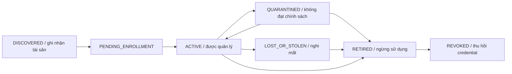
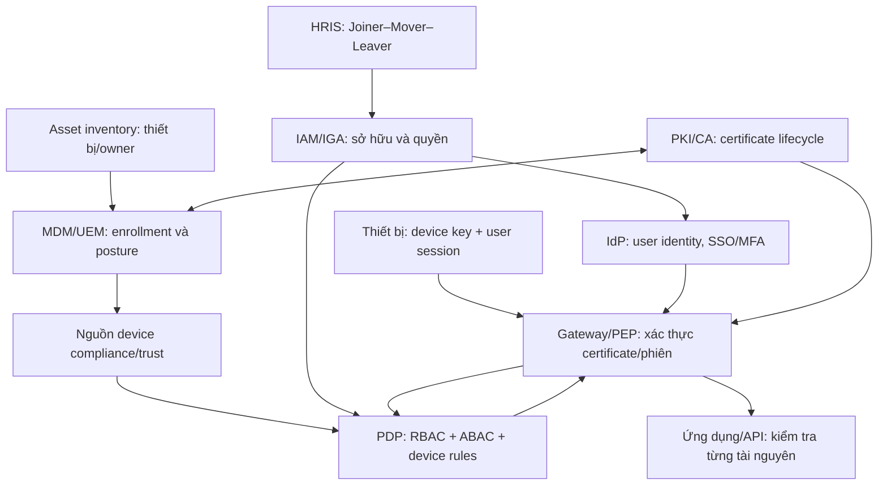

# Định danh thiết bị trong mô hình identity của IAM

## 1. Định danh thiết bị là gì và vì sao IAM cần quản lý?

Trong hệ thống **Identity and Access Management (IAM)**, một nhân viên có thể truy cập cùng tài khoản từ máy tính công ty, điện thoại cá nhân hoặc máy công cộng. Xác thực nhân viên thành công chưa đủ để kết luận **thiết bị đang sử dụng** là thiết bị đáng tin, đang được tổ chức quản lý hoặc được phép truy cập dữ liệu nhạy cảm.

**Định danh thiết bị (device identity)** là tập thông tin và cơ chế dùng để nhận biết một thiết bị cụ thể, liên kết thiết bị với bản ghi quản lý và, khi cần, **xác thực rằng thiết bị đang thực sự giữ một khóa/credential đã đăng ký**. Danh tính này giúp:

- Phân biệt thiết bị được quản lý với thiết bị chưa đăng ký hoặc đã bị thu hồi.
- Áp dụng chính sách truy cập theo **người dùng + thiết bị + tài nguyên + ngữ cảnh**.
- Quản lý thiết bị trong các sự kiện **Joiner–Mover–Leaver**, thay đổi chủ sở hữu, mất thiết bị và thanh lý.
- Cấp, luân chuyển và thu hồi credential/certificate liên kết với thiết bị.
- Điều tra sự cố và giảm **quyền truy cập tồn dư** khi nhân viên nghỉ việc hoặc thiết bị rời hệ thống.

Bài thuộc chương **Mô hình identity** của dịch vụ **SECURITY_IDENTITY_ACCESS_MANAGEMENT_IDENTITY_LIFECYCLE**. Phạm vi tập trung vào định danh, xác thực và vòng đời của thiết bị, đồng thời kết nối với IdP, SSO, SCIM, RBAC/ABAC, quản trị tài khoản dịch vụ, kiểm toán và mô hình **Joiner–Mover–Leaver** của con người.

**Ví dụ xuyên suốt:** Linh là nhân viên phòng Tài chính. Linh đăng nhập SSO bằng tài khoản công ty trên laptop đã đăng ký và có chứng chỉ thiết bị hợp lệ. Hệ thống có thể cho phép Linh xem báo cáo nội bộ. Nếu Linh chuyển sang laptop cá nhân chưa đăng ký, tài khoản của Linh vẫn đúng, nhưng chính sách có thể từ chối tải báo cáo nhạy cảm xuống máy đó.

## 2. Phân biệt danh tính người dùng, thiết bị và ứng dụng

| Chủ thể | Danh tính đại diện cho | Bằng chứng xác thực ví dụ | Vòng đời thường đi theo |
| --- | --- | --- | --- |
| **Human identity** | Nhân viên, đối tác, khách hàng. | Passkey, MFA, phiên SSO/OIDC. | Gia nhập, chuyển vai trò, nghỉ việc, chấm dứt hợp đồng. |
| **Device identity** | Laptop, điện thoại, máy chủ vật lý, thiết bị IoT/OT. | Khóa riêng gắn phần cứng, chứng chỉ máy, credential được cấp khi enrollment. | Mua/khởi tạo, đăng ký, giao thiết bị, thay đổi quản lý, mất, thu hồi, thanh lý. |
| **Workload/service identity** | Ứng dụng, container, tác vụ nền, service account. | Workload identity token, chứng chỉ dịch vụ, khóa được quản lý. | Triển khai, thay phiên bản, xoay credential, ngừng dịch vụ. |

Một máy chủ có thể có **danh tính thiết bị** cho phần cứng/hệ điều hành và nhiều **danh tính workload** cho các dịch vụ chạy bên trong. Không nên tự động coi các workload có cùng quyền chỉ vì chạy trên một máy. Tương tự, một laptop có thể được nhiều người sử dụng theo ca; danh tính thiết bị **không thay thế** danh tính từng người.

Phân biệt thêm:

1. **Identifier (mã nhận diện):** chuỗi dùng để tra cứu, ví dụ asset ID hoặc device ID trong MDM. Nó có thể được chép hoặc giả mạo nếu không được bảo vệ.
2. **Credential (bằng chứng xác thực):** khóa riêng/chứng chỉ hoặc bí mật khác mà thiết bị dùng để chứng minh quyền kiểm soát. Giá trị bảo đảm phụ thuộc cách cấp và bảo vệ khóa.
3. **Enrollment/registration (đăng ký):** quy trình thiết lập mối liên kết giữa thiết bị, credential, tổ chức và hồ sơ quản lý.
4. **Device posture (tình trạng bảo mật):** trạng thái mã hóa ổ đĩa, phiên bản hệ điều hành, bản vá, EDR, khóa màn hình, root/jailbreak, v.v. Posture có thể thay đổi theo thời gian.
5. **Authorization (cấp phép truy cập):** quyết định một yêu cầu cụ thể có được thực hiện hay không sau khi xét người dùng, thiết bị, quyền và tài nguyên.

Vì vậy, **“biết tên thiết bị”**, **“xác thực thiết bị”**, **“thiết bị đạt chuẩn bảo mật”** và **“thiết bị được phép truy cập”** là bốn kết luận khác nhau.

## 3. Những loại định danh thiết bị và mức độ tin cậy

| Dữ liệu/tín hiệu | Công dụng phù hợp | Giới hạn cần nhớ |
| --- | --- | --- |
| **Asset tag / mã tài sản** | Kiểm kê, gắn đơn vị quản lý, bàn giao thiết bị. | Có thể bị dán lại; không phải credential xác thực. |
| **Serial number, IMEI, UUID firmware** | Đối chiếu thiết bị với hồ sơ mua sắm/MDM khi nguồn đáng tin. | Có thể bị lộ, đọc lại hoặc giả mạo trong một số môi trường; tính duy nhất phụ thuộc nhà sản xuất. |
| **MAC address, IP address, hostname** | Vận hành mạng và hỗ trợ chẩn đoán. | Dễ thay đổi hoặc giả mạo; MAC còn được ngẫu nhiên hóa trên nhiều nền tảng. |
| **Device ID do MDM/UEM tạo** | Khóa tham chiếu nội bộ để tra cứu hồ sơ enrollment và compliance. | ID đơn thuần không chứng minh bên gửi request chính là thiết bị đã đăng ký. |
| **Chứng chỉ X.509 + khóa riêng của thiết bị** | Xác thực mật mã qua mTLS/EAP-TLS khi hệ thống xác minh chuỗi tin cậy và chứng minh sở hữu khóa. | Chất lượng phụ thuộc cấp chứng chỉ, nơi lưu khóa, quản trị CA và thu hồi. |
| **Khóa gắn TPM/Secure Enclave/secure element** | Giảm rủi ro sao chép khóa; có thể hỗ trợ attestation khi nền tảng và chính sách cho phép. | Không tự chứng minh máy không nhiễm mã độc hay người dùng được cấp quyền. |
| **Device fingerprint** | Tín hiệu rủi ro phụ trợ (hệ điều hành, trình duyệt, đặc điểm mạng...). | Không ổn định, dễ ảnh hưởng quyền riêng tư; không dùng làm bằng chứng xác thực duy nhất. |

**Nguyên tắc:** đừng dùng serial, IMEI, MAC hoặc một trường `deviceId` do client tự gửi như “mật khẩu” cho thiết bị. Muốn xác thực thiết bị, cần quy trình **enrollment đáng tin** và cơ chế **proof of possession** như ký thử thách bằng khóa riêng hoặc tham gia mTLS bằng khóa đã đăng ký.

### Danh tính thiết bị thường gồm những trường nào?

Một bản ghi quản lý có thể có cấu trúc khái niệm:

```yaml
deviceId: dev-7c13
assetId: LAPTOP-FIN-024
organizationId: org-example
assignedUserId: user-4821
ownershipType: CORPORATE
platform: WINDOWS
management:
  provider: UEM
  enrollmentState: ENROLLED
  compliance: COMPLIANT
  postureObservedAt: "2026-11-20T08:30:00Z"
credential:
  type: X509_CERTIFICATE
  certificateThumbprint: "example-sha256-thumbprint"
  expiresAt: "2027-02-01T00:00:00Z"
lifecycleState: ACTIVE
```

Đây là **YAML minh họa để giải thích mô hình dữ liệu**, không phải schema bắt buộc của sản phẩm MDM hoặc IAM. Credential chỉ nên chứa **tham chiếu hoặc metadata**, tuyệt đối không nhúng khóa riêng, mật khẩu hay refresh token vào hồ sơ xuất bản/nhật ký.

Một thực thể thiết bị có thể tồn tại ngay cả khi chưa cấp certificate. Khi thay thiết bị hoặc cấp lại chứng chỉ, bản ghi quản lý cần lưu liên kết **thiết bị ↔ credential hiện hành và credential đã thu hồi** để điều tra và tránh nhầm thiết bị mới với thiết bị cũ.

## 4. Vòng đời danh tính thiết bị



Tên state là ví dụ cho một quy trình nội bộ; sản phẩm MDM có thể có các state và trình tự khác. Điều quan trọng là **hành động có thể xảy ra theo nhiều thứ tự**: khi báo mất thiết bị phải có thể thu hồi credential và chặn truy cập **ngay lúc nhận báo mất**, không đợi đến cuối quy trình thanh lý.

| Giai đoạn | Hoạt động cốt lõi | Điều kiện cần xác minh |
| --- | --- | --- |
| **Discover / tiếp nhận** | Kiểm kê, xác định nguồn mua/nguồn sở hữu, chủ quản lý. | Tài sản có nguồn đáng tin, chưa trùng với thiết bị khác. |
| **Enroll / đăng ký** | Xác minh quyền đăng ký, cài cấu hình quản lý, tạo khóa, lấy chứng chỉ, liên kết IdP/MDM. | Thiết bị và enrollment được chấp nhận; khóa riêng nằm tại vị trí bảo vệ phù hợp. |
| **Operate / vận hành** | Kiểm tra posture, cập nhật bản vá, luân chuyển credential, đánh giá quyền theo từng yêu cầu. | Enrollment còn hiệu lực, tín hiệu compliance đủ mới, quyền truy cập phù hợp. |
| **Transfer / bàn giao** | Thu hồi quyền người cũ, làm sạch dữ liệu theo chính sách, đổi owner, đăng ký lại nếu cần. | Không còn phiên, ứng dụng hay dữ liệu tồn dư của người cũ. |
| **Quarantine / cô lập** | Hạn chế truy cập khi không đạt chuẩn hoặc phát hiện nghi vấn. | Chỉ cho phép kết nối tới hạ tầng khắc phục theo chính sách. |
| **Lost / stolen / compromise** | Chặn ngay các đường truy cập, thu hồi certificate/token, kích hoạt xử lý sự cố. | Ghi nhận mốc chặn và kiểm tra ứng dụng đích đã thực thi. |
| **Retire / thanh lý** | Thu hồi danh tính, credential, quyền mạng, quyền ứng dụng; xóa dữ liệu an toàn theo loại thiết bị. | Hồ sơ được đóng, credential không còn được chấp nhận, bằng chứng xử lý lưu trữ. |

Hệ thống nên giữ lại **lịch sử trạng thái** để kiểm toán; không xóa hồ sơ ngay khi thiết bị nghỉ hoạt động nếu cần điều tra sự cố hoặc chứng minh đã xử lý thu hồi.

## 5. Đăng ký thiết bị (enrollment) đáng tin

Một quy trình enrollment điển hình cho laptop công ty:

1. **Xác định nguồn thiết bị:** kiểm kê mua sắm, giao thiết bị và đối chiếu với chương trình triển khai của tổ chức. Với mô hình tự động nhập thiết bị từ nhà sản xuất, phải xác minh nguồn và quyền quản trị thiết bị.
2. **Xác thực quyền đăng ký:** người quản trị, người nhận thiết bị hoặc quy trình tự động phải chứng minh có quyền đưa thiết bị vào tenant của tổ chức. Token enrollment nên giới hạn thời gian và mục đích.
3. **Tạo khóa cho thiết bị:** ưu tiên sinh khóa riêng ngay trong TPM/secure element khi hỗ trợ và cấu hình theo chính sách, tránh tạo khóa rồi gửi qua kênh không an toàn.
4. **Attestation (nếu khả dụng):** xác minh bằng chứng của phần cứng/phần mềm về nguồn gốc khóa, tính năng bảo vệ khóa hoặc trạng thái khởi động theo khả năng nền tảng. Phải kiểm tra độ tin cậy của bên phát hành, challenge và thời điểm bằng chứng.
5. **Cấp credential:** PKI/CA nội bộ hoặc hệ thống quản lý credential cấp certificate với phạm vi, thời hạn, chính sách sử dụng phù hợp.
6. **Liên kết và quản lý:** UEM/MDM ghi thiết bị, chủ sở hữu, nhóm, cấu hình bắt buộc; IdP/conditional access nhận tín hiệu trạng thái khi được tích hợp.
7. **Kiểm chứng hoàn tất:** thử xác thực bằng khóa đã cấp, xác minh compliance và kiểm tra quy tắc truy cập trước khi cho dùng tài nguyên nhạy cảm.

**Attestation không phải một kết luận “an toàn tuyệt đối”.** Một khóa có thể thật sự được tạo trong TPM mà thiết bị vẫn đang chạy phần mềm độc hại; một báo cáo posture hợp lệ lúc 09:00 không khẳng định thiết bị còn đúng trạng thái lúc 16:00. Cần đánh giá lại theo độ nhạy tài nguyên và độ mới của tín hiệu.

### Corporate-owned và BYOD

| Loại thiết bị | Cách quản lý thường gặp | Giới hạn về quyền riêng tư và xử lý |
| --- | --- | --- |
| **Corporate-owned** | Quản lý toàn thiết bị, cấu hình mã hóa, EDR, bảo vệ khóa, thu hồi và xóa dữ liệu theo chính sách. | Phải minh bạch việc thu thập dữ liệu và phân quyền quản trị. |
| **BYOD (Bring Your Own Device)** | Quản lý hồ sơ công việc/ứng dụng, container dữ liệu, access policy, device posture tùy nền tảng. | Chỉ thu thập tín hiệu cần thiết; ưu tiên xóa dữ liệu công việc có chọn lọc, tránh tự ý xóa dữ liệu cá nhân. |
| **Shared/kiosk device** | Định danh máy ổn định, đăng nhập cá nhân theo phiên, tự xóa session người dùng sau ca. | Không dùng danh tính thiết bị chung để quy trách nhiệm cho một cá nhân. |
| **IoT/OT device** | Chứng chỉ riêng từng thiết bị, inventory, network segmentation, firmware/update theo khả năng thiết bị. | Có thể không hỗ trợ MDM; cần chọn bù trừ rủi ro và quy trình thay/thu hồi thực tế. |

Không nên áp một chính sách enrollment cho mọi loại thiết bị. Quyền kiểm soát thiết bị phải tương ứng quyền sở hữu, khả năng kỹ thuật, mức rủi ro và cam kết bảo vệ dữ liệu.

## 6. Xác thực thiết bị diễn ra như thế nào?

### Chứng chỉ thiết bị và mTLS

Trong **mutual TLS (mTLS)**, máy chủ và client đều xác thực bằng chứng chỉ/khóa phù hợp. Khi thiết bị đóng vai trò TLS client, nó chứng minh khả năng sử dụng khóa riêng tương ứng chứng chỉ được chấp nhận. Server hoặc gateway phải kiểm tra:

- Chuỗi tin cậy và CA được phép phát hành certificate cho thiết bị.
- Hiệu lực chứng chỉ, mục đích sử dụng/Extended Key Usage khi áp dụng, tên hoặc ràng buộc danh tính phù hợp.
- Tình trạng thu hồi theo cách hệ thống hỗ trợ (CRL/OCSP hoặc cơ chế danh sách chặn/quản trị certificate có độ mới thích hợp).
- Liên kết certificate với **bản ghi thiết bị**, tenant và trạng thái enrollment/khóa hiện tại.

**mTLS chứng minh quyền kiểm soát credential của client**, không tự xác nhận người đang sử dụng máy là ai. Nếu certificate bị sao chép khỏi nơi lưu trữ yếu, một hệ thống khác có thể mạo nhận cho đến khi cơ chế phát hiện/thu hồi có hiệu lực.

### Wi-Fi/VPN và EAP-TLS

Với mạng doanh nghiệp, **802.1X/EAP-TLS** thường dùng chứng chỉ máy hoặc người dùng để xác thực tới hạ tầng AAA/RADIUS. Mạng có thể gán VLAN/ACL theo chính sách. Việc được kết nối Wi-Fi không mặc nhiên cấp quyền đọc hệ thống tài chính: API vẫn cần kiểm tra authorization của chính nó.

### SSO/IdP và trạng thái thiết bị

Trong một luồng SSO, IdP xác thực **người dùng**. Một số nền tảng còn nhận tín hiệu thiết bị được đăng ký, compliance hoặc thiết bị có khóa ràng buộc với môi trường đăng nhập. Hệ thống **Conditional Access** có thể yêu cầu MFA, thiết bị được quản lý hoặc chặn theo mức rủi ro.

Không phải mọi ứng dụng OIDC/SAML đều nhận một “device identity” có thể xác minh. Nếu quyết định truy cập dựa vào thiết bị, phải biết tín hiệu đến từ đâu, được bảo vệ thế nào, có độ mới bao lâu và ràng buộc với phiên nào. **ID token của người dùng không tự chứng minh trạng thái thiết bị** nếu giao thức và IdP không cung cấp tín hiệu có bảo đảm tương ứng.

### SCIM và định danh thiết bị

**SCIM** chủ yếu dùng để quản lý đối tượng như `Users` và `Groups` ở hệ thống đích, giúp vòng đời **danh tính con người** và entitlement nhất quán. SCIM không phải giao thức chứng minh thiết bị và không mặc nhiên đồng bộ hồ sơ MDM hoặc thu hồi certificate máy. Muốn ứng dụng áp chính sách thiết bị, cần kết nối riêng với IdP, UEM/MDM, gateway hoặc nguồn posture đáng tin phù hợp.

## 7. Kiến trúc kết hợp danh tính người dùng và danh tính thiết bị



Trong sơ đồ, **PEP (Policy Enforcement Point)** thực thi quyết định allow/deny; **PDP (Policy Decision Point)** tính toán quyết định dựa trên chính sách. API vẫn có trách nhiệm kiểm tra quyền ở **đối tượng cụ thể** (ví dụ đúng báo cáo, phòng ban, tenant), kể cả khi gateway đã kiểm tra thiết bị.

Trong triển khai thực tế, gateway không được tự tin một header như `X-Device-Id` do Internet client gửi. Nếu gateway chuyển tiếp thông tin thiết bị, phải có ranh giới tin cậy rõ: gateway **xác thực** bằng chứng trước, loại bỏ header mạo danh từ phía ngoài, và truyền identity context qua kênh nội bộ được bảo vệ hoặc token có thể xác minh.

## 8. Authorization dựa trên thiết bị theo RBAC và ABAC

Một quyết định truy cập có thể được biểu diễn:

> **allow = authenticatedUser ∧ authorizedAction ∧ trustedDevice ∧ acceptableContext ∧ authorizedResource**

Đây là công thức tư duy; hệ thống thực tế còn cần chính sách ưu tiên deny, ngoại lệ được phê duyệt và xử lý khi thuộc tính thiếu/không còn mới.

| Thuộc tính | Ví dụ | Cần xác minh từ nguồn nào? |
| --- | --- | --- |
| User identity | `user-4821`, employment active. | IdP và nguồn nhân sự/IGA đáng tin. |
| Role/entitlement | `FINANCE_REPORT_READER`. | Quyền hiện hành từ IAM/app policy; không tin role do client nhập. |
| Device identity | `dev-7c13`, certificate bound. | MDM/registry và bằng chứng sở hữu khóa đã xác thực. |
| Device posture | Mã hóa ổ đĩa bật, OS được hỗ trợ, compliance = true. | MDM/EDR hoặc nguồn đánh giá posture có độ mới đã quy định. |
| Resource | Báo cáo Finance, dữ liệu `INTERNAL` hoặc `RESTRICTED`. | Kho dữ liệu/quản lý tài nguyên, không tin nhãn client gửi. |
| Environment | Độ nhạy thao tác, mức rủi ro, địa điểm, thời điểm. | Nguồn tín hiệu tin cậy và chính sách rủi ro. |

### Ví dụ chính sách minh họa

```yaml
policyId: finance-report-download
effect: allow
subject:
  employmentStatus: ACTIVE
  requiredRole: FINANCE_REPORT_READER
device:
  registered: true
  lifecycleState: ACTIVE
  ownershipType: CORPORATE
  compliant: true
  maxPostureAgeMinutes: 30
  credentialNotRevoked: true
resource:
  tenantMustMatchSubject: true
  classification: RESTRICTED
action: DOWNLOAD
fallback: DENY
```

Đây là **pseudoconfiguration minh họa**, không phải cấu hình áp dụng trực tiếp cho một IdP/PDP cụ thể. Ví dụ quy định **tải xuống báo cáo RESTRICTED** chỉ từ laptop công ty còn active và compliant trong vòng 30 phút. Tổ chức có thể cho phép **xem** trên thiết bị khác qua cơ chế bảo vệ bổ sung mà vẫn cấm **tải**; chính sách phải xét đúng hành động, không gom mọi thao tác vào một cờ “được truy cập”.

### Ví dụ kiểm tra ở backend

```java
// Pseudocode Java; identity context chỉ do gateway/IdP đáng tin cung cấp.
Report downloadReport(RequestContext request, String reportId) {
    UserIdentity user = trustedIdentityProvider.requireUser(request);
    DeviceIdentity device = trustedDeviceGateway.requireVerifiedDevice(request);
    Report report = reportRepository.find(reportId);

    if (!user.isActive()) {
        throw new AccessDeniedException("inactive_user");
    }

    // Kiểm tra lại tình trạng hiện hành và độ mới; deviceId chỉ là khóa tra cứu.
    DeviceRecord current = deviceRegistry.lookup(device.id());
    if (!current.isActive()
            || !current.credentialMatches(device.verifiedCredential())
            || !current.hasFreshCompliantPosture()) {
        throw new AccessDeniedException("device_not_trusted");
    }

    if (!policy.canDownloadReport(user, current, report)) {
        throw new AccessDeniedException("forbidden");
    }
    return report;
}
```

Hàm kiểm tra `trustedDeviceGateway` phải thực sự gắn với kết quả xác thực mật mã hoặc assertion đáng tin; **đọc cookie hoặc header `deviceId` rồi tự gọi là “verified” sẽ không đủ**. Trong hệ thống phân tán cần cân bằng giữa đọc trạng thái mới nhất, cache có TTL và mức rủi ro; đối với thao tác rất nhạy cảm có thể cần đánh giá lại ngay.

## 9. Device identity trong Joiner–Mover–Leaver

Tài khoản người dùng và thiết bị có vòng đời khác nhau nhưng liên quan qua quan hệ **assigned-to**, **managed-by**, **approved-for**, **credential-issued-to**.

| Sự kiện | Việc cần làm với người dùng | Việc cần làm với thiết bị | Kiểm tra quyền tồn dư |
| --- | --- | --- | --- |
| **Joiner** | Xác minh danh tính, tạo tài khoản IdP, cấp role ban đầu. | Giao máy, enroll vào UEM, cấp certificate/khóa, gắn owner, cấu hình bảo mật. | Trước ngày hiệu lực, chưa cho truy cập dữ liệu không được phép; sau ngày hiệu lực, đúng thiết bị và quyền cần thiết. |
| **Mover** | Thu hồi role cũ, cấp role mới và kiểm tra separation of duties. | Đổi assigned owner/nhóm chính sách khi cần; đánh giá lại posture hoặc thiết bị chuyên dụng; cấp lại credential nếu chuyển phạm vi tin cậy. | Không để thiết bị cũ tiếp tục giữ ACL, VPN hoặc entitlement thuộc đơn vị cũ. |
| **Leaver** | Khóa IdP, hủy phiên/refresh token, deprovision ứng dụng qua SCIM/API. | Thu hồi thiết bị, chặn chứng chỉ/đăng nhập từ máy, ngắt phiên, chuyển giao hoặc thanh lý theo chính sách. | Kiểm tra tài khoản cục bộ, certificate, VPN/Wi-Fi, API token, file offline và quyền chia sẻ. |

### Tình huống 1: Mover chuyển phòng ban

Mai chuyển từ bộ phận Kinh doanh sang Kiểm toán. Tài khoản SSO vẫn là tài khoản cũ, nhưng:

1. IAM thu hồi quyền truy cập dữ liệu Kinh doanh mà Mai không còn cần.
2. MDM/UEM cập nhật quan hệ người dùng–thiết bị và nhóm cấu hình khi phòng ban mới có yêu cầu bảo mật khác.
3. Chính sách truy cập hệ thống Kiểm toán yêu cầu thiết bị có mã hóa ổ đĩa, EDR, credential được quản lý và compliance đủ mới.
4. Cấp quyền Kiểm toán đúng vai trò; nếu máy không đạt điều kiện thì yêu cầu khắc phục hoặc đổi máy trước khi cho truy cập.
5. Rà soát chứng chỉ, VPN profile, thư mục đồng bộ và phần mềm của nhóm cũ để tránh dữ liệu/quyền còn tồn tại.

**Không nhất thiết phải thay hoặc xóa toàn bộ danh tính thiết bị** khi nhân viên chuyển vai trò: quyết định phụ thuộc kiểu quản lý, yêu cầu dữ liệu và việc credential có gắn với người dùng hay thiết bị. Điều bắt buộc là quyền cũ phải được đánh giá và thu hồi đúng.

### Tình huống 2: Leaver có laptop công ty

Trước ngày nghỉ của An, hệ thống cần có danh sách laptop, điện thoại được quản lý và mọi credential liên quan. Tại thời điểm nghỉ có hiệu lực, tổ chức đồng bộ trạng thái IdP, ứng dụng và device access; yêu cầu trả thiết bị, thu hồi VPN/Wi-Fi certificate hoặc chính sách chặn tương ứng, kết thúc phiên có thể thu hồi và kiểm tra dữ liệu đã được bàn giao.

**Đừng chỉ disable IdP rồi coi là hoàn tất.** Một VPN dùng certificate máy độc lập có thể vẫn cho kết nối; một ứng dụng có session cục bộ vẫn hoạt động; thiết bị có dữ liệu lưu offline. Vì vậy phải kiểm tra cả **device trust**, **account trust**, **session/token** và **quyền dữ liệu** trên từng đường truy cập.

### Tình huống 3: Thiết bị bị mất hoặc nghi compromise

Khi có báo cáo mất thiết bị, workflow xử lý sự cố có thể:

1. Chuyển trạng thái thiết bị sang `LOST_OR_STOLEN` hoặc `QUARANTINED` ngay.
2. Thu hồi certificate hoặc áp denylist tại các điểm xác thực; xử lý VPN/Wi-Fi/mTLS và credential không gắn phần cứng.
3. Thu hồi phiên/token theo khả năng của IdP, gateway và ứng dụng; cân nhắc khóa tài khoản người dùng khi có dấu hiệu lộ credential.
4. Kích hoạt lệnh khóa/xóa dữ liệu công việc từ xa nếu nền tảng hỗ trợ, đồng thời hiểu rằng máy offline có thể chưa nhận lệnh.
5. Kiểm tra log truy cập bất thường, ghi nhận sự kiện và chỉ khôi phục sau khi điều tra/kiểm tra lại.

Không đưa thiết bị về trạng thái `ACTIVE` chỉ dựa trên lời xác nhận “đã tìm lại máy”; cần xác minh tính toàn vẹn, trạng thái quản lý và credential mới khi phù hợp.

## 10. Certificate, khóa riêng, token và vấn đề thu hồi

Chứng chỉ có ngày hết hạn nhưng **hết hạn không thay thế thu hồi sớm** khi máy mất, đổi chủ hoặc bị lộ khóa. Một hệ thống được thiết kế tốt cần quản lý đồng thời:

- **Certificate lifecycle:** cấp, gia hạn, phân phối, rotate key, thu hồi, hết hạn và kiểm thử truy cập sau thu hồi.
- **Khóa riêng:** lưu trong vùng bảo vệ khi khả dụng; không xuất khóa vào log/backup không mã hóa; có kế hoạch mất TPM/thay mainboard.
- **Phiên và token:** giảm thời gian tồn tại không cần thiết; kiểm tra claim/issuer/audience/expiry; dùng cơ chế thu hồi hoặc đánh giá quyền lại theo rủi ro.
- **Tín hiệu posture:** có TTL rõ; báo cáo “compliant” cũ không được dùng mãi.
- **Quyền offline:** file đã tải xuống hoặc bản sao dữ liệu không tự biến mất khi credential bị thu hồi; cần chính sách mã hóa, quản lý dữ liệu và xử lý sự cố.

Khi dùng CRL hoặc OCSP, cơ chế và cách xử lý lúc dịch vụ kiểm tra thu hồi không sẵn sàng phải được quyết định theo rủi ro. Không nên mặc định một gateway sẽ luôn kiểm tra thu hồi mới nhất nếu chưa bật/cấu hình và kiểm thử đúng.

### Vì sao “xóa khỏi MDM” không đồng nghĩa “đã thu hồi mọi quyền”?

Xóa một bản ghi quản lý có thể làm mất nguồn tra cứu hoặc cơ chế gửi lệnh khắc phục, trong khi certificate đã cấp, tài khoản cục bộ, phiên ứng dụng hay khóa API vẫn có hiệu lực. Quy trình retire an toàn nên **chặn quyền trước**, thực hiện thu hồi/đối soát tại các hệ thống đích, rồi mới đóng hoặc lưu trữ hồ sơ quản lý theo chính sách.

## 11. Các rủi ro bảo mật thường gặp

| Sai lầm | Tấn công/hậu quả | Biện pháp đề xuất |
| --- | --- | --- |
| Tin chuỗi `deviceId` từ request | Client tự nhận là máy được quản lý. | Xác thực bằng khóa/credential và kênh trusted assertion, không tin dữ liệu tự khai. |
| Dùng MAC/serial làm bằng chứng duy nhất | Giả mạo định danh, bỏ qua chính sách thiết bị. | Dùng enrollment đáng tin và proof of possession. |
| Certificate và khóa riêng có thể copy dễ dàng | Thiết bị khác dùng credential đánh cắp. | Khóa không xuất được khi hỗ trợ, attestation có kiểm tra, rotate/revoke. |
| Không ràng buộc thiết bị với tenant/owner | Credential từ đơn vị khác được dùng sai ngữ cảnh. | Kiểm tra liên kết registry, issuer, tenant, owner và policy. |
| Chỉ xem posture lúc đăng ký | Máy mất bản vá/EDR sau đó vẫn được truy cập. | Đánh giá trạng thái liên tục hoặc theo TTL/rủi ro; quarantine khi cần. |
| Xóa hồ sơ MDM trước khi thu hồi credential | Mất khả năng quản lý nhưng đường truy cập cũ vẫn hoạt động. | Thu hồi, đối soát từng hệ thống đích rồi mới retire. |
| Dùng chung certificate cho hàng trăm máy | Một máy lộ khóa ảnh hưởng cả đội thiết bị. | Danh tính/credential riêng từng thiết bị; quản lý phát hành tập trung. |
| Dựa hoàn toàn vào network trust | Máy đã vào VPN có thể truy cập dữ liệu ngoài quyền. | Authorization mức API/tài nguyên, least privilege và phân đoạn mạng. |
| Dùng fingerprint để theo dõi vượt mục đích | Xâm phạm riêng tư; kết quả không đáng tin. | Thu thập tối thiểu, xác định mục đích/retention, dùng phương thức mật mã. |

**Thiết bị được quản lý không đồng nghĩa thiết bị sạch mã độc**; compliance là một yếu tố trong quyết định rủi ro, không phải giấy phép bỏ qua kiểm tra quyền người dùng và dữ liệu.

## 12. Audit, đối soát và chỉ số vòng đời

Các log hữu ích để chứng minh vòng đời danh tính thiết bị thực sự được thực thi:

| Nhóm sự kiện | Các trường cần có (theo chính sách dữ liệu) | Câu hỏi điều tra |
| --- | --- | --- |
| Enrollment | Device ID, asset ID, owner, tenant, phương thức/enrollment authority, thời điểm, kết quả. | Ai đăng ký thiết bị, theo cơ chế nào? |
| Credential issuance | Tham chiếu cert, fingerprint, issuer, hạn dùng, device ID, trạng thái. | Credential nào gắn với thiết bị nào? |
| Posture/compliance | Device ID, nguồn tín hiệu, timestamp, kết quả, lý do không đạt. | Khi truy cập, thiết bị đạt chính sách nào? |
| Access decision | User ID, device ID đã xác thực, action, resource scope, policy/version, allow/deny, correlation ID. | Quyền được chấp nhận hoặc từ chối vì sao? |
| Transfer/retire/lost | Trạng thái trước/sau, người xử lý, phê duyệt, mốc thu hồi, lỗi và retry. | Thiết bị đã hết quyền trên mọi hệ thống chưa? |

Chỉ lưu các trường đủ cho vận hành/kiểm toán; hạn chế PII và **không ghi khóa riêng, access token, refresh token hay secret vào log**. Tránh công khai serial/IMEI hoặc thông tin vị trí thiết bị nếu không cần thiết. Sử dụng retention, phân quyền log và khóa tương quan phù hợp để nối sự kiện HR, IdP, MDM và gateway.

Các chỉ số nên theo dõi:

- **Enrollment coverage:** phần trăm thiết bị được phép truy cập đã có bản ghi/credential hợp lệ.
- **Compliance freshness:** phần trăm thiết bị có tín hiệu posture trong thời hạn chính sách.
- **Orphaned devices:** thiết bị không còn owner hợp lệ nhưng vẫn còn active credential hoặc quyền truy cập.
- **Revocation latency:** thời gian từ sự kiện mất thiết bị/Leaver đến lúc các điểm kiểm soát thực sự từ chối credential/phiên cũ.
- **Expired/expiring credentials:** số certificate hết hạn hoặc sắp hết hạn chưa được rotate.
- **Reconciliation drift:** chênh lệch giữa bản ghi MDM, PKI, IdP, VPN, inventory và ứng dụng.

Một chỉ số “đã gửi lệnh revoke” không đủ; cần tách **thời điểm yêu cầu**, **hệ thống đích xác nhận** và **thử nghiệm/quan sát từ chối truy cập**. Nếu một dịch vụ đích chưa phản hồi, ghi nhận lỗi và người chịu trách nhiệm, không tự đánh dấu đã hoàn tất.

## 13. Checklist triển khai cho ứng dụng hoặc tổ chức

1. **Xác định loại thiết bị và nguồn sự thật:** corporate/BYOD/shared/IoT, tài sản, chủ sở hữu, tenant; mã định danh ổn định và cách chống trùng.
2. **Lựa chọn mô hình tin cậy:** chỉ cần posture assertion của IdP/MDM hay cần mTLS/device certificate riêng tại gateway; tài nguyên nào bắt buộc thiết bị quản lý.
3. **Thiết kế enrollment an toàn:** xác minh quyền đăng ký, bootstrap có thời hạn, tạo khóa an toàn, attestation nếu được hỗ trợ và đáng tin.
4. **Tách authentication và authorization:** xác thực người dùng, xác thực thiết bị, kiểm tra compliance, rồi kiểm tra action/resource/tenant trên backend.
5. **Định nghĩa độ mới và xử lý khi tín hiệu thiếu:** posture TTL, cache quyền, sự kiện compromise, chính sách deny/quarantine hoặc truy cập có giới hạn.
6. **Gắn Joiner–Mover–Leaver:** bàn giao, đổi owner, thu hồi profile, xử lý thiết bị còn dữ liệu, chặn credential độc lập với IdP.
7. **Chuẩn hóa vận hành credential:** cấp/gia hạn/rotate/revoke, xử lý khóa thất lạc, certificate hết hạn và failover của cơ chế kiểm tra thu hồi.
8. **Đối soát và kiểm thử:** tài khoản đã rời tổ chức, thiết bị bị mất, certificate bị thu hồi, posture quá hạn, sai tenant và quyền không đủ phải bị từ chối đúng nơi.
9. **Bảo vệ quyền riêng tư:** chỉ thu thập tín hiệu cần cho quản trị, tách dữ liệu công việc khỏi dữ liệu BYOD cá nhân theo chính sách.

### Bộ tình huống kiểm thử tối thiểu

| Tình huống | Kết quả kỳ vọng |
| --- | --- |
| User hợp lệ, thiết bị active + credential được xác thực, đúng quyền tài nguyên | Cho phép theo chính sách hành động/tài nguyên. |
| User hợp lệ, laptop chưa đăng ký nhưng tự gửi `deviceId` của máy công ty | Không coi device ID tự khai là chứng cứ; từ chối thao tác yêu cầu trusted device. |
| User hợp lệ, credential thiết bị đã revoke | Từ chối sau mốc hiệu lực thu hồi cam kết; ghi log và kiểm tra các điểm thực thi. |
| Thiết bị đạt compliance tuần trước nhưng posture đã quá TTL | Yêu cầu đánh giá lại hoặc từ chối/hạn chế theo chính sách. |
| Thiết bị trusted nhưng user thiếu role hoặc truy cập tài nguyên khác tenant | Từ chối ở lớp authorization của ứng dụng. |
| Nhân viên nghỉ việc nhưng certificate VPN độc lập còn hoạt động | Phát hiện chênh lệch, thu hồi certificate/quyền và đối soát đường VPN. |
| Thiết bị shared có người dùng mới sau ca trước | Buộc xác thực user mới; không tái sử dụng phiên và dữ liệu của ca trước. |
| Thiết bị BYOD rời quản lý | Thu hồi quyền và dữ liệu công việc theo khả năng/chính sách; bảo vệ dữ liệu cá nhân. |

## 14. Tự kiểm tra kiến thức

**Câu 1.** Một API nhận `deviceId=dev-7c13` từ trình duyệt và thấy ID có trong MDM. Có thể coi thiết bị đã được xác thực chưa?

**Trả lời:** Chưa. ID chỉ dùng tra cứu; cần bằng chứng đáng tin rằng client kiểm soát credential gắn với thiết bị, kèm kiểm tra trạng thái và liên kết enrollment.

**Câu 2.** Người dùng đăng nhập SSO với MFA thành công nhưng dùng điện thoại cá nhân không đạt posture. Ứng dụng có nên cho tải dữ liệu hạn chế không?

**Trả lời:** Quyết định phụ thuộc chính sách của tổ chức; nếu thao tác yêu cầu thiết bị trusted/compliant, phải từ chối hoặc yêu cầu chuyển sang thiết bị đáp ứng. MFA của người dùng không thay thế trust của thiết bị.

**Câu 3.** Chứng chỉ máy do CA tin cậy cấp và chưa hết hạn có đủ để cho phép xem báo cáo tài chính không?

**Trả lời:** Không. Cần xác thực credential, kiểm tra thu hồi và registry, rồi kiểm tra user identity, role, tenant, hành động, tài nguyên và ngữ cảnh.

**Câu 4.** Vì sao sau khi một nhân viên nghỉ việc vẫn phải rà soát certificate VPN và thiết bị?

**Trả lời:** Certificate thiết bị, session VPN và một số quyền cục bộ có thể tồn tại độc lập với IdP/SSO; vô hiệu hóa user không tự thu hồi mọi đường truy cập.

**Câu 5.** Thiết bị được đánh dấu compliant hôm qua có thể tự động được tin cậy vô thời hạn không?

**Trả lời:** Không. Posture thay đổi; phải có độ mới giới hạn và cơ chế tái đánh giá phù hợp với độ nhạy tài nguyên.

---

**Ghi nhớ:** *Device identity* cho IAM một cách nhận biết và xác thực thiết bị, nhưng quyết định truy cập an toàn luôn cần **danh tính người dùng/workload, credential thiết bị, trạng thái hiện hành, quyền với tài nguyên và ngữ cảnh**. Thiết kế vòng đời đầy đủ từ enrollment đến revocation và đối soát là cách hạn chế thiết bị mồ côi, credential còn sống và quyền truy cập tồn dư sau Joiner–Mover–Leaver.
