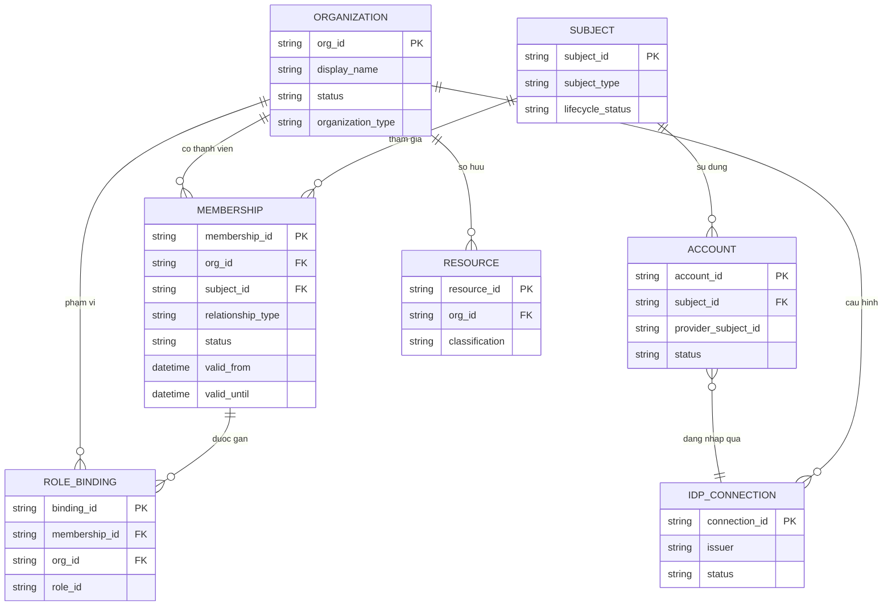
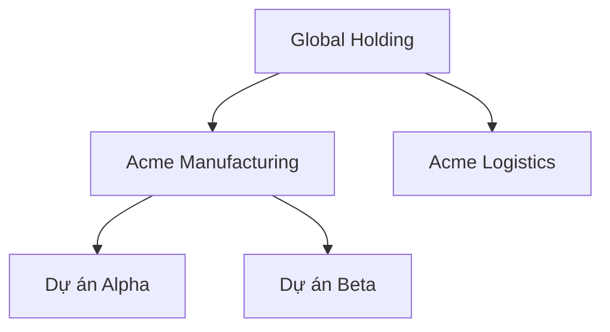
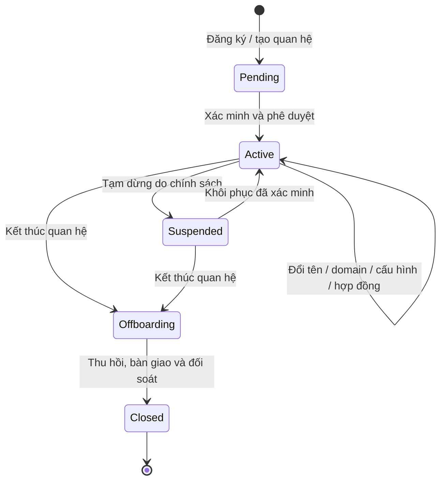

# Organization identity: mô hình danh tính tổ chức trong IAM

## 1. Organization identity là gì?

Trong **Identity and Access Management (IAM)**, *organization identity* là bản ghi định danh một tổ chức hoặc một đơn vị tổ chức có ý nghĩa nghiệp vụ đối với việc xác thực, cấp quyền, quản trị và kiểm toán. Chủ thể được mô tả có thể là công ty, cơ quan, nhà cung cấp, khách hàng doanh nghiệp, đối tác, công ty con hoặc đơn vị nội bộ. Cách hệ thống chọn ranh giới của một “organization” tùy thuộc yêu cầu nghiệp vụ và mô hình ủy quyền của ứng dụng.

Ví dụ, một nền tảng SaaS bán dịch vụ cho doanh nghiệp cần biết:

- Công ty **Acme Ltd.** là khách hàng nào, mang mã tổ chức ổn định nào và được phép dùng sản phẩm gì?
- Những người dùng nào thuộc Acme, ai được Acme bổ nhiệm làm quản trị viên và quyền của họ có giới hạn trong Acme hay không?
- Acme dùng Identity Provider (IdP) nào để đăng nhập SSO, có cho phép đồng bộ tài khoản qua SCIM không?
- Khi một nhân viên chuyển công ty hoặc hợp đồng với Acme chấm dứt, làm sao xóa chính xác những quyền gắn với quan hệ đó?

Organization identity giải quyết phần **“tổ chức nào”** trong các quyết định truy cập, bên cạnh **“người/máy nào”**, **“muốn làm gì”** và **“trên tài nguyên nào”**. Đây là thành phần quan trọng của mô hình vòng đời danh tính `SECURITY_IDENTITY_ACCESS_MANAGEMENT_IDENTITY_LIFECYCLE`, đặc biệt khi kết hợp Joiner–Mover–Leaver, IdP, SSO, SCIM, RBAC/ABAC, quản lý tài khoản dịch vụ và kiểm toán quyền tồn dư.

> **Lưu ý thuật ngữ:** “Organization identity” là một khái niệm mô hình hóa; không có một cấu trúc dữ liệu toàn ngành buộc mọi sản phẩm IAM phải dùng. Một số sản phẩm gọi đối tượng tương ứng là *organization*, *company*, *enterprise*, *customer account*, *directory*, *realm* hoặc *tenant*. Cần đọc đúng ngữ nghĩa của từng sản phẩm, tránh coi các tên gọi là tương đương tuyệt đối.

## 2. Phân biệt organization, person, account, tenant và domain

| Khái niệm | Đại diện cho | Ví dụ | Lỗi thiết kế thường gặp |
|---|---|---|---|
| **Organization identity** | Tổ chức/đơn vị có quan hệ nghiệp vụ và trách nhiệm quản trị | `org_7A31`: Acme Ltd. | Dùng tên hoặc domain làm khóa định danh duy nhất |
| **Person identity** | Một con người có thể tham gia nhiều tổ chức | `person_28F`: Nguyễn An | Coi mỗi tài khoản ở từng tổ chức là một người hoàn toàn khác |
| **Membership / affiliation** | Quan hệ của một người hoặc máy với một tổ chức, có trạng thái và phạm vi | An là nhân viên Acme; An tư vấn cho Beta | Gán quyền trực tiếp vào người mà bỏ qua tổ chức đang đại diện |
| **Account** | Tài khoản đăng nhập hay tài khoản kỹ thuật trong một hệ thống | `an@acme.example` tại IdP | Giả định một identity chỉ có một account |
| **Tenant** | Ranh giới logic của dữ liệu, cấu hình, vận hành hoặc chính sách trong dịch vụ | Không gian SaaS dành cho Acme | Giả định mỗi pháp nhân phải có chính xác một tenant |
| **Domain** | Tên miền DNS/email hoặc thuộc tính được kiểm chứng | `acme.example` | Tin rằng sở hữu một domain đồng nghĩa với tư cách pháp nhân hay quyền truy cập |
| **Role / entitlement** | Vai trò hoặc quyền cụ thể đã được cấp | `ORG_ADMIN`, `invoice.read` | Cấp vai trò toàn nền tảng dù yêu cầu chỉ trong một tổ chức |

Những quan hệ trên không nhất thiết là 1–1:

- Một **organization** có thể có nhiều người dùng, hệ thống và tài khoản dịch vụ.
- Một **person** có thể thuộc nhiều organization, giữ vai trò khác nhau ở mỗi nơi.
- Một **organization** có thể dùng nhiều IdP hoặc nhiều tenant; một tenant cũng có thể phục vụ nhiều đơn vị trực thuộc, tùy thiết kế.
- Nhiều organization có thể chia sẻ domain, và một organization có thể dùng nhiều domain.
- Một **legal entity** (pháp nhân) có thể chứa nhiều phòng ban; không phải phòng ban nào cũng cần một organization identity độc lập.

Do đó, định danh tổ chức không được suy ra đơn thuần từ `email.endsWith("@acme.example")`, tên hiển thị hay nhóm tài khoản. Các thuộc tính đó có thể là **tín hiệu** để kiểm tra hoặc định tuyến, nhưng quyết định quyền cần dựa trên quan hệ được quản lý bởi nguồn tin cậy và chính sách rõ ràng.

## 3. Khi nào nên mô hình hóa organization identity?

Một ứng dụng có thể chỉ cần người dùng và vai trò khi phục vụ một nhóm nội bộ nhỏ. Organization identity trở nên cần thiết khi quyền truy cập phụ thuộc vào tổ chức mà chủ thể đang thay mặt:

1. **B2B SaaS đa khách hàng:** mỗi doanh nghiệp có người dùng, quản trị viên, dữ liệu, gói dịch vụ và chính sách SSO riêng.
2. **IAM của tập đoàn:** nhiều công ty con hoặc đơn vị kinh doanh có nguồn HR, chính sách phê duyệt và yêu cầu tuân thủ khác nhau.
3. **Hệ sinh thái nhà thầu/đối tác:** nhân viên của bên thứ ba truy cập tài nguyên của tổ chức chủ quản theo hợp đồng và người bảo trợ.
4. **Nền tảng cộng tác liên tổ chức:** một người dùng đồng thời tham gia nhiều workspace, dự án hoặc tổ chức khác nhau.
5. **Tài khoản máy và tích hợp doanh nghiệp:** ứng dụng, bot hoặc connector thuộc một tổ chức/chủ sở hữu và cần được thu hồi khi mối quan hệ kết thúc.

Không nên tạo một organization identity riêng cho mọi nhóm RBAC, tên dự án hoặc tag tùy ý. Chỉ tạo ranh giới tổ chức khi có ý nghĩa ổn định về **quản trị thành viên, quyền sở hữu tài nguyên, chính sách, vòng đời hoặc kiểm toán**. Dự án ngắn hạn thường phù hợp với cấu trúc `project` hoặc `group` dưới một organization hơn.

## 4. Mô hình dữ liệu đề xuất

Thiết kế thực tế thường tách **Organization**, **Subject**, **Membership**, **Account**, **Resource** và **RoleBinding** thay vì nhét mọi thứ vào một đối tượng user. Mỗi đối tượng có vòng đời riêng.



Sơ đồ là **một lựa chọn thiết kế minh họa**, không phải schema SCIM hay schema IAM bắt buộc. Đặc biệt, quan hệ `ACCOUNT → IDP_CONNECTION` không phải lúc nào cũng có: tài khoản local không có IdP, một chủ thể có thể dùng nhiều cơ chế đăng nhập và liên kết thực tế cần định danh của nhà cung cấp. Hệ thống phức tạp có thể thêm `organization_hierarchy`, `tenant`, `contract`, `credential`, `approval`, `policy` hoặc bảng quyền cấp trực tiếp.

### 4.1. Những trường quan trọng của organization

| Trường gợi ý | Ý nghĩa | Nguyên tắc quản lý |
|---|---|---|
| `orgId` | ID bất biến dùng cho liên kết và kiểm toán | Không tái sử dụng ID sau giải thể hoặc đóng tài khoản |
| `displayName` | Tên tổ chức hiển thị | Có thể đổi; không dùng làm khóa cấp quyền |
| `organizationType` | Ví dụ `CUSTOMER`, `PARTNER`, `INTERNAL_UNIT` | Phải có định nghĩa nghiệp vụ rõ ràng |
| `status` | `PENDING`, `ACTIVE`, `SUSPENDED`, `OFFBOARDING`, `CLOSED` | Trạng thái phải ảnh hưởng đến quyền hiệu lực theo chính sách |
| `parentOrgId` | Tổ chức cha nếu có cấu trúc phân cấp | Không tự động thừa kế mọi quyền từ cha sang con |
| `owner / sponsor` | Bên chịu trách nhiệm quan hệ và vòng đời | Xác minh quyền của người/chủ thể thực hiện thay đổi |
| `sourceSystem / sourceRef` | Nguồn có thẩm quyền và mã đối soát | Phân biệt mã nội bộ với mã từ ERP/CRM/HRIS |
| `verifiedDomains` | Danh sách domain đã chứng minh quyền kiểm soát | Quản lý ngày xác minh và kiểm tra lại khi cần |
| `lifecycleDates` | Ngày bắt đầu, hết hợp đồng, đóng quan hệ | Không mặc định vô thời hạn cho đối tác/nhà thầu |
| `policyVersion` | Phiên bản chính sách áp dụng | Hỗ trợ truy vết và đối soát sự thay đổi quyền |

Chỉ lưu dữ liệu pháp lý, thuế, đăng ký kinh doanh hoặc thông tin liên hệ nhạy cảm nếu thật sự cần; giới hạn người đọc, mục đích sử dụng và thời gian lưu giữ.

### 4.2. Tách thành viên khỏi người dùng

Ví dụ một người tham gia hai tổ chức:

```json
{
  "subjectId": "person_28F",
  "memberships": [
    {
      "membershipId": "mem_001",
      "orgId": "org_acme",
      "relationshipType": "EMPLOYEE",
      "status": "ACTIVE",
      "roles": ["REPORT_VIEWER"]
    },
    {
      "membershipId": "mem_002",
      "orgId": "org_beta",
      "relationshipType": "CONTRACTOR",
      "status": "ACTIVE",
      "roles": ["PROJECT_CONTRIBUTOR"],
      "validUntil": "2027-03-31T23:59:59+07:00"
    }
  ]
}
```

Đây là JSON minh họa mô hình nghiệp vụ, **không phải payload chuẩn SCIM**. Khi hợp đồng Beta hết hạn, IAM thu hồi `mem_002` và những quyền/credential gắn với quan hệ đó, trong khi `mem_001` có thể tiếp tục hoạt động. Gắn tất cả quyền vào `subjectId` mà không lưu `membershipId` sẽ khó phân biệt quyền nào thuộc tổ chức nào.

### 4.3. Định danh bền vững và liên kết bên ngoài

Tổ chức nội bộ nên có `orgId` ổn định; mã ngoài được lưu theo cặp **namespace + external ID**. Ví dụ: `(CRM, 7931)` và `(ERP, 7931)` chưa chắc là cùng tổ chức. Một tổ chức đổi tên, đổi domain hoặc đổi hệ thống CRM vẫn giữ `orgId` nội bộ, còn các ánh xạ nguồn được cập nhật và kiểm toán.

IdP và ứng dụng đích cũng có ID riêng. Với OpenID Connect, một danh tính người dùng thường được xác định trong ngữ cảnh nhà phát hành bằng cặp `iss` + `sub`; không nên dựa vào email làm định danh liên kết chắc chắn. Với SAML, định danh subject cần được xử lý theo hợp đồng và định dạng của đối tác. Khi dùng chung một IdP cho nhiều tổ chức, vẫn phải xác định **membership và phạm vi tổ chức** riêng.

## 5. Tổ chức, tenant và ranh giới dữ liệu

**Tenant** là ranh giới cô lập trong hệ thống phần mềm, còn **organization** là thực thể nghiệp vụ có danh tính và quan hệ. Hai khái niệm thường cùng xuất hiện nhưng không đồng nhất:

- **Một organization → một tenant:** mô hình đơn giản cho SaaS B2B, mỗi khách hàng có không gian dữ liệu riêng.
- **Một organization → nhiều tenant:** khách hàng có tenant kiểm thử/sản xuất hoặc tách khu vực pháp lý.
- **Nhiều organization → một tenant:** tập đoàn có các công ty con trong cùng môi trường nhưng cần phân cấp chính sách và quyền sở hữu.

Quyết định tách tenant phải dựa trên yêu cầu bảo mật, lưu trú dữ liệu, vận hành và hợp đồng. Dù dùng mô hình nào, `orgId` trong quyền truy cập phải được ràng buộc với tài nguyên và **được xác minh phía máy chủ**.

### Ví dụ kiểm tra truy cập có phạm vi tổ chức

```text
function canReadInvoice(actor, activeMembership, invoice):
    if actor.status != "ACTIVE":
        return DENY
    if activeMembership.status != "ACTIVE":
        return DENY
    if activeMembership.subjectId != actor.subjectId:
        return DENY
    if activeMembership.orgId != invoice.ownerOrgId:
        return DENY
    if "INVOICE_VIEWER" not in activeMembership.roles:
        return DENY
    return evaluateOtherPolicies(actor, invoice)
```

Đây là giả mã để minh họa **kiểm tra theo membership và quyền sở hữu tài nguyên**, không phải mã triển khai hoàn chỉnh. Các hệ thống thực tế phải kiểm tra phiên/token, chính sách ABAC, trạng thái tenant, quyền sở hữu đã xác minh, truy cập chéo tổ chức được cấp rõ ràng và các giới hạn khác.

**Không tin giá trị `orgId` từ request** như bằng chứng người dùng có quyền trong tổ chức đó. `GET /orgs/{orgId}/invoices/{id}` chỉ nêu ngữ cảnh mà client yêu cầu; backend phải đối chiếu actor với membership, quyền cụ thể và `ownerOrgId` của hóa đơn. Nếu bỏ qua một trong các kiểm tra, có thể xảy ra lỗi truy cập ngang tenant (*cross-tenant access* hoặc dạng IDOR/BOLA).

## 6. Quyền quản trị tổ chức và mô hình ủy quyền

Tổ chức có thể tự quản lý thành viên, nhưng cần phân biệt **quản trị nền tảng**, **quản trị tổ chức** và **thành viên thông thường**.

| Vai trò | Phạm vi thông thường | Ví dụ quyền |
|---|---|---|
| **Platform administrator** | Nền tảng theo chính sách vận hành | Quản lý tenant, cấu hình cấp nền tảng, hỗ trợ kỹ thuật có kiểm soát |
| **Organization owner** | Một tổ chức xác định | Quản lý cấu hình tổ chức, phê duyệt quản trị viên, điều phối chuyển quyền sở hữu |
| **Organization administrator** | Một tổ chức xác định | Quản lý thành viên, nhóm, gói SSO/SCIM trong phạm vi được giao |
| **Member / project role** | Một tổ chức hoặc một dự án | Xem/sửa tài nguyên theo role và thuộc tính |
| **External auditor** | Phạm vi kiểm toán được cấp | Đọc báo cáo, không tự nâng quyền hoặc thay đổi thành viên |

Ví dụ một *role binding* cần có ít nhất `subject/membership`, `role`, `scopeOrgId`, nguồn cấp và thời hạn nếu có. Cùng một người có thể là `ORG_ADMIN` ở Acme nhưng chỉ là `REPORT_VIEWER` ở Beta. Phần mềm không được hiểu `ORG_ADMIN` là quyền quản trị toàn bộ tenant khác hoặc toàn nền tảng.

Việc bổ nhiệm hoặc thu hồi quản trị viên tổ chức nên có **kiểm tra thẩm quyền**, ghi nhật ký, và với quyền nhạy cảm có phê duyệt hoặc xác thực tăng cường. Khi quản trị viên cuối cùng rời tổ chức, cần quy trình khôi phục có xác minh để tránh tổ chức bị khóa quản trị hoặc bị chiếm quyền bởi người không đủ thẩm quyền.

## 7. Organization identity trong IdP, SSO và SCIM

### 7.1. Thiết lập quan hệ tin cậy với IdP

Một khách hàng doanh nghiệp có thể dùng IdP riêng để nhân viên đăng nhập vào SaaS bằng SAML hoặc OIDC. Để gắn lần đăng nhập với đúng organization, hệ thống cần:

1. Định danh và xác minh tổ chức chịu trách nhiệm cấu hình liên kết.
2. Thiết lập cấu hình kết nối với issuer/metadata, certificate hoặc khóa phù hợp, endpoint và chính sách xác thực.
3. Xác định phương pháp chọn kết nối lúc đăng nhập (org slug, cấu hình tenant, domain discovery có kiểm tra, hoặc lựa chọn tổ chức).
4. Liên kết subject từ IdP với tài khoản/person theo quy tắc đáng tin cậy và kiểm soát chống liên kết nhầm.
5. Kiểm tra membership, trạng thái organization, quyền hiện hành và điều kiện truy cập trước khi cấp phiên ứng dụng.

**SSO xác thực người dùng qua quan hệ liên kết**; nó không tự xác nhận người dùng vẫn được tổ chức cho phép truy cập mọi tài nguyên. Cơ chế cấp quyền, rà soát nhóm, ngừng thành viên và thu hồi phiên vẫn phải tồn tại.

Ví dụ, `an@acme.example` đăng nhập thành công qua IdP của Acme, nhưng membership ở Acme đã hết hạn. Ứng dụng phải từ chối truy cập vào tài nguyên Acme hoặc yêu cầu quy trình khôi phục hợp lệ; không cấp quyền chỉ vì IdP gửi assertion/token hợp lệ.

### 7.2. SCIM quản lý tài khoản và nhóm

SCIM (System for Cross-domain Identity Management) thường cung cấp tài nguyên **User** và **Group** để đồng bộ danh tính, trạng thái và nhóm giữa hệ thống nguồn và ứng dụng đích. Việc một SaaS có đối tượng `Organization` trong dữ liệu nội bộ **không có nghĩa SCIM chuẩn mặc định sẽ tạo hay xóa organization đó**.

Trong triển khai B2B, SaaS có thể ánh xạ **một kết nối SCIM đã được cấp quyền** tới `orgId` tương ứng. Khi nhận thao tác tạo, cập nhật hoặc vô hiệu hóa User/Group, dịch vụ áp dụng thay đổi trong đúng phạm vi tổ chức mà kết nối này được phép quản lý. Cần xử lý thận trọng khi cùng một người xuất hiện trong nhiều organization để tránh xóa nhầm danh tính hoặc quyền của tổ chức khác.

Những điểm cần bảo vệ:

- Token của kết nối provisioning có phạm vi tổ chức, quyền tối thiểu, cơ chế xoay vòng và thu hồi.
- Ánh xạ `externalId` được lưu theo namespace của kết nối, không coi nó duy nhất trên toàn nền tảng.
- Hỗ trợ đồng bộ trạng thái khóa/mở và nhóm theo khả năng thực tế của nhà cung cấp.
- Thay đổi nhóm hoặc `active=false` phải được **đối soát với quyền hiệu lực** trên ứng dụng đích.
- Ghi lại lỗi đồng bộ, sự kiện lặp, dữ liệu mâu thuẫn và thời gian chưa xử lý.

## 8. RBAC, ABAC và quan hệ tổ chức

Với **RBAC**, mỗi membership được gán vai trò trong phạm vi một tổ chức hoặc tài nguyên. Với **ABAC**, chính sách có thể dùng `subject.orgId`, loại hợp đồng, trạng thái thành viên, chủ sở hữu tài nguyên, độ nhạy dữ liệu và ngữ cảnh truy cập.

Ví dụ điều kiện quản lý dữ liệu đối tác:

```text
ALLOW actor TO read partnerDocument
IF actor.membership.status == ACTIVE
   AND actor.membership.orgId == partnerDocument.ownerOrgId
   AND actor.membership.role == PARTNER_REVIEWER
   AND partnerDocument.classification != RESTRICTED
   AND actor.session.meetsRequiredAssurance == true
```

Quy tắc này chỉ minh họa; **một tổ chức có chung domain hoặc là công ty mẹ** không đương nhiên được đọc tài liệu của tất cả tổ chức con. Nếu doanh nghiệp cần truy cập chéo tổ chức, nên mô hình hóa **quan hệ ủy quyền rõ ràng**, giới hạn tài nguyên và thời hạn, có người chấp thuận và nhật ký kiểm toán.

### Chính sách thừa kế trong phân cấp tổ chức



Sơ đồ thể hiện phân cấp nghiệp vụ, **không ngầm biểu thị thừa kế quyền**. Nếu nhóm quản trị tập đoàn cần xem báo cáo ở các công ty con, quyền đó phải được mô tả bằng chính sách được kiểm soát; nếu dữ liệu bị hạn chế theo pháp nhân, quốc gia hoặc hợp đồng, một vai trò cấp cha chưa chắc được cấp quyền.

## 9. Vòng đời organization identity và Joiner–Mover–Leaver

Vòng đời **tổ chức** và vòng đời **thành viên** liên quan nhưng cần quản lý riêng. Một tổ chức có thể hoạt động nhiều năm, trong khi từng nhân viên/nhà thầu liên tục gia nhập, chuyển vai trò và rời đi.

### 9.1. Vòng đời tổ chức tham khảo



Tên trạng thái và điều kiện chuyển trạng thái là gợi ý để thiết kế. `Suspended` có thể cần chặn truy cập mà vẫn giữ dữ liệu chờ xử lý; `Closed` phải tuân thủ chính sách lưu trữ và không tự động xóa mọi bằng chứng kiểm toán.

### 9.2. Joiner: thêm thành viên vào tổ chức

1. Xác minh nguồn có thẩm quyền: HRIS của tổ chức, bộ phận quản lý hợp đồng hoặc quản trị viên tổ chức đủ quyền.
2. Xác định hoặc liên kết person/subject hiện có; tránh tạo bản ghi trùng do thay đổi email.
3. Tạo membership theo `orgId`, loại quan hệ, ngày bắt đầu/kết thúc, chủ bảo trợ nếu có.
4. Xác định quyền nền bằng RBAC/ABAC, kiểm tra xung đột phân tách nhiệm vụ (SoD) và yêu cầu phê duyệt.
5. Cấp tài khoản/quyền tại IdP, ứng dụng, nhóm SCIM hoặc connector thích hợp; kích hoạt đúng thời điểm.
6. Kiểm tra truy cập thực tế theo tổ chức và lưu bằng chứng đối soát.

Với B2B SaaS, nhân viên Acme gia nhập có thể cần **membership Acme** và quyền trong SaaS, nhưng không cần tạo một person hoàn toàn mới nếu họ đã có identity toàn cục hợp lệ. Việc liên kết identity phải có kiểm tra chống chiếm quyền tài khoản.

### 9.3. Mover: thay đổi vai trò hoặc tổ chức

**Mover trong cùng organization:** người dùng từ `REPORT_VIEWER` lên `BILLING_EDITOR`. IAM tính lại quyền hiện hành, thu hồi quyền cũ không còn cần, kiểm tra SoD, cấp quyền mới sau phê duyệt và đối soát.

**Mover giữa các organization:** người dùng từ Acme sang Beta. Nếu đây là hai pháp nhân hoặc hai khách hàng độc lập, hệ thống cần xác định membership cũ kết thúc và membership mới bắt đầu theo đúng thời điểm; không mặc định chuyển toàn bộ vai trò, dữ liệu hay các ngoại lệ cũ. Có thể vẫn giữ person identity, nhưng quyền phải được tính **theo từng quan hệ tổ chức**.

**Tái cơ cấu/sáp nhập:** hai organization hợp nhất hoặc tách thành nhiều đơn vị. Không nên đơn thuần đổi `orgId` trên hàng triệu bản ghi hay ghép tenant khi chưa xác định chủ sở hữu dữ liệu, phân vùng bảo mật, quyền thừa kế, hợp đồng và yêu cầu kiểm toán. Cần kế hoạch ánh xạ ID cũ–mới, chuyển tài nguyên theo chính sách và kiểm chứng quyền tồn dư.

### 9.4. Leaver: rời một tổ chức

Khi thành viên rời Acme, IAM phải xử lý **quyền phát sinh từ membership Acme**:

- Khóa hoặc kết thúc membership trong Acme theo thời điểm hiệu lực.
- Thu hồi role binding, nhóm, quyền trực tiếp và phiên ứng dụng liên quan tới Acme.
- Thu hồi thông tin xác thực riêng hoặc token có phạm vi Acme; kiểm tra truy cập local, API và tài khoản đặc quyền.
- Bàn giao tài nguyên, quyền quản trị và quyền sở hữu của người rời đi cho chủ thể được chỉ định.
- Đối soát hệ thống đích và xử lý lỗi provisioning chưa hoàn tất.

Nếu người đó đồng thời thuộc Beta, **không được vô hiệu hóa toàn cục** làm mất quyền Beta chỉ vì họ rời Acme, trừ khi chính sách hoặc sự kiện nguồn thực sự yêu cầu kết thúc person/account toàn cục. Ngược lại, nếu người đó rời hoàn toàn khỏi tổ chức và không còn quan hệ hợp lệ nào, IAM có thể phải vô hiệu hóa tài khoản trung tâm cùng các phiên/token và kênh truy cập còn tồn tại.

### 9.5. Leaver ở cấp tổ chức: offboarding đối tác/khách hàng

Khi doanh nghiệp ngừng hợp tác với một organization, cần kiểm kê **tất cả thành viên, tài khoản, dữ liệu, kết nối SSO/SCIM, API key, bot, service account, tích hợp và quyền chia sẻ** thuộc phạm vi của tổ chức đó. Quy trình có thể gồm khóa đăng nhập, dừng provisioning, thu hồi credential, bàn giao hoặc xuất dữ liệu theo hợp đồng, xử lý dữ liệu lưu giữ, kết thúc các kết nối tin cậy và đối soát quyền trên hệ thống đích.

Không nên xóa organization quá sớm khiến mất bằng chứng về quyền sở hữu hoặc truy cập trong quá khứ. Chính sách phải phân biệt **khóa truy cập**, **kết thúc quan hệ**, **lưu trữ hồ sơ** và **xóa dữ liệu đúng thời hạn**.

## 10. Danh tính phi con người thuộc tổ chức

Organization identity cũng là ngữ cảnh quản trị cho **service account**, bot, tích hợp API, workload identity, máy chủ hoặc agent tự động. Danh tính loại này nên có:

| Thuộc tính | Ý nghĩa |
|---|---|
| `ownerOrgId` | Tổ chức chịu trách nhiệm ứng dụng hoặc workload |
| `responsibleTeam` / `sponsor` | Đội hoặc người có quyền xét duyệt và bàn giao |
| `purpose` | Mục đích kỹ thuật và tài nguyên được truy cập |
| `credentialType` | Ví dụ workload federation, chứng chỉ, token, bí mật ứng dụng |
| `entitlements` | Quyền thực tế, tách rõ môi trường và phạm vi tổ chức |
| `expiration/reviewDate` | Ngày cần thu hồi, gia hạn hoặc rà soát |
| `lastUsedAt` | Tín hiệu phát hiện danh tính không còn hoạt động |

Ví dụ một connector đồng bộ hóa hóa đơn của Acme dùng service identity `svc_acme_invoice_sync`. Khi quản trị viên phụ trách nghỉ việc, không nhất thiết xóa ngay connector. Cần chuyển chủ sở hữu có thẩm quyền, rà soát quyền và **luân chuyển bí mật đã có thể bị biết**, sau đó tiếp tục hoặc chấm dứt dịch vụ theo nhu cầu. Khi Acme bị offboard hoàn toàn, tất cả token và quyền của connector trong phạm vi Acme phải được thu hồi.

Với kiến trúc hỗ trợ **workload identity federation** hoặc credential ngắn hạn, có thể giảm phụ thuộc vào khóa tĩnh. Tuy nhiên, điều đó không thay thế việc quản lý chủ sở hữu tổ chức, quan hệ tin cậy và thu hồi quyền của workload.

## 11. Xác minh tổ chức và bảo vệ quan hệ tin cậy

Tạo một organization record bằng API chưa đồng nghĩa tổ chức đó được **xác minh**. Mức xác minh phụ thuộc mục đích: có thể là xác minh quyền quản lý một tenant, quyền sở hữu domain, hợp đồng đã ký hoặc tư cách pháp lý. Cần phân biệt:

- **Domain verification:** chứng minh bên đăng ký đang kiểm soát DNS/domain theo cơ chế xác minh; không tự chứng minh tư cách đại diện pháp lý cho mọi hành động.
- **Business/contract verification:** xác minh tổ chức, đại diện, người bảo trợ và quyền ký kết theo quy trình nghiệp vụ phù hợp.
- **IdP federation trust:** xác minh cấu hình liên kết, issuer, khóa/chứng chỉ, người quản trị kết nối và phạm vi tổ chức được phép cấp phát người dùng.
- **Membership approval:** xác minh một cá nhân hoặc workload thực sự được tổ chức cho phép tham gia; điều này độc lập với việc biết email cùng domain.

Một số tấn công phổ biến là **chiếm domain/tenant**, **đăng ký nhầm domain dùng chung**, **liên kết tài khoản theo email chưa xác minh**, **thay đổi cấu hình IdP trái phép** và **cấp vai trò tổ chức qua dữ liệu do client tự khai**. Các thao tác nhạy cảm như thay IdP, bổ nhiệm owner, xác minh domain hoặc bật provisioning nên yêu cầu chủ thể có thẩm quyền, xác thực phù hợp, ghi nhật ký và kiểm tra lại khi có sự kiện rủi ro.

Ngoài ra, tổ chức có thể đổi tên, bị mua lại hoặc ngừng sở hữu domain. Do đó, trạng thái `verifiedDomains` phải có vòng đời và quy trình rà soát; không được dùng một lần xác minh cũ như bằng chứng bất biến mãi mãi.

## 12. Đối soát, kiểm toán và phát hiện quyền tồn dư

Đối với organization identity, câu hỏi kiểm toán không chỉ là “ai đang có quyền?” mà là **“ai được tổ chức nào cấp quyền, trong phạm vi nào, dựa trên nguồn nào và quyền đó còn hợp lệ không?”**.

Một bản ghi audit hữu ích khi thay đổi membership hoặc role binding cần ghi:

```json
{
  "eventType": "ORG_MEMBERSHIP_ROLE_REVOKED",
  "eventId": "audit_9842",
  "at": "2026-11-23T09:30:00+07:00",
  "actorId": "service_iam_orchestrator",
  "subjectId": "person_28F",
  "membershipId": "mem_002",
  "orgId": "org_beta",
  "roleId": "PROJECT_CONTRIBUTOR",
  "sourceEventId": "hr_evt_552",
  "targetSystem": "project-portal",
  "requestedAction": "REVOKE",
  "observedResult": "CONFIRMED"
}
```

Đây là ví dụ dữ liệu kiểm toán ứng dụng, không phải định dạng chuẩn của giao thức SCIM. Không đưa bí mật, access token hay thông tin cá nhân không cần thiết vào log; áp dụng quyền đọc, thời gian lưu giữ và bảo vệ tính toàn vẹn của bằng chứng.

Các hoạt động kiểm soát nên bao gồm:

1. **Reconciliation:** so sánh organization/membership/role binding được phép với tài khoản và quyền thực có tại từng ứng dụng. Tìm tài khoản mồ côi và quyền còn sót sau Mover/Leaver.
2. **Access review:** để chủ quyền hoặc quản trị viên đủ thẩm quyền rà soát thành viên, người dùng ngoài tổ chức, quyền quản trị, quyền xuyên tenant và quyền trực tiếp.
3. **Recertification:** xác nhận định kỳ các quyền nhạy cảm, tài khoản đối tác và service identity; ghi rõ quyết định duy trì/thu hồi, người quyết định, thời điểm.
4. **Event monitoring:** theo dõi đổi owner, thêm domain, thay IdP, bật SCIM, tạo API key, truy cập khác thường và thất bại thu hồi quyền.
5. **Exception handling:** các hệ thống thiếu connector hoặc thu hồi thất bại phải có ticket, người xử lý, hạn khắc phục và bằng chứng đóng lỗi.

### Chỉ số vận hành đề xuất

| Chỉ số | Định nghĩa thực tế | Tác dụng |
|---|---|---|
| Số membership hết hạn còn active | Quan hệ quá `validUntil` nhưng hệ thống vẫn cho phép truy cập | Phát hiện rủi ro nhà thầu/đối tác còn quyền |
| Thời gian thu hồi quyền theo organization | Từ thời điểm kết thúc quan hệ đến khi xác nhận thu hồi tại hệ thống đích | Đo độ trễ và SLA thu hồi |
| Số role binding thiếu owner/phê duyệt | Quyền được cấp nhưng không truy vết được nguồn hợp lệ | Cảnh báo quyền ngoài quy trình |
| Số service identity không có chủ sở hữu | Bot/key/connector không còn nhóm quản trị chịu trách nhiệm | Ưu tiên rà soát và chuyển chủ |
| Số truy cập xuyên tenant bị chặn | Quyết định từ chối khi actor yêu cầu tài nguyên không thuộc phạm vi | Phát hiện sai cấu hình, lỗi ứng dụng hoặc thăm dò |
| Số sai lệch sau provisioning | Quyền dự kiến khác quyền thực tế tại ứng dụng đích | Đánh giá chất lượng connector và đối soát |

Số lượng truy cập bị chặn tự nó không chứng minh có tấn công; cần xem ngữ cảnh, xu hướng và nguồn phát sinh trước khi kết luận.

## 13. Tình huống thực tế: một người, hai tổ chức

Giả sử **An** là nhân viên công ty **Acme** và làm nhà tư vấn có thời hạn cho **Beta** trên cùng một nền tảng B2B:

| Thời điểm | Sự kiện | Trạng thái mong muốn |
|---|---|---|
| T1 | Acme mời An gia nhập | `person_28F` có membership Acme, quyền `REPORT_VIEWER` trong `org_acme` |
| T2 | Beta phê duyệt hợp đồng tư vấn | Tạo membership Beta riêng, quyền `PROJECT_CONTRIBUTOR` chỉ trong `org_beta` |
| T3 | An đăng nhập SSO qua Acme | Ứng dụng xác thực An và kiểm tra membership trước khi cho xem tài nguyên Acme hoặc Beta |
| T4 | Hợp đồng tư vấn Beta kết thúc | Thu hồi membership, nhóm, token và role binding Beta; membership Acme vẫn hợp lệ |
| T5 | An rời Acme | Thu hồi các quyền còn lại của Acme, vô hiệu hóa các tài khoản/phiên liên quan; đối soát xem còn quan hệ hợp lệ nào khác không |

Một thiết kế sai có thể đặt `person_28F.role = "ADMIN"` ở cấp toàn hệ thống hoặc vô hiệu hóa toàn bộ person ngay tại T4. Thiết kế đúng ràng buộc role theo `(subject, membership, org, resource)` và hiểu rõ sự khác nhau giữa **kết thúc quan hệ với một tổ chức** và **kết thúc danh tính trên toàn nền tảng**.

Trong ví dụ T3, nếu truy cập Beta được phép thông qua danh tính đăng nhập Acme thì phải có **quy tắc liên kết tài khoản và tin cậy rõ ràng**; không tự coi việc đăng nhập Acme là bằng chứng Beta đã cấp quyền.

## 14. Các trường hợp biên cần thiết kế trước

| Tình huống | Nguy cơ | Cách giải quyết |
|---|---|---|
| Đổi tên pháp nhân hoặc thương hiệu | Mất liên kết khi khóa theo tên | Giữ `orgId`, cập nhật thuộc tính và lịch sử tên |
| Đổi domain hoặc IdP | Người cũ không đăng nhập được; người khác bị liên kết nhầm | Xác minh thay đổi, migrate liên kết danh tính có kiểm soát, rà soát trust |
| Nhiều công ty con một tenant | Quyền từ công ty A lộ dữ liệu công ty B | Role binding theo `orgId`/resource, không thừa kế tùy tiện |
| Một người đồng thời ở hai tổ chức | Thu hồi nhầm toàn cục khi rời một tổ chức | Membership có ID và lifecycle độc lập |
| Nhà thầu hết hạn nhưng người bảo trợ đã nghỉ | Quyền tồn dư vì không có người theo dõi | Chủ sở hữu dự phòng, mốc hết hạn và thông báo/thu hồi tự động |
| Sáp nhập hoặc chia tách tổ chức | Dữ liệu và quyền bị chuyển ồ ạt, sai phạm vi | Ánh xạ identity/tài nguyên, duyệt chính sách, đối soát sau migration |
| Quản trị viên cuối cùng nghỉ việc | Không còn người hợp lệ quản trị tenant | Quy trình kế nhiệm/khôi phục có xác minh mạnh |
| SCIM bị ngắt hoặc token hết hạn | Quyền cũ không được thu hồi | Phát hiện lỗi, retry, ticket, đối soát hệ thống đích |
| Xóa organization khi còn dữ liệu cần lưu | Mất bằng chứng kiểm toán hoặc vi phạm nghĩa vụ lưu giữ | Khóa truy cập trước, lưu dữ liệu theo chính sách rồi mới xóa khi hợp lệ |
| Bot do nhân viên rời đi tạo | Credential tiếp tục tồn tại không chủ | Chuyển owner, luân chuyển credential, thu hồi nếu hết nhu cầu |

## 15. Checklist cho người thiết kế IAM

Khi bổ sung organization identity vào hệ thống, hãy tự kiểm tra:

1. **Ngữ nghĩa:** “organization” đại diện cho pháp nhân, đơn vị nội bộ, khách hàng hay không gian quản trị? Ranh giới này có được mô tả nhất quán không?
2. **Định danh:** Có `orgId` bất biến, nguồn có thẩm quyền và ánh xạ ID bên ngoài không? Đổi tên/email/domain có làm đổi ID không?
3. **Quan hệ:** Có mô hình membership nhiều–nhiều, ngày hiệu lực, trạng thái và người bảo trợ không? Một person có thể thuộc nhiều organization an toàn không?
4. **Quyền:** Role và entitlement có được gắn với organization/resource cụ thể không? Có chính sách cho truy cập xuyên tenant và phân cấp tổ chức không?
5. **Liên kết:** Cấu hình IdP/SSO/SCIM được ràng buộc với đúng organization chưa? Đổi issuer, domain và administrator có kiểm soát không?
6. **Vòng đời:** Joiner cấp đúng quyền, Mover bỏ quyền cũ, Leaver thu hồi theo quan hệ; tổ chức bị đóng có xử lý toàn bộ account, nhóm, bot, token và dữ liệu không?
7. **Kiểm toán:** Có thể chứng minh quyền được cấp bởi ai, trên cơ sở nào, trong tổ chức nào và đã thực sự bị thu hồi ở hệ thống đích chưa?

### Ghi nhớ

**Organization identity xác định tổ chức và ngữ cảnh quản trị của một quyền truy cập; membership xác định chủ thể có quan hệ gì với tổ chức đó.** Tách riêng person, account, membership, organization, tenant và role binding giúp mô hình IAM xử lý đúng người dùng đa tổ chức, SSO/SCIM, RBAC/ABAC và danh tính phi con người. Trong Joiner–Mover–Leaver, thay đổi quan hệ với một tổ chức phải dẫn đến thay đổi quyền đúng phạm vi, có bằng chứng đối soát, để hạn chế quyền truy cập tồn dư mà không làm gián đoạn những quan hệ hợp lệ khác.
