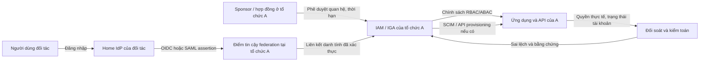

# External identity trong mô hình quản lý danh tính IAM

## 1. External identity là gì?

**External identity** (danh tính bên ngoài) là danh tính của một chủ thể cần tương tác với hệ thống của tổ chức nhưng **không thuộc tập danh tính nội bộ được quản lý trực tiếp theo cùng quy trình nhân sự**. Chủ thể đó có thể là nhân viên của nhà cung cấp, cộng tác viên, đối tác, khách hàng, người dùng của tổ chức khác hoặc một workload từ hệ thống bên ngoài. Trong nhiều kiến trúc, người dùng bên ngoài đăng nhập bằng **Identity Provider (IdP)** của tổ chức họ hoặc một IdP tin cậy thay vì nhận mật khẩu nội bộ mới.

Ví dụ: Công ty A mở cổng quản lý đơn hàng cho nhân viên logistics của Công ty B. Người này là nhân viên được Công ty B quản lý, nhưng có danh tính khách (*guest/external user*) và quyền hạn tại ứng dụng của A. A cần biết **ai đang truy cập**, **tổ chức nào xác thực họ**, **ai ở A bảo trợ quyền truy cập**, **họ được làm gì**, và **khi nào phải thu hồi quyền**.

Trong module **SECURITY_IDENTITY_ACCESS_MANAGEMENT_IDENTITY_LIFECYCLE**, External identity là một phần quan trọng của **Identity Lifecycle Management**: xác minh chủ thể, khởi tạo danh tính/tài khoản, liên kết với IdP và SSO, cấp phát qua SCIM hoặc API, phân quyền theo RBAC/ABAC, rà soát và thu hồi quyền theo mô hình **Joiner–Mover–Leaver (JML)**. Dù hệ thống xác thực được đặt ở bên ngoài, tổ chức sở hữu tài nguyên vẫn phải chịu trách nhiệm về **quyền truy cập vào tài nguyên của mình**.

Sau bài học, người đọc có thể phân biệt external identity với tài khoản nội bộ và tài khoản dịch vụ, nhận diện mô hình federation/B2B/B2C, thiết kế hồ sơ danh tính và trust boundary, chọn cách provisioning thích hợp, xây dựng vòng đời JML, và kiểm soát quyền truy cập tồn dư khi quan hệ với đối tác hoặc cá nhân thay đổi.

## 2. Nhận diện các kiểu danh tính bên ngoài

Thuật ngữ “external” có thể mô tả **quan hệ của chủ thể đối với tổ chức**, **nơi thông tin đăng nhập được quản lý** hoặc **ranh giới tin cậy**. Ba khía cạnh này liên quan nhưng không tương đương.

| Kiểu danh tính | Ví dụ | Nguồn xác minh quan hệ | Cơ chế đăng nhập phổ biến | Điểm kiểm soát vòng đời |
| --- | --- | --- | --- | --- |
| **B2B guest/partner** | Nhân viên hãng vận chuyển dùng portal của doanh nghiệp | Danh mục đối tác, người bảo trợ nội bộ, hợp đồng | Federation với IdP đối tác, tài khoản guest | Sponsor, phạm vi hợp tác, ngày hết hạn, rà soát quyền |
| **Contractor/consultant** | Chuyên gia tư vấn triển khai dự án | Vendor management hoặc hợp đồng và phê duyệt nội bộ | IdP đối tác hoặc tài khoản do tổ chức cấp | Dự án, hợp đồng, môi trường, ngày kết thúc |
| **B2C/customer identity** | Khách hàng cá nhân dùng ứng dụng thương mại | Hệ thống quản lý khách hàng, đăng ký/kiểm tra danh tính theo mức bảo đảm yêu cầu | CIAM, social login, OIDC | Quyền sở hữu dữ liệu cá nhân, yêu cầu đóng tài khoản, bảo vệ khỏi chiếm đoạt |
| **Federated workforce user** | Nhân viên thuộc công ty con đăng nhập dịch vụ công ty mẹ | Danh bạ/HR của đơn vị chủ quản, thỏa thuận liên tổ chức | Federation SAML/OIDC | Tin cậy issuer, thay đổi bộ phận, chấm dứt quan hệ |
| **External workload identity** | Dịch vụ đối tác gọi API của tổ chức | Danh mục ứng dụng, hợp đồng tích hợp, chủ sở hữu dịch vụ | OAuth 2.0 client credentials, workload federation, mTLS tùy thiết kế | Chủ sở hữu, phạm vi token, khóa/chứng chỉ, vòng đời tích hợp |

**Không phải mọi external identity đều sử dụng IdP bên ngoài.** Một tài khoản guest có thể được quản lý cục bộ; một khách hàng có thể đăng nhập bằng CIAM của chính doanh nghiệp; một nhân viên nội bộ có thể xác thực nhờ IdP liên kết. Vì vậy, khi thiết kế mô hình dữ liệu, nên tách `identityType`, `organizationAffiliation`, `authenticationAuthority`, `sponsor` và `accountType` thay vì gộp tất cả vào cờ `isExternal`.

**External identity cũng không đồng nghĩa với service account.** Danh tính bên ngoài có thể là **người** hoặc **máy**. Workload identity cần đường xác thực và vòng đời credential riêng; không nên buộc nó vào giả định rằng mọi chủ thể đều có họ tên, email hay người quản lý trực tiếp.

## 3. Tách danh tính gốc, tài khoản cục bộ và thông tin xác thực

Trong hệ thống có federation, ít nhất ba đối tượng cần được phân biệt:

1. **Chủ thể ở tổ chức gốc (*home organization*):** người hoặc workload do đơn vị gốc quản lý. Đơn vị gốc có thể xác nhận tình trạng làm việc, trạng thái tài khoản và kết quả xác thực.
2. **Danh tính được nhận diện tại tổ chức tiếp nhận (*resource/host organization*):** bản ghi nội bộ ánh xạ đến chủ thể bên ngoài, lưu ID ổn định, quan hệ đối tác, người bảo trợ và chính sách truy cập tại tài nguyên của mình.
3. **Tài khoản/quyền tại ứng dụng đích:** biểu diễn kỹ thuật và những quyền thực tế ở portal, kho tài liệu, CRM, API hoặc dịch vụ khác. Nhiều tài khoản ứng dụng có thể liên kết cùng một danh tính tiếp nhận.

Ví dụ, nhân viên đối tác có tài khoản `hana@partner.example` tại IdP của Công ty B. Cổng B2B của Công ty A có thể tạo `guestIdentityId=ext-5834`, liên kết tài khoản ở IdP ngoài và gán nhóm `partner-orders-reader`. Email chỉ là thông tin liên hệ/hiển thị, **không nên là khóa duy nhất để xác định danh tính liên tổ chức**: email có thể đổi tên, đổi miền, được tái sử dụng hoặc bị chỉnh sửa không đúng thẩm quyền.

| Giá trị | Ai thường chịu trách nhiệm? | Có dùng làm khóa liên kết ổn định không? |
| --- | --- | --- |
| `identityId` ở hệ thống tiếp nhận | IAM/CIAM/IGA của tổ chức tiếp nhận | Có, dùng nội bộ theo quy tắc không tái sử dụng |
| `iss` + `sub` của OIDC | IdP phát hành token | Thường là cặp nhận diện chủ thể trong ngữ cảnh issuer; cần tôn trọng chế độ subject của IdP |
| Entity ID của IdP + NameID bền vững của SAML | Federation của tổ chức gốc | Có thể, tùy định dạng NameID và hợp đồng federation |
| Email, tên hiển thị, số điện thoại | Nguồn đăng ký/IdP/CIAM theo chính sách | Không nên dùng một mình để tự động gộp tài khoản |
| `partnerId`, `contractId`, `sponsorId` | Quản lý đối tác/hợp đồng của tổ chức tiếp nhận | Dùng xác định quan hệ, phạm vi và thời hạn; không thay thế khóa cá nhân |
| `applicationAccountId` | Ứng dụng đích | Dùng đối soát tài khoản ứng dụng với danh tính chuẩn |

**Lưu ý về OIDC:** `sub` là định danh chủ thể do issuer cấp; một số IdP có thể cấp `sub` khác nhau cho cùng người ở các client hoặc sector khác nhau (*pairwise subject identifier*). Không được tự suy ra rằng hai giá trị `sub` tại các client khác nhau luôn có thể đối chiếu; cần một chiến lược liên kết theo thỏa thuận và bằng chứng được phép sử dụng.

## 4. Ranh giới tin cậy: xác thực từ bên ngoài, ủy quyền tại nơi sở hữu tài nguyên

Một mô hình federation gồm tối thiểu hai miền trách nhiệm:

- **Home IdP/nguồn danh tính:** xác thực người dùng, duy trì tài khoản nguồn, có thể cung cấp thuộc tính như tên, email đã xác minh hoặc nhóm. Tùy hợp đồng, đơn vị gốc cũng có thể gửi thông tin thay đổi nhân sự/hợp đồng.
- **Resource organization/ứng dụng tiếp nhận:** quyết định cho phép truy cập tài nguyên nào, theo quyền hạn và mức bảo đảm nào; duy trì liên kết guest, người bảo trợ, quyền cục bộ, thời hạn và nhật ký kiểm toán.



Trong sơ đồ trên, **IdP chỉ giúp trả lời người đó là ai và đã xác thực ra sao trong phạm vi cam kết**. Thông điệp “đã đăng nhập thành công” không tự cấp quyền xem mọi đơn hàng. Công ty A phải áp dụng chính sách riêng: khách này thuộc `partnerId` nào, có được xem đơn hàng của đối tác đó không, vai trò đã được phê duyệt là gì và thời hạn truy cập còn hiệu lực không.

**SSO là đăng nhập một lần**, thường thông qua OIDC hoặc SAML; **federation là quan hệ tin cậy danh tính giữa các miền**. Có SSO không có nghĩa là đã có provisioning, và tạo tài khoản qua SCIM không có nghĩa là đã có SSO. Chính sách đăng nhập, vòng đời tài khoản và quyền truy cập cần được thiết kế như các phần riêng nhưng phối hợp với nhau.

## 5. Thiết kế hồ sơ external identity

Một bản ghi danh tính bên ngoài nên biểu diễn được **định danh**, **nguồn gốc**, **quan hệ tổ chức** và **vòng đời**. Mẫu minh họa dưới đây là dữ liệu nghiệp vụ giả định, **không phải schema bắt buộc của OIDC, SCIM hoặc một sản phẩm cụ thể**.

```json
{
  "identityId": "ext-5834",
  "identityType": "EXTERNAL_HUMAN",
  "displayName": "Hana Nguyen",
  "partnerId": "partner-logistics-b",
  "source": {
    "kind": "FEDERATED_IDP",
    "issuer": "https://login.partner.example/tenant-b",
    "subject": "user-6e8c1"
  },
  "contact": {
    "email": "hana@partner.example",
    "emailVerified": true
  },
  "sponsorship": {
    "sponsorId": "employee-201",
    "contractId": "contract-2026-45",
    "approvedUntil": "2027-03-31T16:59:59Z"
  },
  "lifecycleStatus": "ACTIVE",
  "entitlements": ["partner-orders-reader"],
  "createdAt": "2026-11-23T08:00:00Z"
}
```

Mỗi nhóm trường có mục đích khác nhau:

- `identityId`: khóa nội bộ ổn định để truy vết, liên kết các tài khoản ở hệ thống đích và giữ lịch sử kể cả khi đổi IdP.
- `source.issuer` + `source.subject`: căn cứ liên kết với chủ thể đã xác thực từ nguồn tin cậy. Phải xác nhận issuer và các điều kiện tin cậy trước khi sử dụng claim.
- `partnerId` và `contractId`: phản ánh quan hệ với tổ chức ngoài và phạm vi hợp tác. Các giá trị này cần lấy từ nguồn có thẩm quyền của tổ chức tiếp nhận.
- `sponsorId`: người/bộ phận nội bộ chịu trách nhiệm duyệt yêu cầu và đánh giá quyền. Với khách hàng B2C, mô hình sponsor có thể không phù hợp; thay bằng chính sách CIAM, điều khoản dịch vụ và cơ chế quản lý tài khoản tương ứng.
- `approvedUntil` và `lifecycleStatus`: điều kiện vòng đời cục bộ. Tài khoản IdP ngoài vẫn đang hoạt động **không có nghĩa** quyền ở tổ chức tiếp nhận còn hợp lệ.
- `entitlements`: quyền mong muốn/được chấp thuận; cần đối chiếu với quyền thực tế tại ứng dụng đích.

Có thể cần thêm `tenantId`, `userCategory`, `onboardingEvidence`, `accessReviews`, `assuranceLevel`, `lastSeenAt`, `lastReconciledAt`, `sourceVersion` và các liên kết tài khoản, nhưng chỉ lưu thuộc tính thật sự cần thiết và tuân thủ yêu cầu bảo vệ dữ liệu cá nhân. Không nên sao chép mật khẩu của IdP đối tác vào kho danh tính tiếp nhận.

## 6. Quy trình onboarding: mời, xác minh, liên kết và cấp quyền

Xét quy trình cho một người dùng B2B được mời truy cập cổng đối tác:

1. **Xác lập nhu cầu và người bảo trợ.** Sponsor ở tổ chức A nêu lý do truy cập, tổ chức đối tác, ứng dụng, vai trò đề xuất và ngày hết hạn. Hệ thống kiểm tra đối tác/hợp đồng còn hiệu lực.
2. **Xác minh đối tượng theo mức rủi ro.** Đối chiếu tư cách đối tác và người nhận lời mời; quy trình có thể sử dụng xác nhận qua quản trị viên đối tác, miền tin cậy hoặc xác minh danh tính bổ sung. Việc sở hữu một địa chỉ email đơn thuần không chứng minh quan hệ lao động với đối tác.
3. **Tạo bản ghi external identity.** Cấp `identityId` của tổ chức A, gắn sponsor/partner, ghi thời hạn và lưu trạng thái chờ (`INVITED`, `PENDING_VERIFICATION` hoặc tương đương).
4. **Liên kết với IdP.** Cấu hình federation/trust hoặc xác thực qua IdP phù hợp. Sau lần đăng nhập hợp lệ, liên kết thông tin chủ thể từ issuer với bản ghi đã được duyệt; nếu mơ hồ thì đưa vào xét duyệt thủ công.
5. **Cấp phát tài khoản và quyền.** Có thể tạo trước tài khoản bằng SCIM/API, dùng *just-in-time (JIT) provisioning* ở lần đăng nhập đầu, hoặc quy trình ứng dụng riêng. Chính sách RBAC/ABAC cấp tối thiểu những quyền cần cho mục đích được duyệt.
6. **Xác minh sau cấp phát.** Kiểm tra tài khoản ứng dụng đã được liên kết đúng, quyền có hiệu lực đúng phạm vi và hạn dùng, không cấp quyền dư; ghi nhận bằng chứng cấp quyền.

### Provisioning trước và JIT provisioning

| Tiêu chí | Provisioning trước bằng SCIM/API | JIT provisioning khi đăng nhập |
| --- | --- | --- |
| Thời điểm tạo tài khoản | Trước khi người dùng đăng nhập, sau phê duyệt | Khi người dùng đăng nhập thành công và đạt điều kiện tạo tài khoản |
| Ưu điểm | Có thể chuẩn bị quyền, kiểm soát ngày bắt đầu, đặt trạng thái sẵn sàng | Giảm số tài khoản được tạo trước khi thực sự sử dụng |
| Điểm cần chú ý | Xử lý lỗi đồng bộ, cập nhật/disable và idempotency | Ngăn tạo tự động ngoài chính sách; tránh nhân bản tài khoản khi email thay đổi |
| Khi rời tổ chức | Gửi lệnh disable/delete theo khả năng ứng dụng, đối soát kết quả | Vẫn cần vô hiệu hóa tài khoản guest/quyền cũ; chặn phiên mới thôi là chưa đủ |

Với cả hai cách, cần xác định **ai được quyền khởi tạo** danh tính và có điều kiện phê duyệt trước khi sử dụng. Không nên để bất kỳ tài khoản nào được xác thực bởi một IdP chung tự động nhận vai trò mặc định có quyền xem dữ liệu nhạy cảm.

## 7. Federation và xác thực: cần tin vào điều gì?

Một kết nối federation có nghĩa tổ chức tiếp nhận chấp nhận các khẳng định về danh tính từ một nguồn đã được cấu hình tin cậy. **Trust phải được giới hạn cụ thể**, gồm issuer/IdP, client hay ứng dụng nhận token, loại thông tin được tin cậy, yêu cầu xác thực, thời hạn và thủ tục quản lý chứng chỉ/khóa.

### Khi sử dụng OpenID Connect (OIDC)

Ứng dụng hoặc thành phần xác thực phải kiểm tra token theo luồng phù hợp, bao gồm các yếu tố như chữ ký bằng khóa hợp lệ, issuer `iss`, audience `aud`, thời hạn `exp`, các điều kiện `iat`/`nbf` khi áp dụng và các giá trị chống tấn công hoán đổi/phát lại (`state`, `nonce`, PKCE trong đúng ngữ cảnh). Khóa công khai và metadata chỉ được nhận từ nguồn tin cậy đã cấu hình; không chọn issuer theo chuỗi do người dùng tự nhập mà chưa kiểm soát.

Ví dụ claim rút gọn dưới đây giúp nhận diện **chủ thể đã xác thực**. Nó không tự động xác nhận người này có quyền ở ứng dụng của tổ chức A:

```json
{
  "iss": "https://login.partner.example/tenant-b",
  "sub": "user-6e8c1",
  "aud": "portal-b2b-client",
  "exp": 1795500000,
  "email": "hana@partner.example",
  "email_verified": true
}
```

Đây chỉ là **payload minh họa**; token hợp lệ cần được phát hành, ký, truyền và kiểm chứng theo giao thức. Claim `email_verified=true` thể hiện tín hiệu do issuer công bố, **không phải bằng chứng đủ để tự cấp quyền truy cập dữ liệu của một đối tác cụ thể**.

### Khi sử dụng SAML 2.0

Ứng dụng tiếp nhận cần xác minh chữ ký của assertion/response theo cấu hình tin cậy, issuer, audience, recipient/destination, thời hạn, tương quan với yêu cầu đăng nhập khi áp dụng, và chống tái sử dụng assertion. Nếu dùng NameID làm định danh liên kết, phải hiểu định dạng và độ ổn định của NameID. Chính sách luân chuyển chứng chỉ ký của IdP phải có quy trình kiểm tra trước khi chứng chỉ hết hạn.

### Mức độ bảo đảm xác thực

Tổ chức A có thể yêu cầu MFA hoặc mức bảo đảm xác thực nhất định cho quyền nhạy cảm. Nếu dựa vào MFA của IdP đối tác, hai bên cần thỏa thuận rõ tín hiệu xác thực nào được công nhận và kiểm chứng tín hiệu đó trong ngữ cảnh giao thức; không coi “SSO thành công” là luôn tương đương “MFA đạt yêu cầu”. Có thể bổ sung *step-up authentication* hoặc kiểm soát truy cập theo rủi ro phía tổ chức tiếp nhận.

## 8. Ủy quyền: RBAC và ABAC dành cho external identity

Xác thực trả lời **chủ thể nào đang truy cập**; ủy quyền trả lời **chủ thể đó có được phép thực hiện hành động này trên tài nguyên này ngay lúc này hay không**.

Với **RBAC**, tổ chức tiếp nhận gán vai trò nghiệp vụ như `partner-order-reader`, `partner-invoice-editor` hoặc `guest-support`. Mỗi vai trò chứa tập quyền đã được chủ sở hữu ứng dụng kiểm soát. Một vai trò do IdP đối tác gửi có thể là đầu vào đánh giá, nhưng không nên được ánh xạ sang vai trò quyền cao nếu không có chính sách tin cậy và phê duyệt rõ ràng.

Với **ABAC**, quyết định còn dựa vào thuộc tính chủ thể, tài nguyên và bối cảnh:

| Thành phần | Ví dụ | Nguồn đáng tin cậy nên dùng |
| --- | --- | --- |
| Chủ thể | `identityType=EXTERNAL_HUMAN`, `partnerId=partner-logistics-b`, `status=ACTIVE` | Kho identity và quản trị đối tác của A |
| Tài nguyên | `order.partnerId=partner-logistics-b`, `classification=BUSINESS` | Dịch vụ quản lý đơn hàng và dữ liệu tài nguyên |
| Hành động | `read_order` | Chính sách ứng dụng/API của A |
| Ngữ cảnh | `contractActive=true`, `approvedUntil` chưa hết, MFA đạt yêu cầu | Nguồn hợp đồng, IGA, hệ thống xác thực theo cấu hình tin cậy |

Giả mã một chính sách đơn giản:

```text
allowReadOrder(user, order, now):
    return user.identityType == EXTERNAL_HUMAN
       and user.lifecycleStatus == ACTIVE
       and user.contractStatus == ACTIVE
       and user.approvedUntil > now
       and user.role includes partner-order-reader
       and user.partnerId == order.partnerId
```

Điều kiện `user.partnerId == order.partnerId` giúp giảm rủi ro người dùng của đối tác B xem đơn hàng của đối tác C. Thông tin `partnerId` có giá trị quyết định quyền phải được lấy từ kho dữ liệu có thẩm quyền của tổ chức A hoặc nguồn được phê duyệt; không nên lấy từ tham số HTTP, claim tùy ý do người dùng gửi hoặc dữ liệu chưa kiểm chứng.

Ngoài chính sách ứng dụng, API cần thực thi kiểm tra quyền ở phía máy chủ trên **từng tài nguyên và hành động**. Ẩn nút giao diện hoặc chỉ kiểm tra một lần khi đăng nhập là không đủ.

## 9. Vòng đời Joiner–Mover–Leaver cho danh tính bên ngoài

JML của external identity khác với nhân viên ở nguồn kích hoạt sự kiện: thông tin quan hệ thường nằm ở **sponsor, danh mục đối tác, hợp đồng hoặc CIAM**, thay vì chỉ dựa vào HRIS nội bộ. Khi đơn vị gốc cũng gửi trạng thái nhân sự, tổ chức tiếp nhận nên xem đó là một tín hiệu có thẩm quyền trong phạm vi đã thỏa thuận, nhưng vẫn phải thực thi chính sách và thời hạn quyền của chính mình.

| Pha | Tác nhân kích hoạt | Hành động IAM/IGA của tổ chức tiếp nhận | Dấu hiệu hoàn tất |
| --- | --- | --- | --- |
| **Joiner** | Mời người dùng, hợp đồng ký kết, sponsor phê duyệt | Xác minh nguồn gốc, liên kết IdP, cấp tài khoản/quyền tối thiểu với hạn sử dụng | Đăng nhập đúng chủ thể, chỉ thấy đúng tài nguyên được phép |
| **Mover** | Đổi dự án, vai trò hoặc đơn vị đối tác; thay sponsor, thay phạm vi hợp đồng | Đánh giá lại vai trò/quyền theo RBAC/ABAC, thu hồi quyền cũ, duyệt quyền mới | Quyền thực tế không còn nằm ngoài phạm vi hợp đồng và nhiệm vụ mới |
| **Leaver** | Đối tác chấm dứt hợp đồng, sponsor thu hồi, hết hạn tự động, IdP báo tài khoản gốc bị vô hiệu hóa | Chặn truy cập, disable/deprovision tài khoản guest, thu hồi token/phiên/quyền và rà soát chia sẻ | Không còn đường truy cập trái phép, bằng chứng đã đối soát |

### Joiner: không biến lời mời thành quyền vĩnh viễn

Quyền external thường cần **thời điểm bắt đầu và kết thúc rõ ràng**. Ví dụ, chuyên gia tư vấn chỉ làm trong 30 ngày thì tài khoản phải gắn với thời hạn này và người chịu trách nhiệm gia hạn. Nếu quy trình gửi lời mời và tạo tài khoản diễn ra độc lập, hệ thống phải đảm bảo trạng thái lời mời không bị sử dụng để vượt qua bước phê duyệt quyền.

### Mover: thay đổi phạm vi, không chỉ cộng thêm nhóm

Người dùng có thể từ dự án triển khai chuyển sang hỗ trợ vận hành. Vai trò mới đôi khi cần thêm quyền, nhưng các quyền dự án cũ phải được **đánh giá và thu hồi** nếu hết căn cứ. Kiểm tra cả các quyền được cấp ngoài nhóm tiêu chuẩn như liên kết chia sẻ tài liệu, quyền ứng dụng cấp thủ công và tài khoản trong môi trường kỹ thuật.

### Leaver: có nhiều tín hiệu chấm dứt

Không có một sự kiện duy nhất bao phủ mọi tình huống. Việc đối tác xóa người dùng khỏi IdP có thể chặn lần đăng nhập federation tiếp theo, nhưng **không bảo đảm** phiên ứng dụng cũ, personal access token, credential cục bộ hoặc lời mời còn hiệu lực đã bị thu hồi. Ngược lại, tổ chức A phải có khả năng thu hồi guest khi hợp đồng kết thúc, **ngay cả khi người đó vẫn làm việc tại Công ty B**.

Cần phối hợp thu hồi tại IdP/ứng dụng, vô hiệu hóa tài khoản provisioning, hết hạn hoặc thu hồi phiên/token theo khả năng hỗ trợ, xóa nhóm/quyền và rà soát chia sẻ tài liệu. Việc xóa dữ liệu cá nhân, lưu giữ lịch sử giao dịch và audit log phải theo chính sách lưu trữ/pháp lý tương ứng, không mặc định xóa ngay mọi hồ sơ khi cắt quyền truy cập.

## 10. Các tình huống đặc biệt của external identity

### Người dùng đổi email hoặc đổi nhà cung cấp danh tính

Nếu email đổi từ `hana@partner.example` sang `hana.n@partner.example`, IAM nên cập nhật thuộc tính liên hệ nhưng tiếp tục liên kết theo khóa chủ thể đã xác minh. Nếu đối tác chuyển sang IdP khác, cặp `(issuer, subject)` có thể thay đổi hoàn toàn. Việc gắn tài khoản IdP mới vào `identityId` cũ cần quy trình chuyển đổi đã được phê duyệt và bằng chứng đối chiếu, tránh gộp sai người chỉ vì email giống nhau.

### Một người cộng tác với nhiều đối tác

Một cá nhân có thể xuất hiện trong hai hợp đồng hoặc đại diện cho hai công ty. Quyền nên có **ngữ cảnh tổ chức/hợp đồng** rõ ràng. Tùy chính sách có thể dùng một danh tính chuẩn với nhiều quan hệ hoặc nhiều profile tách biệt; điểm quan trọng là không trộn quyền của đối tác này sang đối tác kia.

### Khách hàng B2C dùng social login

Social login cho biết nhà cung cấp đã xác thực một tài khoản, nhưng **không xác minh mặc định** danh tính pháp lý, tuổi, thẩm quyền đại diện doanh nghiệp hoặc quyền sở hữu một hồ sơ tài chính. Nếu nghiệp vụ đòi hỏi mức bảo đảm cao hơn, cần bước xác minh phù hợp. Khách hàng cũng cần cơ chế quản lý đồng ý, yêu cầu liên quan đến dữ liệu cá nhân và khôi phục tài khoản an toàn theo chính sách CIAM.

### Workload của đối tác gọi API

Một tích hợp máy–máy không thực hiện SSO trình duyệt như người dùng. Quyền API có thể dựa trên OAuth 2.0, workload federation, chứng chỉ hoặc phương thức thích hợp khác. Cần quản lý `clientId`/định danh workload, nguồn cấp credential, chủ sở hữu hợp đồng, audience/scope token, vòng đời khóa và lịch rà soát. Không dùng email cá nhân của kỹ sư làm căn cứ duy nhất cho quyền tích hợp dài hạn.

## 11. Kiểm soát bảo mật và kiểm toán

Vì external identity đi qua ranh giới tổ chức, các kiểm soát đặc biệt cần được ghi rõ trong thiết kế và vận hành.

| Rủi ro | Cơ chế bảo vệ | Bằng chứng/đối soát cần có |
| --- | --- | --- |
| Tự động tin bất kỳ IdP ngoài nào | Danh sách issuer/trust được phê duyệt, cấu hình audience và khóa/chứng chỉ chặt chẽ | Hồ sơ cấu hình federation, kiểm tra issuer và thay đổi chứng chỉ |
| Gộp nhầm tài khoản qua email | Khóa liên kết dựa trên issuer + subject/định danh bền vững, quy trình xác minh khi chuyển IdP | Lịch sử ánh xạ danh tính và phê duyệt chuyển đổi |
| Guest không có người chịu trách nhiệm | Sponsor, hợp đồng, hạn sử dụng, rà soát định kỳ | Báo cáo guest thiếu sponsor hoặc quá hạn |
| Quyền truy cập liên đối tác | RBAC/ABAC có kiểm tra `partnerId`, quyền tối thiểu và kiểm soát tài nguyên | Nhật ký quyết định quyền, kiểm tra chéo phạm vi tài nguyên |
| Token/phiên còn hiệu lực sau khi rời | Quy trình revoke/expire, vô hiệu hóa tài khoản đích, đóng các luồng truy cập khác | Đối soát session/token/account theo khả năng từng hệ thống |
| Đồng bộ SCIM/API lỗi, tài khoản mồ côi | Theo dõi retry, hàng đợi lỗi, đối soát quyền thực tế với quyền được duyệt | Tài khoản không liên kết, request provisioning thất bại, thời gian xử lý |
| Đối tác thay nhân sự nhưng không thông báo | Hợp đồng trao đổi sự kiện, kiểm tra hết hạn tại nơi tiếp nhận, tái chứng nhận bởi sponsor | Lịch sử tái chứng nhận, các guest quá kỳ rà soát |
| Dữ liệu cá nhân của khách/đối tác bị thu thập quá mức | Giới hạn thuộc tính, kiểm soát mục đích và quyền đọc, chính sách lưu giữ | Danh mục thuộc tính, lịch sử truy cập và xử lý yêu cầu dữ liệu |

Nhật ký nên lưu `identityId`, mã tương quan sự kiện, issuer, ứng dụng đích, thời gian, hành động, quyền bị tác động, kết quả kiểm tra/quyết định và người phê duyệt khi có. **Không đưa access token, refresh token, mật khẩu hoặc khóa bí mật vào nhật ký.** Audit phải phân biệt **ý định cấp/thu hồi quyền** với **kết quả thực tế đã xác nhận** để phát hiện provisioning lỗi.

Các chỉ số hữu ích gồm tỷ lệ external identities có sponsor/hạn sử dụng, số guest quá hạn còn hoạt động, thời gian thu hồi từ lúc leaver, số tài khoản mồ côi, số quyền lệch so với phê duyệt và số kết nối federation hoặc SCIM đang lỗi. Các mục tiêu vận hành phải được xác định theo rủi ro và chính sách của tổ chức.

## 12. Ví dụ toàn trình: đối tác được mời, đổi phạm vi rồi chấm dứt

Giả sử Công ty A vận hành hệ thống giao nhận. Công ty B được phép xử lý đơn hàng thuộc hợp đồng `CT-45`. Một nhân viên B tên Hana cần truy cập portal trong ba tháng.

**Ngày 1 – Joiner.** Sponsor của A xác minh hợp đồng, duyệt vai trò `partner-orders-reader` và hạn truy cập. IAM tạo `identityId=ext-5834`, liên kết với OIDC issuer/subject của IdP B sau xác thực hợp lệ. Quyền chỉ cho đọc các đơn `order.partnerId=partner-logistics-b`. Việc liên kết danh tính và cấp quyền được ghi vào nhật ký kiểm toán.

**Ngày 30 – Mover.** B thông báo Hana chuyển từ khâu tra cứu sang điều phối, đồng thời sponsor của A phê duyệt quyền cập nhật trạng thái giao nhận. IGA đánh giá lại vai trò và phân loại đơn hàng: chỉ cấp `partner-delivery-update` cho phạm vi hợp đồng, bỏ các quyền cũ không còn cần thiết. Một ứng dụng phụ chưa cập nhật vai trò; đối soát phát hiện sự khác biệt và tạo tác vụ khắc phục.

**Ngày 90 – Leaver.** Hợp đồng `CT-45` hết hạn nhưng Hana vẫn còn tài khoản ở IdP B. Hệ thống của A không chờ B khóa tài khoản: chính sách tự chuyển guest sang trạng thái không được truy cập, yêu cầu disable/deprovision tài khoản ứng dụng, thu hồi quyền và xử lý các phiên/token còn hoạt động tùy khả năng của sản phẩm. Kết quả đối soát xác nhận không còn quyền trên đơn hàng của A, trong khi log giao dịch cần thiết tiếp tục được lưu theo chính sách.

Tình huống này cho thấy **nguồn xác thực bên ngoài** và **quyền quyết định truy cập tại tổ chức tiếp nhận** là hai trách nhiệm khác nhau. IdP B xác nhận Hana đăng nhập; chính sách của A quyết định Hana có được xem hoặc sửa đơn hàng của A hay không, và trong bao lâu.

## 13. Những câu hỏi cần chốt khi đưa external identity vào thiết kế

Trước khi triển khai một quan hệ B2B, B2C hoặc federation, nhóm IAM và chủ sở hữu ứng dụng nên thống nhất:

1. External identity đại diện cho người, khách hàng hay workload? Ai là chủ thể pháp lý/nghiệp vụ chịu trách nhiệm và tổ chức gốc là ai?
2. Hệ thống nào là nguồn có thẩm quyền về danh tính, trạng thái đối tác/hợp đồng, sponsor, vai trò, ngày bắt đầu và ngày hết hạn?
3. IdP nào được tin cậy, theo giao thức nào, với mức bảo đảm nào? Quá trình thay issuer, khóa ký, chứng chỉ và sự cố IdP được xử lý ra sao?
4. Khóa nào liên kết danh tính ngoài với `identityId` nội bộ? Làm sao tránh trùng khi đổi email, đổi IdP hoặc một người có nhiều quan hệ?
5. Tài khoản được provision trước hay JIT? Ứng dụng có hỗ trợ SCIM/API, disable, thu hồi nhóm, phiên hoặc token không?
6. RBAC/ABAC ngăn quyền vượt phạm vi đối tác và tài nguyên như thế nào? Ai phê duyệt ngoại lệ, với thời hạn bao lâu?
7. Sự kiện mover/leaver đến từ đâu, có đường thu hồi khẩn cấp hay không và cơ chế kiểm tra tài khoản/quyền tồn dư là gì?
8. Những chỉ số, audit trail, quyền quản trị dữ liệu cá nhân và chu kỳ tái chứng nhận nào cần duy trì?

Thiết kế external identity chỉ hoàn chỉnh khi tổ chức xác định được **chủ thể bên ngoài là ai**, **nguồn nào được tin cậy cho loại thông tin nào**, **ai quyết định quyền cục bộ**, **quyền có hiệu lực đến khi nào** và **bằng chứng nào xác nhận quyền đã được thu hồi**. Cách tiếp cận đó đưa external identity vào cùng một vòng đời IAM có kiểm soát với IdP, SSO, SCIM, RBAC/ABAC, tài khoản dịch vụ và kiểm toán, đồng thời hạn chế tài khoản mồ côi và quyền truy cập tồn dư.
