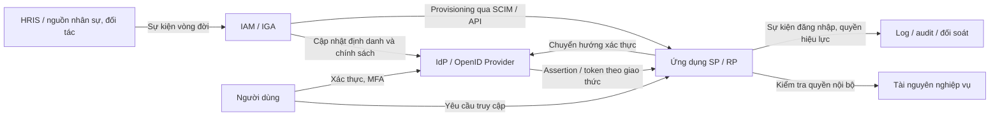
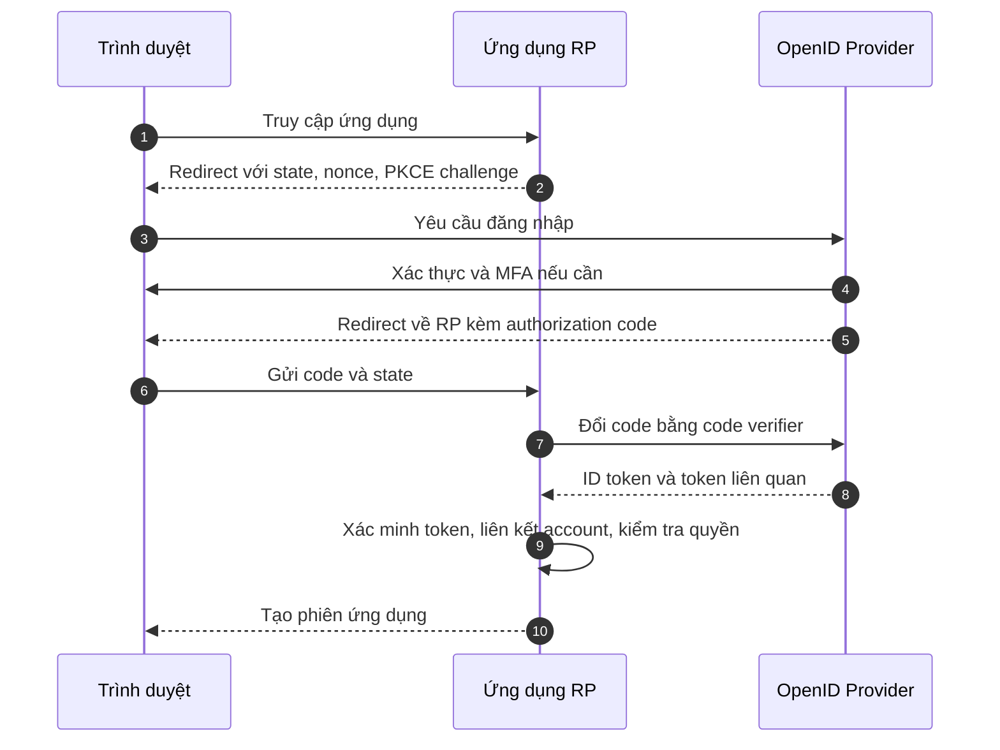

# Federated identity

## 1. Federated identity là gì?

**Federated identity (danh tính liên kết)** là mô hình trong đó một hệ thống **tin cậy kết quả xác thực danh tính do một hệ thống khác cung cấp**, dựa trên quan hệ tin cậy đã thiết lập trước. Nhờ đó, người dùng có thể truy cập ứng dụng ở một tổ chức hoặc miền quản trị khác mà không cần ứng dụng ấy trực tiếp kiểm tra mật khẩu của người dùng.

Ví dụ: một nhà thầu có tài khoản tại công ty đối tác, nhưng cần sử dụng cổng cộng tác của doanh nghiệp. Thay vì tạo thêm một mật khẩu trên cổng, doanh nghiệp có thể cấu hình cổng tin cậy **Identity Provider (IdP)** của đối tác. Khi nhà thầu đăng nhập, IdP của đối tác xác thực người đó và gửi bằng chứng xác thực phù hợp để cổng quyết định có cho đăng nhập hay không.

Trong phạm vi quản lý vòng đời danh tính của **Identity and Access Management (IAM)**, federation giải quyết một câu hỏi cụ thể: **“Hệ thống nhận truy cập có thể tin ai xác thực danh tính và bằng cách nào?”**. Nó không tự động giải quyết mọi câu hỏi về cấp tài khoản, phân quyền, phê duyệt, rà soát và thu hồi quyền truy cập.

Những lợi ích chính:

- **Giảm số bộ thông tin đăng nhập phải quản lý:** người dùng thường xác thực tại IdP quen thuộc thay vì đặt mật khẩu riêng ở từng ứng dụng.
- **Tập trung chính sách xác thực:** tổ chức sở hữu IdP có thể áp dụng MFA, chính sách mật khẩu, thiết bị và đánh giá rủi ro đăng nhập ở một nơi.
- **Hỗ trợ truy cập liên tổ chức:** đối tác, khách hàng và nhà thầu có thể dùng danh tính tại tổ chức chủ quản khi được thiết lập quan hệ tin cậy.
- **Giúp quá trình Joiner–Mover–Leaver có điểm phối hợp:** thay đổi trạng thái danh tính tại nguồn có thể kích hoạt cập nhật đăng nhập và quyền tại nhiều ứng dụng, nếu các kết nối và quy trình vòng đời đã được triển khai đầy đủ.

Tuy vậy, **federated login thành công không có nghĩa người dùng được quyền sử dụng mọi tài nguyên trong ứng dụng**. Ứng dụng vẫn cần kiểm tra quyền đối với từng nghiệp vụ và dữ liệu.

## 2. Các thành phần của mô hình liên kết danh tính

| Thành phần | Trách nhiệm | Ví dụ |
|---|---|---|
| **Subject / Principal** | Con người hoặc thực thể đang yêu cầu truy cập | Nhân viên, nhà thầu, tài khoản ứng dụng |
| **Identity Provider (IdP)** | Xác thực danh tính và phát hành bằng chứng hoặc thông tin định danh theo giao thức | IdP của công ty mẹ, IdP của đối tác |
| **Service Provider (SP)** | Ứng dụng tin cậy kết quả xác thực của IdP; thuật ngữ phổ biến trong SAML | Cổng quản lý hợp đồng |
| **Relying Party (RP) / OIDC Client** | Ứng dụng sử dụng thông tin đăng nhập do OpenID Provider phát hành | Ứng dụng web đăng nhập bằng OIDC |
| **OpenID Provider (OP)** | IdP hỗ trợ OpenID Connect | Máy chủ nhận dạng phát hành ID token |
| **Nguồn danh tính có thẩm quyền** | Lưu dữ liệu nghiệp vụ về quan hệ, trạng thái hoặc người bảo trợ | HRIS, hệ thống hợp đồng, danh bạ đối tác |
| **Ứng dụng và hệ thống phân quyền** | Liên kết người dùng vào hồ sơ nội bộ, thực thi role, policy và quyền dữ liệu | Ứng dụng báo cáo, API, kho tài liệu |
| **SCIM / hệ thống provisioning** | Tạo, cập nhật, khóa tài khoản và đồng bộ nhóm/quyền hỗ trợ tại ứng dụng | Dịch vụ đồng bộ tài khoản từ IAM |

Trong một luồng federation, các bên phải thống nhất **quan hệ tin cậy**, chẳng hạn IdP nào được chấp nhận, ứng dụng nào được phép nhận thông tin đăng nhập, khóa/chứng thư xác minh, endpoint và những thuộc tính định danh cần truyền.



Sơ đồ thể hiện **hai luồng riêng**: đăng nhập liên kết giữa ứng dụng và IdP; đồng bộ vòng đời tài khoản/quyền giữa IAM và ứng dụng. Một triển khai có thể chỉ hỗ trợ luồng thứ nhất. Khi đó phải có biện pháp khác để thu hồi tài khoản và entitlement tại ứng dụng.

### 2.1. Phân biệt federation, SSO, provisioning và authorization

| Khái niệm | Trả lời câu hỏi | Có thể hoạt động như thế nào? |
|---|---|---|
| **Identity federation** | Ứng dụng tin kết quả xác thực từ hệ thống nào? | Quan hệ tin cậy SAML hoặc OIDC giữa IdP và ứng dụng |
| **SSO — Single Sign-On** | Làm sao người dùng đăng nhập một lần để đi vào nhiều ứng dụng? | Tái sử dụng phiên đăng nhập tại IdP, thường kết hợp federation |
| **Provisioning / deprovisioning** | Tài khoản, nhóm và quyền được tạo, cập nhật, khóa ở đâu? | SCIM, API quản trị, workflow hoặc xử lý thủ công |
| **Authentication (AuthN)** | Danh tính này đã được xác thực hợp lệ chưa? | Mật khẩu, MFA, passkey, chính sách IdP và bằng chứng đăng nhập |
| **Authorization (AuthZ)** | Danh tính này được thực hiện hành động nào trên tài nguyên nào? | RBAC, ABAC, policy engine hoặc phân quyền nội bộ |

**SSO không đồng nghĩa federation.** SSO cũng có thể tồn tại giữa các ứng dụng nội bộ thuộc cùng miền tin cậy, trong khi federation nhấn mạnh việc trao đổi bằng chứng danh tính giữa các hệ thống có quan hệ tin cậy. Ngược lại, nhiều liên kết federation có thể dùng chung phiên IdP để tạo trải nghiệm SSO.

**SCIM không phải giao thức đăng nhập.** SCIM thường được sử dụng cùng SAML/OIDC để đồng bộ vòng đời tài khoản, nhóm hoặc những thuộc tính ứng dụng hỗ trợ.

## 3. Các giao thức liên kết danh tính thường gặp

Hai cơ chế phổ biến là **SAML 2.0** và **OpenID Connect (OIDC)**. OAuth 2.0 liên quan chặt chẽ đến OIDC nhưng bản thân OAuth 2.0 chủ yếu là **khung cấp quyền truy cập ủy quyền**, không phải một giao thức xác thực danh tính tương đương OIDC.

| Tiêu chí | SAML 2.0 | OpenID Connect (OIDC) |
|---|---|---|
| Định dạng bằng chứng danh tính | SAML Assertion dạng XML trong SAML Response | ID token; thường là JWT, theo đặc tả OIDC |
| Thuật ngữ bên nhận | Service Provider (SP) | Relying Party (RP) / OIDC Client |
| Bên phát hành | Identity Provider (IdP) | OpenID Provider (OP) |
| Trao đổi phổ biến | Trình duyệt được chuyển hướng, sau đó POST SAML Response đến SP | Trình duyệt chuyển hướng; client nhận authorization code và đổi lấy token |
| Cơ chế tin cậy | Metadata, entity ID, endpoint, chứng thư và chữ ký | Issuer, client ID, redirect URI, discovery metadata, JWKS và chữ ký token |
| Bối cảnh điển hình | Ứng dụng doanh nghiệp, sản phẩm SaaS hỗ trợ SAML | Ứng dụng web/mobile hiện đại, tích hợp login với API |
| Điểm cần bảo vệ | Xác thực chữ ký, điều kiện assertion, audience, recipient, thời gian, tính duy nhất | Xác thực issuer, audience, chữ ký, thời hạn, state, nonce, PKCE |

Không nên đánh giá “SAML cũ nên không an toàn” hoặc “OIDC dùng JWT nên luôn an toàn”. **An toàn phụ thuộc vào triển khai, cấu hình và cách xác minh dữ liệu nhận được.**

### 3.1. SAML 2.0: SP tin cậy assertion từ IdP

Một luồng **SP-initiated SAML SSO** thông thường:

1. Người dùng truy cập một tài nguyên được bảo vệ trên SP.
2. SP tạo yêu cầu xác thực (*AuthnRequest*) và chuyển trình duyệt đến SAML IdP.
3. IdP xác thực người dùng, có thể yêu cầu MFA theo chính sách.
4. IdP phát hành **SAML Response** chứa assertion định danh và các thuộc tính phù hợp; trình duyệt chuyển response đến **Assertion Consumer Service (ACS)** của SP.
5. SP xác minh chữ ký theo cấu hình tin cậy, issuer, audience, địa chỉ nhận, ràng buộc với yêu cầu, thời hạn và các điều kiện hợp lệ.
6. SP ánh xạ danh tính liên kết vào tài khoản của mình, kiểm tra quyền và tạo phiên ứng dụng.

SAML có thể triển khai theo nhiều binding/profile. Vì vậy những trường như **InResponseTo** hoặc cách chống phát lại phải được kiểm tra phù hợp với luồng cụ thể; không được tự bỏ qua xác minh chỉ vì response có chữ ký hợp lệ.

Các trường cần nhận diện:

- **Issuer:** hệ thống phát hành bằng chứng; phải khớp IdP tin cậy.
- **Audience:** ứng dụng hoặc thực thể mà assertion dành cho; không chấp nhận assertion phát hành cho SP khác.
- **NameID / thuộc tính người dùng:** dữ liệu dùng để ánh xạ danh tính; nên ưu tiên giá trị ổn định, đúng quy ước của hai bên.
- **Conditions:** giới hạn thời gian và các điều kiện sử dụng assertion.
- **Signature / certificate:** bằng chứng toàn vẹn và nguồn phát hành; phải kiểm tra đúng phần dữ liệu mà ứng dụng thực sự sử dụng.

### 3.2. OpenID Connect: RP xác minh ID token

Một luồng **OIDC Authorization Code Flow** thường dùng với PKCE:

1. Ứng dụng RP phát sinh yêu cầu đăng nhập, tạo **state**, **nonce** và cặp **PKCE code verifier/challenge** phù hợp.
2. Trình duyệt được chuyển đến authorization endpoint của OpenID Provider.
3. Người dùng đăng nhập tại OP; OP áp dụng MFA hoặc chính sách xác thực tương ứng.
4. OP chuyển trình duyệt về redirect URI đã đăng ký với **authorization code** và state.
5. RP kiểm tra state, sau đó đổi authorization code lấy token qua token endpoint, sử dụng PKCE và cơ chế xác thực client phù hợp loại ứng dụng.
6. RP xác minh **ID token**: chữ ký (nếu là token ký), issuer, audience, thời hạn, nonce và các yêu cầu khác theo ngữ cảnh giao thức.
7. RP ánh xạ cặp định danh ổn định vào tài khoản nội bộ, áp dụng chính sách truy cập và tạo phiên ứng dụng.



Trong OIDC:

- **ID token** được phát hành để client xác minh thông tin về sự kiện xác thực và danh tính; client phải kiểm tra đúng **issuer** và **audience**.
- **Access token** dùng để gọi tài nguyên/API theo quyền được cấp; API phải xác minh và diễn giải token theo cơ chế mà authorization server và API đã thỏa thuận.
- **Refresh token**, nếu được cấp, cho phép lấy token mới theo chính sách. Việc thu hồi refresh token hoặc session IdP **không tự động làm mọi access token đã phát hành mất hiệu lực**.
- **Scope** như `openid`, `profile`, `email` liên quan đến yêu cầu thông tin và giao thức; không mặc nhiên trao quyền đọc/sửa dữ liệu nghiệp vụ trong ứng dụng.
- **Claims** là các thuộc tính được phát hành như `sub`, `iss`, `email` hoặc nhóm, tùy cấu hình và quyền được phép chia sẻ.

Ví dụ **payload đã giải mã** của một ID token dùng để minh họa khái niệm (không phải token hợp lệ có chữ ký):

```json
{
  "iss": "https://idp.example.org",
  "sub": "member-7f29",
  "aud": "collaboration-portal",
  "iat": 1795400000,
  "exp": 1795400300,
  "email": "analyst@example.org",
  "email_verified": true
}
```

Các mốc thời gian trong ví dụ chỉ mang tính minh họa. Trong hệ thống thật, **không được chấp nhận payload chỉ vì giải mã được**. Ứng dụng phải xác thực token theo cấu hình và giao thức, đặc biệt là chữ ký, nhà phát hành, bên nhận và thời hạn; nếu không, bất cứ ai cũng có thể tự tạo chuỗi JSON giả mạo.

## 4. Thiết lập và vận hành quan hệ tin cậy

Một kết nối federated identity là **quan hệ tin cậy có giới hạn**, không phải sự tin tưởng mọi tài khoản hoặc mọi claim từ bên ngoài.

### 4.1. Các dữ liệu thường phải thống nhất

| Nhóm cấu hình | Nội dung cần quản lý | Rủi ro nếu cấu hình sai |
|---|---|---|
| Định danh IdP | SAML entity ID hoặc OIDC issuer | Tin nhầm nhà phát hành |
| Định danh ứng dụng | SAML SP entity ID/audience hoặc OIDC client ID | Nhận bằng chứng không dành cho ứng dụng |
| Endpoint | SAML ACS, SSO URL; OIDC authorization/token endpoint và redirect URI | Token/response bị chuyển sai nơi |
| Khóa và chứng thư | Chứng thư ký SAML, khóa OIDC trong JWKS; quy trình luân chuyển | Không xác minh được chữ ký hoặc chấp nhận khóa không hợp lệ |
| Ánh xạ người dùng | Định danh ổn định, tenant, thuộc tính, quy tắc liên kết tài khoản | Ghép nhầm tài khoản, chiếm quyền |
| Chính sách bảo mật | MFA, mức đảm bảo xác thực, thời gian phiên, logout | Đăng nhập yếu hoặc phiên tồn tại quá lâu |
| Quyền và vòng đời | Nhóm, role, provisioning, deprovisioning, SLA thu hồi | Người rời khỏi tổ chức vẫn còn quyền |
| Giám sát | Log đăng nhập, lỗi token, lỗi provisioning, thay đổi cấu hình | Khó phát hiện sự cố và đối soát |

Đối với OIDC, ứng dụng nên dùng **discovery metadata từ issuer tin cậy** để lấy endpoint và khóa xác minh phù hợp, đồng thời quản lý việc đổi khóa theo cơ chế hỗ trợ. Đối với SAML, cần quản lý **metadata IdP/SP** và chứng thư ký, kể cả giai đoạn chồng lấn khi luân chuyển chứng thư.

Nếu một ứng dụng hỗ trợ nhiều IdP, cần xác định IdP tương ứng bằng **quy tắc cấu hình đã được kiểm soát**. Không tin một issuer chỉ vì chuỗi URL hoặc email do người dùng nhập có vẻ hợp lệ.

### 4.2. Ai là chủ sở hữu danh tính?

Trong mô hình liên kết giữa hai tổ chức, cần tách:

- **Tổ chức nguồn:** chịu trách nhiệm xác minh người thật, tư cách nhân viên/đối tác, chính sách đăng nhập tại IdP của họ.
- **Tổ chức cung cấp tài nguyên:** chịu trách nhiệm quyết định người đó có được truy cập hệ thống của mình hay không, ở mức quyền nào và trong thời gian bao lâu.
- **Người bảo trợ nội bộ (*sponsor*):** thường cần thiết cho đối tác hoặc nhà thầu, chịu trách nhiệm xác nhận nhu cầu và thời điểm chấm dứt.

IdP bên ngoài có thể xác nhận “đây là tài khoản `sub=partner-123` đã xác thực”, nhưng **không thể tự quyết định** người đó được xem bảng lương, sửa hợp đồng hay xuất dữ liệu nhạy cảm của tổ chức nhận truy cập.

## 5. Ánh xạ danh tính: tránh ghép nhầm tài khoản

Sau khi xác thực, ứng dụng thường cần liên kết **external identity** với **local account** để lưu quyền, dữ liệu và lịch sử hoạt động. Đây là nơi dễ phát sinh lỗi bảo mật nếu khóa ánh xạ không ổn định hoặc không phân biệt nhà phát hành.

### 5.1. Dùng định danh ổn định, gắn với issuer

Đối với OIDC, cặp **`(iss, sub)`** là định danh phù hợp để ánh xạ một tài khoản liên kết. Một giá trị `sub` không được giả định là duy nhất trên mọi issuer. Với SAML, chọn NameID hoặc thuộc tính định danh ổn định theo hợp đồng cấu hình và kết hợp với định danh IdP tương ứng.

Ví dụ mô hình dữ liệu mang tính minh họa:

```text
FederatedIdentityLink
  issuer:        "https://idp.partner-a.example"
  external_id:   "user-4821"
  local_user_id: "local-user-906"
  tenant_id:     "partner-a"
  status:        "ACTIVE"
  linked_at:     "2026-11-20T09:00:00Z"
```

**Không dùng email làm khóa liên kết duy nhất**. Email có thể đổi, được tái sử dụng hoặc xuất hiện dưới dạng chưa xác minh. Đặc biệt nguy hiểm là tự động nối tài khoản hiện có chỉ vì email từ một IdP bên ngoài trùng với email tài khoản nội bộ.

### 5.2. Một số nguyên tắc ánh xạ

1. **Ràng buộc issuer với tenant hoặc tổ chức đã cấu hình:** xác định đúng miền tin cậy trước khi tìm người dùng.
2. **Dùng định danh không thay đổi theo tên hiển thị:** ưu tiên subject/NameID bền vững hoặc external ID có cam kết ổn định.
3. **Kiểm soát việc liên kết tài khoản tồn tại:** nếu cần nối một tài khoản cũ với IdP mới, yêu cầu bước xác minh/chấp thuận đủ mạnh, thay vì tự động nối theo email.
4. **Không cho claim tùy ý tự cấp vai trò đặc quyền:** claim nhóm từ IdP phải qua danh sách ánh xạ và chính sách tin cậy.
5. **Theo dõi trạng thái danh tính liên kết:** khi thay IdP, tách hợp đồng hoặc ngừng hợp tác, cần biết liên kết nào phải khóa và liên kết nào được phép chuyển đổi.

Một người có thể có **nhiều phương thức hoặc liên kết định danh**, nhưng phải có quy tắc tránh việc danh tính của hai cá nhân khác nhau bị ghép làm một tài khoản có quyền cao.

## 6. Federated identity trong vòng đời Joiner–Mover–Leaver

Federation đặc biệt hữu ích khi người dùng được quản lý ở tổ chức khác. Tuy vậy, **người quản lý danh tính và người quản lý quyền truy cập thường không cùng một bên**.

### 6.1. Joiner — tham gia hệ sinh thái truy cập

Khi nhà thầu bắt đầu dự án:

1. Hệ thống quản lý đối tác hoặc người bảo trợ xác nhận hợp đồng, ngày bắt đầu, đơn vị, vai trò và phạm vi dự án.
2. Ứng dụng chấp nhận IdP đối tác **đã được duyệt**, với issuer/certificate/client/endpoint hợp lệ.
3. Tổ chức nhận truy cập thiết lập local account thông qua provisioning trước đăng nhập hoặc **Just-in-Time (JIT) account creation** trong lần đăng nhập đầu tiên, nếu chính sách cho phép.
4. Tài khoản chỉ được cấp các quyền nền cần thiết; quyền nhạy cảm phải qua phê duyệt của chủ sở hữu tài nguyên.
5. Hệ thống ghi rõ external subject, issuer, local account, người bảo trợ, thời hạn và kết quả cấp quyền.

**JIT provisioning** có thể tạo hồ sơ khi người dùng đăng nhập liên kết thành công, nhưng phải đi kèm điều kiện được phép gia nhập. Không được coi “xác thực hợp lệ tại IdP đối tác” là đủ để bất kỳ tài khoản đối tác nào tự tạo người dùng trong hệ thống nội bộ.

### 6.2. Mover — đổi vai trò hoặc đổi tổ chức

Ví dụ nhà thầu chuyển từ dự án A sang dự án B:

- Nguồn có thẩm quyền cập nhật dự án, người bảo trợ và ngày hiệu lực.
- IAM tính lại quyền theo **RBAC/ABAC** hoặc yêu cầu phê duyệt; loại bỏ quyền xem tài liệu dự án A nếu đã hết nhu cầu.
- Nếu nhóm được truyền trong assertion hoặc ID token, ứng dụng phải có cách cập nhật quyền hiệu lực, đồng thời xử lý **phiên/token cũ** có thể còn phản ánh nhóm cũ.
- Nếu ứng dụng lưu role hoặc nhóm nội bộ, cần đồng bộ qua SCIM/API hoặc workflow riêng; thay đổi claim tại IdP **không tự cập nhật mọi bản ghi local**.
- Quyền chồng lấn khi bàn giao cần có thời hạn và người phê duyệt.

Một sai lầm phổ biến là chỉ **thêm role mới** sau mỗi lần chuyển dự án. Qua nhiều lần, tài khoản tích lũy các quyền vốn không còn phù hợp. Quản lý Mover phải kết hợp **cấp quyền mới** với **thu hồi quyền cũ**.

### 6.3. Leaver — chấm dứt hợp tác hoặc rời khỏi tổ chức

Khi hợp đồng kết thúc hoặc đối tác thông báo nhân sự nghỉ việc:

1. Khóa hoặc ngừng chấp nhận **liên kết danh tính** theo chính sách; chặn tạo phiên đăng nhập mới.
2. Vô hiệu hóa local account, thu hồi group/role, quyền trực tiếp và ngoại lệ đã cấp cho người đó.
3. Chấm dứt phiên ứng dụng còn hoạt động và thu hồi token, refresh token, API key hoặc credential độc lập trong phạm vi hệ thống hỗ trợ.
4. Vô hiệu hóa hoặc deprovision ở các ứng dụng đích qua SCIM/API; xử lý những ứng dụng chưa hỗ trợ bằng thủ tục có kiểm soát.
5. Đối soát trạng thái tại từng đích, lưu bằng chứng và mở cảnh báo nếu thu hồi không thành công.

**Khóa tài khoản ở IdP không bảo đảm mọi phiên ở SP/RP lập tức kết thúc.** Ứng dụng có thể giữ cookie phiên riêng; access token đã phát hành có thể còn hợp lệ đến lúc hết hạn; ứng dụng khác có thể còn tài khoản hoặc khóa truy cập độc lập.

Nếu tổ chức đối tác không gửi sự kiện Leaver kịp thời, doanh nghiệp nhận truy cập cần cơ chế **hết hạn bảo trợ, tái xác nhận định kỳ và thu hồi chủ động** theo hợp đồng của mình.

### 6.4. Bảng liên hệ federation với JML

| Sự kiện | Phần IdP / nguồn danh tính | Phần ứng dụng / tài nguyên | Bằng chứng cần có |
|---|---|---|---|
| **Joiner** | Xác minh danh tính, trạng thái hợp lệ, MFA | Tạo/liên kết local account, cấp quyền được duyệt | Ai bảo trợ, lý do cấp, quyền thực tế |
| **Mover** | Cập nhật vai trò, nhóm hoặc thuộc tính có thẩm quyền | Tính lại quyền, thu hồi quyền cũ, xử lý phiên/token cũ | Chênh lệch quyền và xác nhận thu hồi |
| **Leaver** | Khóa danh tính hoặc chấm dứt quan hệ tin cậy phù hợp | Disable tài khoản, thu hồi role/token/phiên, deprovision | Xác nhận không còn đường truy cập không hợp lệ |
| **Review** | Đối chiếu trạng thái và chủ sở hữu danh tính | Kiểm tra quyền hiệu lực, ngoại lệ và tài khoản mồ côi | Quyết định giữ/thu hồi, thời điểm và người phê duyệt |

## 7. RBAC/ABAC và quyền truy cập trong hệ thống liên kết

Ứng dụng có thể nhận claim về nhóm, tổ chức hoặc phòng ban từ IdP, nhưng cần **chuyển đổi claim qua chính sách rõ ràng** để tính quyền truy cập. Việc đăng nhập thành công chỉ xác lập được một mức tin cậy về danh tính, không thay thế quyết định phân quyền.

**RBAC** gán quyền theo role được ứng dụng hoặc hệ thống quản trị quyền chấp nhận. **ABAC** đánh giá thuộc tính người dùng, đối tượng và ngữ cảnh. Cả hai có thể kết hợp để giảm quyền tồn dư.

Ví dụ chính sách giả lập:

```text
allow(user, "read", document) when
    user.account_status == "ACTIVE"
    and user.sponsor_status == "ACTIVE"
    and user.tenant_id == document.tenant_id
    and user.project_id == document.project_id
    and "project_reader" in user.approved_roles
    and document.classification != "highly_restricted"
```

Đây là **mã giả minh họa**. Khi triển khai, ứng dụng phải xác định từng thuộc tính lấy từ đâu, được cập nhật khi nào và có đủ đáng tin cậy để quyết định truy cập hay không. Ví dụ:

- `sub` có thể dùng để xác định subject trong issuer đã tin cậy.
- `email` thường hữu ích để hiển thị hoặc liên hệ, không đủ để quyết định cấp quyền nhạy cảm.
- `groups` có thể do IdP phát hành, nhưng chỉ được ánh xạ vào các role nằm trong danh mục được phép.
- `tenant_id`, `project_id` hoặc `sponsor_status` có thể phải lấy từ hệ thống quản trị nội bộ có thẩm quyền, không tùy tiện tin claim do đối tác tự khai báo.

Khi một claim thay đổi ở IdP, **token cũ, bộ nhớ đệm quyền hoặc phiên ứng dụng** có thể chưa phản ánh thay đổi. Thiết kế quyền cần có thời gian sống, cơ chế cập nhật, điều kiện từ chối và xử lý thay đổi khẩn cấp phù hợp rủi ro.

Bên cạnh **least privilege**, các vai trò có thể bị ràng buộc bởi **Separation of Duties (SoD)**: người đề xuất giao dịch không được đồng thời tự phê duyệt giao dịch đó. Federation không làm mất yêu cầu kiểm tra xung đột nhiệm vụ.

## 8. Rủi ro bảo mật đặc trưng và biện pháp kiểm soát

### 8.1. Chấp nhận bằng chứng xác thực sai đối tượng

Ứng dụng chỉ được chấp nhận assertion/token **đúng issuer, đúng bên nhận và đúng ngữ cảnh yêu cầu**. Những lỗi thường gặp là bỏ kiểm tra audience, cấu hình redirect URI quá rộng hoặc không kiểm tra state/nonce/chữ ký.

Biện pháp:

- Xác minh chữ ký bằng khóa/chứng thư của **issuer đã định cấu hình và tin cậy**.
- Xác minh audience, issuer, thời hạn, các điều kiện truy cập và tính ràng buộc với yêu cầu.
- Dùng **state** để bảo vệ quá trình chuyển hướng OIDC, **nonce** trong các trường hợp giao thức yêu cầu và **PKCE** cho authorization code flow phù hợp.
- Với SAML, kiểm tra destination/recipient, điều kiện assertion, replay và cấu trúc chữ ký đúng đối tượng dữ liệu được xử lý.
- Không dùng cấu hình bỏ qua kiểm tra TLS, chữ ký hoặc validate token trong môi trường thực tế.

### 8.2. Account linking dẫn đến chiếm quyền

Nếu hai IdP đều gửi cùng một địa chỉ email, ứng dụng không được mặc nhiên xem hai subject là một người. Quy tắc nối tài khoản phải gắn với issuer, định danh ổn định và thao tác xác minh phù hợp.

### 8.3. Quyền và phiên tồn dư

Federation thường bảo vệ **đăng nhập mới**, trong khi ứng dụng có thể giữ session cookie, refresh token hoặc API key riêng. Phải thiết kế **session expiration, logout/revocation theo khả năng hỗ trợ, deprovisioning và đối soát quyền thực tế**. Back-channel logout, front-channel logout hoặc introspection có thể giúp ở những trường hợp được hỗ trợ, nhưng không được giả định mọi ứng dụng thực thi như nhau.

### 8.4. IdP bị xâm phạm hoặc quan hệ tin cậy cấu hình quá rộng

Nếu IdP được tin cậy bị chiếm quyền, nhiều ứng dụng liên kết có thể bị ảnh hưởng. Do đó phải giới hạn ứng dụng và người dùng được phép federation, kiểm soát quyền nhạy cảm tại ứng dụng, áp dụng MFA mạnh phù hợp và giám sát thay đổi cấu hình IdP/ứng dụng.

### 8.5. Thay đổi chứng thư hoặc khóa mà không phối hợp

Luân chuyển khóa có thể làm xác thực bị gián đoạn nếu SP/RP chỉ chấp nhận một khóa cũ. Nên quản lý metadata/JWKS theo cơ chế chuẩn, chuẩn bị thời gian chuyển tiếp, kiểm tra trước khi cắt khóa cũ và thu hồi ngay khóa bị lộ theo quy trình sự cố.

### 8.6. Lộ dữ liệu danh tính giữa các tổ chức

Claims và thuộc tính có thể chứa thông tin nhạy cảm. Chỉ phát hành dữ liệu cần thiết, kiểm soát log, giới hạn truy cập vào token/assertion, không đưa token đầy đủ vào URL/nhật ký truy cập không an toàn và tuân thủ chính sách bảo vệ dữ liệu của các bên.

## 9. Ví dụ tổng hợp: liên kết danh tính nhà thầu với cổng dự án

Giả sử **Công ty A** cung cấp cổng quản lý hồ sơ dự án và **Công ty B** là nhà thầu có nhân viên tham gia. Công ty A muốn nhân viên B đăng nhập bằng tài khoản do B quản lý, nhưng A vẫn kiểm soát quyền trên cổng.

**Thiết kế ban đầu:**

- A cấu hình IdP của B làm nhà phát hành được tin cậy, kèm issuer, metadata, endpoint và khóa/chứng thư hợp lệ.
- A lưu liên kết tài khoản theo issuer và subject ổn định, kèm mã hợp đồng, sponsor và thời hạn được truy cập.
- A quyết định quyền nội bộ: người dùng thuộc dự án nào được xem tài liệu dự án đó; tài liệu nhạy cảm phải được phê duyệt riêng.
- Nếu hai bên hỗ trợ SCIM, A đồng bộ vòng đời tài khoản/nhóm; nếu không, A cần workflow cập nhật và thu hồi có xác minh.

**Tình huống 1 — Joiner:** B xác minh nhân viên Linh, A phê duyệt quyền cộng tác dự án P1. Linh đăng nhập qua IdP B, A xác minh bằng chứng, liên kết local account và cho xem tài liệu P1. Chỉ có tài khoản B hợp lệ là chưa đủ: Linh phải được A cho phép tham gia P1.

**Tình huống 2 — Mover:** Linh chuyển sang dự án P2. A thu hồi quyền P1, cấp quyền P2 sau phê duyệt và kiểm tra session/token cũ. Nếu A chỉ nhận nhóm mới từ assertion nhưng vẫn giữ role P1 trong cơ sở dữ liệu, thì quyền tồn dư chưa được xử lý.

**Tình huống 3 — Leaver:** Hợp đồng của Linh kết thúc. A vô hiệu hóa local account và các quyền liên quan, thu hồi phiên và credential mà A kiểm soát, đối soát ứng dụng đích và ghi bằng chứng. Việc B khóa tài khoản tại IdP là một tín hiệu hữu ích nhưng không thay thế kiểm soát thu hồi của A.

**Tình huống 4 — Kết thúc quan hệ với cả Công ty B:** A có thể ngừng tin cậy cấu hình federation của B sau khi đánh giá tác động, đồng thời đóng các local account, quyền và dữ liệu liên quan theo quy trình. Thao tác gỡ IdP một mình có thể khiến đăng nhập mới thất bại nhưng không chắc đã chấm dứt mọi phiên hay credential độc lập.

## 10. Quan sát vận hành và kiểm toán

Để quản lý federation như một phần của IAM lifecycle, hệ thống cần ghi nhận **điều gì đã xảy ra**, **quyền nào còn hiệu lực** và **ai chịu trách nhiệm**.

Một bản ghi kiểm toán hữu ích thường có:

| Nhóm dữ liệu | Trường minh họa | Ý nghĩa |
|---|---|---|
| Nguồn và chủ thể | `issuer`, `external_subject`, `local_user_id`, `tenant_id` | Xác định danh tính qua ranh giới tổ chức |
| Xác thực | `event_id`, `auth_time`, `method`, `result` | Truy vết lần đăng nhập, kết quả và yếu tố xác thực khi được phép ghi |
| Quyền | `resource`, `role`, `policy_decision` | Biết quyền được cấp hoặc bị từ chối |
| Vòng đời | `jml_event`, `source_system`, `effective_at` | Liên kết thay đổi quyền với sự kiện đầu vào |
| Phê duyệt | `requester`, `approver`, `sponsor` | Truy trách nhiệm nghiệp vụ |
| Đồng bộ và thu hồi | `target_system`, `requested_state`, `observed_state`, `verified_at` | Phân biệt đã gửi lệnh với đã xác minh ở đích |

Không cần ghi nguyên token hoặc assertion vào audit log để có thể kiểm toán. Việc lưu thông tin nhạy cảm không cần thiết có thể tạo ra rủi ro mới.

Các chỉ số theo dõi nên gồm **tỷ lệ đăng nhập lỗi do cấu hình federation**, **tỷ lệ tài khoản không có sponsor**, **số quyền hoặc account quá hạn**, **thời gian thu hồi sau Leaver**, **số phiên/token chưa thể thu hồi** và **tỷ lệ đồng bộ đã được xác minh tại hệ thống đích**.

Đối với kết nối bên ngoài, nên xác định rõ SLA cung cấp sự kiện Leaver/Mover, chủ sở hữu xử lý sự cố và quy trình khi IdP đối tác bị gián đoạn.

## 11. Các tình huống cần kiểm tra trước khi đưa vào sử dụng

| Tình huống kiểm tra | Kết quả mong đợi |
|---|---|
| Người dùng hợp lệ, issuer đúng, quyền đã duyệt | Đăng nhập thành công và chỉ xem được tài nguyên trong phạm vi |
| Token/assertion có audience không đúng | Ứng dụng từ chối |
| Chữ ký sai, hết hạn hoặc chứng thư/khóa không tin cậy | Ứng dụng từ chối |
| Hai IdP gửi cùng email nhưng subject khác | Không tự ghép tài khoản |
| Người dùng được xác thực nhưng chưa có sponsor hoặc chưa được duyệt | Không tự động cấp quyền nghiệp vụ |
| Người dùng chuyển dự án | Quyền cũ bị thu hồi; quyền mới chỉ có hiệu lực khi đủ điều kiện |
| IdP vô hiệu hóa tài khoản nhưng ứng dụng còn phiên | Quy trình thu hồi riêng phát hiện và xử lý phiên/token theo khả năng hỗ trợ |
| SCIM/API cập nhật thất bại hoặc bị trễ | Workflow ghi lỗi, retry/cảnh báo và không đánh dấu đã xác minh |
| Chứng thư hoặc khóa IdP được luân chuyển đúng quy trình | Đăng nhập hoạt động với khóa hợp lệ, từ chối khóa đã thu hồi |
| Nhà thầu hết hạn hợp đồng | Tài khoản, quyền và các kết nối có hiệu lực được rà soát/thu hồi theo chính sách |

## 12. Nguyên tắc ghi nhớ

Federated identity là **một cơ chế thiết lập niềm tin về xác thực danh tính giữa các hệ thống**. Khi áp dụng trong quản lý vòng đời IAM, cần duy trì đồng thời bốn lớp kiểm soát:

1. **Tin cậy đúng nguồn:** giới hạn IdP được chấp nhận, xác thực chữ ký/token, issuer, audience và các ràng buộc giao thức.
2. **Liên kết đúng danh tính:** dùng định danh ổn định gắn với issuer, tách các tenant và tránh ghép tài khoản tự động bằng email.
3. **Cấp quyền đúng nhu cầu:** ứng dụng hoặc IAM kiểm soát RBAC/ABAC, phê duyệt, thời hạn, SoD và quyền theo tài nguyên.
4. **Thu hồi đúng thực tế:** phối hợp JML, SCIM/provisioning, vô hiệu hóa local account, phiên/token và xác minh trạng thái tại hệ thống đích.

**Bài học cốt lõi:** “Đăng nhập được bằng IdP tin cậy” chỉ trả lời một phần của bài toán IAM. Một hệ thống federation an toàn còn phải biết danh tính đó **được phép vào đâu, trong bao lâu, khi vai trò thay đổi sẽ mất quyền gì và bằng chứng nào chứng minh quyền đã bị thu hồi**.
