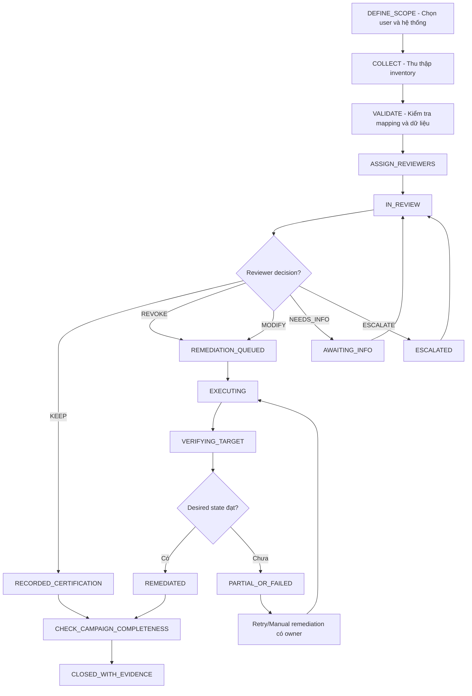
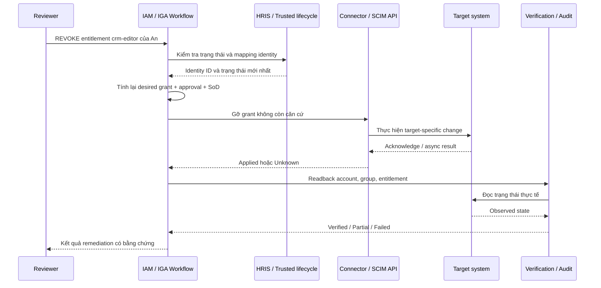

# Review theo user trong Access Review: Rà soát toàn bộ quyền của một danh tính

**Review theo user** (*user-centric access review*, *user-based access certification*) là phương pháp rà soát quyền truy cập theo **từng danh tính người dùng**: tập hợp những tài khoản, role, group, entitlement, đặc quyền và ngoại lệ mà người đó đang nắm giữ ở các hệ thống; xác định vì sao có quyền; rồi để người có thẩm quyền đánh giá quyền nào **còn cần thiết, đúng phạm vi và phải được giữ, sửa hoặc thu hồi**.

Khác với chỉ kiểm tra một nhóm hay một ứng dụng, góc nhìn theo user đặt câu hỏi: **“Người này hiện có thể làm gì trên toàn bộ các hệ thống liên quan, và tất cả những quyền đó còn phù hợp với công việc hiện tại không?”** Ví dụ một nhân viên chuyển từ Sales sang Audit có thể đã được cấp `audit-reader` nhưng vẫn giữ `crm-editor`, quyền export dữ liệu, một phiên đặc quyền PAM và một tài khoản local trên ứng dụng cũ. Review theo user giúp phát hiện **privilege creep** và **quyền truy cập tồn dư** mà việc chỉ xem role mới không thấy được.

Bài thuộc chương **Access review** của module `SECURITY_IDENTITY_ACCESS_MANAGEMENT_IDENTITY_LIFECYCLE`, mô tả quản lý vòng đời danh tính theo **Joiner–Mover–Leaver (JML)**, từ xác minh và tạo tài khoản đến cấp quyền, rà soát, thu hồi khi thay đổi vai trò hoặc kết thúc quan hệ. Nội dung kết nối **IdP, SSO, SCIM, RBAC/ABAC, tài khoản dịch vụ, kiểm toán và đối soát quyền thực tế**. Review theo user là một lớp **kiểm soát phát hiện và xác nhận quyền**, không thay thế kiểm soát ngăn chặn tại điểm truy cập.

Sau bài học, bạn có thể thiết kế một chiến dịch review theo user; xác định danh sách người và quyền phải rà soát; phân biệt assigned, inherited và effective access; lựa chọn reviewer; xử lý quyết định giữ, thu hồi, sửa hoặc chuyển xử lý ngoại lệ; theo dõi remediation tới lúc được xác minh; và áp dụng review với nhân viên, nhà thầu, Leaver, account đặc quyền và workload.

## 1. Access review là gì, và vì sao phải review theo user?

**Access review** là quá trình người hoặc vai trò có thẩm quyền **tái xác nhận tính hợp lệ và nhu cầu tiếp tục sử dụng quyền truy cập**. Một quyền từng được phê duyệt khi cấp không bảo đảm vẫn đúng khi người dùng đổi đội, chuyển dự án, lên chức hoặc nghỉ việc.

Có nhiều cách tổ chức review:

| Kiểu review | Trục chính | Câu hỏi chủ đạo |
| --- | --- | --- |
| **Theo user** | Một danh tính và toàn bộ quyền liên quan | An hiện có những quyền nào? Còn quyền nào cần cho công việc của An? |
| **Theo role/group** | Một vai trò hoặc nhóm | Ai đang giữ `finance-approver`? Những thành viên đó còn đủ điều kiện? |
| **Theo application** | Một ứng dụng | Ai có quyền trên CRM và mức quyền ra sao? |
| **Theo entitlement nhạy cảm** | Một permission hoặc khả năng có rủi ro | Những ai có quyền export dữ liệu hoặc quản trị production? |
| **Theo tài nguyên/dữ liệu** | Một tập tài liệu, kho dữ liệu, tenant | Ai có thể xem dữ liệu tài chính `org-17`? |
| **Theo sự kiện JML** | Joiner, Mover, Leaver và ngoại lệ | Sự kiện HR vừa xảy ra có làm quyền cũ không còn hợp lệ? |

Review theo user hữu ích khi muốn đánh giá **bức tranh tổng thể** của một cá nhân, nhất là các quyền ở nhiều ứng dụng, quyền cấp trực tiếp ngoài IAM, quyền do group lồng nhau và quyền tạm thời.

Tuy nhiên, review theo user **không tự động đầy đủ** nếu dữ liệu connector chỉ bao phủ vài ứng dụng. Một chiến dịch phải công bố rõ **phạm vi hệ thống được kiểm tra, độ mới của dữ liệu và phần chưa quan sát được** để không tạo cảm giác “mọi quyền của người dùng đã được chứng nhận” khi còn nguồn chưa kết nối.

## 2. Reviewer đang chứng nhận điều gì?

Một quyết định review đúng không chỉ hỏi “có đồng ý để người đó tiếp tục có quyền không?”. Reviewer cần chứng nhận:

1. **Danh tính đúng:** entitlement thuộc đúng người, đúng quan hệ nhân sự, không ghép nhầm tài khoản vì trùng email hoặc username.
2. **Căn cứ hợp lệ:** quyền phục vụ vai trò, nhiệm vụ, hợp đồng hoặc dự án còn hiệu lực.
3. **Mức tối thiểu:** permission, action và phạm vi tài nguyên không rộng hơn nhu cầu.
4. **Không xung đột:** không vi phạm Separation of Duties (**SoD**), ví dụ tự tạo và tự phê duyệt cùng giao dịch.
5. **Nguồn cấp rõ ràng:** được cấp qua business role, group, entitlement trực tiếp, ngoại lệ hay PAM/JIT; ai sở hữu grant.
6. **Thời hạn hợp lệ:** quyền tạm còn trong khoảng được phê duyệt; quyền đặc quyền không tồn tại vĩnh viễn ngoài lý do.
7. **Thực thi có bằng chứng:** sau quyết định thu hồi/sửa quyền, trạng thái đích và khả năng truy cập thực tế đã được kiểm tra.

**Một quyết định KEEP không phải chứng nhận “người này đáng tin mãi mãi”.** Nó chỉ xác nhận quyền trong **phạm vi và thời điểm review**, với điều kiện bằng chứng đã đủ. Nếu role, công việc hoặc chính sách thay đổi sau đó, quyền phải được đánh giá lại theo JML và cơ chế kiểm soát đang áp dụng.

### Ví dụ xuyên hệ thống

Giả sử An, `identityId=iam-user-1042`, đang làm kiểm toán nội bộ. Review theo user có thể thu được:

| Quyền | Nguồn | Trạng thái ban đầu | Vấn đề cần xem xét |
| --- | --- | --- | --- |
| `portal-user` | Nhóm cơ sở của nhân viên | Đang có | Có còn ACTIVE và cần portal? |
| `audit-reader` | IAM business role | Đang có | Đúng phạm vi báo cáo không? |
| `crm-editor` | Group Sales cũ | Đang có | Có phải quyền tồn dư sau Mover? |
| `finance-export` | Gán trực tiếp trong SaaS | Đang có | Ai duyệt? Có cần export toàn bộ? |
| `prod-operator` | PAM/JIT exception | Còn hạn trên hệ thống | Ticket đã đóng hay chưa? |
| `local-admin` | Tài khoản cục bộ trên hệ thống cũ | Chưa xác minh | Cần phát hiện/đối soát riêng |
| Session/token đã phát | IdP/ứng dụng | Có thể còn hiệu lực | Thu hồi role có làm mất truy cập ngay không? |

Một chiến dịch có thể kết luận giữ `portal-user` và `audit-reader`, thu hồi `crm-editor`, yêu cầu điều chỉnh phạm vi `finance-export`, xem xét `prod-operator`, và đánh dấu `local-admin` là **chưa đủ dữ liệu**. Không nên chọn “Approve All” chỉ vì An vẫn làm việc tại công ty.

## 3. Phạm vi và đơn vị review: Danh tính, account, entitlement và grant

Trước khi review, cần mô hình hóa **mối quan hệ giữa con người và các tài khoản**.

| Đối tượng | Ý nghĩa | Ví dụ |
| --- | --- | --- |
| **Identity** | Danh tính nghiệp vụ ổn định được IAM quản lý | `iam-user-1042` |
| **Person/worker record** | Bản ghi HR/nhà thầu có thẩm quyền | `EMP-0102` |
| **Target account** | Tài khoản kỹ thuật tại ứng dụng/IdP | `user-735` trong CRM |
| **Role** | Nhóm permission định nghĩa theo chức năng | `audit-reader` |
| **Group membership** | Quan hệ thành viên nhóm IdP/directory | `cn=finance-readers` |
| **Entitlement** | Quyền cụ thể ở hệ thống đích | `report.export`, `tenant.admin` |
| **Grant / assignment** | Bằng chứng một quyền được cấp cho danh tính | `grant-884`, source, approval, expiry |
| **Effective access** | Những hành động thực sự được phép tại PEP/API | `document.read` trên một tenant nhất định |

**Một người có thể sở hữu nhiều target account**, trong đó có account đặc quyền tách biệt với account làm việc thường ngày. Ngược lại, một service account có thể có nhiều người từng phụ trách. Review theo user phải tránh:

- Bỏ sót account phụ, tài khoản local, tài khoản đặc quyền hoặc account được tạo trước khi dùng SSO.
- Ghép nhầm tài khoản của hai người dùng vì cùng họ tên/email.
- Coi tên user ở target như khóa bất biến khi username có thể thay đổi.
- Đếm cùng một quyền hai lần như hai căn cứ độc lập chỉ vì nó được hiển thị qua nhiều group.
- Bỏ qua quyền trực tiếp vì chỉ thu thập role tại IdP.

### Identity mapping là điều kiện tiên quyết

Nên dùng **ID ổn định** và mapping được xác minh giữa HRIS, IAM, IdP, directory và ứng dụng. Email, username, DN hoặc tên hiển thị có thể đổi trong Mover/rename/rehire. Khi mapping **không chắc chắn**, cần đưa vào **review ngoại lệ** chứ không tự gộp hai account.

## 4. Access inventory: Thu thập dữ liệu trước chiến dịch

Review theo user chỉ tốt nếu bức tranh quyền **đủ rộng và đủ mới**. Nguồn dữ liệu thường gồm:

- **HRIS hoặc hệ thống quản lý nhà thầu:** quan hệ, đơn vị, người quản lý, ngày hiệu lực, trạng thái.
- **IAM/IGA:** identity ID, business role, entitlement catalog, approval, ngoại lệ và nguồn cấp.
- **IdP/directory:** account, group và membership, trạng thái khóa, một số chính sách đăng nhập.
- **SCIM/API connectors:** account, nhóm, application role, license hoặc grant theo khả năng target.
- **PAM/PIM:** tài khoản đặc quyền, role eligible/active, quyền JIT và session.
- **Cloud/DB/Kubernetes:** IAM role, database privileges, RBAC namespace, quyền trực tiếp.
- **Hệ thống nghiệp vụ:** owner, tenant, các quan hệ chia sẻ hoặc cấp quyền ở cấp đối tượng.
- **Audit/usage:** dấu hiệu sử dụng quyền, nhưng không được coi là căn cứ duy nhất để giữ quyền.

| Thuộc tính dữ liệu | Cần biết để review | Ví dụ rủi ro khi thiếu |
| --- | --- | --- |
| `collectedAt` | Snapshot được lấy lúc nào? | Dùng dữ liệu cũ trước Mover |
| `sourceSystem` | Dữ liệu từ đâu? | Nhầm quyền IAM mong đợi với quyền thực tế |
| `completeness` | Đã đọc đủ trang, OU, tenant và scope chưa? | Bỏ sót account hoặc quyền |
| `identityMappingConfidence` | Account có gắn đúng người không? | Thu hồi nhầm tài khoản người khác |
| `grantSource` | Vì sao có quyền? | Không biết quyền còn căn cứ từ role nào |
| `resourceScope` | Quyền áp đến đối tượng nào? | Tưởng read-only là chỉ một dự án nhưng là toàn tenant |
| `validUntil` | Khi nào quyền hết hạn? | Ngoại lệ tạm trở thành quyền lâu dài |
| `riskClass` | Mức nhạy cảm của entitlement | Role admin bị review như quyền cơ sở |

**Một kết quả API thành công không chứng minh inventory đầy đủ.** Phải kiểm tra pagination, quyền của account connector, giới hạn truy vấn, replica và những đích không hỗ trợ đọc đầy đủ. Nếu dữ liệu chưa đáng tin, đánh dấu **UNKNOWN/INCOMPLETE** và xử lý tiếp, không để reviewer chứng nhận trên một bảng tưởng như hoàn chỉnh.

## 5. Assigned access khác effective access

Một người có thể có **tên trong role** nhưng chỉ được thực hiện một phần hành động theo ABAC; ngược lại có thể không có role IAM chính thức nhưng được cấp quyền trực tiếp hoặc thông qua nhóm lồng nhau.

Phân biệt:

| Lớp | Ý nghĩa | Ví dụ |
| --- | --- | --- |
| **Direct assignment** | Quyền được cấp thẳng cho account | Application role `crm-editor` |
| **Group-based** | Quyền do thành viên group | `finance-readers` |
| **Inherited/transitive** | Quyền qua nhóm/role phân cấp | Role cao kế thừa quyền đọc |
| **Eligible privileged access** | Có thể kích hoạt đặc quyền khi đủ điều kiện | PAM role eligible nhưng chưa active |
| **Active privileged access** | Đặc quyền đang hiệu lực trong thời gian nhất định | Session JIT đang mở |
| **Resource-level share** | Quyền do chia sẻ bản ghi/thư mục/dataset | Document được share trực tiếp |
| **Effective authorization** | Kết quả sau PEP/PDP, deny, ABAC và trạng thái | Có thể sửa invoice 782 hay không |

Review theo user nên hiển thị **căn cứ cấp** và, khi khả thi, **đường dẫn tạo quyền hiệu lực**.

Ví dụ:

```text
iam-user-1042
  └─ memberOf: finance-operations
      └─ nestedGroup: global-reporting
          └─ applicationRole: report-exporter
              └─ permission: reports.export
```

Nếu reviewer chỉ thấy `finance-operations` và không biết group lồng nhau tạo `reports.export`, họ khó đánh giá rủi ro thực. Ngược lại, danh sách quá nhiều phép ánh xạ trùng cũng có thể gây **review fatigue**. Giao diện cần nhóm quyền theo ứng dụng, nhiệm vụ và mức rủi ro, nhưng vẫn giữ **provenance và chi tiết mở rộng**.

### Role trong token có thể đã cũ

IdP có thể phát access token chứa role lúc 08:30; Mover gỡ role lúc 09:00; API chỉ kiểm tra token đến 10:00. Inventory quyền tại IdP lúc 09:15 cho thấy role đã mất, nhưng **effective access** có thể chưa mất tại API. Khi remediation đặc biệt nhạy cảm, phải xét session, token, cache, khả năng revoke/introspection và kiểm tra trạng thái thực tại PEP.

## 6. Vai trò của reviewer: Ai đủ thẩm quyền xác nhận?

Một chiến dịch user-centric thường giao **quản lý trực tiếp** xem toàn bộ quyền của nhân viên, nhưng manager **không nhất thiết hiểu chi tiết permission kỹ thuật**. Mỗi loại quyền có thể cần reviewer khác hoặc kiểm tra nhiều lớp.

| Reviewer | Hiểu biết phù hợp | Giới hạn thường gặp |
| --- | --- | --- |
| **Line manager** | Công việc hiện tại, quan hệ nhân sự, dự án | Có thể không hiểu `db_owner` hoặc `iam:PassRole` |
| **Application owner** | Mô hình role và chức năng ứng dụng | Không biết người đó còn cần nhiệm vụ cụ thể không |
| **Data owner** | Mức độ nhạy cảm, quyền xem dữ liệu và tenant | Không trực tiếp quản lý nhân sự |
| **Role owner** | Business role, permission mapping, SoD | Không biết mọi grant ngoài catalog |
| **Security/IAM governance** | Rủi ro, đặc quyền, phân tách nhiệm vụ, policy | Không thể tự quyết định nhu cầu nghiệp vụ của mọi người |
| **Workload owner** | Mục đích tài khoản máy, dependency, API scope | Cần phối hợp người quản trị target |

**Không nên yêu cầu một reviewer không có khả năng đánh giá ký xác nhận mọi quyền** chỉ để đủ tỷ lệ hoàn tất. Có thể thiết kế **two-step review**: manager xác nhận người dùng còn cần nhiệm vụ, app/data owner xác nhận entitlement cụ thể và Security kiểm tra quyền rủi ro cao.

### Phân tách quyền review

Reviewer không nên **tự chứng nhận quyền nhạy cảm của chính mình** nếu policy yêu cầu độc lập. Cũng cần tránh reviewer được cấp quyền sửa policy hoặc sửa dữ liệu nguồn rồi tự chứng nhận kết quả. Quyền xem bằng chứng, quyền đưa quyết định và quyền thực hiện remediation nên được quản trị riêng khi mức rủi ro đòi hỏi.

### Delegation

Khi manager nghỉ phép, có thể cho **ủy quyền review có thời hạn và được phê duyệt**. Phải ghi người ủy quyền, người nhận ủy quyền, phạm vi, thời hạn và căn cứ; không giao tự động cho bất kỳ người nào mà không xác minh thẩm quyền.

## 7. Những quyết định reviewer có thể đưa ra

Không nên chỉ có nút **Approve All**. Với mỗi entitlement hoặc nhóm entitlement hợp lý, reviewer có thể chọn:

| Decision | Ý nghĩa | Hậu quả workflow |
| --- | --- | --- |
| **KEEP / CERTIFY** | Tiếp tục giữ quyền trong phạm vi được xác nhận | Ghi lý do, evidence và thời hạn review tiếp theo |
| **REVOKE** | Quyền không còn căn cứ | Tạo remediation gỡ entitlement ở đích, xác minh |
| **MODIFY / REDUCE** | Vẫn cần chức năng nhưng phạm vi đang quá rộng | Cấp phạm vi nhỏ đúng rồi gỡ quyền rộng; kiểm chứng tránh gián đoạn |
| **ESCALATE** | Cần chủ quyền/đội chuyên môn khác đánh giá | Chuyển đúng owner, có SLA |
| **NEEDS_INFO** | Thiếu căn cứ hoặc mapping chưa đủ tin cậy | Yêu cầu bổ sung, không tự chứng nhận |
| **EXCEPTION** | Quyền tạm phải giữ vì lý do khẩn/đặc biệt | Phê duyệt theo rủi ro, scope và expiry rõ |
| **NOT_APPLICABLE / WRONG_IDENTITY** | Quyền bị gắn nhầm người hoặc nằm ngoài campaign | Điều tra identity mapping, không sửa mù quáng |

**Tùy engine, bộ decision có thể khác tên**. Điểm quan trọng là **kết quả review phải chuyển thành hành động có thể theo dõi**, không bị đóng ngay khi reviewer chọn Revoke.

### KEEP phải có căn cứ

Lý do “vẫn đang làm việc” thường quá chung cho quyền đặc quyền. Với `prod-admin`, reviewer nên xác định nhiệm vụ, tần suất, ứng dụng, phạm vi và vì sao không dùng role read-only hoặc JIT.

### MODIFY phức tạp hơn REVOKE

Nếu một người chỉ cần đọc báo cáo của `org-17` nhưng đang có `report-all-tenants`, việc giảm quyền có thể cần:

1. Xác nhận quyền thay thế có tồn tại.
2. Phê duyệt và provision quyền hẹp hơn.
3. Kiểm tra quyền mới hoạt động cho nhiệm vụ hợp lệ.
4. Thu hồi quyền rộng cũ.
5. Đối soát trạng thái và lưu lý do.

Cần kiểm tra SoD và thứ tự thay đổi: với xung đột rủi ro cao, có thể phải **thu hồi quyền rộng trước** để tránh tiếp tục giữ đặc quyền ngoài phạm vi.

## 8. State machine của chiến dịch review theo user

Một campaign không nên được coi là hoàn tất chỉ vì tất cả reviewer đã bấm nút. Nên tách **quá trình đưa quyết định** và **thực thi remediation**.



Sơ đồ này mô tả một **quy trình tham khảo**. Một số hệ thống sẽ có trạng thái `OVERDUE`, `CANCELLED`, `SUSPENDED` hoặc `EXCEPTION_APPROVED`. Với nhiều user và entitlement, campaign tổng phải dựa vào những item bắt buộc đã có quyết định **và remediation đạt yêu cầu**.

### Các trạng thái không được đánh đồng

| Trạng thái | Có thể nói gì? | Chưa thể nói gì? |
| --- | --- | --- |
| `ASSIGNED` | Đã giao reviewer | Quyền đã được đánh giá |
| `IN_REVIEW` | Đang xem xét | Đã có quyết định |
| `DECIDED_REVOKE` | Reviewer yêu cầu thu hồi | Quyền đã biến mất tại target |
| `REMEDIATION_QUEUED` | Đã tạo công việc | Connector đã thực thi |
| `REMEDIATION_APPLIED` | API/connector đã áp theo ngữ nghĩa đích | Effective access đã bị chặn trên mọi phiên |
| `VERIFIED_REVOKED` | Trạng thái mong đợi được kiểm chứng ở target | Quyền khác ngoài phạm vi review cũng đã bị thu hồi |
| `EXCEPTION_GRANTED` | Giữ quyền theo ngoại lệ có điều kiện | Quyền được giữ vô thời hạn |
| `CLOSED` | Điều kiện đóng campaign đã đạt | Từ nay không cần review tiếp |

**Tỷ lệ reviewer hoàn tất 100% không đồng nghĩa tỷ lệ thu hồi thành công 100%.** Đây là một trong những ngộ nhận lớn nhất khi đo hiệu quả access review.

## 9. Từng bước triển khai chiến dịch review theo user

### Bước 1 — Xác định mục tiêu và phạm vi

Trước khi mở campaign, cần xác định:

- Bao gồm **nhân viên**, **nhà thầu**, **đối tác**, **account đặc quyền** nào?
- Những ứng dụng/tenant/OU nào thuộc phạm vi?
- Những entitlement nào **bắt buộc review**, có được bỏ qua role cơ sở rủi ro thấp theo policy không?
- Những quyền nào cần review tăng tần suất: admin, export, dữ liệu nhạy cảm, quyền SoD, quyền JIT lâu bất thường?
- Ai là owner, reviewer, reviewer dự phòng và người có quyền phê duyệt ngoại lệ?
- Dữ liệu snapshot phải mới đến mức nào?
- Kết quả nào là điều kiện đóng campaign?
- Nếu thiếu dữ liệu hoặc reviewer quá hạn, ai xử lý?

**Đừng công bố “đã review toàn bộ quyền” nếu chỉ có IdP và hai SaaS trong phạm vi.** Cần khai báo coverage để có thể so sánh giữa các kỳ.

### Bước 2 — Xác nhận danh tính và trạng thái JML

Lấy trạng thái HR/nhà thầu được xác minh:

- `identityId` ổn định, loại quan hệ, unit/project và manager hiện hành.
- `effectiveAt` cho Mover/Leaver.
- Ngày bắt đầu/kết thúc hợp đồng.
- Những quan hệ khác còn hợp lệ, ví dụ một người vừa là nhân viên vừa có vai trò đối tác.
- Quy tắc rehire và cách liên kết account cũ/mới.

Nếu người đã Leaver mà account vẫn ACTIVE, đây là **finding ưu tiên cao**. Không cần chờ manager bấm Keep/Revoke để chặn một đường truy cập rõ ràng không còn căn cứ; phải thực thi quy trình offboarding có thẩm quyền và ghi nhận trong review.

### Bước 3 — Thu thập và chuẩn hóa entitlement

Tạo danh sách các account và quyền theo danh tính, với:

- Ứng dụng, môi trường, tenant và target account ID.
- Role/group/permission cụ thể, direct vs inherited.
- Quyền theo resource, nếu có.
- Nguồn cấp: business role, access request, JIT, manual, group lồng nhau.
- Owner, approval, `validUntil`, lần thay đổi gần nhất.
- Risk classification và dữ liệu sử dụng (nếu có).
- Timestamp snapshot, khả năng đọc đầy đủ và độ tin cậy mapping.

**Chuẩn hóa không đồng nghĩa mất ngữ nghĩa.** `read` của một tenant không giống `read` toàn tổ chức. Quyền `admin` của ứng dụng A không tương đương `admin` của ứng dụng B. Giao diện có thể gom nhóm nhưng phải cho reviewer xem chi tiết cần thiết.

### Bước 4 — Xác định reviewer và chính sách quyết định

Chọn manager cho căn cứ công việc; app/data owner cho entitlement chuyên biệt; Security/IAM cho SoD hoặc quyền đặc quyền. Với quyền đã cấp trực tiếp ngoài catalog, phải có đường xử lý tìm chủ sở hữu thay vì tự động coi là hợp lệ.

### Bước 5 — Đưa quyết định dựa trên bằng chứng

Reviewer chọn **KEEP, REVOKE, MODIFY, ESCALATE hoặc NEEDS_INFO** cho quyền trong phạm vi; ghi lý do, phiên bản và thời điểm. Không cho “Approve All” bỏ qua quyền đặc biệt không đủ bằng chứng nếu policy yêu cầu xác nhận từng item.

### Bước 6 — Tạo remediation và kiểm soát thực thi

Chuyển quyết định REVOKE/MODIFY thành công việc cụ thể theo target, owner, SLA và tương quan với grant. Không chạy thao tác gỡ quyền thiếu kiểm soát khi nhiều role khác vẫn có căn cứ dùng chung entitlement.

### Bước 7 — Readback và xác minh effective access khi cần

Sau khi connector trả thành công, đọc lại trạng thái account/role/group tại đích. Với quyền đặc quyền hoặc tài nguyên nhạy cảm, cần xét session, token, API policy và các đường quyền cục bộ. Nếu không có khả năng xác minh, ghi **UNKNOWN hoặc MANUAL_VERIFICATION_REQUIRED** chứ không báo thành công giả.

### Bước 8 — Đóng campaign và lên lịch kỳ tiếp theo

Campaign có thể đóng khi mọi item bắt buộc được review, những hành động khắc phục hoàn tất hoặc được chuyển sang **exception theo policy được phê duyệt**, và mọi finding tồn đọng có owner/SLA. Tạo báo cáo coverage, decision, remediation, overdue và rủi ro chưa xử lý.

## 10. Ví dụ bản ghi review theo user

Dữ liệu dưới đây là **schema minh họa**, không phải API chuẩn của IGA/SCIM.

```yaml
campaignId: review-q4-2026
reviewId: review-user-1042
subject:
  identityId: iam-user-1042
  workerType: employee
  employmentStatus: ACTIVE
  department: audit
reviewer:
  identityId: iam-manager-17
  role: line-manager
snapshotAt: "2026-11-20T02:00:00Z"
identityMappingStatus: VERIFIED
coverage:
  - corporate-idp
  - crm-saas
  - reporting-app
items:
  - itemId: rev-101
    target: reporting-app
    targetAccountId: report-735
    entitlement: audit-reader
    grantSource: IAM_ROLE
    risk: medium
    decision: KEEP
    reason: Needed for current audit responsibilities
  - itemId: rev-102
    target: crm-saas
    targetAccountId: crm-294
    entitlement: crm-editor
    grantSource: STALE_GROUP
    risk: high
    decision: REVOKE
    reason: Former Sales role after Mover
    remediationStatus: QUEUED
  - itemId: rev-103
    target: corporate-idp
    entitlement: prod-operator
    grantSource: PAM_JIT
    risk: critical
    decision: ESCALATE
    escalationOwner: platform-security
status: REMEDIATION_PENDING
```

Lưu ý hai điểm:

- `snapshotAt` cho biết **thời điểm quan sát**, không chứng minh dữ liệu còn mới khi campaign đóng. Sự kiện Mover/Leaver sau snapshot phải được xem xét.
- `decision=REVOKE` kèm `remediationStatus=QUEUED` **chưa phải quyền đã thu hồi**. Cần tiếp tục theo dõi kết quả từng target.

### Event audit cho một quyết định

```json
{
  "eventId": "review-decision-0192",
  "campaignId": "review-q4-2026",
  "reviewId": "review-user-1042",
  "itemId": "rev-102",
  "actorId": "iam-manager-17",
  "decision": "REVOKE",
  "reasonCode": "ROLE_NOT_REQUIRED_AFTER_MOVER",
  "policyVersion": "review-policy-v8",
  "decidedAt": "2026-11-21T07:12:00Z",
  "correlationId": "review-flow-82a1"
}
```

Thông tin audit phải có sự liên kết tới **target operation và kết quả xác minh**, không chỉ dừng ở quyết định của reviewer.

## 11. Nguyên tắc thu hồi sau review: Gỡ đúng căn cứ, không xóa mù quáng

Một entitlement có thể được cấp bởi **nhiều nguồn cùng lúc**. Ví dụ:

```text
iam-user-1042
  ├── businessRole: audit-reader -------> reports.read
  └── approvedProjectGrant: PRJ-882 ---> reports.read
```

Nếu reviewer thu hồi business role `audit-reader`, quyền `reports.read` có thể vẫn hợp lệ theo grant dự án `PRJ-882`. Một workflow chỉ gỡ membership không kiểm tra provenance có thể:

- **Thu hồi nhầm** quyền vẫn cần cho nhiệm vụ được duyệt.
- **Không thu hồi hết** quyền vì một grant khác tiếp tục cấp lại entitlement.
- Bị connector hoặc policy tự động tái provision ngay sau khi xóa thủ công.

Cách tiếp cận phù hợp:

1. Liên kết item review với **nguồn cấp/assignment cụ thể**.
2. Tính lại **desired entitlement** từ toàn bộ căn cứ còn hợp lệ.
3. Xác định thao tác cần làm ở từng đích, cân nhắc SoD và mức rủi ro.
4. Thu hồi hoặc thu hẹp **quyền không còn căn cứ**.
5. Kiểm tra không có luồng provisioning khác tự cấp lại quyền.
6. Đọc lại observed state và, với quyền quan trọng, đánh giá effective access.

**REVOKE một grant không nhất thiết làm mất permission cuối cùng nếu còn căn cứ khác.** Nếu reviewer yêu cầu người dùng **không được thực hiện action đó dưới mọi hình thức**, phải tìm và xử lý tất cả đường cấp và các policy liên quan — không chỉ một assignment.

## 12. Review theo user trong Joiner

Ở giai đoạn **Joiner**, kiểm tra quyền ban đầu có thể là một **baseline review**: người mới được cấp quyền phù hợp với nhiệm vụ và thời điểm bắt đầu, không có đặc quyền phát sinh ngoài chính sách.

| Nội dung | Kiểm tra | Kết quả mong đợi |
| --- | --- | --- |
| HR identity | Có bản ghi và ID nguồn được xác minh | Không ghép nhầm người |
| Effective date | Đã đến thời điểm bắt đầu hợp lệ chưa? | Không mở quyền nghiệp vụ quá sớm |
| Role cơ sở | Chỉ role được catalog cho phép | Không cấp admin “cho chắc” |
| Group/IdP | Đúng nhóm theo nhiệm vụ | Không thừa nested membership |
| SCIM application role | Đồng bộ đúng application entitlements | Không tạo account trùng |
| Tài khoản đặc quyền | Có căn cứ riêng và phê duyệt cao hơn | Không mặc định có quyền production |
| Effective access | API áp đúng phạm vi/tenant | Role cơ sở không mở mọi dữ liệu |

**Không nên biến review Joiner thành việc duyệt lại mọi quyền cơ sở đã được kiểm soát tốt một cách thủ công**, nếu tổ chức có auto-certification được policy cho phép. Nhưng phải kiểm tra các ngoại lệ rủi ro và khả năng role/attribute bị mapping sai.

### Ví dụ Joiner có quyền đặc biệt

An mới vào đội phát triển. Một quản trị viên cấp `prod-admin` để đỡ chậm công việc. Review theo user phát hiện role này không nằm trong baseline Joiner, không có approval và không có nhiệm vụ production. Decision phù hợp là **REVOKE/ESCALATE** theo rủi ro, đồng thời sửa quy trình provisioning gây cấp thừa.

## 13. Review theo user trong Mover

**Mover** là tình huống rất cần review vì nhân viên dễ tích lũy quyền. Khi chuyển bộ phận hoặc dự án, IAM nên **tính lại desired state**, gỡ quyền cũ và cấp quyền mới theo phê duyệt.

Ví dụ An chuyển từ Sales sang Audit:

| Entitlement | Trước Mover | Sau Mover mong đợi | Decision |
| --- | --- | --- | --- |
| `employee-basic` | Có | Có | KEEP |
| `crm-editor` | Có | Không | REVOKE |
| `audit-reader` | Không | Có nếu được duyệt | Cấp theo workflow riêng |
| `finance-export-all` | Có thể được cấp thủ công | Chỉ giữ nếu còn nhiệm vụ cụ thể | MODIFY/REVOKE |
| `sales-dashboard-local` | Có | Không | REVOKE |
| PAM role đặc quyền Sales | Có thể eligible/active | Không còn căn cứ | REVOKE và kiểm tra session |

Review theo user giúp phát hiện quyền **ngoài IAM** mà quy trình Mover không tự xử lý: account local, role trực tiếp trong SaaS, nhóm lồng nhau, dự án cũ hoặc access key còn dùng được.

### Đừng chờ kỳ review định kỳ để xử lý Mover

Nếu HR đã xác nhận Mover có hiệu lực, quyền cũ không hợp lệ cần được điều chỉnh **theo sự kiện**, không chờ chiến dịch review quý sau. User-centric review định kỳ là **lớp kiểm tra độc lập** để phát hiện những quyền chưa được thu hồi và tìm lỗi trong connector hoặc role mapping.

### SoD khi chuyển nhiệm vụ

Một người trước đây có quyền tạo lệnh thanh toán, nay chuyển sang phê duyệt. Nếu vẫn giữ quyền cũ, có thể vi phạm **Static Separation of Duties**. Thậm chí nếu role cũ đã gỡ, ứng dụng vẫn phải chặn người đó **duyệt giao dịch do chính mình tạo** qua kiểm tra SoD trên dữ liệu nghiệp vụ.

Reviewer cần nhận diện cả **role conflict** và **object-level conflict**, không chỉ nhìn tên entitlement.

## 14. Review theo user trong Leaver

Khi người dùng **Leaver**, quyền dựa trên quan hệ đã kết thúc phải được thu hồi theo quy trình **offboarding có thẩm quyền**, không chỉ chờ reviewer xác nhận.

Các kiểm tra ưu tiên:

1. **IdP/directory:** account đã disabled, đăng nhập mới bị chặn?
2. **SCIM/SaaS:** account và application roles đã bị gỡ/vô hiệu hóa theo policy?
3. **Local accounts:** những tài khoản không qua SSO có còn hoạt động?
4. **Role/group trực tiếp:** quyền gán thủ công hoặc nhóm lồng nhau còn không?
5. **PAM/JIT:** phiên đặc quyền, key, role eligible hoặc grant tạm còn không?
6. **Session/token:** access token, refresh token và session local còn khả năng sử dụng?
7. **Tài nguyên chia sẻ:** quyền trực tiếp vào folder, database, project hoặc object có được xử lý?
8. **Workload ownership:** script, CI/CD và tài khoản máy do người này sở hữu đã bàn giao?
9. **Audit và dữ liệu công việc:** được bảo toàn theo chính sách nhưng không cho Leaver tiếp tục truy cập?

**Không nên coi account bị xóa khỏi một directory là bằng chứng toàn bộ quyền đã biến mất.** Có thể còn session, token tự chứa, tài khoản SaaS local hoặc key độc lập.

### Leaver review là kiểm tra hậu thu hồi

Thay vì chờ ý kiến “Giữ hay gỡ?” đối với quyền đã mất căn cứ, review có thể chạy như **post-offboarding attestation**: xác minh quyền đã bị chặn và thu hồi, tìm finding còn tồn dư, giao owner và SLA khắc phục.

### Rehire

Người quay lại tổ chức cần được xác minh đúng danh tính và quan hệ hiện tại. Không tự phục hồi tất cả entitlement từng có chỉ vì cùng email hoặc username. Review cần đánh giá role hiện hành, ngoại lệ cũ, account có thể tái sử dụng và các approval đã hết hiệu lực.

## 15. Nhà thầu, đối tác và nhiều quan hệ nhân sự

Không phải mọi user là nhân viên toàn thời gian. Nhà thầu hoặc đối tác có thể có **ngày kết thúc hợp đồng**, **sponsor nội bộ**, tenant riêng hoặc quyền theo dự án.

| Tình huống | Câu hỏi review |
| --- | --- |
| Nhà thầu hết hợp đồng | Sponsor có xác nhận gia hạn hợp lệ không? Nếu không, quyền đã thu hồi? |
| Đối tác đổi dự án | Tất cả grant dự án cũ đã được gỡ? |
| Một người có hai quan hệ hợp lệ | Quyền nào thuộc từng quan hệ, có được giữ độc lập không? |
| Contractor có admin role | Vì sao cần đặc quyền và khi nào hết hạn? |
| Sponsor rời tổ chức | Ai tiếp nhận trách nhiệm duyệt/review quyền contractor? |
| User không có HR record rõ ràng | Có nguồn có thẩm quyền khác hay đây là orphan identity? |

**Thiếu HR record không tự động có nghĩa là Leaver trong mọi tổ chức**, vì một số đối tác được quản lý bởi hệ thống khác. Nhưng nếu không xác định được **nguồn có thẩm quyền hoặc owner** cho quan hệ, đó là finding phải điều tra, không thể chứng nhận giữ quyền theo suy đoán.

## 16. Tài khoản đặc quyền và PAM trong review theo user

Một kỹ sư có thể giữ:

- Account thường ngày: `an.nguyen`.
- Account quản trị: `adm-an.nguyen`.
- Role cloud `prod-operator`.
- Quyền eligible để kích hoạt role trong PAM/PIM.
- Grant JIT đang active trong vài giờ.
- Credential SSH hoặc API key riêng.

Nếu chỉ tổng hợp role của account thường ngày tại IdP, review sẽ **bỏ sót đặc quyền thực sự**.

### Eligible khác Active

Một role **eligible** cho phép chủ thể kích hoạt sau khi đáp ứng điều kiện; nó vẫn là **khả năng tiếp cận đặc quyền** cần review, dù chưa được kích hoạt tại thời điểm snapshot. Role active/JIT còn yêu cầu kiểm tra **phiên đang mở, hạn cấp và hành động đã dùng**.

### Quyền đặc quyền yêu cầu bằng chứng chặt chẽ hơn

Reviewer nên xem:

- Task hoặc chức năng cần đặc quyền.
- Owner target, scope môi trường/tenant và mức ảnh hưởng.
- Vì sao không thể dùng role read-only hoặc JIT ngắn hạn?
- Approval và SoD.
- Tần suất, thời điểm kích hoạt, session/command audit theo phân quyền.
- Các phương thức truy cập ngoài PAM và credential tách biệt.

**Không nhất thiết mọi admin đều bị thu hồi ngay**, nhưng quyền đặc quyền không có căn cứ hoặc không có owner không nên được mặc định KEEP.

## 17. Service account và workload không thể review như nhân viên

**Service account, service principal, CI/CD runner, workload identity và OAuth client** không phải người lao động trực tiếp. Chúng cần một mô hình chứng nhận quyền với **owner và mục đích kỹ thuật**.

| Trường | Câu hỏi cần trả lời |
| --- | --- |
| Workload principal ID | Đây là danh tính máy nào? |
| Owner/team | Ai chịu trách nhiệm và phê duyệt quyền? |
| Business/technical purpose | Job hoặc dịch vụ nào đang sử dụng? |
| Environment | Development, staging hay production? |
| API scope/resource | Chỉ được thao tác gì, trên tài nguyên nào? |
| Credential type | Workload federation, certificate, secret, API key? |
| Rotation/expiry | Bí mật có được quản lý và hết hạn đúng? |
| Last observed use | Có bằng chứng hoạt động không? Có ảnh hưởng nếu gỡ? |
| Dependencies | Dịch vụ nào sẽ lỗi khi quyền mất? |
| Decommission plan | Khi workload ngừng chạy, quyền bị thu hồi thế nào? |

Ví dụ `report-sync-prod` có role `tenant.admin` nhưng chỉ cần `reports.write` vào `org-17`. Review có thể quyết định **MODIFY** theo least privilege, cập nhật scope API, kiểm thử job và thu hồi role quá rộng.

**Không dùng một nhân viên rời công ty làm lý do tự động xóa mọi service account họ từng phụ trách**, nếu dịch vụ vẫn cần thiết. Cần chuyển owner và đánh giá/luân chuyển credential mà người cũ có thể biết, đồng thời rà soát quyền workload riêng.

### Quyền application-only và quyền người dùng

OAuth Client Credentials biểu diễn quyền của **workload**, không chứng minh một người dùng có quyền làm thay thao tác nghiệp vụ. Khi backend dùng app-only token, phải đánh giá **quyền của caller** nếu hành động được kích hoạt theo yêu cầu của người dùng, tránh lỗi *confused deputy*.

## 18. Phát hiện orphaned và dormant access

Hai nhóm finding thường gặp:

- **Orphaned access:** quyền hoặc account không còn owner, không có mapping danh tính hợp lệ, hoặc không còn quan hệ được chấp nhận.
- **Dormant access:** account/quyền không thấy sử dụng trong một thời gian theo khả năng quan sát.

**Không đồng nhất “không có log sử dụng” với “chắc chắn không cần quyền”.** Có thể quyền dùng cho khôi phục thảm họa, kiểm toán định kỳ, công việc cuối quý hoặc hệ thống thiếu telemetry. Tuy vậy, quyền nhạy cảm không dùng lâu là tín hiệu hữu ích để yêu cầu owner giải thích, thu hẹp hoặc chuyển sang JIT.

| Finding | Cách kiểm tra | Hướng xử lý |
| --- | --- | --- |
| Không tìm thấy owner | Tra nguồn HR/contractor/workload registry | Escalate, xác định owner, chặn rủi ro theo policy |
| Account không liên kết được identity | Kiểm tra target ID, nguồn và mapping | Không tự ghép người; xử lý ngoại lệ |
| Privileged account không đăng nhập lâu | Đánh giá job, emergency use và telemetry | Cân nhắc disable hoặc JIT, sau khi kiểm tra phụ thuộc |
| Grant đã hết hạn | Đối soát `validUntil` với target state | Thu hồi và xác minh |
| Entitlement không dùng nhưng vẫn rộng | Hỏi owner về nhiệm vụ thật | Reduce scope, revoke hoặc ngoại lệ có hạn |
| Service principal không còn deployment | Kiểm tra CI/CD, scheduled job, API usage | Decommission an toàn và revoke credential |

**Đừng để reviewer chọn KEEP cho một quyền không rõ chủ thể hoặc không rõ chức năng chỉ để kết thúc campaign.** Với quyền rủi ro cao, cần nâng cấp xử lý theo chính sách.

## 19. Risk-based review: Tần suất và độ sâu không cần bằng nhau

Một số entitlement là quyền cơ sở rủi ro thấp; số khác là quyền production admin, export dữ liệu nhạy cảm hoặc duyệt thanh toán. Review nên điều chỉnh **tần suất, approver và yêu cầu bằng chứng** theo rủi ro.

Ví dụ phân tầng **do tổ chức tự quyết định**, không phải thời hạn chuẩn bắt buộc:

| Nhóm rủi ro | Loại quyền | Cách review gợi ý |
| --- | --- | --- |
| **Thấp** | Portal/read-only thông thường | Manager review theo chu kỳ rộng, kết hợp automation |
| **Trung bình** | Quyền chỉnh sửa nghiệp vụ theo nhóm | Manager + app owner theo phạm vi |
| **Cao** | Export dữ liệu, phê duyệt tài chính, role nhiều tenant | Thường xuyên hơn; kiểm tra SoD và usage |
| **Rất cao** | Production admin, cấp grant, sửa IAM policy, vault admin | Chủ tài nguyên + Security; ưu tiên JIT và theo dõi session |
| **Không rõ nguồn** | Direct grant không owner, mapping không xác định | Xử lý ngoại lệ, không auto-certify |

Không đưa một tần suất cố định như “30 ngày” thành yêu cầu áp dụng cho mọi sản phẩm; việc lựa chọn phụ thuộc rủi ro, quy định, độ biến động nhân sự và khả năng vận hành.

### Review định kỳ và review theo sự kiện

- **Periodic campaign:** phát hiện sai lệch tồn đọng và chứng nhận lại quyền theo chu kỳ.
- **Event-driven review:** khởi tạo khi có Mover, thay đổi manager, chuyển dự án, tài khoản đặc quyền tăng quyền, bất thường hoặc Leaver.
- **Continuous control:** tự động phát hiện grant mới ngoài catalog, quyền hết hạn, orphan hoặc SoD conflict.

Các cơ chế này **bổ sung nhau**. Không nên chờ review quý sau để thu hồi quyền đã hết hiệu lực từ sự kiện JML hôm nay.

## 20. SoD và effective permissions trong review theo user

**Separation of Duties (SoD)** yêu cầu không cho một chủ thể đồng thời thực hiện những nhiệm vụ xung đột. Review theo user giúp nhìn thấy tổ hợp quyền xuyên ứng dụng.

Ví dụ:

| Entitlement | Ứng dụng | Rủi ro khi kết hợp |
| --- | --- | --- |
| `invoice.create` | ERP | Tạo hóa đơn |
| `invoice.approve` | ERP/Approval service | Tự duyệt hóa đơn do mình tạo |
| `vendor.create` | Vendor management | Tạo nhà cung cấp |
| `payment.execute` | Banking gateway | Tạo nhà cung cấp rồi tự trả tiền |
| `audit.log.modify` | Audit platform | Sửa dấu vết sau thao tác nhạy cảm |

SoD cần đánh giá **quyền thực tế**, không chỉ tên role. Một entitlement có thể xuất hiện qua group lồng nhau, role application hoặc direct permission.

Phân biệt:

- **Static SoD (SSD):** cấm giữ đồng thời những role/quyền xung đột.
- **Dynamic SoD (DSD):** hạn chế role được kích hoạt cùng phiên/ngữ cảnh.
- **Transaction/object-level SoD:** không cho một người duyệt tài nguyên mà họ đã tạo, kể cả ở phiên khác.

**Review không thay thế PEP/API.** Dù reviewer đã quyết định REVOKE, API vẫn phải kiểm tra SoD trên từng giao dịch ngay khi request thực hiện.

## 21. Kết quả review dẫn tới remediation như thế nào?

Một quyết định cần được chuyển thành thao tác **có nguồn gốc, có owner và được xác minh**.



Nếu connector chỉ trả HTTP 202 hoặc một acknowledgment, không nên tự cho rằng quyền đã mất hiệu lực ngay. Với quyền đặc quyền, cần xem thêm **session, access token, refresh token, API key và account cục bộ** khi relevant.

### Partial remediation

Một entitlement có thể được gỡ khỏi IdP nhưng vẫn còn role trực tiếp ở SaaS. Khi đó:

- Review decision vẫn là **REVOKE**.
- Một child remediation có thể **VERIFIED**.
- Child khác ở **FAILED/UNKNOWN/PENDING_RETRY**.
- **Remediation tổng chưa được công bố hoàn tất** nếu còn mục tiêu bắt buộc chưa đạt.

Cần đặt owner và SLA cho từng finding, kể cả ứng dụng không có connector tự động.

## 22. Race condition, sự kiện mới và snapshot cũ

Review thường diễn ra nhiều ngày. Trong thời gian đó, nhân viên có thể Mover, Leaver, được cấp grant mới hoặc thay đổi manager. Một snapshot hợp lệ lúc bắt đầu campaign có thể trở nên lỗi thời trước khi reviewer quyết định.

Ví dụ:

```text
Ngày 01: Campaign chụp quyền Sales của An.
Ngày 02: HR phát Mover sang Audit.
Ngày 03: IAM gỡ role Sales theo JML.
Ngày 04: Reviewer mở snapshot cũ và chọn KEEP crm-editor.
Ngày 05: Workflow không được tái cấp role Sales chỉ vì KEEP từ snapshot cũ.
```

**KEEP là quyết định giữ quyền đang được review trong phạm vi và thời điểm hợp lệ**, không phải lệnh unconditional GRANT. Nếu target đã gỡ quyền do Mover/Leaver, **không được tái cấp quyền trái chính sách từ một decision cũ**.

### Bảo vệ bằng version và revalidation

Trước remediation hoặc tái xác nhận:

1. Kiểm tra `identityId` và trạng thái HR/contractor hiện hành.
2. Đối chiếu phiên bản/snapshot của entitlement được review.
3. Xác định role/permission còn nằm trong desired state không.
4. Kiểm tra nguồn grant/approval còn hiệu lực.
5. Chặn quyết định stale, yêu cầu re-review khi thay đổi có tác động lớn.
6. Dùng idempotency key và version/CAS khi nhiều worker cùng cập nhật.
7. Ghi audit của event bị từ chối hoặc bỏ qua vì tới muộn.

**Không coi callback từ campaign cũ là nguồn có thẩm quyền cao hơn sự kiện Leaver mới**.

## 23. Không tự động thu hồi hàng loạt khi dữ liệu không đầy đủ

Giả sử connector CRM chỉ đọc 50% user vì lỗi phân trang. Campaign có thể hiển thị sai rằng hàng trăm nhân viên “không còn account” hoặc “không có role”. Nếu pipeline dùng danh sách thiếu để tự thu hồi/cấp lại hàng loạt, rủi ro gián đoạn rất lớn.

Cần phân biệt:

- **NO_ACCESS:** đã kiểm tra đầy đủ và xác nhận không có quyền.
- **UNKNOWN:** không đủ dữ liệu để kết luận.
- **MAPPING_AMBIGUOUS:** chưa biết target account thuộc danh tính nào.
- **STALE_SNAPSHOT:** dữ liệu không đạt freshness yêu cầu.
- **CONFIRMED_EXCESS:** đã có bằng chứng quyền ngoài desired state.

Khi thiếu dữ liệu, có thể mở finding và điều tra; **không gắn nhãn review complete** rồi suy ra mọi quyền đã hợp lệ hoặc mọi quyền đang thiếu đều phải cấp lại.

Riêng **Leaver đã được xác thực** cần đường chặn/thu hồi theo rủi ro và SLA, không bị trì hoãn vô thời hạn vì một campaign định kỳ thiếu dữ liệu.

## 24. Audit trail: Chứng minh ai đã quyết định và hệ thống đã làm gì

Để phục vụ kiểm toán, cần giữ:

| Nhóm bằng chứng | Nội dung |
| --- | --- |
| **Phạm vi** | Campaign, hệ thống, user, entitlement, snapshot time, coverage |
| **Identity** | Identity ID, target account ID, mapping và nguồn quan hệ |
| **Quyết định** | Reviewer, vai trò/thẩm quyền, quyết định, lý do, thời gian |
| **Policy** | Phiên bản quy tắc, SoD, tần suất review và exception |
| **Grant provenance** | Quyền đến từ role, group, request, direct grant hay JIT |
| **Remediation** | Operation ID, target, idempotency key, kết quả connector |
| **Verification** | Trạng thái target đọc lại, verifiedAt, effective access khi cần |
| **Exception** | Owner, phê duyệt, scope, expiry, lịch kiểm tra lại |
| **Follow-up** | SLA, escalations, finding tồn đọng, corrective action |

Một **decision timestamp** khác **revocation timestamp** và **verification timestamp**. Ví dụ reviewer chọn REVOKE lúc 10:00, connector áp lúc 10:03, đến 10:20 xác minh API không còn chấp nhận action. Báo cáo phải phản ánh **20 phút tới khi kiểm chứng**, không chỉ ba phút tới lúc API trả thành công.

### Dữ liệu nhạy cảm trong audit

Không ghi **password, access/refresh/ID token, session cookie, API key, client secret** hoặc toàn bộ hồ sơ HR vào log review. Quyền reviewer xem thông tin có thể khác quyền của đội Security/IAM xem chi tiết kỹ thuật. Cần bảo vệ bằng ACL, mã hóa khi thích hợp, thời hạn lưu và chính sách giảm thiểu dữ liệu.

## 25. Chỉ số đo chất lượng review theo user

| KPI/Chỉ số | Cách hiểu |
| --- | --- |
| **User coverage** | Tỷ lệ danh tính thuộc phạm vi đã có inventory và reviewer hợp lệ |
| **Application coverage** | Bao nhiêu hệ thống/tenant quan trọng thực sự có dữ liệu |
| **Review decision completion** | Tỷ lệ item có quyết định hợp lệ |
| **Remediation verification completion** | Tỷ lệ quyết định thu hồi/sửa đã được xác minh |
| **High-risk exceptions** | Số entitlement nhạy cảm được giữ theo ngoại lệ và còn hạn |
| **Overdue review** | Item quá SLA, chưa được người có thẩm quyền xử lý |
| **Orphan/unknown identity** | Account không có owner hoặc mapping đáng tin |
| **Dormant privileged access** | Quyền cao ít sử dụng cần giải thích |
| **Privilege creep after Mover** | Quyền vai trò cũ còn sau chuyển nhiệm vụ |
| **Residual access after Leaver** | Account/session/token/quyền còn hiệu lực sau offboarding |
| **Direct grants outside catalog** | Quyền cấp ngoài governance cần đưa vào quản lý |
| **SoD conflicts confirmed** | Tổ hợp quyền có xung đột cần xử lý |
| **Median/p95 revoke verification time** | Thời gian từ quyết định thu hồi tới bằng chứng kết quả |
| **Reviewer fatigue indicators** | Số item/reviewer, tỷ lệ bulk KEEP, thời gian review quá ngắn |
| **Review reversals/appeals** | Quyết định sai hoặc thiếu bối cảnh cần sửa |
| **Regrant after revoke** | Quyền đã gỡ nhưng bị workflow khác cấp lại ngoài căn cứ |

**Hoàn tất 100% lượt bấm không chứng minh 100% quyền an toàn.** Chất lượng còn phụ thuộc độ phủ dữ liệu, tính độc lập reviewer, tính đúng của quyết định và kết quả remediation ở đích.

### Không dùng “không hoạt động” làm một KPI thu hồi tự động duy nhất

Một quyền dùng ít có thể cần cho DR/on-call hoặc chốt sổ tài chính. Hãy dùng usage làm **bằng chứng bổ sung** để hỏi “có cần không?”, không làm công thức duy nhất cho KEEP/REVOKE.

## 26. Tình huống tổng hợp: Một user với sáu đường cấp quyền

Giả sử An chuyển từ Sales sang Audit vào ngày 01/11. Đến chiến dịch review cuối tháng, inventory cho thấy:

| Item | Nguồn | Mục đích cũ/mới | Reviewer | Quyết định |
| --- | --- | --- | --- | --- |
| `employee-basic` | HR-based baseline | Vẫn là nhân viên | Manager | KEEP |
| `crm-editor` | Sales group cũ | Không còn nhiệm vụ Sales | Manager + CRM owner | REVOKE |
| `audit-reader` | IAM role hiện tại | Cần đọc audit | Manager + data owner | KEEP |
| `report-export-global` | Direct SaaS grant | Quá rộng so với tenant `org-17` | Data owner | MODIFY |
| `prod-operator` eligible | PAM | Không có nhiệm vụ vận hành mới | Security | REVOKE |
| `local-admin` | Account local chưa mapping đủ | Nguồn cấp chưa xác định | IAM/target owner | ESCALATE |

### Bước A — Manager xác nhận căn cứ nghiệp vụ

Manager xác nhận An không còn nhiệm vụ CRM, nhưng cần xem báo cáo kiểm toán. Manager **không tự phê duyệt việc giữ `prod-operator`** nếu không có chuyên môn và thẩm quyền.

### Bước B — App/data owner kiểm tra chi tiết

Data owner kiểm tra rằng `report-export-global` đang cho xuất mọi tenant, trong khi An chỉ cần báo cáo `org-17`. Decision là **MODIFY**: cấp quyền hẹp rồi gỡ quyền toàn cục theo trình tự bảo mật phù hợp.

### Bước C — Security xử lý đặc quyền

Security xác nhận role PAM `prod-operator` không còn căn cứ và yêu cầu thu hồi. Workflows kiểm tra role eligible, phiên đang active, token/key và đường vào target, không chỉ một nhóm IdP.

### Bước D — IAM điều tra account local

Account `local-admin` chưa gắn được chắc chắn với identity ID. **Không xóa hoặc KEEP theo suy đoán**; khóa/chặn theo chính sách rủi ro nếu cần, giao target owner xác minh và giữ đầy đủ bằng chứng.

### Bước E — Đối soát sau remediation

```text
Review decision:
  crm-editor           = REVOKE
  report-export-global = MODIFY
  prod-operator        = REVOKE
  local-admin          = ESCALATE

Observed after initial connector run:
  crm-editor           = REMOVED / VERIFIED
  report-export-global = STILL_PRESENT
  report-export-org17  = PRESENT
  prod-operator        = ELIGIBLE_REMOVED, ACTIVE_SESSION_UNKNOWN
  local-admin          = OWNER_UNCONFIRMED

Campaign conclusion:
  NOT FULLY REMEDIATED
  Open findings with owner, risk, next action and SLA
```

**Đã gỡ phần lớn quyền không đủ để tuyên bố campaign đã xử lý hoàn toàn.** Cần tiếp tục kiểm tra quyền export quá rộng, session PAM và account local chưa xác minh. Giao diện có thể hiển thị “review decisions complete” nhưng **remediation vẫn đang xử lý**.

## 27. Ví dụ pseudocode orchestration

Đoạn dưới đây chỉ minh họa tư duy, **không phải mã production**:

```text
reviewIdentity(identityId, campaignId):
    identity = readTrustedIdentity(identityId)
    if identity.mappingAmbiguous:
        openFinding("IDENTITY_MAPPING_AMBIGUOUS")
        return

    inventory = collectAccountsRolesAndGrants(identityId)
    if not inventory.isCompleteAndFreshForPolicy:
        openFinding("INCOMPLETE_ACCESS_INVENTORY")
        return

    items = normalizeEntitlementsWithGrantProvenance(inventory)
    reviewers = resolveAuthorizedReviewers(identity, items)

    for each item in items:
        decision = obtainReviewerDecision(item, reviewers)
        verifyReviewerAuthorityAndDecisionScope(decision)
        recordImmutableDecision(decision)

        if decision == KEEP:
            requireSufficientBusinessJustification(item)
        else if decision == REVOKE or decision == MODIFY:
            enqueueRemediation(item, decision)
        else:
            openExceptionOrEscalation(item, decision)

processRemediation(item, decision):
    currentIdentity = readTrustedLifecycle(item.identityId)
    currentGrants = readTrustedGrantProvenance(item.identityId)
    desired = computeDesiredAccess(currentIdentity, currentGrants, policies)

    if decisionStaleOrContradictsCurrentJML(decision, currentIdentity):
        openFinding("STALE_REVIEW_DECISION")
        return

    operations = planSafeTargetChanges(item, decision, desired)
    dispatchIdempotently(operations)

    observed = readBackTargetEntitlements(item)
    if observed.incompleteOrStale:
        openFinding("TARGET_STATE_UNKNOWN")
        return

    verifyEntitlementAndEffectiveAccessWhenRequired(item, observed)
    markRemediationVerifiedOrPartial()

closeCampaign(campaignId):
    requireAllMandatoryDecisionsReviewed()
    requireRemediationsVerifiedOrApprovedExceptionsDocumented()
    requireOpenHighRiskFindingsHaveOwnersAndEscalation()
    produceCoverageAndAuditReport()
```

Triển khai thật cần xử lý thêm **pagination, connector lỗi, IdP/SCIM latency, concurrent Mover/Leaver, retry, token/session, tài nguyên thiếu khả năng readback, SoD, approval expiry và transaction boundaries**. Không thể giả định các hệ thống SaaS thay đổi nguyên tử trong một lần gọi.

## 28. Ma trận kiểm thử review theo user

| Ca kiểm thử | Kết quả cần đạt |
| --- | --- |
| User có nhiều account ở hai ứng dụng | Tất cả account đã mapping đúng xuất hiện trong inventory |
| Username thay đổi sau Mover | Không tạo một identity giả mới |
| Group lồng nhau cấp admin | Hiển thị quyền kế thừa và provenance |
| Direct entitlement nằm ngoài IAM | Được phát hiện hoặc có finding coverage |
| Manager không hiểu quyền kỹ thuật | Escalate đến app/data owner, không ép auto-certify |
| Reviewer tự review quyền nhạy cảm của mình | Chặn khi policy yêu cầu reviewer độc lập |
| Role vẫn cần nhưng scope quá rộng | MODIFY và kiểm chứng giảm quyền |
| Quyền được cấp từ hai nguồn | Gỡ đúng grant; không thu hồi quyền còn căn cứ |
| Role cũ sau Mover | REVOKE, không chờ review định kỳ nếu JML đã có hiệu lực |
| User Leaver nhưng account SaaS còn ACTIVE | Finding rủi ro cao và offboarding remediation |
| Account local không mapping rõ | UNKNOWN/ESCALATE, không gán nhầm |
| Workload không có owner | Finding và quy trình tìm owner/decommission |
| Privileged role eligible nhưng chưa active | Vẫn được review |
| Token cũ còn quyền sau role revoke | Không tuyên bố effective revoke khi chưa xử lý |
| Connector trả 202 | Không coi là VERIFIED trước readback |
| Snapshot thiếu pagination | Không kết luận “đã review toàn bộ” |
| Review KEEP dựa trên snapshot cũ sau Leaver | Không tái cấp quyền trái JML |
| Revoke timeout sau dispatch | Readback trước retry, tránh double operation |
| Campaign 100% decision nhưng còn remediation | Không báo toàn bộ quyền đã xử lý |
| Review bulk KEEP 200 item trong vài giây | Cảnh báo review fatigue/bất thường |
| Exception quyền admin không có expiry | Không cho chứng nhận ngoại lệ vô hạn theo policy |
| App không hỗ trợ connector | Manual remediation có owner và evidence |
| User có nhiều quan hệ HR hợp lệ | Xác định căn cứ theo từng quan hệ, không suy đoán |
| SoD giữa hai ứng dụng | Phát hiện conflict ở quyền hiệu lực xuyên ứng dụng |

**Bộ kiểm thử cần đánh giá cả danh sách quyền, quyết định người review và kết quả tại đích.** Một review chỉ có thao tác tick checkbox sẽ không phát hiện lỗ hổng cấp quyền ở API hoặc các đường bypass.

## 29. Checklist triển khai review theo user

1. Đã xác định **phạm vi danh tính, hệ thống và entitlement** cho campaign chưa?
2. Có **identity ID ổn định** và mapping account từ HR/IAM/IdP/ứng dụng đáng tin không?
3. Inventory có bao gồm **direct, group, inherited, role, local, PAM và resource-level access** phù hợp không?
4. Mỗi dòng review có **grant source, scope, target, risk và snapshot time** không?
5. Các quyền rủi ro cao có reviewer hiểu quyền và đủ thẩm quyền không?
6. Có chặn **self-certification** trái SoD và có cơ chế delegation có audit không?
7. Decision KEEP, REVOKE, MODIFY, ESCALATE, NEEDS_INFO và EXCEPTION có ý nghĩa rõ không?
8. Có kiểm tra nhu cầu công việc, nhiệm vụ, thời hạn và least privilege thay vì auto-approve không?
9. Review có phân biệt **assigned** với **effective access**, đặc biệt về session/token không?
10. Quyền ở IdP/SSO/SCIM và quyền trực tiếp ứng dụng có được đối soát không?
11. Mover có kích hoạt kiểm tra quyền cũ và Leaver có offboarding không chờ campaign không?
12. Có theo dõi trạng thái **remediation queued, applied, verified, partial và failed** không?
13. Khi một permission có nhiều grant source, hệ thống có gỡ đúng căn cứ không?
14. Có xử lý **stale snapshot, late events, idempotency, duplicate callbacks và UNKNOWN** không?
15. Tài khoản dịch vụ có owner, mục đích, API scope, credential lifecycle riêng không?
16. Có kiểm toán **decision, actor, policy version, target result và verifiedAt** mà không chứa secret không?
17. Báo cáo có phân biệt **review completion**, **remediation completion** và **risk exposure** không?
18. Quyền đặc quyền không sử dụng lâu có được đánh giá kỹ trước khi giữ hoặc gỡ không?
19. Có owner và SLA cho orphaned access, ngoại lệ và finding tồn đọng không?
20. Có xác minh hành động trái quyền bị chặn tại PEP/API sau remediation khi cần không?

## 30. Câu hỏi tự kiểm tra

**Câu 1.** “Review theo user” khác review theo application ở đâu?

**Trả lời:** Review theo user tổng hợp **quyền của một danh tính trên nhiều hệ thống** để đối chiếu với công việc hiện hành. Review theo application tập trung **ai có quyền trong một ứng dụng**. Hai cách nhìn bổ sung nhau.

**Câu 2.** Manager chọn REVOKE role `crm-editor`. Có thể ghi quyền đã bị thu hồi ngay không?

**Trả lời:** Không. Đây mới là **quyết định review**. Cần thực thi remediation tại hệ thống đích và xác minh trạng thái, đặc biệt nếu quyền còn được cấp qua đường khác.

**Câu 3.** Vì sao chỉ đọc group của IdP có thể bỏ sót quyền của user?

**Trả lời:** Người dùng có thể có **application role trực tiếp, local account, resource-level share, nested group, PAM grant hoặc credential độc lập**. Inventory phải có độ phủ thực tế.

**Câu 4.** Role admin ở trạng thái PAM “eligible nhưng chưa kích hoạt” có cần review không?

**Trả lời:** Có. Eligible là **khả năng có thể kích hoạt đặc quyền** theo điều kiện, nên cần đánh giá nhu cầu, scope và owner; review phải phân biệt với role đang active.

**Câu 5.** Vì sao không thể chỉ dựa vào “last used = chưa bao giờ” để thu hồi mọi quyền?

**Trả lời:** Telemetry có thể thiếu; quyền có thể cần cho DR, on-call hoặc tác vụ hiếm. Đây là **tín hiệu điều tra**, không phải căn cứ duy nhất. Reviewer phải kiểm tra mục đích và phụ thuộc.

**Câu 6.** An chuyển từ Sales sang Audit. Có nên chờ đến đợt review quý tiếp theo để gỡ quyền Sales?

**Trả lời:** Không. Quy trình Mover phải **thu hồi theo sự kiện có hiệu lực**. Review định kỳ giúp xác nhận và phát hiện quyền còn sót.

**Câu 7.** Manager giữ quyền từ snapshot cũ nhưng nhân viên đã Leaver sau đó. Workflow có nên tái cấp quyền?

**Trả lời:** Không. Cần kiểm tra **trạng thái JML hiện hành** và từ chối các hành động trái chính sách, không dùng KEEP cũ như một lệnh GRANT không điều kiện.

**Câu 8.** Campaign có 100% quyết định của reviewer, nhưng 10% REVOKE đang chờ connector. Đã hoàn toàn khắc phục chưa?

**Trả lời:** Chưa. **Decision completion** khác **remediation verification completion**. Campaign phải công bố rõ quyền tồn đọng, owner, SLA và rủi ro.

**Câu 9.** Một người vừa là nhà thầu của dự án A vừa là đối tác dự án B. Hết hợp đồng A có phải xóa mọi access không?

**Trả lời:** Không được suy đoán. Cần xác định nguồn quyền theo **từng quan hệ**, thu hồi quyền của A và rà soát quyền độc lập ở B theo chính sách.

**Câu 10.** Vì sao quyền `reports.read` có hai nguồn cấp lại khó thu hồi?

**Trả lời:** Thu hồi một grant có thể **không làm mất effective permission** nếu grant khác vẫn hợp lệ. Phải tính lại desired state, xác định provenance và xử lý các đường cấp theo mục tiêu review.

## Kết luận

**Review theo user trong Access Review là phương pháp tái chứng nhận toàn bộ quyền của một danh tính dựa trên công việc và quan hệ hiện hành.** Điểm mạnh của nó là nhìn thấy **quyền tích lũy xuyên hệ thống, grant trực tiếp, nhóm lồng nhau, tài khoản đặc quyền và ngoại lệ tạm** — những thứ dễ bị bỏ sót nếu chỉ review một role riêng. Một quy trình tin cậy cần **inventory có độ phủ và độ mới rõ ràng, identity mapping ổn định, reviewer đúng thẩm quyền, quyết định có lý do, remediation có nguồn gốc và bằng chứng xác minh ở đích**. Nó kết hợp **IdP, SSO, SCIM, RBAC/ABAC, PAM, workload identity và đối soát**, nhưng không thay thế authorization tại PEP/API hay thu hồi theo sự kiện. Trong **Joiner–Mover–Leaver**, review theo user giúp cấp quyền cơ sở đúng khi gia nhập, phát hiện quyền cũ sau khi chuyển vai trò và kiểm tra quyền truy cập tồn dư khi rời tổ chức — từ đó hỗ trợ **least privilege, SoD và kiểm toán có thể giải thích được**.
