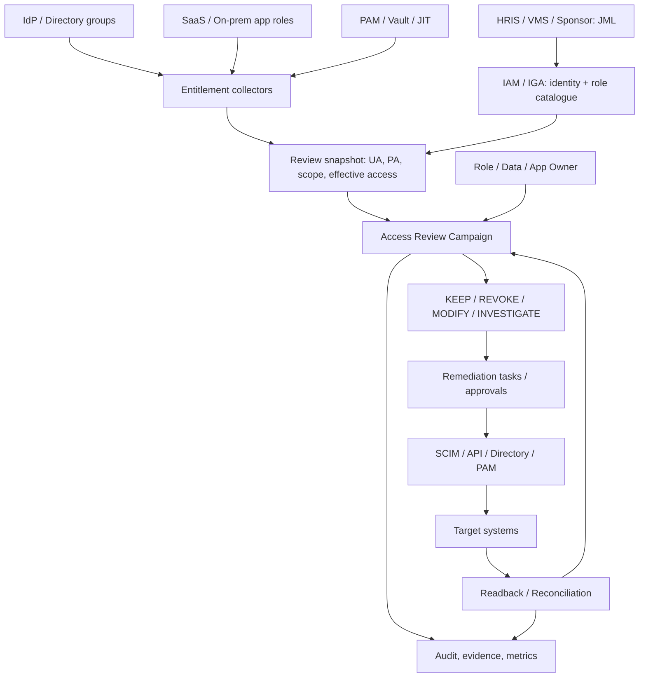
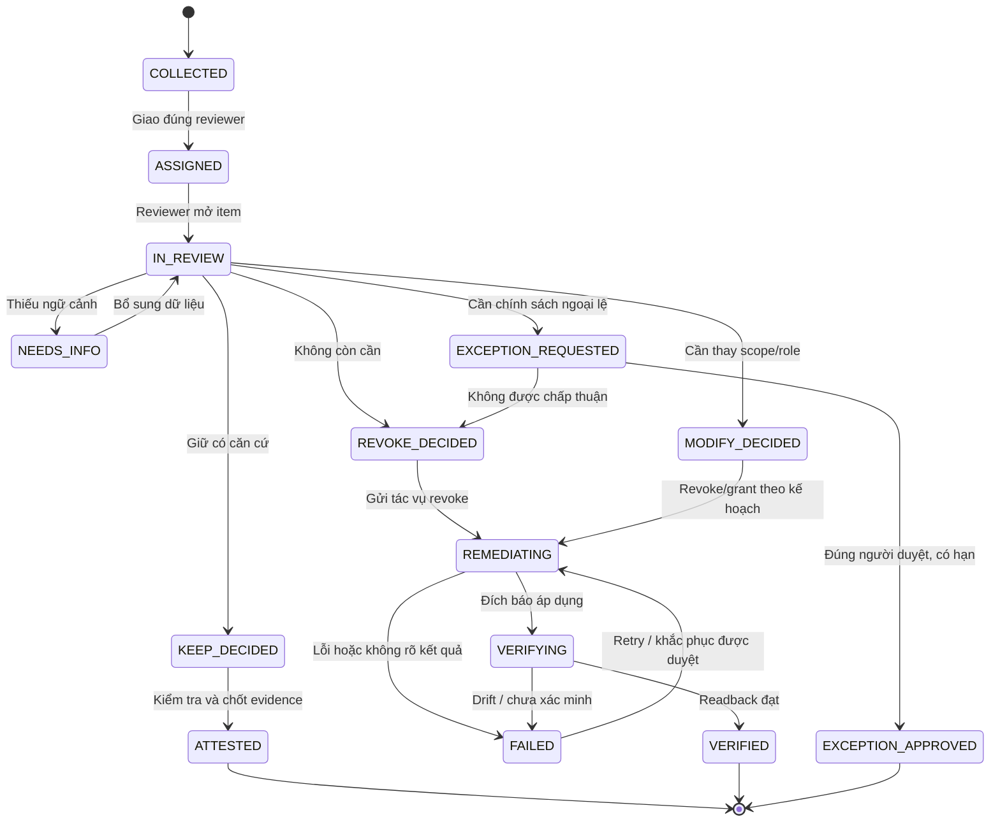
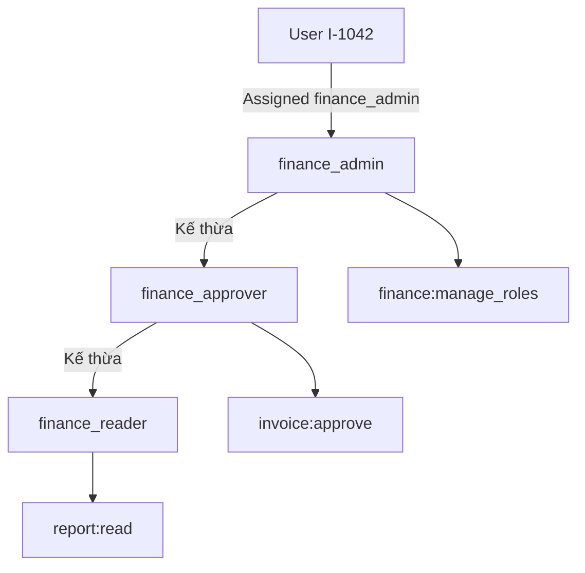
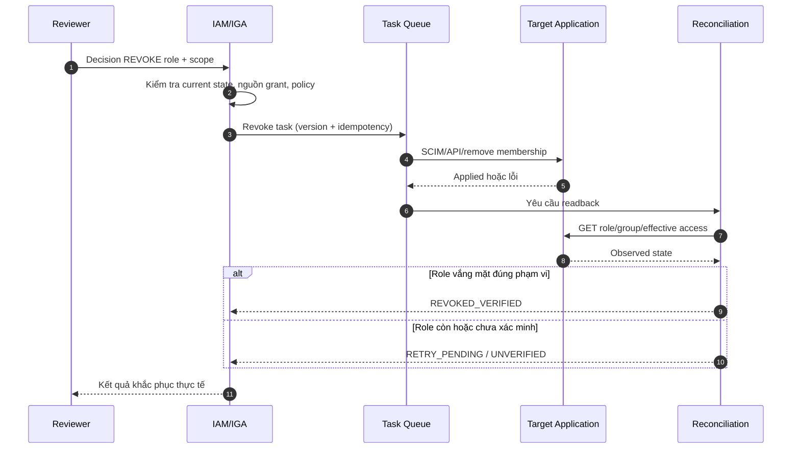

# Review theo role trong quản lý vòng đời danh tính IAM

## 1. Review theo role là gì?

**Review theo role (role-based access review / role-centric access certification)** là hoạt động **rà soát quyền truy cập với vai trò làm đơn vị tổ chức chính**. Người chịu trách nhiệm kiểm tra **những ai đang được gán một role**, vai trò đó **mang những quyền gì**, và liệu các gán quyền cùng cấu hình role có còn phù hợp với công việc, chính sách bảo mật và trạng thái danh tính hiện tại hay không.

Trong một hệ thống **Identity and Access Management (IAM)** theo vòng đời **Joiner–Mover–Leaver (JML)**, role có thể đại diện cho:

- Vai trò nghiệp vụ: `finance_analyst`, `project_manager`.
- Vai trò kỹ thuật của ứng dụng: `report_viewer`, `billing_admin`.
- Vai trò đặc quyền: `production_admin`, `identity_administrator`.
- Vai trò dành cho workload: `report_sync_service`.
- Nhóm/entitlement được ánh xạ thành role qua directory, IdP hoặc ứng dụng đích.

Ví dụ: với role `finance_report_reader`, review theo role phải trả lời **người nào vẫn cần quyền đọc báo cáo tài chính**, **role có cấp thêm quyền xuất hay sửa dữ liệu không**, **quyền đó đang tồn tại ở hệ thống nào**, và **kết quả giữ/thu hồi đã được thực thi chưa**.

**Điểm mấu chốt:** role review không chỉ là gửi một danh sách người dùng cho quản lý rồi thu thập nút “Approve”. Nó là một quy trình có **phạm vi, bằng chứng, quyết định, triển khai khắc phục và đối soát quyền hiệu lực**.

### 1.1. Vai trò của role review trong JML

- **Joiner:** kiểm tra quyền nền và role theo nhiệm vụ đã được cấp chính xác.
- **Mover:** phát hiện role cũ vẫn còn sau khi người dùng đổi phòng ban/dự án.
- **Leaver:** phát hiện tài khoản hoặc entitlement tồn dư khi quan hệ kết thúc.
- **Access governance:** chứng minh quyền hiện hữu vẫn có owner, căn cứ và thời hạn.
- **Audit:** truy vết ai xác nhận role, căn cứ nào và việc thu hồi đã được kiểm chứng ra sao.

**Review định kỳ là biện pháp phát hiện và sửa sai, không thay thế việc thu hồi tức thời** khi HRIS hoặc nguồn có thẩm quyền phát sự kiện Leaver.

## 2. Tại sao cần review theo role?

Một doanh nghiệp có thể dùng hàng chục ứng dụng và hàng nghìn entitlement. Nếu chỉ review người dùng theo từng ứng dụng, người phê duyệt khó biết một role có đang **được cấp quá rộng** hoặc **chứa permission ngoài nhiệm vụ ban đầu** hay không.

Review theo role giúp:

1. **Xác minh membership:** người dùng còn cần vai trò không?
2. **Kiểm soát role design:** role có permission đúng nhu cầu không?
3. **Phát hiện privilege creep:** Mover chỉ được thêm role mới mà chưa gỡ role cũ.
4. **Phát hiện role nhạy cảm:** tài khoản đặc quyền hoặc quyền SoD xung đột.
5. **Giảm orphan roles:** role không còn owner hoặc không có người sử dụng hợp lệ.
6. **Phát hiện role drift:** quyền gán tại SaaS khác với catalog IAM.
7. **Rà soát nested groups, hierarchy và direct grants** tạo quyền hiệu lực khó quan sát.
8. **Thiết lập trách nhiệm:** owner biết ai được nhận role và dữ liệu nào chịu tác động.
9. **Tạo bằng chứng kiểm toán:** quyết định giữ, gỡ, thay đổi hoặc yêu cầu làm rõ.
10. **Đo kết quả khắc phục:** không chỉ số quyết định review mà cả số quyền đã thu hồi thật.

### 2.1. Ví dụ ngắn

Người dùng Linh từng thuộc bộ phận Sales, nay làm ở Finance. Hệ thống báo Linh có:

```text
employee_basic
sales_report_exporter
finance_report_reader
```

Khi review role `sales_report_exporter`, owner nhận ra Linh không còn assignment Sales. Quyết định là **REVOKE**. Sau đó IAM phải gỡ role ở IGA, nhóm IdP và/hoặc ứng dụng đích rồi kiểm tra lại; nếu role local vẫn tồn tại, review **chưa hoàn tất khắc phục**.

## 3. Đối tượng review: người giữ role hay quyền nằm trong role?

Thuật ngữ “review theo role” có thể chỉ hai bài toán khác nhau nhưng liên quan:

| Lớp review | Câu hỏi | Đơn vị quyết định |
|---|---|---|
| **User–Role Assignment (UA) review** | Ai còn cần role này? | Một người/workload gắn với một role và scope |
| **Role–Permission Assignment (PA) review** | Role này còn nên chứa các permission này không? | Một permission/entitlement gắn với một role |
| **Role definition / metadata review** | Vai trò còn hợp lệ, có owner, mô tả, scope, ràng buộc không? | Role và phiên bản cấu hình |
| **Role hierarchy review** | Quyền kế thừa qua role cha/con có đúng không? | Cạnh kế thừa hoặc tập quyền hiệu lực |
| **Effective access review** | Role trên giấy đã chuyển thành quyền thực tế nào ở ứng dụng? | Người–tài nguyên–hành động tại đích |

**Chỉ review UA** có thể bỏ qua tình huống role `report_viewer` bị thay mapping để có thêm `report:export`. **Chỉ review PA** không phát hiện Linh vẫn giữ role Sales sau Mover. Một chương trình governance đầy đủ cần kết nối cả hai chiều.

### 3.1. Hai thay đổi có blast radius khác nhau

- **Gỡ UA:** một người mất một role ở phạm vi nhất định; cần xem những nguồn quyền hợp lệ khác.
- **Gỡ PA:** mọi người đang giữ role có thể đồng loạt mất một permission. Đây là thay đổi **role definition**, cần impact analysis, approval và quy trình triển khai riêng.

Không nhầm nút “Revoke user from role” với “Remove permission from role”.

## 4. Mô hình dữ liệu RBAC làm nền cho role review

Một mô hình RBAC cơ bản có:

- `U`: tập người dùng/chủ thể.
- `R`: tập role.
- `P`: tập permission.
- `UA ⊆ U × R`: quan hệ gán user–role.
- `PA ⊆ P × R`: quan hệ gắn permission–role.

Ví dụ:

```text
UA:
  I-1001 -> finance_report_reader
  I-1002 -> finance_report_reader
  I-1003 -> finance_report_reader

PA:
  finance_report_reader -> report:read

Effective Access:
  user has the role + scope + contextual policy
  -> can read allowed reports
```

Trong thực tế, còn có **role hierarchy, group mapping, tenant scope, ABAC conditions, direct grants, token/session cache và quyền gán ngoài IGA**.

### 4.1. Không coi role name là bằng chứng đủ

Tên `finance_readonly` không chứng minh role **không có quyền export hoặc write**. Khi review phải hiển thị **permission và quyền hiệu lực** lấy từ catalog đã version hóa và/hoặc hệ thống đích.

### 4.2. Không coi email là identity ID

Email, username hoặc DN có thể thay đổi/tái sử dụng. Cần nối reviewer decision với **identity ID ổn định, target account ID và tenant**, để tránh thu hồi nhầm người hoặc phê duyệt nhầm tài khoản.

## 5. So sánh role-centric, user-centric và application-centric review

| Cách review | Trọng tâm | Phù hợp | Giới hạn |
|---|---|---|---|
| **Role-centric** | Một role và tất cả chủ thể/permission liên quan | Role có rủi ro hoặc owner rõ | Có thể bỏ sót quyền trực tiếp ngoài role |
| **User-centric** | Tất cả entitlement của một danh tính | Mover/Leaver, review theo quản lý | Manager không hiểu chi tiết role kỹ thuật |
| **Application-centric** | Những ai có quyền tại một hệ thống | Owner ứng dụng, role local, SaaS | Khó thấy xung đột xuyên nhiều app |
| **Resource-centric** | Ai có quyền vào dữ liệu/tài nguyên | Dữ liệu nhạy cảm, tenant, project | Tốn chi phí lấy quyền hiệu lực đầy đủ |
| **Privileged access review** | Admin, PAM, JIT, break-glass | Quyền rủi ro cao | Cần session/credential ngoài UA |
| **Role-definition review** | Permission set và cấu trúc role | Chống permission creep | Tác động nhiều người nếu sửa PA |

Tổ chức thường kết hợp các hướng. **Role-centric không thay thế hoàn toàn user-centric hoặc application-centric review** khi quyền còn đến từ local grants, nhóm động hoặc key riêng.

## 6. Những vai trò cần ưu tiên review

Không phải tất cả role có cùng mức rủi ro.

| Nhóm role | Ví dụ | Tại sao cần quan tâm |
|---|---|---|
| **Baseline** | `employee_basic` | Được gán rộng; mapping sai có thể ảnh hưởng nhiều người |
| **Business function** | `finance_analyst` | Phải khớp chức năng công việc hiện hành |
| **Sensitive data** | `payroll_reader` | Đọc dữ liệu nhân sự/thu nhập nhạy cảm |
| **Data export** | `customer_exporter` | Tăng nguy cơ thất thoát dữ liệu |
| **Approval/transaction** | `invoice_approver` | Rủi ro SoD/gian lận nếu gán sai |
| **Privileged/admin** | `production_admin` | Có thể thay cấu hình, account hoặc dữ liệu |
| **Emergency/break-glass** | `emergency_recovery_admin` | Quyền cao, phải có governance đặc biệt |
| **Service/workload** | `ci_deploy_service` | Secret/workload role có thể tồn tại lâu, ít người thấy |
| **Legacy/orphan** | `old_project_owner` | Có thể không còn owner hoặc ứng dụng sử dụng |

**Tần suất review** cần dựa trên chính sách tổ chức, độ nhạy, biến động nhân sự và nghĩa vụ kiểm toán; không có một chu kỳ cố định đúng cho mọi role.

## 7. Ai phải review role?

Role-centric review đòi đúng người **hiểu lý do nghiệp vụ và quyền kỹ thuật**.

| Vai trò tham gia | Trách nhiệm |
|---|---|
| **Role owner** | Bảo đảm định nghĩa và nhóm người giữ role phù hợp |
| **Data/resource owner** | Đánh giá quyền vào tài nguyên cụ thể |
| **Line manager** | Xác nhận nhiệm vụ công việc và nhu cầu của nhân viên |
| **Application owner** | Xác nhận entitlement/role mapping tại ứng dụng |
| **Security/IGA** | Chính sách, SoD, privileged review và ngoại lệ |
| **HRIS/VMS/sponsor owner** | Cung cấp trạng thái quan hệ có thẩm quyền |
| **PAM owner** | Kiểm tra role quản trị, JIT, session/credential |
| **Connector/reconciliation owner** | Thực thi và xác minh khắc phục |
| **Auditor** | Đọc và kiểm tra bằng chứng trong phạm vi quyền |

### 7.1. Role owner có thể khác manager

Người quản lý biết Linh đang làm dự án P1, nhưng **data owner** mới có thể đánh giá Linh có được quyền xuất dữ liệu nhạy cảm hay không. Không mặc định manager có thẩm quyền xác nhận mọi permission kỹ thuật.

### 7.2. Tránh self-certification

Người dùng có role admin không nên là người **duy nhất tự phê duyệt** việc mình tiếp tục giữ role đó nếu chính sách yêu cầu độc lập. Cần kiểm tra delegation và group approver để tránh cùng một người tự tạo, tự duyệt và tự thực thi.

## 8. Kiến trúc tổng thể của role review



Một hệ thống IGA có thể thực hiện nhiều chức năng trong cùng sản phẩm; sơ đồ mô tả **vai trò logic**, không áp đặt công nghệ hay số dịch vụ.

### 8.1. Điểm dễ bị bỏ sót

Campaign có thể hiển thị một role từ IGA nhưng không thu thập **role local của SaaS**, **nhóm lồng nhau** hoặc **token/PAT tồn dư**. Kết luận review phải ghi rõ **coverage**: target nào đã đọc được, target nào chưa, và quyền nào chưa thể chứng minh.

## 9. Quy trình role review từ đầu đến cuối

Một chiến dịch điển hình:

1. **Định nghĩa scope**: role, ứng dụng, tenant, mức rủi ro và kỳ review.
2. **Xác định owner/reviewer**: người hiểu đúng vai trò và có thẩm quyền.
3. **Thu thập trạng thái thực tế**: UA, PA, role hierarchy, group mapping và local grants.
4. **Chụp snapshot có version/thời điểm**: dữ liệu và phương pháp thu thập.
5. **Đánh giá rủi ro**: privileged, SoD, inactive account, quyền không dùng, orphan owner.
6. **Giao item** cho reviewer với thông tin đủ để quyết định.
7. **Ra quyết định**: giữ, gỡ, điều chỉnh, chuyển owner hoặc cần điều tra.
8. **Chốt approval** và lưu bằng chứng, xử lý conflict.
9. **Tạo remediation** cho các thay đổi cần thực hiện.
10. **Provision/revoke qua connector** theo chính sách và thứ tự an toàn.
11. **Readback/reconciliation** để xác minh quyền thực tế.
12. **Đóng review** khi các item được giải quyết hoặc có ngoại lệ được quản lý.
13. **Rút kinh nghiệm** về role design, JML và nguồn dữ liệu.

### 9.1. Trạng thái quyết định khác trạng thái thực thi

**REVOKE_DECIDED** nghĩa reviewer yêu cầu gỡ quyền. Nó **không đồng nghĩa** `REVOKED_VERIFIED` tại hệ thống đích. Phải quản lý hai lớp trạng thái độc lập.

## 10. State machine cho một review item



### 10.1. Giữ không có nghĩa quên kiểm tra quyền

Với quyết định `KEEP`, hệ thống vẫn cần biết item đang đại diện **đúng role/scope/quyền hiệu lực**. Nếu dữ liệu bị thiếu hoặc role mapping không chính xác, reviewer không nên xác nhận mù. Có thể chuyển `NEEDS_INFO` và yêu cầu collector bổ sung.

### 10.2. Ngoại lệ không phải “đóng vĩnh viễn”

Một `EXCEPTION_APPROVED` phải có **lý do, người phê duyệt, owner, thời hạn và kiểm soát bù**. Khi hết hạn hoặc nguồn JML thay đổi, ngoại lệ phải được xem xét lại hoặc thu hồi.

## 11. Xác định phạm vi campaign

Phạm vi review phải cụ thể để tránh bỏ sót hoặc review ngoài quyền.

Các chiều thường dùng:

| Chiều | Ví dụ | Điều cần ghi rõ |
|---|---|---|
| Role IDs | `finance_report_reader`, `production_admin` | ID ổn định, không chỉ display name |
| Target systems | `reports-saas`, `accounting-saas` | Có hay không quyền local |
| Tenant / domain | `tenant-company`, `corp-forest` | Tránh lẫn đối tượng giữa tenant |
| Environment | production, staging | Quyền đặc quyền khác nhau |
| Identity type | employee, contractor, guest, workload | Nguồn có thẩm quyền riêng |
| Relationship status | active, suspended, leaver | Trạng thái tại thời điểm nào |
| Scope | dự án, dữ liệu, chi nhánh | Phân biệt quyền theo resource |
| Risk tier | privileged, sensitive-data, baseline | Chu kỳ, reviewer và bằng chứng |
| Review period | quý, sự kiện, đột xuất | Mốc snapshot và hạn quyết định |

### 11.1. Không chỉ review role hiển thị ở portal

Một vai trò có thể tồn tại trong IdP group, directory, ứng dụng local, PAM/JIT, cloud console hoặc service account. Nếu campaign chỉ thu thập một nguồn, phải ghi **coverage limitation** và kế hoạch bù.

### 11.2. Chọn role theo rủi ro

Một cách phân loại có thể kết hợp:

- Quyền admin hoặc thay policy IAM.
- Truy cập dữ liệu nhạy cảm.
- Khả năng export/execute/payment.
- Số lượng người và phạm vi tenant.
- Có mật khẩu dùng chung hoặc quyền standing.
- Mức độ khó thu hồi/quan sát.
- Lịch sử SoD conflict và drift.
- Tần suất Mover và số ngoại lệ còn tồn tại.

**Risk score chỉ để ưu tiên và hỗ trợ reviewer**, không phải bằng chứng quyền hợp lệ.

## 12. Chuẩn bị role catalogue trước khi review

Một role catalogue đáng tin nên mô tả:

| Trường | Ý nghĩa |
|---|---|
| `role_id` | Định danh ổn định |
| `role_name` | Tên hiển thị |
| `description` | Vai trò phục vụ nhiệm vụ gì |
| `business_owner` | Người chịu trách nhiệm nội dung nghiệp vụ |
| `technical_owner` | Người chịu trách nhiệm mapping kỹ thuật |
| `risk_tier` | Phân loại rủi ro |
| `allowed_identity_types` | Nhân viên, contractor, workload nào phù hợp |
| `scope_dimensions` | Tenant/project/environment được hỗ trợ |
| `permissions` | Quyền trực tiếp role mang theo |
| `inherited_roles` | Role được kế thừa nếu có |
| `mapping_targets` | Nhóm/role tại từng ứng dụng |
| `constraints` | SoD, prerequisite, thời hạn, MFA |
| `role_version` | Phiên bản định nghĩa |
| `review_frequency` | Chu kỳ do policy quyết định |
| `last_reviewed_at` | Lần xác nhận cấu hình gần nhất |

### 12.1. Role có owner khác nhau theo ngữ cảnh

Một role nghiệp vụ có thể được quản trị bởi Finance nhưng ánh xạ tới nhiều ứng dụng; một technical role do App Owner quản lý. Cần phân định ai phê duyệt **membership** và ai phê duyệt **permission mapping**.

### 12.2. Không review theo tên role đã lỗi thời

Khi role đổi tên hoặc migrate, sử dụng `role_id` và `role_version` để nối quyết định cũ với định nghĩa tương ứng. Nếu ý nghĩa role đã đổi, **không tái sử dụng approval cũ** như thể quyền không thay đổi.

## 13. Thu thập trạng thái gán role thực tế

Trước khi reviewer nhận danh sách, hệ thống phải biết role được cấp bởi **nguồn nào và bằng con đường nào**.

Nguồn có thể gồm:

- IAM/IGA assignment catalog.
- Directory/IdP security group membership.
- Nhóm lồng nhau hoặc dynamic group.
- SCIM `Groups.members` và trạng thái `Users.active`.
- Role local của SaaS và quyền gán trực tiếp.
- Cloud IAM policies/role bindings.
- PAM privileged eligibility và active grants.
- Vault ACL, lease hoặc credential access.
- External tenant guest assignment.
- Service account và workload identity role.

### 13.1. Snapshot có nguồn và thời điểm

Mỗi record nên kèm:

```text
identity_id = I-1042
role_id = finance_report_reader
scope = tenant-company / finance
source = accounting-saas
assignment_type = DIRECT
observed_at = 2026-11-23T02:00:00Z
source_version = 181
```

**`observed_at` không đồng nghĩa `effective_at`**. Một role được đọc thấy hôm nay nhưng có thể đã hết căn cứ từ hôm qua hoặc có task thu hồi đang xử lý.

### 13.2. Không đoán khi collector thiếu quyền

Nếu connector không có quyền đọc privileged role ở ứng dụng, đánh dấu **UNOBSERVABLE / COVERAGE_GAP** và mở ngoại lệ. Không hiển thị danh sách thiếu rồi cho reviewer xác nhận “không có vấn đề”.

## 14. Chụp snapshot và đối phó dữ liệu thay đổi

Một campaign thường kéo dài nhiều ngày. Trong thời gian đó, nhân viên có thể chuyển dự án hoặc nghỉ việc; group/role ở SaaS cũng có thể thay đổi.

### 14.1. Hai loại dữ liệu

- **Review snapshot:** dữ liệu tại mốc mở campaign, phục vụ chứng minh reviewer đã xem gì.
- **Current authoritative state:** trạng thái HR, assignment, policy và entitlement mới nhất khi ra quyết định/thực thi.

**Giữ snapshot để audit nhưng không dùng snapshot cũ để cấp lại quyền** khi trạng thái nghiệp vụ đã thay đổi.

### 14.2. Ví dụ chênh lệch

Ngày 01/11 role `sales_reader` thuộc Linh. Ngày 05/11 Linh chuyển Finance. Reviewer mở campaign ngày 08/11 và thấy item snapshot Sales.

- Không nên đơn giản click `KEEP` theo danh sách cũ.
- Hệ thống có thể đánh dấu **MOVER_CHANGED / STALE_REVIEW_ITEM**.
- IAM tính quyền mới, tạo hoặc xác minh task gỡ Sales.
- Quyết định phải liên kết cả snapshot, HR event và quyền đang quan sát ở đích.

### 14.3. Thời điểm kiểm tra và phiên bản

Lưu `snapshot_id`, `captured_at`, `role_version`, `policy_version` và `source_version`. Khi item thay đổi đáng kể, yêu cầu reviewer **re-attest** hoặc điều chỉnh theo policy; không giữ quyết định đã chốt cho một đối tượng/scope mới.

## 15. Review danh sách thành viên role (UA review)

Đây là hình thức role-centric thường gặp: **mở một role và duyệt tất cả account đang được gán vào role đó**.

Một reviewer nên thấy:

| Trường | Ví dụ | Tại sao hữu ích |
|---|---|---|
| Chủ thể | `I-1042` — Linh | Biết đúng người |
| Loại danh tính | employee | Áp chính sách nhân viên |
| Trạng thái quan hệ | ACTIVE | Loại bỏ tài khoản Leaver |
| Đơn vị / assignment | Finance / P2 | Xác định nhu cầu |
| Role | `finance_report_reader` | Quyền đang review |
| Resource scope | tenant-company / Finance | Không xác nhận quá rộng |
| Source grant | HR policy / ticket 774 | Có căn cứ hay không |
| Approver ban đầu | Data Owner | Xem lịch sử cấp |
| Ngày cấp/hết hạn | 01/10 – 31/12 | Phát hiện quyền quá hạn |
| Last-used signal | Có/không có dữ liệu tin cậy | Gợi ý điều tra, không tự quyết |
| Effective permissions | `report:read` và các quyền kế thừa | Hiểu tác động thực tế |
| SoD risk | Không/xung đột | Tránh xung đột |
| Target readback | VERIFIED/UNKNOWN | Xác nhận cấp quyền thật |

### 15.1. Reviewer quyết định dựa trên nhiệm vụ

Câu hỏi hợp lý không phải “Linh có đang làm ở công ty không?” mà là: **“Linh có còn nhiệm vụ hợp lệ cần đúng role này với phạm vi này trong giai đoạn tiếp theo không?”**

### 15.2. Người không rõ công việc

Nếu reviewer không hiểu lý do gán role, chọn **INVESTIGATE / NEEDS_INFO**, chuyển tới manager hoặc resource owner. Không ép họ phải KEEP hoặc REVOKE khi thiếu thông tin.

## 16. Review permission bên trong role (PA review)

Một role có thể được giữ đúng người nhưng lại chứa quyền không còn cần thiết. **PA review** kiểm tra từng permission/entitlement gắn vào role.

Ví dụ:

| Role | Permission hiện có | Nhận xét |
|---|---|---|
| `finance_report_reader` | `report:read` | Phù hợp |
| `finance_report_reader` | `report:export` | Rủi ro data egress, cần review |
| `finance_report_reader` | `report:update` | Không đúng mục đích read-only |
| `finance_report_reader` | `user:manage` | Bất thường, có thể leo thang quyền |

Nếu quyết định gỡ `report:update` khỏi role, **mọi người có role** sẽ bị ảnh hưởng; phải xác định impact, owner của permission, hệ thống đích và cách triển khai.

### 16.1. Role definition thay đổi cần quản lý phiên bản

Quy trình thích hợp:

1. Role owner đề xuất thay đổi permission set.
2. Data/Application Owner xác nhận ý nghĩa quyền.
3. Security kiểm tra SoD, least privilege và ảnh hưởng.
4. Chạy impact analysis đối với những user/workload có role.
5. Version hóa role definition/mapping.
6. Triển khai qua IGA/SCIM/API hoặc policy deployment tương ứng.
7. Đối soát **effective permissions** tại đích.
8. Ghi rằng campaign đã xem role ở **version nào**.

### 16.2. Không chỉ gỡ một cột trên catalog

Nếu `report:update` được gỡ khỏi catalog IAM nhưng app local vẫn giữ role `editor`, quyền thực tế chưa đổi. Trạng thái PA remediation phải được xác minh tại các ứng dụng chịu tác động.

## 17. Role hierarchy, nested group và effective permissions

**Role hierarchy** có thể cho phép role cao hơn kế thừa permission của role thấp hơn. **Nested group** có thể tạo đường group membership gián tiếp. Hai cơ chế có thể kết hợp nhưng không đồng nhất.



Nếu `finance_admin` kế thừa cả `invoice:approve` và `report:read`, việc reviewer thấy người dùng chỉ được gán `finance_admin` **không thể chứng minh user chỉ có mỗi một permission**.

### 17.1. Kiểm tra đường cấp quyền

Một effective permission có thể đến từ:

- Gán role trực tiếp.
- Role cha/kế thừa.
- Nested directory group.
- Dynamic membership.
- Local application role.
- Direct permission grant.
- ABAC/PBAC dựa trên thuộc tính.
- Token/session chứa claim đã phát hành.

Review nên hiển thị **grant path** hoặc ít nhất phân loại nguồn để tránh reviewer thu hồi một đường mà đường khác vẫn cho phép.

### 17.2. Không gỡ quyền còn căn cứ khác

Một người có `report:read` qua assignment P1 và P2. Khi P1 kết thúc, phải gỡ **căn cứ P1**, nhưng nếu P2 còn hợp lệ, quyền đọc theo P2 vẫn được giữ đúng scope. Không xóa toàn bộ account chỉ vì một nguồn gán role hết hạn.

## 18. SoD: role xung đột và giao dịch nghiệp vụ

**Separation of Duties (SoD)** ngăn một người có tổ hợp quyền cho phép tự thực hiện quy trình nhạy cảm mà không có kiểm soát độc lập.

Ví dụ:

| Role A | Role B | Rủi ro |
|---|---|---|
| `invoice_creator` | `invoice_approver` | Vừa lập vừa duyệt thanh toán |
| `vendor_master_editor` | `payment_executor` | Sửa người thụ hưởng rồi thực hiện chi |
| `access_requester` | `privileged_access_approver` | Tự xin và tự phê duyệt đặc quyền |
| `policy_editor` | `policy_deployer` | Có thể sửa rồi tự đưa policy lên production |

### 18.1. Phân biệt SSD và DSD

- **Static SoD (SSD):** không được đồng thời **gán** các role xung đột trong phạm vi đã quy định.
- **Dynamic SoD (DSD):** có thể được gán nhiều role, nhưng không được **kích hoạt cùng lúc** nếu nền tảng thực thi role activation.
- **Transaction-level SoD:** không cho người đã tạo **chính giao dịch đó** phê duyệt, bất kể role.

Review phải xét đúng **phạm vi ứng dụng, tenant, project và giao dịch**; không tự suy hai role trùng tên ở tenant khác luôn xung đột hoặc luôn không xung đột.

### 18.2. SoD exception không phải grant vĩnh viễn

Một xung đột có thể có **ngoại lệ được phê duyệt**, chủ sở hữu, kiểm soát bù và `expires_at`. Reviewer nên thấy bằng chứng thay vì chỉ một cờ “exception=true” không có căn cứ.

### 18.3. Reviewer không được tự giải quyết bằng cách xóa tùy tiện

Khi tìm xung đột, nên xác định **role nào không còn cần**, kiểm tra dữ liệu hiện hành và nghiệp vụ liên quan. Không tự gỡ một role quan trọng nếu hành động có thể làm gián đoạn quy trình được bảo vệ; cần workflow remediation với owner.

## 19. Rủi ro role và quyết định review theo mức ưu tiên

Một role có thể được gắn `risk_tier` theo loại permission và tác động.

### 19.1. Tín hiệu rủi ro

- Quyền quản trị IAM, directory, cloud hoặc production.
- Khả năng đọc/xuất dữ liệu cá nhân nhạy cảm.
- Quyền sửa policy hoặc cấp thêm role.
- Khả năng tạo/duyệt thanh toán hoặc hành động không thể đảo ngược.
- Số lượng account giữ role và độ rộng scope.
- Standing privilege so với JIT/eligible privilege.
- Role có owner yếu, mapping không rõ, lâu không cập nhật.
- Ngưỡng SoD và ngoại lệ đang hoạt động.
- Quyền truy cập qua nhiều tenant hoặc external guest.
- Không thể xác minh entitlement tại đích.

### 19.2. Risk score không phải quyết định duy nhất

`last_used_at` có thể giúp ưu tiên nhưng **không tự chứng minh role không cần thiết**: quyền khẩn cấp hoặc dùng mỗi quý có thể hợp lệ dù ít hoạt động. Ngược lại, quyền được dùng thường xuyên không chứng minh việc gán nó đúng chính sách.

Nên kết hợp **nhu cầu nghiệp vụ, approval, phạm vi, nguồn có thẩm quyền và rủi ro hiệu lực**, không để thuật toán tự KEEP/REVOKE tất cả.

## 20. Các quyết định review và ý nghĩa

| Quyết định | Ý nghĩa | Hành động sau đó |
|---|---|---|
| **KEEP / CERTIFY** | Role/scope vẫn cần và hợp lệ | Lưu căn cứ, thời hạn; kiểm tra mapping/coverage |
| **REVOKE** | Không còn lý do giữ assignment | Tạo task revoke và verify |
| **MODIFY / REDUCE_SCOPE** | Cần role thấp hơn, scope hẹp hơn hoặc TTL ngắn | Revoke cũ, grant mới nếu hợp lệ, readback |
| **INVESTIGATE / NEEDS_INFO** | Thiếu thông tin để kết luận | Giao owner, deadline và evidence request |
| **REASSIGN_OWNER** | Role hoặc account thiếu người chịu trách nhiệm | Chuyển owner, cập nhật catalog và review lại |
| **EXCEPTION_REQUESTED** | Có lý do đặc biệt không đáp ứng policy thường | Xét phê duyệt độc lập, hạn và kiểm soát bù |
| **ROLE_RETIRE** | Role không còn mục đích | Phân tích người/permission phụ thuộc, migrate và thu hồi |
| **ESCALATE** | Có vi phạm, xung đột hoặc quá hạn | Chuyển Security/Data Owner/incident |

### 20.1. Không mặc định KEEP khi reviewer im lặng

**Không phản hồi** là một trạng thái cần giải quyết theo chính sách. Đặc biệt với role đặc quyền, **quá hạn không mặc nhiên được chứng nhận lại**; có thể cần escalation, thu hồi theo điều kiện được duyệt hoặc kiểm soát bù.

### 20.2. Quyết định có thể là MODIFY chứ không chỉ KEEP/REVOKE

Một người còn cần đọc báo cáo nhưng không cần export. Gỡ toàn bộ role có thể khóa công việc; giữ nguyên role tạo overprivilege. Hướng đúng có thể là **thay bằng role chỉ đọc**, sau khi phê duyệt đúng scope và triển khai có kiểm soát.

## 21. Phê duyệt, delegation và người review có thẩm quyền

### 21.1. Kiểm tra reviewer identity

Không chỉ dựa vào tên hiển thị. Mỗi quyết định cần lưu:

- Reviewer ID ổn định.
- Loại owner và phạm vi ủy quyền.
- Trạng thái reviewer còn active.
- Bằng chứng phê duyệt/delegation.
- Thời gian và policy version.
- Quan hệ với beneficiary/role.
- Căn cứ quyết định.

### 21.2. Delegation có thời hạn

Khi role owner vắng mặt, có thể giao review cho **người thay thế có ủy quyền**, với phạm vi, ngày hết hạn và quy tắc SoD. Không để requester tự chọn bất kỳ email nào rồi được duyệt quyền nhạy cảm.

### 21.3. Hai lớp reviewer

Role kỹ thuật có thể yêu cầu:

1. **Manager** xác nhận người đó còn làm nhiệm vụ.
2. **Role/Data Owner** xác nhận nhiệm vụ cần quyền tương ứng.
3. **Security** phê duyệt ngoại lệ hoặc privilege đặc biệt.

Luồng có thể tuần tự hoặc song song theo policy. Cần ghi rõ **khi nào đủ quyết định**, không suy từ một nút “Approved” của người đầu tiên.

## 22. Evidence cho một review decision

Một quyết định review có giá trị kiểm toán khi có thể trả lời:

1. **Ai đã được review?** Identity và target account nào?
2. **Role nào?** Role ID, version, scope và permission gì?
3. **Dữ liệu nào được trình?** Snapshot, source, observed state.
4. **Ai quyết định?** Reviewer ID, role/ủy quyền và SoD.
5. **Quyết định là gì?** KEEP/REVOKE/MODIFY/INVESTIGATE.
6. **Vì sao?** Justification hoặc policy reason.
7. **Khi nào?** Timestamp, effective date, deadline.
8. **Đã thực thi chưa?** Task IDs và kết quả.
9. **Đã xác minh chưa?** Target readback, coverage và verified_at.

### 22.1. Ví dụ review item JSON

```json
{
  "campaign_id": "REV-2026-Q4-FINANCE",
  "review_item_id": "RI-1042-07",
  "snapshot_id": "SNAP-2026-11-23-01",
  "snapshot_at": "2026-11-23T02:00:00Z",
  "subject": {
    "identity_id": "I-1042",
    "identity_type": "EMPLOYEE",
    "relationship_status": "ACTIVE",
    "department": "FIN"
  },
  "role": {
    "role_id": "finance_report_reader",
    "role_version": "v4",
    "scope": "tenant-company/finance"
  },
  "assignment": {
    "source": "IGA_ROLE_MAPPING",
    "target_system": "reports-saas",
    "target_account_id": "saas-user-1042",
    "observed": true
  },
  "review": {
    "reviewer_id": "I-2201",
    "decision": "KEEP",
    "reason_code": "CURRENT_JOB_REQUIREMENT",
    "decided_at": "2026-11-23T09:00:00Z"
  },
  "remediation_state": "NOT_REQUIRED",
  "policy_version": "ACCESS-REVIEW-V5"
}
```

Đây là **mô hình dữ liệu minh họa**, không phải API chuẩn. ID và mốc thời gian đều giả định.

### 22.2. Quyết định KEEP vẫn cần giới hạn thời gian

Một kết luận KEEP không miễn review kỳ tới và không ghi đè những sự kiện JML phát sinh sau đó. Khi Leaver có hiệu lực, quyền phải bị thu hồi theo nguồn có thẩm quyền **ngay cả khi hôm trước reviewer đã KEEP**.

## 23. Review theo role trong Joiner

Với Joiner, role review giúp kiểm tra **role mặc định và role riêng được cấp ban đầu**.

### 23.1. Chuỗi cấp quyền

1. HRIS xác nhận worker ID, quan hệ và ngày bắt đầu.
2. Identity proofing xác minh đúng chủ thể.
3. IAM tạo hoặc liên kết account.
4. IGA tính các role tối thiểu theo assignment.
5. Role đặc biệt cần approval riêng theo policy.
6. SCIM/API/IdP provisioning cấp các entitlement tương ứng.
7. Readback xác minh quyền được cấp đúng.
8. Campaign review khi cần có thể kiểm tra **role nền có quá rộng không** hoặc onboarding ngoại lệ còn tồn tại.

### 23.2. Pre-provisioning

Một account có thể được tạo trước ngày bắt đầu nhưng **không được kích hoạt role nghiệp vụ sớm** nếu policy chưa cho phép. Reviewer cần phân biệt **account exists**, **assigned role**, **active role** và **effective access**.

### 23.3. Duplicate account

Nếu Joiner retry tạo hai tài khoản cùng email, role review chỉ một account có thể bỏ sót account còn lại. Cần nối **identity ID ổn định, target ID và tenant**, kiểm tra tài khoản orphan/trùng khi reconciliation.

## 24. Review theo role trong Mover

Mover là nguồn phổ biến của **privilege creep**. Khi người dùng đổi trách nhiệm, các role cũ có thể vẫn tồn tại ở IGA hoặc ứng dụng.

### 24.1. Ví dụ Sales → Finance

```text
Current valid assignments:
  department = FIN
  project = Finance Reporting

Desired roles:
  employee_basic
  finance_report_reader

Observed roles:
  employee_basic
  finance_report_reader
  sales_data_exporter

Role review result:
  sales_data_exporter -> REVOKE
  finance_report_reader -> KEEP
```

Reviewer phải hiểu **ngày hiệu lực**, nguồn assignment và liệu có **ngoại lệ bàn giao còn hạn** không.

### 24.2. Mover có nhiều quan hệ hợp lệ

Một người có thể tham gia đồng thời P1 và P2. Không suy rằng “đổi phòng ban” thì mọi role dự án cũ phải mất. Tính role theo **toàn bộ quan hệ, hợp đồng và exception hợp lệ hiện hành**, tránh thu hồi sai.

### 24.3. Mover đã xử lý trước campaign

Nếu một role đã được gỡ bởi workflow Mover trước khi reviewer quyết định, item nên ghi rõ **auto-remediated/superseded** và evidence, không phát lại lệnh revoke/grant vô điều kiện.

## 25. Review theo role trong Leaver

**Leaver** yêu cầu hành động ngay khi nguồn có thẩm quyền xác nhận; role review hỗ trợ phát hiện **tài khoản/quyền tồn dư**, không được chờ kỳ review định kỳ.

### 25.1. Những gì cần rà soát

- IAM/IGA role assignments còn tồn tại.
- Directory/IdP group membership và nested groups.
- Local role/permission trong SaaS.
- PAM eligible/active roles và session đang mở.
- Vault secret checkout, token/PAT/SSH key cá nhân.
- Guest access hoặc tài khoản ở tenant khác.
- Role được gán từ rule nhóm động vẫn tiếp tục kích hoạt.
- Ứng dụng không có connector readback.

### 25.2. Trạng thái review Leaver

Ví dụ:

| Hệ thống | Vai trò | Hành động | Kết quả |
|---|---|---|---|
| IdP | `finance_report_reader` qua group | Remove membership | VERIFIED |
| SaaS kế toán | `invoice_approver` local | Revoke direct role | VERIFIED |
| PAM | `production_admin` eligible | Revoke eligibility + session | VERIFIED |
| Legacy | `old_db_admin` | Không có API kiểm tra | UNVERIFIED |

**Không đánh dấu offboarding verified toàn bộ nếu role/credential quan trọng vẫn UNVERIFIED**. Ghi exception, owner, hạn xử lý và kiểm soát bù.

### 25.3. Leaver nhiều hợp đồng

Nếu hợp đồng A kết thúc nhưng hợp đồng B vẫn active, phải xác định **identity/account/role nào thuộc A**. Không tự disable một tài khoản dùng chung khi B vẫn được phép hoạt động; nhưng quyền A hết căn cứ cần thu hồi đúng lúc.

## 26. Review nhà thầu, guest và danh tính không phải nhân viên

| Loại danh tính | Nguồn có thẩm quyền | Trọng tâm review |
|---|---|---|
| Nhân viên | HRIS/HCM | Phòng ban, role theo nhiệm vụ, Mover/Leaver |
| Nhà thầu | VMS, hợp đồng, sponsor | Ngày hết hợp đồng, dự án, người bảo trợ |
| Guest/đối tác | Sponsor và hệ thống federation | Role cục bộ, tenant, thời hạn và quyền dữ liệu |
| Nhiều assignment | Các nguồn nghiệp vụ được duyệt | Không gỡ role còn căn cứ từ assignment khác |
| Service account | Service catalog/CMDB | Owner, workload, permissions, credential lifecycle |
| CI/CD workload | Nền tảng deployment/workload identity | Quyền build/deploy, environment và secret |
| Break-glass | Security/PAM governance | Sử dụng hiếm, owner, bảo vệ credential, hậu kiểm |

### 26.1. Không dùng HRIS để kết luận mọi account orphan

Một service account không có worker ID **không mặc nhiên là tài khoản trái phép**. Nó có thể được quản lý bởi CMDB/service catalog; role review cần tìm đúng owner nghiệp vụ/kỹ thuật và yêu cầu bằng chứng mục đích.

### 26.2. Khi owner workload nghỉ việc

Không tự xóa workload còn cần cho sản xuất. Workflow phù hợp là **thu hồi quyền cá nhân của Leaver, bàn giao owner, đánh giá credential rotation và review role kỹ thuật**; chỉ decommission khi có nguồn/quyết định hợp lệ.

## 27. Role đặc quyền và PAM/JIT

Với `production_admin`, `identity_admin` hoặc `database_owner`, role review phải kiểm tra cả **standing**, **eligible** và **activated privilege**.

| Khái niệm | Ý nghĩa | Điều cần review |
|---|---|---|
| **Standing role** | Role luôn active | Có thật sự cần đặc quyền liên tục không? |
| **Eligible role** | Có thể xin kích hoạt JIT | Điều kiện xin, approval, MFA, owner |
| **Activated role** | Đang có đặc quyền trong khoảng thời gian | TTL, phạm vi, phiên và kết thúc |
| **PAM checkout** | Đã mượn credential/phiên | Người nhận, mục đích, audit, rotation |
| **Break-glass** | Đường truy cập khẩn | Governance, alert, testing và hậu kiểm |
| **Effective admin access** | Đích thực sự cho quyền quản trị | Credential, local role, phiên/token và grant khác |

### 27.1. Role review không chỉ là kiểm tra eligible

Một người có thể không còn `production_admin` trong IGA nhưng vẫn giữ **SSH key, PAT hoặc phiên đang mở**. Cần đối soát quyền ở đích và xử lý credential độc lập với role assignment.

### 27.2. Review theo rủi ro và hoạt động

Role đặc quyền cần xem **ticket sử dụng, lịch sử kích hoạt, thời hạn, SoD, authn assurance và khả năng thu hồi**. Tuy nhiên, ít sử dụng chưa chắc sai: break-glass có thể được thiết kế để hầu như không dùng. Quyết định cần owner và policy.

### 27.3. Không cho tự gia hạn đặc quyền khi quá hạn

Một role JIT hết hạn phải được thu hồi theo policy; không tự kéo dài chỉ vì reviewer chưa mở campaign.

## 28. Directory, IdP, SSO, SCIM và role mapping

Một role nghiệp vụ có thể được thực thi qua nhiều lớp:

```text
IGA business role:
  finance_report_reader
    |
    +--> Directory / IdP group: grp-finance-report-readers
    |
    +--> SCIM Group: reports-finance-readers
    |
    +--> SaaS application role: report_viewer
    |
    +--> ABAC scope: tenant-company / finance
```

### 28.1. Mapping cần được review

Một decision KEEP trong IGA không chứng minh:

- Group IdP đã đúng thành viên.
- SCIM đồng bộ đã hoàn tất.
- SaaS không có role local khác.
- Token SSO chưa chứa claim cũ.
- Scope ABAC ở app còn giới hạn theo tenant/dữ liệu.

**Role review nên kết hợp source mapping và readback ứng dụng**, đặc biệt với quyền nhạy cảm.

### 28.2. OIDC/SAML khác SCIM

- **IdP / OIDC / SAML:** phục vụ xác thực và SSO, có thể phát nhóm/role claim.
- **SCIM:** đồng bộ đối tượng User/Group tới ứng dụng.
- **RBAC/ABAC/PBAC:** quyết định quyền thực tế theo role, thuộc tính và chính sách.
- **Ứng dụng đích:** nơi phải thực thi authorization tại backend.
- **PAM/Vault:** quản trị tài khoản/credential đặc quyền theo năng lực.

SCIM `PATCH remove member` không tự thu hồi mọi refresh token, app session hoặc role cấp trực tiếp ngoài SCIM.

## 29. Remediation: quyết định REVOKE phải được thực thi

Sau khi reviewer kết luận gỡ role, hệ thống tạo **remediation task** cho từng target.

### 29.1. Luồng thu hồi role



### 29.2. SCIM PATCH minh họa

Nếu role được ánh xạ qua SCIM Group, có thể gỡ một user cụ thể:

```http
PATCH /scim/v2/Groups/group-finance-readers HTTP/1.1
Host: scim.example.org
Authorization: Bearer <redacted-token>
Content-Type: application/scim+json

{
  "schemas": ["urn:ietf:params:scim:api:messages:2.0:PatchOp"],
  "Operations": [
    {
      "op": "remove",
      "path": "members[value eq \"target-user-1042\"]"
    }
  ]
}
```

Ví dụ chỉ dùng khi provider hỗ trợ PATCH/Groups và bộ lọc phù hợp. **Không dùng `remove path=members` để gỡ một người**, vì có thể ảnh hưởng toàn nhóm.

### 29.3. Không revoke nhầm quyền từ nguồn khác

Nếu role `finance_report_reader` được cấp bởi **hai quan hệ nghiệp vụ vẫn hợp lệ**, một review item quyết định gỡ một nguồn grant cần được đối chiếu. Có thể phải gỡ **grant cụ thể**, không xóa toàn bộ role nếu nguồn thứ hai còn căn cứ.

## 30. Remediation PA: thay quyền trong role

Với quyết định role không nên chứa `report:export`, cần tác vụ **sửa role definition/mapping**.

Các bước:

1. Tính tập người dùng/workload đang giữ role.
2. Xác định hệ thống/tài nguyên bị ảnh hưởng.
3. Phê duyệt thay đổi theo Data/App Owner và Security.
4. Kiểm tra SoD, quyền hỏng, cấu hình API và business continuity.
5. Tạo role version hoặc mapping mới.
6. Triển khai theo chiến lược có kiểm soát.
7. Reconcile permission hiệu lực ở ứng dụng.
8. Đóng PA review khi **permission thực sự được cập nhật**.

**Cẩn thận với role dùng chung:** sửa permission của `employee_basic` có thể ảnh hưởng toàn doanh nghiệp. Không áp “xóa permission khỏi role” như một thao tác cấp quyền cho một người.

## 31. Desired vs observed access và bằng chứng hoàn tất

Role review có thể nhìn ba hình thức quyền:

- **Desired:** role/permission được phép theo nguồn hiện hành và policy.
- **Assigned/provisioned:** role hoặc group được IGA/connector ghi là gán.
- **Observed effective:** role/permission thực tế mà ứng dụng đang nhận và thực thi.

### 31.1. Ví dụ drift sau review

```text
Review decision:
  I-1042 / sales_data_exporter -> REVOKE

IGA state:
  role assignment removed

IdP state:
  grp-sales-exporters membership absent

Target SaaS:
  direct role sales_exporter still present

Result:
  REMEDIATION_PARTIAL
  NOT REVOKED_VERIFIED
```

Nếu target không cho readback role, ghi **UNVERIFIED** cùng owner và biện pháp theo dõi bổ sung. Không dùng status `COMPLETE` chỉ vì một API trả HTTP 200.

### 31.2. Token và session

Một JWT đã phát hành có thể giữ role claim cũ đến hết hạn. Role review có thể yêu cầu xử lý session/token cho quyền nhạy cảm, nhưng **gỡ membership không tự thay đổi nội dung JWT hay đóng mọi session local**. Audit cần chỉ ra phạm vi thực sự đã kiểm tra.

## 32. Concurrency, stale snapshot và quyết định lỗi thời

Trong thời gian campaign, có thể xảy ra:

- Linh được cấp role mới từ request hợp lệ sau snapshot.
- Mover/Leaver làm thay đổi căn cứ role.
- App Owner chỉnh PA mapping.
- Hai reviewer cùng quyết định một item.
- Một task grant cũ được retry sau khi reviewer REVOKE.

### 32.1. Quy tắc xử lý

1. Ghi `review_item_version` và `snapshot_id`.
2. Trước remediation, đọc lại **identity status và desired state**.
3. So sánh role/permission version với bản reviewer đã xem.
4. Nếu khác biệt ảnh hưởng quyền, yêu cầu **re-evaluate** hoặc đánh dấu `SUPERSEDED`.
5. Không cho event review cũ cấp lại quyền sau Leaver.
6. Dùng optimistic concurrency cho state update.
7. Lưu lịch sử mọi quyết định và chuyển trạng thái.
8. Phân biệt lỗi tạm thời, xung đột version và thiếu quyền đọc đích.

### 32.2. Mã giả tránh stale revoke/grant

```text
function processReviewRemediation(item):
    currentIdentity = getCurrentAuthoritativeIdentity(item.identityId)
    currentPolicy = getCurrentPolicy()
    currentRole = getRoleDefinition(item.roleId)
    latestGrantSources = getValidGrantSources(item.identityId, item.roleId)

    if item.snapshotRoleVersion != currentRole.version:
        mark(item, REEVALUATION_REQUIRED)
        return

    if item.decision == KEEP:
        if currentIdentity.status in {TERMINATED, SUSPENDED}:
            mark(item, SUPERSEDED_BY_LIFECYCLE)
            return
        storeAttestation(item)
        return

    if item.decision == REVOKE:
        desired = evaluateRoleNeed(currentIdentity, latestGrantSources, currentPolicy)
        if desired == PRESENT:
            requireReviewOfConflictingEvidence(item)
            return

        target = resolveAccountAndTenant(item)
        if target is UNKNOWN:
            mark(item, UNVERIFIED)
            return

        observed = readTargetRole(target, item.roleId)
        if observed == ABSENT:
            mark(item, REVOKED_VERIFIED)
            return

        submitScopedRevokeWithIdempotency(item, target)
        mark(item, VERIFYING)
```

**Đây là mã giả khái niệm**, không xử lý đầy đủ race condition/transaction trong production. Với **Leaver có thẩm quyền**, việc thu hồi cần được ưu tiên theo chính sách; không để nguồn phụ chưa cập nhật vô tình giữ quyền đã hết hiệu lực.

## 33. Thời hạn, SLA và escalation của role review

Một campaign cần hạn cho các bước khác nhau:

| Mốc | Trách nhiệm | Nguy cơ nếu quá hạn |
|---|---|---|
| **Data collection due** | Connector owner | Reviewer xem danh sách thiếu |
| **Reviewer assignment due** | IGA owner | Item không có người xác nhận |
| **Review decision due** | Role/Data Owner | Quyền tồn tại không được chứng nhận |
| **Exception approval due** | Security/Owner | Ngoại lệ vô thời hạn |
| **Remediation due** | Target/Connector owner | Role đã quyết định gỡ vẫn còn |
| **Verification due** | Reconciliation owner | Không biết quyền đã thực sự mất |
| **Campaign closure due** | Campaign owner | Không có báo cáo cuối đầy đủ |

### 33.1. Quá hạn không tự biến thành KEEP

Nếu reviewer không phản hồi, có thể áp chính sách xử lý như escalated review, tạm khóa quyền đặc biệt hoặc áp kiểm soát bù **khi được phê duyệt**. Không dùng “silence = approved” như mặc định cho quyền rủi ro cao.

### 33.2. SLA cho Leaver khác chu kỳ review

Quyền của người đã nghỉ việc phải được thu hồi theo quy trình **offboarding ngay khi có hiệu lực**, không chờ đến hết hạn campaign quý. Những item Leaver trong campaign là **bằng chứng phát hiện drift**, không phải lời xin phép để tiếp tục cấp quyền.

## 34. Kiểm toán và audit evidence

Tối thiểu, audit cần trả lời **ai review vai trò nào, dữ liệu nào được xem, quyết định gì và quyền ở đích đã đổi chưa**.

| Trường | Mục đích |
|---|---|
| `campaign_id` / `review_item_id` | Truy vết chiến dịch và dòng quyết định |
| `snapshot_id` / `captured_at` | Dữ liệu đã trình cho reviewer |
| `identity_id` / `target_account_id` | Xác định đúng chủ thể |
| `role_id` / `role_version` | Xác định đúng định nghĩa role |
| `scope` / `tenant_id` | Giới hạn quyền |
| `reviewer_id` / `delegation_ref` | Người ra quyết định hợp lệ |
| `decision` / `reason_code` | KEEP/REVOKE/MODIFY và căn cứ |
| `policy_version` / `sod_result` | Quy định đã áp dụng |
| `decided_at` / `effective_at` | Mốc thời gian |
| `task_id` / `connector_operation_id` | Theo dõi thực thi |
| `observed_state` / `verified_at` | Bằng chứng readback |
| `exception_owner` / `deadline` | Trường hợp chưa hoàn tất |

### 34.1. Ví dụ remediation audit

```json
{
  "campaign_id": "REV-2026-Q4-FINANCE",
  "review_item_id": "RI-1042-08",
  "identity_id": "I-1042",
  "role_id": "sales_data_exporter",
  "role_version": "v2",
  "scope": "tenant-company/sales",
  "reviewer_id": "I-2201",
  "decision": "REVOKE",
  "reason_code": "MOVER_ROLE_NO_LONGER_NEEDED",
  "decided_at": "2026-11-23T09:15:00Z",
  "remediation_task_id": "TASK-RV-778",
  "target_system": "reports-saas",
  "target_account_id": "saas-user-1042",
  "remediation_state": "REVOKED_VERIFIED",
  "observed_role_present": false,
  "verified_at": "2026-11-23T09:19:00Z"
}
```

Đây là dữ liệu giả định. **Không lưu password, bearer token, session cookie, private key hoặc dữ liệu nhân sự không cần thiết vào audit.**

## 35. Chỉ số đo hiệu quả role review

| KPI | Cách hiểu |
|---|---|
| **Review coverage** | Tỷ lệ role/assignment thuộc scope đã được thu thập và giao review |
| **Certification completion rate** | Tỷ lệ item có quyết định hợp lệ |
| **Remediation verified rate** | Tỷ lệ item REVOKE/MODIFY đã có readback đạt |
| **Unverified revocation count** | Số quyền được yêu cầu thu hồi nhưng chưa có bằng chứng |
| **Privileged role review coverage** | Mức bao phủ các vai trò đặc quyền |
| **Role owner coverage** | Tỷ lệ role có owner phù hợp |
| **Permission mapping drift** | Role có permission khác catalog |
| **Mover leftover-role count** | Role cũ còn sau thay đổi nhiệm vụ |
| **Leaver residual role age** | Thời gian role còn tồn tại sau Leaver |
| **SoD conflict rate** | Số/tỷ lệ tổ hợp role xung đột |
| **Overdue review items** | Item chưa quyết định quá hạn |
| **Review decision quality** | Item bị đảo quyết định vì thiếu context |
| **Orphan role count** | Role không owner, không mục đích hoặc không người dùng |
| **Role definition change impact** | Số chủ thể/tài nguyên bị ảnh hưởng khi sửa PA |

### 35.1. Đừng tối ưu số KEEP

Chiến dịch có 100% `KEEP` không tự chứng minh quản trị tốt; có thể do reviewer **rubber-stamp**. Cần kiểm tra độ đầy đủ dữ liệu, chất lượng justification, SoD/privileged coverage và kết quả remediation.

### 35.2. So sánh kỳ trước

Đo xu hướng số role không cần thiết, thời gian thu hồi và orphan accounts hữu ích hơn chỉ đo số phiếu được duyệt. Dữ liệu cần giải thích sự thay đổi phạm vi campaign qua các kỳ.

## 36. Ví dụ xuyên suốt: review role tài chính

Giả sử công ty có HRIS, IGA, IdP, SaaS kế toán, SCIM connector và công cụ PAM.

Role `finance_report_reader` có quyền `report:read`. Role `sales_data_exporter` cho phép xuất dữ liệu Sales. Role `invoice_approver` cho phép duyệt hóa đơn với SoD.

### 36.1. Tạo campaign

IGA khởi tạo campaign `REV-2026-Q4`, thu thập:

- Danh tính và assignment từ HRIS.
- Role cấp trong IGA.
- Directory/IdP group.
- SaaS local role và SCIM membership.
- SoD và privileged grants.
- Role permission mapping và owner.

### 36.2. Tìm role cũ sau Mover

Linh đã chuyển Sales sang Finance. Snapshot thấy Linh giữ cả `sales_data_exporter` và `finance_report_reader`.

Role owner xác minh Linh không còn nhiệm vụ Sales, ra quyết định:

```text
I-1042 / sales_data_exporter -> REVOKE
I-1042 / finance_report_reader -> KEEP
```

IAM gỡ role Sales qua các đích; một SaaS local vẫn còn grant nên item `REVOKE` chưa được xác minh, phải tạo task bổ sung.

### 36.3. Phát hiện role permission creep

Data Owner thấy `finance_report_reader` từng được cập nhật để có thêm `report:export`. Họ quyết định gỡ permission export khỏi role theo nguyên tắc read-only.

Đó là **PA remediation**, ảnh hưởng toàn bộ người giữ role. Trước triển khai cần impact analysis, kiểm tra người cần quyền export hợp lệ có role riêng, rồi xác minh app không còn export dưới quyền read-only.

### 36.4. Phát hiện SoD

Một nhân viên khác đồng thời có `invoice_creator` và `invoice_approver` trong cùng phạm vi. Review đánh dấu SoD conflict; Finance Controller xác minh nhiệm vụ, đề xuất gỡ role không còn cần và kiểm tra **transaction-level SoD** ở ứng dụng.

### 36.5. Leaver trong lúc campaign đang mở

Một nhân viên trở thành Leaver khi reviewer chưa xử lý item. Workflow offboarding phải **thu hồi ngay quyền**, không chờ reviewer. Item review chuyển sang trạng thái superseded/auto-remediated với liên kết event và bằng chứng, tránh reviewer cũ nhấn KEEP làm cấp lại quyền.

### 36.6. Đóng campaign

Campaign chỉ kết luận đầy đủ khi:

- Quyết định đã được ghi với reviewer hợp lệ.
- Các PA/UA remediation cần thiết đã được xử lý.
- Reconciliation xác minh quyền ở đích theo phạm vi.
- Item chưa xác minh có owner, hạn và ngoại lệ rõ.
- Báo cáo tổng hợp nêu coverage, SoD, privileged role và quyền tồn dư.

**Bài học:** review theo role cần song song kiểm tra **ai được gán vai trò** và **vai trò chứa quyền gì**, sau đó xác minh **quyền thật sự ở hệ thống đích**.

## 37. Các trường hợp kiểm thử cần có

| Tình huống | Kết quả kỳ vọng |
|---|---|
| Role không có owner | Không auto-approve; giao owner/escalate |
| Role hiển thị sai permission set | Chặn review hoặc bổ sung dữ liệu |
| User active nhưng không còn assignment liên quan | Đề xuất REVOKE theo căn cứ |
| User có hai assignment hợp lệ | Không gỡ role còn căn cứ hợp lệ |
| User Leaver xuất hiện trong snapshot | Thu hồi theo JML ngay, không chờ campaign |
| Review item KEEP nhưng sau đó Leaver | KEEP không ngăn offboarding |
| Manager tự duyệt role admin của chính mình | Chặn theo SoD/approval policy |
| Delegated reviewer hết hạn ủy quyền | Không được xác nhận |
| Reviewer không có đủ context | NEEDS_INFO, không ép KEEP |
| Role không dùng nhưng là break-glass | Kiểm tra governance, không tự gỡ tùy tiện |
| PA thay `report_viewer` để thêm export | Impact/permission review phát hiện |
| Gỡ PA khỏi role nhiều người | Quản lý thay đổi và test ảnh hưởng |
| Role hierarchy có kế thừa quyền admin | Hiển thị effective permissions |
| Nested group vẫn cho role sau direct membership revoke | Reconciliation phát hiện |
| Dynamic group tự thêm member lại | Kiểm tra rule/source attribute |
| SCIM PATCH 2xx nhưng role local còn | Không đánh dấu REVOKED_VERIFIED |
| SaaS không hỗ trợ readback | UNVERIFIED, owner/exception |
| Token đã phát hành giữ role cũ | Không coi mọi session đã thu hồi |
| Role khác tenant cùng tên | Không ghép nhầm role |
| Email đổi giữa snapshot và quyết định | ID ổn định giữ liên kết đúng |
| Reviewer sửa scope của item | Re-evaluate approval và version |
| Hai reviewer xử lý đồng thời | Optimistic concurrency tránh ghi đè |
| Role definition version đổi giữa review và remediation | Yêu cầu đánh giá lại |
| Job cấp role cũ retry sau Leaver | SUPERSEDED; không tái cấp |
| Revoke role của workload không có HR record | Kiểm tra CMDB/owner |
| Owner service account trở thành Leaver | Bàn giao owner, review credential, không xóa workload tùy tiện |
| Privileged role hết hạn JIT | Revoke activation/session theo policy |
| Giữ quyền ngoại lệ nhưng `expires_at` đã qua | Thu hồi hoặc phê duyệt lại |
| Reviewer im lặng quá hạn | Escalate, không mặc định KEEP |
| Audit chứa token/password | Redact, coi là lỗi bảo mật |
| Campaign đóng dù còn item critical UNVERIFIED | Không kết luận fully verified |
| Role chỉ được cấp qua direct grant ngoài IGA | Collector/app review phát hiện |
| User bị xóa ở IGA nhưng còn guest account | Tracked cross-tenant coverage |
| Revoke một nguồn nhưng còn nguồn grant hợp lệ khác | Bảo toàn đúng quyền còn căn cứ |
| PA catalog sửa thành công nhưng target mapping chưa đổi | Remediation chưa verified |

## 38. Các sai lầm thường gặp

| Sai lầm | Hậu quả | Cách xử lý |
|---|---|---|
| Chỉ gửi danh sách user–role cho manager | Không ai hiểu permission kỹ thuật | Cung cấp role description và effective permissions |
| Chỉ review UA, bỏ qua PA | Role permission creep không bị phát hiện | Role-definition review riêng |
| Chỉ review role trong IGA | Bỏ sót local/direct grants | Collect từ ứng dụng và reconciliation |
| Dùng email làm ID duy nhất | Nhầm người, đổi email bị lệch | Identity/target ID ổn định |
| Không có role owner | Item treo hoặc phê duyệt không có trách nhiệm | Owner assignment và escalation |
| Reviewer tự chứng nhận admin role | Vi phạm SoD | Phê duyệt độc lập |
| Auto-KEEP khi quá hạn | Quyền nguy hiểm kéo dài | Policy-driven escalation |
| Gỡ permission khỏi role mà không impact analysis | Khóa công việc hàng loạt | PA change governance |
| Gỡ role chung vì một nguồn assignment hết hạn | Thu hồi cả quyền còn hợp lệ | Xem toàn bộ nguồn grant |
| Tin role name là read-only | Không thấy quyền export/write | Quyền hiệu lực/permission mapping |
| Không xét nested group/hierarchy | Vẫn có quyền sau revoke | Grant-path analysis |
| Chỉ lưu decision REVOKE | Không biết đã gỡ ở đích chưa | Task remediation + verification |
| Dùng HTTP 200 làm bằng chứng toàn quyền đã mất | Token, session, role local còn sống | Target readback và session controls |
| Review định kỳ thay cho Leaver | Quyền tồn dư nhiều tuần | JML enforcement tức thời |
| Dùng snapshot cũ để cấp lại role | Stale grant sau Mover/Leaver | Version/current-state check |
| Không kiểm tra service accounts | Bỏ lọt workload đặc quyền | Service catalog/CMDB và owner |
| Tự xóa bot vì owner nghỉ việc | Sự cố sản xuất | Bàn giao owner và rotation |
| Kết luận 100% coverage dù collector lỗi | Báo cáo sai thực tế | Coverage gap và exception |
| Role review không có kỳ sau | Quyền dần bị tích lũy | Định kỳ theo mức rủi ro và event-driven review |

## 39. Checklist triển khai role-centric review

Trước khi mở campaign, đội IAM nên xác nhận:

- **Role scope:** đã liệt kê role, tenant, application, environment và identity type cần review chưa?
- **Ownership:** role owner, data owner, app owner và reviewer được ủy quyền có hợp lệ?
- **Catalogue:** role ID, permission set, hierarchy, mapping, risk và version có rõ?
- **Coverage:** đã đọc được UA, PA, direct grants, SCIM/group và privileged roles?
- **Snapshot:** có mốc, source, version và cách phát hiện stale data?
- **JML:** Joiner, Mover, Leaver, rehire và nhiều hợp đồng được xử lý đúng?
- **SoD:** xung đột role và transaction-level rules có được phát hiện?
- **Review UX:** reviewer hiểu đúng người, role, quyền hiệu lực, scope và lý do?
- **Decisions:** KEEP/REVOKE/MODIFY/INVESTIGATE/EXCEPTION có semantics rõ?
- **Approval:** tránh self-approval, delegation hết hạn và auto-KEEP?
- **Remediation:** có tác vụ theo target, idempotency, retry và owner?
- **Verification:** có thể readback quyền thực tế, phân biệt VERIFIED/UNVERIFIED?
- **Sessions:** có phạm vi xử lý IdP token, SaaS session, PAM lease khi cần?
- **Audit:** ai quyết định, dữ liệu nào được xem, khi nào, kết quả gì?
- **Metrics:** theo dõi coverage, SoD, stale roles, remediation lag và quyền tồn dư?

Checklist phải điều chỉnh theo chính sách và năng lực quan sát của từng ứng dụng; **không có một phương pháp review duy nhất bảo đảm phát hiện toàn bộ quyền**.

## 40. Nguyên tắc cần ghi nhớ

**Review theo role là quá trình xác nhận role đang được dùng đúng người, đúng công việc và đang mang đúng permission.** Nó là một lớp quản trị truy cập quan trọng trong IAM nhưng chỉ đáng tin khi đi kèm dữ liệu, quyết định và xác minh thực thi.

Những nguyên tắc cốt lõi:

1. **Phân biệt UA và PA:** kiểm tra **ai có role** và **role chứa quyền nào**.
2. **Review quyền hiệu lực, không chỉ tên role:** xét hierarchy, group, direct grant và scope ABAC.
3. **Giao đúng reviewer:** manager hiểu nhu cầu công việc; role/data/app owner hiểu quyền; Security xử lý SoD/đặc quyền.
4. **Không tự phê duyệt đặc quyền:** delegation và self-certification cần được kiểm soát.
5. **Dùng dữ liệu có nguồn và phiên bản:** snapshot để audit, current state để quyết định/thực thi.
6. **SoD và risk-based review:** ưu tiên admin, dữ liệu nhạy cảm, export và tài khoản không rõ owner.
7. **Không auto-KEEP khi thiếu phản hồi:** escalation hoặc biện pháp theo policy.
8. **Chỉnh role definition có kiểm soát:** một thay đổi PA có thể ảnh hưởng mọi người giữ role.
9. **Kết nối JML:** Joiner cấp role tối thiểu; Mover gỡ quyền cũ; Leaver thu hồi ngay, không chờ campaign.
10. **Xử lý cả workload:** service account, guest, nhà thầu, PAM/JIT có nguồn và lifecycle khác nhau.
11. **Remediation phải có readback:** REVOKE decision không đồng nghĩa REVOKED_VERIFIED.
12. **Đối soát quyền ở đích:** SCIM/IdP/SSO/RBAC/ABAC có phạm vi khác nhau; token và session có thể tồn dư.
13. **Ngăn stale grants:** không phát lại tác vụ cấp quyền sau khi quan hệ/policy đã thay đổi.
14. **Lưu audit đầy đủ:** người duyệt, căn cứ, role/version, target, trạng thái và bằng chứng thực thi.
15. **Đo quyền tồn dư:** ưu tiên tỷ lệ revoke verified, coverage thật và thời gian khắc phục thay vì chỉ số nút KEEP.

**Kết luận:** role-centric access review giúp doanh nghiệp **nhìn quyền từ góc độ trách nhiệm nghiệp vụ**, nhận ra người dùng giữ role không còn phù hợp hoặc role đã tích lũy permission nguy hiểm. Khi tích hợp với **HRIS, Joiner–Mover–Leaver, IdP, SSO, SCIM, RBAC/ABAC, PAM, kiểm toán và reconciliation**, kết quả review có thể chuyển thành **thu hồi quyền thực tế, có bằng chứng**, góp phần giảm **quyền truy cập tồn dư** trên toàn hệ thống.
