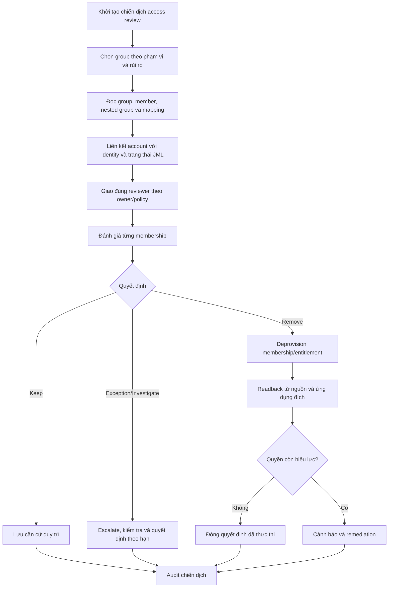
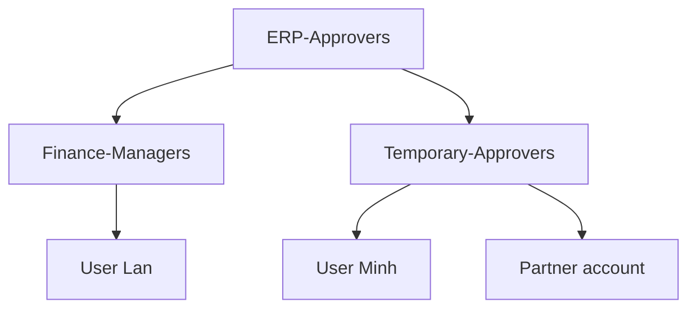

# Review theo group trong Access review và quản lý vòng đời danh tính IAM

**Review theo group** (*group-based access review* hoặc *group membership certification*) là quá trình người có thẩm quyền **xem xét và xác nhận ai còn cần thuộc một nhóm quyền**, nhóm đó cung cấp quyền truy cập gì, và thành viên nào cần được giữ, điều chỉnh hoặc thu hồi. Nhóm có thể nằm trong **Active Directory (AD)**, Identity Provider (IdP), hệ thống SaaS hoặc ứng dụng nội bộ. Việc rà soát cần dựa trên **quyền hiệu lực ở hệ thống đích**, không chỉ danh sách tên người trong một group.

Ví dụ, group `ERP-Invoice-Approvers` ánh xạ đến role phê duyệt hóa đơn tại ERP. Sau khi một nhân viên chuyển từ Finance sang Analytics, tên người đó có thể vẫn còn trong group vì quy trình **Mover** chỉ cấp quyền mới mà chưa gỡ quyền cũ. Review theo group giúp người sở hữu quyền phát hiện và yêu cầu gỡ membership không còn căn cứ.

Trong **Identity and Access Management (IAM)**, review theo group là một phần của **access governance** xuyên suốt **Joiner–Mover–Leaver (JML)**. Nó bổ sung cho việc xác minh danh tính, provisioning, deprovisioning và reconciliation; phối hợp với **IdP/SSO, SCIM, RBAC/ABAC, kiểm toán và quản trị tài khoản dịch vụ** để giảm đặc quyền và quyền truy cập tồn dư.

## 1. Group được dùng để cấp quyền như thế nào?

**Group** là tập hợp các chủ thể hoặc tài khoản; ứng dụng có thể dùng membership làm căn cứ cấp role, permission hay policy. Tuy nhiên **group không hoàn toàn đồng nghĩa role**: một group có thể phục vụ phân phối cấu hình, danh sách liên lạc hoặc quản trị, trong khi role đại diện tập quyền theo nhiệm vụ.

| Đối tượng | Ý nghĩa trong review | Câu hỏi cần trả lời |
| --- | --- | --- |
| **Group** | Tập thành viên được quản trị | Nhóm còn cần thiết và có owner không? |
| **Direct member** | User/group/workload được thêm trực tiếp | Có căn cứ tiếp tục membership không? |
| **Nested group** | Nhóm thành viên của nhóm khác | Những identity nào gián tiếp nhận quyền? |
| **Effective member** | Identity có tư cách thành viên sau khi tính kế thừa | Ai thực sự hưởng quyền qua group? |
| **Entitlement mapping** | Liên hệ group với role, ACL hoặc ứng dụng | Membership cho phép hành động nào? |
| **Owner** | Người chịu trách nhiệm phê duyệt/đánh giá | Có hiểu phạm vi và rủi ro không? |
| **Target account** | Account hiện có trong ứng dụng đích | Quyền có thực sự được cấp/thu hồi ở đích? |

Nhóm `Finance-Readers` có thể cấp quyền đọc báo cáo, nhưng một ứng dụng khác có thể ánh xạ cùng group thành quyền rộng hơn. Vì vậy, **không suy luận quyền chỉ từ tên group**; phải kiểm tra mapping và permission thực tế.

## 2. Mục tiêu của access review theo group

Một đợt review cần đạt được những kết quả rõ ràng:

1. **Xác định quyền mà group mang lại** và độ nhạy cảm của tài nguyên.
2. **Xác nhận từng direct/effective member** vẫn có nhiệm vụ hợp lệ.
3. **Phát hiện Mover residual access:** quyền từ bộ phận hoặc dự án cũ chưa được gỡ.
4. **Phát hiện Leaver/orphan account:** account không còn quan hệ hoặc owner hợp lệ.
5. **Kiểm tra least privilege:** group có cấp quyền vượt nhu cầu không?
6. **Kiểm tra SoD:** membership kết hợp với quyền khác có tạo xung đột nhiệm vụ không?
7. **Xử lý ngoại lệ:** xác định lý do, người phê duyệt, phạm vi và ngày hết hạn.
8. **Thu hồi và xác minh:** quyết định Remove phải được thực thi, đọc lại và kiểm chứng.
9. **Lưu bằng chứng:** ai review, quyết định nào, dữ liệu nào và kết quả thực tế ra sao.

**Review thành công không phải chỉ đạt 100% nút “Approve”.** Mục tiêu là chứng minh quyền còn phù hợp và những quyền không phù hợp đã bị xử lý.

## 3. Review theo group khác review theo user hoặc entitlement

| Kiểu review | Đơn vị hiển thị | Ưu điểm | Điểm cần bổ sung |
| --- | --- | --- | --- |
| **Theo group** | Một group và danh sách thành viên | Owner thấy ai có quyền qua một cơ chế chung | Cần mở rộng nested groups và mapping |
| **Theo user** | Một identity và tất cả entitlement | Manager thấy tổng thể quyền của một người | Manager có thể không hiểu quyền kỹ thuật |
| **Theo application** | Account/role trong ứng dụng | App owner hiểu tác động tài nguyên | Có thể bỏ sót identity tương quan hoặc quyền gián tiếp |
| **Theo privileged entitlement** | Các quyền nhạy cảm nhất | Tập trung rủi ro cao | Cần kiểm tra toàn bộ đường truy cập |

Các cách rà soát **bổ sung cho nhau**. Group review có thể xác nhận membership đúng, nhưng vẫn bỏ sót quyền ERP **gán trực tiếp** ngoài group; account reconciliation và review theo ứng dụng cần phát hiện sai lệch đó.

## 4. Chuẩn bị danh mục group trước chiến dịch review

Trước khi giao reviewer, IAM cần có metadata đáng tin:

| Trường | Ví dụ minh họa | Vai trò |
| --- | --- | --- |
| `groupId` | `grp-erp-approvers-01` | Khóa ổn định |
| `displayName` | ERP Invoice Approvers | Hiển thị dễ hiểu |
| `sourceSystem` | AD / IdP / ERP | Xác định nơi quản trị |
| `targetApplications` | ERP Production | Biết quyền ở đích |
| `ownerId` | `finance-control-owner` | Định tuyến reviewer |
| `riskLevel` | High | Lựa chọn tần suất và cấp xét |
| `membershipType` | Static / Dynamic | Hiểu cơ chế cấp |
| `roleMappings` | `invoice.approve` | Giải thích permission |
| `groupStatus` | Active / Retired | Tránh review group đã ngừng |
| `lastReconciledAt` | Timestamp | Đánh giá độ mới dữ liệu |

Đây là **schema minh họa**, không phải định dạng chuẩn SCIM hoặc AD. Không sử dụng email, tên group hay `displayName` làm khóa duy nhất: group có thể đổi tên và email có thể được tái sử dụng.

**Group owner khác manager của mọi thành viên.** Owner hiểu tại sao group tồn tại và có thể xác nhận điều kiện membership; manager xác nhận công việc của từng nhân viên. Quyền nhạy cảm có thể cần cả hai góc nhìn.

## 5. Quy trình end-to-end review theo group



**Quyết định Review và thực hiện Remediation là hai mốc khác nhau.** Một người nhấn Remove không bảo đảm group đã được cập nhật và ứng dụng đã ngừng chấp nhận quyền.

## 6. Snapshot dữ liệu và phạm vi review

Một chiến dịch cần ghi lại **snapshot** danh sách group/member tại thời điểm bắt đầu, cùng version hoặc thời gian truy xuất. Trong thời gian reviewer làm việc, nhân sự có thể Joiner, Mover hoặc Leaver, khiến danh sách thay đổi.

Ví dụ:

- Ngày 1: Lan thuộc group `Support-Exporters`, xuất hiện trong snapshot.
- Ngày 2: Lan chuyển bộ phận; workflow Mover gỡ group.
- Ngày 3: Reviewer mở item cũ và nhấn Keep.

Nếu hệ thống dùng quyết định Keep để **thêm lại membership** mà không kiểm tra trạng thái hiện hành, quyền đã thu hồi có thể bị tái cấp. Cần phân biệt snapshot phục vụ bằng chứng với **observed state hiện tại**, và **revalidate JML/policy trước mọi hành động cấp hoặc sửa quyền**.

Không nên tự động provision quyền chỉ vì reviewer Keep một item đã được deprovision; Keep chỉ xác nhận quyền **đang được xét** còn cần, không phải approval cấp mới ngoài luồng.

## 7. Xử lý nested groups và effective membership

**Nested group** gây rủi ro đặc biệt vì một identity có thể hưởng quyền qua nhiều tầng.



Trong ví dụ, `ERP-Approvers` không trực tiếp chứa Lan mà chứa group `Finance-Managers`. Nếu reviewer chỉ xem direct members của `ERP-Approvers`, họ có thể bỏ sót Lan và hàng trăm thành viên gián tiếp.

Kiểm soát cần có:

1. **Hiển thị direct và effective membership** rõ ràng, kèm chuỗi kế thừa.
2. **Giới hạn độ sâu và phát hiện chu trình** khi tính quan hệ nhóm.
3. **Kiểm tra quy tắc nesting của hệ thống đích**: không phải mọi group hay ứng dụng đều kế thừa giống nhau.
4. **Phân biệt nguồn quyền:** group đích, group nguồn, role kế thừa và quyền gán trực tiếp.
5. **Chỉ ra nơi cần thu hồi thực tế:** gỡ user khỏi nhóm con hay gỡ liên kết nhóm con–nhóm cha?
6. **Đánh giá tác động:** gỡ một nested group có thể thu hồi quyền của rất nhiều người.
7. **Đọc lại effective entitlement**, không chỉ trạng thái direct member.

**Không mặc nhiên gỡ toàn bộ nested group** nếu chỉ một thành viên không còn căn cứ. Cần chọn remediation ít ảnh hưởng nhất và có phê duyệt tương ứng.

## 8. Membership động và membership tĩnh

Một số IdP/directory hỗ trợ **dynamic group membership** từ thuộc tính: bộ phận, loại quan hệ, dự án hoặc điều kiện khác. Review theo group động cần xem xét **cả quy tắc lẫn dữ liệu nguồn**.

| Loại group | Cần review điều gì? | Rủi ro |
| --- | --- | --- |
| **Static/manual** | Từng assignment và lý do giữ quyền | Không gỡ quyền khi Mover/Leaver |
| **Dynamic/rule-based** | Rule, nguồn thuộc tính, owner và tập member thực tế | Rule sai cấp quyền trên diện rộng |
| **Hybrid** | Quy tắc và ngoại lệ thủ công | Ngoại lệ tồn tại ngoài rule |
| **Nested** | Chuỗi quan hệ, tác động gián tiếp | Bỏ sót quyền kế thừa |
| **Privileged** | Cơ chế kích hoạt, thời gian, SoD và quyền hiệu lực | Đặc quyền tồn dư |

Với group động, **gỡ member thủ công có thể không bền vững**: rule tiếp tục khớp sẽ thêm lại user. Khi đó cần sửa dữ liệu nguồn có thẩm quyền, điều kiện rule hoặc chính sách ngoại lệ, theo quy trình kiểm soát và phân tích tác động.

## 9. Quyết định Keep, Remove và Exception

Một item review nên có các kết quả nghiệp vụ rõ ràng:

| Quyết định | Ý nghĩa | Việc cần làm |
| --- | --- | --- |
| **Keep / Certify** | Membership vẫn phù hợp | Lưu căn cứ, reviewer và thời điểm |
| **Remove / Revoke** | Membership không còn cần | Tạo hành động deprovision và xác minh |
| **Change scope** | Quyền còn cần nhưng quá rộng | Chuyển sang role/group ít quyền hơn theo policy |
| **Exception** | Duy trì tạm vì lý do đặc biệt | Owner, lý do, ngày hết hạn, phê duyệt |
| **Investigate** | Chưa đủ dữ liệu để quyết định | Giao xử lý, thời hạn và cảnh báo |
| **No response / overdue** | Reviewer chưa quyết định | Escalation theo chính sách, không tự xem là Keep |

Một quyết định Keep không nên chỉ là “tôi biết tên người này”. Reviewer phải hiểu **người đó có nhiệm vụ gì, group cấp quyền gì và liệu quyền vẫn còn cần trong phạm vi hiện tại**.

Đối với quyền đặc biệt hoặc quyền không có owner, tổ chức cần quy tắc xử lý rủi ro rõ, có thể yêu cầu revoke hoặc tạm hạn chế khi không tìm được căn cứ hợp lệ.

## 10. Review theo group trong Joiner

Khi **Joiner**, HRIS/nguồn quan hệ cung cấp thông tin cần thiết để cấp nhóm theo role và chính sách. Review có thể kiểm tra:

- Account có identity ID ổn định, không bị gán nhầm vào người khác.
- Group thuộc bộ quyền cơ bản hay quyền nhạy cảm cần approval riêng.
- Ngày hiệu lực của nhân viên đã đến trước khi quyền dùng được.
- Group mapping ở IdP/AD có trùng hoặc xung đột với entitlement khác không.
- Người nhận quyền có đúng tenant, vị trí hoặc dự án theo RBAC/ABAC không.

Ví dụ một nhân viên Support được gán `Support-Readers` tự động, nhưng `Support-Customer-Export` phải qua data-owner approval. Nếu chiến dịch review phát hiện người mới chưa có nhiệm vụ xuất dữ liệu, reviewer có thể Remove quyền export, trong khi quyền đọc thông thường vẫn được giữ.

## 11. Review theo group trong Mover

**Mover là nguồn phổ biến của quyền tồn dư.** Khi người dùng chuyển bộ phận hoặc dự án, hệ thống có thể chỉ thêm group mới mà quên gỡ group cũ.

| Trước Mover | Sau Mover mong muốn | Review cần phát hiện |
| --- | --- | --- |
| `Finance-Approvers` | `Analytics-Readers` | Group Finance còn hiệu lực |
| `Project-A-Writers` | `Project-B-Writers` | ACL dự án A còn qua group |
| `Production-Operators` | `Security-Auditors` | Đặc quyền production không còn căn cứ |
| `Temporary-OnCall` | Không trực ca | Group tạm đã quá hạn |

Review cần phối hợp **thông tin Mover từ HR/project catalog** với mapping nhóm; nếu chỉ hỏi “người này vẫn còn làm ở công ty không?” thì không phát hiện role accumulation.

Giai đoạn bàn giao có thể cần quyền cũ trong thời gian ngắn. Ngoại lệ phải có **owner, phạm vi, lý do và ngày hết hạn**, không thể biến thành Keep vĩnh viễn mà không có đánh giá lại.

## 12. Review theo group trong Leaver

Khi **Leaver**, quyền truy cập công việc thường phải được thu hồi theo sự kiện có thẩm quyền, **không đợi đến chiến dịch review định kỳ**.

Review giúp phát hiện các trường hợp quy trình Leaver chưa hoàn tất:

- Account đã disabled nhưng vẫn thuộc group ứng dụng.
- Nhóm AD bị gỡ nhưng role SaaS gán trực tiếp còn active.
- JWT/cookie phiên cũ vẫn mang claim nhóm và được API chấp nhận.
- API key hoặc credential phụ không liên quan trực tiếp IdP còn hoạt động.
- Account không tìm thấy identity gốc hoặc người phụ trách.
- Group partner chứa người đã hết hợp đồng.

**Disable IdP hoặc SCIM `active=false` không tự bảo đảm mọi phiên và token bị thu hồi ngay**. Với quyền nhạy cảm, cần kiểm chứng bằng negative authorization test tại ứng dụng/API và xử lý session/token theo khả năng nền tảng.

## 13. IdP, SSO, SCIM và group review

| Thành phần | Liên quan đến group review | Giới hạn |
| --- | --- | --- |
| **IdP / directory** | Nguồn group và claim; có thể quản lý dynamic membership | Claim có thể trễ hoặc sai lệch với ứng dụng |
| **SSO/OIDC/SAML** | Truyền thông tin xác thực hoặc group claim theo trust | Không tự provision/deprovision mọi group ở SaaS |
| **SCIM/connector** | Đồng bộ User, Group và membership theo hỗ trợ | Không phải mọi ứng dụng có cùng mapping/filtered PATCH |
| **RBAC** | Ánh xạ group sang role/permission | Tên group không đủ xác định quyền |
| **ABAC/PBAC** | Giới hạn quyền theo tài nguyên, tenant và ngữ cảnh | Membership đúng chưa chắc cho phép mọi tài nguyên |
| **IAM/IGA** | Tính desired state, owner, review và remediation | Cần readback từ đích |
| **Audit/reconciliation** | Đối chiếu quyết định với quyền thực tế | Không thay thế enforcement tại API |

Đặc biệt, **ID token OIDC không phải access token dùng gọi API**. Với API cần kiểm tra access token phù hợp và authorization theo resource. Nếu một session đã chứa group claim cũ, việc gỡ membership ở IdP không nhất thiết khiến session lập tức mất quyền.

## 14. Review nhóm đặc quyền và SoD

Group như `Domain-Admins`, `Database-Owners` hoặc `Payment-Approvers` đòi hỏi mức kiểm soát cao hơn group đọc thông tin.

Cần xác nhận:

1. Có owner cụ thể và purpose hợp lệ?
2. Người được cấp quyền còn đúng vai trò công việc?
3. Có thể giảm xuống **least privilege** hoặc **Just Enough Administration (JEA)**?
4. Quyền có được kích hoạt theo **Just-in-Time (JIT)** thay vì luôn thường trực?
5. Người dùng có các role xung đột theo **Separation of Duties (SoD)**?
6. Có account phụ, nhóm lồng nhau hoặc đường truy cập qua service identity?
7. Có session/token quản trị còn tồn dư sau khi gỡ membership?
8. Quyết định review có được xác minh tại hạ tầng/API đích không?

Ví dụ một người thuộc `Payment-Creators` và gián tiếp thuộc `Payment-Approvers` qua nested group. **SoD phải xét quyền hiệu lực sau kế thừa**, không chỉ danh sách role trực tiếp.

## 15. Partner và service account trong group review

### Partner identity

Một group B2B có thể chứa nhiều tài khoản từ cùng đối tác nhưng chỉ được phép truy cập dữ liệu theo **partner ID, tenant, sponsor và hợp đồng còn hiệu lực**. Group owner phải rà soát cả **người nhận quyền** lẫn **quan hệ hợp đồng**. Partner IdP xác thực thành công không tự tạo quyền cho mọi dữ liệu ở bên cung cấp.

Khi hợp đồng kết thúc, quyền cần được thu hồi chủ động. Nếu partner vẫn xuất hiện trong group, review phải ghi nhận và xử lý sai lệch theo mức rủi ro.

### Service/workload identity

Một số group cấp quyền cho service account hoặc workload. Không thể đánh giá chúng chỉ bằng `department` hay `manager` của nhân viên tạo account.

Với workload cần kiểm tra **service ID, owner kỹ thuật, mục đích, môi trường, resource scope, credential lifecycle và phụ thuộc vận hành**. Khi kỹ sư rời tổ chức, cần chuyển owner và thu hồi quyền cá nhân đối với secret, nhưng không xóa mù workload đang hoạt động.

## 16. Reconciliation sau quyết định Remove

```text
desired_membership = approved_membership(group_id, policy, JML)
observed_membership = read_group_members_at_source_or_target(group_id)

missing = desired_membership - observed_membership
excess  = observed_membership - desired_membership
```

Đây là mô hình logic. Để xác định **effective permissions**, còn phải tính nested groups, role mapping, ACL cục bộ, cache và trạng thái token/session.

Quy trình Remove an toàn:

1. Ghi quyết định review gắn với **group ID, account ID, reviewer và thời điểm**.
2. Kiểm tra người dùng hiện vẫn thuộc group và quyết định chưa bị thay thế.
3. Xác định **nơi quản trị nguồn** để không xóa ở đích rồi bị đồng bộ lại.
4. Thực hiện remove qua directory, SCIM PATCH hoặc connector phù hợp.
5. Đọc lại direct membership và effective entitlement ở hệ thống đích.
6. Kiểm chứng hành động trái quyền bị từ chối, khi mức rủi ro yêu cầu.
7. Đóng remediation khi có bằng chứng; nếu thất bại phải cảnh báo/escalate.

**SCIM PATCH thành công không đồng nghĩa phiên ứng dụng cũ đã bị thu hồi.** Quyết định Remove không nên được đánh dấu “remediated” chỉ vì connector trả 200/204; phải phù hợp tiêu chí kiểm chứng của hệ thống.

## 17. Lỗi thường gặp khi review theo group

| Lỗi | Hậu quả | Kiểm soát |
| --- | --- | --- |
| Reviewer không biết group cấp quyền gì | Keep theo cảm tính | Hiển thị mapping, tài nguyên và rủi ro |
| Chỉ review direct member | Bỏ sót thành viên nested | Tính effective membership và đường kế thừa |
| Review group động bằng remove thủ công | User được rule tự thêm lại | Sửa rule hoặc dữ liệu nguồn đúng |
| Account sai identity correlation | Duy trì quyền của người đã nghỉ | Liên kết ID ổn định và trạng thái JML |
| Không kiểm tra quyền ứng dụng cục bộ | Role tồn dư ngoài IdP | Application review và reconciliation |
| Chỉ thống kê tỷ lệ hoàn thành | Không biết quyền đã được thu hồi chưa | Đo remediation verified |
| Reviewer quá nhiều item | Duyệt hàng loạt không hiểu quyền | Phân loại rủi ro, ưu tiên và chia workload |
| Hành động Remove trên group cha quá rộng | Thu hồi nhầm quyền nhiều người | Phân tích blast radius và chọn điểm gỡ đúng |
| Giữ quyền không có hạn/owner | Privilege creep | Ngoại lệ có thời hạn và phê duyệt |
| Dùng snapshot cũ để cấp lại quyền | Đảo ngược Mover/Leaver | Revalidation trước mọi write |

**Không tự động coi không phản hồi là Keep.** Chính sách xử lý overdue cần tùy rủi ro: có thể escalation, hạn chế hoặc revoke có kiểm soát, kèm đánh giá tác động và thông báo.

## 18. Thiết kế chiến dịch review hiệu quả

Một chiến dịch nên xác định:

- **Scope:** nhóm đặc quyền, nhóm chứa dữ liệu nhạy cảm, nhóm B2B hoặc toàn bộ nhóm theo mức rủi ro.
- **Frequency:** tần suất theo yêu cầu nội bộ và độ nhạy cảm; review sự kiện JML không thay thế review định kỳ.
- **Reviewer assignment:** group owner, manager, data owner và cấp duyệt cần thiết.
- **Evidence:** danh sách member, đường nesting, role mapping, last-used signal nếu đáng tin và căn cứ công việc.
- **Decision deadline:** thời gian đánh giá và escalation.
- **Remediation SLA:** giới hạn thời gian từ Remove đến quyền đích mất hiệu lực.
- **Exception governance:** owner, lý do, thời hạn và đánh giá lại.
- **Post-review QA:** lấy mẫu quyết định Keep/Remove và kiểm tra quyền thực tế.

Tín hiệu `lastLogin` hoặc `lastUsed` có thể hữu ích nhưng **không đủ để tự quyết định**. Một tài khoản break-glass hợp lệ có thể ít dùng, còn một quyền thường được sử dụng nhiều lần không có nghĩa hợp lệ sau Mover.

## 19. Ví dụ bảng chứng nhận membership

| Group | Thành viên | Ngữ cảnh | Quyết định | Hành động |
| --- | --- | --- | --- | --- |
| ERP Approvers | Lan | Chuyển từ Finance sang Analytics | Remove | Gỡ membership, kiểm tra role ERP |
| Support Readers | Minh | Vẫn phụ trách Support | Keep | Ghi căn cứ |
| Project A Writers | Hòa | Đã chuyển dự án B | Remove | Gỡ ACL và group A |
| Temporary OnCall | An | Ngoại lệ bàn giao còn 3 ngày | Exception | Hết hạn tự động và recheck |
| Partner Orders | Partner X user | Hợp đồng hết hạn | Remove | Disable/deprovision B2B |
| Service Reports | Workload R | Owner hiện tại chưa rõ | Investigate | Xác định owner, hạn xử lý |

Bảng minh họa logic review, không khẳng định các tài khoản/tài nguyên có thật. Quyết định cần gắn định danh ổn định thay vì chỉ tên hiển thị.

## 20. Kiểm thử quy trình review

| Tình huống | Kết quả mong muốn |
| --- | --- |
| Group có một user trực tiếp | Reviewer nhìn thấy đúng identity |
| Group có nested group | Hiển thị effective members và nguồn kế thừa |
| Dynamic group với rule còn khớp | Không gỡ thủ công rồi coi đã xong |
| User đã Mover trước snapshot review | Không cấp lại role cũ từ Keep |
| User đã Leaver nhưng còn session | Remove và kiểm tra quyền thực tế |
| Group đặc quyền chứa user không owner | Điều tra ưu tiên, không auto-Keep |
| Reviewer không đủ thẩm quyền | Không được xác nhận group nhạy cảm |
| Connector lỗi khi Remove | Giữ trạng thái remediation pending/failed |
| Remove một thành viên | Không xóa nhầm những thành viên khác |
| Group bị rename giữa chiến dịch | Vẫn liên kết bằng group ID ổn định |
| Partner hết hợp đồng | Không tiếp tục entitlement |
| Workload service account bị đổi owner | Review owner và phạm vi mà không gián đoạn mù quáng |

Khi kiểm thử SCIM Group, một lệnh `remove` trên toàn thuộc tính `members` có thể ảnh hưởng tất cả thành viên; cần chọn đúng phần tử hoặc cơ chế gỡ membership do provider hỗ trợ.

## 21. Audit và chỉ số đo lường

Audit nên chứa **campaign ID, group ID, member/account/identity ID, reviewer, role mapping, snapshot time, policy version, quyết định, lý do, lệnh remediation, phản hồi đích và readback**. Không lưu access token, mật khẩu, cookie, private key hoặc thông tin nhân sự không cần thiết.

Các chỉ số nên theo dõi:

- **Certification coverage:** tỷ lệ group thuộc scope đã được rà soát.
- **Decision completion:** tỷ lệ item có quyết định hợp lệ.
- **Removal decision rate:** tỷ lệ membership được xác định không còn cần.
- **Verified revocation rate:** tỷ lệ quyết định Remove đã được chứng minh tại đích.
- **Remediation latency:** thời gian từ quyết định Remove đến thu hồi thực tế.
- **Nested entitlement visibility:** mức bao phủ effective membership.
- **Orphan member count:** account không có identity/owner hợp lệ.
- **Mover residual access:** quyền cũ của nhân viên chuyển vị trí.
- **Leaver time to deny:** độ trễ chặn truy cập thực tế sau Leaver.
- **Privileged exception overdue:** ngoại lệ group đặc quyền quá hạn.

**100% quyết định review đã hoàn thành không đồng nghĩa 100% quyền dư đã được gỡ.** Cần báo cáo riêng quyết định, trạng thái remediation và bằng chứng kiểm chứng.

## 22. Câu hỏi tự kiểm tra

**Tình huống A:** Reviewer thấy group `ERP-Approvers` có nested group `Finance-Managers`. Chỉ review direct membership đã đủ chưa? **Chưa.** Phải tính effective members và quyền kế thừa.

**Tình huống B:** Hà đã Mover nhưng role Finance vẫn còn. Reviewer nhấn Remove. Có thể đóng remediation ngay không? **Không.** Cần gỡ quyền ở hệ thống nguồn/đích và readback.

**Tình huống C:** Lan thuộc dynamic group theo department Finance. Reviewer gỡ thủ công nhưng rule vẫn khớp. Vấn đề gì xảy ra? **Membership có thể được thêm lại**; cần xử lý nguồn thuộc tính hoặc rule.

**Tình huống D:** Group review đã Keep account của một người trước khi nhận event Leaver. Có được provision lại theo Keep không? **Không.** Phải revalidate trạng thái JML trước mọi write.

**Tình huống E:** Group được gỡ nhưng cookie SaaS còn quyền cũ. Thu hồi đã hoàn tất chưa? **Chưa.** Phải kiểm tra session/token và authorization thực tế.

**Tình huống F:** Service account trong group đọc báo cáo không có owner, job đang chạy. Nên làm gì? **Điều tra và xác định owner/phụ thuộc, giảm scope theo chính sách**, không tự xóa mù workload.

## Ghi nhớ

**Review theo group** giúp xác nhận **ai còn cần quyền qua membership**, bao gồm thành viên trực tiếp, nested group, dynamic group và entitlement được ánh xạ tại ứng dụng. Quy trình an toàn phải có **group owner, căn cứ nhiệm vụ, trạng thái Joiner–Mover–Leaver, least privilege, SoD, quyết định Keep/Remove/Exception, remediation và readback**. Phối hợp **IdP/SSO, SCIM, RBAC/ABAC, quản trị service identity và audit** để không chỉ hoàn thành chứng nhận trên giấy mà còn **thực sự loại bỏ quyền truy cập tồn dư**.
