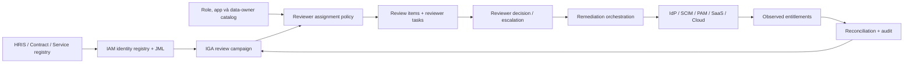
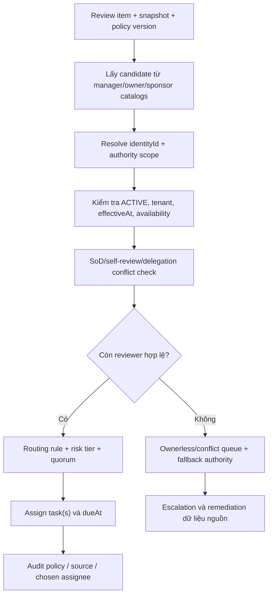
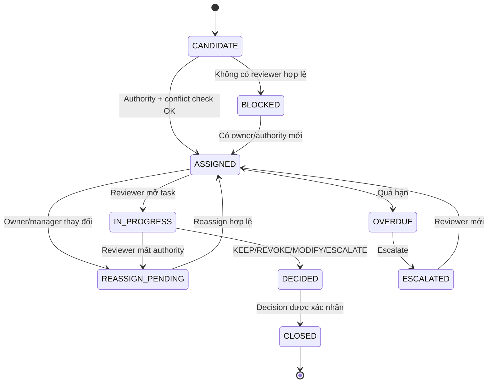

# Reviewer assignment trong Access Review và quản lý vòng đời danh tính IAM

## 1. Reviewer assignment là gì?

**Reviewer assignment** là quá trình xác định, kiểm chứng và giao **đúng người hoặc nhóm có thẩm quyền** chịu trách nhiệm đánh giá từng mục quyền truy cập (*access review item*) trong một chiến dịch rà soát quyền (*access review/certification campaign*). Hệ thống không chỉ gửi một thông báo: nó phải chứng minh **vì sao reviewer được chọn, có đủ thông tin và thẩm quyền ra quyết định không, có xung đột lợi ích không**, và ai chịu trách nhiệm khi reviewer vắng mặt hoặc quá hạn.

Ví dụ, khi rà soát quyền `finance-payment-approver` của nhân viên Minh, quản lý trực tiếp có thể xác nhận Minh còn nhiệm vụ liên quan thanh toán; nhưng **data owner hoặc application owner** mới có thể xác nhận mức truy cập này phù hợp kiểm soát tài chính. Nếu chỉ gán reviewer là “người quản lý gần nhất” rồi cho nút Approve, chiến dịch có thể hoàn tất về mặt hành chính nhưng **vẫn giữ quyền nhạy cảm không có cơ sở phù hợp**.

Trong module **SECURITY_IDENTITY_ACCESS_MANAGEMENT_IDENTITY_LIFECYCLE**, reviewer assignment hỗ trợ mô hình **Joiner–Mover–Leaver (JML)** bằng cách đưa quyền được cấp/duy trì vào một quy trình xác nhận có trách nhiệm. Quyết định review liên quan tới **HRIS/contract registry, IdP, SSO, SCIM, RBAC/ABAC, IAM/IGA, PAM, danh tính dịch vụ, đối soát và kiểm toán**, nhằm phát hiện **quyền tích lũy hoặc còn tồn dư** sau thay đổi vai trò và nghỉ việc.

Sau bài này, người đọc có thể thiết kế reviewer routing theo đối tượng và quyền, xác định **owner, người thay thế, chuỗi escalation, SoD, đa cấp review**, xử lý trường hợp manager/owner thay đổi giữa kỳ, và phân biệt trạng thái **đã gán reviewer, đã ra quyết định, đã thực thi thu hồi và đã kiểm chứng quyền thực tế**.

> Reviewer assignment là một **quyết định về thẩm quyền đánh giá**, không phải bằng chứng entitlement của người dùng đã đúng. Ngay cả khi reviewer xác nhận cần thu hồi, quy trình vẫn phải thực hiện thay đổi và đối soát ở hệ thống đích.

## 2. Vị trí của reviewer assignment trong kiến trúc IAM/IGA

Trong một chương trình Identity Governance and Administration (IGA), hệ thống thường tổng hợp các danh tính, tài khoản, vai trò, nhóm và quyền trực tiếp thành **các mục cần xác nhận**. Policy quyết định mục nào cần xem và chọn reviewer phù hợp; reviewer quyết định giữ, sửa, thu hồi hoặc escalation; các connector triển khai quyết định; reconciliation kiểm tra trạng thái thực tế.



| Thành phần | Trách nhiệm | Đầu vào reviewer assignment |
| --- | --- | --- |
| **HRIS** | Người lao động, tổ chức, manager, ngày hiệu lực | Manager hiện hành, trạng thái Joiner/Mover/Leaver |
| **Contract/partner registry** | Guest, nhà thầu, sponsor và thời hạn | Sponsor hoặc người sở hữu quan hệ đối tác |
| **Identity registry** | Liên kết một chủ thể với account ở các hệ thống | `identityId`, loại chủ thể, trạng thái và owner |
| **Role catalog / IGA** | Danh mục role, rủi ro, SoD, phê duyệt | Business role owner, policy, risk tier |
| **Application/data catalog** | Chủ tài nguyên, hệ thống và mức nhạy cảm | App owner, data owner, scope |
| **Reviewer assignment engine** | Quyết định ai phải review theo policy | Candidate, authority, conflict và fallback |
| **Review campaign** | Giao task, nhận quyết định, theo dõi hạn | Item snapshot, assignment, deadline và bằng chứng |
| **Provisioning connector** | Grant/revoke tại đích | Kết quả sau quyết định REVOKE/MODIFY |
| **IdP/SSO/PAM** | Xác thực reviewer và kiểm soát phiên đặc quyền | Authentication assurance và quyền vận hành |
| **Reconciliation/audit** | So actual/effective access với desired state | Bằng chứng đóng item/campaign |

**Đừng đồng nhất nơi lưu metadata với nguồn có thẩm quyền.** Manager có thể đến từ HRIS; role owner từ IGA; data owner từ catalog tài nguyên; quyền thực tế từ ứng dụng. Một nhóm IdP đặt tên `reviewer-admins` không tự là danh sách người có thẩm quyền phê duyệt mọi quyền tài chính.

## 3. Reviewer khác requester, approver và remediation owner

Trong IAM, một cá nhân có thể xuất hiện trong nhiều workflow nhưng **nhiệm vụ và thời điểm quyết định khác nhau**.

| Vai trò | Câu hỏi chịu trách nhiệm | Đầu ra |
| --- | --- | --- |
| **Access requester** | Ai cần xin cấp/thay đổi quyền? | Access request cùng lý do |
| **Access request approver** | Có nên cấp quyền mới trong thời điểm này? | APPROVE/REJECT trước provisioning |
| **Access reviewer/certifier** | Quyền **đang tồn tại** có còn hợp lệ và cần thiết không? | KEEP/REVOKE/MODIFY/ESCALATE |
| **Role owner** | Nội dung và tập permission của vai trò có còn đúng không? | Role definition và impact review |
| **Application/data owner** | Quyền trên hệ thống/tài nguyên này có phù hợp không? | Xác nhận phạm vi và phân loại rủi ro |
| **Remediation owner** | Ai chịu trách nhiệm gỡ/sửa quyền đã bị đánh dấu? | Thực thi, readback, xử lý exception |
| **Auditor** | Chương trình có bằng chứng và kiểm soát độc lập không? | Đánh giá chất lượng, không tự cấp quyền |

Một manager có thể được giao xác nhận **nhu cầu công việc**, nhưng không nhất thiết có thẩm quyền đánh giá **thiết kế chính sách SoD**, hoặc việc một cloud role có thể sửa mọi secret production. Với quyền rủi ro cao, có thể cần hai loại chứng nhận: **business need** và **technical/data risk**.

**Quyết định KEEP trong access review không phải một access request mới.** Nó là xác nhận về quyền đã có. Nếu quyền không tồn tại ở đích, không tự tạo grant chỉ vì reviewer bấm KEEP; việc cấp mới phải đi qua quy trình request/provisioning hợp lệ.

## 4. Reviewer có thể là ai?

Các lựa chọn reviewer thường gặp phải được ánh xạ tới **authority scope** rõ ràng.

| Loại reviewer | Thích hợp nhất khi | Hạn chế chính |
| --- | --- | --- |
| **Direct manager** | Xác nhận nhân viên còn làm nhiệm vụ liên quan | Có thể thiếu hiểu biết permission/tenant/SoD |
| **Second-level manager** | Manager trực tiếp bị xung đột hoặc cần kiểm soát bổ sung | Không tự hiểu sâu tài nguyên |
| **Business role owner** | Vai trò nghiệp vụ và điều kiện eligibility | Không thay thế app/data owner cho quyền đặc biệt |
| **Application owner** | Entitlement kỹ thuật, direct grants, tài khoản cục bộ | Có thể không hiểu nhu cầu nhân sự của mọi user |
| **Data/resource owner** | Truy cập dữ liệu nhạy cảm, tenant, pháp nhân, tài liệu | Cần đủ metadata về chủ thể và nhiệm vụ |
| **Privileged access owner / PAM team** | Role admin, break-glass, JIT eligible/active | Phải giữ tính độc lập với người đang dùng đặc quyền |
| **Guest sponsor / contract owner** | Quyền khách/đối tác, nghĩa vụ hợp đồng | Không quyết định thay chủ dữ liệu ở tổ chức tiếp nhận |
| **Service/workload owner** | Service account, bot, CI/CD và automation | Không là “manager HR” của workload |
| **Security/compliance reviewer** | SoD conflict, ngoại lệ rủi ro cao, quyền nhạy cảm | Nên phối hợp owner nghiệp vụ và target |
| **Delegated reviewer** | Thay thế tạm cho owner được chỉ định | Ủy quyền có scope, hạn và kiểm tra xung đột |
| **Fallback review board** | Metadata thiếu owner hoặc trường hợp khó | Không trở thành đường auto-approve thuận tiện |

**Không có một reviewer đúng cho tất cả.** Một service account dùng để sao lưu cơ sở dữ liệu nên do **service owner** giải trình nhu cầu, trong khi **data/platform owner** xác nhận blast radius. Một guest của đối tác nên có sponsor nội bộ xác nhận hợp đồng, nhưng nếu quyền liên quan dữ liệu riêng tư thì data owner vẫn phải tham gia.

## 5. Chọn reviewer theo thẩm quyền, không chỉ quan hệ tổ chức

Một **reviewer candidate** phải đồng thời đáp ứng:

1. **Identity hợp lệ:** có identity/account được xác minh, chưa Leaver, không bị disable và có thể đăng nhập review portal.
2. **Authority:** policy cho phép người đó review loại quyền, resource/tenant và risk tier cụ thể.
3. **Independence:** không tự xác nhận quyền của mình khi chính sách yêu cầu độc lập; không có xung đột SoD.
4. **Knowledge:** có đủ hiểu biết nghiệp vụ và nội dung entitlement để quyết định có căn cứ.
5. **Availability:** có khả năng thực hiện trong hạn, hoặc có delegation/backup hợp lệ.
6. **Auditability:** có thể gắn quyết định với cá nhân hoặc reviewer identity rõ ràng, không dùng account chung.
7. **Data visibility:** có quyền đọc **vừa đủ** dữ liệu review trong phạm vi được giao.

Một người có thể là quản lý danh nghĩa của nhân viên nhưng **đã chuyển bộ phận** trước ngày review, hoặc là app owner mới chưa có quyền xem entitlement của tenant được giao. Routing cần tính tới **thời điểm hiệu lực, trạng thái owner và scope**.

### Phân biệt eligibility và task assignment

**Reviewer eligible** có quyền/điều kiện nhận một nhóm item; **reviewer assigned** đã được giao một task cụ thể; **reviewer acting** là người thực sự đưa quyết định và ký audit. Ba chủ thể có thể khác nhau khi có delegation hợp lệ. Phải lưu **assignee ban đầu, effective reviewer và căn cứ thay thế**, không ghi đè tên reviewer ban đầu để che mất lịch sử.

## 6. Đơn vị phân công: theo item, theo account hay theo campaign?

Một review campaign có thể gồm nhiều ngàn quyền. Phân công ở cấp quá thô gây nguy cơ **một reviewer xác nhận cả những quyền ngoài thẩm quyền**.

| Đơn vị | Ưu điểm | Rủi ro |
| --- | --- | --- |
| **Campaign-level assignment** | Quản trị đơn giản | Người nhận có thể không đủ thẩm quyền với mọi item |
| **Application-level assignment** | App owner có hiểu biết hệ thống | Chưa chắc xác nhận được nhu cầu của từng subject |
| **Identity/account-level assignment** | Manager/sponsor xem tổng thể một người | Có thể bỏ sót direct grants và scope khác nhau |
| **Role/entitlement-level assignment** | Role/data owner ra quyết định đúng tập quyền | Cần mapping quyền và owner chính xác |
| **Resource-scope-level assignment** | Phù hợp quyền dữ liệu, tenant, dự án | Số lượng task lớn, cần nhóm hợp lý |
| **Multi-dimensional assignment** | Kết hợp business need và data/technical risk | Cần orchestration và quy tắc tổng hợp quyết định |

**Khuyến nghị thiết kế:** hạt nhân của review nên là một **review item có thể giải thích được**: `(beneficiary identity, target account, entitlement, resource scope, grant source, snapshot)`. Tác vụ giao reviewer có thể gom các item cùng thẩm quyền để giảm thao tác, nhưng **không làm mất quyết định cho từng quyền**.

Ví dụ `role=finance-analyst` ở tenant VN có thể do manager xác nhận nhu cầu; `directGrant=payment-release` trên cùng tài khoản phải do **data owner và người kiểm soát tài chính** đánh giá riêng.

## 7. Dữ liệu tối thiểu cần có để phân reviewer

Một assignment engine không thể đáng tin nếu chỉ biết `userName` và `groupName`. Nó nên tiếp nhận metadata theo nguồn, version và thời điểm.

| Thuộc tính | Ví dụ | Lý do |
| --- | --- | --- |
| `reviewItemId`, `campaignId` | `item-8041`, `q4-review` | Gắn duy nhất task và chiến dịch |
| `identityId`, `identityType` | `id-518`, `EMPLOYEE` | Xác định chủ thể và policy JML |
| `managerId` / `sponsorId` | `id-manager-22` | Candidate nghiệp vụ |
| `roleId`, `roleOwnerId` | `FINANCE_READER`, owner role | Candidate phù hợp role |
| `applicationId`, `applicationOwnerId` | `finance-saas`, owner app | Candidate cấp hệ thống |
| `resourceId`, `dataOwnerId` | `report-584`, owner data | Candidate theo tài nguyên |
| `tenantId`, `legalEntity` | `tenant-vn`, `VN` | Ràng buộc authority scope |
| `riskTier`, `sodFlags` | `HIGH`, `PAYMENT_SOD` | Quyết định yêu cầu độc lập/đa cấp |
| `grantSource`, `observedAt` | `DIRECT`, timestamp | Hiểu provenance và snapshot |
| `sourceVersion`, `roleVersion` | HR version, policy version | Tránh quyết định từ dữ liệu stale |
| `assignmentPolicyVersion` | `review-routing-v8` | Có thể giải trình reviewer routing |
| `reviewDueAt`, `timeZone` | Thời điểm hết hạn và múi giờ | Nhắc/escalate đúng thời điểm |
| `currentReviewerState` | ACTIVE/DELEGATED/ABSENT | Tránh giao cho owner không sẵn sàng |

**Không dùng email làm khóa duy nhất**: email và DN có thể đổi hoặc tái sử dụng. Reviewer và beneficiary nên được tương quan bằng identity ID ổn định cùng nguồn chứng thực. Với bên ngoài hoặc workload, dùng namespace rõ ràng để không gộp trùng user giữa tenant.

## 8. Reviewer routing: ma trận quy tắc theo rủi ro và loại entitlement

Một policy routing có thể chọn reviewer theo nhóm quyền và phân tầng. Bảng sau là **ví dụ minh họa**, không phải quy tắc bắt buộc áp dụng mọi doanh nghiệp.

| Phạm vi cần review | Reviewer chính | Reviewer bổ sung khi cần | Fallback hợp lệ |
| --- | --- | --- | --- |
| Quyền cơ bản nhân viên | Manager hiện hành | Role owner khi entitlement bất thường | Manager cấp trên/IGA triage |
| Role nghiệp vụ tài chính | Manager + business role owner | Data owner khi quyền ghi/duyệt | Finance control owner theo policy |
| SaaS direct grant | Application owner | Manager xác nhận nhu cầu | Backup owner ứng dụng có authority |
| Truy cập dữ liệu nhạy cảm | Data owner | Security/privacy theo risk tier | Data governance board |
| Cloud production admin | PAM/platform owner | Security + manager theo policy | Privileged access review board |
| Break-glass admin | Security/platform owner | Độc lập hậu kiểm và owner vận hành | Nhóm emergency governance đã duyệt |
| Guest/đối tác | Internal sponsor | Data/application owner | Sponsor backup hoặc contract owner |
| Service account | Service/workload owner | Platform/application owner | Backup service owner có đăng ký |
| SoD conflict | Control owner/SoD authority | Business owner giải trình | Escalation hội đồng kiểm soát |
| Orphan account | Không assign cho “manager mặc định” | IAM investigation tìm chủ thể | Quarantine + owner resolution |

Một chính sách có thể yêu cầu **tất cả** các bên xác nhận hoặc **một bên phù hợp** trong nhóm reviewer. Cần định nghĩa rõ đó là **quorum**, chuỗi **sequential review**, hay **parallel review**; không trộn chúng vào một trạng thái `APPROVED` mơ hồ.

### Thứ tự ưu tiên của rule

Nếu một item thỏa nhiều rule (ví dụ vừa là guest, vừa có role admin, vừa thuộc dữ liệu nhạy cảm), assignment engine cần chiến lược kết hợp **không làm yếu kiểm soát mạnh hơn**. Ví dụ:

1. Áp các quy tắc bắt buộc về **Leaver/disabled identity, SoD và privileged access**.
2. Áp quyền sở hữu **tài nguyên và tenant**.
3. Xác nhận nhu cầu nghiệp vụ qua manager/sponsor.
4. Chọn backup/delegate chỉ khi có bằng chứng thẩm quyền.
5. Nếu vẫn mơ hồ, **escalate**; không tự gán cho người gửi request để đủ chỉ tiêu.

## 9. Quản lý owner và nguồn sự thật cho reviewer

Reviewer assignment phụ thuộc một mạng **ownership**: manager, sponsor, role owner, app owner, data owner, service owner, security control owner. Mỗi nhóm có nguồn cập nhật và vòng đời khác nhau.

| Loại owner | Nguồn nên xem là có thẩm quyền | Rủi ro khi dữ liệu sai |
| --- | --- | --- |
| Manager | HRIS/organization hierarchy | Mover có thể làm manager cũ vẫn duyệt |
| Sponsor khách/nhà thầu | Contract/partner registry | Guest hết hợp đồng nhưng sponsor cũ vẫn KEEP |
| Role owner | IGA role catalog có version | Role đã retired không ai chịu trách nhiệm |
| Application owner | CMDB/application catalog được quản lý | App chuyển đội nhưng task gửi owner cũ |
| Data owner | Data catalog/resource governance | Dữ liệu mật được người không thẩm quyền xác nhận |
| Workload owner | Service registry/CI/CD ownership | Service account orphan vẫn có cloud admin |
| Security/SoD owner | Policy/control catalog | Xung đột không có người giải quyết |
| Reviewer delegate | Delegation registry có hạn và scope | Người thay thế thiếu thẩm quyền hoặc bị Leaver |

**Đừng suy owner của entitlement từ tên nhóm kỹ thuật** nếu catalog chưa có mapping. Ví dụ `grp_fin_team` có thể là nhóm nhận email chứ không phải role có quyền giải ngân. Cần xác minh từ target và catalog trước khi giao task.

### Source precedence

Nếu HRIS nói manager mới là B nhưng cache IGA vẫn là A, engine phải biết **source nào quyết định manager tại thời điểm review**. Nếu catalog app owner đã thay đổi nhưng đồng bộ chưa xong, cần xử lý tính mới, thay vì chọn người tình cờ được trả về đầu tiên. Ghi `sourceSystem`, `observedAt`, `effectiveAt` và version khi có.

## 10. Kiểm tra xung đột lợi ích và tự đánh giá

**Reviewer độc lập** là một nguyên tắc quan trọng đối với quyền nhạy cảm. Không phải mọi review đều bắt buộc nhiều người, nhưng **không để self-review làm đường duy nhất cho đặc quyền cao hoặc trường hợp có xung đột theo policy**.

Các tình huống cần phát hiện:

- Reviewer và beneficiary là **cùng một identity**, dù sử dụng hai account khác nhau.
- Người dùng có quyền thay role catalog lại là **reviewer duy nhất** quyết định quyền tự sửa policy của mình.
- Manager và beneficiary là hai account cùng chủ thể vì identity correlation sai.
- Privileged admin có quyền sửa audit của chính việc họ đang xác nhận.
- Reviewer là người cấp quyền ngoài luồng và không có phê duyệt độc lập đối với grant đó.
- Reviewer đã Leaver, bị suspend hoặc mất thẩm quyền do Mover.
- Reviewer được ủy quyền cho beneficiary của chính item hoặc cho một account chung.
- Một delegation chain vòng tròn khiến người được review cuối cùng tự xác nhận.

### Static SoD và dynamic SoD

**Static SoD** có thể cấm một người đồng thời được gán các vai trò reviewer và beneficiary ở những nhóm entitlement nhất định. **Dynamic SoD** có thể yêu cầu người xác nhận review phải khác actor đã kích hoạt admin session hoặc người thực hiện giao dịch liên quan. Với tài chính, kiểm soát theo **transaction** còn quan trọng hơn so sánh tên role.

**Nếu không tìm được reviewer độc lập hợp lệ**, chuyển item sang `BLOCKED_REVIEWER_CONFLICT` hoặc **control owner** theo quy trình, không âm thầm bỏ bước SoD để đóng campaign đúng hạn.

## 11. Thuật toán chọn reviewer: lọc, sắp xếp, xác thực, ghi nhận

Một assignment engine nên có pipeline **deterministic**, có thể giải thích và kiểm thử được. Đầu tiên xây candidate list, sau đó loại người không có thẩm quyền, xung đột và không khả dụng; cuối cùng áp quy tắc ưu tiên hoặc chuỗi review.



### Giả mã minh họa

```text
assignReviewers(reviewItem, campaign, policy):
    assert reviewItem.belongsToCampaign(campaign)
    assert campaign.snapshotAndPolicyVersionAreKnown()

    candidates = candidateResolver.fromTrustedSources(
        beneficiary=reviewItem.identityId,
        roleOwner=reviewItem.roleOwnerId,
        applicationOwner=reviewItem.applicationOwnerId,
        dataOwner=reviewItem.dataOwnerId,
        managerOrSponsor=reviewItem.managerOrSponsorId
    )

    eligible = []
    for candidate in candidates:
        reviewer = identityRegistry.resolveStableId(candidate)
        if not reviewer.isActiveAt(campaign.assignmentTime):
            continue
        if not authorityPolicy.canReview(
            reviewer, reviewItem.entitlement, reviewItem.tenant,
            reviewItem.resourceScope, reviewItem.riskTier
        ):
            continue
        if conflictPolicy.hasSelfReviewOrSoDConflict(reviewer, reviewItem):
            continue
        if not availabilityPolicy.isAvailableOrHasValidDelegation(reviewer):
            continue
        eligible.add(reviewer)

    route = policy.chooseRequiredStagesAndQuorum(reviewItem, eligible)

    if not route.satisfiesIndependenceAndOwnerRequirements():
        return openTriageWithReasonAndDeadline(reviewItem)

    return persistReviewerAssignments(
        reviewItemId=reviewItem.id,
        policyVersion=policy.version,
        sourceVersions=campaign.sourceVersions,
        reviewerStages=route,
        idempotencyKey=campaign.id + reviewItem.id
    )
```

Đây là **pseudocode**, không phải API của IGA. Trong thực tế, người vắng mặt có thể được **giao thay thế** chứ không nên bị loại ngay; việc chọn primary hay delegate cần được biểu diễn rõ trong policy. Nếu có nhiều stage bắt buộc, hàm chọn route không được loại bớt một stage chỉ vì reviewer sẵn có đông hơn ở stage khác.

### Determinism và idempotency

Chạy lại assignment vì retry không được tạo hai task độc lập cho một item/cùng stage trừ khi policy yêu cầu. Sử dụng `assignmentId`, campaign/item/stage key, version và ledger trạng thái. Khi policy thay đổi, engine có thể cần **reassignment có kiểm soát**, không ghi đè assignment cũ rồi mất audit.

## 12. Manager-based review: hữu ích nhưng không đủ cho mọi quyền

**Manager review** giúp kiểm tra nhân viên có còn cần một ứng dụng/nhóm quyền cho công việc hay không. Nó đặc biệt hữu ích với quyền dựa trên job function, nhưng có những giới hạn:

1. Manager có thể không hiểu các permission kỹ thuật nằm sau một role.
2. Manager có thể vừa chuyển đội và chưa biết phạm vi công việc của nhân viên.
3. Manager có thể có động cơ giữ quyền để đội làm việc thuận tiện, mặc dù data owner đánh giá rủi ro cao.
4. Một tài khoản local hoặc service account có thể không có manager HRIS.
5. Nhân viên ở nhiều dự án có thể cần xác nhận của **project owner** chứ không chỉ manager chính.
6. Group lồng nhau hoặc direct grant có thể không hiện lên trong danh sách role cấp cao.

**Giải pháp:** manager chịu trách nhiệm về **business need**, trong khi owner kỹ thuật/dữ liệu chịu trách nhiệm về **permission scope và risk**, theo ma trận policy. Một role đọc tài liệu thông thường có thể chỉ cần manager; quyền tạo admin khác hoặc giải ngân nên có reviewer độc lập phù hợp.

### Manager chuyển vai trò ngay trong campaign

Nếu manager A đã nhận task nhưng HRIS phát Mover chuyển nhân viên sang manager B, cần policy quyết định: **giữ reviewer tại snapshot**, chuyển sang B, hay yêu cầu cả hai trong giai đoạn bàn giao. Với quyền có nguy cơ cao, nên tái xác minh reviewer trước khi quyết định được chấp nhận; **không dùng quyết định của A sau khi A đã mất thẩm quyền** nếu chính sách yêu cầu authority hiện hành.

## 13. Role owner và application/data owner review

**Role owner** xem một role có còn được dùng đúng mục đích, quyền trong role có quá rộng hay không; **application owner** hiểu các entitlement kỹ thuật và cách cấp trực tiếp; **data owner** chịu trách nhiệm với scope, độ nhạy và người được truy cập tài nguyên.

Ví dụ entitlement `finance-export` có thể được gán qua:

```text
IAM role: FINANCE_ANALYST
   |
   +-- IdP Group: finance-reporting
   |      |
   |      +-- SaaS entitlement: report:read
   |
   +-- Direct grant (legacy): data:export
   |
   +-- API role: invoice:approve (unexpected)
```

Manager có thể xác nhận người dùng là Finance Analyst; nhưng data owner phải đánh giá quyền export, application owner kiểm tra direct grant, còn owner kiểm soát SoD phải xác định xung đột `invoice:approve` với nhiệm vụ lập hóa đơn.

### Một role owner quản lý toàn bộ người nhận role?

Nếu người được gán role ở nhiều pháp nhân/tenant, role owner chỉ có authority review **phần role definition/eligibility** được giao. Việc xác nhận **người cụ thể có được xem data tenant B hay không** có thể thuộc tenant/data owner của B. Routing cần phân biệt **role-wide review** và **assignment-level review**, tránh một reviewer duyệt xuyên tenant ngoài phạm vi.

## 14. Multi-reviewer: tuần tự, song song, quorum và quyết định xung đột

Các quyền rủi ro cao có thể yêu cầu nhiều người xác nhận. Hệ thống phải mô tả **semantics của tập quyết định**, không dùng một nút tổng hợp không rõ logic.

| Mô hình | Cách chạy | Điều cần chú ý |
| --- | --- | --- |
| **Single reviewer** | Một reviewer hợp lệ quyết định | Phù hợp scope và mức rủi ro |
| **Sequential** | Manager trước, data/role owner sau | Reviewer stage sau cần thấy kết quả và thay đổi mới |
| **Parallel all-required** | Các owner đồng thời, tất cả phải xác nhận | Không kết thúc nếu còn một xác nhận bắt buộc |
| **Parallel quorum** | Một số lượng/loại reviewer đủ điều kiện quyết định | Quorum phải giữ điều kiện độc lập và quyền của owner bắt buộc |
| **Risk-triggered additional review** | Reviewer đầu đánh dấu quyền nguy hiểm → Security bổ sung | Không để decision đầu tự cấp quyền |
| **Consensus/exception board** | Xung đột được xử lý bởi hội đồng có thẩm quyền | Ghi người, chính sách, lý do và hạn ngoại lệ |

**Không dùng majority vote để vượt một Deny bắt buộc của data owner hoặc kiểm soát SoD**, trừ khi chính sách cụ thể cho phép xử lý exception qua cấp có thẩm quyền và có bằng chứng. Quy tắc tổng hợp nên ưu tiên **Deny/REVOKE hoặc escalation** khi gặp tín hiệu rủi ro cao, theo policy đã phê duyệt.

Ví dụ một item có hai stage bắt buộc:

```text
Stage 1 — Manager business-need review:
  Decision: KEEP (nhiệm vụ còn cần)

Stage 2 — Data owner sensitive-scope review:
  Decision: MODIFY (chỉ dữ liệu pháp nhân VN)

Final:
  Không thể ghi KEEP toàn bộ role.
  Tạo remediation thu hẹp scope, rồi readback.
```

Với `REVOKE` ở một stage và `KEEP` ở stage khác, hệ thống phải áp **conflict-resolution workflow** theo rủi ro, không lấy kết quả đến sau làm quyết định cuối tùy tiện.

## 15. Delegation, backup reviewer và thay thế tạm thời

Delegation giúp campaign tiếp tục khi reviewer nghỉ phép, nhưng **ủy quyền không đồng nghĩa chuyển toàn bộ thẩm quyền vĩnh viễn**.

Một bản ghi delegation nên chứa:

- **Delegator:** reviewer có thẩm quyền gốc.
- **Delegate:** identity ổn định của người được giao thay.
- **Scope:** application, role, tenant, resource class hoặc review item cụ thể.
- **Validity:** `effectiveFrom`, `expiresAt`, trạng thái.
- **Reason/approval:** nghỉ phép, thay ca, chuyển owner hoặc tình huống ngoại lệ.
- **Independence constraints:** không tự review, không xung đột SoD, không ủy quyền vòng tròn.
- **Audit:** người tạo, người duyệt, thời điểm và reviewer thực sự ra quyết định.

**Delegate phải có authority cần thiết**, không chỉ được người khác “forward email” hoặc chia sẻ link. Với quyền dữ liệu nhạy cảm/privileged access, policy có thể yêu cầu owner cao hơn duyệt delegation hoặc cấm tự ủy quyền.

### Chain và expiry

Nếu A ủy quyền cho B, rồi B ủy quyền cho C, hệ thống phải có giới hạn **độ sâu delegation** và kiểm tra authority ở mọi bước. Không cho vòng `A → B → A` tạo quyết định không độc lập. Khi delegation hết hạn, task chưa hoàn tất phải quay lại owner hợp lệ hoặc được reassign theo policy; **quyết định đã ký bởi delegate hợp lệ trước khi hết hạn** được giữ cùng chứng cứ thời điểm.

### Không dùng account chung

Một nhóm `finance-approvers` có thể là **candidate pool**, nhưng quyết định cuối phải có **human reviewer identity cụ thể** hoặc cơ chế tổ chức được ghi nhận minh bạch; tránh một shared account khiến không thể truy nguyên ai đã quyết định.

## 16. Escalation khi reviewer vắng mặt, quá hạn hoặc không đủ thẩm quyền

Một chiến dịch thường bị treo vì manager đã Leaver, role không có owner hoặc reviewer bỏ qua email. Cần định nghĩa **escalation policy** trước khi khởi động.

| Tình huống | Phản ứng phù hợp |
| --- | --- |
| Reviewer không phản hồi trước mốc nhắc | Nhắc theo lịch, hiển thị quyền và deadline |
| Reviewer sắp hết hạn | Thông báo escalation cho owner cấp trên |
| Reviewer đã Leaver/disabled | Thu hồi task và chọn reviewer thay thế có authority |
| Reviewer có xung đột SoD | Bỏ candidate, chọn reviewer độc lập hoặc hội đồng kiểm soát |
| Role không owner | Tạo owner-resolution/triage; không tự phê duyệt |
| Manager không tồn tại trong HRIS | Tìm sponsor/đơn vị đúng nguồn; không chọn email ngẫu nhiên |
| App đã retired nhưng role còn cấp | Điều tra quyền tồn dư; có thể cần deprovisioning |
| Nhiều reviewer disagree | Theo rule conflict resolution, không giả định người cuối thắng |
| Deadline qua nhưng quyền đặc biệt còn | Escalation rủi ro, biện pháp giảm thiểu, owner và SLA |

**Không mặc định `NO_RESPONSE = KEEP`.** Với quyền rủi ro cao, quá hạn phải mở escalation. **Không mặc định `NO_RESPONSE = REVOKE` cho mọi hệ thống** nếu có thể gây gián đoạn nghiêm trọng; cần policy theo risk tier, entitlement, nghĩa vụ pháp lý và khả năng khôi phục.

### Fallback cần dựa vào thẩm quyền

Không tìm thấy manager không có nghĩa nhóm IAM support tự được quyền KEEP mọi cloud admin role. **Fallback reviewer** phải có thẩm quyền được catalog/policy công nhận, ví dụ security control owner hoặc review board. Nếu không thể tìm được, trạng thái chính xác là **BLOCKED/OWNER_UNRESOLVED**, không phải COMPLETED.

## 17. Lifecycle của reviewer assignment và task

Reviewer assignment bản thân nó cũng có vòng đời từ đề cử, giao task, thay thế đến hoàn tất. Tách **trạng thái phân công** khỏi **quyết định review** và **kết quả remediation**.



Ví dụ trên là **một state machine tham khảo**. **`CLOSED` ở assignment không tự là `REMEDIATION_VERIFIED` ở access review item**. Nếu reviewer quyết định REVOKE, assignment có thể đã hoàn tất trách nhiệm quyết định, trong khi provisioning connector vẫn chưa gỡ quyền.

### Trạng thái độc lập nên lưu

```text
reviewItem.assignmentState = DECIDED
reviewItem.decision         = REVOKE
reviewItem.executionState   = PARTIAL
reviewItem.observedAccess   = STILL_GRANTED
reviewItem.finalState       = REMEDIATION_REQUIRED
```

Chính sự tách bạch này giúp tránh tuyên bố campaign an toàn chỉ vì reviewer đã bấm nút.

## 18. Snapshot, thời điểm hiệu lực và thay reviewer trong kỳ review

Một access review thường dựa trên **snapshot** quyền tại thời điểm cắt dữ liệu. Trong khi campaign chạy, người được review có thể Mover, Leaver; manager hoặc role owner cũng có thể đổi.

**Hai thời điểm phải phân biệt:**

1. **Observation time:** entitlement được phát hiện tại target vào lúc nào?
2. **Decision/authority time:** reviewer có thẩm quyền và trạng thái chủ thể/tài nguyên có còn hợp lệ khi quyết định được ghi nhận không?

Một item có snapshot ngày 01/11, nhưng đến 20/11 nhân viên đã Leaver. Reviewer ấn KEEP từ inbox cũ ngày 23/11 **không được dùng để mở lại quyền**. IGA phải kiểm tra trạng thái nguồn mới, event version và policy trước khi chấp nhận quyết định hay tạo connector action.

### Reassignment có điều kiện

- **Change of manager:** nếu business ownership chuyển, cập nhật reviewer hoặc yêu cầu reapproval theo rule, ghi lại task cũ.
- **Role owner changed:** quyền ở scope role có thể cần reviewer mới; người cũ không được tiếp tục quyết định sau khi mất authority nếu chính sách yêu cầu.
- **Beneficiary Mover:** re-evaluate desired roles, SoD và scope; có thể hủy item cũ, tạo item mới theo identity/status hiện hành.
- **Beneficiary Leaver:** ưu tiên revoke/access termination, không chờ campaign certification.
- **Reviewer Leaver:** thu hồi các task, revoke quyền truy cập review portal và reassign bằng actor hợp lệ.
- **Policy updated:** reviewer routing rule mới có thể cần effectivity date và migration rõ ràng; không ghi đè decisions cũ tùy tiện.

**Không dùng snapshot làm nguồn sự thật để cấp lại quyền.** Nó là dữ liệu quan sát, cần được xem cùng source version và policy mới nhất khi quyết định thực thi.

## 19. Reviewer assignment gắn với Joiner–Mover–Leaver

### Joiner

Khi người mới gia nhập, IAM dùng HRIS/contract registry để biết manager/sponsor và role cần thiết. Một số entitlement birthright có thể tự cấp theo chính sách đã duyệt. Nếu chiến dịch rà soát phát hiện một quyền bổ sung mới được gán, reviewer phải được chọn theo role, owner và scope **tại thời điểm quyền được đánh giá**, không chỉ nhìn phòng ban ở ngày đầu tiên.

Một Joiner chưa có manager rõ ràng **không phải lý do tự động cấp role nhạy cảm**. Hệ thống có thể đánh dấu PENDING_OWNER và chỉ cấp quyền cơ bản đã có policy riêng.

### Mover

Mover làm thay đổi manager, role eligibility, dự án, pháp nhân và các owner. Những task review còn mở phải được **kiểm tra tính hợp lệ của người được giao**; quyền cũ không còn căn cứ phải được thu hồi theo workflow JML. Một reviewer mới có thể cần xác nhận quyền giao cho công việc mới; reviewer cũ có thể chỉ có quyền xác nhận nhu cầu giai đoạn bàn giao theo thời hạn.

**Không giữ `customer-export` vì manager cũ chưa kịp hoàn thành campaign**. Mover có thể kích hoạt deprovisioning độc lập; review là kiểm soát bổ sung để phát hiện quyền còn sót.

### Leaver

Leaver là sự kiện có thẩm quyền kích hoạt chặn account/quyền trong SLA. Reviewer assignment không được trì hoãn Leaver bằng logic “chờ manager chứng nhận”. Các item của beneficiary đã nghỉ có thể được chuyển sang **remediation tracking** hoặc xử lý tự động theo policy; những task mà người đã nghỉ đang làm reviewer phải được reassign.

### Rehire

Một người có thể quay lại với identity liên kết lịch sử nhưng quan hệ/role mới. Không dùng quyết định KEEP của reviewer ở **lifecycle generation cũ** để phục hồi quyền. Reviewer assignment phải áp **manager, owner, role eligibility và policy mới**, bảo đảm không tái cấp entitlement lịch sử không còn căn cứ.

## 20. Reviewer assignment cho guest, nhà thầu và đối tác

Guest hoặc contractor có thể được xác thực qua **home IdP** của đối tác, nhưng quyền truy cập tài nguyên thuộc **tổ chức tiếp nhận** vẫn phải được rà soát bởi reviewer có thẩm quyền ở phía sở hữu tài nguyên.

Ví dụ nhân viên của Vendor A có account guest trong tenant Công ty B:

- **Sponsor của B** xác nhận hợp đồng/dự án còn cần người này.
- **Application/data owner của B** xác nhận guest được truy cập đúng tenant, dữ liệu và scope.
- **Security control owner** tham gia nếu quyền là admin hoặc chứa dữ liệu nhạy cảm.
- **Home IdP của A** có thể chứng minh danh tính nhưng **không tự có quyền KEEP entitlement của B**.

Khi sponsor của B chuyển đội hoặc Leaver, phải cập nhật owner của guest và **reassign item**, không chờ Vendor A thay đổi HRIS. Nếu guest không còn sponsor có thẩm quyền, đưa vào quy trình hạn chế/quarantine hoặc revoke theo policy, không tự assign cho guest để tự KEEP.

### Guest và hết hạn hợp đồng

Hợp đồng đã hết hạn là một nguồn sự thật có thể **vô hiệu hóa nhu cầu quyền** bất kể reviewer có phản hồi hay không. Không để một quyết định KEEP từ campaign cũ kéo dài quyền guest vượt `contractExpiresAt` khi không có phê duyệt/điều chỉnh hợp đồng hợp lệ.

## 21. Reviewer assignment cho service account và workload identity

**Non-human identities (NHI)** như service account, bot, CI/CD, Kubernetes workload hoặc ứng dụng tích hợp không có manager HRIS theo nghĩa nhân sự. Không thể assign reviewer bằng quy tắc “manager của nhân viên tạo account”.

| Thuộc tính workload | Ý nghĩa cho reviewer routing |
| --- | --- |
| `serviceId`, `workloadId` | Xác định dịch vụ/thực thể phi con người |
| `serviceOwner`, `backupOwner` | Người xác nhận nhu cầu vận hành và dependency |
| `applicationOwner` | Chủ hệ thống cấp quyền |
| `environment`, `tenant`, `namespace` | Giới hạn scope reviewer và entitlement |
| `credentialType` | Token, cert, secret, managed identity, federation |
| `trustPolicy` | Issuer/subject/audience và điều kiện workload |
| `riskTier` | Quyền deploy, read secret, mutate IAM policy |
| `lastUsed`, `deploymentStatus` | Tín hiệu nghiệp vụ, không phải căn cứ duy nhất |
| `sourceRegistryVersion` | Chống review theo owner đã lỗi thời |

**Service owner** xác nhận workload vẫn cần quyền. **Platform/secret/data owner** xác nhận phạm vi và nguy cơ. Nếu workload được gán `cloud-admin`, không để người viết pipeline tự là reviewer duy nhất xác nhận quyền của pipeline đó khi chính sách yêu cầu độc lập.

### Khi owner nghỉ việc

Leaver của kỹ sư tạo workload kích hoạt **chuyển ownership**, rà soát credential/trust và reassign các review item, **không mặc định xóa workload production đang chạy**. Ngược lại, khi chính workload đã ngừng sử dụng, review cần phát hiện và thu hồi quyền/credential sau khi kiểm tra dependency, không cho owner bấm KEEP mà bỏ qua trạng thái lifecycle.

## 22. Quyền đặc quyền và break-glass: reviewer độc lập

Các quyền như `tenant-admin`, `production-deployer`, `policy-editor`, `secret-reader`, `payment-release` cần reviewer có kiến thức và thẩm quyền phù hợp **blast radius**. Đối với PAM/PIM, phải rà soát cả:

- **Eligible assignment:** người đó có thể kích hoạt role đặc quyền không?
- **Active/standing assignment:** role đang có hiệu lực lúc nào?
- **Session/credential:** token, SSH session hoặc privileged session có còn sử dụng được?
- **Direct grant:** role có được gán riêng ngoài IGA/IdP group không?
- **Role definition:** tập permission đã mở rộng kể từ lần review trước chưa?
- **Break-glass account:** owner, người giữ credential, mục đích khẩn cấp, lịch thử nghiệm và hậu kiểm.

### Lựa chọn reviewer

Với một admin role production, **manager** có thể xác nhận kỹ sư còn lịch trực, **platform/role owner** xác nhận quyền được giới hạn đúng project, **Security/PAM owner** xác nhận JIT/SoD và thời hạn. Tùy policy, nhiều chữ ký có thể bắt buộc; **người đang giữ đặc quyền không tự xác nhận quyền đó**.

**Break-glass ít sử dụng không tự là quyền không cần thiết.** Nó cần được thử nghiệm và review theo thiết kế khẩn cấp; người được giao reviewer phải đủ thẩm quyền bảo vệ khả năng phục hồi, nhưng không biến break-glass thành admin account dùng hằng ngày.

## 23. Tích hợp IdP, SSO, LDAP/SCIM, RBAC/ABAC và PAM

Reviewer assignment không tự cấp hay thu hồi quyền; nó là tầng **governance** quyết định ai được xác nhận quyền. Những hệ thống bên dưới hỗ trợ dữ liệu và thực thi.

| Công nghệ/thành phần | Liên quan đến reviewer assignment | Không nên suy |
| --- | --- | --- |
| **IdP/SSO** | Reviewer đăng nhập, chứng minh principal và quyền đọc task | Đăng nhập được nghĩa là có quyền review mọi item |
| **LDAP/AD** | Cung cấp group/manager/owner mapping khi nguồn phù hợp | `memberOf` là role nghiệp vụ được duyệt |
| **SCIM** | Đọc User/Group đích và cập nhật khi remediation | SCIM có chuẩn endpoint “assign reviewer” phổ quát |
| **RBAC** | Xác định role và quyền review task theo owner/scope | Người có role `reviewer` được review mọi tenant |
| **ABAC/PBAC** | Giới hạn reviewer theo resource, risk, tenant, thời hạn, trạng thái | Chỉ cần group chung mà không kiểm tra object-level |
| **PAM/PIM** | Quản lý privileged role/session và có thể cung cấp reviewer metadata | Quyền eligible đồng nghĩa đang active |
| **IGA workflow** | Campaign, reviewer routing, delegation, decision và audit | Quyết định reviewer tự là trạng thái cuối ở target |
| **Target application** | Nguồn observed access và kết quả runtime | IdP group change luôn gỡ mọi direct grant |

### Authorization của review portal

Khi reviewer mở `/reviews/items/item-8041`, backend cần kiểm tra `(actor, item, resource scope, tenant, assignmentState, delegation, action)`. Không tin một tham số `reviewerId` do browser tự gửi. Đây là bài toán **object-level authorization**: người biết ID task không được đọc thông tin nhân sự/role của người khác.

Một task cần **reviewer SSO login** qua IdP nhưng **authorization review action** phải được thực thi ở ứng dụng/PEP. Nếu assignment bị thu hồi do reviewer Leaver, session SSO cũ không được tiếp tục dùng để quyết định bằng một API không kiểm tra lại authority.

## 24. Mô hình JSON cho một reviewer assignment có thể kiểm toán

Đây là **schema ứng dụng minh họa**, không phải SCIM schema hay định dạng bắt buộc của một nhà cung cấp IGA.

```json
{
  "assignmentId": "assign-8401",
  "campaignId": "access-review-2026q4",
  "reviewItemId": "item-8041",
  "beneficiaryIdentityId": "id-518",
  "targetSystem": "finance-saas",
  "targetAccountId": "sp-user-518",
  "entitlementId": "INVOICE_APPROVER",
  "resourceScope": {"legalEntity": "VN", "tenantId": "tenant-vn"},
  "riskTier": "HIGH",
  "snapshot": {
    "observedAt": "2026-11-23T01:00:00Z",
    "identitySourceVersion": 42,
    "roleCatalogVersion": "v6"
  },
  "routing": {
    "policyVersion": "review-routing-v8",
    "stage": "DATA_OWNER",
    "required": true,
    "allowDelegation": false
  },
  "reviewer": {
    "assignedIdentityId": "id-data-owner-44",
    "effectiveReviewerIdentityId": "id-data-owner-44",
    "assignedBy": "review-assignment-engine",
    "authoritySource": "data-catalog",
    "authorityScope": "tenant-vn"
  },
  "assignmentState": "ASSIGNED",
  "dueAt": "2026-11-30T10:00:00Z",
  "decision": null,
  "remediationState": "NOT_STARTED"
}
```

Một assignment ở trạng thái `ASSIGNED` **không có nghĩa quyền của beneficiary được giữ lại**. Nếu quyền đó bị Leaver revoke trong lúc task đang chờ, workflow cần đánh giá lại item; không được dùng task cũ để **grant lại quyền**.

### Lưu provenance và lịch sử thay thế

Khi reviewer thay đổi, nên có **assignment history** dạng append-only/tamper-evident theo giải pháp; ghi reviewer trước, reviewer sau, lý do, policy version, source authority, actor, thời gian và quyết định trước đó nếu có. Không ghi đè `assignedIdentityId` rồi xóa sạch dấu vết người được giao ban đầu.

## 25. Quy trình tạo, giao và hoàn tất reviewer task

Một quy trình vận hành rõ ràng nên đi qua các cổng kiểm soát sau:

1. **Chuẩn bị campaign:** xác định ứng dụng, nhóm danh tính, entitlement, risk tier, thời hạn và người chịu trách nhiệm.
2. **Chụp snapshot observed access:** thu thập User/Group/role/direct grant/privileged eligibility từ các đích có thời điểm và provenance.
3. **Tính desired state:** dùng HRIS/contract, role policy, ABAC/SoD và owner hiện hành để so quyền có căn cứ.
4. **Đánh giá reviewer routing:** chọn manager/app/data/role/service owner theo policy.
5. **Kiểm tra thẩm quyền:** xác minh identity của reviewer, trạng thái JML, tenant scope và conflict.
6. **Phân công có ID:** tạo task theo item/stage, người được giao, due date, policy/source version; ghi audit.
7. **Cấp visibility tối thiểu:** reviewer chỉ thấy thông tin cần cho các item mình được giao.
8. **Nhắc và escalation:** có reminder, backup, thay thế hợp lệ và SLA xử lý quyền rủi ro cao.
9. **Reviewer đưa quyết định:** KEEP/REVOKE/MODIFY/ESCALATE/NEEDS_INFO với reason và evidence.
10. **Đánh giá lại state:** kiểm tra quyền reviewer và trạng thái beneficiary vẫn hợp lệ trước khi chấp nhận decision.
11. **Thực thi remediation:** gửi revoke/modify tới SCIM/API/IdP/PAM/cloud theo nguồn gán có thẩm quyền.
12. **Readback và runtime verification:** xác nhận entitlement đã đúng; xử lý token/session tồn dư khi liên quan.
13. **Audit và đóng:** lưu quyết định, approval chain, action, observed state; không đóng remediation đang PARTIAL.
14. **Cải tiến policy:** sửa owner catalog, role definition, routing rules và dữ liệu nguồn nếu phát hiện sai lệch lặp.

**Decision lifecycle và remediation lifecycle phải tách riêng.** Một campaign có 100% item đã được reviewer quyết định nhưng 10 quyền admin chưa được gỡ **không thể báo “đã khắc phục 100%”**.

## 26. Quy tắc quyết định của reviewer và sự hợp lệ theo thời gian

Các quyết định thường có nghĩa:

| Quyết định | Ý nghĩa | Hành động |
| --- | --- | --- |
| **KEEP/CERTIFY** | Quyền đang có tiếp tục cần thiết và hợp lệ trong scope | Ghi căn cứ, thời hạn, owner; không tự tạo grant |
| **REVOKE** | Quyền không còn căn cứ hoặc không được phép | Tạo tác vụ thu hồi và readback |
| **MODIFY** | Nhu cầu có nhưng phạm vi, role hoặc thời hạn quá rộng | Thay entitlement theo policy và xác minh |
| **ESCALATE** | Rủi ro/SoD hoặc owner chưa đủ thẩm quyền xử lý | Chuyển reviewer/board phù hợp |
| **NEEDS_INFO** | Thiếu mô tả quyền, nguồn gán hoặc bằng chứng | Yêu cầu bổ sung, tạm chưa kết luận |
| **EXCEPTION** | Có ngoại lệ được phê duyệt, kiểm soát bù và hết hạn | Theo dõi hết hạn và re-review |
| **NO_DECISION** | Quá hạn/chưa phản hồi | Escalation, không tự chuyển thành KEEP |

**Reviewer assignment cần xác minh authority ngay khi reviewer ra quyết định**, không chỉ lúc task được phân công. Giữa hai mốc, reviewer có thể bị Leaver, mất role owner, bị thu hồi delegation hoặc chuyển tenant.

### Không nhận quyết định từ inbox cũ

Một email chứa link review không phải “vé cho phép” vĩnh viễn. Backend phải lấy `assignmentState` mới nhất, kiểm tra người đang hành động, quyền reviewer, version của task/item và trạng thái JML. Nếu task đã reassign, reviewer cũ không được âm thầm ghi KEEP.

### Không lấy quyết định review thay đổi nguồn HR

Nếu reviewer bấm KEEP cho quyền một người đã Leaver, **không coi đó là phép tái tuyển dụng**. HRIS/contract là nguồn quyết định lifecycle; việc mở lại quyền đòi một nguồn có thẩm quyền và quy trình mới.

## 27. Bảo mật và quyền riêng tư của reviewer assignment

Review portal chứa **danh tính, nhóm đặc quyền, cấu trúc tổ chức và quyền truy cập dữ liệu nhạy cảm**. Một reviewer được giao task chỉ nên xem **thông tin cần để ra quyết định**, không được duyệt mọi danh tính chỉ vì thuộc group review.

| Nguy cơ | Ví dụ | Biện pháp |
| --- | --- | --- |
| **BOLA/IDOR** | Sửa `itemId` trong URL để xem quyền nhân viên khác | Object-level authorization ở backend |
| **Cross-tenant leak** | Reviewer tenant A thấy quyền của tenant B | Binding reviewer scope/tenant và filtering tin cậy |
| **Self-certification** | Người dùng tự KEEP quyền admin của mình | Identity correlation và SoD check |
| **Stale delegation** | Delegate hết hạn vẫn quyết định được | Kiểm tra authority tại thời điểm action |
| **Shared reviewer account** | Không biết ai đã phê duyệt | SSO cá nhân, audit actor identity |
| **Over-broad reviewer role** | Một nhóm có thể đọc toàn bộ campaign HR | Least privilege và data minimization |
| **Spoofed manager/owner** | Thuộc tính owner tự khai trong request | Nguồn có thẩm quyền, version/freshness |
| **Replay quyết định** | Gửi lại task/decision cũ sau Leaver | Version, lifecycle generation và idempotency |
| **Mass approve** | Reviewer duyệt 1.000 item không đọc nội dung | Risk-based UX, reason codes, sampling và rate controls |
| **Log secret leakage** | Token/PII nằm trong audit review | Redaction, retention và phân quyền truy cập |
| **Approval race** | Item bị revoke rồi reviewer KEEP ghi đè | Conditional update và current-state check |
| **Queue failure** | Task bị gửi trùng/đến sai reviewer | Assignment ledger và kiểm tra state ở consumer |

**MFA/SSO xác thực reviewer, không tự xác định họ được review cái gì.** Review portal phải có PEP hoặc cơ chế authorization tương đương tại API, không chỉ ẩn nút hoặc phân quyền client-side.

### Dữ liệu tối thiểu

Hiển thị role description, resource scope, owner, JML status, grant source và dấu hiệu sử dụng khi hợp lệ; tránh hiển thị giấy tờ định danh, mật khẩu, access token, private key, toàn bộ hồ sơ HR hoặc thông tin tài chính không cần. Các lý do reviewer nhập vào cần được kiểm tra XSS/log injection và lưu theo chính sách retention.

## 28. Concurrency, idempotency, delegation và reassignment

Một review item có thể được thao tác bởi reviewer cũ, reviewer thay thế và hệ thống escalation cùng lúc. Nếu không có concurrency control, người cuối ghi DB có thể **xóa quyết định của người trước hoặc chấp thuận trái authority**.

### Mô hình cập nhật có điều kiện

```sql
-- SQL minh họa, không phải query chuẩn IGA
UPDATE review_assignment
SET state = 'DECIDED',
    decision = :decision,
    decided_by = :authenticated_actor,
    version = version + 1,
    decided_at = :now
WHERE assignment_id = :assignment_id
  AND version = :expected_version
  AND state IN ('ASSIGNED', 'IN_PROGRESS')
  AND effective_reviewer_id = :authenticated_actor;
```

**Bản ghi SQL không đủ để chứng minh authority.** Trước và cùng logic transaction, backend vẫn phải kiểm tra actor thuộc đúng tenant, thẩm quyền review entitlement/scope, delegation còn hạn và JML status hiện hành. Với các yêu cầu phức tạp, phải đặt kiểm tra này trong transaction/hợp đồng nhất quán, tránh race giữa validation và update.

### Idempotency của assignment/reassignment

Khi engine chạy lại do queue retry, cần ghi nhận một `assignmentOperationId` hoặc khóa logic `(campaignId, reviewItemId, stage, assignmentPolicyVersion)`. Tạo task mới chỉ khi có **lý do thay assignment và version mới**; không spam reviewer ba email/tác vụ chỉ vì event được phát lại.

### Reviewer đã quyết định rồi bị chuyển role

Không sửa ngược audit để biến quyết định cũ thành người mới quyết định. Nếu quyết định lúc đó được đưa bởi reviewer **hợp lệ**, giữ lịch sử và kiểm tra policy có cần re-review vì thay đổi quyền/tài nguyên hay không. Nếu phát hiện reviewer **không có thẩm quyền ngay tại thời điểm quyết định**, đánh dấu invalidated và tổ chức review lại với chứng cứ, không âm thầm xóa.

## 29. Kiểm toán, bằng chứng và các KPI quan trọng

Một audit trail đáng tin phải giải trình được **ai được gán reviewer, tại sao, vào lúc nào, ai quyết định thật và quyền sau đó đã thay đổi hay chưa**.

### Bằng chứng nên có

- Campaign ID, snapshot time, scope, role/entitlement ID, resource/tenant và risk tier.
- Beneficiary identity ID, account ID ở target, JML source/version và effective time.
- Reviewer routing policy ID/version, source owner mapping và candidate/selection reason.
- Original assignee, effective reviewer, delegate/backup, thời gian hiệu lực/authority scope.
- Conflict/SoD check, independent reviewer stages, quorum, quyết định đa cấp.
- Assignment history, reassignment reason, reminder/escalation, deadline và hành động quá hạn.
- Reviewer decision, reason code, timestamp, authentication context ở mức cần thiết.
- Revoke/modify operation, connector result, target readback và runtime authorization result.
- Exception/control owner, hạn, biện pháp bù, trạng thái remediation và bằng chứng đóng.

**Không log password, ID/access token, private key, session cookie hoặc toàn bộ PII.** Bảo vệ audit khỏi sửa/xóa ngoài thẩm quyền, phân quyền người xem và tuân thủ retention.

### Chỉ số chương trình

| Metric | Câu hỏi kiểm soát |
| --- | --- |
| **Reviewer assignment coverage** | Bao nhiêu item có reviewer hợp lệ, không bị BLOCKED? |
| **Assignment routing accuracy** | Bao nhiêu item được gán đúng owner/tenant/risk policy qua sampling? |
| **Self-review conflict rate** | Bao nhiêu xung đột được phát hiện trước quyết định? |
| **Ownerless entitlement backlog** | Bao nhiêu role/account thiếu owner có thẩm quyền? |
| **Delegation validity** | Bao nhiêu task dùng delegate còn hạn và đúng scope? |
| **Reassignment latency** | Từ owner/manager thay đổi đến lúc task chuyển hợp lệ mất bao lâu? |
| **Review decision completion** | Bao nhiêu item đã có quyết định hợp lệ? |
| **High-risk overdue items** | Quyền nhạy cảm còn chờ reviewer quá SLA bao lâu? |
| **Reviewer workload skew** | Có reviewer nhận quá nhiều item rủi ro cao không? |
| **Rubber-stamp signal** | Duyệt hàng loạt bất thường, thiếu lý do ở quyền nhạy cảm? |
| **Remediation verified rate** | Bao nhiêu REVOKE/MODIFY được đối soát thành công ở target? |
| **Leaver with active access** | Bao nhiêu beneficiary đã Leaver vẫn có quyền? |
| **Direct grant visibility** | Các entitlement ngoài IAM group có được đưa vào review? |
| **Stale decision invalidation** | Bao nhiêu quyết định cũ bị ngăn tái cấp quyền? |

**Assignment coverage cao không chứng minh chất lượng review cao.** Nếu reviewer không đủ thẩm quyền hoặc quyết định REVOKE chưa được thực thi, chiến dịch vẫn còn rủi ro dù 100% item đã có người phụ trách.

## 30. Ma trận kiểm thử reviewer assignment

Một bộ test nên dùng danh tính/tenant/entitlement **tổng hợp trong sandbox**. Không giả lập Leaver hoặc thu hồi role admin của người dùng production.

| ID | Kịch bản | Kết quả mong đợi |
| --- | --- | --- |
| RA-01 | Nhân viên ACTIVE, manager hợp lệ, quyền thường | Gán đúng manager theo policy |
| RA-02 | Quyền dữ liệu mật có data owner | Đúng owner và stage bắt buộc |
| RA-03 | Cloud admin role | Có reviewer độc lập và stage PAM/Security phù hợp |
| RA-04 | Beneficiary và candidate cùng identity, hai account | Không tự review |
| RA-05 | Reviewer là Leaver | Không assign/không cho quyết định |
| RA-06 | Reviewer chuyển team, mất authority | Reassign và ghi history |
| RA-07 | Manager thiếu trong HRIS | Triage/fallback có thẩm quyền, không auto-approve |
| RA-08 | App owner sai tenant | Không cho review ngoài scope |
| RA-09 | Role owner đã retired | Escalate owner resolution |
| RA-10 | Guest có sponsor B, home IdP A | B chịu trách nhiệm quyền của B |
| RA-11 | Service account không manager HR | Gán service owner, không lỗi rồi bỏ qua |
| RA-12 | Service owner Leaver | Chuyển backup owner/review, không xóa workload mù quáng |
| RA-13 | Delegation còn hạn, đúng scope | Cho delegate quyết định, ghi original/effective reviewer |
| RA-14 | Delegation hết hạn | Từ chối decision và reassign |
| RA-15 | Delegation vòng tròn hoặc tự review | Từ chối, escalation |
| RA-16 | Quorum bắt buộc hai stage | Không hoàn tất nếu thiếu một stage |
| RA-17 | Manager KEEP, data owner MODIFY | Không coi final KEEP toàn scope |
| RA-18 | Reviewer đọc item tenant khác bằng ID | Không lộ thông tin/không cho quyết định |
| RA-19 | Reviewer bấm KEEP từ email cũ sau reassignment | Từ chối stale action |
| RA-20 | Mover diễn ra giữa campaign | Re-evaluate beneficiary, role và reviewer |
| RA-21 | Beneficiary Leaver trước quyết định | JML revoke được ưu tiên, không resurrect quyền |
| RA-22 | Rehire với lifecycle generation mới | Không dùng review cũ mở entitlement |
| RA-23 | Assignment event được queue phát hai lần | Idempotent, không nhân đôi task |
| RA-24 | Hai reviewer cùng thao tác một item | CAS/version ngăn lost update |
| RA-25 | Role owner thay đổi lúc reviewer đang đọc | Authority check tại lúc quyết định |
| RA-26 | Reviewer chọn REVOKE, connector lỗi | Assignment có thể DECIDED nhưng remediation PARTIAL |
| RA-27 | Direct grant không có owner | Escalation/owner resolution, không bỏ khỏi review |
| RA-28 | Reviewer hàng loạt KEEP quyền admin | Bật kiểm soát quality/risk và audit phù hợp |
| RA-29 | Reviewer không phản hồi quá hạn | Reminder, escalation; không mặc định KEEP |
| RA-30 | Resource authorization sau SCIM revoke | Readback/runtime deny được kiểm chứng độc lập |

**Chạy tách ba lớp:** (1) **routing/authority test**, (2) **review decision test**, (3) **JML remediation end-to-end**. Một item được gán đúng reviewer có thể PASS lớp 1 nhưng FAIL lớp 3 nếu entitlement không bị thu hồi. Ghi rõ `PASS`, `FAIL`, `SKIPPED_UNSUPPORTED` hoặc `BLOCKED_ENVIRONMENT`, không biến skip thành pass.

## 31. Tình huống xuyên suốt: Mover, quyền tài chính và reviewer đổi giữa kỳ

Một công ty có HRIS, IGA, IdP/SSO, ứng dụng CRM, Finance SaaS và PAM. Nhân viên **Lan** có `identityId=id-518`, trước đây làm Sales và chuyển sang Finance; ứng dụng còn direct grant `customer-export` và mới có quyền `invoice-review`.

### Giai đoạn A — Khởi tạo chiến dịch review

IGA chụp snapshot và tạo hai item:

```text
Item R-01: id-518 -> CRM -> customer-export (DIRECT_GRANT)
Item R-02: id-518 -> Finance -> invoice-review (ROLE_ASSIGNMENT)

Reviewer candidate:
  R-01: Sales manager / CRM application owner
  R-02: Finance manager / Finance data owner
```

Policy đánh dấu `customer-export` là quyền nhạy cảm. R-01 cần CRM owner xác nhận quyền và manager kiểm tra nhu cầu; R-02 cần Finance owner xác nhận phạm vi. Hệ thống không gán một reviewer chung chỉ vì cả hai item thuộc cùng một employee.

### Giai đoạn B — Mover thay nguồn quyết định

HRIS phát Mover `sourceVersion=42`, chuyển Lan sang Finance và manager mới. Task của Sales manager từ snapshot cũ trở nên đáng nghi: quyền CRM có thể không còn cần và người quản lý cũ không còn thẩm quyền xác nhận dài hạn. Assignment engine đối chiếu effective time, **reassign hoặc escalate** R-01 theo policy; IAM đồng thời tính revoke CRM theo desired state, không chờ campaign đóng.

### Giai đoạn C — Xung đột đánh giá

Finance manager chọn KEEP quyền `invoice-review` vì Lan vẫn cần xử lý hóa đơn. Nhưng Finance data owner phát hiện một direct grant `payment-release` chưa nằm trong role catalog. Policy SoD cấm một người vừa lập vừa duyệt chính khoản thanh toán. Hệ thống tạo item khác/đưa vào control review; không cho manager tự KEEP quyền nhạy cảm đó chỉ vì đã xác nhận job title.

### Giai đoạn D — Connector partial

CRM app owner ra quyết định REVOKE `customer-export`. IGA gửi API thu hồi nhưng target trả timeout; SCIM Group đã được gỡ song direct grant còn. Assignment task của reviewer có thể được đánh dấu `DECIDED`, **remediation vẫn `PARTIAL`**. Reconciliation đọc lại CRM và escalates tới application owner. Chỉ khi API thực sự từ chối export không còn căn cứ, remediation mới verified.

### Giai đoạn E — Leaver và quyền reviewer

Sau đó Lan nghỉ việc. HRIS phát Leaver; IdP/SCIM/PAM xử lý account, role, session và credential. Nếu Lan đồng thời đang là reviewer cho quyền người khác, những assignment ấy phải được reassign. Bất kỳ quyết định KEEP từ task cũ sau Leaver đều không được chấp nhận. Nếu Lan được tuyển lại, quyền Finance và thẩm quyền reviewer phải được xét lại theo **generation và policy hiện hành**.

**Bài học:** reviewer assignment cần thay đổi theo thẩm quyền và vòng đời danh tính; hiệu lực của quyết định cần gắn **review item chính xác, thời điểm, policy và reviewer hợp lệ**; còn thu hồi quyền phải được chứng minh ở ứng dụng.

## 32. Những sai lầm phổ biến khi phân công reviewer

**Sai lầm 1 — “Manager luôn là reviewer đúng.”** Manager xác nhận nhu cầu công việc nhưng không tự biết mọi entitlement và dữ liệu nhạy cảm.

**Sai lầm 2 — “Ai trong nhóm reviewer-admin cũng có thể duyệt.”** Phải kiểm tra resource, tenant, role, risk và trạng thái JML cụ thể.

**Sai lầm 3 — “Giao cho beneficiary tự review để nhanh.”** Tạo xung đột lợi ích, đặc biệt với đặc quyền cao và quyền nhạy cảm.

**Sai lầm 4 — “Đã assign từ snapshot thì thẩm quyền giữ nguyên cả tháng.”** Manager/owner có thể Mover hoặc Leaver; kiểm tra authority khi quyết định.

**Sai lầm 5 — “Không có owner thì mặc định gửi IAM helpdesk.”** Helpdesk không tự đủ quyền xác nhận quyền tài chính hoặc production admin.

**Sai lầm 6 — “Hủy task cũ và ghi đè reviewer mới là đủ.”** Cần lịch sử reassignment, policy/version và dấu vết người quyết định.

**Sai lầm 7 — “Delegation chỉ cần forward email.”** Phải ghi scope, expiry, authority, SoD và actor thực tế.

**Sai lầm 8 — “Quorum hai reviewer nghĩa là bất kỳ hai ai.”** Nếu data owner bắt buộc, không dùng hai manager thay thế.

**Sai lầm 9 — “Người cuối bấm nút là người quyết định cuối.”** Conflict resolution phải theo policy, đặc biệt khi có REVOKE/SoD.

**Sai lầm 10 — “Đã reviewer KEEP thì có thể grant quyền.”** Certification chỉ xác nhận quyền đang có, không thay access request.

**Sai lầm 11 — “Leaver cần chờ campaign review xong.”** Leaver deprovisioning phải chạy theo nguồn có thẩm quyền và SLA.

**Sai lầm 12 — “Service account cứ assign người tạo ban đầu.”** Workload cần owner hiện hành, service registry và reviewer độc lập khi quyền cao.

**Sai lầm 13 — “SCIM đã gỡ group tức mọi quyền mất.”** Direct grants, nested groups, PAM và token có thể còn.

**Sai lầm 14 — “100% item có reviewer nghĩa chiến dịch đã tuân thủ.”** Cần đo chất lượng assignment, decision và remediation verified.

**Sai lầm 15 — “SSO login thành công đủ cho phép review mọi item.”** Authentication không thay thế object-level authorization.

**Sai lầm 16 — “Quá hạn không trả lời mặc nhiên là KEEP.”** Phải escalation theo risk, owner và policy.

## 33. Checklist thiết kế Reviewer assignment trong Access Review

1. **Scope:** mỗi review item có identity, account, entitlement, resource scope, target và snapshot rõ ràng chưa?
2. **Nguồn:** manager/sponsor, role/app/data/service owner được đọc từ nguồn có thẩm quyền và có version/effective time chưa?
3. **Policy routing:** có ma trận theo loại quyền, risk tier, tenant, phân loại dữ liệu và chủ thể không?
4. **Eligibility:** reviewer có identity ACTIVE, quyền theo resource/scope, đủ kiến thức và thời gian không?
5. **SoD:** có chống self-review, vòng delegation, xung đột quyền và account song trùng cùng identity không?
6. **Review item granularity:** đã tránh giao một reviewer duyệt cả campaign gồm quyền ngoài thẩm quyền chưa?
7. **Multi-reviewer:** đã định nghĩa single/sequential/parallel, all-required/quorum, conflict-resolution và stage bắt buộc chưa?
8. **Delegation:** có original reviewer, effective reviewer, thời hạn, scope, approver và audit history không?
9. **Ownerless:** có triage/backup/board thật sự có authority, không auto-approve hay default admin không?
10. **Escalation:** có deadline, reminders, escalation, SLA theo rủi ro và xử lý no-response an toàn không?
11. **Manager change:** Mover của beneficiary hoặc reviewer có kích hoạt re-evaluate assignment không?
12. **Leaver:** beneficiary Leaver được revoke độc lập; reviewer Leaver bị reassign và không thể quyết định bằng phiên cũ không?
13. **Rehire:** review quyết định cũ có bị chặn tái cấp quyền nhờ lifecycle generation và policy mới không?
14. **Guest:** có internal sponsor/contract owner và resource owner phía tổ chức tiếp nhận không?
15. **Workload:** có service owner, backup owner, environment/trust và review riêng cho tài khoản máy không?
16. **Privileged:** role admin, PAM eligibility/activation, break-glass có reviewer độc lập, scope và SoD phù hợp không?
17. **Access review portal:** backend có object-level authorization, tenant isolation, bảo vệ CSRF/replay và privacy không?
18. **Concurrency:** assignment/decision có version, idempotency và reassign audit để tránh lost update không?
19. **Stale data:** trước chấp nhận decision có kiểm tra authority, entitlement và trạng thái JML hiện hành không?
20. **Decision:** KEEP/REVOKE/MODIFY/ESCALATE có lý do, owner và evidence rõ không?
21. **Provisioning:** quyết định REVOKE/MODIFY có được gửi đúng IdP/LDAP/SCIM/API/PAM theo nguồn gán không?
22. **Runtime:** có readback effective entitlement và xử lý session/token khi quyền thực sự bị thu hồi không?
23. **Audit:** có thể chứng minh reviewer được chọn vì sao, ai thực sự quyết định, thay thế và hậu quả ra sao không?
24. **Metrics:** có đo assignment coverage, self-review conflicts, ownerless backlog, quyết định quá hạn và remediation verified không?
25. **Kiểm thử:** có chạy case manager/owner Mover/Leaver, delegate expired, multi-stage, tenant bypass và connector partial không?

**Reviewer assignment không chỉ là chọn một tên người trên danh sách, mà là một bước quản trị thẩm quyền trong Access Review.** Khi hệ thống định tuyến mỗi entitlement đến reviewer đúng phạm vi, kiểm tra độc lập và xung đột SoD, hỗ trợ delegation/escalation có kiểm soát, cập nhật khi Joiner–Mover–Leaver thay đổi và lưu được bằng chứng, quyết định review mới có giá trị. Kết hợp với **IdP/SSO, SCIM, RBAC/ABAC, PAM, tài khoản dịch vụ và reconciliation**, tổ chức có thể đi từ “đã gửi email rà soát” đến **“quyền đã được đúng người đánh giá, được thực thi và được xác minh tại tài nguyên thực tế”**.
