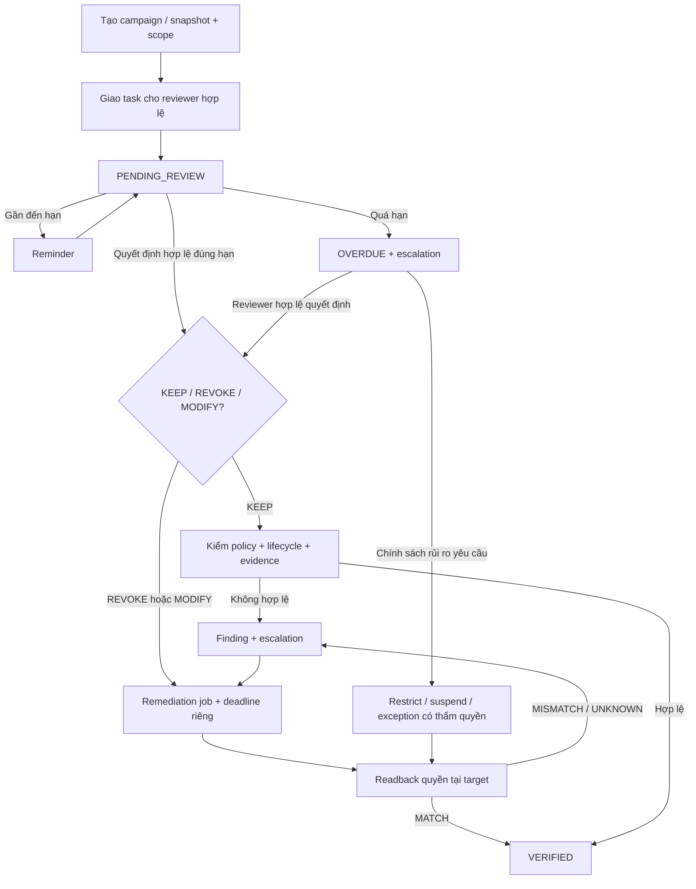
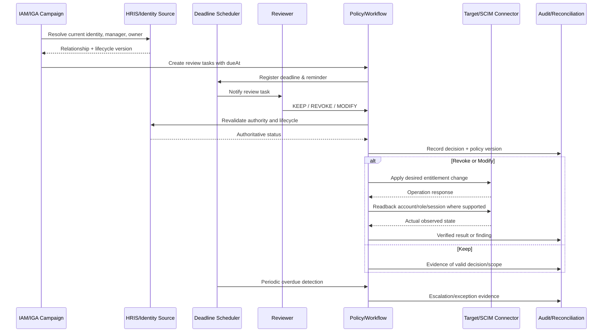

# Review deadline trong Access Review: Hạn rà soát quyền và kiểm soát quyền truy cập tồn dư

Một doanh nghiệp mở đợt **Access Review** để người quản lý và chủ hệ thống kiểm tra quyền truy cập của nhân viên. Hạn hoàn thành là 17:00 ngày 15/12. Đến ngày 16/12, dashboard hiển thị 98% mục đã được duyệt hoặc từ chối, nên đợt rà soát được đánh dấu “gần hoàn thành”. Nhưng 2% chưa xử lý lại chứa quyền **Global Administrator**, các tài khoản nhà thầu đã hết hợp đồng và một service account không có owner. Trong số các mục đã được chọn “Revoke”, nhiều quyền vẫn còn hoạt động ở SaaS do connector lỗi. Một số người đánh dấu “Keep” khi chưa kiểm tra việc nhân viên đã chuyển phòng ban.

Vấn đề không chỉ là **có một deadline trên lịch**. Một chương trình rà soát quyền cần biết **cần hoàn thành hành động nào trước thời điểm nào**, **ai chịu trách nhiệm khi quá hạn**, **quyền nào đang có nguy cơ tồn dư**, và **bằng chứng nào cho thấy quyết định đã được thực thi**.

**Review deadline** trong **Access Review** là mốc thời gian được áp dụng cho một chiến dịch, một nhiệm vụ rà soát hoặc một bước tiếp theo để bảo đảm các quyền truy cập được **đánh giá, quyết định và xử lý đúng hạn**. Deadline phải gắn với mức rủi ro, trách nhiệm, trạng thái vòng đời danh tính và cơ chế escalation. Đặc biệt, **hạn đưa ra quyết định** khác với **hạn thu hồi quyền** và **hạn xác minh kết quả ở hệ thống đích**.

Bài học thuộc chương **Access review** của mô-đun **Identity Lifecycle** trong **Identity and Access Management (IAM)**. Phạm vi là quản lý vòng đời danh tính theo **Joiner–Mover–Leaver (JML)**, từ xác minh, tạo account, cấp quyền đến rà soát và thu hồi khi thay đổi vai trò. Nội dung liên hệ **IdP, SSO, SCIM, RBAC/ABAC, PAM, tài khoản dịch vụ, kiểm toán và reconciliation** nhằm giảm **quyền truy cập tồn dư (residual access)**.

> **Nguyên tắc trung tâm:** “Reviewer đã bấm hoàn thành trước deadline” không đồng nghĩa “rủi ro truy cập đã được đóng”. Chương trình chỉ có bằng chứng đầy đủ khi quyền cần giữ vẫn hợp lệ, quyền cần gỡ đã được thu hồi tại hệ thống thực thi và những trường hợp chưa xác minh được được theo dõi rõ ràng.

## 1. Review deadline là gì?

**Access Review** (còn được gọi là access certification hoặc access recertification trong những ngữ cảnh nhất định) là hoạt động người hoặc đơn vị có thẩm quyền **xem xét một tập các account, group, role, entitlement hoặc quyền hiệu lực** để xác định chúng có còn hợp lý theo công việc, ownership và chính sách hiện hành hay không.

**Review deadline** quy định thời điểm mà một bước cụ thể phải đạt kết quả mong đợi.

Các mục cần rà soát có thể gồm:

- Quyền truy cập ứng dụng của nhân viên.
- Group membership trong directory hoặc IdP.
- Role trực tiếp tại SaaS.
- Privileged roles, cả **eligible** và **active** theo PAM/PIM.
- Quyền admin cloud, database và hạ tầng.
- Quyền vào dữ liệu theo tenant, project, resource và scope.
- Nhà thầu, tài khoản tạm thời, quyền đã hết nhu cầu.
- Service accounts, workload identities và các credential nhạy cảm.
- Quyền cấp bởi delegation, nested groups hoặc exception.
- Tài khoản chưa có owner, account mồ côi hoặc identity không còn liên kết nguồn nhân sự.

### 1.1. Tại sao một ngày hết hạn trên dashboard là chưa đủ?

Vì trong một chiến dịch có nhiều giai đoạn:

1. **Thu thập:** kiểm kê dữ liệu và xác định đối tượng cần review.
2. **Giao việc:** xác định reviewer phù hợp.
3. **Quyết định:** Keep, Revoke, Modify, Escalate hoặc Unable to determine theo quy trình.
4. **Thực hiện:** xử lý quyền cần gỡ hoặc điều chỉnh.
5. **Xác minh:** readback trạng thái ở hệ thống đích.
6. **Đóng chiến dịch:** tổng hợp những mục hoàn tất, ngoại lệ và rủi ro chưa đóng.

Một deadline duy nhất có thể chỉ bao phủ bước (3). Nếu hệ thống đóng chiến dịch ở bước đó, những yêu cầu thu hồi vẫn đang chờ xử lý có thể bị che khuất.

### 1.2. Review không phải login, provisioning hay authorization

| Hoạt động | Kết quả | Review deadline có quan hệ gì? |
|---|---|---|
| Authentication/SSO | Xác minh người dùng đăng nhập. | Người reviewer phải được xác thực khi ra quyết định. |
| Authorization | API/resource ALLOW hoặc DENY thao tác. | Review cần xem quyền hiệu lực có hợp lý không. |
| Manager approval | Xác nhận nhu cầu công việc tại thời điểm cấp. | Không thay thế việc rà soát quyền đã tồn tại. |
| Access Review | Đánh giá quyền có nên giữ, gỡ hay điều chỉnh. | Cần deadline, owner, evidence, escalation. |
| SCIM/Connector | Đồng bộ User/Group hoặc entitlement hỗ trợ. | Là một tuyến thực thi quyết định sau review. |
| Reconciliation | So trạng thái mong muốn và thực tế. | Chứng minh remediation hoàn thành, ghi UNKNOWN nếu không đủ dữ liệu. |

Một user được manager duyệt 6 tháng trước không có nghĩa hôm nay quyền đó vẫn phù hợp; đặc biệt sau **Mover** hoặc **Leaver**.

## 2. Các loại deadline phải tách riêng

Từ “review deadline” thường dễ bị hiểu lầm thành một mốc duy nhất. Trong vận hành IAM, nên mô hình hóa ít nhất các mốc sau.

| Mốc thời gian | Ý nghĩa | Chủ thể chịu trách nhiệm |
|---|---|---|
| **Campaign start** | Bắt đầu thu thập/giao việc trong chiến dịch. | IAM/IGA campaign owner. |
| **Campaign review deadline** | Hạn tổng thể để các quyết định reviewer được đưa ra. | Campaign owner và reviewers. |
| **Reviewer task due date** | Hạn của một reviewer hoặc một nhóm item. | Reviewer/manager/resource owner. |
| **Reminder time** | Mốc thông báo chưa xử lý. | Workflow engine. |
| **Escalation trigger** | Mốc đưa task quá hạn lên tuyến xử lý tiếp. | Workflow owner / escalation owner. |
| **Decision effective time** | Khi một quyết định hoặc thay đổi policy có hiệu lực theo quy tắc. | Policy/IAM engine. |
| **Remediation deadline** | Hạn thực hiện Revoke/Modify tại các target. | Provisioning/target owner. |
| **Verification deadline** | Hạn chứng minh quyền thực tế đã đúng sau remediation. | IAM reconciliation/target owner. |
| **Exception expiration** | Ngày ngoại lệ rủi ro hết hiệu lực. | Risk acceptor và exception owner. |
| **Grant expiration** | Thời điểm entitlement hoặc JIT grant tự hết hạn. | Entitlement/target policy. |
| **Lifecycle revocation deadline** | Hạn chặn quyền sau Mover/Leaver theo policy. | IAM/target operators. |

**Không đồng nhất các mốc này.** Ví dụ deadline reviewer là 15/12, nhưng quyết định Revoke một quyền production-admin được đưa ra ngày 10/12 có thể cần thực thi sớm theo rủi ro; không nên đợi đến ngày 15/12 chỉ vì chiến dịch chưa kết thúc.

### 2.1. Review cadence khác review deadline

- **Review cadence:** tần suất rà soát (chẳng hạn theo quý hoặc theo sự kiện).
- **Review window:** khoảng thời gian reviewer được đưa ra quyết định.
- **Task due date:** hạn của nhiệm vụ cụ thể.
- **Remediation SLA:** thời gian tối đa để xử lý quyết định và xác minh.
- **Next review date:** mốc dự kiến cho chiến dịch tiếp theo.

Các con số do tổ chức chọn theo rủi ro và nghĩa vụ áp dụng; **không có một chu kỳ hoặc SLA cố định phù hợp cho mọi quyền**.

### 2.2. Deadline khác expiry của quyền

Ví dụ:

```text
Quyền temporary project-reader:
  entitlementValidUntil = 2026-12-08T17:00:00+07:00

Nhiệm vụ access review:
  reviewerDueAt = 2026-12-15T17:00:00+07:00
```

Quyền đã đến hạn kết thúc ngày 08/12 không được tự kéo dài đến ngày 15/12 chỉ vì task review chưa hoàn tất. Một approval `KEEP` cũng không tự gia hạn grant nếu policy yêu cầu yêu cầu cấp mới hoặc reapproval có thời hạn.

## 3. Các vai trò và trách nhiệm với deadline

| Vai trò | Trách nhiệm deadline | Giới hạn |
|---|---|---|
| **Campaign owner** | Chọn scope, khởi tạo kỳ rà soát, đo tiến độ và đóng chiến dịch. | Không được âm thầm sửa decision của reviewer. |
| **IAM/IGA operations** | Quản lý workflow, scheduler, dữ liệu, escalation và remediation. | Không coi automation thành approval thay con người. |
| **Line manager** | Xác nhận nhu cầu công việc của nhân viên trong thời hạn. | Không phải owner của mọi resource. |
| **Application owner** | Đánh giá role và account trong ứng dụng thuộc trách nhiệm. | Cần dữ kiện đúng ở target. |
| **Data/resource owner** | Đánh giá quyền với dữ liệu/tài nguyên nhạy cảm. | Không thay IAM lifecycle authority. |
| **Privileged access owner** | Review quyền admin, eligible/active và exceptions. | Cần SoD và policy PAM/PIM. |
| **Service/workload owner** | Xác nhận principal kỹ thuật còn cần thiết. | Không thể duyệt dựa vào HR manager không tồn tại. |
| **Security/risk** | Đặt điều kiện rủi ro, xử lý overdue nghiêm trọng, exception. | Không coi quyết định risk acceptance là remediation. |
| **Provisioning/target owner** | Thực thi Revoke/Modify đúng hạn. | Cần phản hồi/readback trạng thái thực. |
| **Audit/compliance** | Kiểm tra bằng chứng và ngoại lệ. | Không tự thực hiện grant ngoài thẩm quyền. |

### 3.1. Một quyền có thể cần hơn một reviewer

Ví dụ quyền `finance-admin`:

- Manager xác nhận người dùng còn làm công việc Finance.
- Application owner xác nhận role có thật và cần thiết.
- Security hoặc privileged access owner kiểm soát xung đột/đặc quyền.
- Policy quyết định tất cả hay một phần các quyết định là bắt buộc.

Deadline phải phản ánh **approval/review matrix**: không được đánh dấu item hoàn tất chỉ vì một trong các reviewer đã trả lời nếu chính sách yêu cầu nhiều người.

### 3.2. Không có reviewer hợp lệ phải là finding

Nếu HRIS không tìm được manager hoặc manager đã Leaver:

- Không mặc định `KEEP`.
- Không giao ngẫu nhiên cho người cùng phòng.
- Đưa task vào hàng chờ **UNASSIGNED / REVIEWER_UNRESOLVED**.
- Route tới owner/escrow được policy định nghĩa.
- Theo dõi deadline, lý do thiếu thông tin và owner giải quyết.
- Đảm bảo nhân sự không còn quyền duyệt không thể dùng link cũ.

## 4. Khởi tạo deadline từ một campaign có phạm vi rõ

### 4.1. Phạm vi review quyết định mẫu số

Trước khi đặt deadline phải xác định **inventory nào được rà soát**:

- Những hệ thống và tenant nào.
- Những account loại HUMAN/CONTRACTOR/SERVICE/ADMIN nào.
- Những quyền direct, inherited, eligible và active nào.
- Những resource hoặc group nào.
- Có đưa break-glass và local admin vào scope không.
- Các entitlement đã hết hạn hoặc không có owner được xử lý ra sao.
- Những target nào không đọc được dữ liệu/không có connector.

Nếu chiến dịch bỏ qua các quyền ngoài IdP, tỷ lệ “100% reviewed” chỉ áp dụng **cho tập đã thu thập**, không chứng minh 100% quyền của toàn doanh nghiệp đã được rà soát.

### 4.2. Snapshot và cập nhật liên tục

Hai cách tổ chức dữ liệu:

**Snapshot campaign:** Chụp trạng thái quyền tại một thời điểm có ghi `snapshotAt`; reviewer đánh giá tập tại đó. Dễ kiểm toán, nhưng cần cơ chế xử lý quyền phát sinh/biến mất trong thời gian review.

**Continuous/event-aware campaign:** Tập quyền có thể cập nhật khi JML/provisioning thay đổi; đòi hỏi version, tránh item mất khỏi dashboard không có bằng chứng, và không dùng quyết định của item cũ cho grant mới.

Không có một lựa chọn luôn đúng. Quan trọng là **công bố phạm vi, thời điểm và chiến lược xử lý delta**.

### 4.3. Khảo sát tính đầy đủ trước khi giao việc

Một campaign nên có dữ liệu:

```text
campaignId
targetSystems / tenantScopes
snapshotAt
populationCount
includedEntitlementTypes
reviewerResolutionStatus
unmappedAccounts
dataFreshness
readErrors / coverageGaps
policyVersion
reviewDeadline
remediationPolicy
```

Nếu connector chỉ thu được 1.000 trong 40.000 account, không thể khởi động một báo cáo đầy đủ mà không ghi **PARTIAL_COLLECTION / UNKNOWN_COVERAGE**.

## 5. Thời gian, timezone và ngữ nghĩa deadline

Một deadline được định nghĩa không rõ có thể khiến reviewer bị tính quá hạn sai hoặc giúp quyền đặc biệt sống thêm sau mốc cần thu hồi.

### 5.1. Dùng thời điểm tuyệt đối cho xử lý máy

Ví dụ:

```yaml
campaignId: review-2026-q4
businessTimeZone: Asia/Ho_Chi_Minh
reviewDueLocal: "2026-12-15 17:00:00"
reviewDueAt: "2026-12-15T10:00:00Z"
```

Đây là **ví dụ quy đổi**: 17:00 tại Việt Nam (+07:00) tương đương 10:00 UTC. Thiết kế nên giữ **timezone nghiệp vụ** để hiển thị, đồng thời lưu một **instant** có thể so sánh thống nhất cho scheduler và audit.

Không nên chỉ lưu `2026-12-15` rồi để mỗi máy tự hiểu là 00:00 theo timezone cục bộ.

### 5.2. Chọn biên đóng/mở rõ ràng

Ví dụ policy:

```text
Decision đúng hạn nếu:
  decisionAcceptedAt <= reviewDueAt

Quá hạn nếu:
  trustedClock.now() > reviewDueAt
  AND task chưa có quyết định hợp lệ
```

Tổ chức cũng có thể chọn hạn là biên loại trừ (decision trước, không bao gồm thời điểm hạn). **Phải định nghĩa và test nhất quán**; không để một API và một scheduler hiểu khác nhau.

### 5.3. Business days khác calendar days

Khi tính `dueAt = assignedAt + 3 days`, cần làm rõ:

- Ba **ngày dương lịch** hay ba **ngày làm việc**?
- Có nghỉ cuối tuần, ngày lễ của đơn vị không?
- Reviewer ở tenant/quốc gia khác dùng lịch nào?
- Nếu giao việc sau giờ làm, tính từ khi nào?
- Một task bị reroute có được giữ hạn cũ không?
- Có pause khi hệ thống lỗi và ai được quyền gia hạn?

Đây là **quy tắc nghiệp vụ**, không phải phép cộng ngày đơn giản.

### 5.4. Lưu thời điểm có offset và xử lý DST

Ở những vùng có **daylight saving time (DST)**, `09:00` địa phương có thể tương ứng UTC offset khác nhau vào các mùa. Dùng timezone IANA (ví dụ `Europe/Paris`) khi cần tính giờ làm địa phương; không mặc định toàn cầu là `+07:00`.

Dùng **UTC instant** cho so sánh; giữ timezone nghiệp vụ cho hiển thị và tính business calendar. Không dùng đồng hồ của trình duyệt để quyết định server-side.

### 5.5. Deadline hiển thị, thời điểm gửi và thời điểm nhận

Một reviewer có thể bấm Approve lúc 16:59:59, nhưng request đến server sau 17:00. Cần định nghĩa:

- **Decision acceptedAt** là timestamp được server xác nhận.
- Event queue có thể xử lý sau; không thay đổi `acceptedAt` đã ghi.
- Offline/mobile decision chỉ được xem là hợp lệ theo chính sách nếu có mô hình đồng bộ và chứng cứ phù hợp.
- Scheduler cần xử lý race với một quyết định đến cùng thời điểm bằng transaction/compare-and-set.

Không đặt độ đúng hạn theo giờ máy người dùng hoặc giờ email gửi đi.

## 6. Mô hình timeline của một chiến dịch

### 6.1. Các mốc ví dụ

Giả sử chiến dịch quý IV 2026:

| Thời điểm minh họa | Hoạt động |
|---|---|
| 01/12 09:00 | Chốt snapshot, kiểm nguồn và tạo tasks. |
| 02/12 09:00 | Mở review cho manager và resource owners. |
| 08/12 09:00 | Reminder đầu tiên cho các task chưa xong. |
| 12/12 09:00 | Escalation lần đầu với quyền rủi ro cao chưa được rà soát. |
| 15/12 17:00 | Hạn đưa ra quyết định review. |
| Sau 15/12 | Triage overdue, xử lý revoke/exception theo policy. |
| Theo SLA của từng item | Hoàn thành remediation và verification. |
| Khi đủ bằng chứng | Đóng campaign, ghi outstanding findings rõ ràng. |

Các thời điểm chỉ minh họa, **không phải SLA bắt buộc**.

### 6.2. Sơ đồ luồng trạng thái thời hạn



Sơ đồ thể hiện các **hành vi khả dĩ**. Không phải mọi tổ chức đều tự suspend quyền chưa review; nếu có, quyết định phải nằm trong risk policy và được kiểm soát ảnh hưởng vận hành.

## 7. Thiết kế deadline dựa trên rủi ro

### 7.1. Không áp một SLA cho mọi quyền

Một role đọc wiki nội bộ ít nhạy cảm có thể chịu rủi ro khác với:

- Global/tenant administrator.
- Quyền quản lý IAM policy.
- Quyền đọc secrets hoặc key material.
- Quyền xuất dữ liệu cá nhân số lượng lớn.
- Access của contractor sắp hết hạn.
- Local admin không qua SSO.
- Service principal có quyền triển khai production.

Mức ưu tiên cần xét **khả năng gây hại, nguồn quyền, cấp độ nhạy cảm, scope, thời gian tồn tại và mức độ quan sát**.

### 7.2. Ví dụ ma trận deadline do doanh nghiệp tự thiết kế

| Loại access | Review window ví dụ | Hướng xử lý overdue | Remediation |
|---|---|---|---|
| Quyền cơ sở ít nhạy cảm | 15 ngày làm việc | Reminder + escalation tới manager. | Theo risk policy. |
| Quyền tài chính/data nhạy cảm | 7 ngày làm việc | Escalate tới data owner/Security. | Ưu tiên theo dữ liệu. |
| Privileged eligible role | 3 ngày làm việc | Triage ngay khi quá hạn; xem xét suspend eligibility. | Revoke/verify theo PAM policy. |
| Active privileged session/grant | Theo JIT TTL, không chờ review window. | Hết hạn hoặc revoke theo policy vận hành. | Chặn tại target và verify. |
| Contractor grant sắp hết hợp đồng | Trước ngày hết hạn hợp đồng. | Không mặc định gia hạn. | Expire/deprovision theo contract. |
| Workload không có owner | Ngay khi phát hiện, với triage theo mức tác động. | Assign owner + risk assessment. | Không xóa tự động workload production thiếu kiểm tra. |

**Các con số là minh họa để học**, không phải tiêu chuẩn pháp lý hay SLA thực tế bắt buộc. Một chương trình phải phê duyệt mức hạn, lịch công việc, mức độ quan trọng và ngoại lệ phù hợp.

### 7.3. Risk-based priority của từng item

Có thể xếp hàng đợi theo:

```text
Priority = g(
    privilegeLevel,
    resourceSensitivity,
    accountLifecycleState,
    lastUsed,
    exposureScope,
    credentialRisk,
    reviewerCoverage,
    daysOverdue
)
```

Đây là **hàm khái niệm**, không phải một thuật toán chấm điểm chuẩn. Ví dụ `lastUsed` không thể tự quyết định giữ/gỡ: một break-glass account hiếm dùng có thể vẫn cần được bảo vệ và diễn tập.

### 7.4. Nếu reviewer không trả lời thì sao?

Không có nguyên tắc “mọi quyền quá hạn đều tự động KEEP” hoặc “mọi quyền quá hạn đều lập tức DELETE” áp dụng cho tất cả.

Một chính sách hợp lý phải xác định:

- Quyền nào cần **hạn chế/suspend ngay** khi không có xác nhận hợp lệ.
- Quyền nào cần duy trì ngắn hạn để tránh gián đoạn nghiêm trọng, kèm risk acceptance hợp lệ.
- Ai được phê duyệt ngoại lệ và trong bao lâu.
- Mốc tiếp theo để escalated task được xử lý.
- Cách readback sau khi đã hạn chế hoặc gỡ.
- Cách xử lý resource/service account quan trọng không có owner.

Đặc biệt, **quyền Leaver đã đến hạn thu hồi theo JML không được kéo dài chỉ vì campaign review chưa xong**.

## 8. Chọn reviewer và xử lý khi owner thay đổi

### 8.1. Reviewer có thể là ai?

- Manager: xác nhận nhu cầu nghiệp vụ của nhân viên.
- Application owner: xem xét role trong ứng dụng.
- Data owner: đánh giá truy cập dữ liệu nhạy cảm.
- Privileged role owner: chứng thực đặc quyền.
- Service owner: xác nhận quyền của workload/service principal.
- Security: xử lý ngoại lệ và SoD.

Chọn reviewer phải dựa trên **nguồn quan hệ có thẩm quyền**, không từ tên/email do user tự khai.

### 8.2. Manager chuyển vai trò hoặc nghỉ việc trong campaign

Ví dụ:

```text
01/12: Task được giao manager A.
10/12: HRIS ghi Mover; manager hiện hành là B.
12/12: A mở email cũ và bấm KEEP.
15/12: Campaign đến hạn.
```

Nếu policy đòi manager hiện hành, hệ thống phải:

1. Phát hiện quan hệ manager đã đổi.
2. Không cho A quyết định với thẩm quyền cũ.
3. Reassign hoặc tạo task revision cho B.
4. Xác định deadline mới theo quy tắc chuyển tuyến.
5. Ghi audit lý do và lịch sử owner.
6. Không xem “A đã bấm trước hạn” là quyết định hợp lệ nếu A không còn authority.

### 8.3. Delegation và out-of-office

Một delegation hợp lệ cần:

- Identity của người giao và người nhận đã xác minh.
- Loại review được phép.
- Scope: tenant, project, risk tier.
- Khoảng hiệu lực.
- Chống tự duyệt/SoD.
- Audit acting reviewer và delegator.
- Chính sách về deadline có giữ nguyên hay được điều chỉnh.

Không cho một delegate hết hạn dùng link cũ để hoàn thành review cho quyền đặc biệt.

### 8.4. Workload không có line manager

Machine/service identity cần **owner team/workload sponsor hoặc platform owner**, không phải giả lập một người làm nhân viên để dùng HRIS manager. Review deadline của workload có thể gắn với:

- Service catalog review date.
- Credential rotation/expiry.
- Owner attestation.
- Service decommission milestone.
- Chứng thực quyền API/cloud/secrets còn hợp lý.

## 9. State machine: deadline, decision và remediation

### 9.1. Không nén mọi trạng thái vào COMPLETE

Một **review task** có thể ở:

| Trạng thái | Ý nghĩa |
|---|---|
| `PENDING` | Chưa có quyết định hợp lệ. |
| `IN_PROGRESS` | Reviewer đã mở hoặc đang tìm hiểu. |
| `NEEDS_INFORMATION` | Thiếu dữ liệu để quyết định. |
| `REASSIGNMENT_PENDING` | Đang sửa authority/owner. |
| `DECIDED_KEEP` | Người có quyền đã xác nhận giữ. |
| `DECIDED_REVOKE` | Người có quyền yêu cầu gỡ. |
| `DECIDED_MODIFY` | Người có quyền yêu cầu điều chỉnh scope. |
| `DECIDED_ESCALATE` | Cần tuyến xử lý khác theo policy. |
| `OVERDUE` | Chưa có quyết định hợp lệ sau dueAt. |
| `INVALIDATED` | Item/decision không còn áp dụng do JML/authority thay đổi. |

Một **remediation** có thể ở:

| Trạng thái | Ý nghĩa |
|---|---|
| `PENDING_REMEDIATION` | Đã có quyết định gỡ/sửa, chờ xử lý. |
| `IN_PROGRESS` | Connector hoặc owner đang thao tác. |
| `APPLIED_UNVERIFIED` | Có phản hồi đã áp dụng nhưng chưa readback. |
| `VERIFIED` | Quyền ở target phù hợp desired state trong phạm vi kiểm. |
| `FAILED` | Có lỗi rõ ràng. |
| `UNKNOWN` | Không đủ bằng chứng do timeout/ACL/coverage. |
| `EXCEPTION_ACCEPTED` | Có quyết định chấp nhận rủi ro còn hạn, chưa chắc đã gỡ quyền. |

Tên trạng thái chỉ là **mô hình học tập**, không phải danh mục bắt buộc của mọi IGA.

### 9.2. Hai đồng hồ quan trọng

```text
Review task:
  assignedAt -> reviewerDueAt -> decidedAt

Remediation:
  decisionAt -> remediationDueAt -> verifiedAt
```

Một quyết định `REVOKE` lúc 15:55 ngày cuối cùng vẫn có thể **đúng hạn review**, nhưng nếu quyền tồn tại thêm nhiều ngày, remediation có thể **quá SLA**. Báo cáo phải thể hiện cả hai.

### 9.3. Campaign có thể đóng khi còn finding không?

Một chương trình có thể có hai khái niệm:

- **Administrative campaign closure:** đợt thu thập quyết định đã kết thúc; outstanding items và exceptions được bàn giao có owner.
- **Risk/remediation closure:** tất cả quyền phải gỡ đã được xác minh hoặc có ngoại lệ được phê duyệt, còn hạn và minh bạch.

Không nên ghi `100% complete` mà không phân biệt hai trường hợp; nếu campaign đóng khi còn finding, cần **báo cáo tồn đọng** chứ không xóa dấu vết.

## 10. Reminder, escalation và overdue

### 10.1. Reminder có mục tiêu thông báo

Một reminder hữu ích nên nói:

- Campaign và task ID.
- Review item thuộc hệ thống nào.
- Hạn cụ thể kèm timezone.
- Số item và risk tier.
- Mức độ ảnh hưởng nếu quá hạn theo policy.
- Đường dẫn vào portal đáng tin.
- Đầu mối hỗ trợ khi reviewer không có quyền hoặc thiếu dữ liệu.

Không gửi toàn bộ secrets, group membership nhạy cảm hoặc thông tin nhân sự ngoài nhu cầu qua email/chat.

### 10.2. Escalation là tuyến trách nhiệm, không phải auto-approve

Một chiến lược có thể gồm:

1. Trước hạn: nhắc reviewer trực tiếp.
2. Khi gần hạn: nhắc và thông báo campaign owner.
3. Quá hạn: đánh dấu task **OVERDUE**, báo escalation owner.
4. Rủi ro cao: kích hoạt workflow hạn chế quyền theo policy.
5. Quá hạn kéo dài: đưa vào exception/risk register có owner.
6. Nếu reviewer không còn hợp lệ: reassign theo authority.

**Không tự đổi PENDING thành KEEP** vì tổ chức muốn có tỷ lệ hoàn thành cao.

### 10.3. Escalation có thể không đổi deadline gốc

Để đo trách nhiệm, nên giữ:

```json
{
  "taskId": "review-task-2001",
  "originalDueAt": "2026-12-15T10:00:00Z",
  "currentDueAt": "2026-12-17T10:00:00Z",
  "extensionApprovedBy": "risk-owner-02",
  "extensionReasonCode": "APPROVED_EXCEPTION",
  "extensionVersion": 2
}
```

Nếu chỉ ghi đè `dueAt` từ 15/12 thành 17/12, dashboard có thể mất dấu việc task từng trễ. Hệ thống nên giữ **original deadline, revisions và người phê duyệt gia hạn**.

### 10.4. Rủi ro của “reminder fatigue”

Gửi email mỗi phút sẽ làm reviewer bỏ qua thông báo. Cần:

- Cadence và mức độ ưu tiên theo rủi ro.
- Gộp item cùng campaign một cách hợp lý.
- Không gửi reminder sau khi task đã hoàn tất/reassigned.
- Chặn gửi trùng do retry.
- Có đường thông báo escalation độc lập cho quyền khẩn cấp.

## 11. Quá hạn nhưng chưa có quyết định: xử lý quyền thế nào?

### 11.1. Quyền thông thường

Nếu người dùng ACTIVE, có quyền tiêu chuẩn và manager chưa phản hồi, tổ chức cần policy rõ:

- Giữ tạm trong một **grace period được phê duyệt**?
- Chuyển sang resource owner?
- Hạn chế chức năng nhạy cảm?
- Tạo exception có thời hạn?
- Thu hồi theo thiết kế nếu không có bằng chứng nhu cầu hợp lệ?

**Grace period không phải mặc định universal**, nhất là khi quyền thuộc dữ liệu nhạy cảm hoặc có dấu hiệu sai lifecycle.

### 11.2. Quyền đặc biệt

Khi task review của quyền Global Admin/JIT/PAM quá hạn:

- Escalate ưu tiên cao.
- Xem xét trạng thái eligible/active.
- Có thể tạm suspend eligible role theo policy rủi ro.
- Không giữ active privileged session chỉ vì campaign còn mở.
- Kiểm session/token/credential tại target theo khả năng.
- Theo dõi quyền bị cấp qua direct grant hoặc nested group.

Không được dùng workflow review để **gia hạn quyền JIT đã hết hạn**.

### 11.3. Account Leaver hoặc nhà thầu hết hạn

Nếu authoritative source đã xác nhận Leaver hoặc contract expired, luồng deprovision cần chạy theo chính sách vòng đời **không chờ reviewer trả lời**.

Ví dụ:

```text
User TERMINATED tại 10/12 09:00.
Task access review due 15/12 17:00.

Hành động:
  - Kích hoạt deprovisioning theo Leaver ngay khi có hiệu lực.
  - Vô hiệu hóa task KEEP cũ nếu không còn phù hợp.
  - Readback target/account/session.
  - Ghi cả JML event và campaign finding.
```

### 11.4. Service account không owner

Với service principal production không có owner, xóa ngay khi quá hạn review có thể gián đoạn workload quan trọng. Tương tự, để vô thời hạn cũng không chấp nhận được.

Quy trình nên có:

1. Triage mục đích/workload hiện hoạt.
2. Xác định owner team và hệ thống phụ thuộc.
3. Xem xét scope/credential đã cấp.
4. Áp dụng hạn chế có kiểm soát khi rủi ro cao.
5. Bàn giao owner hoặc decommission có kế hoạch.
6. Kiểm readback sau thay đổi.
7. Giữ finding tới khi có bằng chứng đủ.

## 12. Review deadline trong Joiner–Mover–Leaver

Deadline theo chu kỳ là một tuyến kiểm soát; **sự kiện JML** là tuyến thay đổi quyền có hiệu lực theo nhu cầu thực tế.

### 12.1. Joiner

Khi nhân viên mới:

- HRIS xác nhận start date, role và manager.
- IAM tạo account/role theo birthright policy, approval nếu cần.
- Nếu review campaign đang chạy, phải quyết định account mới nằm ngoài snapshot hay được thêm như delta.
- Quyền mới chưa đến hiệu lực không nên được mô tả là “active” chỉ vì đã pre-provision.
- Không tự kéo dài ngày bắt đầu/quyền khi reviewer chưa xem xong.

**Review deadline không thay thế điều kiện Joiner đủ tư cách nhận quyền**.

### 12.2. Mover

Khi chuyển phòng ban hoặc vai trò:

- Desired entitlements thay đổi.
- Manager/resource owner của item review có thể thay.
- Quyền cũ cần được gỡ theo lifecycle policy, không chờ hết campaign.
- Task “Keep Support group” đã tạo trước Mover có thể không còn hợp lệ.
- Decision cần được version hoặc invalidate theo event Mover.
- Quyền mới chỉ được cấp theo policy/approval hiện hành.
- Reconciliation kiểm quyền cũ không còn effective access.

Một task được reviewer hoàn thành **trước Mover** vẫn có thể mất hiệu lực sau Mover, tùy ngữ nghĩa policy và dữ liệu đã được thay đổi.

### 12.3. Leaver

Khi Leaver:

1. Nhận event authoritative và effectiveAt.
2. Chặn xác thực mới/thu hồi account và entitlements phù hợp.
3. Xử lý phiên, token, credentials và privileged roles ở các target.
4. Không để campaign review tiếp tục cấp lại quyền từ decision `KEEP` trước đó.
5. Reconcile direct grants, nested groups và local accounts.
6. Cập nhật campaign items theo trạng thái lifecycle, giữ evidence thay đổi.
7. Ghi UNKNOWN/exception nếu target không đủ khả năng quan sát.

**Hạn review còn 7 ngày không phải lý do hợp lệ để trì hoãn revoke quyền Leaver 7 ngày.**

### 12.4. Rehire/tái tuyển dụng

Một người tái tuyển dụng có thể có cùng email nhưng mối quan hệ công việc mới:

- Liên kết identity theo nguồn có thẩm quyền.
- Không tự khôi phục mọi role đã từng được “KEEP” trong campaign cũ.
- Xác minh manager, department, tenant và job hiện tại.
- Tạo quyền theo desired state mới.
- Lập review item mới nếu entitlement cần certification theo policy.

### 12.5. Ma trận giao nhau giữa campaign và JML

| JML event | Campaign item đang PENDING | Campaign item đã KEEP | Hướng xử lý |
|---|---|---|---|
| Joiner | Account mới có thể không có trong snapshot. | Không áp dụng trước đó. | Delta review hoặc coverage record. |
| Mover | Manager/scope có thể sai. | KEEP có thể stale. | Reassign/revalidate, revoke quyền cũ. |
| Leaver | Không chờ quyết định. | KEEP không thể override Leaver. | Deprovision và readback. |
| Contractor expiry | Sponsor/điều kiện thay đổi. | KEEP không gia hạn contract. | Thu hồi theo hạn hợp đồng. |
| Privilege emergency revoke | Review đang mở. | KEEP không làm quyền phục hồi. | Chặn theo security event. |
| Workload decommission | Service owner cần xác nhận. | KEEP lịch sử mất mục đích. | Thu hồi machine privilege và secrets. |

## 13. Review deadline với IdP, SSO và SCIM

### 13.1. IdP/SSO không phải authority cho mọi quyền

IdP có thể chứng minh reviewer đăng nhập; directory/IdP có thể hiển thị group. Nhưng:

- SaaS có thể có direct role.
- SP session có thể cache claims.
- Access token đã phát hành có thể còn dùng được.
- Local account có thể không phụ thuộc SSO.
- Admin role ở cloud có thể đến từ policy/trust khác.
- API key hoặc secret có vòng đời riêng.

Vì vậy một review campaign đọc group từ IdP **không chứng minh toàn bộ quyền hiệu lực trong ứng dụng đích**.

### 13.2. SCIM sau quyết định Revoke

Một workflow:

```text
Reviewer -> REVOKE role
  -> IAM cập nhật desired state
  -> SCIM/connector PATCH User/Group (nếu target hỗ trợ)
  -> Target phản hồi accepted/success
  -> IAM readback role và account
  -> Khi cần kiểm session/API authorization
  -> VERIFIED hoặc MISMATCH/UNKNOWN
```

SCIM không mặc nhiên revoke mọi local role, OAuth token hoặc session đã phát. Không lấy HTTP success làm bằng chứng duy nhất của **remediation deadline met**.

### 13.3. SSO của reviewer

Reviewer chỉ nên đưa quyết định sau khi:

- Được xác thực qua SAML/OIDC hoặc cơ chế có mức assurance phù hợp.
- Được ánh xạ tới stable identity ID và tenant.
- Có authorization với đúng task/scope.
- Chưa Leaver hoặc mất quyền reviewer.
- Có step-up nếu policy review đặc quyền yêu cầu.
- Decision được ghi với server timestamp và task revision.

Một link trong email không tự tạo quyền duyệt nếu người bấm không có thẩm quyền.

### 13.4. RBAC/ABAC trong phạm vi review

**RBAC** thường đưa vào campaign role và group. **ABAC** thêm thuộc tính như department, project, tenant, owner, classification, lifecycle state và environment.

Manager có thể KEEP role `report-reader`; nhưng ABAC vẫn phải từ chối document ngoài tenant hoặc có classification vượt clearance. Review cần hiểu **scope của role** và **quyền hiệu lực**, không chỉ tên role.

## 14. Privileged access và JIT trong thời hạn review

### 14.1. Eligible và Active cần review khác nhau

Một người có thể:

- Có role eligible để yêu cầu Global Admin.
- Có active activation trong 30 phút.
- Có standing direct grant ngoài PAM.
- Có session hoặc token đã cấp từ lần activation trước.

Campaign review cần xác định những đối tượng này có nằm trong scope hay không, tránh báo “không active hiện tại” rồi bỏ qua **eligible privilege** có thể được kích hoạt sau đó.

### 14.2. Không lấy review deadline để gia hạn JIT

Ví dụ:

```text
JIT activation expiresAt = 2026-12-12T10:00:00Z
Privileged access review dueAt = 2026-12-15T10:00:00Z
```

Activation cần hết hiệu lực theo TTL của JIT. Campaign chưa review xong không tự gia hạn tới ngày 15/12. Nếu target vẫn cho quyền sau activation expiration, đó là **remediation/security finding** tách biệt với review task.

### 14.3. Đánh giá quyền đặc biệt quá hạn

Một triage quyền cao cần hỏi:

1. Principal và account có owner không?
2. Có đang ACTIVE, eligible, hay cả hai?
3. Có approval còn hạn và đúng scope không?
4. Có direct role/bypass ngoài PAM không?
5. Có phương thức revoke và readback không?
6. Có break-glass dependency cần bảo toàn không?
7. Nếu suspend có gây mất khả năng khôi phục không?
8. Ai chấp nhận rủi ro nếu chưa thể xử lý ngay?

Chỉ dùng một nút `REVOKE_ALL` không phân tích có thể gây lỗi vận hành, đặc biệt với emergency và service identities.

## 15. Review deadline đối với service accounts và workload

### 15.1. Service principal cần reviewer phù hợp

Một machine identity có thể có:

| Thuộc tính | Câu hỏi review |
|---|---|
| Workload ID | Job/service nào dùng principal? |
| Owner team | Nhóm nào chịu trách nhiệm? |
| Environment | Production/staging/dev? |
| Purpose | Vì sao principal cần quyền? |
| Effective entitlements | Có quyền cao ngoài phạm vi không? |
| Credential | Mật khẩu, API key, certificate hay federated token? |
| Last verified use | Có bằng chứng workload còn chạy không? |
| Planned decommission | Có mốc ngừng sử dụng không? |
| Target systems | Những nơi cần revoke/rotate khi scope thay đổi? |

Một account máy không có HRIS line manager; giao cho “manager của người tạo” có thể sai khi người tạo đã nghỉ việc.

### 15.2. Khi service owner không phản hồi

- Escalate tới service catalog owner hoặc platform owner.
- Xác định workload còn quan trọng hay không.
- Phân biệt **orphan ownership** với **orphan account**.
- Xem xét credential có thể bị truy xuất bởi Leaver.
- Có thể hạn chế phạm vi hoặc rotate credential theo rủi ro.
- Có kế hoạch decommission và rollback cho resource không còn cần thiết.
- Không đánh dấu KEEP mặc định chỉ để tránh gián đoạn.

### 15.3. Credential expiry khác review deadline

Một API key có expiry 10/12 cần được rotate/revoke theo kế hoạch riêng dù campaign service account review đến 15/12. Ngược lại, key có expiry rất xa không chứng minh owner/team còn cần nó.

## 16. Decision đúng hạn và remediation đúng hạn

### 16.1. Ba kết quả cần phân biệt

Một item có thể:

1. **Reviewed on time:** reviewer đưa decision hợp lệ trước dueAt.
2. **Remediated on time:** hành động Revoke/Modify đạt target trong thời hạn.
3. **Verified on time:** IAM có bằng chứng trạng thái quyền đúng trước verification deadline.

Ví dụ:

```text
Review due:       15/12 17:00
Reviewer REVOKE:  15/12 16:00     -> reviewed on time
Connector sent:   15/12 16:05
Target removed:   16/12 11:00
Readback verified:16/12 11:20
Remediation due:  15/12 20:00     -> remediation overdue
```

Tỷ lệ review đúng hạn vẫn có thể cao trong khi risk closure kém.

### 16.2. Đặc điểm của quyết định KEEP

KEEP cần đi cùng:

- Reviewer có thẩm quyền.
- Entitlement/scope cụ thể, không phải label quá rộng.
- Identity vẫn đủ tư cách (ACTIVE, contract còn hạn).
- Không vi phạm SoD/risk policy.
- Ngữ cảnh job/resource/owner còn phù hợp.
- Decision time, policy version và evidence cần thiết.

Một quyết định KEEP trước khi user Leaver có thể mất hiệu lực sau event Leaver. Không dùng campaign decision như một loại **grant miễn thu hồi**.

### 16.3. Đặc điểm của quyết định REVOKE/MODIFY

Cần xác định:

- Quyền nào bị gỡ, ở ứng dụng/tenant/project nào.
- Các đường cấp role trực tiếp và gián tiếp.
- Khi nào bắt đầu triển khai thay đổi.
- Hạn remediation/verification theo risk tier.
- Target đã xác minh trạng thái gì.
- Session/token có đường sử dụng khác cần kiểm không.
- Owner chịu trách nhiệm khi thất bại.

**“Revoke requested” khác “Revoke applied” và khác “Revoke verified”.**

## 17. Kiến trúc workflow điều phối deadline

### 17.1. Các thành phần thường gặp

- **IGA/IAM campaign service:** định nghĩa scope, owner và lifecycle của campaign.
- **Inventory/reconciliation service:** thu thập entitlements và actual state.
- **Identity source/HRIS:** manager, employment state và sự kiện JML.
- **Reviewer task service:** assignment, decision, revisions.
- **Deadline scheduler:** phát hiện due/overdue, nhắc, escalation.
- **Policy engine:** risk tier, reviewer matrix, expiry và phép chuyển trạng thái.
- **Notification service:** email/chat/portal alerts.
- **Provisioning connector:** SCIM/API/direct adapter đến target.
- **Target readback:** xác minh quyền hiệu lực theo khả năng.
- **Audit/evidence store:** ghi quyết định, thời điểm, policy version, ngoại lệ.

### 17.2. Sơ đồ trao đổi



Cần đảm bảo scheduler **không tự tạo quyết định KEEP**. Scheduler là thành phần điều phối thời gian, còn authorization và policy quyết định ai có thể làm gì.

### 17.3. Deadline engine không được tạo vòng lặp cấp quyền

Một event `OVERDUE` có thể kích hoạt escalation; một quyết định `REVOKE` có thể tạo remediation job. Các message có thể đến trễ hoặc lặp. Mỗi handler cần **idempotency và state guards** để không vô tình tạo grant mới, đổi scope hoặc xóa nhầm quyền.

## 18. Data model cho campaign, task và remediation

### 18.1. JSON minh họa campaign

```json
{
  "campaignId": "access-review-2026-q4",
  "scope": {
    "tenantIds": ["tenant-a"],
    "systems": ["finance-saas", "corp-directory", "cloud-prod"],
    "identityTypes": ["HUMAN", "CONTRACTOR", "WORKLOAD"]
  },
  "snapshotAt": "2026-12-01T02:00:00Z",
  "startsAt": "2026-12-02T02:00:00Z",
  "reviewDueAt": "2026-12-15T10:00:00Z",
  "businessTimeZone": "Asia/Ho_Chi_Minh",
  "policyId": "quarterly-access-certification",
  "policyVersion": "v6",
  "campaignOwner": "iam-governance",
  "scopeComplete": false
}
```

Ví dụ giả lập; `scopeComplete=false` cho biết việc thu thập chưa đủ bằng chứng, không phải một loại trạng thái chuẩn.

### 18.2. JSON minh họa một review item

```json
{
  "taskId": "review-task-2001",
  "campaignId": "access-review-2026-q4",
  "subjectId": "person-1045",
  "subjectType": "HUMAN",
  "targetSystem": "finance-saas",
  "targetAccountId": "user-target-81",
  "entitlementId": "finance-exporter",
  "resourceScope": "tenant-a/project-42",
  "privilegeRiskTier": "HIGH",
  "reviewerId": "person-0090",
  "reviewerAuthoritySource": "hris",
  "reviewerAuthorityVersion": 71,
  "assignmentRevision": 2,
  "originalDueAt": "2026-12-15T10:00:00Z",
  "currentDueAt": "2026-12-15T10:00:00Z",
  "status": "PENDING",
  "decision": null
}
```

Các ID và loại rủi ro đều mang tính minh họa. Một hệ thống cần định nghĩa enum, schema, ACL và xử lý null/unknown rõ ràng.

### 18.3. Decision và remediation event

```json
{
  "decisionId": "decision-2601",
  "taskId": "review-task-2001",
  "assignmentRevision": 2,
  "actingReviewerId": "person-0090",
  "decision": "REVOKE",
  "acceptedAt": "2026-12-15T09:30:00Z",
  "policyVersion": "v6",
  "remediation": {
    "operationId": "revoke-7781",
    "targetSystem": "finance-saas",
    "dueAt": "2026-12-15T13:30:00Z",
    "state": "APPLIED_UNVERIFIED",
    "verifiedAt": null
  }
}
```

Đây không phải schema SCIM hoặc một vendor cụ thể. **Decision ID, operation ID và timestamp** giúp phân biệt “đã chọn Revoke” với “target đã gỡ”.

## 19. Deadline scheduling: thuật toán và tính đúng đắn

### 19.1. Tính deadline theo policy

Ví dụ pseudocode:

```text
calculateReviewDueAt(task, policy, calendar):
    base = max(task.assignedAt, policy.campaignStartsAt)
    limit = policy.campaignReviewDueAt

    if policy.riskTier(task) == HIGH:
        riskDue = addBusinessHours(
            base, policy.highRiskReviewHours, calendar
        )
    else:
        riskDue = addBusinessDays(
            base, policy.standardReviewDays, calendar
        )

    return min(riskDue, limit)
```

Đây là **minh họa một lựa chọn thiết kế**, không phải thuật toán phổ quát. Cần quy định nếu task được giao **sau campaignDueAt** hoặc khi reassign: tạo finding, gia hạn có thẩm quyền hay đưa vào chiến dịch phụ.

### 19.2. Scheduler chỉ sinh event, không đổi nghĩa quyết định

```text
for task in tasksWithDueAtBefore(now):
    if task.hasValidFinalDecision:
        continue

    if task.status in [CANCELLED, INVALIDATED]:
        continue

    publishIdempotentOverdueEvent(
        task.id,
        task.assignmentRevision,
        task.currentDueAt
    )

    applyRiskBasedEscalationPolicy(task)
```

Khi task chuyển trạng thái trong lúc scheduler chạy, handler phải **đọc lại trạng thái mới**. Một event OVERDUE đến muộn không được biến quyết định KEEP/REVOKE hợp lệ thành pending.

### 19.3. Idempotency key

Một key có thể dựa trên:

```text
(eventType, taskId, assignmentRevision, dueAt)
```

Sử dụng key giúp notification/escalation không bị phát trùng do retry. Tuy nhiên **định nghĩa key phải phù hợp ngữ nghĩa**; đổi deadline hợp lệ cần tạo phiên bản mới, không làm mất lịch sử deadline cũ.

### 19.4. Race condition tại biên hạn

Hai tiến trình:

- Reviewer gửi decision.
- Scheduler đánh dấu task OVERDUE.

Cần giao dịch nhất quán:

1. Server ghi `acceptedAt` và `decisionRevision`.
2. Đối chiếu dueAt theo policy ở cùng phiên bản task.
3. Chỉ chấp nhận state transition hợp lệ.
4. Overdue event đọc lại decision trước khi escalation.
5. Audit phân biệt `decisionAcceptedAfterDeadline` với decision bị từ chối/không hợp lệ.

Không nên chỉ dựa vào một cron job mỗi giờ để định nghĩa chính xác mọi quyết định tới hạn.

## 20. SQL/Java minh họa tính trạng thái quá hạn

### 20.1. Query tìm task chưa có quyết định

Ví dụ SQL khái niệm:

```sql
SELECT task_id, reviewer_id, current_due_at, risk_tier
FROM review_tasks
WHERE status IN ('PENDING', 'IN_PROGRESS', 'NEEDS_INFORMATION')
  AND current_due_at < :trustedNowUtc
  AND campaign_id = :campaignId;
```

Không mặc định chuyển trạng thái hoặc gửi email từ một lệnh SELECT. Scheduler cần kiểm authorization, revision, lịch escalation và event idempotency.

### 20.2. Java types cho deadline

```java
import java.time.Instant;
import java.time.ZoneId;

record ReviewDeadline(
    Instant originalDueAt,
    Instant currentDueAt,
    ZoneId businessZone,
    long revision
) {}

enum ReviewTaskState {
    PENDING,
    IN_PROGRESS,
    DECIDED_KEEP,
    DECIDED_REVOKE,
    DECIDED_MODIFY,
    OVERDUE,
    INVALIDATED
}

boolean isOverdue(
    Instant now,
    ReviewDeadline deadline,
    boolean hasValidDecision
) {
    return !hasValidDecision
        && now.isAfter(deadline.currentDueAt());
}
```

Mẫu Java trên dùng **`Instant`** để tránh nhầm các timezone. `isAfter` diễn đạt một quy tắc **quá hạn sau dueAt**, còn ứng dụng thật phải xử lý state, policy boundary, clock source và grace theo yêu cầu.

### 20.3. Dùng clock có thể kiểm thử

Thay vì gọi thời gian thật rải rác, ứng dụng Java có thể nhận `Clock` qua dependency injection; unit tests dùng fixed clock để kiểm:

- Trước deadline một tích tắc.
- Tại deadline.
- Sau deadline một tích tắc.
- Đổi timezone hiển thị.
- Gia hạn có version.
- Quyết định đồng thời với scheduler.

Không cần chờ thời gian thực đi qua hoặc chỉnh đồng hồ hệ thống production để test.

## 21. Remediation SLA và readback ở target

### 21.1. Khi nào bắt đầu đồng hồ remediation?

Tùy policy, `remediationDueAt` có thể tính từ:

- Thời điểm decision REVOKE được chấp nhận.
- Thời điểm event JML có hiệu lực.
- Thời điểm risk finding được phát hiện.
- Một mốc cố định sớm hơn do policy/regulatory obligation.

Không nên **mặc định** remediation clock luôn bắt đầu khi campaign đóng; Leaver có thể yêu cầu chặn nhanh hơn nhiều.

### 21.2. Phân loại bằng chứng

| Kết quả | Bằng chứng | Có thể đóng remediation? |
|---|---|---|
| `REQUESTED` | IAM đã tạo job revoke. | Chưa. |
| `ACKNOWLEDGED` | Connector/target đã nhận yêu cầu. | Chưa đủ. |
| `APPLIED` | Target xác nhận thay đổi. | Cần readback theo policy. |
| `VERIFIED` | Trạng thái quyền tại target phù hợp desired; có timestamp. | Có trong phạm vi đã xác minh. |
| `MISMATCH` | Target vẫn còn role/quyền không hợp lệ. | Chưa; cần remediation. |
| `UNKNOWN` | Lỗi query/ACL hoặc thiếu dữ liệu. | Không tự đóng. |

### 21.3. Những đường quyền ngoài connector

Một thao tác gỡ group có thể chưa gỡ:

- Role trực tiếp trong ứng dụng SaaS.
- Nested group ở directory khác.
- Local admin account.
- Session SSO đã lập.
- API token/refresh token còn sống.
- SSH key/credential cá nhân.
- Eligible privileged role ở PAM/PIM.
- Cloud role trust hoặc service principal đặc quyền.

Do đó target readback có thể cần nhiều nguồn. **Scope của bằng chứng phải được công bố**; đừng dùng kết quả readback một group làm tuyên bố mọi đường đã sạch.

### 21.4. Revoke không được làm sống lại grant cũ

Một campaign có thể có quyết định KEEP cũ đến muộn sau khi Leaver đã thu hồi quyền. Reconciliation không được dùng **decision lịch sử** làm desired state bất biến khi identity đã TERMINATED.

Nguồn có thẩm quyền, lifecycle version và current policy cần được kiểm trước mọi thao tác **GRANT** hoặc **RESTORE**.

## 22. Gia hạn deadline và chấp nhận ngoại lệ

### 22.1. Gia hạn không phải thao tác UI thông thường

Đối với review có rủi ro, kéo dài deadline cần:

- Lý do cụ thể.
- Người có thẩm quyền phê duyệt extension.
- Mức rủi ro/quyền bị ảnh hưởng.
- Hạn mới và giới hạn số lần gia hạn.
- Kiểm soát bù trừ, ví dụ giám sát hoặc hạn chế scope.
- Dấu vết original/current deadline.
- Kế hoạch xử lý task/remediation còn lại.

Người đang quá hạn không nên tự chỉnh dueAt để biến kết quả thành “đúng hạn”.

### 22.2. Review extension khác risk acceptance

**Deadline extension** nói “cho thêm thời gian ra quyết định hoặc thực hiện”. **Risk acceptance** nói “người có thẩm quyền chấp nhận rủi ro cụ thể trong phạm vi và thời hạn nhất định”. Hai điều này không tương đương.

Một risk acceptance nên có:

- Finding/subject/entitlement/resource cụ thể.
- Mức rủi ro và lý do.
- Risk owner độc lập, phù hợp SoD.
- Kiểm soát bù trừ.
- Thời hạn hết ngoại lệ.
- Điều kiện theo dõi và ngày tái đánh giá.
- Bằng chứng approval và escalation.
- Quy tắc không cho ngoại lệ vượt event Leaver/contract expiry nếu policy cấm.

### 22.3. Quyền không được mặc định hợp lệ trong thời gian extension

Nếu quyền có `expiresAt` ngày 10/12, một review extension tới 18/12 **không tự gia hạn grant**. Hai hệ thống quyền và review phải có chính sách rõ khi thời hạn không đồng bộ.

## 23. Chất lượng dữ liệu và rủi ro báo cáo sai deadline

### 23.1. Thiếu account hoặc role trong campaign

Nếu inventory thiếu quyền thực tế:

- Tỷ lệ completion bị tính trên mẫu số quá nhỏ.
- Một privileged account có thể không được giao reviewer.
- Campaign có vẻ đóng đúng hạn nhưng vẫn có orphan access.
- Một Mover có thể không thấy nested group cũ cần gỡ.

Cần đo **coverage** độc lập với **review completion**.

### 23.2. Reviewer không thấy thông tin đủ để quyết định

Một task ghi “Role X — Keep/Revoke” có thể không giúp manager hiểu:

- X là role nào?
- Được sử dụng ở app/resource nào?
- Có privilege gì, trên tenant nào?
- Ai là owner/nguồn cấp?
- Khi nào được dùng gần đây và điều đó có đáng tin không?
- Có account khác cùng người?
- Có direct grant, nested membership và linked service identity không?

Khi không đủ dữ liệu, reviewer nên có lựa chọn **NEEDS_INFORMATION / ESCALATE**, không buộc chọn KEEP để hoàn thành chỉ số.

### 23.3. Last-used không đủ để quyết định xóa

Một account break-glass ít hoặc chưa từng dùng vẫn có thể cần thiết. Ngược lại, một quyền được dùng thường xuyên có thể bị lạm dụng và không còn phù hợp. **Last-used là tín hiệu**, cần xem nhiệm vụ, policy, owner, resource và rủi ro.

### 23.4. Quyết định hợp lệ có thời gian

Một review tại snapshot 01/12 có thể hợp lệ lúc đó, nhưng nhân viên Mover 10/12. Cần xác định quyết định còn có hiệu lực với **grant ID và scope** nào. Nếu group được gỡ rồi tạo lại với cùng tên nhưng grant mới, quyết định cũ không tự áp cho entitlement instance mới.

## 24. Audit trail cho deadline

### 24.1. Mỗi thay đổi quan trọng cần sự kiện

- Campaign created/opened/closed.
- Snapshot completed/partial.
- Task assigned/reassigned.
- Due date created/extended.
- Reminder sent/delivered (nếu theo dõi).
- Escalation triggered/acknowledged.
- Reviewer decision submitted/accepted/rejected as stale.
- Grant marked KEEP/REVOKE/MODIFY.
- Remediation job started/applied/failed.
- Target readback verified/mismatch/unknown.
- Exception approved/expired/revoked.
- JML event invalidated task/decision.

### 24.2. Ví dụ audit event

```json
{
  "eventType": "ACCESS_REVIEW_OVERDUE",
  "eventId": "review-event-9007",
  "campaignId": "access-review-2026-q4",
  "taskId": "review-task-2001",
  "taskRevision": 2,
  "originalDueAt": "2026-12-15T10:00:00Z",
  "currentDueAt": "2026-12-15T10:00:00Z",
  "observedAt": "2026-12-15T10:00:04Z",
  "reviewerRef": "person-0090",
  "riskTier": "HIGH",
  "taskState": "PENDING",
  "escalationPolicyId": "privileged-review-v6",
  "result": "ESCALATION_CREATED",
  "correlationId": "review-corr-0021"
}
```

Các ID và policy đều giả lập. Log không được chứa password, raw access token, private key hoặc toàn bộ dữ liệu nhân sự không cần thiết.

### 24.3. Bảo đảm tính toàn vẹn evidence

- Audit timestamp lấy từ nguồn server có đồng bộ thời gian.
- Decision gắn với reviewer identity được xác minh.
- Deadline changes có version và authority.
- Log được bảo vệ khỏi quyền sửa/xóa trái phép của reviewer.
- Correlation ID liên kết task → decision → remediation → readback.
- Giảm dữ liệu nhạy cảm nhưng giữ đủ thông tin giải thích outcome.
- Quy định retention, access controls và khả năng export phục vụ kiểm tra.

### 24.4. Đóng finding có bằng chứng

Một finding `REVOKE_OVERDUE` không nên được đóng chỉ vì owner nhập “đã xử lý”. Cần **bằng chứng quyền không còn hiệu lực** tại target hoặc một ngoại lệ còn hạn được phê duyệt, với ghi rõ những đường quyền không quan sát được.

## 25. KPI và báo cáo có ý nghĩa

### 25.1. Không dùng một tỷ lệ hoàn thành duy nhất

| KPI | Cách hiểu | Rủi ro diễn giải |
|---|---|---|
| **Review decision completion** | Số item có quyết định hợp lệ / tổng item trong scope. | Không đo việc revoke đã áp dụng. |
| **On-time decision rate** | Item quyết định đúng hạn / item đến hạn. | Cần định nghĩa denominator và timezone. |
| **Overdue review items** | Item chưa quyết định hợp lệ sau dueAt. | Nên chia theo risk tier. |
| **Reviewer coverage** | Item có reviewer được xác minh / tổng item. | Có reviewer nhưng không có quyền quyết định vẫn sai. |
| **Campaign inventory coverage** | Quyền đã thu thập / quyền ước tính trong scope. | Có thể không biết mẫu số nếu target thiếu API. |
| **Remediation completion** | Item REVOKE/MODIFY đã được target xác nhận. | ACK không đồng nghĩa VERIFIED. |
| **Verification rate** | Số remediation có readback đủ / tổng cần verify. | UNKNOWN không tính như success. |
| **Overdue high-risk findings** | Quyền nhạy cảm chưa xử lý theo SLA. | Một item có thể quan trọng hơn nhiều item thường. |
| **Post-Leaver access-block latency** | Thời gian từ Leaver có hiệu lực đến target DENY. | Cần xác định đường truy cập được kiểm. |
| **Deadline extension rate** | Bao nhiêu task gia hạn, vì sao. | Gia hạn có thể che chất lượng workflow nếu không lưu originalDueAt. |
| **Reassignment/stale-reviewer rate** | Task phải đổi reviewer do nguồn quản lý thay. | Gợi ý dữ liệu manager chưa đồng bộ. |
| **Exception aging** | Ngoại lệ đã tồn tại bao lâu. | Risk acceptance không thay remediation. |

### 25.2. Định nghĩa denominator

Ví dụ:

```text
decisionCompletionRate =
  validDecisions / reviewItemsInDeclaredScope

onTimeDecisionRate =
  validDecisionsAcceptedByDueAt / itemsDueInPeriod

verifiedRemediationRate =
  verifiedRevokeOrModify / revokeOrModifyItemsNeedingVerification
```

Các công thức là **định nghĩa đề xuất**. Tổ chức cần quyết định rõ cách tính item invalidated, newly discovered, duplicate, partial collection và exception. Không được loại những item rủi ro cao khỏi mẫu số một cách âm thầm.

### 25.3. Dashboard nên thể hiện gì?

Một dashboard quản trị có thể có:

- Tổng số item theo scope và risk.
- Pending, decided, overdue, invalidated.
- Đúng hạn/quá hạn theo reviewer/team/target.
- Original vs current deadline.
- Revoke/Modify pending, failed, verified, unknown.
- Privileged access và Leaver findings nổi bật.
- Những hệ thống không đủ dữ liệu.
- Exception hết hạn/sắp hết hạn.
- Nguyên nhân backlog: thiếu manager, thiếu owner, connector lỗi, reviewer chậm.
- Thời gian thực tế từ decision tới target verification.

Không được xem số lượng reminder gửi ra là chỉ số thay thế kết quả review.

## 26. Kiểm thử deadline và các ca cạnh biên

### 26.1. Ma trận test

| ID | Tình huống | Expected |
|---|---|---|
| `DDL-01` | Decision đến trước dueAt. | On-time theo policy. |
| `DDL-02` | Decision đến đúng dueAt. | Xử lý đúng quy tắc biên đã công bố. |
| `DDL-03` | Decision tới sau dueAt. | Late/overdue rõ, không sửa timestamp. |
| `DDL-04` | Reviewer dùng timezone khác. | Vẫn áp cùng UTC instant. |
| `DDL-05` | Business-day rule gặp cuối tuần/ngày lễ. | Tính theo calendar đã cấu hình. |
| `DDL-06` | Task đã decided nhưng reminder event đến trễ. | Không gửi nhắc sai hoặc thay decision. |
| `DDL-07` | Scheduler gửi overdue event hai lần. | Idempotent, không tạo escalation trùng. |
| `DDL-08` | Reviewer A đã Leaver, manager B thay. | Reassign, chặn quyết định A. |
| `DDL-09` | Delegate hết hạn trước khi Approve/KEEP. | DENY action. |
| `DDL-10` | Reviewer tự sửa deadline. | Bị từ chối nếu không có authority. |
| `DDL-11` | Gia hạn có phê duyệt. | Lưu original/currentDueAt và audit. |
| `DDL-12` | Review task quá hạn, policy không auto-revoke. | Escalation theo chính sách, không tự KEEP. |
| `DDL-13` | Privileged eligibility quá hạn. | Triage/suspend nếu chính sách yêu cầu. |
| `DDL-14` | Leaver event xảy ra trước review dueAt. | Deprovision không chờ review. |
| `DDL-15` | Mover đổi department trong campaign. | Quyền cũ bị review invalidate/gỡ theo policy. |
| `DDL-16` | KEEP decision cũ tới sau event Leaver. | Không tái cấp quyền. |
| `DDL-17` | Revoke decision đúng hạn nhưng connector lỗi. | Decision on-time, remediation FAIL/UNKNOWN. |
| `DDL-18` | Connector báo success nhưng role còn ở target. | Verification FAIL, không FULFILLED. |
| `DDL-19` | SaaS account bị disable nhưng API token còn active. | Không kết luận mọi quyền đã sạch. |
| `DDL-20` | Account service không owner. | Tạo finding, triage, không xóa mù quáng. |
| `DDL-21` | Review window quá hạn nhưng JIT active TTL chưa hết. | Xử lý theo cả review risk policy và JIT TTL. |
| `DDL-22` | JIT đã hết TTL nhưng review chưa due. | JIT hết quyền theo TTL; không chờ campaign. |
| `DDL-23` | Phân trang inventory bị cắt ở trang đầu. | Coverage không được đánh dấu COMPLETE. |
| `DDL-24` | Một quyền direct grant ngoài IdP không xuất hiện trong review. | Coverage gap và reconciliation finding. |
| `DDL-25` | Decision thiếu chứng cứ reviewer authority. | Không coi là valid review. |
| `DDL-26` | Campaign đóng còn remediation UNKNOWN. | Báo outstanding risk và owner, không giấu. |
| `DDL-27` | Event review cũ xử lý sau quyền mới được tạo cùng tên. | Không áp nhầm decision cho grant instance mới. |
| `DDL-28` | Reviewer chọn KEEP cho quyền ở tenant khác ngoài scope. | Không mở rộng scope trái policy. |
| `DDL-29` | Policy version thay giữa kỳ. | Ghi version và xử lý chuyển đổi đúng. |
| `DDL-30` | Đổi system clock/client clock. | Server-side trusted time vẫn quyết định. |

### 26.2. Test đồng thời và race

Cần test:

- Decision và overdue event diễn ra gần như đồng thời.
- Reassign task và manager cũ bấm Keep cùng lúc.
- Leaver event và provisioning job đang retry.
- Revoke decision và grant được cấp lại từ request khác.
- Campaign đóng khi connector mới báo APPLIED nhưng chưa readback.
- Extension được phê duyệt sau khi task đã thực sự quá hạn.

Mục tiêu không phải **không bao giờ có event đến trễ**, mà là **không để event cũ thay đổi trái policy trạng thái hiện hành**.

### 26.3. Test không làm rối dữ liệu production

Dùng sandbox, fixture principal và tenant test có phê duyệt. Không thử revoke quyền production thật, không khóa admin thật hoặc tạo token mang đặc quyền trên hệ thống ngoài phạm vi được phép chỉ để đo deadline.

## 27. Case study: chiến dịch Access Review quý IV

### 27.1. Bối cảnh

Một tổ chức có:

- **HRIS:** nguồn authoritative về nhân viên, manager và ngày kết thúc hợp đồng.
- **IAM/IGA:** tạo campaign và route reviewer.
- **IdP/SSO:** account và group.
- **SCIM connector:** cập nhật User/Group trong SaaS hỗ trợ.
- **PAM/PIM:** eligible/active privileged roles.
- **Cloud/SaaS:** có một phần quyền direct hoặc local accounts.
- **Reconciliation:** đối chiếu desired và actual state.

Chiến dịch có **1.000 review items** và hạn quyết định ngày 15/12/2026 lúc 17:00 (+07:00). Các con số chỉ minh họa.

### 27.2. Bốn item đặc biệt

| Item | Tình trạng ngày 12/12 | Rủi ro |
|---|---|---|
| A: `finance-reader` của nhân viên ACTIVE | Manager đã KEEP; scope phù hợp. | Thấp hơn nếu dữ kiện đầy đủ. |
| B: `global-admin eligible` | Privileged owner chưa review. | Cao, có khả năng kích hoạt admin. |
| C: `contractor-app-admin` | Contractor đã hết hạn hợp đồng ngày 10/12. | Không được chờ campaign để revoke. |
| D: `svc-payroll-export` | Owner là nhân viên đã Leaver; workload có thể còn chạy. | Cần xác minh owner và credential. |

### 27.3. Hành động trước deadline

**Item A:** KEEP chỉ hợp lệ khi manager có authority, subject ACTIVE, scope đúng và không có xung đột policy. Audit ghi acceptedAt.

**Item B:** Ưu tiên escalation tới privileged owner, kiểm role eligible lẫn active. Nếu quá hạn, áp policy rủi ro riêng; không mặc định KEEP hoặc cho active vô hạn.

**Item C:** Deprovision theo contract expiry **ngay từ 10/12**, không đợi 15/12; readback SaaS và token/session khi có thể.

**Item D:** Triage workload, chuyển owner team, kiểm direct grants/secrets; có thể duy trì workload hợp lệ với hạn chế và risk owner, không xóa mù quáng.

### 27.4. Ngày 15/12

Giả sử:

```text
Item trong scope:                  1,000
Review decisions hợp lệ:            980
Trong đó KEEP:                      740
Trong đó REVOKE / MODIFY:           240
Chưa có quyết định hợp lệ:           20

Trong 240 quyết định REVOKE/MODIFY:
  Target verified:                  210
  Target mismatch:                   20
  Unknown do API/readback lỗi:       10
```

**Decision completion = 980/1.000 = 98%.** Nhưng **verified remediation = 210/240 = 87,5%** đối với nhóm cần xác minh, theo cách tính minh họa. Không thể tuyên bố tất cả rủi ro đã đóng chỉ từ tỷ lệ 98%.

Cần phân loại **20 pending** theo rủi ro, theo dõi **20 mismatch** và **10 unknown** với owner, SLA và phương án xử lý.

### 27.5. Sau deadline

- Chốt decision overdue theo timestamp đáng tin.
- Escalate những item chưa review, đặc biệt quyền privileged.
- Thực thi remediation theo deadline riêng.
- Readback tại target và mở finding nếu còn role.
- Không tái cấp quyền từ approval/KEEP cũ khi JML đã thay đổi.
- Ghi report campaign closure với số liệu chưa đóng.
- Kiểm các lỗ hổng dữ liệu inventory cho kỳ tiếp theo.

### 27.6. Bài học của tình huống

**Quản lý deadline tốt là quản lý được tiến độ của từng lớp kiểm soát**, không chỉ số người đã nhấn nút. Một chương trình an toàn phải xem **người đã Leaver**, **quyền đặc biệt**, **service accounts** và **target verification** là những rủi ro riêng, không bị che bởi tỷ lệ completion trung bình.

## 28. Những lỗi thiết kế thường gặp

| Sai lầm | Hậu quả | Cách xử lý |
|---|---|---|
| Chỉ có một `dueDate` cho mọi bước. | Không phân biệt review và revoke. | Tách review/remediation/verification deadlines. |
| Không lưu timezone hoặc instant. | Đánh dấu late sai khi nhiều múi giờ. | UTC instant + business zone. |
| Ghi đè deadline gốc sau extension. | Không audit được việc đã quá hạn. | Lưu originalDueAt và revision history. |
| Không giải quyết reviewer thiếu/Leaver. | Task bị treo hoặc người mất thẩm quyền vẫn quyết định. | Authority resolution + reassignment. |
| Auto-approve tất cả khi quá hạn. | Quyền thừa tiếp tục tồn tại. | Risk-based escalation, no implicit KEEP. |
| Auto-delete mọi service account quá hạn. | Gây gián đoạn workload production. | Owner triage và decommission có kế hoạch. |
| Chờ review deadline để revoke Leaver. | Quyền tồn dư quá lâu. | JML event-driven revocation độc lập. |
| Coi KEEP là quyền vĩnh viễn. | Bỏ qua Mover/Leaver và grant expiry. | Policy current state + periodic/event review. |
| Tính completion chỉ theo item đã giao. | Bỏ sót direct grant và orphan accounts. | Measure coverage + reconciliation. |
| Gộp eligible và active privileged role. | Bỏ sót đường kích hoạt đặc quyền. | Review cả eligible/active và session. |
| Chỉ đọc IdP group. | SaaS local role/token còn hoạt động. | Target-specific readback. |
| Coi SCIM success là revoke verified. | Quyền còn ở data plane. | Verify actual/effective access. |
| Reminder trùng do retry. | Reviewer fatigue và escalations rối. | Idempotency và state guards. |
| Không kiểm decision revision. | Quyết định cho grant cũ áp vào grant mới. | Task/grant version binding. |
| Không phân biệt UNKNOWN với MATCH. | Báo rủi ro đã xử lý dù thiếu bằng chứng. | Coverage gap/exception. |
| Reviewer không thấy scope/risk. | KEEP sai vì thiếu dữ liệu. | Entitlement catalog và context đầy đủ. |
| Audit log chứa raw token/secrets. | Rò rỉ thông tin nhạy cảm. | Minimal evidence + redaction. |
| Kết thúc campaign xóa pending items. | Mất dấu backlog và rủi ro. | Administrative vs risk closure rõ. |
| Rollback policy kèm khôi phục entitlement cũ. | Tái cấp quyền sau Leaver. | Tách policy rollback và current lifecycle desired state. |
| KPI chỉ tối ưu % completion. | Thúc đẩy duyệt hình thức. | Theo dõi high-risk overdue, remediation và quality. |

## 29. Bài tập và câu hỏi tình huống

### Tình huống A — Decision đúng hạn, Revoke chậm

Reviewer chọn REVOKE lúc 16:00 ngày deadline. Connector tới 3 ngày sau mới gỡ role, nhưng dashboard báo “review hoàn thành đúng hạn”.

**Câu hỏi:** Báo cáo còn thiếu điều gì?

**Gợi ý:** tách decision compliance với remediation và verification SLA. Theo dõi từ thời điểm quyết định tới khi target thực sự từ chối quyền.

### Tình huống B — Manager cũ quyết định vào ngày cuối

Một user chuyển bộ phận trước deadline; task được gửi tới manager cũ, người này bấm KEEP sau sự kiện Mover.

**Câu hỏi:** Vì sao timestamp đúng hạn chưa đủ?

**Gợi ý:** reviewer authority và desired entitlement đã thay đổi. Cần revalidate, invalidate/reassign và xử lý quyền cũ theo JML.

### Tình huống C — Không có response sau deadline

Một privileged role eligible không được reviewer xử lý. Tổ chức có policy không tự gỡ mọi quyền thông thường nhưng quyền privileged cần escalation riêng.

**Câu hỏi:** Nên xử lý thế nào?

**Gợi ý:** risk-based triage theo privileged owner/Security, kiểm JIT eligible/active, suspend/restrict nếu policy có, rồi readback. Không auto-KEEP.

### Tình huống D — Gia hạn deadline không có bằng chứng

Một manager đổi dueAt từ 15/12 sang 25/12 trên UI rồi dashboard hiển thị không còn overdue. Không có approver hay lý do extension.

**Câu hỏi:** Thiết kế cần thay gì?

**Gợi ý:** role riêng cho gia hạn, approval theo risk, original/currentDueAt, revision, audit và cách tính on-time không che lịch sử.

### Tình huống E — Service account owner nghỉ việc

Một bot đồng bộ bảng lương có quyền admin API nhưng owner cá nhân đã Leaver. Review quá hạn, hệ thống muốn xóa bot.

**Câu hỏi:** Rủi ro của xóa ngay và giữ nguyên vô thời hạn là gì?

**Gợi ý:** đánh giá workload, service owner team, credential exposure, least privilege, rotation và kế hoạch decommission. Ghi finding có hạn/owner.

### Tình huống F — Token tồn dư

Reviewer đã REVOKE group ở IdP, SCIM trả thành công. Một API token cũ vẫn cho phép export dữ liệu.

**Câu hỏi:** Review và remediation đang ở trạng thái nào?

**Gợi ý:** có thể có quyết định và provisioning applied, nhưng effective access chưa verified; cần xử lý token/resource policy theo khả năng.

### Tình huống G — Campaign 100% nhưng thiếu tài khoản

Một SaaS có 800 tài khoản, connector chỉ lấy 500; tất cả 500 đều reviewed trước hạn.

**Câu hỏi:** Có thể báo 100% quyền của SaaS đã được review không?

**Gợi ý:** không. Chỉ được nói 100% trong 500 item đã thu thập, kèm coverage gap và phần chưa quan sát.

### Tình huống H — Hai sự kiện tới cùng lúc

Scheduler tạo OVERDUE event lúc 17:00:01; reviewer vừa gửi KEEP được server chấp nhận lúc 16:59:59, nhưng event xử lý trước database replication cập nhật.

**Câu hỏi:** Làm sao không tạo escalation sai?

**Gợi ý:** kiểm state/version nguồn hiện hành và acceptedAt, idempotent handler, tính nhất quán transaction và sửa escalation nếu phát hiện dữ liệu trễ.

## 30. Checklist triển khai Review deadline trong IAM

1. Đã phân biệt **review cadence, review window, reviewer dueAt, remediationDueAt, verificationDueAt**?
2. Campaign có scope/tenant/target rõ và inventory completeness được công bố?
3. Có lưu `snapshotAt`, policy version và chiến lược xử lý item phát sinh sau snapshot?
4. Mỗi item có subject, entitlement, scope, risk tier và nguồn thực tế?
5. Reviewers được xác minh từ manager/resource/workload ownership đáng tin?
6. Người reviewer đã Mover/Leaver hoặc hết delegation có bị chặn quyết định không?
7. Có tránh self-certification trái SoD đối với quyền nhạy cảm?
8. Deadline được lưu bằng **instant tuyệt đối**, đồng thời giữ timezone nghiệp vụ?
9. Đã quy định rõ inclusive/exclusive boundary tại dueAt?
10. Business-day/calendar-day và ngày nghỉ được tính theo policy cụ thể?
11. Reviewer task dueAt có thể khác campaign dueAt theo risk không?
12. Có kiểm các request được giao sau campaign deadline?
13. Reminder được gửi phù hợp rủi ro và không lặp vô hạn?
14. Escalation có owner/authority, không tự KEEP khi quá hạn?
15. Gia hạn deadline cần approval, giữ originalDueAt/revision và audit?
16. Có phân biệt extension với **risk acceptance** có thời hạn?
17. State machine tách **decision** khỏi **remediation** và **verification**?
18. Có trạng thái MISMATCH/UNKNOWN khi target không chứng minh được quyền?
19. Quyết định KEEP được ràng buộc đúng grant instance/scope và lifecycle state?
20. Quyết định REVOKE/MODIFY được xử lý theo SLA riêng, không chờ campaign close?
21. Có theo dõi **last actual access blocked time** sau revoke nếu policy yêu cầu?
22. Quyền Leaver có bị revoke theo lifecycle policy ngay khi có hiệu lực, không đợi reviewer?
23. Mover có làm stale manager/entitlement decision được revalidate hoặc invalidate?
24. Event cũ/lặp có bị chặn tái cấp quyền sau Leaver?
25. Joiner/rehire có được tạo desired entitlements mới thay vì thừa kế KEEP cũ?
26. IdP/SSO xác thực reviewer nhưng resource authorization vẫn được kiểm ở target?
27. SCIM success có được phân biệt với role/session/token revoke verified?
28. RBAC/ABAC có xét nested groups, direct grants, scope, tenant và resource sensitivity?
29. Privileged review có xét **eligible và active**, standing grants, PAM/JIT và break-glass?
30. Service accounts/workload có owner và vòng đời riêng, không phụ thuộc HR line manager giả?
31. Có xác định đường quyền ngoài connector/SSO hoặc coverage gaps?
32. Scheduler và callbacks có **idempotency, version guards, race handling**?
33. Decision timestamp, escalation và dueAt extension có được ghi audit nguyên vẹn?
34. Không log password, raw token, session cookie, private key hoặc dữ liệu không cần?
35. Dashboard có tách **decision completion, on-time review, verified remediation và unknown**?
36. Có phân loại high-risk overdue thay vì chỉ đếm tổng task?
37. Campaign closure có chuyển bàn giao unresolved findings kèm owner/SLA?
38. Có test deadline boundary/timezone/business calendar và manager reassignment?
39. Có test JML event xảy ra giữa campaign và connector retry sau decision?
40. Chương trình có thể chứng minh **quyền cần giữ là hợp lý và quyền cần gỡ đã thực sự bị chặn** không?

## Kết luận

**Review deadline** không đơn thuần là ngày kết thúc chiến dịch Access Review. Đây là một tập **mốc thời gian có ngữ nghĩa, trách nhiệm và mức rủi ro khác nhau**, từ giao nhiệm vụ và quyết định của reviewer đến **remediation và verification**. Quản lý tốt deadline cần có scope rõ, reviewer có thẩm quyền, thời điểm nhất quán, reminder/escalation có kiểm soát, ngoại lệ được phê duyệt và audit đủ để chứng minh điều gì đã hoàn thành.

Trong **Identity Lifecycle**, deadline định kỳ phải phối hợp với **Joiner–Mover–Leaver** chứ không thay thế các nghĩa vụ cấp/thu hồi quyền theo sự kiện. **IdP/SSO** cung cấp xác thực và nhóm ở phạm vi hỗ trợ; **SCIM/connector** có thể thực hiện thay đổi account/entitlement; **RBAC/ABAC/PAM** xác định quyền và rủi ro; còn **target readback và reconciliation** chứng minh hiệu lực thực tế. Khi tổ chức tách được **“review đúng hạn”** khỏi **“quyền đã gỡ và xác minh đúng hạn”**, công khai các trường hợp UNKNOWN và ưu tiên đường truy cập rủi ro cao, Access Review mới thực sự góp phần giảm **quyền truy cập tồn dư**.
