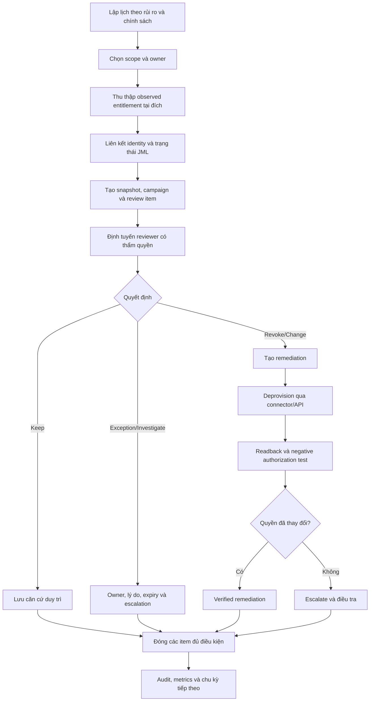
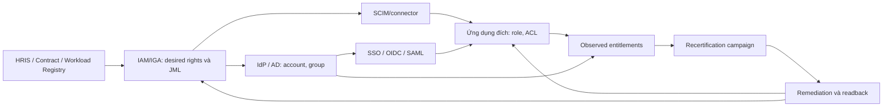

# Chu kỳ recertification trong Access recertification và quản lý vòng đời danh tính IAM

**Chu kỳ recertification** là khoảng thời gian và quy trình lặp lại để **tái xác nhận quyền truy cập đã cấp có còn phù hợp với nhiệm vụ, quan hệ, tài nguyên và chính sách hiện tại hay không**. Trong quản trị danh tính và truy cập (**IAM/IGA**), một lần phê duyệt lúc cấp quyền không đủ để bảo đảm quyền vẫn hợp lệ sau nhiều tháng. Nhân viên có thể chuyển bộ phận, dự án kết thúc, hợp đồng đối tác hết hạn hoặc quyền ứng dụng bị thay đổi ngoài quy trình.

Ví dụ, doanh nghiệp rà soát nhóm quyền quản trị production thường xuyên hơn nhóm đọc tài liệu nội bộ. Mỗi chu kỳ lấy bằng chứng về entitlement thực tế, giao đúng người có thẩm quyền xem xét, ghi quyết định **Keep / Revoke / Change / Exception** và kiểm chứng các hành động thu hồi ở hệ thống đích. **Hoàn thành bước bấm xác nhận không đồng nghĩa hoàn thành thu hồi quyền**.

Trong module quản lý vòng đời danh tính **Joiner–Mover–Leaver (JML)**, chu kỳ recertification là lớp kiểm soát **phát hiện và sửa quyền truy cập tồn dư** bên cạnh provisioning/deprovisioning theo sự kiện. Nó phải phối hợp **IdP, SSO, SCIM, RBAC/ABAC, tài khoản dịch vụ, phê duyệt, kiểm toán và account reconciliation**.

## 1. Recertification khác cấp quyền ban đầu thế nào?

| Hoạt động | Khi nào xảy ra | Câu hỏi chính | Kết quả |
| --- | --- | --- | --- |
| **Access request / approval** | Trước khi cấp quyền mới | Có đủ căn cứ *để cấp* không? | Approve/Reject, sau đó provisioning |
| **Access recertification** | Theo chu kỳ hoặc trigger | Quyền *đã tồn tại* có còn cần và hợp lệ không? | Keep/Revoke/Change/Exception |
| **Reconciliation** | Định kỳ hoặc theo sự kiện | Desired state khác observed state ở đâu? | Sai lệch và biện pháp sửa |
| **Joiner workflow** | Bắt đầu quan hệ | Account/role nào cần thiết từ ngày hiệu lực? | Provision có kiểm soát |
| **Mover workflow** | Đổi công việc, bộ phận, dự án | Quyền nào thêm, quyền nào phải gỡ? | Recompute và deprovision |
| **Leaver workflow** | Kết thúc quan hệ | Làm sao chặn mọi đường truy cập không còn căn cứ? | Disable/revoke và xác minh |
| **Authorization runtime** | Mỗi yêu cầu tài nguyên | Chủ thể có được làm hành động này ngay bây giờ không? | Permit/Deny tại PEP |

**Chu kỳ review không thay thế phản ứng tức thời với Leaver hoặc tài khoản bị chiếm.** Nếu biết một người đã nghỉ, không được đợi đến đợt chứng nhận hàng quý mới thu hồi quyền.

## 2. “Chu kỳ” bao gồm những gì?

Chu kỳ không đơn thuần là ngày bắt đầu và ngày kết thúc. Một thiết kế cần xác định:

- **Cadence:** tần suất khởi tạo, ví dụ mỗi tháng, mỗi quý hoặc theo chính sách rủi ro.
- **Coverage:** identity, ứng dụng, group, role, quyền trực tiếp và workload nào nằm trong scope.
- **Snapshot date:** thời điểm chụp dữ liệu quyền và độ mới của nguồn.
- **Reviewer:** người có thẩm quyền xác nhận nhu cầu và phạm vi.
- **Decision deadline:** hạn hoàn tất đánh giá.
- **Remediation deadline:** hạn thực hiện quyết định thu hồi hoặc thay đổi quyền.
- **Exception validity:** thời gian quyền ngoại lệ được chấp nhận.
- **Evidence retention:** thời hạn lưu bằng chứng theo chính sách.
- **Follow-up:** kiểm chứng kết quả, giải quyết item tồn đọng và lập kế hoạch chu kỳ sau.

Mỗi thành phần cần có owner và quy tắc rõ. Ví dụ **ngày đóng chiến dịch** không được dùng để che những item đã chọn Revoke nhưng vẫn còn quyền hoạt động.

## 3. Chọn tần suất theo rủi ro, không chỉ một lịch chung

Không có chu kỳ cố định phù hợp cho mọi tổ chức và mọi entitlement. Tần suất nên dựa trên **độ nhạy cảm, phạm vi tác động, khả năng bị lạm dụng, độ biến động nhân sự/dự án, mức tự động hóa thu hồi và yêu cầu kiểm soát áp dụng**.

| Nhóm quyền | Ví dụ minh họa về cadence | Lý do |
| --- | --- | --- |
| **Đặc quyền cao** | Hằng tháng hoặc thường xuyên hơn theo rủi ro | Thao tác quản trị có blast radius lớn |
| **Dữ liệu nhạy cảm** | Hằng quý theo policy | Rủi ro lộ dữ liệu nếu quyền dư |
| **Quyền nghiệp vụ thường** | Hằng quý hoặc nửa năm | Nhu cầu tương đối ổn định nhưng vẫn thay đổi |
| **Quyền rủi ro thấp** | Nửa năm hoặc hằng năm nếu đánh giá cho phép | Tối ưu chi phí review |
| **Partner/contractor** | Theo hợp đồng, dự án và chu kỳ định kỳ | Nguồn quan hệ thay đổi bên ngoài HR |
| **Service/workload identity** | Theo tuổi credential, chủ sở hữu và mức đặc quyền | Account máy ít gắn với HR và dễ trở thành orphan |
| **Break-glass** | Kiểm tra khả dụng và custody theo lịch riêng | Ít dùng nhưng đặc quyền rất nhạy cảm |

**Các mốc trên chỉ là ví dụ thiết kế, không phải yêu cầu pháp lý hay chuẩn chung.** Tổ chức phải đặt lịch căn cứ chính sách và nghĩa vụ cụ thể của mình. Quyền JIT có thời hạn 30 phút vẫn cần kiểm soát kết thúc ngay, không đợi recertification.

Một số đối tượng nên được review **theo sự kiện** bất kể lịch: đổi manager, Mover, hợp đồng thay đổi, role permission tăng, nhóm được gán quyền production, phát hiện orphan account hoặc nghi ngờ credential bị lộ.

## 4. Phân loại phạm vi của chiến dịch

Chu kỳ có thể được tổ chức theo nhiều chiều:

| Cách tổ chức | Ai nhìn thấy gì? | Điểm mạnh | Hạn chế |
| --- | --- | --- | --- |
| **Theo identity** | Tất cả entitlement của một người | Manager hiểu công việc tổng thể | Cần diễn giải tên quyền kỹ thuật |
| **Theo application** | Account và role trong hệ thống | Application owner biết rủi ro hệ thống | Có thể thiếu đối chiếu JML |
| **Theo group** | Direct/nested/effective membership | Group owner xem phạm vi nhóm | Group có thể ánh xạ nhiều role |
| **Theo privileged role** | Admin, approver, secret access | Ưu tiên blast radius cao | Không bao phủ toàn bộ quyền thông thường |
| **Theo resource** | Ai có quyền với một kho dữ liệu/dự án | Data owner kiểm soát đúng tài nguyên | Cần catalog và owner chính xác |
| **Theo partner/workload** | Quyền tài khoản ngoài HR | Xử lý hợp đồng và service owner | Dữ liệu owner có thể thiếu |

Một chu kỳ tổng thể có thể kết hợp các chiến dịch. **Không mặc định nhóm đã được review thì mọi quyền trực tiếp tại ứng dụng đã được review**. Cần đối soát ACL, role cục bộ và membership kế thừa.

## 5. Kiến trúc quy trình theo chu kỳ



**Decision completion** và **remediation completion** phải được lưu thành các trạng thái riêng, nếu không báo cáo có thể công bố “100% review hoàn tất” trong khi quyền admin đã bị yêu cầu thu hồi vẫn hoạt động.

## 6. Chuẩn bị dữ liệu trước ngày chụp snapshot

Chất lượng dữ liệu quyết định giá trị recertification. Trước khi khởi động chiến dịch cần:

1. Lấy account/role/group/ACL từ **hệ thống đích**, không chỉ danh sách entitlement mà IAM dự kiến đã cấp.
2. **Correlate** target account với identity ID ổn định; phân biệt account phụ và service identity.
3. Gắn trạng thái **Joiner–Mover–Leaver**, manager, owner, department và hợp đồng từ nguồn có thẩm quyền.
4. Mở rộng **nested group**, role hierarchy và direct permission khi công cụ hỗ trợ.
5. Hiển thị **effective permission** hoặc giải thích đường nhận quyền, ví dụ user → group con → group cha → role ERP.
6. Tìm resource owner, data classification, tenant, môi trường và mức rủi ro.
7. Xác định approval gốc, ngoại lệ có hạn và các quyền không còn người phụ trách.
8. Ghi timestamp, trạng thái đồng bộ và nguồn dữ liệu để reviewer biết độ mới.
9. Xử lý tài khoản chưa correlate như một ngoại lệ rủi ro; **không tự gán nhầm vào identity gần tên nhất**.

Thông tin **last login/last used** hữu ích để đánh giá nhưng không chứng minh quyền cần hay không cần. Tài khoản break-glass có thể hiếm khi dùng mà vẫn cần tồn tại; ngược lại quyền cũ được sử dụng thường xuyên chưa chắc hợp lệ sau Mover.

## 7. Snapshot và quyền đang thay đổi trong chu kỳ

Chiến dịch thường chụp entitlement tại thời điểm `T0`, nhưng trong thời gian xét duyệt JML tiếp tục xảy ra. Cần chống **stale review decision**.

Ví dụ:

- **T0:** Lan có role `invoice-approver`, item review đang chờ.
- **T1:** HRIS báo Lan chuyển sang Analytics; IAM thu hồi role Finance.
- **T2:** Reviewer mở snapshot T0 và nhấn **Keep**.
- **Sai lầm:** hệ thống cấp lại role Finance vì quyết định Keep trên dữ liệu cũ.

**Keep không phải approval cấp lại quyền đã được thu hồi**. Trước khi thay đổi tài nguyên, phải đọc trạng thái hiện hành và kiểm tra lifecycle, policy và version. Nếu snapshot khác hiện trạng, item cần hiển thị cảnh báo, tái đánh giá hoặc đóng là đã được xử lý, tùy quy trình.

Một chiến dịch có thể dùng snapshot bất biến cho kiểm toán và **current observed state** cho remediation; không nên ghi đè bằng chứng lịch sử để che thay đổi.

## 8. Người review cần đủ thẩm quyền và đủ ngữ cảnh

| Reviewer | Phù hợp với | Hạn chế |
| --- | --- | --- |
| **Line manager** | Xác nhận nhân viên còn làm nhiệm vụ gì | Có thể không hiểu permission kỹ thuật |
| **Application owner** | Giải thích role và khả năng ứng dụng | Có thể không biết nhu cầu từng cá nhân |
| **Data/resource owner** | Phạm vi tài nguyên và tính hợp lệ dữ liệu | Cần liên kết identity và nhiệm vụ |
| **Group owner** | Đúng membership và rule của group | Có thể bỏ sót entitlement trực tiếp |
| **Security/IAM** | Kiểm tra policy, SoD và rủi ro | Không nhất thiết là owner nghiệp vụ |
| **Partner sponsor** | Hợp đồng và tài khoản B2B | Cần xác minh quyền ứng dụng thực tế |
| **Workload owner** | Mục đích job/service và scope API | Cần inventory credential/secret rõ |

Reviewer phải hiểu **quyền cụ thể cấp hành động gì**, trên môi trường/tài nguyên nào và tại sao beneficiary còn cần. Một người bấm Keep hàng trăm item mà không thấy mô tả quyền không tạo được bằng chứng mạnh.

Nếu reviewer đã Mover hoặc Leaver, assignment người duyệt cần được chuyển qua cơ chế có thẩm quyền. Không để manager cũ tiếp tục review bằng session còn sống.

## 9. Quyết định trong từng chu kỳ

| Quyết định | Ý nghĩa | Việc tiếp theo |
| --- | --- | --- |
| **Keep / Certify** | Quyền tiếp tục hợp lệ | Lưu lý do, owner, thời hạn và thời điểm review |
| **Revoke** | Quyền không còn cần | Deprovision ở nguồn và hệ thống đích, readback |
| **Change scope** | Vẫn cần nhưng quyền quá rộng | Hạ role, giới hạn tenant/dự án/action |
| **Exception** | Cần quyền bất thường trong thời hạn | Owner, lý do, approval, expiry, hậu kiểm |
| **Investigate** | Thiếu dữ liệu để kết luận | Giao xử lý và escalation có hạn |
| **Overdue / No response** | Chưa có quyết định | Xử lý theo policy rủi ro, không mặc nhiên Keep |

**Revoke là một quyết định quản trị; quyền chỉ thật sự mất khi deprovision và authorization tại đích phản ánh trạng thái mới.** Nếu token/phiên còn chấp nhận quyền cũ, cần có biện pháp phù hợp với kiến trúc và rủi ro.

## 10. SLA của quyết định và remediation

Một chu kỳ tốt tách **SLA review** khỏi **SLA xử lý quyền dư**:

- **Review SLA:** thời hạn để approver ra quyết định.
- **Escalation SLA:** thời gian chuyển người thay thế khi reviewer không phản hồi.
- **Remediation SLA:** thời gian hệ thống thực thi quyết định Revoke/Change.
- **Verification SLA:** thời gian đọc lại và kiểm thử quyền hiệu lực.
- **Exception SLA:** thời hạn người giữ quyền ngoại lệ phải được tái đánh giá.

Ví dụ một reviewer chọn Revoke cho quyền `cloud-admin` ngày 5 nhưng connector lỗi đến ngày 15. Campaign có thể đã nhận quyết định, song **không được đánh dấu verified revocation**. Lỗi phải được báo động và có owner xử lý theo độ nhạy cảm.

**Không mặc định im lặng đồng nghĩa chấp thuận.** Policy có thể quy định escalation hoặc hạn chế quyền trong trường hợp không có phản hồi, nhưng phải xét tác động và quy tắc an toàn.

## 11. Gắn chu kỳ recertification với Joiner

Ở **Joiner**, IAM tính entitlement cơ bản từ quan hệ và vai trò đã xác minh, có thể qua RBAC/ABAC. Chu kỳ đầu tiên sau onboarding nên kiểm tra:

- Identity được liên kết đúng account/tenant.
- Role birthright không vượt mức cần thiết.
- Quyền nhạy cảm có approval hợp lệ và đúng owner.
- Ngày hiệu lực quyền đúng với ngày quan hệ bắt đầu.
- Account phụ hoặc credential tạo trong onboarding đã được quản trị.
- SCIM/connector thực sự provision đúng ở đích.

Review định kỳ có thể phát hiện role bị cấu hình rộng hoặc account cấp nhầm. Tuy vậy, **không trì hoãn kiểm tra entitlement ngay sau provisioning để đợi chu kỳ đầu tiên**; verification ban đầu vẫn là yêu cầu riêng.

## 12. Gắn chu kỳ recertification với Mover

**Mover** làm thay đổi bộ quyền mong muốn: quyền mới có thể được cấp trong khi quyền cũ chưa bị gỡ. Recertification cần phát hiện **role accumulation**, kể cả qua group lồng nhau và gán trực tiếp.

| Sự kiện Mover | Dấu hiệu trong review | Hành động |
| --- | --- | --- |
| Finance sang Analytics | Còn `invoice-approver` | Revoke ERP và kiểm tra SoD |
| Dự án A sang B | ACL/repo access A vẫn active | Gỡ quyền A, giữ B hợp lệ |
| Operator sang Auditor | Còn role production operator | Thu hồi đặc quyền và phiên liên quan |
| Bàn giao còn 7 ngày | Quyền cũ chưa hết hạn | Ngoại lệ có hạn và owner |
| Hết nhiệm kỳ manager | Còn quyền phê duyệt account | Thay đổi role và approval delegation |

**Sự kiện Mover phải kích hoạt thu hồi theo quy trình ngay**, còn recertification là hàng rào phát hiện sai lệch nếu workflow thất bại hoặc có quyền cấp ngoài luồng.

## 13. Gắn chu kỳ recertification với Leaver

Leaver phải được xử lý **theo thời điểm chấm dứt**, không phụ thuộc lịch hàng tháng/quý. Recertification sau đó giúp phát hiện residual access:

- IdP account đã disabled nhưng SaaS account vẫn active.
- Group ở AD đã gỡ nhưng ERP role còn gán cục bộ.
- Session SSO/RP hoặc refresh/access token vẫn có thể gọi API.
- API key hoặc account phụ tồn tại độc lập với SSO.
- Partner hết hợp đồng vẫn nằm trong nhóm B2B.
- Credential của người đã nghỉ vẫn được dùng trong job automation.
- Account orphan không có identity/owner có thẩm quyền.

**SCIM `active=false` không tự chấm dứt mọi ứng dụng và phiên**, và JWT tự chứa có thể tồn tại đến lúc hết hạn nếu không có revoke/kiểm tra trạng thái hiện hành. Do đó review phải xem **khả năng truy cập thực tế** và bổ sung negative authorization test với hệ thống nhạy cảm.

## 14. IdP, SSO, SCIM và entitlement hiệu lực



**IdP/SSO** cung cấp xác thực và có thể mang group claim; **SCIM/connector** quản lý account/group và entitlement theo khả năng; **RBAC/ABAC/PBAC** kiểm tra quyền theo tài nguyên; **IGA** điều phối recertification. Quyền quan sát ở IdP chưa chắc phản ánh tất cả role cục bộ ở SaaS.

**ID token OIDC không phải access token gọi API.** Khi review phát hiện quyền tồn dư, phải xử lý cả authorization ở resource server theo audience, scope và quyền hiện hành, thay vì chỉ xóa claim IdP.

## 15. Recertification dành cho quyền đặc biệt

Các entitlement nhạy cảm cần tần suất, reviewer và bằng chứng chặt hơn:

- Domain/tenant administrator, cloud owner, database admin.
- Role có thể đổi policy, cấp quyền hoặc xóa audit.
- Permission xuất toàn bộ dữ liệu nhạy cảm.
- Quyền duyệt thanh toán hoặc hạn mức tài chính.
- Quyền truy cập secret vault hoặc production break-glass.
- Đặc quyền được cấp qua JIT/PAM, kể cả **eligibility** xin quyền.

Cần phân biệt **quyền đủ điều kiện kích hoạt** và **quyền đang active**. Dù role JIT không được kích hoạt tại snapshot, một người còn eligibility có thể trở thành admin khi có điều kiện; eligibility cũng cần review.

**Separation of Duties (SoD)** phải được đánh giá trên tập quyền hiệu lực. Một người thuộc hai nhóm xung đột qua nesting có thể vi phạm SoD dù từng group riêng biệt được reviewer xác nhận.

## 16. Partner identity và hợp đồng

Partner/contractor thường không dùng cùng HRIS với nhân viên. Chu kỳ recertification nên gắn với:

- **Sponsor** còn chịu trách nhiệm không?
- **Partner ID/tenant/contract ID** còn hợp lệ?
- Người dùng vẫn thuộc dự án/hợp đồng được cấp?
- Hạn truy cập có vượt ngày kết thúc hợp đồng?
- Có quyền vượt phạm vi dữ liệu được chia sẻ?
- Account do partner IdP xác thực có còn được ứng dụng nội bộ chấp nhận?
- Có quyền trực tiếp, group hoặc API key chưa thu hồi?

Không phụ thuộc hoàn toàn vào việc đối tác sẽ tự disable account. **Bên sở hữu tài nguyên phải chủ động đánh giá và thu hồi quyền B2B** khi căn cứ không còn.

## 17. Service account và workload recertification

**Service/workload identities** có vòng đời khác nhân viên. Các trường review quan trọng gồm:

| Thuộc tính | Câu hỏi review |
| --- | --- |
| Workload ID | Identity có gắn với service thực sự đang vận hành? |
| Owner | Có người/nhóm chịu trách nhiệm hiện tại? |
| Purpose | Chức năng còn cần quyền này? |
| Environment | Token staging có dùng ngoài staging? |
| Scope | Chỉ được read/write đúng resource? |
| Credential | Có hạn, rotation hoặc managed identity phù hợp? |
| Dependency | Nếu thu hồi, tác động tới job nào? |
| Recent activity | Hoạt động có phù hợp workload dự kiến? |
| Human access | Ai có quyền lấy secret hoặc sửa workload? |

Không tự xóa service account chỉ vì kỹ sư tạo ra nó đã Leaver. Cần **chuyển owner**, thu hồi quyền cá nhân đối với secret/CI-CD và đánh giá quyền kỹ thuật theo phụ thuộc, đảm bảo không tồn tại credential vô chủ.

## 18. Review theo chu kỳ và event-driven review

**Periodic review** chạy theo lịch, tạo mốc kiểm soát và bằng chứng nhất quán. **Event-driven review** diễn ra khi có thay đổi đáng kể.

| Sự kiện | Trigger review/certification bổ sung |
| --- | --- |
| Thay đổi role permission ở ứng dụng | Tái xét mọi người đang sở hữu role có quyền mới |
| Mover sang nhóm nhạy cảm | Review quyền cũ và quyền đặc biệt mới |
| Thay đổi hợp đồng partner | Xác minh tenant, scope và thời hạn |
| Resource đổi owner hoặc classification | Chuyển reviewer và đánh giá truy cập |
| Service account đổi owner | Rà soát credential và scope |
| Group được nest vào nhóm privileged | Phân tích tất cả effective members |
| Phát hiện quyền orphan | Điều tra và thu hồi theo policy |
| Sự cố credential hoặc insider risk | Đánh giá/thu hồi ngay, không chờ lịch |

Kết hợp hai cơ chế giúp giảm **khoảng trống giữa các chu kỳ**. Nhưng không nên tạo vô số chiến dịch lặp mà không có khả năng xử lý; cần quy tắc deduplication, version và ownership.

## 19. Reconciliation và xác minh hậu review

```text
desired = quyền hợp lệ theo identity + JML + role + approval + exception
observed = quyền thực tế ở IdP/AD + SaaS + ACL + group nesting

excess  = observed - desired
missing = desired - observed
```

Đây là mô hình logic; trong triển khai phải xét quyền gián tiếp, ABAC runtime, role kế thừa, phiên/token và quyền kỹ thuật. Trước khi gỡ một entitlement có thể có phụ thuộc, cần owner và phương án thay thế phù hợp, nhưng quyền không có căn cứ phải được xử lý theo mức rủi ro.

Quy trình hậu review:

1. Ghi decision gắn **identity/account/resource/entitlement ID** và snapshot.
2. Kiểm tra request chưa bị thay thế bởi sự kiện JML mới.
3. Thực hiện revoke/change ở **nguồn quản trị chính** để tránh tự được đồng bộ lại.
4. Kiểm tra response connector và trạng thái thực tế ở đích.
5. Thử truy cập trái quyền bị từ chối khi yêu cầu bảo mật cao.
6. Xử lý session/token còn hiệu lực theo khả năng nền tảng.
7. Đóng verified remediation hoặc ghi blocker với owner/SLA.
8. Giữ lịch sử để chu kỳ sau không mất dấu sai lệch.

**HTTP 200/204 từ connector chưa đủ chứng minh quyền thực tế mất hiệu lực**, đặc biệt khi ứng dụng dùng cache hoặc có session cũ.

## 20. Tránh rubber-stamping và review fatigue

Một chiến dịch với hàng nghìn item có thể khiến reviewer chọn Keep hàng loạt mà không xem xét. Để nâng chất lượng:

- **Nhóm item theo rủi ro** và ưu tiên quyền privileged, dữ liệu nhạy cảm.
- Cung cấp tên nghiệp vụ, role mapping, owner và lý do cấp ban đầu.
- Nêu rõ thay đổi JML, last used signal và expiry (nếu dữ liệu đáng tin).
- Hiển thị nhóm lồng nhau, quyền trực tiếp và phạm vi tenant.
- Hạn chế bulk approval đối với nhóm quyền nhạy cảm.
- Buộc reviewer ghi lý do đối với quyền bất thường hoặc ngoại lệ.
- Đánh giá mẫu một số quyết định Keep để phát hiện chứng nhận hình thức.
- Theo dõi reviewer có tỷ lệ Keep bất thường, nhưng **không kết luận sai phạm chỉ từ thống kê**.
- Tối ưu số lượng item và cung cấp quyền truy cập thông tin để reviewer hiểu.

**Đừng coi ít quyền bị revoke là mục tiêu.** Mục tiêu là quyết định đúng, có căn cứ, và xử lý quyền dư thật sự.

## 21. Kiểm toán, bằng chứng và chỉ số

Một bản ghi recertification nên chứa: **campaign ID, scope, snapshot timestamp, nguồn dữ liệu, identity/account/entitlement/resource IDs, reviewer, quyết định, lý do, policy version, thời điểm, lệnh remediation, readback và trạng thái cuối cùng**.

Không ghi password, refresh/access token, cookie, API key, private key hoặc thông tin cá nhân không cần thiết vào log. Phải bảo vệ integrity và retention theo chính sách.

| Chỉ số | Điều phản ánh |
| --- | --- |
| **Certification coverage** | Tỷ lệ entitlement trong scope đã được xét |
| **Decision completion rate** | Tỷ lệ item có quyết định hợp lệ |
| **Verified revocation rate** | Tỷ lệ item Revoke đã mất quyền ở đích |
| **Remediation latency** | Thời gian từ Revoke đến readback thành công |
| **Overdue review items** | Reviewer/campaign chậm SLA |
| **Exception overdue** | Quyền ngoại lệ quá hạn |
| **Mover excess entitlements** | Quyền cũ còn sau chuyển công việc |
| **Leaver residual-access count** | Đường truy cập còn sau chấm dứt |
| **Orphan entitlement count** | Quyền không liên kết được identity/owner |
| **Privileged review coverage** | Độ bao phủ các quyền rủi ro cao |
| **Repeat finding rate** | Sai lệch tái xuất hiện qua nhiều chu kỳ |
| **Review decision quality** | Tỷ lệ quyết định được kiểm tra mẫu và có căn cứ |

**Đạt 100% decision completion nhưng chỉ 60% verified revocation là chưa hoàn tất mục tiêu kiểm soát.** Báo cáo cần tách rõ tiến độ xét duyệt khỏi tiến độ thu hồi.

## 22. Một ví dụ lập lịch 12 tháng

Ví dụ tổ chức lựa chọn một lịch theo đánh giá rủi ro của riêng mình:

| Mốc | Công việc minh họa | Trọng tâm |
| --- | --- | --- |
| Tháng 1 | Privileged roles và group admins | Owner, SoD, eligibility JIT |
| Tháng 2 | Remediation + kiểm chứng kỳ trước | Quyền tồn dư cần khắc phục |
| Tháng 3 | Quyền dữ liệu nhạy cảm và ERP | Data owner, scope, expiry |
| Tháng 4 | Quyền B2B và hợp đồng | Sponsor, partner tenant |
| Tháng 5 | Service accounts và credentials | Workload owner và scope |
| Tháng 6 | Quyền ứng dụng nghiệp vụ | Role không còn cần |
| Tháng 7–9 | Lặp nhóm rủi ro cao, theo kết quả và chính sách | Đặc quyền và dữ liệu |
| Tháng 10–12 | Hoàn tất chu kỳ năm, kiểm tra ngoại lệ và cải tiến | Coverage, SLA, chính sách mới |

Lịch trên là **minh họa quản trị**, không phải chuẩn tần suất bắt buộc. Nhóm admin rủi ro cao có thể phải review nhiều lần trong cùng 12 tháng; các đợt review theo sự kiện vẫn diễn ra bất cứ lúc nào.

## 23. Ma trận kiểm thử chu kỳ recertification

| Tình huống | Kết quả mong muốn |
| --- | --- |
| Reviewer không có thẩm quyền | Không thể chứng nhận item |
| Snapshot cũ, user đã Mover | Keep không cấp lại quyền cũ |
| User Leaver giữa chiến dịch | Không giữ quyền; thu hồi theo JML |
| Connector thất bại khi Revoke | Item remediation chưa được xác minh |
| Nhóm có nested group | Review thấy effective membership |
| Dynamic group có rule sai | Đánh giá cả policy nguồn, không gỡ thủ công rồi dừng |
| Role privileged có entitlement tăng | Re-review do sự kiện thay đổi quyền |
| Partner hết hạn hợp đồng | Quyền B2B bị thu hồi không chờ lịch |
| Workload không có owner | Investigate với SLA, tránh auto-Keep |
| Reviewer không phản hồi | Escalation theo policy, không tự Keep |
| Quyền đã thu hồi nhưng session vẫn truy cập | Negative test phát hiện tồn dư |
| Campaign có 100% quyết định nhưng 20% revoke pending | Báo cáo riêng tiến độ remediation |

## 24. Câu hỏi tự kiểm tra

**Tình huống A:** Công ty chọn review mỗi quý. Nhân viên nghỉ việc giữa quý có được giữ quyền đến ngày review tiếp theo không? **Không.** Leaver phải kích hoạt thu hồi theo sự kiện.

**Tình huống B:** Reviewer chọn Revoke, SCIM trả thành công nhưng ERP vẫn có role cục bộ. Đã xong chưa? **Chưa.** Cần đối soát và readback ở ERP.

**Tình huống C:** Người dùng đã Mover và bị gỡ group cũ, nhưng reviewer bấm Keep từ snapshot cũ. IAM nên làm gì? **Không cấp lại quyền**, phải kiểm tra trạng thái và version hiện hành.

**Tình huống D:** Một group admin ít được dùng. Chỉ dựa vào last login có nên tự xóa không? **Không.** Cần kiểm tra mục đích, owner và cơ chế đặc quyền.

**Tình huống E:** Service account không có owner; review do manager nhân sự của người tạo account đã nghỉ thực hiện. Có đủ căn cứ không? **Không.** Phải xác định workload owner và phụ thuộc hiện hành.

**Tình huống F:** Campaign có tất cả item đã được quyết định nhưng một số lệnh deprovision còn lỗi. Có thể công bố hoàn thành thu hồi không? **Không.** Tách Decision completed khỏi Verified remediation completed.

## Ghi nhớ

**Chu kỳ recertification** là cơ chế **tái đánh giá quyền đã cấp theo một lịch hoặc sự kiện có kiểm soát**, kết hợp **tần suất theo rủi ro, snapshot, reviewer đúng thẩm quyền, quyết định có căn cứ, remediation, readback và audit**. Nó **bổ sung chứ không thay thế Joiner–Mover–Leaver theo thời gian thực**. Việc liên kết **IdP/SSO, SCIM/connector, RBAC/ABAC, service identity và reconciliation** giúp phát hiện quyền thừa, quyền đặc biệt và quyền tồn dư; **chỉ khi quyền thực tế được kiểm chứng đã thay đổi, quyết định thu hồi mới được coi hoàn tất**.
