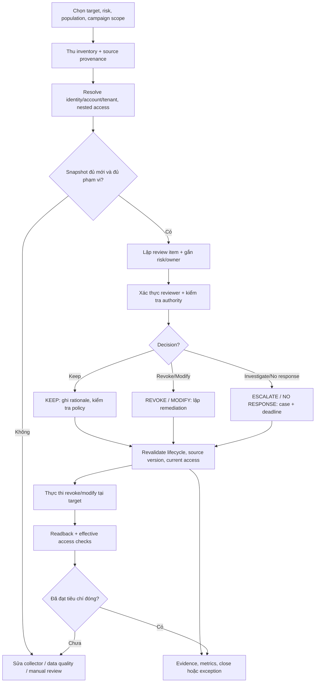
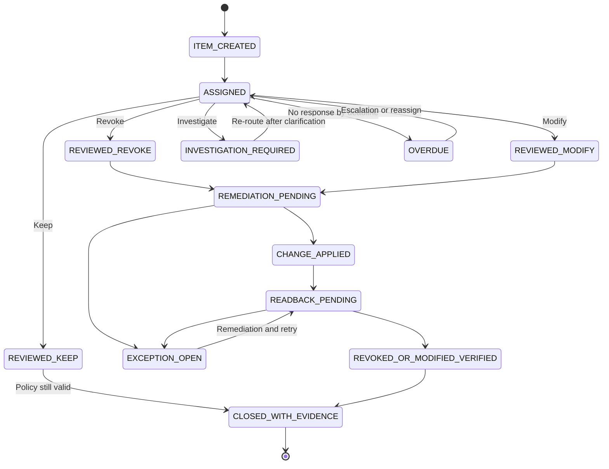

# Attestation trong Access recertification và quản lý vòng đời IAM

## Mục tiêu học tập

Sau bài học, người học có thể:

1. Giải thích **attestation** trong **access recertification**, phân biệt nó với việc phê duyệt cấp quyền lần đầu, đối soát kỹ thuật, authorization ở runtime và bằng chứng thu hồi.
2. Xác định đối tượng cần được chứng nhận: **identity, target account, role, group, permission, entitlement, phạm vi tài nguyên, grant provenance và quyền hiệu lực**.
3. Thiết kế **review campaign** với đối tượng, kỳ rà soát, nguồn dữ liệu, snapshot/version, reviewer, deadline, policy, quy tắc escalation và bằng chứng.
4. Phân tích vai trò của **manager, application owner, data owner, sponsor, security reviewer**, tránh self-attestation và phê duyệt hình thức cho các quyền nhạy cảm.
5. Phân biệt các kết quả **Certify/Keep, Revoke, Modify, Escalate/Investigate** và trường hợp **không có quyết định**, không ngầm coi im lặng là chấp thuận.
6. Hiểu cách dùng **RBAC, ABAC, IdP, SSO, directory, SCIM, PAM** và dữ liệu ứng dụng thực tế để rà soát đúng quyền, kể cả quyền trực tiếp và quyền được kế thừa.
7. Liên kết recertification với **Joiner–Mover–Leaver (JML)**, contractor expiry, rehire và non-human identity để tránh giữ quyền sau khi mất điều kiện.
8. Xây dựng bằng chứng quyết định, luồng remediation, readback, kiểm toán, metric và test nhằm giảm **excess privilege** và **residual access**.

## 1. Attestation là gì?

Trong quản trị truy cập, **attestation** là một hành động xác nhận có trách nhiệm rằng **một quyền hoặc tập quyền được xem xét vẫn phù hợp với nhu cầu công việc và chính sách tại thời điểm rà soát**, hoặc xác định quyền đó phải thay đổi/thu hồi.

**Access recertification** là quá trình tổ chức đưa các quyền đang tồn tại ra kiểm tra lại theo chu kỳ hoặc theo sự kiện. Nó thường có nhiều thành phần: tạo inventory, chọn reviewer, thu quyết định attestation, xử lý ngoại lệ, thực thi thu hồi và xác minh kết quả.

Một attestation điển hình trả lời:

> “Tại thời điểm xem xét, account của An có nên tiếp tục sở hữu role `FinanceReportExporter` trên hệ thống báo cáo, trong phạm vi chi nhánh A và cho đến khi nào?”

Người rà soát không chỉ xác nhận **quyền đang tồn tại**, mà cần xác nhận **quyền đó có lý do hợp lệ để tồn tại tiếp hay không**.

Ví dụ: Lan đã chuyển từ Sales sang Finance. Directory vẫn hiển thị Lan thuộc nhóm `crm-sales-exporters`. Trong campaign, application owner thấy role này không còn cần thiết, chọn `REVOKE` và ghi lý do. IAM gỡ membership, đọc lại quyền ở ứng dụng và kiểm tra token/session liên quan. **Quyết định `REVOKE` là bằng chứng attestation; việc quyền thực sự bị gỡ là bằng chứng remediation riêng.**

### 1.1. Attestation không phải thao tác kỹ thuật đơn lẻ

| Khái niệm | Câu hỏi | Chủ thể/chứng cứ |
|---|---|---|
| **Access request** | Người dùng đề nghị quyền gì? | Requester, entitlement, scope |
| **Initial approval** | Có cho cấp quyền mới không? | Approver, risk/SoD, request version |
| **Provisioning** | Hệ thống đích đã nhận thay đổi quyền chưa? | Connector/target response |
| **Access inventory** | Account hiện có những quyền nào? | Directory, IAM, application |
| **Reconciliation** | Actual access có khớp desired state không? | Dữ liệu nguồn và đích |
| **Attestation** | Reviewer xác nhận quyền hiện có còn phù hợp không? | Quyết định có thẩm quyền, lý do, snapshot |
| **Remediation** | Quyền cần gỡ/sửa đã được thực thi chưa? | Revoke/modify, readback |
| **Runtime authorization** | Request hiện tại có được Permit không? | PEP/PDP, permission/scope/session |

**Attestation là một điểm quyết định trong governance, không tự vô hiệu token, session, ACL hay role tại ứng dụng.**

### 1.2. Không phải mỗi lần nhấn “Keep” đều là chứng nhận đáng tin

Một người nhấn **Keep all** mà không biết role chứa gì, không thấy scope hoặc không có thẩm quyền kiểm tra có thể tạo đủ thao tác trên portal nhưng chưa chứng minh chất lượng review.

Attestation có giá trị khi reviewer nhận được **thông tin đầy đủ, nguồn đáng tin, thời gian phù hợp, chính sách rõ và trách nhiệm cá nhân**. Với quyền nhạy cảm, cần thêm risk-based review và kiểm tra độc lập khi phù hợp.

## 2. Mối liên hệ với Identity Lifecycle Joiner–Mover–Leaver

**Joiner–Mover–Leaver** là mô hình vận hành liên tục, còn recertification là một lớp kiểm soát **phát hiện và sửa những quyền không còn phù hợp**. Không nên chờ campaign hàng quý mới thu hồi quyền của người đã nghỉ việc.

### 2.1. Joiner

Khi người mới vào tổ chức, IAM cấp quyền cơ sở theo birthright policy và quyền bổ sung theo request/approval. Lần recertification đầu tiên có thể xác nhận:

- Role có đúng chức năng thực tế sau khi bắt đầu làm việc?
- Account đã được xác minh identity/proofing phù hợp chưa?
- Có direct grant hoặc nhóm được cấp thủ công ngoài policy không?
- Quyền đang hoạt động có vượt phạm vi hợp đồng hoặc dự án không?

Một account đã provision sẵn trước ngày bắt đầu không tự được coi quyền có thể sử dụng trước khi Joiner đủ điều kiện.

### 2.2. Mover

Khi nhân viên đổi phòng ban, chức vụ hoặc dự án, bộ quyền cũ có thể còn lưu trong app-local role hoặc token. **Mover workflow phải chủ động tính lại quyền và thu hồi quyền cũ**, không đợi review campaign.

Attestation giúp phát hiện các quyền chưa được thu hồi do connector lỗi, nested groups, grants ngoài IGA hoặc dữ liệu nguồn lệch.

### 2.3. Leaver

Khi Leaver có hiệu lực, account cần được disable/deprovision theo policy ngay. Nếu trong campaign vẫn thấy account hoặc quyền của Leaver:

- Đây không chỉ là câu hỏi “manager có đồng ý giữ quyền không”.
- Cần mở **exception/incident** và kích hoạt **revoke/disable** theo mức rủi ro.
- Một reviewer không được chọn `KEEP` để vượt trạng thái Leaver có thẩm quyền.
- Cần kiểm tra phiên, token, credential và account đặc quyền riêng khi liên quan.

**Attestation không phải cơ chế trì hoãn deprovisioning bắt buộc của Leaver.**

### 2.4. Rehire và contractor

Người được tái tuyển dụng không mặc nhiên nhận lại toàn bộ quyền đã được attest ở kỳ làm việc cũ. Phải kiểm tra engagement/lifecycle version và vai trò mới.

Với nhà thầu, sponsor có thể cần xác nhận quyền còn phù hợp **trước thời điểm hết hợp đồng**. Nếu hợp đồng đã kết thúc mà account còn active, xử lý theo nguồn có thẩm quyền, không dùng quyết định giữ quyền trong campaign làm cơ sở kéo dài hợp đồng.

## 3. Mục tiêu nghiệp vụ của access attestation

Một chương trình attestation tốt có các mục tiêu rõ:

1. **Loại quyền thừa:** người dùng không còn cần quyền theo nhiệm vụ.
2. **Giảm quyền tích lũy:** role cũ còn sau Mover hoặc nhiều dự án.
3. **Phát hiện quyền không có owner:** account/entitlement orphan hoặc shadow admin.
4. **Kiểm soát quyền cao:** admin, secrets, production, dữ liệu nhạy cảm.
5. **Xác minh trách nhiệm:** có người đủ thẩm quyền quyết định giữ/gỡ.
6. **Quản lý ngoại lệ:** những quyền cần điều tra phải có owner, deadline và remediation.
7. **Tạo bằng chứng kiểm toán:** ai quyết định, dựa trên dữ liệu gì, đã xử lý ra sao.
8. **Cải thiện role mining/catalog:** phát hiện role quá rộng hoặc mapping không rõ.
9. **Xác nhận các grant có thời hạn:** quyền dự án/JIT không còn quá expiry.
10. **Phát hiện control gap:** đích không hỗ trợ readback hoặc token không revoke.

Attestation không chỉ phục vụ kiểm toán. Quyết định có chất lượng cần dẫn tới **thực thi least privilege** tại hệ thống đích.

### 3.1. Attestation theo risk thay vì “mọi thứ mỗi năm một lần”

Tần suất và độ sâu nên phụ thuộc vào:

- Độ nhạy dữ liệu và hành động.
- Mức quyền (read, export, approve, admin, manage credentials).
- Đặc điểm workforce: nhân viên, contractor, guest, service principal.
- Biến động role/đơn vị/dự án.
- Cửa sổ thu hồi quyền và khả năng technical enforcement.
- Yêu cầu kiểm toán, pháp lý hoặc quy định áp dụng.
- Những sai lệch hoặc sự cố từng quan sát.

Không có một tần suất toàn cầu bắt buộc cho mọi hệ thống. Ví dụ quyền production admin có thể cần review thường xuyên hơn một group đọc tài liệu cơ bản, nhưng chính sách cụ thể phải do tổ chức định nghĩa.

## 4. Đối tượng nào được đưa ra attestation?

Một reviewer cần hiểu chính xác **đang xác nhận điều gì**. Các lớp quyền khác nhau có thể tạo ra review item khác nhau.

### 4.1. Các lớp inventory

| Đối tượng | Ví dụ | Câu hỏi review |
|---|---|---|
| **Identity/account** | Account SaaS của Lan | Account còn có owner và nhu cầu sử dụng không? |
| **Application assignment** | Gói truy cập CRM | Có cần giữ quyền vào ứng dụng? |
| **Role** | `InvoiceApprover` | Role có phù hợp trách nhiệm hiện tại? |
| **Group membership** | `finance-exporters` | Thành viên này còn cần trong group? |
| **Permission** | `invoice.export` | Có thực sự cần export hay chỉ read? |
| **Resource scope** | `projectId=PROJECT-A` | Quyền có giới hạn đúng dự án/tenant? |
| **Direct grant/ACL** | Quyền trên folder/dataset | Có đường cấp quyền ngoài RBAC không? |
| **Privileged assignment** | Cloud admin/PAM eligible role | Có cần duy trì eligibility/elevation? |
| **Delegated access** | Quyền xem inbox/dự án thay người khác | Ủy quyền còn hiệu lực và đúng chủ thể? |
| **Workload entitlement** | Service principal đọc secrets | Workload còn chạy và owner hợp lệ? |
| **Shared/local account** | Local admin trên máy chủ | Ai sử dụng và kiểm soát credential? |
| **Session/API credential** | Personal token hoặc SSH key | Có đường truy cập tồn dư cần xử lý? |

Một group name như `report-readers` có thể không nói rõ scope. Nếu reviewer không biết group thực thi quyền nào ở ứng dụng, **không đủ căn cứ xác nhận Keep**.

### 4.2. Gán quyền trực tiếp, kế thừa và hiệu lực

Một user có thể nhận `data.export` qua:

- Gán role trực tiếp tại ứng dụng.
- Directory group được đồng bộ qua IdP.
- Nested group trong LDAP/AD.
- Role hierarchy trong RBAC.
- Cloud IAM policy.
- Resource ACL riêng.
- Temporary/JIT grant.
- Token/API credential có scope độc lập.

Nếu chỉ đưa vào campaign các gán group trực tiếp, có thể bỏ sót **effective privileges**. Review design cần công bố **độ bao phủ và cách resolve quyền kế thừa**.

### 4.3. Review từng group hay từng permission?

| Mức review | Ưu điểm | Giới hạn |
|---|---|---|
| Group membership | Dễ lấy từ directory và cấp/gỡ qua connector | Tên group có thể không phản ánh permission thật |
| Application role | Gần với mô hình app owner hiểu | Một role có thể quá rộng hoặc chứa permission mới |
| Permission/action | Rõ năng lực được phép | Khối lượng lớn, khó quản lý nếu catalog kém |
| Effective access theo resource | Chính xác về phạm vi nghiệp vụ | Cần engine/inventory và nguồn thuộc tính tin cậy |
| Account/application access | Hữu ích để kiểm kê nền tảng | Không đủ cho quyền nhạy cảm bên trong ứng dụng |

Thực tế có thể kết hợp: manager review **nhu cầu ứng dụng**, data owner review **scope dữ liệu**, application/security owner review **role và privileged permissions**.

## 5. Review campaign là gì?

**Campaign** là một đợt rà soát với phạm vi, reviewer, thời hạn và rule xử lý xác định. Nó có thể chạy định kỳ hoặc được kích hoạt bởi sự kiện.

### 5.1. Thành phần campaign

| Trường | Ý nghĩa |
|---|---|
| `campaignId` | Định danh đợt rà soát |
| `campaignType` | Manager, application, privileged, project, SoD... |
| `targetApplications` | Danh sách ứng dụng/tenant |
| `populationRule` | Điều kiện chọn identity/account/grant |
| `riskScope` | Quyền cao, dữ liệu restricted, contractor... |
| `snapshotTime` | Mốc chụp inventory |
| `snapshotVersion` | Phiên bản dữ liệu hoặc digest |
| `reviewerAssignmentRule` | Cách chọn owner/reviewer |
| `dueAt` | Hạn ra quyết định |
| `escalationPolicy` | Xử lý khi không có quyết định |
| `decisionOptions` | Certify, Revoke, Modify, Investigate |
| `remediationPolicy` | Chuyển quyết định thành thay đổi ở đích |
| `closureCriteria` | Điều kiện đóng, gồm xử lý exception |
| `retentionPolicy` | Thời hạn và nơi lưu bằng chứng |

### 5.2. Các loại campaign

- **Manager review:** manager xác nhận cấp dưới còn cần truy cập hệ thống nào.
- **Application owner review:** owner đánh giá role/entitlement ở ứng dụng.
- **Data owner review:** owner dữ liệu xác nhận người dùng và scope được phép.
- **Privileged access review:** đánh giá admin, production, break-glass, PAM.
- **Project/contractor review:** xác nhận assignment, sponsor và thời hạn.
- **Orphan account review:** tìm account không còn owner/identity correlation.
- **Non-human identity review:** service accounts, workload roles, API keys.
- **SoD conflict review:** tổ hợp quyền có thể phá phân tách nhiệm vụ.
- **Event-triggered review:** Mover, đổi owner, sự cố, role definition thay đổi.

Một campaign có thể kết hợp nhiều kiểu review. Nhưng owner của dữ liệu và manager có thể **không cùng thẩm quyền** để chứng nhận tất cả permission.

## 6. Ai có thẩm quyền attestation?

### 6.1. Reviewer theo rủi ro và đối tượng

| Người rà soát | Nên xác nhận | Không nên tự mặc định |
|---|---|---|
| **Line manager** | Người dùng còn cần ứng dụng cho công việc không | Biết toàn bộ quyền kỹ thuật của app |
| **Application owner** | Role và cách mapping permission | Biết mọi quan hệ HR hiện hành |
| **Data owner** | Scope dữ liệu, classification, mục đích | Được duyệt quyền production admin |
| **Project sponsor** | Assignment dự án và thời gian | Có authority sau khi dự án kết thúc |
| **Security/PAM owner** | Quyền cao, SoD, kỹ thuật kiểm soát | Thay business owner quyết định nhu cầu nghiệp vụ |
| **Service owner team** | Workload còn cần role/API scope không | Giữ workload vô thời hạn không review |
| **Compliance/auditor** | Chất lượng evidence và control | Tự gỡ/cấp quyền ngoài process nếu thiếu authority |

Một reviewer hợp lệ phải được **xác thực** và **được ủy quyền** cho đúng campaign/item. SSO login thành công không chứng minh họ được phép certify mọi quyền.

### 6.2. Self-attestation

Người dùng có thể xác nhận mình **vẫn dùng một ứng dụng**, nhưng không nên tự mình là nguồn duy nhất chứng nhận quyền quản trị nhạy cảm của chính mình nếu chính sách yêu cầu kiểm soát độc lập.

Rủi ro:

- Người có lợi ích giữ quyền có thể chọn Keep vì tiện.
- Reviewer có nhiều account và tự review qua alias.
- Người có quyền `iam.role.assign` có thể tự gán rồi tự xác nhận.
- Role có đặc quyền mà người dùng không hiểu hết.

Tùy policy có thể cho user self-declaration như một **tín hiệu**, sau đó manager/data owner hoặc security reviewer ra quyết định cuối.

### 6.3. Delegation và replacement reviewer

Khi reviewer nghỉ phép hoặc Mover, quyền review có thể được chuyển cho người khác theo delegation có:

1. Delegator có thẩm quyền và được phép ủy quyền.
2. Delegate được xác thực, trong đúng tenant và risk scope.
3. Có thời điểm bắt đầu/kết thúc ủy quyền.
4. Không phát sinh self-review hoặc SoD conflict.
5. Audit cả **người thực hiện** và **nguồn thẩm quyền**.
6. Quyết định gắn đúng campaign item và snapshot.
7. Không dùng delegation đã hết hạn để ký nhận sau đó.

Một email “Tôi duyệt thay” không tự tạo ra reviewer authority hợp lệ.

### 6.4. Reviewer rời tổ chức giữa campaign

Nếu manager đã Leaver hoặc mất thẩm quyền:

- Những item **chưa quyết định** cần re-route.
- Callback đến muộn không được chấp nhận ngoài policy.
- Quyết định đã được đưa ra trước khi mất thẩm quyền phải được xét theo **authority tại thời điểm quyết định** và các quy tắc hiệu lực.
- Trước khi thực thi quyết định có tác động quyền, workflow vẫn phải revalidate lifecycle/risk/current state.

Không được dùng tình trạng reviewer hiện tại để tự sửa lịch sử decision quá khứ.

## 7. Dữ liệu reviewer cần nhìn thấy

Attestation chỉ có chất lượng khi reviewer hiểu được **access hiện có**, mục đích và tác động.

### 7.1. Tập trường hiển thị tối thiểu

| Thông tin | Lý do |
|---|---|
| Beneficiary identity và account | Tránh review nhầm người hoặc alias |
| Application, tenant, account purpose | Đúng hệ thống và mục đích sử dụng |
| Role/group/permission và mô tả | Hiểu năng lực đang được sở hữu |
| Resource scope | Biết phạm vi dự án/đơn vị/dataset |
| Direct/inherited grant | Hiểu quyền đến từ đâu |
| Grant source/provenance | Birthright, request, project, JIT, manual |
| Business justification/approval reference | Biết nhu cầu ban đầu |
| Owner/sponsor/project assignment | Xác định trách nhiệm hiện tại |
| Lifecycle/contract status và freshness | Phát hiện Mover, Leaver, hết hợp đồng |
| Risk/privilege class | Ưu tiên review quyền nhạy cảm |
| Last used/last authenticated (nếu đáng tin) | Tín hiệu mức sử dụng, không kết luận duy nhất |
| Expiry/validUntil | Quyền sắp hoặc đã hết hạn |
| SoD conflict indicators | Phát hiện xung đột nhiệm vụ |
| Snapshot/source timestamp | Biết dữ liệu có còn mới không |

### 7.2. “Last used” không phải bằng chứng duy nhất

Một role không được sử dụng trong 90 ngày có thể không còn cần thiết, nhưng cũng có thể là role ứng cứu sự cố chỉ dùng khi cần. Ngược lại, quyền được sử dụng hàng ngày **không tự chứng minh việc sử dụng là hợp lệ**.

Reviewer nên kết hợp **job function, owner, ticket, scope, policy và bằng chứng sử dụng**. Dữ liệu sử dụng cần có nguồn, độ bao phủ và định nghĩa rõ: login khác permission invocation; access token issuance khác việc đọc dữ liệu thật.

### 7.3. Entitlement description phải rõ

Một item chỉ ghi `grp-fin-003` khó được reviewer đánh giá. Catalog nên giải thích:

```text
Entitlement ID: ENT-FIN-EXPORT-003
Display name: Xuất báo cáo tài chính
Application: Finance Analytics
Effective permissions:
  - finance.report.read
  - finance.report.export
Data scope:
  - BRANCH-A
Risk classification: HIGH
Owner: Finance Data Owner
Provisioning mapping:
  - SCIM Group finance-exporters
```

Nếu role mapping đã thay đổi sau khi campaign tạo snapshot, reviewer cần biết **đang quyết định trên định nghĩa version nào**.

## 8. Snapshot campaign và dữ liệu hiện tại

### 8.1. Tại sao cần snapshot?

Một campaign kéo dài 14 ngày. Trong thời gian đó:

- User có thể Mover/Leaver.
- Account có thể bị vô hiệu.
- Group membership thay đổi.
- Role có thể nhận permission mới.
- Một grant JIT có thể hết hạn.
- Project owner thay đổi.

Nếu review UI luôn đọc dữ liệu “live” mà không ghi version, không thể biết reviewer đã nhìn thấy quyền nào tại thời điểm chọn Keep.

**Snapshot có thể tái hiện** giúp chứng minh đúng đối tượng review và căn cứ quyết định.

### 8.2. Snapshot không được biến thành nguồn cấp quyền bất biến

Một snapshot cũ không nên khiến workflow **cấp lại quyền đã bị thu hồi**. Cần phân biệt:

- `reviewSnapshot`: trạng thái được đem ra chứng nhận.
- `currentActualAccess`: quyền đang tồn tại ở đích.
- `currentDesiredAccess`: quyền theo lifecycle/policy hiện hành.
- `attestationDecision`: reviewer chọn Keep/Revoke/Modify đối với item.
- `remediationPlan`: thay đổi phù hợp với trạng thái mới nhất.

Ví dụ review snapshot thấy role `SalesReader`, reviewer chọn Keep sau khi user đã chuyển sang Finance. Hệ thống **không được tự cấp lại SalesReader** chỉ vì attestation chọn Keep.

### 8.3. Hai cách xử lý khi dữ liệu thay đổi

1. **Rebase/reopen:** đưa reviewer xem snapshot mới, yêu cầu xác nhận lại.
2. **Apply with guard:** chỉ thực hiện kết quả review nếu quyền hiện tại, lifecycle và policy còn phù hợp.

Cách chọn phụ thuộc mức rủi ro, nhưng phải công khai và được kiểm thử. Đối với quyền cao, thay đổi role definition hoặc resource scope đáng kể thường cần review lại thay vì lặng lẽ áp decision cũ.

### 8.4. Độ tươi và độ đầy đủ dữ liệu

Dữ liệu inventory có thể thiếu do API phân trang, token connector bị giới hạn quyền hoặc nested group không được mở rộng. Phải ghi **coverage và data quality**. Một campaign với inventory không đầy đủ không thể được tuyên bố “mọi quyền đã được chứng nhận” chỉ vì tất cả item đã tạo được reviewer bấm.

## 9. Các quyết định attestation

Một hệ thống có thể hỗ trợ nhiều nhãn khác nhau. Tên dưới đây chỉ là **mô hình nghiệp vụ minh họa**:

| Quyết định | Ý nghĩa | Xử lý tiếp |
|---|---|---|
| **CERTIFY / KEEP** | Quyền được nhận định còn phù hợp trong scope đã xem | Giữ quyền theo policy hiện hành, lập lịch review tiếp |
| **REVOKE** | Quyền không còn cần hoặc không phù hợp | Gửi lệnh thu hồi, readback |
| **MODIFY** | Quyền cần thu hẹp scope/đổi role/giới hạn thời gian | Plan thay đổi, approval bổ sung nếu cần |
| **ESCALATE / INVESTIGATE** | Reviewer thiếu thông tin hoặc nghi ngờ quyền | Chuyển đúng owner, hạn xử lý |
| **NOT_APPLICABLE / WRONG_OWNER** | Reviewer không có thẩm quyền/không thuộc phạm vi | Re-route, không coi là đã chứng nhận |
| **NO_RESPONSE** | Chưa nhận quyết định hợp lệ | Nhắc/escalate theo policy, không tự coi là Keep |
| **REVIEW_BLOCKED** | Data không đủ, SoD hoặc security hold | Remediation/incident tùy rủi ro |

### 9.1. Certify không phải “cho thêm quyền”

Khi reviewer chọn `KEEP`, hệ thống đang xác nhận một **grant hiện có** còn phù hợp. Nó **không phải một yêu cầu cấp mới**, không tự mở scope hoặc kích hoạt lại quyền đã revoke.

Nếu current actual access không còn grant, quyết định Keep từ snapshot cũ **không tự buộc connector thêm lại**.

### 9.2. Revoke phải có kết quả kỹ thuật

`REVOKE` là quyết định governance. Sau đó cần:

1. Xác định đúng target account, tenant và grant provenance.
2. Kiểm tra mọi nguồn cấp entitlement còn hợp lệ.
3. Thu hồi assignment hoặc chặn permission theo policy.
4. Xử lý app-local role, group, session/token khi cần.
5. Đọc lại trạng thái đích.
6. Ghi `REVOKED_VERIFIED` hoặc `EXCEPTION_OPEN`, không tự đóng khi request mới gửi.

### 9.3. Modify phải ghi rõ phạm vi mới

Ví dụ role `FinanceExporter` được chứng nhận **chỉ còn cần đọc**. Quyết định đúng phải chỉ rõ chuyển từ `invoice.read+export` sang `invoice.read` và scope chi nhánh A.

Không được ghi `MODIFY` mơ hồ rồi giữ role cũ vì connector không biết phải sửa gì.

### 9.4. Không phản hồi không phải đồng ý

Một số quy trình có thể định nghĩa auto-remediation hoặc default revoke khi quá hạn, nhưng **đó là hành động theo policy**, không phải một quyết định attestation thực sự do reviewer đưa ra.

Tương tự, tự gán tất cả item chưa được xem thành `CERTIFIED` để đạt 100% completion là báo cáo sai. Cần tách **reviewer decision**, **policy default action** và **technical result**.

## 10. Evidence: attestation phải chứng minh được điều gì?

Một bằng chứng attestation cần trả lời:

1. **Ai** review item?
2. Actor có được xác thực ở mức yêu cầu và có **authority** không?
3. Review chính xác **identity/account/entitlement/scope nào**?
4. Dữ liệu **snapshot nào**, phiên bản role và nguồn nào đã hiển thị?
5. Quyết định **Keep, Revoke, Modify hoặc Investigate** cụ thể?
6. **Vì sao** quyết định phù hợp với nhu cầu công việc?
7. Lúc nào decision được ghi, hiệu lực bao lâu?
8. Policy/SoD/risk rule nào đã được áp dụng?
9. Có delegation, override hoặc emergency exception không?
10. Sau decision, các thao tác remediation đã diễn ra chưa?
11. Actual access có được readback và xác minh không?
12. Có thay đổi JML nào khiến decision không còn áp dụng không?

Không được dùng một ảnh chụp “Campaign 100% complete” thay cho từng evidence item nếu cần điều tra quyền cụ thể.

### 10.1. Ví dụ evidence event

```json
{
  "eventType": "ACCESS_ATTESTATION_DECIDED",
  "campaignId": "RECERT-2026-Q4-CRM",
  "reviewItemId": "REVIEW-ITEM-4502",
  "reviewSnapshotId": "SNAPSHOT-CRM-2026Q4-V3",
  "reviewItemVersion": 2,
  "subject": {
    "identityId": "IDN-2048",
    "targetAccountId": "CRM-U-782",
    "tenantId": "corp-vn"
  },
  "entitlement": {
    "entitlementId": "ENT-CRM-SALES-EXPORT",
    "targetRoleId": "SalesExporter",
    "resourceScope": ["BRANCH-A"],
    "grantSource": "ACCESS_REQUEST"
  },
  "reviewer": {
    "identityId": "IDN-MGR-301",
    "authorityType": "APPLICATION_OWNER",
    "authoritySnapshotReference": "AUTH-CRM-OWNER-V6",
    "authenticationEvidenceReference": "AUTHN-EVENT-301"
  },
  "decision": "REVOKE",
  "reasonCode": "MOVER_NO_LONGER_NEEDED",
  "comment": "Không còn tham gia nhóm Sales",
  "policyId": "crm-access-recert-v4",
  "policyVersion": "4.2",
  "sourceLifecycleVersion": 73,
  "decidedAt": "2026-12-05T03:10:00Z",
  "correlationId": "IAM-RECERT-JOB-7811"
}
```

Dữ liệu **minh họa**; không phải SCIM schema, XACML response hay cấu trúc bắt buộc của mọi hệ thống IGA. Cần áp dụng data minimization cho comment, không ghi thông tin sức khỏe/kỷ luật hoặc dữ liệu HR nhạy cảm không cần thiết.

### 10.2. Bằng chứng trạng thái sau remediation

```json
{
  "eventType": "ACCESS_ATTESTATION_REMEDIATION_VERIFIED",
  "reviewItemId": "REVIEW-ITEM-4502",
  "correlationId": "IAM-RECERT-JOB-7811",
  "remediationAction": "REMOVE_ROLE",
  "targetSystem": "CRM_SAAS",
  "targetAccountId": "CRM-U-782",
  "targetRoleId": "SalesExporter",
  "requestState": "APPLIED",
  "targetRoleReadback": "REMOVED_VERIFIED",
  "appSessionReview": "VERIFIED_NO_ACTIVE_PRIVILEGED_SESSION",
  "effectiveAccessCheck": "DENIED",
  "verifiedAt": "2026-12-05T03:15:00Z"
}
```

Bản ghi thứ hai mô tả **bằng chứng kỹ thuật** nối tới attestation. Không nên ghi “session verified” nếu thực tế ứng dụng không cung cấp được dữ liệu session; khi đó phải ghi `UNKNOWN` hoặc ngoại lệ có owner.

## 11. Attestation và approval evidence khác nhau

Một truy cập có thể có **approval hợp lệ ở thời điểm cấp** nhưng sau đó không còn phù hợp. Đó là lý do recertification cần thiết.

| Khía cạnh | Initial approval | Attestation / recertification |
|---|---|---|
| Thời điểm | Trước khi cấp hoặc nâng quyền | Khi quyền đã tồn tại hoặc được đưa ra review |
| Câu hỏi | “Có được cấp quyền này không?” | “Có nên **tiếp tục giữ** quyền này không?” |
| Đối tượng | Access request/scope đề nghị | Actual/desired access snapshot và grant |
| Reviewer | Approver theo catalog và policy | Manager/app/data/security owner theo campaign |
| Decision | Approve/Reject/Conditional | Keep/Revoke/Modify/Escalate |
| Bằng chứng | Request version, approver, authority, policy | Review item, actual state, source, reviewer, rationale |
| Sau quyết định | Provision hoặc từ chối | Revoke/modify, đối soát, ngoại lệ |
| Rủi ro nếu thiếu | Cấp sai ngay từ đầu | Quyền tích lũy và tồn dư theo thời gian |

**Một quyền từng được phê duyệt không mặc định được giữ vĩnh viễn.** Nhưng ngược lại, việc attestation chọn Keep không thể hợp thức hóa một gán quyền trực tiếp trái policy hoặc một account Leaver.

## 12. Luồng end-to-end cho chiến dịch recertification



Các nhánh trong sơ đồ thể hiện logic; **Keep** thường không phát sinh lệnh cấp mới, còn **Escalate** có thể chỉ mở case thay vì ghi thay đổi đích. Thực tế cần tách workflow theo loại decision.

### 12.1. Trình tự chuẩn

1. **Định nghĩa campaign:** thời gian, population, risk, reviewer routing.
2. **Thu inventory:** tất cả target cần thiết với độ bao phủ đã biết.
3. **Correlation:** mapping identity ↔ account ↔ entitlement ↔ tenant.
4. **Snapshot:** đóng băng tập item và metadata hiển thị.
5. **Đánh giá nguồn:** HR/contractor status, grant source, SoD, expiry.
6. **Giao reviewer:** đúng manager/owner/sponsor có thẩm quyền.
7. **Ra decision:** Keep/Revoke/Modify/Investigate cho từng item.
8. **Ghi evidence:** actor, authority, input version, decision, time.
9. **Revalidate:** so latest lifecycle/current access trước remediation.
10. **Thực thi:** connector/SCIM/PAM/app role/ACL theo đúng grant.
11. **Readback:** target state và runtime access khi khả thi.
12. **Đóng có điều kiện:** lý do, bằng chứng, exception và owner.

### 12.2. Campaign kết thúc khác remediation hoàn tất

Một tổ chức có thể có 100% reviewer đã trả lời, nhưng 15% item `REVOKE` còn đang chờ gỡ role. Khi đó:

```text
Review decision completion: 100%
Remediation completion: 85%
Unverified revocation: 15%
Campaign closure: tùy tiêu chí và exception policy
```

Không được báo “100% recertification thành công” mà không nói rõ **giai đoạn nào đã hoàn tất**.

## 13. Attestation theo RBAC và ABAC

### 13.1. RBAC

Với Role-Based Access Control, reviewer thường xem **role assignment** và những permission mà role mang lại.

Ví dụ:

```text
Identity: Lan
Target account: CRM-U-782
Role: SalesExporter
Permissions:
    crm.contact.read
    crm.report.read
    crm.report.export
Resource scope:
    BRANCH-A
Source:
    SCIM Group crm-sales-exporters
Review decision:
    REVOKE (Mover khỏi Sales)
```

Nếu chỉ cho reviewer thấy role name `SalesExporter` nhưng role vừa được sửa thêm `crm.contact.delete`, họ có thể không biết tác động thực. Nên gắn **role definition/version và effective permissions** tại snapshot.

### 13.2. ABAC

Với Attribute-Based Access Control, một role có thể hợp lệ nhưng vẫn phải giới hạn theo:

- Department/project assignment hiện tại.
- Tenant/branch/resource ownership.
- Data classification.
- Employment/contractor lifecycle.
- Thời gian hiệu lực của grant.
- Device/MFA assurance.
- SoD theo giao dịch.

Attestation của một permission `report.read` không thể kết luận user được đọc **mọi report** nếu ABAC chỉ cho phép dự án được giao. Vì thế reviewer cần thấy **scope**, chứ không chỉ tên action.

### 13.3. Attestation không thay runtime decision

Một reviewer chọn Keep không buộc PDP phải trả Permit khi request vi phạm resource scope, account disabled hoặc token thiếu điều kiện.

```text
Attestation result: KEEP (nên duy trì role đã được duyệt)

Authorization request:
  subject.lifecycleState = TERMINATED
  action = invoice.approve
  resource.branchId = BRANCH-A

Runtime decision: DENY
```

**Business certification và authorization enforcement là hai lớp khác nhau**. Lifecycle guard phải được áp dụng tại runtime theo policy.

## 14. IdP, SSO, Directory và SCIM cung cấp gì?

### 14.1. IdP/Directory

Directory có thể cho biết group membership hoặc account disabled. IdP hỗ trợ xác thực reviewer và phát hành claims. Tuy nhiên:

- Một người có thể có nhiều account (user/admin/tenant khác).
- Nested group có thể tạo quyền kế thừa.
- Account local ở SaaS không nhất thiết nằm trong IdP inventory.
- Group claim trong token có thể stale sau khi membership đổi.

Inventory cần biết nguồn, tenant, thời điểm, quyền hạn connector và khả năng đọc đầy đủ.

### 14.2. SSO không phải attestation

SSO (SAML/OIDC) cho phép người dùng đăng nhập ứng dụng theo kiến trúc xác thực. Một người đã đăng nhập và sử dụng ứng dụng không tự chứng minh access còn được data owner cho phép.

Tương tự, việc IdP không còn group trong token mới không chứng minh **app-local session cũ** hoặc direct grant đã mất quyền.

### 14.3. SCIM User/Group và giới hạn

SCIM 2.0 có thể quản lý `User` và `Group` tại ứng dụng đích. Một mô hình role được map từ Group:

```text
Identity Lan
  → IdP group finance-report-exporters
  → SCIM Group in SaaS
  → Application role FinanceExporter
  → Permission report.export
```

**SCIM không định nghĩa schema attestation chung cho mọi nhà cung cấp**, cũng không bảo đảm mọi entitlement SaaS đều được biểu diễn dưới dạng Group.

Sau quyết định Revoke, SCIM client có thể gỡ User khỏi Group nếu endpoint hỗ trợ, nhưng cần readback và đánh giá app-local role/token.

### 14.4. Ví dụ SCIM PATCH gỡ membership

```http
PATCH /scim/v2/Groups/scim-group-410 HTTP/1.1
Host: provision.example.org
Authorization: Bearer <redacted>
Content-Type: application/scim+json
Accept: application/scim+json

{
  "schemas": [
    "urn:ietf:params:scim:api:messages:2.0:PatchOp"
  ],
  "Operations": [
    {
      "op": "remove",
      "path": "members[value eq \"scim-user-2048\"]"
    }
  ]
}
```

Đây là ví dụ minh họa; cần xác minh **target User.id**, Group.id, tenant và khả năng PATCH của service provider.

Một HTTP 2xx chứng minh server xử lý yêu cầu theo semantics của đích, **không tự chứng minh effective role đã mất hoặc session đã bị hủy**.

## 15. Quyền có nhiều nguồn: đừng xóa nhầm hoặc giữ nhầm

Một role có thể đến từ nhiều nguồn:

```text
Identity: An
Role: ProjectReader

Grant A: Birthright cho active employee (scope GENERAL)
Grant B: Access request của Project A (scope PROJECT-A)
Grant C: JIT support task (scope PROJECT-B, TTL 30 phút)
```

Nếu reviewer chọn Revoke **Grant B**, hệ thống phải biết:

- Chỉ Grant B bị mất lý do.
- Role có còn cần vì Grant A hoặc C trong phạm vi khác không?
- Một role app toàn cục có vô tình rộng hơn union của các scope hợp lệ không?
- Quyền ở target được map từ group nào?
- Có direct grant ngoài IAM không?

### 15.1. Grant provenance

Nên ghi:

| Field | Ý nghĩa |
|---|---|
| `grantId` | ID từng quyền được cấp |
| `grantSourceType` | BIRTHRIGHT, ACCESS_REQUEST, PROJECT, PAM_JIT, MANUAL |
| `sourceReference` | Request/policy/project/ticket |
| `scope` | Đơn vị/dự án/dataset/tenant |
| `validFrom/validUntil` | Cửa sổ hiệu lực |
| `owner` | Owner của grant |
| `entitlementMappingVersion` | Mapping sang role/group đích |
| `effectiveState` | Trạng thái quyền có thể sử dụng |

Một review chỉ liệt kê `RoleName` mà không có provenance có thể không biết nên revoke nguồn nào.

### 15.2. Không được để “reviewed” che direct grant

Ví dụ directory group đã đúng, nhưng app admin thêm User vào role `ExportAll` trực tiếp. Campaign chỉ review group sẽ bỏ sót direct grant.

Cần đối soát **actual target entitlements** với catalog và nguồn approval/birthright. Quyền không rõ nguồn cần review và remediation, không mặc định Keep.

## 16. Quyền cao và Privileged Access Management

Quyền quản trị production, domain admin, secrets, cloud IAM, dữ liệu lương và tài chính có thể đòi attestation sâu hơn quyền cơ bản.

### 16.1. Những câu hỏi với quyền đặc quyền

1. Có lý do nghiệp vụ hiện tại không?
2. Người dùng có thể thực hiện công việc bằng **Just-Enough Access** thay vì admin toàn hệ thống không?
3. Quyền cần thường trực hay nên dùng **Just-in-Time/PAM**?
4. Account đặc quyền có tách khỏi account thường và gắn đúng identity không?
5. Có quyền direct/indirect qua nested groups không?
6. Có MFA, privileged session control và audit khi policy yêu cầu không?
7. Có SoD xung đột với việc tự phê duyệt hoặc quản trị log không?
8. Có credential/token/API key khác cho phép bỏ qua PAM không?
9. Quyền có expiry, owner và review đủ thường xuyên không?
10. Session còn hoạt động sau thu hồi không?

### 16.2. Eligible khác Active

Một người có thể **eligible** yêu cầu nâng quyền nhưng chưa được **active** trong role admin. Campaign cần phân biệt:

- Attest **eligibility** cho role trong PAM.
- Attest **standing activation** (nếu có).
- Đối soát **actual privileged session**.
- Rà soát các credential độc lập.

Việc chứng nhận “eligible” không có nghĩa mọi phiên elevated đã được phép tồn tại vô hạn.

### 16.3. Break-glass account

Break-glass account có thể phải luôn sẵn sàng cho sự cố theo policy, nhưng vẫn phải review owner, phương thức bảo vệ credential, giám sát sử dụng, số lần kích hoạt, expiry/rotation và bằng chứng hậu kiểm.

Không coi “hiếm dùng” là lý do tự xóa account khẩn cấp khi chưa đánh giá rủi ro vận hành; nhưng cũng không để account không owner hoặc không audit.

## 17. Attestation cho service account và workload identity

**Non-human identity (NHI)** như microservice, CI/CD runner, integration bot, scheduled job hoặc service principal cần cách review riêng.

Một workload có thể không có HR employee record. Bằng chứng có thể dựa trên:

- Service/workload principal ID.
- Owner team và sponsor chịu trách nhiệm.
- Mục đích tích hợp và dependency.
- Application/data/API owner.
- Tenant, environment, audience, permission/scope.
- Kiểu credential và thời hạn.
- Last activity/usage có giới hạn rõ.
- Pipeline/service inventory, service lifecycle.
- Secret rotation, managed identity hoặc federation policy.
- Tình trạng deployment/decommission.

### 17.1. Trường hợp owner đã Leaver

Giả sử người tạo `billing-sync-job` nghỉ việc. Không nên tự xóa job nếu hệ thống thanh toán vẫn cần; cũng không nên giữ secret cá nhân của Leaver.

Reviewer/service owner cần:

1. Xác định owner team đang chịu trách nhiệm.
2. Thu hồi quyền cá nhân của người đã nghỉ.
3. Kiểm tra credential từng được người đó biết/quản lý và rotate khi cần.
4. Tính lại least-privilege API scope.
5. Xác nhận workload còn chạy và phục vụ mục đích hợp lệ.
6. Decommission khi không còn nhu cầu hoặc quyền không thể quản trị an toàn.
7. Ghi evidence và readback.

### 17.2. Token TTL ngắn không chứng minh entitlement đúng

Một service principal có thể liên tục lấy access token mới thời hạn 10 phút. Nếu role `cloud.admin` còn gán vĩnh viễn, TTL token ngắn không giải quyết được quyền quá mức.

Attestation phải xét **authorization grant và khả năng tiếp tục phát hành credential**, không chỉ kiểm tra token hiện tại.

## 18. Remediation sau attestation: quy trình thu hồi thực tế

### 18.1. State machine



Đây là state model minh họa. Một organization có thể đặt tên khác, nhưng cần phân biệt **decision đã đưa ra**, **lệnh đã gửi**, **target đã áp dụng** và **effective access đã được kiểm chứng**.

### 18.2. Readback ở từng lớp

| Lớp | Xác minh |
|---|---|
| IAM/IGA | Quyết định đúng item và trạng thái remediation |
| Directory/IdP | Membership/role đã thay đổi |
| SCIM | User/Group resource phản ánh thao tác |
| Application | App-local role, ACL, permission và scope đúng |
| PAM | Privileged session/activation còn hay đã chấm dứt |
| Token/session | Quyền cũ có thể tồn tại trong token/session không |
| Runtime authorization | API/PEP từ chối action trái desired state |
| Audit | Correlation giữa decision và bằng chứng kết quả |

**Một connector báo HTTP 204 không tự đóng tất cả các lớp**.

### 18.3. Đừng revoke toàn role nếu grant khác còn hợp lệ

Nếu reviewer quyết định Revoke một grant dự án, nhưng role còn được giữ qua một grant có nguồn hợp lệ khác với scope tương ứng, cần tính lại effective assignment rồi chỉ xử lý phần đã mất điều kiện.

Tuy nhiên, nếu app không thể biểu diễn scope hẹp và vì vậy để quyền toàn cục, đây là **overprovisioning** cần xử lý/ngoại lệ, không dùng grant khác làm cớ giữ quyền rộng.

### 18.4. Transaction và lỗi một phần

Một campaign có 3 target: directory, SaaS A và SaaS B. Revoke thành công ở directory nhưng thất bại ở SaaS B phải báo **PARTIAL_REMEDIATION**, mở case có owner và SLA.

Không nên tự rollback bằng cách cấp lại quyền ở directory nếu việc đó phục hồi privilege trái policy; cần thiết kế compensation phù hợp an toàn và tính nhất quán.

## 19. Quy tắc xử lý campaign không có phản hồi

### 19.1. Vì sao reviewer không trả lời?

- Email notification không đến.
- Reviewer đã Mover/Leaver hoặc không còn owner.
- Inventory không rõ ý nghĩa entitlement.
- Người quản lý không biết nhân viên đang dùng ứng dụng gì.
- Quyền thuộc ứng dụng ngoài phạm vi reviewer.
- Khối lượng item lớn dẫn tới review fatigue.
- Dữ liệu sai/thiếu, reviewer không dám chứng nhận.
- Portal hoặc IdP gặp lỗi.

**Không phản hồi không có nghĩa không cần quyền**, nhưng cũng không được coi là chứng nhận Keep.

### 19.2. Escalation có kiểm soát

Có thể xây policy:

1. Nhắc người có trách nhiệm trước deadline.
2. Re-route khi reviewer không còn authority.
3. Chuyển app owner/data owner nếu manager không đủ thông tin.
4. Tăng ưu tiên quyền admin/high risk.
5. Mở exception có owner và thời hạn khi quá hạn.
6. Áp policy default handling đã phê duyệt, ví dụ risk-based suspend/revoke khi có căn cứ.
7. Ghi rõ action tự động theo policy, **không gắn nhãn reviewer-certified**.

Không có quy tắc “mọi item quá hạn phải revoke” áp dụng được cho mọi hệ thống. Với quyền thiết yếu hoặc account dịch vụ, revoke mù có thể gây outage; nhưng giữ vô hạn mà không có review cũng tạo rủi ro. Cần policy risk-based và biện pháp giảm rủi ro.

### 19.3. Trường hợp reviewer thiếu thông tin

Reviewer chọn `INVESTIGATE` nên tạo case hỏi đúng owner, có deadline; không ép họ chọn Keep/Revoke để hệ thống đạt tỷ lệ hoàn thành.

Nếu một group không có description hoặc mapping bị lỗi, cần sửa catalog/inventory rồi mở lại item.

## 20. Tính nhất quán, sự kiện đến muộn và race condition

Một review campaign có thể chạy nhiều ngày trong khi HR events và provisioning vẫn hoạt động.

### 20.1. Event Mover đến sau snapshot

```text
01/12  Campaign snapshot: Lan có CRM SalesExporter.
03/12  HR Mover: Lan sang Finance; IAM revoke Sales.
05/12  Reviewer mở item snapshot, chọn KEEP.
06/12  Worker campaign xử lý decision.
```

Nếu worker coi Keep là lệnh Add Group, quyền Sales có thể bị **hồi sinh**. Thiết kế đúng: Keep chỉ chứng nhận quyền khi nó **còn hợp lệ và hiện có**; worker phải kiểm tra latest lifecycle/actual state trước mọi write.

### 20.2. Revoke và request mới xảy ra đồng thời

Một quyền được reviewer chọn Revoke trong khi một access request mới đã được approval hợp lệ cho cùng role/scope. Không nên xóa mù tất cả grants rồi gây gián đoạn; cần xác định:

- Grant nào bị reviewer revoke?
- Quyền đến từ source nào?
- Request mới có được policy/owner phê duyệt sau review snapshot không?
- Mover/Leaver có làm cả hai mất điều kiện không?
- Target assignment nên là union của các grants còn hợp lệ hay phải deny vì security hold?

### 20.3. Idempotency và callback replay

Nếu worker thực hiện một lệnh revoke rồi timeout, không thể tự kết luận lệnh đã thất bại. Cần:

1. Đọc lại trạng thái đích.
2. Kiểm tra current policy/desired state.
3. Retry có backoff và giới hạn khi cần.
4. Chặn callback cũ làm lùi quyết định mới.
5. Ghi evidence với campaignId, itemId, decisionVersion và jobId.
6. Không đưa role đã bị revoke do Leaver vào lại qua retry của snapshot cũ.

### 20.4. Time-of-check/Time-of-use

Một reviewer xác nhận quyền phù hợp lúc 09:00; lúc 09:05 HR thay trạng thái người dùng; lúc 09:10 connector mới xử lý. Hệ thống phải revalidate các **mandatory lifecycle guards** trước khi thực thi, và dùng version/transaction đúng khả năng nền tảng.

## 21. Pseudocode xây dựng item review và thực thi decision

### 21.1. Tạo review items

```text
function createRecertificationCampaign(scope, snapshotAt):
    actualAccess = collectTargetInventory(scope)
    hrState = collectAuthoritativeLifecycleStates(scope)
    grantSources = collectKnownGrantProvenance(scope)

    if inventoryCoverageUnknownOrInsufficient(actualAccess):
        createDataQualityException()
        return CAMPAIGN_NOT_READY

    items = []

    for access in actualAccess:
        identity = correlateAccountWithStableId(access.account)
        if identity is ambiguous:
            openCorrelationException(access)
            continue

        effective = expandDirectAndInheritedAccess(access)
        owner = resolveReviewerByPolicy(
            identity, effective, hrState, scope.reviewPolicy
        )

        if owner is missing or unauthorized:
            createReviewerAssignmentException(access)
            continue

        item = immutableReviewItem(
            campaignId = scope.id,
            identityId = identity.id,
            targetAccountId = access.account.id,
            targetTenant = access.tenant,
            entitlement = effective.entitlement,
            resourceScope = effective.scope,
            grantProvenance = grantSources.for(access),
            lifecycleSnapshot = hrState.for(identity),
            reviewerId = owner.id,
            snapshotAt = snapshotAt,
            snapshotVersion = actualAccess.version
        )

        items.add(item)

    persistItemsAndCoverageEvidence(items)
    return CAMPAIGN_READY
```

Đây là **pseudocode**, không phải code chạy trực tiếp. Nguồn inventory có thể chỉ cung cấp role chứ không tính được effective permission; khi đó cần ghi rõ giới hạn, không giả vờ đã mở rộng đầy đủ.

### 21.2. Ghi decision an toàn

```text
function recordAttestationDecision(itemId, reviewer, decision, reason):
    item = loadCurrentReviewItem(itemId)

    if item.status != ASSIGNED:
        return REJECT("INVALID_REVIEW_STATE")

    if not authenticateReviewer(reviewer):
        return REJECT("REVIEWER_NOT_AUTHENTICATED")

    if not hasReviewAuthority(reviewer, item, trustedNow()):
        return REJECT("REVIEWER_NOT_AUTHORIZED")

    if decision == KEEP and item.isHighRisk and reason is missing:
        return REJECT("JUSTIFICATION_REQUIRED")

    saveImmutableDecisionEvent(
        itemId = item.id,
        campaignId = item.campaignId,
        itemVersion = item.version,
        snapshotDigest = item.snapshotDigest,
        reviewerIdentityId = reviewer.identityId,
        authorityEvidence = reviewer.authorityEvidence,
        decision = decision,
        reason = reason,
        policyVersion = item.reviewPolicyVersion,
        decidedAt = trustedNow()
    )

    if decision in [REVOKE, MODIFY]:
        enqueueRemediationWithVersionGuards(item.id)

    return DECISION_RECORDED
```

### 21.3. Thực thi remediation có version guard

```text
function remediateRecertItem(itemId):
    item = loadCurrentReviewItem(itemId)
    decision = loadLatestValidDecision(itemId)

    if decision not in [REVOKE, MODIFY]:
        return NO_CHANGE_REQUIRED

    identity = resolveAuthoritativeIdentity(item.identityId)
    currentLifecycle = loadLatestLifecycle(identity.id)
    actual = readCurrentTargetAccess(item.target)

    if actual is UNKNOWN or mappingAmbiguous(actual):
        openConnectorOrCorrelationException()
        return

    desired = recomputeDesiredAccessFromAllValidSources(
        identity, item.target, currentLifecycle
    )

    plan = deriveSafeChangeFromDecisionAndDesired(
        item, decision, actual, desired
    )

    if plan.needsIndependentApproval:
        openReviewOrApprovalCase()
        return

    if itemOrLifecycleVersionChangedSincePlan:
        return REEVALUATE

    executeIdempotentTargetChange(plan)
    readBackTargetAndEffectiveAuthorization(plan)
    recordVerifiedStateOrException()
```

**Không viết workflow bằng cách “if decision == REVOKE then remove every group of user”**: điều đó dễ xóa quyền khác còn hợp lệ và gây gián đoạn.

## 22. Audit trail và tính toàn vẹn bằng chứng

### 22.1. Các event quan trọng

```text
CAMPAIGN_CREATED
INVENTORY_COLLECTED
REVIEW_SNAPSHOT_CAPTURED
REVIEW_ITEM_ASSIGNED
REVIEWER_AUTHORITY_VERIFIED
ATTESTATION_DECIDED_KEEP
ATTESTATION_DECIDED_REVOKE
ATTESTATION_DECIDED_MODIFY
ATTESTATION_ESCALATED
REVIEW_ITEM_OVERDUE
REMEDIATION_REQUESTED
REMEDIATION_APPLIED
TARGET_READBACK_VERIFIED
EFFECTIVE_ACCESS_DENIED
REMEDIATION_EXCEPTION_OPENED
EXCEPTION_RESOLVED
CAMPAIGN_CLOSED
```

Không nhất thiết mọi hệ thống có tên event giống nhau. Cần bảo đảm **không ghi đè lịch sử review bằng trạng thái cuối**, vì điều tra cần biết ai đã từng chọn Keep trước khi quyết định thay đổi.

### 22.2. Identity binding và source trust

Evidence cần gắn reviewer identity với phiên xác thực và authority snapshot. Một địa chỉ email hiển thị không tự chứng minh reviewer đã được xác thực hoặc có thẩm quyền.

Dữ liệu HR/contractor, entitlement catalog và target inventory cần có **source version/timestamp**. Nếu thiếu, không nên tuyên bố mọi review dựa trên dữ liệu mới nhất.

### 22.3. Hash, chữ ký và immutable storage

Một hash của snapshot có thể giúp phát hiện nội dung bị thay đổi:

```text
snapshotDigest = SHA256(canonicalSerialize(reviewItemSnapshot))

attestationEvidence = {
    campaignId,
    reviewItemId,
    snapshotDigest,
    reviewerIdentityId,
    reviewerAuthorityReference,
    decision,
    decidedAt,
    decisionPolicyVersion
}
```

Việc serialize phải được chuẩn hóa thực sự. Hash đơn thuần không chứng minh **ai** đã review hoặc có authority. Nếu cần chống sửa log, có thể dùng append-only, WORM, chữ ký/HMAC theo trust model, audit sink độc lập và quản lý khóa phù hợp.

### 22.4. Retention và quyền riêng tư

Lưu evidence theo yêu cầu tổ chức/pháp luật, hợp đồng và legal hold khi áp dụng; **không có một thời hạn bắt buộc chung**.

Tránh lưu password, refresh/access token, session cookie, private key hoặc hồ sơ HR không cần thiết. Giới hạn quyền xem reviewer comments và identity attributes. Người có thể sửa role không nên đồng thời âm thầm xóa evidence review.

## 23. Đối soát desired/actual access sau attestation

### 23.1. Ma trận sai lệch

| Attestation / Desired | Actual | Ý nghĩa | Hành động |
|---|---|---|---|
| Keep, đủ điều kiện | Role vẫn đúng scope | Phù hợp trong phạm vi kiểm tra | Ghi Keep và lịch review sau |
| Revoke | Role vẫn còn | **Unremediated excess access** | Revoke, readback, exception/SLA |
| Modify giảm scope | Role vẫn toàn cục | **Overprivileged** | Chặn/sửa scope hoặc giữ case mở |
| Revoke | Role đã gỡ, token cũ còn dùng | **Residual access** | Invalidate/deny runtime, xác minh |
| Keep từ snapshot cũ | User đã Leaver | **Decision not applicable** | Không giữ/cấp lại; deprovision |
| No response | Role vẫn active | **Not certified** | Escalate/default action theo policy |
| Revoke một grant | Grant khác vẫn hợp lệ | Có thể không phải sai lệch | Xác minh provenance và scope |
| Role đã mất | Session đang giữ permission | Drift giữa cấu hình và runtime | Session/token policy |
| Không có owner | Service principal có admin | **Orphan/ownership risk** | Rà soát cấp cao, bảo vệ hoặc revoke |
| Inventory không đầy đủ | Không biết actual | **Unknown** | Sửa collector, không tuyên bố verified |
| Role được certify | Direct ACL ngoài review vẫn rộng | **Coverage gap** | Bổ sung inventory/campaign |

### 23.2. Những mức kết quả khác nhau

| Trạng thái | Điều được chứng minh |
|---|---|
| `REVIEW_ASSIGNED` | Item đã giao đúng reviewer |
| `DECISION_RECORDED` | Reviewer có quyết định |
| `DECISION_VALIDATED` | Authority, snapshot, policy đáp ứng |
| `REMEDIATION_REQUESTED` | Đã gửi lệnh thay đổi |
| `TARGET_APPLIED` | Hệ thống đích phản hồi áp dụng |
| `TARGET_STATE_VERIFIED` | Readback khớp desired role/scope |
| `EFFECTIVE_ACCESS_VERIFIED` | Runtime enforcement phù hợp trong phạm vi |
| `EXCEPTION_OPEN` | Chưa đủ bằng chứng, đang xử lý |
| `CLOSED_WITH_EVIDENCE` | Tất cả tiêu chí đóng theo policy đã đạt |

**Không dùng `DECISION_RECORDED` thay thế `EFFECTIVE_ACCESS_VERIFIED`**.

## 24. Metrics đánh giá chương trình attestation

| Chỉ số | Ý nghĩa |
|---|---|
| **Review coverage** | Tỷ lệ account/grant trong phạm vi thực tế được đưa vào campaign |
| **Reviewer assignment coverage** | Tỷ lệ item có reviewer đúng authority |
| **On-time decision rate** | Tỷ lệ item quyết định đúng hạn |
| **No-response rate** | Item không được reviewer xử lý |
| **Keep/Revocation/Modification rates** | Phân bố quyết định theo risk/target |
| **Auto-close/default-action rate** | Phần item đóng bởi policy chứ không phải reviewer |
| **Remediation completion rate** | Tỷ lệ quyết định Revoke/Modify đã thực thi |
| **Remediation latency P50/P95** | Thời gian từ decision đến target verified |
| **Exception age** | Thời gian sai lệch còn mở |
| **Excess privilege discovered** | Số quyền thừa được phát hiện |
| **Unowned/Orphan account count** | Account thiếu owner/identity |
| **Privileged access attestation coverage** | Mức độ bao phủ quyền cao |
| **SoD violation discovery** | Xung đột quyền phát hiện qua review |
| **Stale/incorrect inventory rate** | Chất lượng snapshot và nguồn |
| **Residual access after revoke** | Quyền/token còn dùng sau khi gỡ |
| **Reviewer rubber-stamp signals** | Ví dụ Keep all quá nhanh hoặc không có rationale |
| **Reopen/rework rate** | Item phải review lại do dữ liệu hoặc policy đổi |
| **Evidence completeness** | Có actor/authority/snapshot/decision/readback đủ không |

Các KPI phải có **mẫu số, ranh giới campaign, thời điểm, source/target và tiêu chí verified**. Không thể đánh giá chất lượng chỉ từ số item được nhấn Keep.

### 24.1. Phát hiện attestation hình thức

Một reviewer xử lý 5.000 item trong một phút, tất cả đều Keep và không có lý do có thể là tín hiệu rủi ro. Cần phân tích:

- Có sử dụng bulk action được policy cho phép không?
- Dữ liệu entitlement có thực sự hiển thị đầy đủ không?
- Reviewer có đủ authority và hiểu đối tượng?
- Có SoD/privileged roles trong số đó không?
- Quyết định có khác với lịch sử Mover/Leaver và usage evidence không?

Không nên kết luận gian lận chỉ từ tốc độ thao tác; cần điều tra và cải thiện workflow, giảm review fatigue.

## 25. Kiểm thử access attestation

### 25.1. Ma trận kiểm thử

| Tình huống | Kết quả mong muốn |
|---|---|
| Reviewer đúng thẩm quyền chọn Keep một role hợp lệ | Decision được lưu cùng snapshot/version |
| Reviewer không có quyền review tenant khác | Từ chối ở API, không chỉ UI |
| User tự review admin role khi policy yêu cầu độc lập | Bị chặn/escalate |
| Delegation hết hạn | Không được quyết định thay |
| Approver/reviewer Leaver | Re-route pending items |
| Role description trống hoặc mapping mơ hồ | Data quality exception, không ép Keep |
| Campaign chụp thiếu một nhóm phân trang | Coverage check phát hiện |
| Nested group tạo quyền admin | Effective access inventory phải có hoặc nêu giới hạn |
| User Mover sau snapshot, reviewer chọn Keep role cũ | Không tự cấp lại, revalidation guard |
| User Leaver nhưng campaign vẫn thấy User | Deprovision/incident, không được giữ |
| Một grant bị Revoke nhưng nguồn khác hợp lệ cùng role | Recompute desired, không xóa nhầm |
| Reviewer chọn Modify giảm scope | Target chỉ có quyền trong scope mới |
| Revoke nhưng connector timeout | Readback và retry giới hạn, không tự báo verified |
| Role đã gỡ, JWT cũ vẫn có quyền | Phát hiện residual access |
| No response quá hạn | Escalate/default action đúng policy, không ghi “certified” |
| Bulk Keep với entitlement nhạy cảm | Kiểm tra policy/approval và evidence |
| Service principal thiếu owner | Owner review hoặc exception, không tự Keep |
| SaaS direct grant ngoài IGA | Reconciliation phát hiện |
| Application role được sửa sau snapshot | Version check/reopen khi policy yêu cầu |
| Một token app-local còn active sau Leaver | Runtime deny/revoke hoặc exception |
| Reviewer gửi callback v1 sau khi item đã v2 | Stale decision bị từ chối |
| Multi-tenant cùng email ở hai account | Correlation dùng stable target account/tenant |
| Evidence bị chỉnh scope sau decision | Integrity/snapshot mismatch |
| Review campaign đủ quyết định nhưng revoke pending | Không báo remediation complete |

### 25.2. Positive/negative testing

**Positive test** xác nhận reviewer hợp lệ nhìn thấy dữ liệu đúng, ra quyết định và remediation diễn ra theo policy.

**Negative test** xác nhận người không có quyền, nguồn dữ liệu thiếu, role nhạy cảm, account Leaver hoặc callback cũ không tạo đường vòng giữ quyền. Test backend API, worker queue và reconciliation, không chỉ hành vi giao diện.

### 25.3. Boundary và clock

Thử các trường hợp:

- Campaign due date trùng thời điểm reviewer thực hiện action.
- Deadline theo timezone/offset khác nhau.
- Delegation có `validUntil`, quyết định đúng tại boundary.
- Grant/JIT hết hạn giữa khi mở UI và khi bấm Keep.
- HR Mover/Leaver đến giữa khi approve và khi write target.
- Replica directory/SCIM cập nhật chậm.
- Role definition thay đổi trong campaign.
- Kết nối mất khi revoke nhưng target có thể đã xử lý.

Cần dùng **trusted server time** và snapshot/version để tránh dựa vào đồng hồ client.

## 26. Tình huống thực hành: tất cả đã “Certified” nhưng quyền vẫn tồn dư

**Bối cảnh:** Doanh nghiệp sử dụng HRIS, IdP SSO, SCIM và CRM SaaS. Bộ phận quản trị chạy campaign quý cho các account CRM, gán manager review quyền truy cập ứng dụng và application owner review quyền export.

### 26.1. Timeline

```text
01/12  Campaign snapshot:
       - Minh: CRM SalesExporter, BRANCH-A.
       - Lan: CRM ReportReader, PROJECT-A.
       - billing-sync-job: CRM API Writer, owner = Minh.
       - Một direct app-local admin role của Minh
         không được SCIM inventory thu thập.

03/12  HR Mover: Minh từ Sales sang Finance.
       IGA gỡ group Sales tại IdP.
       CRM còn role direct + token cũ.

04/12  Manager cũ mở snapshot, bấm Keep all.
       Không xem mapping của role SalesExporter.

05/12  Application owner chọn REVOKE SalesExporter
       cho Minh; job gỡ SCIM Group nhận 204.

06/12  Báo cáo campaign: 100% items completed.
       Không có runtime role/token readback.

07/12  HR Leaver: Minh nghỉ việc.
       Một personal token cũ và service principal
       do Minh từng quản lý vẫn có quyền CRM.

08/12  Auditor phát hiện export API còn Permit
       qua token của Minh và role admin local
       chưa được đưa vào review.
```

### 26.2. Câu hỏi phân tích

1. “Keep all” ngày 04/12 có chứng minh quyền SalesExporter còn hợp lệ sau Mover không?
2. Vì sao một reviewer không thể chỉ nhìn tên role rồi tự chứng nhận?
3. Manager cũ có còn là reviewer có thẩm quyền sau Mover không?
4. HTTP 204 khi gỡ SCIM Group chứng minh lớp nào của quá trình revoke?
5. Vì sao 100% item completed không có nghĩa 100% remediation?
6. Role admin local ngoài SCIM inventory tạo lỗ hổng gì?
7. App token còn active sau Leaver cần được xử lý và xác minh thế nào?
8. Service principal `billing-sync-job` có nên bị xóa ngay chỉ vì Minh nghỉ?
9. Những bằng chứng nào cần có để đóng đúng case?
10. Cần cải tiến campaign và provisioning/reconciliation ra sao?

### 26.3. Hướng giải

**Bước 1 — Kiểm tra độ tươi của review.** Snapshot ngày 01/12 cho thấy Minh là SalesExporter, nhưng HR Mover ngày 03/12 có thể làm quyền không còn hợp lệ. Lúc manager chọn Keep ngày 04/12, workflow phải cảnh báo lifecycle đã đổi và revalidate trước khi chấp nhận/chuyển quyết định.

**Bước 2 — Phân đúng reviewer.** Manager có thể chứng nhận nhu cầu công việc, nhưng application/data owner cần đánh giá quyền export và scope. Người quản lý cũ sau Mover không tự có authority duyệt mọi entitlement của Minh theo cấu trúc mới.

**Bước 3 — Không đồng nhất API success và revoke verified.** SCIM 204 chỉ là phản hồi của một thao tác trên Group. Cần readback group/role app-local, session/token và quyền API trong phạm vi kiểm chứng. Role admin local không nằm trong SCIM inventory phải được bổ sung bằng app API/connector khác.

**Bước 4 — Kết thúc Leaver đúng mốc.** IAM phải disable account IdP và app-local account, revoke session/token/API key và xử lý account đặc quyền. Không chờ campaign tiếp theo hoặc dùng quyết định Keep cũ để tái cấp quyền.

**Bước 5 — Workload riêng.** `billing-sync-job` cần owner team, dependency review, secret rotation và quyền tối thiểu. Không tự xóa một job còn cần cho nghiệp vụ; nhưng không được giữ credential cá nhân hoặc unowned admin permissions.

**Bước 6 — Evidence và báo cáo trung thực.** Ghi campaign snapshot/version, người review/authority, quyết định của từng role, HR Mover/Leaver events, grant provenance, SCIM response, app-local role state, token/session outcome và exception. Báo riêng **review completion**, **remediation verified** và **inventory coverage**.

**Bước 7 — Cải tiến phòng ngừa.** Thêm version guard, reviewer routing theo owner, mô tả role/permissions, inventory direct grants, app-local token revocation, đối soát JML liên tục và tiêu chí closure dựa trên evidence.

### 26.4. Bài tập đúng/sai

1. “Attestation là việc reviewer xác nhận quyền còn phù hợp hoặc yêu cầu thay đổi/thu hồi.”
2. “Reviewer chọn Keep là bằng chứng role đã được provision chính xác ở ứng dụng.”
3. “Access recertification có thể theo chu kỳ hoặc kích hoạt bởi sự kiện.”
4. “Leaver có hiệu lực vẫn có thể giữ quyền nếu manager trong campaign chọn Keep.”
5. “Review snapshot giúp biết chính xác reviewer đã nhìn thấy dữ liệu nào.”
6. “Snapshot cũ nên được dùng để tự cấp lại role đã revoke vì Mover.”
7. “Quyền kế thừa qua nested group có thể cần được review như effective access.”
8. “Email người dùng và target account ID luôn tương đương.”
9. “Một role có thể tới từ nhiều grant source cần được phân biệt.”
10. “Quyết định Revoke tự làm token/session ở mọi SaaS hết hiệu lực ngay.”
11. “No response không phải là một lời chứng nhận Keep của reviewer.”
12. “Một policy có thể định nghĩa default action khi quá hạn, nhưng phải báo đó là action tự động.”
13. “Application owner có thể hiểu role kỹ thuật hơn manager.”
14. “Last used là tín hiệu hữu ích nhưng không tự chứng minh quyền hợp lệ.”
15. “Một người có hai account có thể không là hai reviewer độc lập.”
16. “SCIM Group.members không biểu diễn mọi direct grant của mọi ứng dụng.”
17. “Service principal không nhất thiết có HR employee lifecycle nhưng phải có owner.”
18. “Readback ở directory chắc chắn đồng nghĩa API JWT cũ đã bị chặn.”
19. “Review completion và remediation completion cần được đo riêng.”
20. “Reviewer có thể cần xem scope/tenant và permission mapping, không chỉ group name.”
21. “Nếu inventory thiếu, không nên báo 100% toàn bộ quyền đã được review.”
22. “Một event attestation cần liên kết campaign item, snapshot, actor, authority, decision và thời điểm.”
23. “Đối soát quyền tồn dư sau Mover/Leaver không nên chờ kỳ review kế tiếp.”
24. “Quyền PAM eligible và privileged session active là hai khái niệm khác nhau.”

**Đáp án:** 1 Đúng; 2 Sai; 3 Đúng; 4 Sai; 5 Đúng; 6 Sai; 7 Đúng; 8 Sai; 9 Đúng; 10 Sai; 11 Đúng; 12 Đúng; 13 Đúng; 14 Đúng; 15 Đúng; 16 Đúng; 17 Đúng; 18 Sai; 19 Đúng; 20 Đúng; 21 Đúng; 22 Đúng; 23 Đúng; 24 Đúng.

## 27. Những nguyên tắc cần ghi nhớ

1. **Attestation là quyết định quản trị xem quyền đã tồn tại có nên tiếp tục hay không**, không phải thao tác cấp/gỡ quyền tự động.
2. **Review cần dựa trên actual access đủ đầy và có nguồn/phiên bản**, không chỉ danh sách quyền mong muốn trong IGA.
3. **Reviewer phải có thẩm quyền và hiểu quyền/scope**, đặc biệt với privileged, export, SoD, multi-tenant và workload identities.
4. **Keep, Revoke, Modify, Investigate và No response phải được phân biệt**; im lặng không phải chứng nhận.
5. **Snapshot bất biến giúp tái hiện quyết định lịch sử**, nhưng khi thực thi phải kiểm tra lifecycle và actual state mới nhất.
6. **RBAC role, ABAC scope, nested group, direct grant và application-local ACL đều có thể tạo effective access**, cần quản lý độ bao phủ inventory.
7. **IdP/SSO xác thực; SCIM có thể đồng bộ User/Group; ứng dụng thực thi quyền**. Không lớp nào một mình bảo đảm mọi quyền còn phù hợp.
8. **Mover phải chủ động gỡ quyền cũ; Leaver phải chặn và thu hồi ngay theo policy**, không chờ campaign hoặc bị override bởi Keep.
9. **Remediation cần idempotency, version guard, readback và xử lý token/session**, tránh quyền tồn dư hoặc tái cấp từ event cũ.
10. **Một quyền có nhiều nguồn grant phải có provenance**, để không xóa nhầm quyền hợp lệ hay giữ scope rộng hơn chính sách.
11. **Non-human identity cần owner và lifecycle riêng**, review entitlement/credential mà không giả định giống nhân viên.
12. **Bằng chứng cần gắn campaign, snapshot, reviewer authority, decision, target state và remediation**, bảo vệ integrity và quyền riêng tư.
13. **Review completion, remediation completion và effective access verification là những chỉ số khác nhau**, không được gộp thành một kết luận an toàn.
14. **Access recertification bổ sung cho JML và access request**, giúp phát hiện quyền tích lũy mà provisioning ban đầu hoặc sự kiện thay đổi chưa xử lý hết.

Một chương trình **Attestation trong Access recertification** tốt biến việc “kiểm tra quyền định kỳ” thành **quyết định có căn cứ, có người chịu trách nhiệm và có kết quả thu hồi được kiểm chứng**. Khi kết hợp với HRIS, IAM/IGA, IdP, SSO, SCIM, RBAC/ABAC, PAM, service identity governance và vòng đời **Joiner–Mover–Leaver**, tổ chức có thể giảm quyền thừa, giảm quyền truy cập tồn dư và có bằng chứng kiểm toán đáng tin cho từng quyền được giữ, điều chỉnh hoặc thu hồi.
