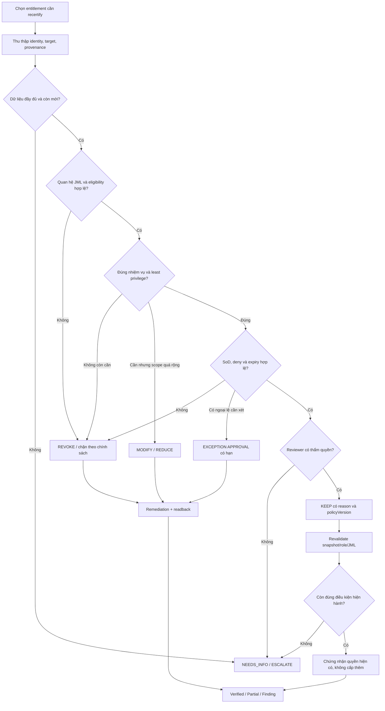

# Xác nhận giữ quyền trong Access Recertification: Quyết định KEEP có căn cứ và có thể kiểm toán

**Xác nhận giữ quyền** (*retain access*, *certify access*, thường được biểu diễn bằng quyết định **KEEP**) là hành động của **người rà soát có thẩm quyền** xác nhận rằng **một quyền truy cập đã được cấp** vẫn **cần thiết, phù hợp công việc, đúng phạm vi, đúng thời hạn và không trái chính sách** tại thời điểm tái chứng nhận quyền (*access recertification*).

Ví dụ, An đang là kiểm toán viên nội bộ và có role `audit-reader` để đọc những báo cáo thuộc đơn vị `org-17`. Trong chiến dịch recertification, người quản lý xác nhận An vẫn phụ trách việc kiểm toán; chủ dữ liệu xác nhận quyền chỉ đọc ở `org-17` là phù hợp; chính sách không phát hiện xung đột nhiệm vụ. Khi đó quyền này có thể nhận **KEEP**. Tuy nhiên, nếu cùng An đang giữ `finance-export-global` cho toàn doanh nghiệp, reviewer **không nên KEEP toàn bộ** chỉ vì An cần đọc báo cáo của một đơn vị. Quyết định đúng có thể là **MODIFY** để giảm phạm vi, hoặc **REVOKE** nếu không còn căn cứ.

Bài thuộc chương **Access recertification** của module `SECURITY_IDENTITY_ACCESS_MANAGEMENT_IDENTITY_LIFECYCLE`, tìm hiểu quản lý vòng đời danh tính theo **Joiner–Mover–Leaver (JML)**: xác minh danh tính, tạo tài khoản và cấp quyền, rà soát khi thay đổi vai trò, thu hồi khi quan hệ kết thúc. Nội dung liên kết **IdP, SSO, SCIM, RBAC/ABAC, tài khoản dịch vụ, kiểm toán và giảm quyền truy cập tồn dư**.

Điểm cốt lõi là: **KEEP là một quyết định tái xác nhận có điều kiện đối với quyền đã tồn tại; nó không tự tạo quyền mới, không tự gia hạn thời hạn đã hết và không vượt qua các chính sách từ chối hoặc sự kiện JML mới hơn.**

Sau bài học, bạn có thể xác định điều kiện KEEP hợp lệ; phân biệt KEEP với GRANT, EXTEND, MODIFY và EXCEPTION; lựa chọn reviewer phù hợp; kiểm tra nguồn cấp và quyền thực; thiết kế luồng quyết định có audit; xử lý snapshot cũ, quyền hết hạn, Mover/Leaver và nhiều grant source; đồng thời kiểm thử recertification để không vô tình tái cấp quyền đã thu hồi.

## 1. Access recertification là gì?

**Access recertification** là việc **xác nhận lại** các quyền đã được cấp theo định kỳ hoặc theo sự kiện. Nếu **access request** thường hỏi “có nên cấp quyền này không?”, thì **recertification** hỏi “quyền đang tồn tại này có còn nên được giữ không?”.

Quyền từng được phê duyệt lúc Joiner có thể không còn cần sau Mover; quyền JIT từng hợp lệ cho một incident có thể đã hết hạn; người rời tổ chức có thể vẫn còn quyền tại một SaaS chưa được deprovision. Vì vậy, recertification giúp phát hiện những quyền không còn căn cứ và củng cố **least privilege**.

### 1.1. Phân biệt các quy trình liên quan

| Quy trình | Câu hỏi chính | Đầu ra |
| --- | --- | --- |
| **Access request** | Có nên cấp hoặc thay đổi quyền được yêu cầu? | Approval, provisioning, verification |
| **Access review** | Những quyền nào đang có và có vấn đề gì? | Inventory, findings, đánh giá |
| **Access recertification** | Quyền hiện có còn được **tái xác nhận** không? | KEEP, REVOKE, MODIFY, ESCALATE hoặc ngoại lệ |
| **Provisioning/deprovisioning** | Hệ thống đích cần cấp/gỡ gì? | Thao tác entitlement qua IdP, SCIM, API |
| **Authorization** | Một request cụ thể có được phép thực hiện? | Permit/Deny tại PDP/PEP |
| **Reconciliation** | Quyền kỳ vọng và quyền thực tế có khớp không? | Findings và xác minh remediation |

Những quy trình này liên quan nhưng **không thay thế nhau**. Một quyền được KEEP trong recertification vẫn phải đi qua chính sách authorization khi sử dụng. Một quyết định REVOKE vẫn cần deprovisioning và readback trước khi tuyên bố quyền đã mất hiệu lực.

### 1.2. Xác nhận giữ quyền đang chứng nhận đối tượng nào?

Một reviewer không nên chỉ chứng nhận một chuỗi tên role mơ hồ. Đối tượng cần được xác định:

- **Chủ thể:** `identityId` hoặc workload principal ID ổn định.
- **Tài khoản đích:** account cụ thể ở IdP, SaaS, DB, cloud hoặc ứng dụng.
- **Entitlement:** role, group, permission, API grant hoặc resource share.
- **Phạm vi:** tenant, dự án, đơn vị, môi trường và tài nguyên.
- **Nguồn cấp:** business role, group, direct grant, approved exception, JIT.
- **Hiệu lực:** thời điểm bắt đầu, kết thúc và trạng thái tài khoản/phiên.
- **Mức rủi ro:** quyền đọc, sửa, export, phê duyệt, admin hay quản lý policy.

Một quyết định KEEP với `report-reader` chỉ có ý nghĩa khi rõ **đọc báo cáo nào, ở tenant nào, bằng tài khoản nào và căn cứ nào**.

## 2. KEEP khác GRANT, RENEW, MODIFY và REVOKE

Đây là phân biệt quan trọng nhất trong bài:

| Hành động | Ý nghĩa | Có tự động tạo/mở rộng quyền không? |
| --- | --- | --- |
| **KEEP / RETAIN / CERTIFY** | Quyền hiện có, với scope hiện tại, vẫn hợp lệ tại thời điểm đánh giá | **Không**; chỉ chứng nhận quyền hiện có |
| **GRANT** | Cấp một quyền chưa tồn tại hoặc chưa được gán | Có, sau phê duyệt và provisioning |
| **RENEW / EXTEND** | Gia hạn hiệu lực một grant có thời hạn | Có thể kéo dài quyền; cần quy trình/chính sách gia hạn riêng |
| **MODIFY / REDUCE** | Điều chỉnh quyền hiện có về scope, mức quyền hoặc thời hạn | Có thay đổi; thường cần entitlement mới và thu hồi phần cũ |
| **REVOKE** | Thu hồi căn cứ cấp quyền không còn hợp lệ | Có thao tác gỡ/chặn và cần xác minh |
| **EXCEPTION** | Cho phép giữ một quyền ngoài quy tắc thông thường theo ngoại lệ có kiểm soát | Chỉ khi được cấp phép đúng quy trình, có owner/scope/expiry |
| **ESCALATE / NEEDS_INFO** | Chưa đủ căn cứ để quyết định | Không được tự coi là KEEP |

**KEEP không phải “Approve request mới” và không phải “re-provision nếu phát hiện quyền thiếu”.** Giả sử reviewer mở snapshot lúc quyền `crm-editor` còn tồn tại, nhưng trước khi reviewer quyết định, quy trình Mover đã gỡ nó. Một thao tác KEEP trên snapshot cũ **không được tự cấp lại** `crm-editor`.

### 2.1. KEEP có làm reset ngày hết hạn không?

**Không mặc định.** Nếu grant `report-export` chỉ hợp lệ đến 17:00 ngày 01/12, quyết định KEEP lúc 15:00 không tự chuyển nó thành grant vô thời hạn. Để gia hạn, cần xác định rõ **căn cứ, thời điểm mới, approval và chính sách**. Đặc biệt với PAM/JIT, review chỉ xác nhận **nhu cầu đủ điều kiện**, không tự mở rộng active session hoặc credential.

### 2.2. KEEP có xóa findings cũ không?

Không nên xóa bằng chứng cũ. Một item đã từng bị phát hiện rủi ro, được giảm phạm vi rồi KEEP ở kỳ sau vẫn phải giữ **lịch sử quyết định và remediation** để kiểm toán biết vì sao thay đổi.

## 3. Tiêu chí để quyết định KEEP hợp lệ

Một quyết định giữ quyền nên dựa trên các **điều kiện tích cực** chứ không chỉ là “không có ai phản đối”.

| Tiêu chí | Câu hỏi cần trả lời | Ví dụ evidence |
| --- | --- | --- |
| **Identity hợp lệ** | Account có gắn đúng người/workload? | Stable identity ID, verified account mapping |
| **Quan hệ còn hiệu lực** | Nhân viên/nhà thầu/đối tác còn đủ điều kiện? | HRIS, contractor registry, `effectiveAt` |
| **Nhu cầu nghiệp vụ** | Người đó còn nhiệm vụ cần quyền này? | Role công việc, task, dự án, owner xác nhận |
| **Đúng entitlement** | Quyền này thực sự cấp khả năng gì? | Role/permission catalog và target mapping |
| **Least privilege** | Có quyền hẹp hơn đủ cho nhiệm vụ không? | Action/resource/scope comparison |
| **Đúng phạm vi** | Tenant, dữ liệu, ứng dụng và môi trường có đúng? | Resource owner, project/tenant assignment |
| **SoD** | Có xung đột role hoặc nghiệp vụ? | SoD matrix, creator/approver checks |
| **Thời hạn** | Grant/approval còn hiệu lực và không quá dài? | `validFrom`, `validUntil`, approval |
| **Owner và reviewer đúng** | Ai có thẩm quyền tái chứng nhận? | Manager, app owner, data owner |
| **Dữ liệu đủ mới** | Snapshot và trạng thái JML có còn phản ánh thực tế? | `snapshotAt`, source version |
| **Không có deny/incident** | Account có bị đình chỉ hoặc đặc quyền bị chặn? | Security restriction, incident state |
| **Nguồn cấp rõ** | Quyền có từ role, group, request hay cấp trực tiếp? | Grant provenance, approval ID |

Nếu thiếu căn cứ quan trọng, quyết định phù hợp thường là **NEEDS_INFO hoặc ESCALATE** thay vì tự KEEP. Nếu đã có **Deny có hiệu lực** hoặc quan hệ đã kết thúc, reviewer không thể biến quyền thành hợp lệ chỉ bằng việc nhấn giữ.

### 3.1. “Đã có quyền từ lâu” không phải lý do đủ

Một quyền có thể tồn tại nhiều năm do phân quyền cũ, không có owner hoặc chưa từng được rà soát. **Lịch sử tồn tại không chứng minh nhu cầu hiện tại**.

### 3.2. “Gần đây có sử dụng” không phải lý do đủ

Một người có thể vẫn sử dụng quyền vì tài khoản đó đang có, dù nhiệm vụ đã chuyển cho người khác. Usage log giúp xác minh hoạt động, nhưng **không thay căn cứ nghiệp vụ và chính sách**.

Ngược lại, quyền ít sử dụng có thể phục vụ khôi phục thảm họa hoặc nhiệm vụ theo quý. Không nên tự REVOKE chỉ vì thiếu log; cần hỏi owner, kiểm tra telemetry và đánh giá khả năng chuyển sang JIT.

### 3.3. Account ACTIVE không chứng minh entitlement hợp lệ

Một nhân viên có thể còn làm việc nhưng **role Sales đã hết căn cứ** sau khi chuyển sang Audit. Trạng thái account ACTIVE không phải bằng chứng để KEEP mọi entitlement.

## 4. Ai có quyền xác nhận giữ quyền?

Reviewer phải **biết vì sao cần quyền** và **có thẩm quyền** đối với phạm vi quyền được review.

| Reviewer | Xác nhận tốt điều gì? | Giới hạn |
| --- | --- | --- |
| **Line manager** | Công việc, đơn vị, dự án, nhu cầu của nhân viên | Có thể không hiểu quyền kỹ thuật chi tiết |
| **Business role owner** | Ý nghĩa và đối tượng đủ điều kiện giữ business role | Không thấy mọi quyền cấp trực tiếp ở ứng dụng |
| **Application owner** | Permission ứng dụng và ảnh hưởng thao tác | Không quyết định một mình tất cả nhu cầu nghiệp vụ |
| **Data owner** | Độ nhạy cảm dữ liệu, tenant, nhóm được phép đọc/export | Không phải người quản lý toàn bộ nhân sự |
| **Security / IAM governance** | Least privilege, SoD, privileged access và ngoại lệ | Không đủ bối cảnh để tự chứng nhận mọi nhiệm vụ |
| **Workload owner** | Job, service principal, API scope, dependency | Phải phối hợp API/target owner |

### 4.1. Hai lớp xác nhận cho quyền rủi ro cao

Ví dụ quyền `finance-export-global`:

1. **Manager:** xác nhận An vẫn cần thực hiện báo cáo.
2. **Data owner:** xác nhận phạm vi `org-17` phù hợp và không cần toàn doanh nghiệp.
3. **Security/IAM:** kiểm tra SoD, policy và đặc quyền.
4. Nếu phạm vi hiện tại quá rộng, outcome là **MODIFY**, không phải KEEP toàn quyền.

Điều này tránh trường hợp manager chỉ hiểu nhiệm vụ nhưng không nhận ra một role chứa thêm quyền xóa dữ liệu hoặc export hàng loạt.

### 4.2. Không tự chứng nhận đặc quyền của chính mình

Khi chính sách yêu cầu reviewer độc lập, người giữ quyền không được tự KEEP quyền admin/SoD-sensitive. Quyền **đề xuất**, **phê duyệt**, **thực thi remediation** và **xem audit** nên được phân tách phù hợp với rủi ro.

### 4.3. Reviewer delegation

Người quản lý nghỉ phép có thể ủy quyền cho người khác theo quy trình, nhưng cần ghi:

- Người ủy quyền và người được ủy quyền.
- Phạm vi user/entitlement và thời hạn delegation.
- Căn cứ, approval, quyền hạn của người nhận.
- Audit xác định **ai thực sự đã chọn KEEP**.

Không chuyển quyền duyệt ngầm cho một account chung hoặc một người không đủ thẩm quyền.

## 5. Dữ liệu cần hiển thị trước nút KEEP

Một màn hình recertification tốt không chỉ đưa tên role và hai nút KEEP/REVOKE. Nó cần đủ thông tin để reviewer **ra quyết định có trách nhiệm**.

| Trường hiển thị | Ví dụ | Giá trị đối với reviewer |
| --- | --- | --- |
| Subject | `iam-user-1042`, An | Người đang giữ quyền |
| Current role/job | `internal-auditor` | Nhiệm vụ hiện hành |
| Target account | `reports-saas:user-735` | Tài khoản đích chính xác |
| Entitlement | `audit-reader` | Quyền được xét |
| Permission impact | `reports.read`, chỉ org-17 | Khả năng thực sự |
| Source | IAM role / group / direct grant | Vì sao có quyền |
| GrantedAt / approver | 01/09, owner A | Căn cứ cấp ban đầu |
| Last reviewed | 01/10 | Lịch sử tái xác nhận |
| ValidUntil | 31/12 | Hạn cuối đang có |
| Risk | Medium / high | Độ nhạy cảm |
| SoD flags | None hoặc conflicting role | Xung đột |
| Last observed usage | 15/11, nếu có | Tín hiệu tham khảo |
| SnapshotAt / freshness | 20/11 02:00 UTC | Độ mới của inventory |
| Target verification state | Present / Unknown | Độ tin cậy trạng thái |

**Không tiết lộ bí mật, token, credential hoặc dữ liệu cá nhân không cần thiết** cho reviewer. Dữ liệu hiển thị phải tuân theo vai trò reviewer và chính sách bảo mật.

### 5.1. Hiển thị quyền ở dạng hiểu được

Nếu một entitlement có tên `APP_FIN_OPER_214`, reviewer khó đánh giá. Nên cung cấp **mô tả nghiệp vụ, action cụ thể và scope**:

```text
Role: APP_FIN_OPER_214
Tên nghiệp vụ: Finance report reader
Tác động: Có thể đọc báo cáo tài chính
Phạm vi: org-17 / monthly-report
Không bao gồm: quyền export, sửa, duyệt chi
Nguồn: finance-readers group
Owner: finance-data-owner
```

Nếu mapping role–permission chưa rõ hoặc thiếu owner, **không mặc định chứng nhận**. Cần điều tra chính sách ứng dụng.

## 6. Assigned access, inherited access và effective access

**Quyền được gán** không luôn đồng nhất **quyền thực tế có thể sử dụng**. Quyết định KEEP cần hiểu các đường cấp:

| Kiểu quyền | Ví dụ | Điểm cần xác nhận |
| --- | --- | --- |
| Direct grant | App owner cấp `crm-editor` trực tiếp | Ai phê duyệt và tại sao ngoài IAM? |
| Group membership | `finance-readers` tại IdP | Group ánh xạ đến quyền gì ở target? |
| Nested group | Group A nằm trong B, B cấp export | Quyền kế thừa có tạo mở rộng không? |
| Role hierarchy | `operator` kế thừa `viewer` | Quyền hiệu lực và SoD có đúng? |
| Resource sharing | Folder/database share riêng | Đã giới hạn đúng object và tenant? |
| PAM eligible | Có thể kích hoạt `prod-admin` | Nhu cầu quyền tiềm năng còn hợp lệ? |
| PAM active/JIT | Quyền đang được kích hoạt | Có task, thời hạn và session phù hợp? |
| Cached token/session | Claim role cũ còn hạn | Có hiệu lực sau Mover/Leaver không? |

Ví dụ:

```text
iam-user-1042
  └── group: reporting-team
       └── nestedGroup: reporting-all-tenants
            └── applicationRole: report-exporter
                 └── permission: reports.export.all
```

Reviewer tưởng chỉ giữ group `reporting-team` có thể vô tình chứng nhận quyền **export toàn tenant**. Cần cho thấy **entitlement được kéo theo** và những nghĩa vụ/giới hạn bổ sung.

### 6.1. Quyết định KEEP ở nguồn nào?

Nếu cùng một permission `reports.read` xuất hiện qua hai grant:

- `grant-100`: business role `audit-reader`.
- `grant-200`: ngoại lệ dự án `PRJ-52` còn hạn.

KEEP `grant-100` **không đồng nghĩa chứng nhận `grant-200`**, và cũng không chứng minh phiên truy cập cũ đã tuân thủ policy. Hệ thống cần liên kết quyết định với **grant source cụ thể**.

### 6.2. Role trong token có thể lỗi thời

Sự kiện Mover gỡ group ở IdP nhưng access token được phát trước đó còn vai trò cũ. Quyền được gán tại IdP đã thay đổi, song API có thể còn chấp nhận claim cũ. Xác nhận KEEP một role không đồng nghĩa xác nhận **mọi session và API path** đều an toàn; với quyền nhạy cảm cần kiểm chứng cơ chế thu hồi ở PEP/API.

## 7. Luồng ra quyết định KEEP theo trạng thái

Một quy trình recertification có thể được mô tả:



Đây là **luồng tham khảo**, không phải một thuật toán bắt buộc của mọi IGA. Với quyền đặc biệt, việc ra quyết định có thể cần nhiều reviewer, bước xét duyệt ngoại lệ hoặc chính sách tự động chặn.

### 7.1. Trạng thái của một item

| Trạng thái item | Ý nghĩa |
| --- | --- |
| `PENDING_REVIEW` | Chưa có quyết định |
| `IN_REVIEW` | Reviewer đang đánh giá |
| `NEEDS_INFO` | Thiếu căn cứ |
| `ESCALATED` | Chờ người có thẩm quyền cao hơn |
| `CERTIFIED_KEEP` | Quyền hiện có được chứng nhận ở snapshot/điều kiện phù hợp |
| `DECIDED_MODIFY` | Cần thay đổi phạm vi |
| `DECIDED_REVOKE` | Cần thu hồi |
| `EXCEPTION_PENDING` | Chờ ngoại lệ được duyệt |
| `REMEDIATION_PENDING` | Công việc sửa/gỡ quyền đang chờ |
| `REMEDIATION_VERIFIED` | Trạng thái đích đã được xác minh |
| `STALE_DECISION` | Quyết định không còn áp dụng vì dữ liệu/quan hệ thay đổi |
| `CLOSED_WITH_FINDING` | Có tồn đọng được chuyển xử lý có owner, SLA |

**CERTIFIED_KEEP là kết quả nghiệp vụ**, không phải một lệnh provisioning và không cần tạo mới permission chỉ vì reviewer đã xác nhận.

### 7.2. Những trường hợp không được auto-KEEP

- Reviewer quá hạn, không phản hồi.
- Snapshot đã lỗi thời hoặc thiếu dữ liệu target.
- Identity mapping chưa được xác minh.
- Quan hệ nhân sự/nhà thầu đã kết thúc.
- Entitlement bị policy Deny hoặc SoD conflict.
- Role có scope không rõ hoặc owner không tồn tại.
- Quyền tạm đã hết `validUntil`.
- Một quyết định KEEP được gửi lại sau khi quyền đã bị thu hồi bởi Mover/Leaver.

**Không phản hồi không phải bằng chứng đồng ý.** Một số doanh nghiệp có thể định nghĩa xử lý tự động khi quá hạn, nhưng đó là **chính sách rủi ro riêng** phải được phê duyệt, ghi lại và không được trình bày như hành động chứng nhận của reviewer chưa phản hồi.

## 8. Quyền KEEP phải gắn với đúng snapshot và version

Một chiến dịch có thể kéo dài nhiều ngày. Trong khoảng đó, nhân viên có thể đổi vai trò, quyền có thể được thu hồi, hoặc role–permission mapping của ứng dụng đã được cập nhật.

Ví dụ:

```text
Ngày 01: Inventory thấy An có crm-editor.
Ngày 02: HR xác nhận An chuyển Sales -> Audit.
Ngày 02: IAM gỡ crm-editor.
Ngày 03: Reviewer mở snapshot cũ và chọn KEEP.
Ngày 04: Workflow phải từ chối dùng KEEP này để tái cấp crm-editor.
```

Nguyên tắc:

1. Quyết định gắn với **subject ID, entitlement ID, target, scope và snapshot/version**.
2. Trước khi ghi nhận KEEP, kiểm tra **trạng thái JML/eligibility hiện hành** nếu dữ liệu có thể đã đổi.
3. Nếu role mapping hoặc resource scope đã thay đổi đáng kể, đánh dấu **STALE/REVIEW_AGAIN**.
4. KEEP không được dùng để **re-provision quyền bị gỡ hợp lệ**.
5. Callback hoặc event cũ không được vượt **Leaver/deny** mới hơn.
6. Idempotency và optimistic concurrency tránh hai reviewer/worker ghi đè lẫn nhau.

### 8.1. Đối tượng quyết định cần định danh bất biến

Ví dụ object:

```json
{
  "campaignId": "recert-2026-q4",
  "reviewItemId": "item-2098",
  "subjectIdentityId": "iam-user-1042",
  "targetAccountRef": "reports-saas/user-735",
  "entitlementRef": "audit-reader",
  "grantRef": "grant-884",
  "resourceScope": ["org-17"],
  "snapshotVersion": 42,
  "policyVersion": "recert-policy-v8",
  "decision": "KEEP",
  "reviewerIdentityId": "iam-manager-17",
  "reasonCode": "CURRENT_JOB_REQUIRES_ACCESS",
  "decidedAt": "2026-11-21T07:12:00Z"
}
```

Đây là **schema minh họa**. `snapshotVersion` cần tham chiếu đúng nội dung đã chứng nhận; nếu người dùng thay entitlement sau quyết định mà không cập nhật version, audit có thể hiểu sai phạm vi.

### 8.2. Cập nhật đồng thời

Nếu Security phát hiện một role vi phạm SoD và ra quyết định REVOKE, còn manager ở snapshot cũ bấm KEEP, workflow không được dùng nguyên tắc “ai ghi cuối thì thắng”. Các hành động phải tuân theo **version, policy precedence và guardrail bảo mật**. Cần ghi cả event bị từ chối vì stale để điều tra.

## 9. KEEP theo RBAC: Vai trò còn hợp lệ chưa?

Trong **Role-Based Access Control (RBAC)**, user được gán role, role được gán permission. Khi recertify, reviewer cần biết:

- **Role definition:** vai trò biểu diễn nhiệm vụ nào?
- **Permission mapping:** role hiện cấp chính xác những khả năng gì?
- **Eligibility:** user còn đủ điều kiện theo công việc/HR không?
- **Assignment provenance:** gán qua business role, group hay trực tiếp?
- **Role hierarchy:** quyền được kế thừa có phù hợp không?
- **SoD:** role kết hợp với role khác có gây xung đột?
- **EffectiveAt/validUntil:** thời gian hiệu lực còn hợp lệ?
- **Owner:** ai có quyền duyệt KEEP role này?

### 9.1. Ví dụ về role cần giữ

An là kiểm toán viên, có `audit-reader` gồm `reports.read` và `audit.log.read` ở đúng đơn vị. Manager xác nhận nhiệm vụ, app owner xác nhận permission mapping, policy không có deny. **KEEP** có thể hợp lệ.

### 9.2. Ví dụ về role phải giảm

Role `audit-admin` có cả `reports.read` và `audit.policy.modify`. An chỉ cần đọc dữ liệu. **Không nên KEEP** role admin để tránh thay đổi quyền; lựa chọn tốt hơn là **MODIFY** sang role chỉ đọc, kiểm chứng khả năng phục vụ công việc và gỡ role rộng.

### 9.3. Static role không có nghĩa cấp suốt đời

Một static role có tập quyền được định nghĩa trước, nhưng **assignment với user phải thay đổi theo JML**. Recertification là bước kiểm tra rằng assignment vẫn còn căn cứ, không phải lý do đóng băng quyền cũ bất chấp chức năng thay đổi.

## 10. KEEP theo ABAC/PBAC: Scope và điều kiện còn đúng?

**ABAC** đánh giá subject, action, resource, environment; **PBAC** tổ chức và thực thi các quy tắc này. Với quyền nghiệp vụ, chỉ role còn phù hợp chưa chắc đủ để KEEP toàn bộ phạm vi.

Ví dụ chính sách ở API:

```text
PERMIT reports.read khi:
    subject.employmentStatus == ACTIVE
    AND subject có role audit-reader
    AND resource.tenantId thuộc subject.allowedTenantIds
    AND resource.classification <= subject.clearance
    AND session đáp ứng chính sách xác thực
    AND không có deny hoặc SoD có hiệu lực
```

Reviewer cần phân biệt:

- **KEEP role** vì chức năng `reports.read` còn cần.
- **MODIFY tenant scope** nếu `allowedTenantIds` đang chứa nhiều tenant không còn phụ trách.
- **REVOKE access** nếu chủ thể không còn quan hệ hợp lệ.
- **ESCALATE** nếu classification/clearance thiếu căn cứ.

**Quyết định KEEP ở IAM không thay authorization tại PEP/API.** Nếu API bỏ qua điều kiện tenant, reviewer có thể chứng nhận role đúng nhưng hệ thống vẫn lộ dữ liệu ngoài phạm vi. Cần kiểm thử effective access và sửa policy/PEP khi phát hiện lỗi.

## 11. SoD: Quyền còn cần nhưng không được giữ cùng một số quyền khác

**Separation of Duties (SoD)** ngăn một chủ thể có thể hoàn thành toàn bộ chuỗi thao tác rủi ro mà không có kiểm soát độc lập.

| Quyền A | Quyền B | Rủi ro |
| --- | --- | --- |
| `invoice.create` | `invoice.approve` | Tự tạo rồi tự duyệt hóa đơn |
| `vendor.create` | `payment.execute` | Tạo nhà cung cấp và tự trả tiền |
| `access.request.approve` | `access.grant.admin` | Tự duyệt và tự cấp quyền |
| `audit.log.modify` | `security.control.disable` | Vô hiệu hóa bảo vệ và sửa dấu vết |

Một quyền có thể **riêng lẻ hợp lệ** nhưng **không thể KEEP đồng thời** với quyền khác.

### 11.1. Static, dynamic và object-level SoD

- **Static SoD:** cấm gán đồng thời role/quyền xung đột.
- **Dynamic SoD:** cấm kích hoạt đồng thời theo phiên/ngữ cảnh khi hệ thống hỗ trợ.
- **Object-level SoD:** cấm một người duyệt giao dịch do chính mình tạo, kể cả role Maker đã bị gỡ hoặc thay phiên.

Ví dụ An từng tạo `payment-782`, nay có role phê duyệt. KEEP `payment-approver` chỉ có thể hợp lệ nếu chính sách và API còn **chặn self-approval** trên giao dịch đó. Nếu tổ chức cấm hoàn toàn tổ hợp vai trò, phải giải quyết ở assignment, không trì hoãn vì đã có reviewer đồng ý.

### 11.2. Reviewer KEEP không được vượt guardrail

Một reviewer có thể xác nhận nhu cầu công việc nhưng **không có quyền bỏ qua** chính sách SoD bắt buộc. Phải chuyển sang quy trình ngoại lệ được phép, thay đổi nhiệm vụ hoặc thu hồi phần quyền xung đột.

## 12. Quyền trực tiếp, group lồng nhau và nhiều nguồn cấp

Một quyền có thể đến từ nhiều nguồn:

```text
Identity An
  ├── IAM business role: audit-reader ----> reports.read
  ├── Project grant: PRJ-52 -------------> reports.read
  └── Nested group: legacy-finance ------> reports.export
```

Nếu reviewer KEEP `audit-reader`, điều đó **không chứng nhận** grant từ `PRJ-52` hoặc `legacy-finance`. Trong một số UI, các quyền được gộp thành một dòng “reports access”; cần có khả năng mở rộng chi tiết để biết đường cấp và phạm vi.

### 12.1. Quy tắc grant provenance

Lưu nguồn cấp như:

| Trường | Ví dụ | Vai trò |
| --- | --- | --- |
| `grantId` | `grant-884` | Khóa assignment cụ thể |
| `sourceType` | `BUSINESS_ROLE`, `DIRECT`, `JIT` | Con đường cấp |
| `sourceRef` | `AR-2048` | Request/approval/task |
| `targetId` | `reports-saas` | Hệ thống đích |
| `entitlementRef` | `reports.read` | Quyền |
| `scope` | `org-17` | Phạm vi |
| `validUntil` | 31/12 | Hạn |
| `owner` | `data-owner-29` | Người chịu trách nhiệm |

Nếu chỉ KEEP business role còn direct grant `reports.export` không có owner, campaign không thể tự công bố toàn bộ quyền An đã được chứng nhận.

### 12.2. Nếu quyền đã biến mất trước quyết định KEEP?

**Không khôi phục nó chỉ vì snapshot cũ chứa quyền.** Cần xác định tại sao quyền mất, policy mới, JML event mới hoặc thay đổi grant source. Nếu công việc thực sự cần cấp lại, hãy dùng **Access Request mới** với phê duyệt/provisioning độc lập thay vì biến recertification thành grant ngầm.

## 13. KEEP với quyền có thời hạn, JIT và PAM

Quyền đặc quyền hoặc quyền theo dự án thường **có ngày hết hạn**. Quyết định KEEP cần xác định có đang:

1. Chứng nhận **eligibility** được quyền xin kích hoạt.
2. Chứng nhận **active assignment** đang được cấp.
3. Xin **gia hạn grant**.
4. Xin **kích hoạt phiên JIT**.

Đây là **bốn hành động khác nhau**.

| Tình huống | Quyết định phù hợp | Không được suy ra |
| --- | --- | --- |
| Role PAM eligible còn cần cho on-call | KEEP eligibility nếu chính sách cho phép | Session production đang active vô thời hạn |
| JIT grant hết hạn sau incident | REVOKE/expire đúng thời điểm | KEEP để kéo dài phiên cũ |
| Phê duyệt dự án sắp hết hạn nhưng nhiệm vụ kéo dài | RENEW theo workflow riêng | Được tự gia hạn vì reviewer KEEP |
| Privileged role rộng hơn nhu cầu | MODIFY sang scope hẹp hoặc JIT | KEEP quyền admin thường trực do tiện |
| Credential khẩn cấp được quản lý | Kiểm tra owner, bảo vệ và rotation | Giữ mã chia sẻ không truy vết |

### 13.1. Standing privilege và JIT

Một role `prod-deployer` có thể được định nghĩa cố định nhưng chỉ **kích hoạt qua PAM/JIT theo change ticket**. Reviewer có thể KEEP khả năng được **xin quyền theo quy trình**, nhưng không có cơ sở để cấp sẵn `prod-admin` cho user 24/7.

### 13.2. Token, session và grant có vòng đời khác nhau

Dù assignment đã hết hạn, access token tự chứa hoặc session cục bộ có thể vẫn hoạt động. Việc chứng nhận hoặc thu hồi phải xét **khả năng chặn quyền ở PEP, token lifetime, introspection, session invalidation và quyền đích** phù hợp với rủi ro. Không đồng nhất “đã gỡ nhóm IdP” với “không còn bất kỳ quyền hiệu lực nào”.

## 14. Xác nhận giữ quyền trong Joiner

Ở giai đoạn **Joiner**, nhiều quyền được cấp theo onboarding policy. Recertification có thể được dùng để xác nhận **role cơ sở đã cấp đúng nhiệm vụ và đúng thời điểm**, nhất là ngoại lệ có rủi ro cao.

| Trường hợp | Câu hỏi review | Kết quả |
| --- | --- | --- |
| Account được pre-provision trước ngày nhận việc | Đã đến `effectiveAt` chưa? | Không KEEP quyền hoạt động quá sớm |
| Role `employee-basic` | Người mới có quan hệ HR hợp lệ và cần portal? | Có thể KEEP |
| Role `sales-agent` | Đã được phân công bán hàng tại vùng phù hợp? | KEEP role/scope phù hợp |
| Role `global-admin` tự động xuất hiện | Có căn cứ đặc quyền riêng không? | REVOKE/ESCALATE |
| App account chưa tồn tại | Có phải lỗi provisioning? | Không dùng KEEP để tự cấp grant |

**Xác nhận giữ quyền không thay kiểm tra provisioning ban đầu.** Nếu Joiner chưa được cấp đúng role, cần xử lý access request/assignment phù hợp, không đánh dấu KEEP cho entitlement chưa có.

## 15. Xác nhận giữ quyền trong Mover

**Mover** xảy ra khi danh tính chuyển phòng ban, vai trò, dự án, đơn vị hoặc thay tư cách làm việc. Đây là trường hợp nguy hiểm vì quyền cũ có thể **vẫn tồn tại** dù nhiệm vụ đã thay.

Ví dụ An chuyển từ Sales sang Audit:

| Quyền | Trước Mover | Nhu cầu hiện tại | Quyết định |
| --- | --- | --- | --- |
| `employee-basic` | Có | Vẫn là nhân viên | KEEP |
| `sales-agent` | Có | Không còn Sales | REVOKE |
| `crm-editor` direct | Có | Không còn cần sửa CRM | REVOKE |
| `audit-reader` | Có | Đúng nhiệm vụ kiểm toán | KEEP |
| `report-export-global` | Có | Chỉ cần đọc `org-17` | MODIFY |
| `prod-operator` eligible | Có | Không còn nhiệm vụ vận hành | REVOKE |

### 15.1. Không chuyển mọi quyền thành KEEP vì manager mới chưa hiểu

Manager mới có thể không biết tên kỹ thuật của role cũ. Nếu thiếu mô tả hoặc owner, **ESCALATE** để app owner/Security xác minh. Không dùng KEEP mặc định để giữ mọi quyền khi chuyển nhân sự.

### 15.2. Thu hồi theo JML không chờ recertification

Nếu HR xác nhận Mover ngày 01/11, hệ thống nên gỡ quyền Sales theo chính sách **ngay khi có hiệu lực**, không chờ chiến dịch quý sau. Recertification là lớp **xác minh và phát hiện quyền còn sót**, không phải cơ chế trì hoãn thu hồi.

### 15.3. KEEP sau Mover phải dùng context mới

Nếu snapshot chụp trước ngày Mover, reviewer không được xác nhận căn cứ trên chức năng cũ. Cần cập nhật thông tin HR, manager, đơn vị, task và role mapping trước khi đưa quyết định.

## 16. Xác nhận giữ quyền trong Leaver

**Leaver** làm chấm dứt căn cứ truy cập từ quan hệ đã kết thúc. Nếu account/quyền còn ở đích, đó là **finding cần offboarding**, không phải một entitlement có thể KEEP chỉ vì từng có approval.

Các kiểm tra liên quan:

1. Trạng thái HR/contractor và `effectiveAt` đã được xác minh?
2. Đăng nhập mới ở IdP/directory đã bị chặn?
3. Group/application role đã bị deprovision qua SCIM/API?
4. Có local account, direct grant hoặc tài khoản phụ còn active không?
5. Session, refresh token, access token, SSH key hoặc PAM grant còn dùng được?
6. Những quyền từ quan hệ độc lập khác có còn căn cứ và owner rõ không?
7. Đã đọc lại trạng thái đích, xử lý remediation tồn đọng chưa?

**Không được dùng nút KEEP để phủ quyết Leaver đã có hiệu lực.** Nếu doanh nghiệp xác nhận một người còn quan hệ đối tác độc lập, phải **tách nguồn quyền theo quan hệ** và kiểm tra eligibility riêng; không gộp mọi quyền của hợp đồng cũ vào quan hệ mới.

### 16.1. Leaver xảy ra sau khi reviewer chọn KEEP

```text
10:00 Reviewer KEEP role reports.read của An.
11:00 HR xác nhận Leaver effectiveAt=11:00.
11:01 IAM phải chặn quyền theo Leaver.
11:10 Worker recertification nhận callback KEEP muộn.
11:10 Không được khôi phục role hoặc phiên từ quyết định cũ.
```

**Sự kiện JML mới hơn có thẩm quyền phải được xử lý theo chính sách**, không bị callback KEEP lỗi thời vô hiệu hóa.

### 16.2. Rehire

Khi người quay lại, identity cần được xác minh và entitlement tính theo vai trò mới. **KEEP từ kỳ làm việc trước không phải căn cứ tự động phục hồi** role, approval hoặc đặc quyền cũ.

## 17. Nhà thầu, đối tác và nhiều quan hệ hợp lệ

Không phải mọi chủ thể đều thuộc một bản ghi nhân sự truyền thống. Nhà thầu có **sponsor**, hợp đồng và ngày hết hạn; đối tác có thể có tenant/quyền theo dự án.

| Tình huống | Điều kiện KEEP cần xác minh |
| --- | --- |
| Nhà thầu gia hạn hợp đồng | Gia hạn đã được nguồn có thẩm quyền ghi nhận và được sponsor duyệt |
| Đối tác đổi dự án | Project mới còn cần entitlement, scope có đổi không? |
| Sponsor nghỉ việc | Ai có thẩm quyền tiếp quản và review? |
| Một người có hai hợp đồng | Quyền nào bắt nguồn từ hợp đồng nào? |
| Account không có HR record | Có nguồn authority khác hay là orphan identity? |
| Quyền dự án đã hết hạn | Không tự gia hạn bởi KEEP |

**Không có HR record không luôn đồng nghĩa Leaver**, vì doanh nghiệp có thể quản lý đối tác ở nguồn riêng. Nhưng nếu không xác định được nguồn quan hệ hoặc owner đáng tin, nên **ESCALATE/UNKNOWN**, không giả định quyền có căn cứ.

## 18. Xác nhận giữ quyền cho tài khoản dịch vụ và workload

**Service account, service principal, CI/CD runner và workload identity** không có “chức danh nhân viên” theo nghĩa thông thường. Reviewer thường là **owner hệ thống, workload owner và API/resource owner**, không phải manager HR của principal máy.

| Câu hỏi | Ví dụ evidence |
| --- | --- |
| Workload còn được sử dụng không? | Deployment, job schedule, owner xác nhận |
| Nó dùng để làm gì? | `report-sync-prod` tạo báo cáo hàng ngày |
| Scope thực sự cần? | `reports.write` của `org-17` |
| Có quyền thừa? | `tenant.admin` nhưng chỉ cần ghi báo cáo |
| Credential còn hợp lệ? | Rotation, certificate/secret expiry, workload federation |
| Ai chịu trách nhiệm? | Team owner và kỹ sư trực vận hành |
| Có phụ thuộc nếu thu hồi? | Downstream services và kế hoạch chuyển đổi |
| Có kế hoạch decommission? | Ngày ngừng job và readback quyền đích |

Ví dụ `report-sync-prod` đang có quyền `tenant.admin`. Vì workload chỉ cần `reports.write`, quyết định hợp lý là **MODIFY**, thu hẹp scope và kiểm thử job, không KEEP quyền rộng chỉ vì “job vẫn chạy tốt”.

### 18.1. Owner nghỉ việc

Khi người từng sở hữu workload Leaver, cần **chuyển owner, kiểm tra dependency, luân chuyển credential có thể đã biết và rà soát API grants**. Không xóa tự động mọi service principal đang phục vụ hệ thống hợp lệ, cũng không KEEP workload không còn owner vô hạn.

### 18.2. App-only token không chứng minh quyền người dùng

Nếu backend dùng OAuth Client Credentials để gọi API, đó là **quyền của workload**. Khi người dùng yêu cầu backend thực hiện một thao tác nghiệp vụ, backend cần kiểm tra quyền người dùng riêng; không lấy KEEP quyền app-only làm căn cứ cho mọi hành động của người dùng (*confused deputy*).

## 19. Ngoại lệ: Khi cần giữ quyền vượt baseline

Đôi khi công việc khẩn hoặc chuyển giao đòi giữ một quyền ngoài baseline. Khi đó không nên gán KEEP thông thường rồi bỏ qua policy. Cần **EXCEPTION** có quy trình quản trị rõ.

Một ngoại lệ nên gồm:

- Identity/workload và target được xác minh.
- Quyền, action, resource scope cụ thể.
- Mục đích, task/change/ticket và owner.
- Lý do không thể dùng quyền hẹp hơn.
- Phê duyệt đủ thẩm quyền và tách biệt khi cần.
- `validFrom`, `validUntil`, tự hết hạn hoặc điều kiện chấm dứt.
- Kiểm soát bù trừ: MFA mạnh, session monitoring, dual control, audit.
- Review sau sử dụng và kiểm chứng thu hồi.

**Break-glass không đồng nghĩa quyền admin vĩnh viễn.** Một ngoại lệ khẩn không nên biến thành một KEEP mơ hồ mỗi kỳ để giữ đặc quyền mà không giải thích được rủi ro và thời hạn.

### 19.1. Khi không thể chứng nhận

Nếu dữ liệu nguồn không đủ để biết thực sự role cấp những quyền gì, hoặc owner không xác định, quyết định đúng là **NEEDS_INFO/ESCALATE** với SLA. Với quyền có rủi ro nghiêm trọng, có thể cần hạn chế tạm theo chính sách trong lúc điều tra.

## 20. Evidence của một quyết định KEEP

Một bản ghi tái chứng nhận phải giải thích được **ai, quyền gì, ở đâu, vì sao, theo policy nào và dựa trên dữ liệu lúc nào**.

Ví dụ **YAML thiết kế**, không phải schema bắt buộc của sản phẩm IGA:

```yaml
campaignId: recert-q4-2026
itemId: recert-item-2098
subject:
  identityId: iam-user-1042
  relationshipType: employee
  employmentStatus: ACTIVE
target:
  systemId: reporting-saas
  accountId: reports-user-735
  entitlementId: audit-reader
  resourceScope:
    - org-17
grant:
  grantId: grant-884
  grantSource: IAM_BUSINESS_ROLE
  validUntil: "2026-12-31T17:00:00Z"
snapshot:
  collectedAt: "2026-11-20T02:00:00Z"
  version: 42
review:
  decision: KEEP
  reasonCode: CURRENT_AUDIT_ASSIGNMENT
  reviewerIdentityId: iam-manager-17
  decidedAt: "2026-11-21T07:12:00Z"
  policyVersion: recert-policy-v8
  reviewerAuthorityVerified: true
  sodCheck: PASS
postDecision:
  action: NO_NEW_GRANT
  effectiveUntilUnchanged: true
  revalidation: PASSED
```

**Không lưu token, mật khẩu, client secret, cookie, MFA seed hoặc toàn bộ hồ sơ HR** trong quyết định recertification. Dùng ID và tham chiếu có kiểm soát khi cần truy lại evidence.

### 20.1. Phân biệt timestamp

| Thời điểm | Ý nghĩa |
| --- | --- |
| `snapshotAt` | Lúc inventory được thu thập |
| `reviewAssignedAt` | Lúc giao item cho reviewer |
| `decidedAt` | Lúc reviewer chọn KEEP |
| `revalidatedAt` | Lúc hệ thống xác minh điều kiện còn đúng |
| `grantExpiresAt` | Lúc grant hết thời hạn hiệu lực |
| `nextReviewDueAt` | Mốc review tiếp theo theo policy |
| `revokedAt` | Lúc gửi/thực hiện thu hồi nếu cần |
| `revokeVerifiedAt` | Lúc xác nhận quyền đã hết ở target |

**Ngày recertification mới không tự trở thành ngày hết hạn grant mới.** Đây là hai loại thời gian có ý nghĩa khác nhau.

## 21. Ghi nhận KEEP một cách an toàn trong workflow

### 21.1. Pseudocode

```text
certifyKeep(reviewItemId, reviewer, expectedVersion):
    item = loadReviewItem(reviewItemId)

    require(item.version == expectedVersion)
    require(item.status IN {PENDING_REVIEW, IN_REVIEW})
    require(reviewerIsAuthorized(reviewer, item))
    require(not prohibitedSelfCertification(reviewer, item))

    snapshot = loadTrustedSnapshot(item)
    require(snapshot.identityMappingVerified)
    require(snapshot.completeAndFreshForRisk)
    require(item.entitlementAndScopeMatch(snapshot))

    lifecycle = readCurrentTrustedLifecycle(item.subjectIdentityId)
    require(lifecycleAllowsEntitlement(lifecycle, item))

    currentGrant = readCurrentGrantProvenance(item.grantId)
    require(currentGrant.existsAndIsValid)
    require(currentGrant.entitlementScopeMatches(item))
    require(not currentGrant.expired)

    policy = loadCurrentApplicablePolicy(item)
    require(noApplicableDenyOrSoDConflict(policy, item, lifecycle))
    require(businessJustificationIsSufficient(item, reviewer))

    atomically:
        appendImmutableDecisionEvent(
            decision = KEEP,
            actor = reviewer.identityId,
            scope = item.scope,
            policyVersion = policy.version,
            snapshotVersion = snapshot.version
        )
        updateReviewItemVersionAndStatus(CERTIFIED_KEEP)

    // KHÔNG phát lệnh ADD_ROLE, CREATE_GRANT hoặc EXTEND_EXPIRY
    return CERTIFIED_KEEP
```

Đây là **giả mã minh họa**, không phải implementation của một IGA thực tế. Những hệ thống cho phép owner sửa thời hạn khi chọn KEEP cần coi đó là **gia hạn có kiểm soát** và xác định approval riêng; không âm thầm đổi `validUntil`.

### 21.2. Vì sao cần so sánh version?

Hai reviewer hoặc worker có thể thao tác trên cùng item. Nếu Security đã REVOKE vì SoD nhưng manager ở snapshot cũ chọn KEEP, **last-write-wins** có thể làm mất quyết định an toàn. Dùng **optimistic concurrency / compare-and-swap**, policy precedence và audit để từ chối stale update.

### 21.3. Không gửi side effect không cần thiết

KEEP đối với entitlement hiện có thường cần ghi **decision/evidence**, không phải gọi connector để “đảm bảo quyền có tồn tại”. Nếu quyền đã bị gỡ bởi Mover hay incident, tự động add lại sẽ tạo **regrant trái chính sách**. Quyền thật sự thiếu nhưng vẫn cần phải đi qua **access request mới hoặc remediation có thẩm quyền**, kiểm tra JML và SoD.

## 22. Sau KEEP, hệ thống có cần làm gì nữa không?

Không phải KEEP là hoàn toàn không có công việc tiếp theo. Một số tác vụ có thể gồm:

- Lưu audit và **reason code**.
- Ghi nhận reviewer đã hoàn thành item.
- Cập nhật **mốc review tiếp theo** nếu policy cho phép, không tự gia hạn grant.
- Kiểm tra snapshot còn đúng, lập finding khi role mapping thay đổi.
- Xác nhận các **ràng buộc/obligation** vẫn được thực thi ở ứng dụng.
- Mở công việc **MODIFY** nếu reviewer giữ nhu cầu nghiệp vụ nhưng muốn giảm scope.
- Đề xuất JIT thay vì standing privilege trong kỳ tiếp theo.
- Báo cáo quyền chưa được chứng nhận hoặc đang chờ owner.

**KEEP không có nghĩa tất cả hành động theo sau phải là NO-OP**, nhưng **không được biến thành cấp thêm quyền mà reviewer chưa phê duyệt**.

### 22.1. KEEP nhiều item có thể đóng campaign chưa?

Campaign có thể có 100 item KEEP và 20 item REVOKE chưa thực thi. **Quyết định review đã hoàn tất** không có nghĩa **remediation đã hoàn tất**. Báo cáo phải phân biệt hai chỉ số và các finding tồn đọng.

## 23. Remediation khi không đủ điều kiện KEEP

Một quy trình đáng tin phải xử lý các kết quả thay thế:

| Finding | Decision | Hành động tiếp theo |
| --- | --- | --- |
| Không còn công việc liên quan | REVOKE | Gỡ grant hoặc assignment, readback |
| Còn cần nhưng scope rộng | MODIFY | Cấp quyền hẹp phù hợp, gỡ phần rộng, xác minh |
| Role có xung đột SoD | REVOKE/ESCALATE | Quyết định theo policy, không giữ mù quáng |
| Không có owner | ESCALATE | Tìm owner, kiểm tra rủi ro và deadline |
| Quyền đã hết hạn | EXPIRED/REVOKE | Xử lý grant lifecycle, không KEEP để gia hạn |
| Data snapshot thiếu | NEEDS_INFO | Bổ sung inventory, không chứng nhận trên dữ liệu thiếu |
| User đã Leaver | REVOKE/OFFBOARD | Chặn truy cập, xử lý session/credential |
| Quyền có đường cấp ngoài IAM | RECONCILE | Tìm provenance, không kết luận từ group IdP |
| Cần giữ ngoài baseline có căn cứ hợp lệ | EXCEPTION | Owner, approval, scope, expiry và compensating controls |

### 23.1. Desired – Observed – Effective Access

Nên phân biệt:

- **Desired access:** quyền được phép có theo HR, policy, role, task và approval.
- **Observed access:** account/group/role thực tế hệ thống đích ghi nhận.
- **Effective access:** hành động người dùng thực sự được phép thực hiện ở API, phiên và tài nguyên.

Quyết định REVOKE chỉ hoàn tất khi **trạng thái đích cần thiết được xác minh**. Nếu một session cũ vẫn cho phép action nhạy cảm, cần xử lý token/session hoặc PEP theo khả năng nền tảng. Trạng thái `connector success` không đồng nghĩa `effective access denied`.

### 23.2. Quyền có nhiều căn cứ cấp

Một entitlement được yêu cầu bởi hai role hợp lệ có thể không mất khi gỡ một role. Phải tính lại tập quyền mong đợi từ **toàn bộ grant source** để tránh **gỡ nhầm quyền vẫn cần** hoặc **giữ quyền không còn căn cứ**. Nếu mục tiêu là loại bỏ hoàn toàn một permission, cần xử lý mọi đường cấp hợp lệ/không hợp lệ liên quan.

## 24. Kiểm soát chất lượng khi reviewer chọn KEEP hàng loạt

Một nút **KEEP ALL** có thể phù hợp trong phạm vi role cơ sở rủi ro thấp đã có evidence tốt, nhưng rất dễ gây **review fatigue** và “rubber-stamping” khi dùng cho đặc quyền nhạy cảm.

Dấu hiệu nên theo dõi:

- Reviewer KEEP hàng trăm item trong vài giây.
- Tất cả entitlement, kể cả admin/SoD conflict, đều nhận cùng một lý do chung.
- Quyền không có owner hoặc thiếu thông tin vẫn được KEEP.
- Snapshot đã hết freshness yêu cầu nhưng UI không cảnh báo.
- Manager luôn KEEP dù nhân viên có Mover.
- Direct grant ngoài catalog không được xem chi tiết.
- Role rất rộng được chứng nhận chỉ vì “đã dùng gần đây”.
- Quyền đã hết hạn nhưng mốc `validUntil` được gia hạn tự động khi KEEP.

Biện pháp:

1. **Ưu tiên review theo rủi ro:** quyền cao cần đánh giá từng mục và lý do chi tiết.
2. **Hiển thị tác động thực:** role còn chứa những permission nào?
3. **Bắt buộc reason code + justification** với quyền nhạy cảm.
4. **Hạn chế bulk action** hoặc yêu cầu xác nhận bổ sung cho tập quyền có rủi ro.
5. **Đánh giá mẫu sau campaign** để tìm quyết định chưa đủ căn cứ.
6. **Giữ audit** của hoạt động thao tác nhanh, delegation và override.
7. **Không dùng quá hạn như bằng chứng Keep mặc định** khi chính sách yêu cầu attestation rõ ràng.

**Mục tiêu không phải ép reviewer bấm nhiều hơn**, mà là khiến quyết định có đủ dữ liệu để đúng và kiểm toán được.

## 25. Chỉ số đo chất lượng xác nhận giữ quyền

| Chỉ số | Ý nghĩa |
| --- | --- |
| **KEEP rate theo risk tier** | Phát hiện tỷ lệ giữ bất thường ở quyền rủi ro cao |
| **KEEP with sufficient justification** | Bao nhiêu quyết định có căn cứ cụ thể |
| **Stale KEEP decisions blocked** | Quyết định lỗi thời bị chặn trước khi gây regrant |
| **KEEP of expired grants** | Lỗi giữ/gia hạn quyền tạm trái chính sách |
| **Privileged standing access retained** | Tỷ lệ đặc quyền lâu dài sau review |
| **SoD conflicts certified** | Chỉ báo sai quy trình hoặc policy cần xử lý |
| **Unknown/incomplete entitlement items** | Độ phủ dữ liệu còn thiếu |
| **Review completion rate** | Tiến độ có quyết định |
| **Remediation verification rate** | Tỷ lệ sửa/gỡ đã được xác minh |
| **Unowned rights retained** | Quyền không rõ owner vẫn được giữ |
| **Role-to-permission drift** | Quyền thực tế khác catalog đã duyệt |
| **Post-Mover excess access** | Quyền từ vai trò cũ còn tồn dư |
| **Post-Leaver residual access** | Quyền/phiên vẫn hoạt động sau offboarding |
| **Regrant after revoke** | Quyền đã bị gỡ nhưng bị cấp lại ngoài căn cứ |
| **Reviewer bulk-KEEP anomalies** | Dấu hiệu rubber-stamping |
| **Time to resolve escalations** | Khả năng xử lý item không đủ căn cứ |

Không nên đánh giá chiến dịch bằng **KEEP rate càng cao càng tốt**. Một tỷ lệ KEEP rất cao có thể chỉ phản ánh role nền phù hợp, nhưng cũng có thể là dấu hiệu đánh giá qua loa. Phải phân tích **risk, coverage, evidence và remediation**.

## 26. Tình huống thực hành: Bốn quyết định khác nhau cho cùng một user

Giả sử An hiện là nhân viên kiểm toán tại `org-17`. Trước đây An làm ở Sales; tài khoản sử dụng SSO và một số SaaS vẫn có direct grant.

| Item | Observed | Nhu cầu hiện tại | Quyết định |
| --- | --- | --- | --- |
| `employee-basic` | Group IdP | Cần dùng portal | KEEP |
| `audit-reader/org-17` | IAM business role | Cần đọc báo cáo của đơn vị | KEEP |
| `crm-editor` | Group Sales cũ | Không còn nhiệm vụ Sales | REVOKE |
| `finance-export-global` | SaaS direct grant | Chỉ cần báo cáo `org-17` | MODIFY |
| `prod-operator` eligible | PAM | Không còn on-call production | REVOKE |
| `legacy-local-admin` | Account local | Chưa xác định owner/mapping | ESCALATE |

### Bước 1 — Giữ quyền cơ sở

Manager kiểm tra An ACTIVE, cần portal và role không vượt baseline. `employee-basic` nhận **KEEP**, ghi reason code, không tạo grant mới.

### Bước 2 — Giữ role audit theo scope

Manager xác nhận nhiệm vụ, data owner kiểm tra `org-17`, IAM kiểm tra SoD và version. `audit-reader/org-17` có thể **KEEP**. Nếu role bị mở rộng ngầm thành đọc mọi tenant trong khi reviewer không biết, quyết định phải được **đánh giá lại**.

### Bước 3 — Thu hồi Sales

`crm-editor` không còn căn cứ. Workflow gỡ role/group và kiểm tra target; nếu access token chứa claim Sales vẫn còn hiệu lực ở API, hệ thống không được ghi “đã chặn hoàn toàn” trước khi xử lý theo chính sách.

### Bước 4 — Giảm quyền export

Data owner không KEEP `finance-export-global`. Workflow cấp permission cho `org-17` nếu cần, xác minh tác vụ được phép và gỡ role global. Thứ tự triển khai phải xét SoD và rủi ro, không tự cấp cả quyền cũ và mới lâu dài.

### Bước 5 — Xử lý PAM và local account

`prod-operator` không còn nhu cầu nên REVOKE eligibility/active session theo policy. `legacy-local-admin` thiếu identity mapping rõ, vì vậy **ESCALATE** tới target owner; không chứng nhận hay gỡ mù quáng.

### Bước 6 — Tách kết quả review với remediation

```text
Review decisions:
  employee-basic          KEEP
  audit-reader/org-17     KEEP
  crm-editor              REVOKE
  finance-export-global   MODIFY
  prod-operator           REVOKE
  legacy-local-admin      ESCALATE

Remediation after first run:
  crm-editor              VERIFIED_REVOKED
  finance-export-global   PENDING_TARGET_READBACK
  prod-operator           ELIGIBILITY_REMOVED / SESSION_UNKNOWN
  legacy-local-admin      OWNER_INVESTIGATION_OPEN

Conclusion:
  DECISIONS_RECORDED = TRUE
  REMEDIATION_COMPLETE = FALSE
```

**Hai quyết định KEEP hợp lệ không làm chiến dịch hoàn tất** khi những quyền phải sửa/gỡ vẫn còn tồn đọng. Reviewer và IAM cần theo dõi finding đến lúc có evidence hoặc ngoại lệ được duyệt.

## 27. Các edge case cần suy xét

### 27.1. KEEP cho entitlement chưa được provision

Không hợp lệ như một attestation về **quyền đang tồn tại**. Nếu quyền cần nhưng target thiếu, chuyển sang **Access Request hoặc provisioning remediation có phê duyệt**, kiểm tra trạng thái hiện hành và xác minh sau cấp.

### 27.2. KEEP trên snapshot sau khi user đổi manager

Cần xác minh reviewer còn thẩm quyền. Manager cũ có thể đã mất quyền duyệt ở thời điểm quyết định; không tự chấp nhận phê duyệt từ người không còn thẩm quyền.

### 27.3. Hai reviewer không đồng ý

Manager cho KEEP, data owner cho REVOKE. Hệ thống phải áp **approval policy và conflict resolution** được thiết kế, không chọn ngẫu nhiên hay lấy timestamp mới nhất làm kết quả. Với quyền rủi ro cao, Deny/guardrail có thể có ưu tiên bắt buộc.

### 27.4. Role đã thay permission mapping

Role vẫn tên `audit-reader` nhưng ứng dụng bổ sung `reports.export` vào role. KEEP dựa trên ý nghĩa cũ không chứng nhận quyền export mới. Cần **review lại tác động của role** theo catalog/policy version hiện hành.

### 27.5. User có hai quan hệ hợp lệ

Người dùng vừa là nhà thầu dự án A và đối tác dự án B. Khi A kết thúc, phải thu hồi grant thuộc A; có thể KEEP những grant độc lập của B sau khi xác minh. Không mặc định xóa hết hoặc giữ hết.

### 27.6. Target không cho readback quyền

Nếu ứng dụng không hỗ trợ API kiểm tra, dùng quy trình thủ công có owner, bằng chứng có kiểm soát và mức độ tin cậy được ghi nhận. Không tự gắn VERIFIED chỉ nhờ gửi request thành công.

### 27.7. Đã KEEP nhưng user Leaver ngay sau đó

Quyết định KEEP không ràng buộc quyền tồn tại đến kỳ review sau. **Leaver event** vẫn phải chặn và thu hồi theo chính sách, kể cả khi KEEP mới được ký vài phút trước.

### 27.8. Hệ thống tự regrant sau REVOKE

Một role provisioning rule có thể tự gán lại entitlement từ nguồn HR/IdP cũ. Cần sửa **nguồn cấp và desired state**, không chỉ gỡ một lần ở SaaS; nếu không, quyết định recertification không có hiệu lực lâu dài.

### 27.9. Có quyền nhưng không rõ account thuộc ai

Không KEEP dựa vào tên/email. Cần xác minh mapping, chủ account và nguồn danh tính. Với orphan đặc quyền, áp quy trình xử lý rủi ro phù hợp.

### 27.10. Quyền “không dùng” nhưng phục vụ DR

Cần owner xác nhận nhu cầu đặc biệt, cân nhắc role **eligible/JIT** và thời gian kích hoạt thay vì giữ standing privilege toàn thời gian. Nếu vẫn KEEP, phải giải thích và áp kiểm soát bù trừ.

## 28. Ma trận kiểm thử cho quyết định KEEP

| Test case | Kết quả mong đợi |
| --- | --- |
| User ACTIVE, đúng nhiệm vụ/scope, owner phê duyệt | KEEP với evidence |
| User không còn chức năng cũ sau Mover | Không KEEP quyền cũ |
| User Leaver nhưng reviewer bấm KEEP | Chặn/stale, không regrant |
| Role đã bị revoke trước callback KEEP | Không cấp lại entitlement |
| Quyền đã hết `validUntil` | Không gia hạn ngầm |
| Reviewer không đủ thẩm quyền | Từ chối decision hoặc ESCALATE |
| Reviewer tự KEEP quyền nhạy cảm trái policy | Chặn self-certification |
| Role gây SoD conflict | Không KEEP trái guardrail |
| Scope rộng hơn nhu cầu | MODIFY/REVOKE, không KEEP nguyên quyền |
| App role mapping thay đổi sau snapshot | Đánh dấu stale/re-review |
| Snapshot dữ liệu thiếu pagination | Không chứng nhận là complete |
| Direct grant ngoài IAM không owner | NEEDS_INFO/ESCALATE |
| Cùng permission có hai grant | KEEP/REVOKE đúng nguồn, không suy nhầm effective access |
| PAM eligible nhưng không active | Đưa vào recertification theo rủi ro |
| JIT active session quá hạn | Không kéo dài bằng KEEP |
| Workload có owner và scope tối thiểu | KEEP theo purpose + credential lifecycle |
| Workload không còn deployment | Decommission/REVOKE sau kiểm tra dependency |
| Hai reviewer quyết định trái nhau | Áp conflict policy, không last-write-wins |
| Reviewer bulk KEEP quyền high-risk | Audit/cảnh báo hoặc chặn theo policy |
| Connector báo success nhưng target còn quyền sau REVOKE | Chưa remediation verified |
| User rehire với role mới | Không phục hồi quyền từ KEEP cũ |
| API chưa kiểm tra tenant | Fix PEP/policy, KEEP role không đủ |
| Security Deny mới xuất hiện | Không lấy KEEP cũ vượt Deny |
| Quyền vẫn cần nhưng chưa tồn tại | Access Request mới, không biến KEEP thành GRANT |

**Không chỉ kiểm thử nhãn quyết định.** Cần kiểm tra **audit, eligibility, lifecycle, trạng thái target, session và PEP** trên những đường truy cập có rủi ro cao.

## 29. Checklist thực hiện xác nhận giữ quyền

1. Quyền được review có **subject, account, entitlement, scope và grant source** chính xác không?
2. Đã kiểm tra identity mapping và quan hệ HR/contractor/workload hiện hành chưa?
3. Role/permission có **mô tả tác động thực sự**, không chỉ tên kỹ thuật khó hiểu không?
4. Snapshot đủ mới, đúng target và đầy đủ pagination/tenant chưa?
5. Reviewer có thẩm quyền, hiểu nghiệp vụ và độc lập khi cần không?
6. Có lý do tích cực rằng công việc **vẫn cần** entitlement này không?
7. Có thể dùng quyền hẹp hơn theo **least privilege** không?
8. SoD, tenant isolation, data classification và policy Deny có được kiểm tra không?
9. Quyền có `validUntil`, grant/approval còn hiệu lực và không bị auto-extend không?
10. Có phân biệt **KEEP với GRANT, RENEW và EXCEPTION** không?
11. Quyền được gán trực tiếp, qua group, role kế thừa hay PAM/JIT có provenance rõ không?
12. Với quyền đặc quyền, có owner, session/credential policy và cân nhắc JIT không?
13. Với workload, có purpose, dependency, owner, scope API và credential lifecycle không?
14. Quyết định có gắn policy version, snapshot version và timestamp không?
15. Nếu xuất hiện Mover/Leaver hoặc deny mới, có chặn KEEP stale/regrant không?
16. Quyết định REVOKE/MODIFY có remediation và readback, không dừng ở click reviewer không?
17. Campaign có tách completion của **review decisions** và **verified remediation** không?
18. Audit có reason code đủ giải thích nhưng không chứa secrets/PII không?
19. Có thống kê dấu hiệu bulk KEEP, quyền không owner và ngoại lệ quá hạn không?
20. Người dùng có thể hiểu rõ rằng KEEP không đồng nghĩa quyền sẽ tồn tại mãi không?

## 30. Câu hỏi tự kiểm tra

**Câu 1.** Manager chọn KEEP cho quyền `audit-reader`. Quyết định này có phải cấp lại role cho user không?

**Trả lời:** Không. KEEP là **xác nhận giữ quyền đang tồn tại** trong scope đã review. Nếu quyền đã bị gỡ, cần phân tích lý do và dùng workflow cấp quyền hợp lệ nếu còn nhu cầu; không tự regrant từ KEEP.

**Câu 2.** Quyền đặc quyền hết hạn ngày mai. Reviewer KEEP hôm nay có làm quyền tự kéo dài thêm một quý không?

**Trả lời:** Không. **Gia hạn (RENEW/EXTEND)** là quyết định riêng, phải đáp ứng quy trình và giới hạn thời gian theo policy. KEEP không tự sửa `validUntil`.

**Câu 3.** Nhân viên vẫn ACTIVE nhưng vừa chuyển từ Sales sang Audit. Có đủ căn cứ KEEP `crm-editor` không?

**Trả lời:** Không chỉ vì ACTIVE. Cần chứng minh vẫn có nhiệm vụ CRM hợp lệ; nếu không, REVOKE quyền cũ theo Mover.

**Câu 4.** Một role có quyền `reports.read` nhưng cũng cho export toàn tenant. Nhân viên chỉ cần đọc một đơn vị. Nên KEEP cả role không?

**Trả lời:** Không. Nên cân nhắc **MODIFY/REDUCE** sang role/phạm vi hẹp, xác minh trước/sau và gỡ quyền rộng.

**Câu 5.** Reviewer KEEP quyền vào ngày 01, nhưng ngày 02 HR báo Leaver. Quyết định KEEP còn là căn cứ giữ quyền sau Leaver không?

**Trả lời:** Không. Leaver có hiệu lực làm mất căn cứ liên quan; phải chặn, thu hồi và đối soát theo chính sách, không dựa vào KEEP trước đó.

**Câu 6.** Reviewer không biết entitlement `APP_FIN_214` thực sự cấp quyền gì. Có nên chọn KEEP cho nhanh?

**Trả lời:** Không. Cần role/permission mapping, owner và tác động thực tế; chọn NEEDS_INFO/ESCALATE khi chưa đủ evidence.

**Câu 7.** Một permission có từ hai grant. KEEP một grant có chứng nhận cả permission hiệu lực qua nguồn kia không?

**Trả lời:** Không. Decision phải gắn với **nguồn/assignment được review**. Quyền còn được grant khác cấp có vòng đời và căn cứ riêng.

**Câu 8.** Một service principal đang chạy job production nhưng có quyền `tenant.admin`. Có đủ lý do KEEP chỉ vì job không lỗi không?

**Trả lời:** Không. Phải xác định **permission tối thiểu** cho job, cân nhắc MODIFY scope, review owner/credential và kiểm thử dependency trước thay đổi.

**Câu 9.** Campaign có 100% item được KEEP hoặc REVOKE, nhưng các yêu cầu REVOKE chưa xử lý ở SaaS. Có thể báo đã hoàn toàn khắc phục không?

**Trả lời:** Không. **Decision completion khác remediation verification completion**. Cần theo dõi target operation và xác minh quyền đã biến mất.

**Câu 10.** Một user đã mất role sau Mover, nhưng callback KEEP cũ vừa đến. Hệ thống phải làm gì?

**Trả lời:** Kiểm tra snapshot/version và trạng thái JML hiện hành; **từ chối regrant**, ghi stale decision và yêu cầu review mới nếu thực sự cần quyền.

## Kết luận

**Xác nhận giữ quyền (KEEP) trong Access Recertification là một quyết định có căn cứ về việc tiếp tục duy trì một entitlement hiện có, đúng người, đúng nhiệm vụ, đúng phạm vi và đúng thời hạn.** Một quyết định hợp lệ cần **reviewer đủ thẩm quyền, dữ liệu đáng tin và còn mới, grant provenance rõ ràng, kiểm tra least privilege, SoD và chính sách hiện hành**. KEEP **không tự cấp lại quyền đã bị thu hồi, không tự gia hạn grant tạm và không vượt trạng thái Mover/Leaver**. Khi quyền không còn phù hợp, reviewer phải chọn REVOKE, MODIFY, ESCALATE hoặc ngoại lệ được duyệt, đồng thời theo dõi remediation đến lúc target và quyền hiệu lực được xác minh. Kết nối recertification với **IdP/SSO, SCIM, RBAC/ABAC/PBAC, PAM, workload identity và kiểm toán** giúp giảm quyền tồn dư trong **Joiner–Mover–Leaver** mà vẫn bảo đảm người có nhiệm vụ hợp lệ giữ được **đúng quyền thực sự cần thiết**.
