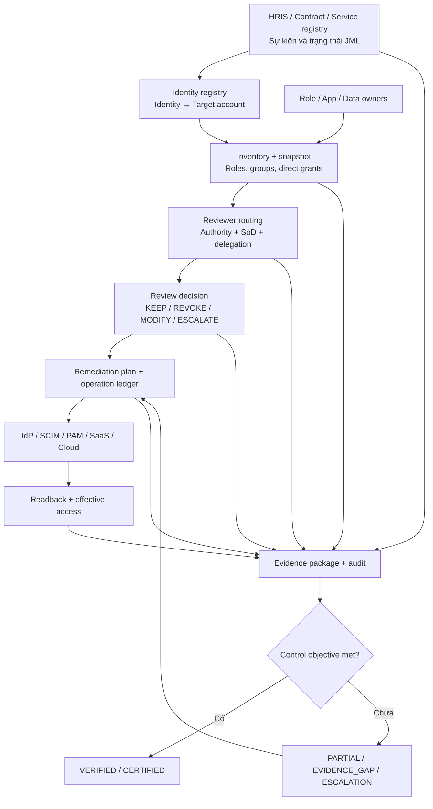
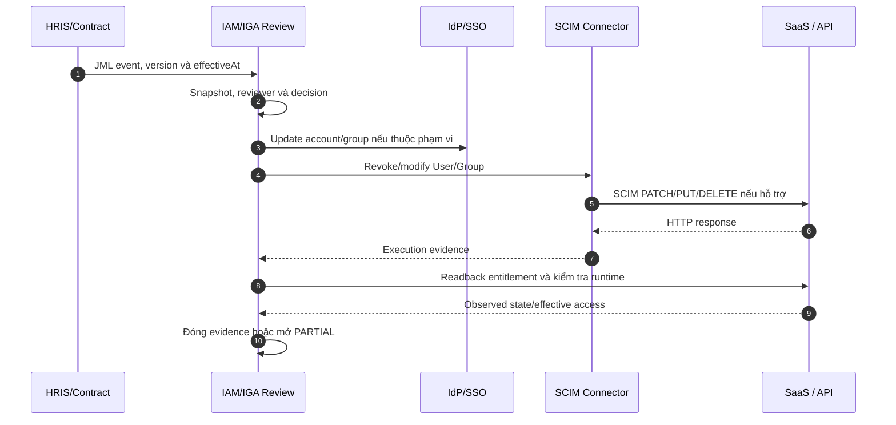

# Bằng chứng recertification trong quản lý vòng đời danh tính IAM

## 1. Bằng chứng recertification là gì?

**Bằng chứng recertification** (*access recertification evidence*) là tập thông tin có thể kiểm tra và truy nguyên, chứng minh rằng **quyền truy cập đã được đưa vào phạm vi rà soát, giao đúng người có thẩm quyền đánh giá, nhận quyết định hợp lệ và được xử lý đến trạng thái mong muốn**. Trong nhiều hệ thống, recertification còn được gọi là **access certification**, **periodic access review** hoặc **user access review**.

Một bằng chứng tốt phải trả lời được các câu hỏi: **quyền nào**, của **chủ thể nào**, trên **tài nguyên nào**, **tại thời điểm nào**, do **ai và với thẩm quyền gì** xác nhận, căn cứ vào **dữ liệu nguồn nào**, kết quả là **KEEP, REVOKE, MODIFY hay ngoại lệ**, và sau đó **quyền thực tế đã thay đổi ra sao**.

Ví dụ: một nhân viên vừa chuyển từ Sales sang Finance. Manager chọn `REVOKE` cho quyền `customer:export` trong chiến dịch quý. Hệ thống ghi `decision=REVOKE` là **bằng chứng quyết định**; nhưng để chứng minh rủi ro đã được xử lý, còn cần bằng chứng **connector thực thi**, **SCIM Group hoặc direct grant được gỡ**, và **API ứng dụng không còn cho phép xuất dữ liệu** theo chính sách. Nếu mục cuối chưa được xác minh, kết luận phải là **remediation chưa hoàn tất**, dù chiến dịch đã có đủ chữ ký.

Trong module **SECURITY_IDENTITY_ACCESS_MANAGEMENT_IDENTITY_LIFECYCLE**, bằng chứng recertification liên quan trực tiếp đến quản lý danh tính theo **Joiner–Mover–Leaver (JML)**: xác minh, tạo tài khoản, cấp quyền, rà soát khi đổi vai trò và thu hồi khi nghỉ việc hoặc hết quan hệ. Hệ thống có thể liên kết **HRIS, IdP, SSO, SCIM, RBAC/ABAC, IAM/IGA, PAM, tài khoản dịch vụ, dữ liệu kiểm toán** và mục tiêu giảm **quyền truy cập tồn dư**.

Sau bài này, người đọc có thể thiết kế **chuỗi bằng chứng đầu-cuối**, phân biệt quyết định với thực thi, thu thập snapshot đúng và đủ, kiểm chứng reviewer và SoD, bảo vệ tính toàn vẹn/tính riêng tư, tổ chức hồ sơ để kiểm toán và đo việc thu hồi đã **thật sự có hiệu lực**.

> **Nguyên tắc:** mục đích không phải tạo nhiều ảnh chụp màn hình; mục đích là tạo **bằng chứng đáng tin, đúng phạm vi, có nguồn gốc, có thời điểm, liên kết được với quyết định và đủ để tái kiểm tra kết luận**.

## 2. Phân biệt evidence, log, report và lời xác nhận

Nhiều chương trình access review gặp vấn đề vì sử dụng các khái niệm khác nhau như thể tương đương.

| Loại thông tin | Ví dụ | Giá trị | Giới hạn |
| --- | --- | --- | --- |
| **Source record** | HRIS xác nhận nhân viên đã Mover, contract hết hạn | Chứng minh căn cứ vòng đời | Không chứng minh ứng dụng đã đổi quyền |
| **Inventory/snapshot** | Danh sách User/Group/role tại `observedAt` | Chứng minh tập quyền tại mốc thu thập | Có thể thiếu direct grant hoặc chứa dữ liệu cũ |
| **Reviewer assignment** | Task giao cho data owner hợp lệ | Chứng minh ai được yêu cầu đánh giá | Không chứng minh người đó đã quyết định |
| **Reviewer decision** | `REVOKE`, lý do và chữ ký/identity reviewer | Chứng minh kết luận quản trị | Không chứng minh target đã thu hồi |
| **Execution log** | Connector gửi SCIM PATCH, nhận HTTP `204` | Chứng minh có thao tác và phản hồi | Không chứng minh mọi quyền hiệu lực đã hết |
| **Readback/observation** | GET Group/role tại target cho thấy membership đã mất | Chứng minh một nguồn trạng thái thực tế | Có thể chưa bao gồm phiên/token hoặc đường cấp khác |
| **Runtime authorization test** | API từ chối thao tác đã thu hồi | Chứng minh hành vi chặn tại điểm thực thi | Chỉ trong scope và thời điểm kiểm thử |
| **Campaign summary** | 99% review items có quyết định | Hữu ích quản trị tiến độ | Dễ che 1% item có rủi ro rất cao |
| **Screenshot** | Hình trang phê duyệt hoặc thành viên nhóm | Dễ xem bằng mắt | Khó chứng minh tính đầy đủ, thời gian và nguồn |
| **Audit evidence package** | Bộ record + liên kết + phiên bản + kiểm tra toàn vẹn | Có thể truy nguyên nhiều lớp | Phải bảo vệ dữ liệu và xác minh nguồn |

**Một log không tự là bằng chứng đầy đủ.** Nó trở thành một phần của evidence khi có **ngữ cảnh, danh tính hệ thống sinh, chính sách, mốc thời gian, tính toàn vẹn và mối liên kết với mục tiêu kiểm soát**.

Ví dụ `request succeeded` không đủ để chứng minh `finance-admin` đã bị gỡ; cần biết request nào, actor/target nào, version nào và quyền có thể tiếp tục xuất hiện từ nguồn nào khác.

## 3. Mục tiêu kiểm soát cần được chứng minh

Trước khi chọn trường dữ liệu, cần định nghĩa **control objective**. Không nên thu thập dữ liệu vì “auditor có thể sẽ cần”, rồi mới tìm cách giải thích sau.

| Mục tiêu | Câu hỏi kiểm toán | Bằng chứng cốt lõi |
| --- | --- | --- |
| **Completeness** | Mọi account/entitlement thuộc phạm vi đã được đưa vào review chưa? | Scope, inventory nguồn, kiểm kê direct grants và kết quả reconciliation |
| **Accuracy** | Danh tính, role, scope và dữ liệu owner có đúng không? | Identity correlation, version/snapshot, target IDs |
| **Authorization** | Người quyết định có thẩm quyền ở thời điểm quyết định không? | Reviewer assignment, authority source, SoD và delegation |
| **Timeliness** | Review và remediation có đúng deadline/SLA không? | Mốc hiệu lực, due date, timestamps, exception |
| **Least privilege** | Quyền được giữ có phù hợp nhu cầu và mức tối thiểu không? | Role catalog, scope, business justification, risk assessment |
| **SoD compliance** | Có xung đột hoặc self-review trái policy không? | SoD findings, reviewer independence, quyết định ngoại lệ |
| **Execution** | Quyết định REVOKE/MODIFY đã được thực thi chưa? | Operation IDs, connector response, readback |
| **Effective access** | Quyền tại ứng dụng/PEP còn hay đã bị chặn? | Runtime check và quyền có hiệu lực từ các đường cấp |
| **Traceability** | Có thể nối từ sự kiện nguồn đến kết luận cuối không? | Stable IDs, correlation IDs, policy/source versions |
| **Integrity/privacy** | Bằng chứng có bị sửa, mất hoặc lộ dữ liệu không? | Access controls, checksums/signatures, retention/audit |

Một bộ dữ liệu có thể đáp ứng **completeness của danh sách nhóm IdP** nhưng chưa đủ **completeness của quyền ứng dụng** nếu role được cấp trực tiếp trong SaaS. Cần viết chính xác **phạm vi mà từng bằng chứng hỗ trợ**.

**Tính kịp thời** cũng không có một con số mặc định cho mọi tổ chức. Review quyền đọc thông thường có chu kỳ khác quyền cloud admin, tài chính hoặc tài khoản người đã Leaver; deadline/SLA phải đến từ policy nội bộ và nghĩa vụ tuân thủ thực tế.

## 4. Chuỗi bằng chứng đầu-cuối: source → decision → enforcement

Một access recertification đáng tin gồm nhiều lớp dữ liệu; mỗi lớp phải có **mốc thời gian, nguồn, identity/resource ID và ID tương quan**.



**Phân biệt hai cách dùng từ “Certified”:** một số công cụ coi `CERTIFIED` là *reviewer đã xác nhận quyền nên giữ*, trong khi chương trình quản trị có thể dùng `VERIFIED` cho việc thu hồi đã thành công. Tổ chức phải định nghĩa enum và báo cáo riêng, không dùng một trạng thái chung để che quyết định và remediation.

### Ba liên kết không được đứt

1. **Identity linkage:** `identityId` chuẩn → `accountId` đích → `User/Group/role` thực tế.
2. **Authority linkage:** `reviewItemId` → reviewer được giao → source thẩm quyền → quyết định/ngoại lệ.
3. **Execution linkage:** quyết định `REVOKE/MODIFY` → job/connector → target resource → readback/runtime result.

Nếu chỉ có hình chụp từng màn hình mà không nối được các khóa này, khó chứng minh rằng ảnh “đã gỡ quyền” thực sự thuộc **đúng tài khoản của quyết định**.

## 5. Phạm vi recertification và bằng chứng tính đầy đủ

Trước khi review, phải nêu rõ **đối tượng nào được bao phủ**: ứng dụng, tenant, vai trò, nhóm, loại tài khoản, quyền đặc quyền, tài nguyên nhạy cảm, địa bàn/pháp nhân, thời gian và ngoại lệ.

Một **scope manifest** có thể bao gồm:

- `campaignId`, `scopeVersion`, `policyVersion`, người duyệt phạm vi và ngày hiệu lực.
- Danh sách `targetSystemIds`, tenant/subscription/project được thu thập.
- Các `identityTypes`: employee, contractor, guest, privileged account, service/workload.
- Danh mục entitlement: RBAC roles, group memberships, direct grants, cloud IAM, PAM eligibility/activation, tài khoản local.
- Các loại trừ **có lý do** như tài khoản máy không thuộc hệ thống đó, thay vì loại trừ mơ hồ “other”.
- Phạm vi các resource/data classifications và SoD constraints.
- Điểm cắt snapshot, SLA chốt review và SLA thu hồi sau quyết định.
- Chủ sở hữu nguồn dữ liệu, connector version và tình trạng các nguồn.

### Tính đầy đủ không chỉ là số lượng dòng

Giả sử IAM phát hiện 4.000 group memberships, nhưng ứng dụng có thêm 160 direct grants. Nếu campaign chỉ thu group, tỷ lệ `4.000/4.000 = 100%` **không chứng minh đủ entitlement**. Phải so với **tập quyền có hiệu lực hoặc tập các nguồn cấp đã xác định**, và ghi rõ hệ thống chưa thể quan sát nếu tồn tại.

| Dữ liệu cần đối chiếu | Bằng chứng hữu ích | Cách diễn giải |
| --- | --- | --- |
| Identity registry vs target accounts | Account discovery + stable identity mapping | Account orphan/duplicate có được vào scope? |
| IdP groups vs SaaS role assignments | Group sync output + API inventory | Có direct role không đi qua IdP? |
| HRIS Leavers vs active accounts | Leaver list tại mốc + IdP/SaaS states | Người nghỉ vẫn còn quyền không? |
| PAM registry vs cloud admin roles | PAM eligible/active + cloud IAM inventory | Admin trực tiếp ngoài PAM có được phát hiện? |
| Role catalog vs effective entitlements | Role mapping version và target observed | Role đã retired nhưng còn member/quyền không? |

Một **reconciliation report** giải thích được các chênh lệch quan trọng thường có giá trị hơn việc xuất một tập CSV lớn không biết đã bỏ sót nguồn nào.

## 6. Bằng chứng snapshot: lấy đúng lúc và chứng minh nguồn

**Snapshot** là ảnh chụp logic của trạng thái quyền tại một thời điểm hoặc cửa sổ thu thập. Nó là điểm khởi đầu cho review, không phải một lời cam kết quyền sẽ không đổi suốt chiến dịch.

Một snapshot có thể cần:

| Trường | Mục đích |
| --- | --- |
| `snapshotId`, `campaignId` | Gắn dữ liệu với đúng lần thu thập |
| `sourceSystemId`, `tenantId` | Chứng minh phạm vi đọc |
| `collectionStartedAt`, `collectedAt` | Biết thời gian thực tế lấy dữ liệu |
| `sourceRevision` hoặc cursor | So sánh phiên bản/cửa sổ biến đổi khi hệ thống hỗ trợ |
| `connectorVersion`, `queryParameters` | Có thể tái kiểm tra logic lấy quyền |
| `identityId`, `providerAccountId` | Tương quan người và account |
| `entitlementId`, `scope`, `grantSource` | Biết quyền gì, từ đâu |
| `totalDiscovered`, `totalIncluded`, `excludedCount` | Kiểm tra population completeness |
| `collectionStatus`, `limitations` | Ghi nhận nguồn lỗi/partial |
| `artifactHash`, `storageRef` | Kiểm chứng tính toàn vẹn bản snapshot |

**Không tự coi snapshot nhiều trang là nhất quán tuyệt đối.** Khi API dùng pagination và dữ liệu thay đổi giữa các lần gọi, danh sách có thể bị bỏ sót/trùng. Cần dùng snapshot isolation/cursor nếu provider hỗ trợ, hoặc cơ chế reconciliation sau thu thập; nếu không thể, ghi độ lệch thời gian và giới hạn.

### Ví dụ chênh lệch ngày

- `2026-11-01`: snapshot thấy User A thuộc `sales-exporters`.
- `2026-11-05`: HRIS phát Mover sang Finance và IAM gỡ quyền.
- `2026-11-23`: reviewer mở item từ snapshot cũ.

Reviewer có thể xác nhận **quyền đã bị thu hồi** dựa trên readback, không nên bấm KEEP chỉ vì ảnh snapshot còn quyền. Nếu cần đánh giá nhu cầu hiện tại, phải làm mới nguồn nghiệp vụ và effective access.

## 7. Bằng chứng định danh: đúng chủ thể, đúng tài khoản

Một quyết định review chỉ hữu ích khi đối tượng được review chính xác. **Email, displayName, username hoặc DN có thể đổi hoặc tái sử dụng**, do đó không nên dùng làm khóa chứng minh duy nhất.

Một **identity binding** tốt liên kết:

```text
Canonical identityId: id-518
  ├─ HR person key: hr-person-8201
  ├─ IdP subject: (issuer=https://idp.example.test, sub=u-518)
  ├─ SaaS SCIM User.id: sp-user-518
  ├─ SaaS externalId: id-518-from-connector
  ├─ Privileged account ID: adm-518
  └─ CRM local account ID: crm-account-991
```

Các giá trị là **dữ liệu minh họa**. `externalId` trong SCIM thường do client cung cấp cho mục tiêu tương quan, trong khi `id` của SCIM resource do provider quản lý. **Không giả định mọi hệ thống đích có cùng identity ID** hoặc uniqueness toàn cầu.

### Những trường hợp phải lưu bằng chứng liên kết đặc biệt

- Người dùng đổi tên, email hoặc username.
- Một người có account thường và account đặc quyền.
- Contractor chuyển sang employee hoặc rehire.
- Guest từ IdP bên ngoài có local account ở tổ chức tiếp nhận.
- Một service account đổi owner hoặc tên service.
- Hai account cùng email nhưng khác tenant hoặc khác thời kỳ quan hệ.

Nếu mapping **không rõ hoặc mâu thuẫn**, đừng chọn account đầu tiên rồi báo review PASS. Chuyển `IDENTITY_CORRELATION_UNRESOLVED` và điều tra trước khi quyết định/thu hồi.

## 8. Bằng chứng quyền có hiệu lực: role, group và direct grant

**Effective access** là quyền thực sự có thể được sử dụng sau khi tính cả role, nhóm lồng nhau, direct grants, resource-based policy, ABAC conditions, deny rules, PAM sessions và những đường truy cập khác.

Một bản ghi `User A ∈ Group B` không đủ để kết luận A có quyền gì, hoặc khi gỡ Group B A sẽ mất hoàn toàn quyền ấy.

Ví dụ:

```text
Observed assignment at campaign snapshot:
  User: id-518
  IdP group: finance-readers
  SaaS role: REPORT_VIEWER
  Nested group: legacy-finance -> EXPORTER
  Direct SaaS entitlement: payment-approve
  PAM eligibility: PROD_SUPPORT_ADMIN

Desired state after Mover:
  REPORT_VIEWER scoped to legalEntity=VN

Review findings:
  legacy-finance -> EXPORTER = excess
  payment-approve = SoD conflict
  PROD_SUPPORT_ADMIN = no longer job-related
```

### Chứng minh provenance

Mỗi entitlement nên có thông tin **grant source**, ví dụ `IGA_ROLE_MAPPING`, `IDP_GROUP_SYNC`, `DIRECT_ADMIN`, `PAM_ELIGIBILITY`, `CLOUD_POLICY` hoặc `LOCAL_ACCOUNT`.

Khi reviewer chọn `REVOKE`, connector phải biết **nguồn thực sự cấp quyền**. Gỡ một nhóm không xử lý được direct grant; xóa một direct grant có thể vô tình làm mất quyền đang có căn cứ từ chính sách khác nếu mapping được thiết kế không đúng.

### Bằng chứng từ ABAC/PBAC

Một role `report-reader` chỉ cho phép dữ liệu pháp nhân `VN` nếu policy ABAC kiểm tra `resource.legalEntity=VN`. Bằng chứng cần ghi **scope và policy version**, không chỉ role name. Với authorization theo điều kiện, có thể cần **policy evaluation trace hoặc test kết quả** trên tài nguyên đại diện, theo quyền được phép quan sát.

**Không công khai nguyên văn mọi policy nhạy cảm** cho tất cả reviewer; cung cấp mức giải thích đủ quyết định và lưu bản đầy đủ ở kho chứng cứ có kiểm soát.

## 9. Bằng chứng phân công reviewer và thẩm quyền phê duyệt

Một người bấm `KEEP` chưa đủ chứng minh quyết định hợp lệ nếu người đó **không phải reviewer có thẩm quyền**.

Hồ sơ reviewer assignment nên lưu:

- `assignmentId`, `reviewItemId`, `campaignId`, review stage.
- Reviewer được giao ban đầu và reviewer thực sự đưa quyết định.
- Loại thẩm quyền: manager, role owner, data owner, app owner, sponsor, service owner, Security/SoD authority.
- `authoritySource`: HRIS, role catalog, app catalog, contract registry hay delegation registry.
- `authorityScope`: tenant, app, resource class, role hoặc pháp nhân.
- `assignmentPolicyVersion`, nguồn dữ liệu và thời điểm hiệu lực.
- Kết quả kiểm tra **ACTIVE**, mối quan hệ quản lý, độc lập và conflict.
- Delegation chain, người duyệt delegation, hạn và phạm vi khi có.
- Thời điểm phân công, reassign, hết hạn, escalation và lịch sử task.

### Authority tại hai thời điểm

**Lúc giao task:** reviewer có thẩm quyền được chọn từ dữ liệu đáng tin.

**Lúc ký quyết định:** phải kiểm tra lại reviewer **vẫn có thẩm quyền** trong phạm vi đó. Trong thời gian campaign diễn ra, reviewer có thể bị Leaver hoặc đổi phòng ban; quyết định từ link email cũ không được chấp nhận chỉ vì assignment trước đó từng hợp lệ.

**Không dùng một shared reviewer account** để đóng hàng trăm item nếu không thể truy nguyên actor. Một nhóm reviewer có thể nhận task, nhưng **effective reviewer identity** vẫn cần được ghi nhận khi có người thực sự quyết định.

## 10. Bằng chứng về quyết định: KEEP, REVOKE, MODIFY, ESCALATE

Một quyết định cần rõ **đối tượng, kết quả, căn cứ và phạm vi**, đồng thời phân biệt quyết định với trạng thái thực thi.

| Decision | Ý nghĩa bằng chứng | Bước tiếp theo |
| --- | --- | --- |
| **KEEP/CERTIFY** | Reviewer có thẩm quyền xác nhận quyền đang có còn cần và phù hợp | Lưu căn cứ, scope, hạn; không tự tạo quyền mới |
| **REVOKE** | Quyền không còn cần hoặc không được phép | Điều phối thu hồi và xác minh target |
| **MODIFY** | Cần quyền nhưng role/scope/TTL hiện tại quá rộng hoặc sai | Tạo kế hoạch thay đổi theo chính sách |
| **ESCALATE** | Không đủ thẩm quyền hoặc tồn tại rủi ro/xung đột | Giao reviewer/control owner có authority |
| **NEEDS_INFO** | Thiếu dữ liệu để đưa kết luận | Bổ sung bằng chứng, chưa certify |
| **EXCEPTION** | Chấp nhận rủi ro/ngoại lệ có điều kiện theo policy | Owner, biện pháp bù, thời hạn và tái duyệt |
| **NO_DECISION/OVERDUE** | Chưa có quyết định hợp lệ | Nhắc/escalate; không mặc định KEEP |

### Lý do quyết định phải có nội dung

Một `KEEP` cho quyền đọc báo cáo chung có thể chỉ cần reason code và business role phù hợp. Nhưng một `KEEP` cho `production-admin` hoặc `payment-release` thường cần **justification có liên hệ nhiệm vụ, scope, thời hạn, owner và kiểm soát bổ sung**.

Bằng chứng tốt nêu:

- Reviewer xác nhận **người đó cần làm công việc gì**.
- Entitlement/role nào đáp ứng việc đó và **ở phạm vi nào**.
- Có SoD conflict hoặc yêu cầu phê duyệt độc lập không.
- Có thể dùng quyền ít hơn/JIT thay vì standing access không.
- Decision có hiệu lực theo chính sách nào và cần xem lại vào thời điểm nào.

**Không cho `KEEP` phát sinh grant khi quyền hiện tại chưa có.** Access recertification chứng nhận quyền đang tồn tại; việc cấp mới cần đi qua access request/approval/provisioning tương ứng.

## 11. Bằng chứng quyết định nhiều cấp và xử lý xung đột

Với quyền rủi ro cao, một chiến dịch có thể yêu cầu **manager xác nhận business need**, **data owner xác nhận scope**, và **Security/PAM owner xác nhận privilege/SoD**.

Ví dụ:

```text
Review item: id-518 -> payment:approve -> tenant-vn

Stage 1 (Manager): KEEP — nhiệm vụ còn cần
Stage 2 (Finance control owner): MODIFY — chỉ pháp nhân VN
Stage 3 (SoD reviewer): ESCALATE — xung đột với payment:create

Final item status:
  PENDING_CONFLICT_RESOLUTION
  Not "KEEP by latest reviewer"
```

Nếu policy yêu cầu cả ba stage, **thiếu một stage không được coi là quorum thành công**. Nếu policy cho phép quorum, bằng chứng phải nêu rõ quy tắc, số lượng, loại reviewer bắt buộc, tính độc lập và cách xử lý **Deny/REVOKE**.

Không được dùng “đại đa số chọn KEEP” để tự vượt quyết định bắt buộc của data owner hoặc cảnh báo SoD. Ngoại lệ phải đi qua **cấp có thẩm quyền theo policy**, lưu lý do, thời hạn và kiểm soát bù.

### Tính hợp lệ khi reviewer thay đổi

Khi manager Mover hoặc role owner chuyển quyền quản lý, phải giữ lịch sử decision hợp lệ trước đó và ghi rõ lần reassign/re-review. **Không sửa ngược audit** để biến người mới thành người đã ký quyết định cũ. Nếu quyết định ban đầu không hợp lệ do thiếu thẩm quyền, đánh dấu `INVALIDATED` cùng nguyên nhân và tổ chức review lại.

## 12. SoD và self-review: bằng chứng kiểm soát độc lập

**Segregation of Duties (SoD)** là yêu cầu tránh để một chủ thể kiểm soát quá nhiều bước nhạy cảm hoặc tự phê duyệt quyền của chính mình.

Bằng chứng SoD nên gồm:

| Thành phần | Điều cần chứng minh |
| --- | --- |
| Rule ID/version | Quy tắc nào đang áp dụng? |
| Entitlement graph | Những quyền nào tạo xung đột, kể cả kế thừa/direct grants? |
| Actors | Requester, beneficiary, approver, reviewer, executor có trùng identity không? |
| Evaluation timestamp | Kiểm tra tại thời điểm gán task và lúc ký quyết định? |
| SoD outcome | PASS, CONFLICT, EXCEPTION hay UNVERIFIED? |
| Exception authority | Ai được phép chấp nhận và trong phạm vi nào? |
| Compensating controls | Dual control, giám sát giao dịch, review độc lập… |
| Expiration/remediation | Hạn ngoại lệ và trạng thái thu hồi quyền xung đột |

**Không chỉ so sánh tên account.** Một người có thể có `user-518` và `adm-518`; nếu reviewer ở account thứ hai đang xác nhận quyền của chính identity đó, vẫn có thể là **self-review**.

### SoD tĩnh, động và theo giao dịch

- **Static SoD:** không được được gán đồng thời hai role xung đột.
- **Dynamic SoD:** có thể có role nhưng không được kích hoạt trong cùng phiên/ngữ cảnh.
- **Transaction-level SoD:** người lập và người duyệt phải khác nhau **trên chính giao dịch**.

Bằng chứng chiến dịch về role assignment **không thay được** bằng chứng kiểm soát theo từng giao dịch nếu chính sách tài chính yêu cầu. Cần phân biệt control được recertification chứng minh với control được hệ thống nghiệp vụ áp dụng.

## 13. Ngoại lệ và quyết định chấp nhận rủi ro

Một exception hợp lệ **không phải lỗ hổng để bỏ qua review**, mà là quyết định rõ ràng về việc tạm duy trì quyền lệch với rule chuẩn dưới điều kiện được phê duyệt.

Ví dụ kỹ sư cần truy cập production thêm 48 giờ để bàn giao sau Mover. Hồ sơ ngoại lệ cần:

1. **Exception ID**, chủ thể, resource, entitlement và scope chính xác.
2. **Lý do nghiệp vụ**, mô tả rủi ro và những lựa chọn quyền ít hơn đã xem xét.
3. **Approver có thẩm quyền**, độc lập khi policy yêu cầu.
4. **Ngày bắt đầu/kết thúc**, giới hạn quyền hoặc JIT session.
5. **Compensating controls**: MFA mạnh, session recording, dual control, alert, kiểm tra sau sử dụng.
6. **Liên kết JML event** và quyết định review liên quan.
7. **Kế hoạch expiry/revoke**, owner và trạng thái thực thi.
8. **Bằng chứng kết thúc ngoại lệ**: role/credential đã bị thu hồi, runtime không còn cho phép.

**Không biến `EXCEPTION` thành `KEEP` vĩnh viễn**. Khi đến hạn, hệ thống phải tạo nhắc, kiểm tra lại điều kiện hoặc tự thu hồi theo policy và xác minh. Một danh sách exception không có owner và expiry là dấu hiệu kiểm soát yếu.

## 14. Chứng minh remediation: từ quyết định đến target

Đây là phần dễ thiếu nhất trong bằng chứng access recertification. **Decision `REVOKE`** là điểm khởi đầu, không phải điểm kết thúc.

Một remediation ledger nên mô tả:

| Trường | Nội dung |
| --- | --- |
| `remediationId`, `reviewItemId` | Tương quan quyết định tới action |
| `targetSystem`, `tenantId`, `providerId` | Gỡ đúng tài nguyên đích |
| `action` | Remove Group, disable User, revoke direct role, terminate session… |
| `grantSource` | Nguồn đã cấp quyền để tránh gỡ sai |
| `policy/sourceVersion` | Không áp quyết định từ snapshot cũ |
| `operationId`, `attemptId` | Retry/idempotency và điều tra lỗi |
| `requestedAt`, `completedAt` | Xác định SLA thực thi |
| `transportResult` | HTTP code/error/timeout, không phải trạng thái cuối |
| `observedAt`, `observedState` | Readback từ target hoặc nguồn đáng tin |
| `verificationMethod` | GET, effective-access query, API test hoặc kiểm chứng PAM |
| `finalOutcome` | VERIFIED/PARTIAL/UNKNOWN/BLOCKED |

### Các trạng thái không nên trộn

```text
Reviewer decision: REVOKE
Provisioning action: SCIM PATCH sent
HTTP result: 204 No Content
Group readback: membership absent
Application direct grant: still active
Runtime authorization: export allowed

Kết luận:
  Review decision recorded = YES
  SCIM Group removal = VERIFIED
  Effective access fully revoked = NO
  Remediation state = PARTIAL
```

**Không lấy HTTP 2xx làm bằng chứng tuyệt đối.** Một số provider đồng bộ bất đồng bộ; một response `204` có thể chưa thể hiện quyền ở toàn bộ ứng dụng. Cần theo dõi **desired vs observed** và các đường cấp quyền còn lại.

## 15. Bằng chứng readback và runtime authorization

**Readback** là đọc trạng thái sau thay đổi tại hệ thống đích, thường bằng API hoặc inventory chính thức. **Runtime verification** là kiểm tra hành vi thực sự cho phép/từ chối action, khi việc thử nghiệm an toàn và được phép.

| Phạm vi | Ví dụ kiểm tra | Bằng chứng tạo ra |
| --- | --- | --- |
| SCIM User | `GET /Users/{id}`, kiểm tra `active` | Trạng thái User theo provider |
| SCIM Group | `GET /Groups/{id}`, kiểm tra `members` | Membership đích theo thời điểm |
| SaaS direct role | API entitlement/role assignment | Grant trực tiếp còn hay đã gỡ |
| IdP/Directory | Account disabled, nhóm và phiên liên quan | Một phần identity/account state |
| Cloud IAM | Policy/role bindings trên resource | Entitlement tại control plane |
| PAM/PIM | Eligible/active role, privileged session | Đặc quyền còn được kích hoạt không |
| Resource API | Actor thử hành động đã bị thu hồi theo test được phép | Permit/Deny tại điểm thực thi |
| DB/data layer | Scope row/column/tenant áp tại query | Đường dữ liệu có bị hạn chế đúng không |

Một `GET` đọc từ replica có thể **trễ so với cập nhật**; cần biết consistency model và cửa sổ đối soát. Nếu chưa đủ dữ liệu tại mốc deadline, ghi `UNVERIFIED` hoặc `PARTIAL` với owner, không điền `verifiedAt` giả.

### Runtime test phải có giới hạn

Không dùng tài khoản sản xuất hoặc dữ liệu khách hàng thật để thử hành vi phá hoại chỉ nhằm lấy bằng chứng. Có thể dùng **test identity được ủy quyền**, hành động read-only phù hợp, mock/staging hoặc kiểm tra quyền có hiệu lực ở API quản trị. Ghi rõ **phương pháp và phạm vi**; một test từ chối một endpoint không chứng minh tất cả endpoint đã an toàn.

## 16. IdP, SSO, SCIM và phiên: bằng chứng không thể thay thế nhau

**IdP/SSO** thường bảo đảm xác thực, còn **SCIM** hỗ trợ quản lý User/Group và **ứng dụng đích** quyết định entitlement/runtime authorization. Chúng liên quan nhưng không đồng nghĩa.



### SCIM chứng minh được gì?

Nếu service provider hỗ trợ, SCIM có thể giúp xác nhận **User active**, group membership, resource ID và những thuộc tính quản lý qua SCIM. Nhưng **không có SCIM API chuẩn chung để chứng minh mọi local admin role, direct grant, OAuth token hoặc SSO session đã biến mất**.

Ví dụ gỡ một User khỏi Group theo SCIM PATCH (chỉ minh họa, phải xác minh provider hỗ trợ PATCH/valuePath):

```http
PATCH /scim/v2/Groups/sp-group-sales HTTP/1.1
Authorization: Bearer <CONNECTOR_TOKEN_REDACTED>
Content-Type: application/scim+json

{
  "schemas": ["urn:ietf:params:scim:api:messages:2.0:PatchOp"],
  "Operations": [
    {"op": "remove", "path": "members[value eq \"sp-user-518\"]"}
  ]
}
```

Bộ evidence nên giữ **request ID, target IDs, sanitized payload/reference, response và readback**. Nếu một direct grant vẫn tồn tại, SCIM membership removal có thể PASS nhưng **recertification remediation** vẫn FAIL/PARTIAL.

### Session/token còn tồn dư

Một access token JWT có thể còn hiệu lực đến `exp` nếu resource server chỉ kiểm chữ ký và không đánh giá lại trạng thái. Vì vậy Leaver hoặc thu hồi quyền cao có thể cần **session termination, refresh-token revocation, token introspection/short TTL hoặc kiểm tra quyền runtime**, tùy khả năng nền tảng. Evidence cần nói rõ **đã xử lý đường nào**, không hứa “logout một nơi là xóa mọi token”.

## 17. JML: các bằng chứng cần có cho Joiner, Mover, Leaver

Recertification là kiểm soát **định kỳ hoặc theo sự kiện**; nó không thay thế vòng đời JML. Từng trạng thái đặt ra yêu cầu bằng chứng riêng.

| Giai đoạn | Căn cứ nghiệp vụ | Bằng chứng quyền cần xem | Điều không được bỏ sót |
| --- | --- | --- | --- |
| **Joiner** | HRIS/sponsor xác nhận bắt đầu | Quyền birthright và quyền đã duyệt, đúng ngày hiệu lực | Tạo account/role sớm ngoài policy |
| **Mover** | Đổi job, bộ phận, dự án, pháp nhân | `toKeep`, `toGrant`, `toRevoke`, SoD và readback | Quyền cũ còn tồn dư, grant trực tiếp, token cũ |
| **Leaver** | Nghỉ việc/hết hợp đồng, effectiveAt | Disable account, revoke groups/roles/credentials và runtime deny | Chỉ đóng review mà chưa chặn truy cập |
| **Rehire** | Quan hệ mới được xác nhận | Identity linkage, lifecycle generation, role policy mới | Tái cấp toàn bộ quyền lịch sử |
| **Guest expiry** | Contract/sponsor hết hiệu lực | Local guest, resource access và quyền phía tổ chức tiếp nhận | Home IdP vẫn xác thực được |
| **Service offboarding** | Workload ngừng hoặc owner đổi | Trust, cloud role, tokens/secrets và dependency | Service account mồ côi vẫn giữ admin |

### Mover: minh chứng tránh privilege creep

Với Mover, bộ bằng chứng có thể thể hiện **before/after** theo cùng một identity ID:

```text
Before:
  SALES_ANALYST
  CRM_EXPORT (direct)
  EMPLOYEE_BASIC

Desired after HRIS Mover:
  FINANCE_REPORT_READER
  EMPLOYEE_BASIC

Observed after remediation:
  FINANCE_REPORT_READER = present
  EMPLOYEE_BASIC = present
  SALES_ANALYST = absent
  CRM_EXPORT = absent

Reviewer decision:
  Revoke Sales grants, Keep EMPLOYEE_BASIC, Grant Finance via separate approval

Evidence:
  HRIS version, policy version, request IDs, target readbacks,
  runtime verification and source/observation timestamps
```

Một báo cáo chỉ ghi “Finance role đã được thêm” không chứng minh **Sales role cũ đã bị gỡ**. Mover cần xem cả hai chiều cấp và thu hồi.

### Leaver: không đợi chiến dịch kết thúc

Nếu HRIS đã xác nhận Leaver, **không chờ manager bấm REVOKE trong campaign** mới deprovision account. Hệ thống thực thi theo JML và SLA; campaign cần ghi nhận event, trạng thái quyền và bằng chứng thu hồi, đồng thời **vô hiệu hóa quyết định KEEP cũ** nếu không còn phù hợp.

## 18. Service account, workload identity và guest: bằng chứng riêng

**Non-human identities** có owner và vòng đời khác người dùng. Không thể dùng `managerId` của người tạo service account làm bằng chứng đầy đủ rằng workload vẫn cần quyền.

### Evidence cho service/workload

- `serviceId`, workload identity ID, environment, namespace, issuer và owner hiện tại.
- Service registry xác nhận workload **còn sử dụng hay đã retired**.
- Những role/permissions/API scopes cần cho chức năng thực tế.
- Trust policy cho federation: issuer, audience, subject, repo, branch, environment khi phù hợp.
- Credential/certificate/secret lifecycle và ngày rotation/revocation.
- Quyết định của **service owner** về nhu cầu và **platform/data owner** về scope.
- SoD/privileged risk và liệu có thể dùng managed identity/JIT token hay không.
- Evidence về gỡ role/trust/credential khi workload offboard, không chỉ ticket đóng.

**Leaver của nhân viên sở hữu service account không tự là Leaver của workload.** Thường cần chuyển ownership và rà soát quyền/credential. Ngược lại, workload ngừng mà vẫn giữ quyền admin là một rủi ro **orphaned privileged identity**.

### Evidence cho guest/B2B

Guest có thể được xác thực bằng home IdP của đối tác. Tổ chức **sở hữu tài nguyên** cần bằng chứng từ **internal sponsor/contract owner**, hợp đồng còn hiệu lực, target account/entitlement và việc revoke khi hết hạn. Một quyết định KEEP của home IdP không thay thế quyền quyết định của data owner bên tiếp nhận.

## 19. Quyền đặc quyền, PAM và break-glass: bằng chứng bổ sung

Với privileged access, chỉ xác nhận role name hoặc group membership thường là chưa đủ.

| Loại bằng chứng | Nội dung |
| --- | --- |
| **Privileged role catalog** | Permission, scope, owner, risk tier, role version, blast radius |
| **Eligibility** | Ai đủ điều kiện xin/kích hoạt role, từ ngày nào tới ngày nào |
| **Activation** | Ai kích hoạt, yêu cầu gì, phê duyệt/step-up/MFA, TTL |
| **Standing assignment** | Quyền cao tồn tại liên tục và lý do cần thiết |
| **Session** | PAM session ID, thời điểm bắt đầu/kết thúc, scope, audit |
| **Direct grants** | Role cloud/SaaS không qua PAM/IdP, provenance |
| **SoD review** | Quyền cấp role/đổi audit/security policy có xung đột không |
| **Termination** | Gỡ eligible/active assignment, kết thúc session/token khi cần |
| **Break-glass** | Owner, credential custody, test readiness, sử dụng khẩn và hậu kiểm |

**Break-glass không dùng trong nhiều tháng không tự là quyền cần xóa.** Nó có mục đích phục hồi khẩn cấp; bằng chứng cần cho thấy owner, kiểm soát credential, phạm vi, báo động khi dùng, thử nghiệm và review sau sử dụng. Việc review chỉ dựa trên **last login** có thể dẫn đến quyết định sai.

### JIT khác standing privilege

Một kỹ sư có thể đủ điều kiện nhận `PROD_DEPLOY_OPERATOR` trong một tháng nhưng chỉ activate 30 phút khi có ticket. Bằng chứng nên ghi **eligible assignment** và **active session** riêng. Nếu campaign chỉ cho thấy “role eligible”, không được khẳng định người đó **đang có active admin access** tại mọi thời điểm; ngược lại, nếu active session còn sau revoke eligibility, phải xử lý session tồn dư.

## 20. Thiết kế gói bằng chứng: evidence bundle

Một **evidence bundle** là một tập record và tham chiếu có cấu trúc, đủ để tái kiểm tra một item mà không cần tin một màn hình UI.

Ví dụ **JSON nghiệp vụ giả định**, không phải schema chuẩn SCIM/IGA hay yêu cầu của một nhà cung cấp:

```json
{
  "evidenceBundleId": "evb-2026q4-8041",
  "campaignId": "access-recert-2026q4",
  "reviewItemId": "item-8041",
  "controlObjective": "RECERTIFY_AND_VERIFY_EXCESS_ACCESS",
  "subject": {
    "identityId": "id-518",
    "identityType": "EMPLOYEE",
    "lifecycleState": "MOVER",
    "sourceEventId": "hr-mover-104",
    "sourceVersion": 42
  },
  "target": {
    "systemId": "finance-saas",
    "tenantId": "tenant-vn",
    "accountId": "sp-user-518",
    "entitlementId": "PAYMENT_APPROVER",
    "grantSource": "DIRECT"
  },
  "snapshot": {
    "snapshotId": "snapshot-77",
    "observedAt": "2026-11-23T01:00:00Z",
    "storageRef": "evidence://snapshots/snapshot-77",
    "collectionStatus": "COMPLETE"
  },
  "reviewer": {
    "assignmentId": "assignment-8041",
    "identityId": "id-control-owner-44",
    "authoritySource": "finance-controls-catalog",
    "authorityPolicyVersion": "review-routing-v8",
    "independenceCheck": "PASS"
  },
  "decision": {
    "value": "REVOKE",
    "reasonCode": "SOD_CONFLICT",
    "decidedAt": "2026-11-23T02:15:00Z",
    "policyVersion": "access-governance-v12"
  },
  "remediation": {
    "operationId": "revoke-891",
    "targetProviderId": "sp-user-518",
    "executionState": "SUCCEEDED",
    "readbackState": "ABSENT",
    "readbackAt": "2026-11-23T02:17:30Z",
    "runtimeCheck": "DENIED",
    "runtimeCheckedAt": "2026-11-23T02:18:00Z",
    "verificationState": "VERIFIED"
  },
  "integrity": {
    "canonicalization": "documented-v1",
    "hashAlgorithm": "SHA-256",
    "artifactDigest": "REFERENCE_DIGEST_COMPUTED_AT_EXPORT"
  },
  "evidenceStatus": "COMPLETE"
}
```

Các `evidence://` là **tham chiếu minh họa**, không phải URL có thể truy cập. `artifactDigest` ở ví dụ cũng là **placeholder**; hệ thống thật phải **tính digest từ bytes đã chuẩn hóa** và không được ghi placeholder như bằng chứng hợp lệ.

### Vì sao không nhúng tất cả dữ liệu thô?

Một bundle nên chứa **metadata xác minh được và tham chiếu** tới tài liệu chi tiết có phân quyền. Không nên đưa token, dữ liệu khách hàng, danh bạ nhân sự đầy đủ hoặc nội dung nhạy cảm vào mọi record. Khi auditor cần mở artifact, hệ thống kiểm tra quyền đọc và ghi lại hành động truy cập.

## 21. Event timeline và causal chain

Khi một reviewer nói “tôi đã yêu cầu gỡ quyền nhưng vẫn thấy trong ứng dụng”, **timeline** phải cho biết thứ tự thực tế các sự kiện, không chỉ trạng thái cuối của ticket.

Ví dụ:

```text
2026-11-23T01:00:00Z  SNAPSHOT_CAPTURED (id-518 / PAYMENT_APPROVER)
2026-11-23T01:05:00Z  REVIEW_ASSIGNED (data/control owner)
2026-11-23T02:15:00Z  DECISION_REVOKE (policy v12)
2026-11-23T02:15:05Z  REMEDIATION_QUEUED (revoke-891)
2026-11-23T02:16:00Z  TARGET_DELETE_ROLE_REQUEST_SENT
2026-11-23T02:16:01Z  TARGET_RESPONSE_TIMEOUT (outcome UNKNOWN)
2026-11-23T02:17:30Z  TARGET_READBACK (direct grant ABSENT)
2026-11-23T02:18:00Z  API_RUNTIME_TEST (payment approve DENIED)
2026-11-23T02:18:05Z  REMEDIATION_VERIFIED
```

**Timeout không chứng minh request thất bại.** Target có thể đã gỡ role trước khi response bị mất. Readback và trạng thái hiện hành giúp xác định kết quả; retry mù quáng có thể gây lỗi hoặc ảnh hưởng entitlement khác.

### Thời gian và thứ tự

Thời gian từ các hệ thống có thể lệch clock; cần đồng bộ thời gian theo quy trình và ghi nguồn timestamp. Thứ tự nghiệp vụ của HRIS event còn nên dựa vào **source version, event sequence hoặc lifecycle generation** thay vì chỉ so wall-clock time.

Với một hệ thống message queue có **at-least-once delivery**, bằng chứng nên lưu event ID, version, idempotency key và trạng thái consumer để không đếm hai lần một grant/revoke phát lại.

## 22. Thu thập evidence tự động và provenance

Bằng chứng nên được sinh **gần nơi sự kiện xảy ra**, có định danh và quy tắc bảo vệ ngay từ đầu, thay vì cuối quý mới chụp ảnh thủ công.

Một pipeline khả thi:

1. **Inventory collector** đọc User/Group/role/direct grant theo API được ủy quyền, lưu snapshot ID và nguồn.
2. **Identity correlation** gắn các provider IDs với identity registry; đánh dấu trường hợp mơ hồ.
3. **Policy/owner snapshot** ghi role catalog version, manager/sponsor/data owner và SoD policy.
4. **Reviewer engine** tạo assignment có policy, authority, source/effective time và dấu vết delegation.
5. **Decision service** lưu quyết định có actor xác thực, lý do và concurrency version.
6. **Remediation orchestrator** tạo operation ledger, execution result và retry/partial state.
7. **Target observer** độc lập hoặc tách quyền hợp lý đọc lại entitlements/runtime khi có khả năng.
8. **Evidence assembler** liên kết theo IDs, kiểm tra completeness và integrity, gán trạng thái.
9. **Secure archive** lưu bundle và artifacts theo retention, quyền đọc và lịch sử truy cập.
10. **Continuous reconciliation** phát hiện quyền tái xuất hiện sau khi đã marked verified.

### Ai tạo bằng chứng?

**Một hệ thống tự ghi “tôi đã thành công” không đủ cho mọi control.** Với quyền rủi ro cao, có thể cần quan sát từ **nguồn đích đáng tin hoặc một bộ kiểm tra độc lập**. Tuy nhiên không nên yêu cầu “độc lập tuyệt đối” khi hạ tầng không hỗ trợ; ghi **nguồn chứng cứ, mức tin cậy và giới hạn** một cách minh bạch.

### Thông báo không phải evidence cốt lõi

Email “Review complete” hữu ích cho vận hành, nhưng có thể bị gửi sớm hoặc hiển thị kết quả từ cache. Cần giữ **record quyết định và observed state** tại nguồn thay vì coi email hoặc screenshot inbox là bằng chứng chính.

## 23. Kiểm tra tính toàn vẹn và khả năng truy nguyên

Bằng chứng điện tử có thể bị sửa sau khi xuất hoặc bị thay bằng artifact khác. Vì thế cần thiết kế **integrity controls**.

| Cơ chế | Điều có thể chứng minh | Điều không tự chứng minh |
| --- | --- | --- |
| **SHA-256 digest** | Bytes không thay đổi so với digest được tin cậy | Dữ liệu gốc đúng sự thật hay không |
| **Digital signature** | Một bên giữ khóa đã ký đúng dữ liệu, nếu xác minh khóa/chuỗi tin cậy | Reviewer có thẩm quyền nếu ký sai policy |
| **Append-only/immutable storage** | Hạn chế thay hoặc xóa artifact sau khi ghi | Artifact đã đầy đủ và đúng scope |
| **Audit log có bảo vệ** | Ai truy cập/thay đổi và khi nào theo hệ thống | Không thay kiểm tra quyền thực tế |
| **Time synchronization/timestamp source** | Giảm mơ hồ thứ tự sự kiện | Không đảm bảo mọi sự kiện nằm trong cùng transaction |
| **Stable IDs và correlation** | Nối record cùng item/target/effectivity | Không tự loại mapping sai danh tính |
| **Versioned policy** | Tái kiểm tra rule áp dụng tại mốc review | Không chứng minh target đã thực thi |

### Tránh "hash rồi là bằng chứng đúng"

Hash chỉ cho phép kiểm tra **tính toàn vẹn của bytes** so với một giá trị digest được bảo vệ. Nếu collector ngay từ đầu bỏ sót direct grants, một file thiếu dữ liệu vẫn có hash hợp lệ. Vì vậy **integrity ≠ completeness ≠ correctness**; ba tính chất cần được kiểm soát riêng.

### Canonicalization và chữ ký

Nếu ký JSON, hệ thống phải định nghĩa **dạng bytes chuẩn hóa** hoặc ký artifact gốc cố định; thay thứ tự field, ký tự xuống dòng hay encoding có thể tạo hash khác dù dữ liệu ngữ nghĩa giống. Khi lưu/chuyển giao cần ghi thuật toán, key ID/certificate reference, phiên bản chuẩn hóa và kết quả verify, nhưng **không đưa private key vào bundle**.

## 24. Quyền riêng tư, bảo mật và lưu giữ bằng chứng

Evidence recertification có thể tiết lộ **danh tính nhân viên, sơ đồ quyền đặc biệt, dữ liệu công việc, hợp đồng đối tác, nhóm admin và thậm chí đường tiếp cận thông tin nhạy cảm**. Cần quản trị evidence như tài sản bảo mật.

**Các nguyên tắc:**

- **Data minimization:** chỉ thu thuộc tính phục vụ mục tiêu kiểm soát; không sao chép toàn bộ HR profile hoặc dữ liệu cá nhân.
- **Least privilege:** reviewer thấy item mình phụ trách; auditor thấy phạm vi được cấp; evidence admin không tự được đọc mọi tài nguyên nghiệp vụ.
- **Separation of duties:** người cấp quyền không có toàn quyền tùy ý xóa/sửa log chứng minh việc cấp.
- **Redaction:** không lưu raw password, bearer/access token, cookie, private key, secret hoặc reset link.
- **Encryption:** bảo vệ trong truyền và lưu theo yêu cầu môi trường, quản lý khóa độc lập khi phù hợp.
- **Retention:** lưu theo chính sách, nghĩa vụ pháp lý và phân loại dữ liệu, không tự đặt số năm dùng cho mọi tổ chức.
- **Legal hold:** ngăn xóa artifact thuộc phạm vi cần giữ khi được yêu cầu hợp lệ.
- **Access logging:** ai xem/export/download evidence bundle, thời gian và phạm vi.
- **Deletion/archival:** hết hạn lưu giữ thì xử lý theo policy và khả năng pháp lý, không xóa vội chỉ để tiết kiệm dung lượng.

### Bằng chứng vẫn có thể dùng mà không lộ PII

Thay vì lưu cả bản scan chứng minh danh tính hoặc lịch sử nhân sự chi tiết, có thể lưu `identityProofingRef`, trạng thái xác minh, tổ chức phát hành và thời gian phù hợp. Với quyền ứng dụng, có thể lưu `identityId`, `targetAccountId` và entitlement IDs; dữ liệu cá nhân chi tiết chỉ mở theo quyền đặc biệt nếu thực sự cần.

**Không biến bản export evidence thành "shadow identity database"** không có vòng đời, phân quyền và retention riêng.

## 25. Kiểm toán nội bộ và xuất hồ sơ kiểm toán

Khi kiểm toán hỏi “hãy chứng minh quyền admin đã được rà soát và các quyết định thu hồi đã hoàn tất”, gói trả lời nên **nhất quán và kiểm chứng được**, không phải một tập ảnh rời.

Một bộ hồ sơ có thể gồm:

1. **Control description:** mục tiêu rà soát, policy, hệ thống/đối tượng và mức rủi ro.
2. **Population/scope evidence:** danh mục trong scope và báo cáo completeness của nguồn.
3. **Campaign settings:** kỳ review, snapshot cutoff, reviewer routing, deadlines và trạng thái campaign.
4. **Sampled review items:** beneficiary, entitlement, source, reviewer authority, decision và reason.
5. **SoD/exception log:** conflict, người chấp thuận, kiểm soát bù và expiry.
6. **Remediation evidence:** operation IDs, target readback, runtime check và trạng thái cuối.
7. **Open findings:** các item PARTIAL/BLOCKED/UNKNOWN, owner, deadline, risk treatment.
8. **Integrity/access evidence:** kho lưu, hash/signature khi áp dụng, audit access và retention.
9. **Change management:** role/policy/catalog versions, thay đổi reviewer/owner khi campaign đang chạy.
10. **Limitations statement:** ứng dụng không có API đối soát, dữ liệu eventual consistency, những kiểm tra không được phép thực hiện.

### Sampling không thay toàn bộ population reconciliation

Auditor có thể chọn mẫu **risk-based** hoặc theo phương pháp của họ. Nhưng một số lỗ hổng **completeness** là vấn đề population-level: nếu collector bỏ qua toàn bộ direct grants của một app, việc chọn mẫu từ chính danh sách đã thiếu **không phát hiện được nhóm bị bỏ sót**. Phải kiểm tra **population definition, extraction controls và đối soát với nguồn độc lập** khi khả thi.

### Kết luận chính xác

Một report có thể nói: “95% item trong scope có quyết định reviewer, 92% quyết định REVOKE được xác minh, 8% còn remediation”, thay vì ghi chung “Campaign complete” mà không cho thấy phần quyền còn tồn dư.

## 26. Giả mã đánh giá chất lượng evidence bundle

Một hệ thống có thể tự động kiểm tra tính đầy đủ/kết nối của bằng chứng trước khi đóng item.

```text
validateRecertificationEvidence(bundle, approvedControl):
    require bundle.campaignId and bundle.reviewItemId
    require bundle.scopeMatches(approvedControl.scope)
    require bundle.snapshot.sourceAndObservedTimeKnown()
    require bundle.identityMapping.isUnambiguous()

    if bundle.snapshot.isIncompleteOrUntrusted():
        return EVIDENCE_GAP("INVENTORY_INCOMPLETE")

    reviewer = identityRegistry.load(bundle.reviewer.identityId)
    if not reviewerAuthority.wasValidAtDecisionTime(bundle):
        return INVALID_DECISION("REVIEWER_NO_AUTHORITY")

    if bundle.reviewer.independenceCheck != PASS:
        return NEEDS_CONTROL_REVIEW("SELF_REVIEW_OR_SOD")

    if not bundle.decision.isFinalAndHasRequiredJustification():
        return PENDING_DECISION

    if bundle.decision.value == KEEP:
        if not currentLifecycleAndPolicyAllowThisAccess(bundle):
            return STALE_DECISION_OR_REMEDIATION_NEEDED
        if not roleScopeAndExceptionsAreValid(bundle):
            return EXCEPTION_OR_POLICY_GAP
        return CERTIFIED_DECISION_WITH_SCOPE

    if bundle.decision.value in [REVOKE, MODIFY]:
        if not bundle.remediation.hasCorrelatedOperationIds():
            return EXECUTION_EVIDENCE_GAP
        if bundle.remediation.hasUnresolvedTimeoutOrPartialTargets():
            return PARTIAL
        if not targetReadbackMatchesCurrentDesiredState(bundle):
            return REMEDIATION_NOT_VERIFIED
        if approvedControl.requiresRuntimeCheck():
            if not runtimeVerificationMatchesPolicy(bundle):
                return REMEDIATION_NOT_VERIFIED
        return REMEDIATION_VERIFIED

    return ESCALATION_OR_MORE_INFORMATION
```

**Đây là pseudocode**, không phải thư viện hay API IGA. Hàm `wasValidAtDecisionTime` phải sử dụng **lịch sử authority có thời điểm hiệu lực**, không chỉ nhìn owner hiện tại; một reviewer có thể hợp lệ khi ký nhưng đã chuyển đội sau đó.

### Tách hai loại kết luận

- **Decision attestation valid:** reviewer thực sự có authority, quyết định có căn cứ và policy phù hợp.
- **Remediation verified:** thay đổi được thực thi ở target và quyền hiệu lực đạt desired state theo phạm vi kiểm chứng.

Một `KEEP` hợp lệ có thể **không cần chạy revoke**, nhưng vẫn cần kiểm tra quyền đang có hợp lệ về scope và SoD. Một `REVOKE` có quyết định hợp lệ nhưng không có target evidence **không được gán trạng thái VERIFIED**.

## 27. Các lỗi chất lượng bằng chứng thường gặp

| Lỗi | Vì sao không đủ? | Cách cải thiện |
| --- | --- | --- |
| **Ảnh "100% Complete"** | Không biết population và kết quả target | Xuất report chi tiết + population reconciliation |
| **Chỉ có email Approve** | Không chứng minh reviewer authority tại thời điểm ký | Assignment/authority snapshot và identity xác thực |
| **Dùng username/email làm khóa** | Có thể đổi, tái sử dụng, trùng tenant | Stable identity/provider ID binding |
| **Chỉ xuất IdP groups** | Bỏ sót direct grants, SaaS local roles | Inventory nhiều nguồn và effective access |
| **Snapshot không timestamp** | Không biết quyền thuộc ngày nào | ObservedAt, source version và collection window |
| **Reviewer tự xác nhận admin role** | Xung đột lợi ích/SoD | Kiểm tra identity correlation và independent reviewer |
| **Kết luận KEEP thiếu lý do** | Không chứng minh quyền cần cho công việc | Reason code và scope/owner/expiry theo risk tier |
| **Exception không hết hạn** | Quyền lệch chính sách có thể tồn tại mãi | Hạn, owner, compensating controls |
| **Chỉ có HTTP 200/204** | Chưa chắc ứng dụng hết quyền | Readback, runtime access và direct-grant checks |
| **Request timeout bị coi là fail** | Có thể đã áp side effect | UNKNOWN, retry an toàn và readback |
| **Log thay đổi không có operation ID** | Không nối được quyết định với target | Correlation ID và execution ledger |
| **Hash nhưng không kiểm phạm vi** | File thiếu dữ liệu vẫn hash hợp lệ | Completeness và accuracy checks độc lập |
| **Sửa report cũ tại chỗ** | Mất lịch sử và dấu vết kiểm toán | Version/append-only, invalidation reason |
| **Dữ liệu thô chứa token/PII** | Tạo nguồn lộ bí mật | Redaction, references và access control |
| **Leaver chờ manager KEEP/REVOKE** | Chặn quyền muộn | JML event-driven deprovision và audit |
| **Campaign đóng khi PARTIAL** | Quyền thừa vẫn hiệu lực | Tách review completion và remediation verified |

### Evidence gap là một kết quả có giá trị

Khi không thể đọc lại một ứng dụng legacy hoặc không có API kiểm tra quyền, **nói rõ không xác minh được** là kết quả chính xác và giúp ưu tiên cải tiến. Không gắn `VERIFIED` chỉ vì “đội vận hành xác nhận bằng miệng”; có thể bổ sung attestation thủ công có người chịu trách nhiệm và giới hạn, nhưng phân loại **mức độ tin cậy và rủi ro tồn dư**.

## 28. Ma trận kiểm thử tính đáng tin của bằng chứng

Các ca sau được thiết kế cho sandbox/dữ liệu tổng hợp hoặc kiểm thử không phá hoại. Không nên tự disable account sản xuất để "lấy bằng chứng".

| ID | Kịch bản | Tiêu chí đạt |
| --- | --- | --- |
| EV-01 | Snapshot có source, timestamp, scope | Có đầy đủ metadata và đúng campaign |
| EV-02 | Collector bỏ sót một tenant | Completeness check phát hiện |
| EV-03 | Snapshot nhiều trang có dữ liệu trùng | Reconciliation phát hiện/chống đếm hai lần |
| EV-04 | Target có direct grant ngoài IdP | Được phát hiện hoặc đánh dấu evidence gap |
| EV-05 | Hai account trùng email khác tenant | Binding không gán sai identity |
| EV-06 | Reviewer đã Leaver lúc ký | Decision bị từ chối/invalidated |
| EV-07 | Reviewer là beneficiary qua account admin khác | SoD/self-review phát hiện |
| EV-08 | Delegation hết hạn trước lúc quyết định | Không coi decision hợp lệ |
| EV-09 | Manager thay đổi giữa campaign | Ghi reassign hoặc kiểm tra authority theo policy |
| EV-10 | Multi-stage quorum thiếu owner bắt buộc | Không đánh dấu certified |
| EV-11 | Manager KEEP, data owner REVOKE | Conflict/escalation đúng rule |
| EV-12 | Quyền admin KEEP nhưng không có lý do | Không chốt attestation hợp lệ |
| EV-13 | Exception hết hạn | Cảnh báo và remediation theo policy |
| EV-14 | REVOKE có HTTP 204 nhưng membership vẫn còn | Không verified |
| EV-15 | Group đã gỡ nhưng direct grant còn | Effective access review báo PARTIAL |
| EV-16 | SCIM PATCH timeout sau khi đã áp | Readback nhận biết thành công, tránh retry sai |
| EV-17 | Runtime vẫn Permit sau revoke | Remediation không verified |
| EV-18 | JWT cũ còn quyền đến hết TTL | Ghi giới hạn và xử lý theo policy |
| EV-19 | Leaver event mới hơn decision KEEP | Không tái cấp quyền |
| EV-20 | Rehire cùng email, generation mới | Không dùng quyết định cũ cấp lại |
| EV-21 | Guest hợp đồng hết hạn, home IdP active | Resource organization vẫn revoke |
| EV-22 | Service account owner Leaver | Reassign ownership, review workload riêng |
| EV-23 | PAM eligible gỡ nhưng session active | Phát hiện residual privileged access |
| EV-24 | Break-glass ít dùng | Review owner/kiểm soát, không tự xóa |
| EV-25 | Sửa một byte trong archive evidence | Integrity check báo thay đổi |
| EV-26 | Digest được tính trên file thiếu population | Completeness check vẫn FAIL |
| EV-27 | Người dùng không có quyền mở evidence tenant khác | API từ chối và không lộ dữ liệu |
| EV-28 | Log chứa raw bearer token | Kiểm tra DLP/redaction phát hiện |
| EV-29 | Cùng event được phát lại hai lần | Ledger/idempotency không nhân đôi kết quả |
| EV-30 | Item REVOKE còn một target lỗi | Campaign report nêu PARTIAL, owner/SLA |
| EV-31 | Evidence exporter lỗi giữa chừng | Không publish "complete package" |
| EV-32 | Audit sample từ một population bị thiếu | Population control phát hiện giới hạn |

**Kết luận test phải tách:** `PASS`, `FAIL`, `SKIPPED_UNSUPPORTED`, `BLOCKED_ENVIRONMENT` hoặc trạng thái tương đương. Một test bỏ qua do vendor không hỗ trợ runtime query **không nên được đổi thành PASS**. Ghi rõ giới hạn và phương án kiểm tra bổ sung.

## 29. Chỉ số chất lượng evidence recertification

Chỉ số nên phản ánh **khả năng kiểm chứng và hiệu quả giảm rủi ro**, không chỉ số lượt người bấm duyệt.

| KPI | Định nghĩa cần thống nhất |
| --- | --- |
| **Population coverage** | Phần trăm target/accounts/entitlements trong scope có dữ liệu quan sát hợp lệ |
| **Identity correlation completeness** | Tỷ lệ account liên kết được đúng identity/owner |
| **Reviewer authority verified rate** | Tỷ lệ quyết định có thẩm quyền reviewer được chứng minh |
| **Decision completion rate** | Tỷ lệ review items có quyết định hợp lệ |
| **Decision with justification rate** | Tỷ lệ quyền nhạy cảm KEEP có lý do và scope |
| **SoD exception overdue** | Số ngoại lệ đã quá hạn, phân theo rủi ro |
| **Remediation verified rate** | Tỷ lệ quyết định REVOKE/MODIFY có target evidence phù hợp |
| **Residual privileged access** | Quyền admin/phiên còn sau khi có quyết định revoke |
| **Leaver active access** | Số chủ thể Leaver còn đường truy cập không hợp lệ |
| **Evidence integrity verification rate** | Tỷ lệ artifact kiểm tra hash/chữ ký và nguồn thành công |
| **Evidence gap backlog** | Số item thiếu nguồn, mapping, decision hoặc readback |
| **Evidence freshness** | Thời gian từ observation đến decision/verification |
| **Reconciliation drift rate** | Phần quyền observed khác desired state |
| **Auditor sample reproducibility** | Mẫu được tái kiểm tra bằng cùng ID, nguồn và phiên bản |
| **Time to produce audit package** | Tốc độ xuất hồ sơ có kiểm soát mà không làm lộ PII |

### Diễn giải chỉ số

**100% decision completion** không đồng nghĩa **100% remediation verified**. Nếu 200 item được chọn REVOKE nhưng chỉ 180 được xác minh, còn 20 item chưa chắc đã gỡ quyền, phải báo **90% verified** trong phạm vi đó, kèm rủi ro của 20 item còn lại. Không gộp quyền thông thường và quyền admin rủi ro cao theo một tỷ lệ duy nhất mà mất bối cảnh.

## 30. Tình huống end-to-end: recertification của nhân viên chuyển sang Finance

Giả sử một công ty có HRIS, IAM/IGA, IdP SSO, CRM, Finance SaaS và PAM. Nhân viên **Mai** có `identityId=id-518`, từng làm Sales và vừa chuyển sang Finance. CRM còn grant `customer-export` và một role cloud production đã không còn cần.

### Giai đoạn A — Chọn phạm vi và chụp nguồn

Campaign `access-recert-2026q4` bao gồm CRM, Finance, cloud admin và những account của nhân viên Mover trong kỳ. Snapshot ngày 23/11 phát hiện:

```text
identityId: id-518
lifecycle: MOVER
CRM direct grant: customer-export
IdP Group: finance-report-readers
Cloud standing role: PROD_SUPPORT_ADMIN
HR sourceVersion: 42
```

Collector ghi scope manifest, timestamp, provider IDs và tình trạng API. Nếu cloud grant không nằm trong IGA role catalog, nó vẫn phải được đưa vào **direct-grant inventory** hoặc ghi evidence gap, không bỏ khỏi scope vì “không do chúng ta cấp”.

### Giai đoạn B — Reviewer có thẩm quyền

Manager mới của Mai xác nhận Mai cần đọc báo cáo Finance. Data owner CRM đánh giá `customer-export` không còn căn cứ. PAM/platform owner xác nhận `PROD_SUPPORT_ADMIN` cần bị thu hồi. Engine ghi reviewer assignment, policy version, trạng thái ACTIVE và SoD check cho từng item; không dùng một manager duyệt cả ba quyền.

### Giai đoạn C — Quyết định

- `finance-report-readers`: KEEP với phạm vi pháp nhân VN, lý do cụ thể.
- `customer-export`: REVOKE vì không còn nhiệm vụ Sales.
- `PROD_SUPPORT_ADMIN`: REVOKE vì Mover khỏi đội vận hành.

Nếu manager chọn KEEP một quyền admin còn data owner/Security chọn REVOKE, workflow xử lý conflict theo chính sách, không lấy người bấm cuối làm kết luận.

### Giai đoạn D — Execution và readback

IAM gỡ direct grant `customer-export` qua CRM API và gỡ cloud role qua connector/PAM tương ứng. CRM trả success, nhưng cloud API timeout sau khi nhận revoke. Thay vì gửi lệnh grant/rollback, hệ thống đọc trạng thái hiện tại:

- CRM: `customer-export` không còn trong direct grants.
- Cloud: standing role đã bị gỡ nhưng một privileged session còn đang mở.
- Finance: role `report-reader` còn, scope được phép đúng.

Trạng thái remediation cloud là **PARTIAL** cho đến khi phiên được xử lý hoặc hết hiệu lực theo SLA/chính sách; **không đánh dấu hoàn tất chỉ vì cloud role mapping đã đúng**.

### Giai đoạn E — Bằng chứng hoàn tất

Evidence bundle của mỗi item chứa:

1. HRIS Mover event và source version.
2. Identity/account mapping và snapshot entitlement.
3. Reviewer assignment, authority, SoD, quyết định, lý do.
4. Connector operation IDs, response và readback.
5. Runtime verification theo quyền thích hợp hoặc giới hạn kiểm chứng được ghi rõ.
6. Kết quả final, owner của item PARTIAL, deadline và escalation.
7. Integrity metadata và nơi lưu artifact theo retention.

Khi privileged session đã được chấm dứt và kiểm chứng, item cloud có thể chuyển `REMEDIATION_VERIFIED`; lịch sử PARTIAL vẫn được giữ.

### Giai đoạn F — Leaver phát sinh sau đó

Nếu Mai nghỉ việc vào kỳ tiếp theo, HRIS Leaver phải kích hoạt deprovisioning độc lập; **không dùng quyết định KEEP Finance ở chiến dịch cũ để mở lại quyền**. Audit ghi thêm sự kiện Leaver, target state, các phiên/token và timestamp xác minh. Nếu Mai được tái tuyển, mọi quyền phải được tính theo lifecycle generation và role policy mới.

**Bài học:** evidence recertification có giá trị khi chứng minh **một chuỗi nhân quả từ nguồn có thẩm quyền đến hành động được phép hoặc bị chặn**, cùng rủi ro và khoảng trống chưa xử lý, chứ không chỉ tập phiếu duyệt.

## 31. Checklist xây dựng bằng chứng recertification có thể kiểm toán

1. **Control objective:** có định nghĩa rõ quyền nào cần được rà soát, vì mục đích gì và tiêu chí kết luận nào không?
2. **Scope:** campaign có manifest ứng dụng/tenant/account/role/direct grant/privileged access và loại trừ có lý do không?
3. **Population completeness:** có so inventory với nguồn khác và phát hiện account/entitlement bị bỏ sót không?
4. **Snapshot:** có source, timestamp, collection window, version, pagination/consistency limitations và artifact reference không?
5. **Identity mapping:** `identityId` liên kết chính xác với `provider account ID`, không dựa email đơn lẻ không?
6. **Effective access:** đã tính groups, nested roles, direct grants, cloud/PAM permissions và ABAC scope chưa?
7. **Source of truth:** HRIS/contract/service registry, role catalog và app/data owner có authority rõ không?
8. **Reviewer assignment:** ai được giao, thẩm quyền từ đâu, scope/risk tier, delegation, expiry và lịch sử reassignment có rõ không?
9. **Independent review:** có phát hiện self-review, SoD và xung đột ở cấp giao dịch khi yêu cầu không?
10. **Decision:** KEEP/REVOKE/MODIFY/ESCALATE có actor, reason, scope, policy version và effective time không?
11. **Multi-reviewer:** quorum/stages bắt buộc, trường hợp disagreement và exception đã có chứng cứ chưa?
12. **Exception:** có owner, lý do, compensating controls, expiry và bằng chứng xử lý khi hết hạn không?
13. **Execution:** quyết định REVOKE/MODIFY có operation IDs, target IDs, kết quả retry và trạng thái phân tán không?
14. **SCIM/IdP:** đã phân biệt group/account update với quyền ứng dụng và session/token còn tồn dư chưa?
15. **Target readback:** có dữ liệu observed từ target và kiểm soát eventual consistency/replica lag chưa?
16. **Runtime:** có kiểm chứng hành vi cho phép/từ chối trong phạm vi được phép, hoặc ghi giới hạn nếu không thể không?
17. **Joiner:** quyền mặc định và quyền được duyệt có đúng ngày hiệu lực, không tạo trùng account không?
18. **Mover:** có so quyền trước/sau, xóa quyền cũ và xử lý SoD/exception bàn giao không?
19. **Leaver:** deprovisioning chạy theo nguồn có thẩm quyền, không chờ campaign, có bằng chứng chặn quyền không?
20. **Rehire/guest:** có lifecycle generation, contract/sponsor và owner phía sở hữu tài nguyên không?
21. **Service account:** có service owner, workload lifecycle, credential/trust và review quyền máy riêng không?
22. **Privileged/PAM:** đã chứng minh eligible/active/standing role, session, break-glass và audit/expiry phù hợp chưa?
23. **Integrity:** artifact có nguồn, phiên bản, hash/chữ ký hoặc kho lưu chống sửa theo mức rủi ro không?
24. **Privacy:** có minimization, redaction, quyền xem/export, retention và legal hold khi cần không?
25. **Traceability:** auditor có nối từ JML event → review item → reviewer → decision → connector → observed state không?
26. **Status semantics:** có tách `DECIDED`, `REMEDIATION_PARTIAL`, `VERIFIED` và `EVIDENCE_GAP` rõ không?
27. **Failure handling:** timeout/unknown/duplicate events có retry an toàn và không tạo grant sai không?
28. **Open findings:** mọi item chưa verified có owner, due date, risk tier và escalation không?
29. **Metrics:** có báo decision completion khác remediation verified, completeness và residual access không?
30. **Audit readiness:** có thể xuất mẫu hồ sơ với population/scope, limitations và bằng chứng toàn vẹn mà không lộ secret không?

**Bằng chứng recertification không chỉ là dấu tích “đã duyệt”, mà là hồ sơ chứng minh quyền đã được đánh giá có thẩm quyền và kết quả được kiểm chứng.** Khi gắn nguồn danh tính, snapshot quyền, reviewer, quyết định, SoD, remediation, readback và hành vi ứng dụng bằng các định danh/phiên bản đáng tin, tổ chức có thể chứng minh quyền được giữ đúng căn cứ và **quyền không còn cần thiết đã thực sự bị thu hồi**. Tích hợp với Joiner–Mover–Leaver, IdP/SSO, SCIM, RBAC/ABAC, PAM, service identities và kiểm toán giúp chuyển mục tiêu từ “hoàn thành chiến dịch” sang **giảm quyền truy cập tồn dư có thể đo lường và kiểm tra lại**.
