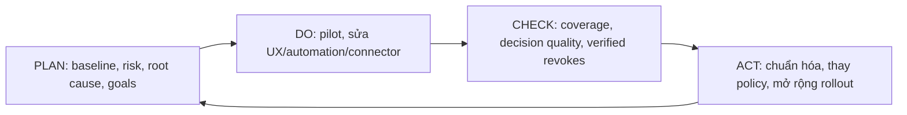
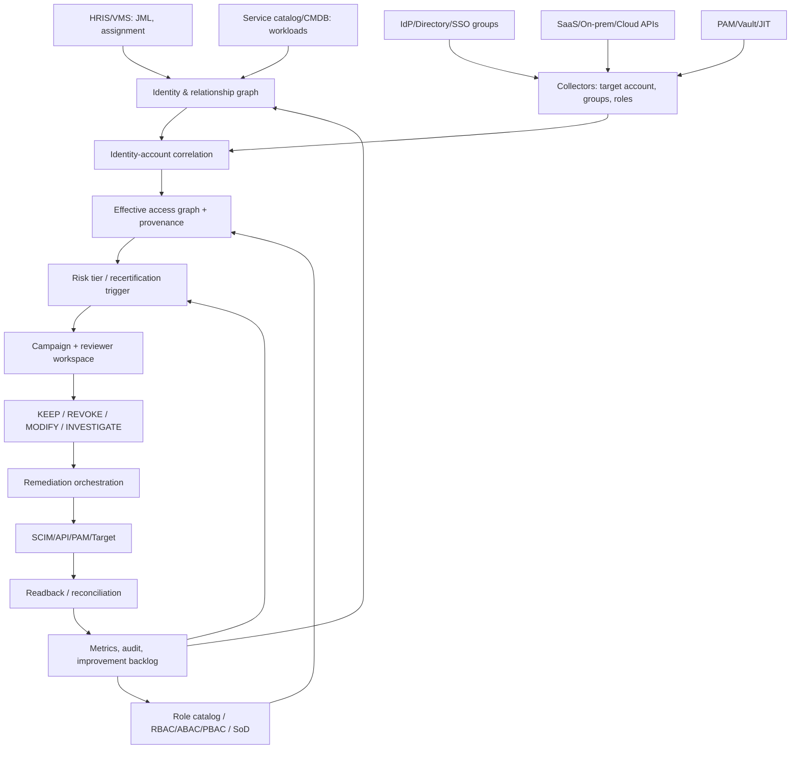
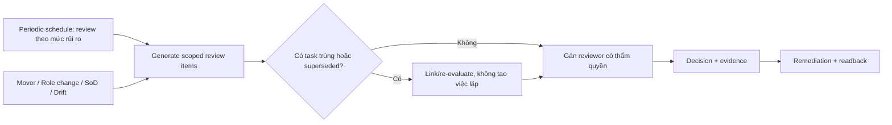
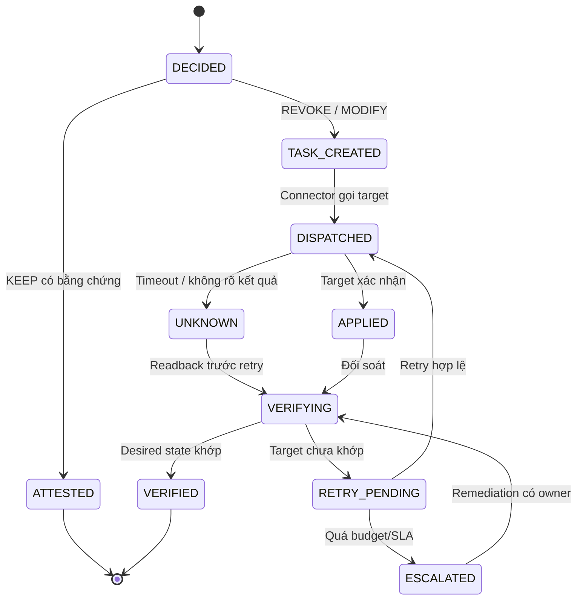

# Cải tiến access recertification trong quản lý vòng đời danh tính IAM

## 1. Cải tiến recertification là gì?

**Cải tiến access recertification** là quá trình đo lường, điều chỉnh và nâng chất lượng chương trình **tái chứng nhận quyền truy cập** để những quyết định *giữ, thu hồi hoặc điều chỉnh quyền* phản ánh đúng nhu cầu công việc và thực sự được thi hành ở hệ thống đích.

Một chương trình recertification thông thường yêu cầu người quản lý, chủ sở hữu dữ liệu hoặc chủ sở hữu ứng dụng định kỳ xác nhận người dùng còn cần các **role, group và entitlement** hay không. Tuy nhiên, nếu chỉ gửi danh sách hàng nghìn dòng rồi yêu cầu bấm `Approve`, chương trình có thể đạt tỷ lệ hoàn thành cao nhưng **vẫn giữ nhiều quyền truy cập tồn dư**.

Cải tiến recertification vì vậy không đơn thuần là “rút ngắn thời gian duyệt”. Mục tiêu là tăng **độ chính xác, khả năng giải thích, tỷ lệ khắc phục đã xác minh và mức bao phủ quyền có rủi ro** trong khi giảm thao tác thủ công không cần thiết.

Trong module **Identity and Access Management (IAM)**, chủ đề này gắn trực tiếp với vòng đời **Joiner–Mover–Leaver (JML)**: quyền được cấp khi gia nhập, thay đổi khi chuyển công việc và phải được thu hồi khi quan hệ kết thúc. Recertification là một lớp kiểm soát bổ sung để phát hiện những **sai lệch còn sót lại** từ HRIS, IdP, SSO, SCIM, RBAC/ABAC, ứng dụng SaaS và tài khoản dịch vụ.

### 1.1. Ví dụ minh họa

Quý trước, 90% request review được trả lời trước hạn. Nhưng 40 quyết định `REVOKE` chưa được SCIM connector thực hiện, 12 tài khoản đã Leaver vẫn có role local và nhiều reviewer không nhìn thấy permission thực tế trong role.

Một đợt cải tiến đúng hướng sẽ:

1. Làm rõ reviewer đang nhìn dữ liệu nào và quyền ấy cấp những hành động gì.
2. Tách **quyết định review** khỏi **kết quả thu hồi**.
3. Tập trung vào role nhạy cảm và quyền không còn căn cứ sau Mover/Leaver.
4. Tạo task thu hồi có owner/SLA và **readback** sau thực thi.
5. Đo xem số quyền tồn dư thực tế có giảm hay không.

**Nguyên tắc:** *Campaign closed* không đồng nghĩa *access verified*, và *reviewed* không đồng nghĩa *risk reduced*.

## 2. Phân biệt access review, recertification và cải tiến liên tục

| Khái niệm | Câu hỏi | Kết quả chính |
|---|---|---|
| **Access review** | Ai đang có quyền gì và quyền nào bất thường? | Danh sách cần xem, phân tích quyền |
| **Access recertification** | Ai có thẩm quyền xác nhận quyền đó vẫn hợp lệ? | Quyết định KEEP/REVOKE/MODIFY và bằng chứng |
| **Remediation** | Quyết định thay quyền đã được thực thi chưa? | Task cấp/thu hồi, thay role/scope |
| **Reconciliation** | Quyền thực tế ở target có khớp quyền được phép không? | Xác minh, drift và ngoại lệ |
| **Continuous improvement** | Hệ thống review có đang giảm rủi ro và công sức không? | Chỉ số, phân tích nguyên nhân, sửa quy trình |

Không phải mọi hệ thống đều dùng những tên trạng thái giống nhau. Điều bắt buộc là **phân biệt ý định, quyết định, thao tác kỹ thuật và quyền hiệu lực**.

### 2.1. Cải tiến không thay thế lifecycle event

- Một **Leaver** đã được xác minh không được tiếp tục truy cập chỉ vì chiến dịch recertification chưa đến kỳ.
- Một **Mover** phải được tính lại desired access ngay khi thay assignment; không đợi reviewer quý sau để gỡ role cũ.
- Một **Joiner** cần cấp quyền tối thiểu theo chính sách; recertification giúp tìm sai lệch khi cấp thừa.
- Một **workload** không có hồ sơ HRIS phải được review qua service catalog/CMDB và owner phù hợp.

Recertification kiểm tra **chất lượng của lifecycle và authorization**, không phải cơ chế duy nhất vận hành lifecycle.

## 3. Vấn đề phổ biến khiến recertification kém hiệu quả

| Triệu chứng | Nguyên nhân có thể | Rủi ro |
|---|---|---|
| Reviewer KEEP gần như 100% | Không hiểu role, quá nhiều item, không có thời gian | Rubber-stamping, giữ quyền không cần |
| Tỷ lệ hoàn thành cao nhưng quyền tồn dư nhiều | Chỉ đo approval, không đo remediation | Báo cáo tạo cảm giác an toàn sai |
| Người review thấy tên kỹ thuật khó hiểu | Thiếu business context, owner và permission mapping | Quyết định thiếu căn cứ |
| Một người phải duyệt hàng nghìn item | Phân công reviewer sai, scope quá rộng | Mệt mỏi, duyệt hàng loạt không phân tích |
| Quyền Leaver vẫn xuất hiện | Dữ liệu HR/connector chậm hoặc bỏ sót app | Tài khoản còn quyền sau offboarding |
| Role local SaaS không được đưa vào campaign | Chỉ đọc IGA/IdP | Coverage giả tạo |
| Quyền đã revoke nhưng xuất hiện lại | Dynamic group, rule cũ, retry stale event | Tái cấp quyền ngoài ý muốn |
| Service account không có owner | Chỉ dùng HRIS để xác định danh tính | Workload đặc quyền không được chứng nhận |
| SoD conflict vẫn được duyệt | Reviewer không thấy xung đột hoặc ngoại lệ | Một người có thể tự thực hiện giao dịch nhạy cảm |
| Campaign quá hạn lặp lại | Không rõ SLA, owner, escalation | Quyền chưa được xác nhận kéo dài |

Cải tiến hiệu quả cần **đo trước khi sửa** và phân loại nguyên nhân. Đừng tự động quy kết mọi quyết định KEEP là sai; một số role nền hoặc đặc quyền khẩn cấp có lý do hợp lệ dù ít được dùng.

## 4. Xác định mục tiêu cải tiến đo được

Các mục tiêu nên phản ánh cả **an ninh, khả năng kiểm toán và chi phí vận hành**.

| Chiều | Mục tiêu có ý nghĩa | Chỉ số minh họa |
|---|---|---|
| **Coverage** | Xem được các quyền quan trọng ở mọi nguồn | % target/entitlement có readback |
| **Decision quality** | Reviewer ra quyết định dựa trên dữ liệu đúng | % item có owner, scope và justification |
| **Remediation** | Quyền phải gỡ được gỡ thật | % REVOKE đã VERIFIED tại target |
| **Timeliness** | Quyền tồn dư bị xử lý sớm | Median/P95 revoke-to-verify latency |
| **Risk reduction** | Giảm exposure của role nhạy cảm | Số privileged assignments không còn căn cứ |
| **Reviewer effort** | Giảm thao tác thấp giá trị | Thời gian review mỗi item đủ context |
| **Data trust** | Giảm bản ghi không xác định được người/đích | % orphan/unmapped accounts |
| **Auditability** | Có bằng chứng có thể truy vết | % item đầy đủ reviewer + policy + evidence |
| **Governance** | Đúng người, đúng SoD, đúng ngoại lệ | Số self-approval/conflict chưa giải quyết |
| **Sustainability** | Kỳ sau ít phát sinh lại lỗi cũ | Repeat finding rate giữa các kỳ |

**Không đặt mục tiêu giảm tỷ lệ REVOKE về gần 0**. Tỷ lệ revoke lớn có thể phản ánh đợt dọn dẹp tốt, hoặc phản ánh provisioning/lifecycle vận hành kém. Phải phân tích cùng nguồn dữ liệu và xu hướng.

### 4.1. Baseline cần có thời điểm và phạm vi

Ví dụ baseline ghi rõ: “Role đặc quyền trong 8 ứng dụng production, chụp quyền lúc 01/11, 1.200 review item, 90% target có khả năng đọc lại”. Nếu kỳ sau review 30 ứng dụng, không so tỷ lệ chung mà **không chuẩn hóa phạm vi**.

## 5. Vòng lặp cải tiến PDCA cho recertification

Một phương pháp thực tiễn là **Plan–Do–Check–Act (PDCA)**.



- **Plan:** xác định lỗi lớn nhất, nguồn dữ liệu, người chịu trách nhiệm, ngưỡng thành công.
- **Do:** thử trên một tập role/ứng dụng có giới hạn, không đổi toàn doanh nghiệp ngay.
- **Check:** so sánh metrics trước/sau, đo cả lỗi vận hành và quyền tồn dư.
- **Act:** giữ thay đổi có hiệu quả, sửa phần không đạt, cập nhật runbook và policy.

### 5.1. Không tối ưu chỉ một mắt xích

Nếu tăng tốc phê duyệt nhưng connector vẫn lỗi, **rủi ro không giảm**. Nếu tăng auto-revoke mà mapping account sai, có thể gây **thu hồi nhầm người**. Các cải tiến cần cân bằng chuỗi end-to-end: **data → decision → remediation → verification**.

## 6. Mô hình trưởng thành của chương trình recertification

Một thang trưởng thành tham khảo:

| Mức | Đặc trưng | Điểm cần nâng tiếp |
|---|---|---|
| **M1 — Thủ công** | Spreadsheet/email, quyền không đồng nhất | Định danh ổn định, owner, event log |
| **M2 — Có workflow** | Campaign, phê duyệt và trạng thái | Chuẩn hóa role/entitlement, SLA |
| **M3 — Có đối soát** | Connector, verified revocation, drift detection | Dữ liệu hiệu lực và ưu tiên rủi ro |
| **M4 — Risk-aware** | Role risk tier, JML triggers, reviewer context, SoD | Adaptive cadence, automation có kiểm soát |
| **M5 — Continuous governance** | Theo dõi thay đổi, revalidation, đo tác động, phản hồi vào thiết kế role | Thử nghiệm liên tục, giảm nguồn sinh drift |

Đây là **mô hình tự xây để học**, không phải mức chứng nhận chính thức. Doanh nghiệp có thể đạt M4 ở ứng dụng quan trọng nhưng M2 ở legacy; không nên dùng một nhãn mức duy nhất để che phủ khác biệt.

### 6.1. Ưu tiên nâng mức theo rủi ro

Trước tiên cải tiến quyền có tác động lớn: admin IAM, production, export dữ liệu nhạy cảm, duyệt thanh toán và tài khoản bên ngoài. Sau khi kiểm soát được **bằng chứng và remediation**, mới mở rộng tự động hóa cho role thông thường.

## 7. Kiến trúc cải tiến: từ danh tính đến quyền hiệu lực



**Kiến trúc logic** này không đòi tất cả thành phần ở một sản phẩm IGA. Nó nhấn mạnh rằng một quyết định recertification tốt phải có **dữ liệu nguồn, quyền hiệu lực, owner và khả năng xác minh**.

## 8. Bước cải tiến đầu tiên: chất lượng dữ liệu danh tính

Review đúng quyền cho sai người còn nguy hiểm hơn không review. Vì vậy cần xây nền tảng **identity–account correlation**.

### 8.1. Dữ liệu cần đối chiếu

| Loại dữ liệu | Trường quan trọng | Nguồn nên kiểm tra |
|---|---|---|
| Nhân viên | `identity_id`, `worker_id`, status, effective date | HRIS/HCM |
| Nhà thầu | contract, sponsor, end date, assignment | VMS/sponsor |
| Guest | external principal, tenant, sponsor, expiry | Federation/app owner |
| Workload | `workload_id`, environment, owner, purpose | Service catalog/CMDB |
| Tài khoản đích | `target_account_id`, tenant, active, type | SCIM/API/directory |
| Entitlement | role/group/permission ID, scope, source | IGA + target |
| Session/credential | token/lease/session reference và status | IdP, PAM, app nếu có |

### 8.2. Những lỗi cần phát hiện

- Hai tài khoản ứng dụng cùng ánh xạ một email nhưng thuộc hai người/tenant khác nhau.
- Email thay đổi khiến grant bị liên kết sai.
- Tài khoản guest có sponsor hết hạn.
- Workload dùng credential của người đã nghỉ.
- Tài khoản local chưa được ánh xạ vào identity.
- HRIS ghi `TERMINATED` nhưng app vẫn `active=true`.

**Không dùng email làm khóa định danh duy nhất**; cần ID ổn định và mapping có bằng chứng.

### 8.3. Trạng thái không xác minh được

Một account thiếu owner nên có trạng thái `UNMAPPED / NEEDS_INVESTIGATION`, không được tự động KEEP hoặc tự động DELETE chỉ vì không tìm thấy hồ sơ HR.

## 9. Đo đúng quyền hiệu lực, không chỉ role được gán

Một role trên catalog có thể cho phép một tập permission, nhưng quyền thực tế tại ứng dụng còn chịu ảnh hưởng bởi:

- Role hierarchy và nested group.
- Dynamic group membership.
- Direct grant tại SaaS hoặc cloud.
- ABAC/PBAC scope theo tenant, dự án, thiết bị và thời gian.
- Access token/refresh token hoặc session được phát hành trước khi quyền bị gỡ.
- PAM eligible và activated privilege.
- API key/PAT/SSH key độc lập với IdP.
- Role ở external tenant/guest context.

### 9.1. Cải tiến bằng grant provenance

Với mỗi effective entitlement nên lưu **đường cấp quyền**:

```text
identity I-1042
  -> department=FIN (HRIS, version 44)
  -> business_role=finance_reader
  -> IdP group=grp-finance-readers
  -> SCIM group=reports-finance
  -> SaaS app_role=report_viewer
  -> effective action=report:read, scope=tenant-company/finance
```

Reviewer có thể hiểu **vì sao người đó có quyền**. Khi quyết định REVOKE, orchestration biết phải gỡ ở **nguồn nào** thay vì chỉ xóa một dòng trong dashboard.

### 9.2. Xác minh khả năng nhìn dữ liệu

Một collector chỉ đọc được `Groups` nhưng không đọc `local_roles` thì không thể kết luận “quyền ứng dụng đầy đủ”. Ghi rõ `coverage_level` và tạo backlog bổ sung connector/kiểm tra thủ công.

## 10. Cải tiến scope bằng phương pháp dựa trên rủi ro

Thay vì gửi cùng một checklist cho mọi user/role, có thể ưu tiên theo **mức nhạy cảm và khả năng quyền sai**.

Các tín hiệu phù hợp:

| Tín hiệu | Ví dụ | Hệ quả trong kế hoạch review |
|---|---|---|
| Đặc quyền cao | `identity_admin`, `production_admin` | Owner độc lập, kiểm tra JIT/PAM |
| Dữ liệu nhạy cảm | Payroll, customer export | Data owner review, scope/resource rõ |
| Xung đột SoD | Tạo và duyệt hóa đơn | Đánh giá sớm, không cho auto-KEEP |
| Mover gần đây | Thay department/project | Kiểm tra role cũ và mới |
| Leaver hoặc hợp đồng hết hạn | User status terminated | Thu hồi ngay theo lifecycle |
| Không có owner | Orphan account/role | Investigation, không tự công nhận |
| Quyền lâu không được dùng | Dữ liệu sử dụng đáng tin | Gợi ý xem xét, không auto-revoke mù |
| Direct grants ngoài IAM | Role local SaaS | Remediation và governance |
| Nhiều tenant | External guest, cross-tenant scope | Owner/scope review kỹ |
| Dữ liệu không đầy đủ | Connector thiếu readback | Tăng ưu tiên bổ sung bằng chứng |

### 10.1. Score không thay policy

Một số tổ chức tính điểm ưu tiên, nhưng **không có công thức chung chuẩn cho mọi hệ thống**. Ví dụ:

```text
priority_score =
    severity_weight
    + privileged_role_weight
    + sod_conflict_weight
    + stale_relationship_weight
    + missing_owner_weight
    + direct_grant_weight

priority_score only determines REVIEW PRIORITY;
it does not automatically imply PERMIT or REVOKE.
```

Phải hiệu chỉnh theo bối cảnh, tránh **ưu tiên sai do dữ liệu thiếu** và có cơ chế override được audit khi phát hiện rủi ro đặc biệt.

## 11. Chuyển từ campaign hàng loạt sang event-driven review

**Periodic recertification** theo quý/năm có thể bỏ sót những thay đổi xảy ra giữa kỳ. Một hướng cải tiến là **event-driven recertification**: tạo hoặc làm mới review item khi có sự kiện làm thay đổi căn cứ quyền.

### 11.1. Các trigger hữu ích

- Mover đổi phòng ban, manager, dự án, chi nhánh hoặc tenant.
- Gia hạn hoặc hết hợp đồng nhà thầu.
- Role chuyển từ read-only sang có export/admin.
- Người dùng nhận role đặc quyền mới.
- Phát hiện SoD conflict.
- Grant trực tiếp ngoài catalog xuất hiện.
- Role hoặc ứng dụng thay owner.
- Resource đổi data classification.
- Credential/service owner thay đổi.
- Quyền được cấp ngoại lệ sắp hết hạn.
- Reconciliation phát hiện unexpected entitlement.

### 11.2. Event-driven không phải chờ reviewer mới thu hồi Leaver

Với Leaver, hệ thống cần **thực thi revocation theo sự kiện có thẩm quyền**, đồng thời tạo evidence/exception review khi cần. Không tạo một request chờ phê duyệt để người đã nghỉ có thể tiếp tục sử dụng quyền.

### 11.3. Kết hợp chu kỳ và sự kiện



Event-driven review chỉ hiệu quả khi **event ordering, deduplication, identity matching và current-state checks** đáng tin.

## 12. Tần suất review thích ứng với rủi ro

Một cách tiếp cận là xây **review cadence** theo role risk tier và sự kiện, thay vì áp một hạn cho mọi role.

| Loại quyền | Cách nghĩ về tần suất | Bằng chứng ưu tiên |
|---|---|---|
| Role nền ít rủi ro | Campaign định kỳ + tự động kiểm tra dữ liệu | Trạng thái quan hệ, owner |
| Quyền dữ liệu nhạy cảm | Review thường xuyên hơn theo policy | Data owner, scope, lý do sử dụng |
| Privileged standing role | Giám sát và recertification ưu tiên | PAM, MFA, SoD, usage và JIT eligibility |
| Guest/contractor | Trigger theo sponsor/contract end | Hạn quan hệ, tenant, role local |
| Workload/service role | Khi owner/scope/deployment thay đổi + kỳ review | Service catalog, credential/role |
| Break-glass | Governance và diễn tập/kiểm tra chuyên biệt | Owner, usage incident, recovery controls |

**Không ấn định chu kỳ như 30/90 ngày thành quy chuẩn bắt buộc** khi chưa có policy tổ chức và nghĩa vụ pháp lý áp dụng. Tần suất cần phản ánh mức rủi ro, độ biến động và chi phí rà soát.

## 13. Tối ưu phân công reviewer

Reviewer phù hợp phải **biết vì sao quyền cần cho công việc** và **có thẩm quyền quyết định**.

| Loại quyết định | Người có thể chịu trách nhiệm |
|---|---|
| Nhu cầu công việc | Line manager/sponsor |
| Quyền vào dữ liệu | Data/resource owner |
| Role/permission kỹ thuật | Application/role owner |
| SoD/privileged exception | Security, Finance Controller hoặc PAM owner phù hợp |
| Workload/service grant | Service owner + technical owner |
| Guest và external tenant | Sponsor + tenant/resource owner |

### 13.1. Chống tự phê duyệt

Không giao item `production_admin` của quản trị viên A cho chính A nếu policy yêu cầu người xác nhận độc lập. Cần kiểm tra **identity ID** sau delegation, không chỉ tên/email trong UI.

### 13.2. Tránh người không hiểu role kỹ thuật

Một manager biết nhân viên cần xem báo cáo nhưng không rõ `APP_FIN_004` là role gì. Cải tiến là hiển thị **business description, quyền thực tế, phạm vi và owner**, hoặc thêm lớp role owner review thay vì buộc manager bấm KEEP mù.

### 13.3. Theo dõi tải reviewer

Một owner nhận hàng nghìn item nên được hỗ trợ **nhóm theo role/risk, search, sort, lý do grant, bulk decision có kiểm soát** và SLA thực tế. Không tăng tốc bằng cách mặc định đánh dấu tất cả KEEP.

## 14. Cải thiện trải nghiệm reviewer bằng context có ích

Một review item chất lượng nên trả lời ngay:

1. **Ai có quyền?** Identity ID, tên hiển thị trong phạm vi phù hợp, loại danh tính.
2. **Quyền nào?** Role ID, permission set, resource/action, scope.
3. **Đến từ đâu?** HR policy, access request, group, direct grant hoặc admin.
4. **Vì sao có?** Nhiệm vụ, ticket và approval cũ.
5. **Đến khi nào?** Effective date, expiration, exception TTL.
6. **Có thay đổi không?** Mover/Leaver hoặc policy mapping mới.
7. **Có rủi ro gì?** Privileged, SoD, data classification, cross-tenant.
8. **Đang có hiệu lực thật không?** Target readback, session/credential nếu liên quan.
9. **Nếu gỡ sẽ ảnh hưởng gì?** Những tác vụ hợp lệ phụ thuộc role.
10. **Ai chịu trách nhiệm nếu reviewer cần hỏi?** Role/data/technical owner.

### 14.1. So sánh UI kém và UI tốt

| UI thiếu ngữ cảnh | UI hỗ trợ quyết định |
|---|---|
| `APP_FIN_004 / user103 / Approve?` | `finance_report_reader` — chỉ đọc báo cáo Finance, tenant A |
| Không có owner | Role owner và data owner rõ |
| Không thấy hạn | Expiry và nhu cầu gắn assignment |
| Không thấy quyền hiệu lực | `report:read`; không có export |
| Không biết quyền đã dùng chưa | Tín hiệu sử dụng, độ tin cậy và thời điểm |
| Bấm KEEP/REVOKE không giải thích | Reason codes và justification theo rủi ro |
| Không thấy kết quả sau quyết định | Remediation task và verified status |

**Thêm nhiều cột không tự động tốt hơn.** Chỉ hiển thị dữ liệu có ý nghĩa, đáng tin và được quyền xem; bảo vệ thông tin HR/PII nhạy cảm.

## 15. Chống rubber-stamping nhưng không gây quá tải

**Rubber-stamping** là tình trạng reviewer xác nhận hàng loạt quyền mà không kiểm tra nhu cầu hoặc rủi ro thực sự.

### 15.1. Dấu hiệu cảnh báo

- Rất nhiều item được KEEP trong thời gian phi thực tế.
- Không có reason code cho quyền đặc quyền.
- Reviewer xử lý item ngoài phạm vi họ quản lý.
- Các role hiển thị chỉ là ID kỹ thuật vô nghĩa.
- Không item nào bị đặt `NEEDS_INFO` dù dữ liệu thiếu.
- KEEP cho người Leaver hoặc contractor hết hạn.
- Một người tự review role của chính mình.
- Chênh lệch lớn giữa decision KEEP và SoD/unexpected access findings.

### 15.2. Các cải tiến cụ thể

- Giao **owner phù hợp** và giới hạn tải công việc.
- Bắt buộc justification với role đặc quyền hoặc trường hợp bất thường.
- Sắp xếp **high-risk items trước**.
- Yêu cầu xem permission set trước khi xác nhận role có rủi ro cao.
- Có `INVESTIGATE` khi dữ liệu chưa đủ.
- Cho bulk decision chỉ với nhóm **đồng nhất, ít rủi ro, có policy cho phép**.
- Kiểm tra sau campaign: lấy mẫu các item KEEP có rủi ro hoặc mapping không rõ.
- Phản hồi phát hiện về role engineering, access request và HR lifecycle.

### 15.3. Không coi thời gian click là bằng chứng tuyệt đối

Một reviewer có thể đã chuẩn bị ngoài hệ thống rồi quyết định nhanh, hoặc bấm chậm nhưng không xem nội dung. Tín hiệu hành vi chỉ giúp **phát hiện trường hợp cần kiểm tra**, không tự kết luận gian lận hoặc sai phạm.

## 16. Bộ quyết định rõ nghĩa: KEEP, REVOKE, MODIFY, INVESTIGATE

| Quyết định | Điều kiện nên có | Kết quả cần theo dõi |
|---|---|---|
| **KEEP** | Nhu cầu, role/scope và policy còn hợp lệ | Attestation có bằng chứng và thời hạn |
| **REVOKE** | Quyền không còn căn cứ hoặc trái policy | Task thu hồi và target readback |
| **MODIFY** | Cần role thấp hơn, scope khác hoặc TTL ngắn | Revoke phần cũ, grant phần mới nếu được phép |
| **INVESTIGATE** | Dữ liệu thiếu/mâu thuẫn | Owner, deadline, không tự công nhận |
| **EXCEPTION_REQUESTED** | Nhu cầu đặc biệt cần phê duyệt khác | Review độc lập, kiểm soát bù, expiry |
| **ALREADY_REVOKED** | Readback thấy quyền không còn | Liên kết evidence, không replay hành động thừa |
| **SUPERSEDED** | JML/policy mới làm item lỗi thời | Không dùng decision cũ để cấp lại |
| **UNVERIFIED** | Không thể chứng minh quyền ở đích | Exception + remediation owner |

**KEEP không phải một quyền cấp vĩnh viễn**, và **REVOKE không phải bằng chứng đã thu hồi**.

### 16.1. Khi reviewer chọn MODIFY

Một nhân viên vẫn cần đọc báo cáo nhưng không cần export. Thay vì xóa hoàn toàn role, workflow có thể:

1. Thu hồi `report_exporter`.
2. Xác định `report_viewer` được phép theo policy.
3. Cấp role mới sau khi kiểm tra SoD/approval.
4. Đọc lại quyền đích, xác minh **export vắng mặt, read còn đúng scope**.

## 17. Quản lý ngoại lệ và waiver có thời hạn

Recertification sẽ gặp các trường hợp quyền không theo mẫu chung: hỗ trợ khẩn cấp, dự án bàn giao, tài khoản legacy và nghĩa vụ vận hành.

Một ngoại lệ hợp lệ nên chứa:

- `exception_id` và quyền/scope liên quan.
- Lý do nghiệp vụ, mức rủi ro và bằng chứng.
- Business owner + Security/Approver theo policy.
- Ngày hiệu lực và `expires_at`.
- Kiểm soát bù: MFA, PAM session, theo dõi hoặc network segmentation.
- Kế hoạch chấm dứt ngoại lệ.
- Trạng thái thực thi và lần review lại.

### 17.1. Không dùng ngoại lệ làm giải pháp vĩnh viễn

Một exception được renew vô hạn khiến role lẽ ra phải thu hồi tồn tại năm này qua năm khác. Hệ thống nên **cảnh báo số lần gia hạn**, yêu cầu phân tích nguyên nhân gốc và cân nhắc thiết kế role/workflow mới thay vì bỏ qua.

### 17.2. Leaver không được giữ quyền chỉ vì waiver cũ

Khi quan hệ đã chấm dứt, chính sách Leaver có thể **vô hiệu hóa quyền đã cấp ngoại lệ**, bất kể kỳ recertification chưa đến hạn. Bất kỳ quyền giữ lại sau Leaver phải có nguồn và điều kiện đặc biệt rõ ràng, không suy từ một waiver của thời kỳ còn làm việc.

## 18. Tự động hóa an toàn trong recertification

**Automation** có thể giảm thao tác thủ công ở những phần có dữ liệu chính xác và chính sách được phê duyệt.

### 18.1. Những bước phù hợp để tự động hóa

- Thu thập entitlement từ IdP, SCIM, SaaS, cloud và PAM.
- Chuẩn hóa identity/account mapping.
- Đối chiếu HR relationship và assignment hiện tại.
- Tính role scope, owner, risk tier và SoD signals.
- Nhóm item theo reviewer và rủi ro.
- Nhắc việc/escalation khi quá hạn.
- Tạo task revoke/modify có idempotency.
- Readback sau connector update.
- Theo dõi exception hết hạn và drift phát sinh lại.
- Tạo evidence/audit report theo phạm vi.

### 18.2. Những việc không nên auto-approve tùy tiện

- Role admin hoặc có quyền cấp thêm role.
- Export dữ liệu nhạy cảm.
- Quyền có xung đột SoD.
- Người dùng/target chưa map đúng.
- Các role thiếu owner hoặc không rõ purpose.
- Quyền vượt tenant hoặc môi trường.
- Waiver hết hạn mà chưa được xét lại.
- Các mục có source data mâu thuẫn.

### 18.3. Recommendation không phải quyết định cuối

Một hệ thống có thể đề xuất `REVIEW_PRIORITY=HIGH` hoặc `SUGGEST_REVOKE` dựa trên role lâu không dùng, nhưng **quyết định phải tuân policy, người có thẩm quyền và khả năng tác động**. Không coi “AI cho rằng ít dùng” là đủ căn cứ xóa role production hoặc tự giữ quyền.

## 19. Cải tiến kết thúc campaign bằng verified remediation

**Lỗi thiết kế thường gặp:** campaign đóng khi 100% reviewer đã nhấn nút. Nếu 50% quyết định REVOKE chưa thực thi, rủi ro vẫn tồn tại.

### 19.1. Hai loại hoàn thành

| Loại | Điều được xác nhận | Điều chưa thể kết luận |
|---|---|---|
| **Decision completed** | Reviewer đã ra quyết định hợp lệ | Target đã thay quyền |
| **Remediation applied** | Connector/target báo đã cập nhật | Quyền hiệu lực đã đúng ở mọi đường |
| **Remediation verified** | Đã có readback phù hợp với desired state | Các hệ thống ngoài phạm vi cũng đúng |
| **Campaign closure with exceptions** | Các lỗi chưa giải quyết đã có owner, deadline | Không đồng nghĩa tất cả quyền đều an toàn |

### 19.2. Trạng thái task tham khảo



**Không tự đổi UNKNOWN thành FAILED hoặc VERIFIED** khi timeout. Có thể lệnh đã áp dụng, nên đọc trạng thái ở đích trước khi lặp.

## 20. Kết nối remediation với SCIM, API và role mapping

Nếu entitlement được quản lý qua **SCIM Group**, workflow có thể tạo thao tác gỡ một membership sau quyết định REVOKE.

Ví dụ minh họa:

```http
PATCH /scim/v2/Groups/group-finance-readers HTTP/1.1
Host: scim.example.org
Authorization: Bearer <redacted-token>
Content-Type: application/scim+json

{
  "schemas": ["urn:ietf:params:scim:api:messages:2.0:PatchOp"],
  "Operations": [
    {
      "op": "remove",
      "path": "members[value eq \"target-user-1042\"]"
    }
  ]
}
```

Provider phải hỗ trợ `Groups`, `PATCH` và biểu thức filter tương ứng. **Không dùng `remove path=members` để gỡ một cá nhân** nếu thao tác đó xóa nhiều thành viên.

### 20.1. Đối soát không dừng ở SCIM Group

Một người có thể có quyền qua:

- Role local của SaaS không bị thay khi gỡ SCIM group.
- Nested group hoặc dynamic group tự thêm lại.
- Privileged role/eligibility trong PAM.
- App session hoặc token đã phát hành.
- API key/PAT/SSH key không gắn trực tiếp với nhóm IdP.

**Quyết định revoke đã verified cần nêu phạm vi cụ thể**: ví dụ nhóm vắng mặt ở target A, role local vắng mặt ở app B, session tại C đã đóng hoặc chưa kiểm tra được.

## 21. Cải tiến cùng Joiner lifecycle

Khi onboarding, hệ thống có thể tự cấp một số role nền theo chính sách. Nếu default role quá rộng, kỳ recertification sẽ liên tục tạo nhiều kết luận REVOKE.

### 21.1. Tìm nguyên nhân từ đầu nguồn

Một số tín hiệu:

- Nhiều Joiner role bị reviewer gỡ ngay kỳ đầu.
- Role được cấp trước ngày `effective_at`.
- Quyền export/admin nằm trong role nền.
- Tài khoản được nhân đôi do email mapping.
- Quy trình account activation không có readback.

Cải tiến phù hợp là **sửa role catalog, approval rule và JML provisioning**, không chỉ yêu cầu reviewer thu hồi các role lỗi lặp lại.

### 21.2. Pre-hire không tự có quyền

Có thể tạo account để chuẩn bị thiết bị trước ngày bắt đầu nhưng policy có thể yêu cầu **chưa active entitlement nghiệp vụ**. Campaign hoặc kiểm tra tự động nên phân biệt account created, account enabled, role assigned và access effective.

### 21.3. Dữ liệu identity proofing

Nếu không chắc account ứng dụng thuộc đúng người đã proofing, phải dừng việc auto-certify và xử lý mapping. Recertification không thể sửa sai việc **liên kết nhầm danh tính** chỉ bằng một nút KEEP.

## 22. Cải tiến cùng Mover lifecycle

**Mover** thường tạo quyền tồn dư do workflow chỉ cấp role mới mà quên gỡ role cũ.

Ví dụ:

```text
Trước:
  sales_report_viewer
  sales_exporter

Sau thay đổi hợp lệ:
  finance_report_viewer

Desired roles:
  finance_report_viewer

Observed roles:
  sales_exporter
  finance_report_viewer

Recertification finding:
  sales_exporter = UNEXPECTED_ROLE
```

### 22.1. Chuyển từ chữa lỗi sang phòng ngừa

Nếu cùng loại role tồn dư lặp nhiều kỳ, cần:

1. Sửa logic **desired roles** theo assignment hiện tại.
2. Tạo task **revoke old / grant new** có quan hệ rõ.
3. Kiểm tra SoD khi có chồng lấn quyền.
4. Đối soát target sau Mover.
5. Tạo event-driven review cho ngoại lệ chưa giải quyết.
6. Theo dõi **Mover leftover-role count** kỳ sau.

### 22.2. Multiple assignments

Một người có thể cùng lúc phục vụ hai dự án hoặc hợp đồng. Không xóa toàn bộ quyền cũ vì một assignment kết thúc nếu còn **nguồn khác hợp lệ**; phải xác định scope và grant provenance.

## 23. Cải tiến cùng Leaver lifecycle

**Leaver** là một điều kiện ngắt quyền có ưu tiên cao; quyền còn sau ngày nghỉ là một tín hiệu rủi ro và nguyên nhân cần điều tra.

### 23.1. Những điều recertification phát hiện

- Tài khoản IdP đã disable nhưng SaaS local role còn.
- PAM eligible role hoặc checkout chưa chấm dứt.
- Token/PAT/SSH key cá nhân còn sử dụng.
- Guest assignment ở external tenant chưa được revoke.
- Service account vẫn ghi owner là người đã nghỉ.
- Retry job từ Joiner/Mover cấp lại role sau Leaver.

### 23.2. Không chờ reviewer quyết định giữ hay gỡ

Một sự kiện Leaver có thẩm quyền phải kích hoạt workflow offboarding **ngay khi có hiệu lực** theo policy. Recertification có thể:

- Phát hiện quyền nằm ngoài connector.
- Xác nhận offboarding theo từng target.
- Mở remediation cho access tồn dư.
- Tổng hợp root cause để sửa lifecycle.
- Báo cáo thời gian từ Leaver tới `REVOKED_VERIFIED`.

### 23.3. Phân biệt người nghỉ và owner workload

Người sở hữu kỹ thuật của service account nghỉ việc **không đồng nghĩa service account phải tự động bị xóa**. Cần bàn giao owner, thu hồi quyền quản trị cá nhân, đánh giá rotation secret và xem workload còn có mục đích hợp lệ không.

## 24. Vai trò của IdP, MFA, SSO, RBAC/ABAC/PBAC trong cải tiến

| Thành phần | Đóng góp cho recertification | Điều không tự chứng minh |
|---|---|---|
| **HRIS/VMS** | Quan hệ công việc và sự kiện JML | Toàn bộ target đã cập nhật |
| **IdP/Directory** | Account, nhóm, trạng thái xác thực | Role local SaaS đã thu hồi |
| **MFA** | Bảo đảm xác thực mạnh hơn khi truy cập | Người đó còn cần role |
| **SAML/OIDC SSO** | Session/token và claims tại thời điểm phát hành | Token cũ đã mất quyền sau Mover |
| **SCIM** | Đọc/cập nhật Users/Groups | Mọi permission/credential ngoài SCIM đã đổi |
| **RBAC** | User–Role/Role–Permission mapping | Scope theo tenant/resource tự được bảo vệ |
| **ABAC/PBAC** | Policy theo thuộc tính, action và ngữ cảnh | PEP nào cũng đang enforce đúng |
| **PAM/Vault** | Quyền đặc quyền, checkout, JIT và credential | Check-in đã vô hiệu hóa mật khẩu tĩnh |
| **Reconciliation** | Đọc trạng thái thực tế, phát hiện drift | Quyền ngoài phạm vi quan sát đã an toàn |

### 24.1. Cải tiến coverage theo từng lớp

Chương trình nên ghi **coverage matrix**: ứng dụng nào đọc được user/group, role local, direct grant, session hoặc privileged credential. Không nên ghi “100% coverage” nếu chỉ đồng bộ account qua SCIM mà thiếu permission thực tế.

## 25. Review tài khoản đặc quyền, service và break-glass

### 25.1. Đặc quyền PAM/JIT

Review nên phân biệt:

- **Eligible:** được phép yêu cầu role đặc quyền.
- **Active:** đã kích hoạt role trong khoảng.
- **Effective:** target thực sự cho thao tác admin.
- **Credential checkout:** đã tiếp cận secret tĩnh hoặc mở phiên qua broker.
- **Revoked/rotated:** credential/role/phiên không còn được dùng theo phạm vi xác minh.

Ít sử dụng không tự chứng minh một quyền **break-glass** thừa; nhưng quyền khẩn cấp phải có owner, giám sát, kiểm thử và hậu kiểm.

### 25.2. Service account và workload identity

Với bot và CI/CD, cần:

- Service catalog/CMDB làm nguồn danh tính và mục đích.
- Owner kỹ thuật/nghiệp vụ còn hoạt động.
- Scope của cloud role, DB role, API token và vault access.
- TTL, renewal, credential rotation.
- Phân tách production/staging và tenant.
- Kế hoạch decommission khi workload ngừng chạy.

### 25.3. Privileged recertification không được auto-KEEP mù

Role đặc quyền có blast radius lớn. Automation có thể chuẩn bị evidence, nhưng quyết định giữ quyền thường cần approver đủ thẩm quyền và có kiểm soát SoD theo policy.

## 26. Nâng chất lượng bằng role engineering

Nếu mỗi người có 30 role nhỏ khó hiểu hoặc một role `admin_all` quá rộng, reviewer khó đưa ra quyết định chính xác.

### 26.1. Những dấu hiệu cần cải tổ role catalog

- Role không có owner/description.
- Role names không phản ánh chức năng.
- Nhiều role tương đương nhưng permission khác nhau khó giải thích.
- Role chứa permission không liên quan hoặc SoD-conflicting.
- Role gắn trực tiếp từng cá nhân (role explosion).
- Role dùng chung nhiều tenant mà không có scope.
- Mapping từ business role tới technical role không được version hóa.
- Baseline role có quyền export hoặc quản trị ngoài nhu cầu.

### 26.2. Quy trình cải tiến

1. Phân tích quyền thực tế, các kết luận REVOKE/MODIFY lặp lại.
2. Xây role theo **nhiệm vụ nghiệp vụ**, phân biệt business/technical role.
3. Xác định permission tối thiểu và scope.
4. Kiểm tra hierarchy, nested group và SoD.
5. Gắn owner, version và quy tắc cấp/thu hồi.
6. Thử với nhóm người đại diện.
7. Migrate role có kiểm soát, không cấp rộng trong giai đoạn chuyển.
8. Đối soát và theo dõi số finding recertification kỳ sau.

**Một thay đổi Role–Permission Assignment (PA)** có thể ảnh hưởng hàng trăm người cùng lúc; không được coi như thay gán quyền của một user.

## 27. Dữ liệu và bằng chứng trong một review item cải tiến

Một review item minh họa nên có các nguồn và phiên bản đủ để reviewer xác nhận.

```json
{
  "campaign_id": "RECERT-2026-Q4",
  "item_id": "RC-1042-09",
  "snapshot": {
    "snapshot_id": "SN-2026-11-23",
    "captured_at": "2026-11-23T02:00:00Z",
    "collector_status": "COMPLETE",
    "source_version": 44
  },
  "subject": {
    "identity_id": "I-1042",
    "identity_type": "EMPLOYEE",
    "relationship_status": "ACTIVE",
    "current_assignment": "FINANCE_REPORTING"
  },
  "entitlement": {
    "target_system": "reports-saas",
    "target_account_id": "saas-user-1042",
    "role_id": "sales_exporter",
    "role_version": "v3",
    "scope": "tenant-company/sales",
    "grant_source": "DIRECT_APP_GRANT",
    "risk_tier": "HIGH"
  },
  "signals": {
    "recent_mover": true,
    "sod_conflict": false,
    "owner_known": true,
    "effective_access_observed": true
  },
  "review": {
    "reviewer_id": "I-2201",
    "decision": "REVOKE",
    "reason_code": "OLD_PROJECT_NO_LONGER_NEEDED",
    "decided_at": "2026-11-23T09:15:00Z"
  },
  "remediation": {
    "task_id": "RV-755",
    "status": "VERIFYING",
    "verified_at": null
  }
}
```

Đây là **schema minh họa**, không phải chuẩn JSON chính thức. Không ghi mật khẩu, access token, cookie, thông tin lương hay dữ liệu cá nhân không cần thiết vào item/audit.

### 27.1. Tách snapshot khỏi current state

Reviewer cần biết đã xem **snapshot nào**, còn worker remediation phải kiểm tra **trạng thái và policy mới nhất**. Item snapshot ngày 01/11 không được áp lệnh cấp quyền vào ngày 20/11 nếu HRIS đã xác nhận Leaver ngày 15/11.

## 28. Mô hình dữ liệu cải tiến nên hỗ trợ traceability

Các thực thể logic tối thiểu:

| Thực thể | Chức năng |
|---|---|
| **Campaign** | Phạm vi, kỳ review, owner và trạng thái |
| **ReviewItem** | Subject–entitlement–scope tại snapshot |
| **ReviewerAssignment** | Ai có thẩm quyền ra quyết định |
| **DecisionEvent** | KEEP/REVOKE/MODIFY và lý do |
| **RemediationTask** | Target operation, owner, retry và deadline |
| **VerificationEvidence** | Quan sát quyền thực tế và phạm vi kiểm chứng |
| **RiskSignal** | SoD, Mover, privileged, thiếu owner |
| **Exception** | Waiver có hạn, kiểm soát bù |
| **SourceVersion** | HRIS/role/policy/collector version |
| **ImprovementFinding** | Root cause, sửa quy trình, thước đo sau sửa |

### 28.1. Định danh

Sử dụng `campaign_id`, `review_item_id`, `identity_id`, `target_account_id`, `entitlement_id`, `policy_version`, `source_version` và `correlation_id`. Khi request đi qua nhiều queue, mỗi event phải nối được với quyết định reviewer và bằng chứng target.

### 28.2. Không ghi đè lịch sử

Nếu item từ `REVOKE_DECIDED` chuyển `FAILED` rồi `VERIFIED`, nên giữ **event history** với timestamp và actor thay vì chỉ lưu trạng thái cuối, để phân tích SLA và nguyên nhân lỗi.

## 29. Đo metrics với mẫu số và định nghĩa minh bạch

Không nên dùng một KPI `campaign_completion_percent` duy nhất.

### 29.1. Những công thức nên phân biệt

```text
Decision completion rate
  = items_with_valid_decisions / reviewable_items

Verified remediation rate
  = revoke_or_modify_items_verified / all_revoke_or_modify_items

Coverage rate
  = in_scope_entitlements_observed / expected_in_scope_entitlements

Owner coverage
  = roles_with_valid_owner / roles_in_scope

SLA breach rate
  = overdue_items / items_with_applicable_sla

Repeat finding rate
  = recurring_findings / comparable_findings_in_previous_period
```

**Mẫu số phải có nguồn đáng tin**. Nếu không biết tổng entitlement kỳ vọng, không thể báo coverage 100% chỉ bằng cách lấy số item thu thập được chia cho chính nó.

### 29.2. Bảng KPI cải tiến

| KPI | Phản ánh | Cần đọc cùng |
|---|---|---|
| Decision completion | Reviewer đã quyết định bao nhiêu | Chất lượng context/SoD |
| Verified remediation | Quyền cần gỡ đã gỡ thật bao nhiêu | Coverage và exceptions |
| Leaver residual access age | Quyền tồn dư sau Leaver bao lâu | Độ chính xác identity mapping |
| Mover leftover role | Privilege creep sau chuyển việc | Multiple assignments |
| Privileged review coverage | Có giám sát vai trò đặc quyền không | PAM/credential scope |
| Average reviewer workload | Mức quá tải và UX | Risk mix của items |
| Unverified item age | Task thiếu bằng chứng bao lâu | Connector capability |
| Role owner coverage | Governance có người chịu trách nhiệm | Role version/quality |
| SoD conflict closure | Xung đột được xử lý | Transaction-level SoD |
| Repeat remediation finding | Lỗi có tái phát kỳ sau không | Lifecycle root cause |

### 29.3. Dùng median và percentile

Thời gian thu hồi trung bình có thể che những trường hợp mất hàng tuần. Theo mức rủi ro, nên xem **median và P95/P99**, cộng các outlier có owner. Không ghép Leaver cấp cao với entitlement ít rủi ro rồi kết luận chỉ số chung đạt.

## 30. Phương pháp phân tích nguyên nhân gốc

Cải tiến hiệu quả cần truy đến **tại sao quyền sai được sinh ra và tồn tại**, không chỉ đóng một item.

### 30.1. Ví dụ “5 Whys” với role Sales còn sau Mover

1. Vì sao Linh còn `sales_exporter`? Target SaaS còn direct role.
2. Vì sao target còn? Connector Mover chỉ thêm role Finance.
3. Vì sao không gỡ Sales? Workflow chỉ tính `roles_to_grant`.
4. Vì sao workflow thiếu revoke? Quy tắc desired state không có diff hai chiều.
5. Vì sao không phát hiện sớm? Không có reconciliation/alert sau Mover.

Hành động cải tiến cần:

- Sửa **desired role calculation**.
- Thêm revoke task và readback.
- Bổ sung test Mover grant/revoke đồng thời.
- Thêm metric `Mover leftover role count`.
- Kiểm tra finding có tái phát sau khi sửa.

### 30.2. Root cause categories

- **Source data:** HRIS/VMS sai hoặc đến chậm.
- **Identity matching:** ghép sai tài khoản.
- **Policy design:** role quá rộng hoặc thiếu SoD.
- **Workflow:** thiếu approval, revoke, expiry hoặc owner.
- **Integration:** SCIM/API không đủ quyền hoặc lỗi.
- **Verification:** không đọc được effective access.
- **Human process:** reviewer quá tải/thiếu context.
- **Credential/session:** token, PAT, SSH key tồn dư.

Một finding có thể có nhiều nguyên nhân; cần ưu tiên sửa **nguồn sinh ra lỗi** thay vì chỉ làm sạch một lần.

## 31. Thử nghiệm cải tiến mà không làm rộng quyền

Có thể chạy **pilot** trên một nhóm role/ứng dụng trước khi áp dụng thay đổi toàn doanh nghiệp.

### 31.1. Thiết kế thử nghiệm

- Chọn cohort có **risk tier và độ phức tạp tương tự**, không trộn privileged với low-risk.
- Ghi baseline về tỷ lệ verified revocation, thời gian reviewer, data completeness và lỗi.
- Thử phiên bản dashboard có **role description, grant path, last-used signal**.
- Theo dõi kết quả reviewer; đối chiếu với owner/target evidence.
- Kiểm tra người hợp lệ có bị thu hồi nhầm không.
- Chỉ rollout khi các chỉ số rủi ro và vận hành đạt ngưỡng đã duyệt.

### 31.2. Ví dụ đánh giá trước/sau

| Chỉ tiêu | Trước (minh họa) | Sau pilot (minh họa) | Điều cần giải thích |
|---|---:|---:|---|
| Item có role description | 60% | 98% | Collector/catalog chất lượng tốt hơn |
| Decision completed | 85% | 93% | Có thể do UX/owner mapping |
| REVOKE verified | 52% | 91% | Có readback và connector remediation |
| Unmapped accounts | 45 | 12 | Identity matching được sửa |
| Overdue privileged items | 18 | 4 | Có escalation và risk priority |
| Review time per item | 4 phút | 3 phút | Không giảm bằng auto-KEEP mù |

**Các số là giả định để minh họa cách đo**, không đại diện cho dữ liệu thực tế hay ngưỡng chuẩn.

### 31.3. Thử nghiệm không được tự động cấp quyền

Không dùng A/B test để người dùng ở một cohort được phép truy cập dữ liệu nhạy cảm trong khi cohort khác bị chặn ngoài chính sách. Thử nghiệm thay **quy trình review/UX**, không được hạ cấp authorization production nếu chưa có phê duyệt và kiểm soát rủi ro.

## 32. Lộ trình cải tiến 30–60–90 ngày (minh họa)

Một kế hoạch ngắn hạn có thể điều chỉnh theo nguồn lực:

| Giai đoạn | Trọng tâm | Đầu ra kiểm chứng |
|---|---|---|
| **Ngày 1–30: Baseline** | Inventory role/target, owner, KPI, review dữ liệu và lỗi cũ | Coverage matrix, root-cause backlog, risk tiers |
| **Ngày 31–60: Pilot** | Cải thiện context, reviewer routing, SoD, remediation/readback ở ứng dụng ưu tiên | Pilot scorecard, verified revoke, negative tests |
| **Ngày 61–90: Scale** | Mở rộng connector/role, event-driven triggers, dashboard và quy trình kiểm toán | Rollout evidence, KPI so baseline, playbook vận hành |

### 32.1. Đầu việc 30 ngày đầu

1. Chọn owner chương trình.
2. Phân loại ứng dụng/role theo rủi ro.
3. Kiểm kê target account và quyền hiệu lực.
4. Đánh giá 10–20 finding có tác động lớn (số lượng tùy quy mô).
5. Xác định nguồn thiếu dữ liệu và connector không readback.
6. Đo baseline decision/verification/Leaver residual access.
7. Chốt danh sách cải tiến có owner và deadline.

### 32.2. Đầu việc pilot

- Sửa UI hiển thị role scope và grant source.
- Thử SoD và self-approval guards.
- Tạo task remediation cho REVOKE/MODIFY.
- Readback SCIM/API và xử lý `UNKNOWN`.
- Thêm cảnh báo Leaver/Mover stale role.
- Kiểm tra không xóa quyền còn căn cứ từ assignment khác.

### 32.3. Điều kiện mở rộng

Không mở rộng automation nếu **identity mapping còn mơ hồ, không có owner hoặc không đo được kết quả thực tế**. Ưu tiên khắc phục nền tảng dữ liệu trước.

## 33. Trường hợp mẫu: tối ưu recertification quyền Finance

Một doanh nghiệp có:

- HRIS theo dõi nhân sự.
- IGA quản lý business role và campaign.
- IdP/SSO/MFA bảo vệ đăng nhập.
- Accounting SaaS có SCIM Groups và role local.
- PAM quản lý `production_admin`.
- Service catalog quản lý workload.

### 33.1. Tình trạng ban đầu

Campaign trước có 1.200 item. Reviewer chỉ thấy mã role và tên người; 95% item KEEP. Tuy nhiên:

- Người đã Mover vẫn có `sales_exporter`.
- Một số role local không nằm trong IGA.
- Quyết định REVOKE không có readback.
- Service account có owner đã nghỉ.
- Một tài khoản privileged có quyền JIT đã hết hạn nhưng session chưa được kiểm tra.

### 33.2. Cải tiến dữ liệu và scope

Đội IAM:

1. Nối HR assignment với target account ID.
2. Thêm SaaS local role collector.
3. Phân loại `invoice_approver`, `finance_exporter` và `production_admin` là nhóm cần review ưu tiên.
4. Hiển thị permission set, tenant, project, grant source và SoD cho reviewer.
5. Tạo event-driven item cho Mover/sponsor change.

### 33.3. Cải tiến quyết định

Reviewer thấy Linh chuyển sang Finance nhưng còn `sales_exporter`. Họ chọn `REVOKE` với reason `OLD_ASSIGNMENT`. Một người khác giữ `invoice_approver` đúng chức năng, được `KEEP` có lý do; transaction-level SoD vẫn kiểm tra người duyệt không phải người tạo hóa đơn.

### 33.4. Cải tiến thực thi

IGA phát revoke task đến SaaS. SCIM Group đã gỡ member, nhưng SaaS local role vẫn còn. Dashboard báo `REMEDIATION_PARTIAL`, không tự đánh dấu `VERIFIED`. Application Owner xử lý direct grant rồi readback lại.

### 33.5. Kết quả cần theo dõi

- Quyền Sales cũ sau Mover giảm.
- Direct grant ngoài IGA được phát hiện và xử lý.
- REVOKE verified tăng, exception backlog giảm.
- Service account được chuyển owner mà không gián đoạn workload.
- Privileged session/lease được xác minh theo phạm vi.
- Campaign kỳ sau ít lặp lại cùng root cause.

Đây là ví dụ **giả định**, không phải kết quả đo từ một tổ chức có thật.

## 34. Tự động hóa remediation: pseudocode an toàn

Một tác vụ recertification không nên dùng duy nhất decision cũ mà bỏ qua nguồn JML/policy hiện hành.

```text
function processRecertificationTask(itemId):
    item = loadReviewItem(itemId)
    identity = loadCurrentAuthoritativeIdentity(item.identityId)
    role = loadRoleDefinition(item.roleId)
    policy = loadCurrentPolicy()

    if item.state in {VERIFIED, SUPERSEDED}:
        return

    if role.version != item.snapshotRoleVersion:
        mark(item, REEVALUATION_REQUIRED)
        return

    if item.decision == KEEP:
        if not currentRelationshipAllows(identity, item.roleScope):
            mark(item, SUPERSEDED_BY_JML)
            enqueueLifecycleRevocation(item)
            return
        recordTimeBoundAttestation(item)
        return

    if item.decision in {REVOKE, MODIFY}:
        desired = calculateDesiredEntitlement(
            identity, role, item.scope, policy
        )
        account = resolveVerifiedTargetAccount(
            item.identityId, item.targetSystem, item.tenant
        )

        if account == UNKNOWN:
            mark(item, UNVERIFIED)
            assignInvestigationOwner(item)
            return

        observed = readTargetEntitlement(account, item.roleId)

        if observed == desired:
            mark(item, VERIFIED)
            recordEvidence(item, observed)
            return

        dispatchAuthorizedIdempotentRemediation(item, desired)
        mark(item, VERIFYING)
```

Đây là **mã giả mô tả nguyên tắc**, không phải một hàm production hoàn chỉnh. Trong thực tế cần xử lý **multiple assignments, sự kiện revoke có ưu tiên, optimistic concurrency, queue retry, partial failures, target-specific semantics và timeout**.

### 34.1. Lưu ý không để kiểm tra KEEP chặn Leaver

Khi HRIS xác nhận Leaver, workflow offboarding có thể phải thu hồi quyền **không phụ thuộc recertification item đang KEEP**. Một event review cũ không được “phục hồi” grant đã hết hiệu lực.

## 35. Đối phó event đến sai thứ tự và stale grants

Một ví dụ nguy hiểm:

1. Campaign snapshot ghi Linh là nhân viên active, có role `finance_reader`.
2. Reviewer quyết định KEEP.
3. HRIS phát Leaver version 51.
4. IAM gỡ role và disable tài khoản.
5. Worker recertification retry thao tác từ version 50, **vô tình gán lại role**.

Giải pháp:

- Review item có `snapshot_version` và `source_version`.
- Grant/revoke task có `idempotency_key`, target ID và tenant.
- Trước mọi grant, xác minh **desired state hiện tại**, nhất là JML.
- Mark stale job `SUPERSEDED` thay vì replay.
- Sau timeout, **readback** trước retry.
- Không suy ra exactly-once end-to-end chỉ vì queue có idempotency.
- Ưu tiên đường **deny/offboarding** đối với Leaver hợp lệ.
- Ghi audit từ decision tới operation và verification.

### 35.1. Snapshot và current-state không thay thế nhau

**Snapshot** là bằng chứng reviewer đã xem cái gì. **Current state** là căn cứ để quyết định thao tác hiện tại còn hợp lệ không. Cần giữ cả hai; không viết đè snapshot rồi mất dấu vết, cũng không thực thi mù một snapshot đã lỗi thời.

## 36. Bảo mật dữ liệu và quyền riêng tư khi cải tiến

Recertification thường kết hợp dữ liệu HR, quyền hệ thống và đôi khi tín hiệu sử dụng. Cần hạn chế thu thập và truy cập.

### 36.1. Nguyên tắc bảo vệ

- Chỉ hiển thị cho reviewer thông tin **cần để quyết định**.
- Không gửi password, bearer token, SSH key hoặc secret vào dashboard.
- Không log toàn bộ request headers, session cookie hoặc nội dung dữ liệu nhạy cảm.
- Giới hạn quyền xem campaign theo owner, tenant, role và mục đích.
- Ghi audit ai xem/sửa/export review data.
- Đặt retention cho snapshot, decision evidence và recording theo policy.
- Pseudonymize dữ liệu khi dùng cho thử nghiệm cải tiến nếu phù hợp.
- Không để dữ liệu production nhạy cảm vào môi trường pilot kém bảo vệ.
- Bảo vệ webhook/event bằng xác thực nguồn, integrity, replay protection.
- Đảm bảo tool gợi ý/tự động hóa không trở thành đường bypass approval/SoD.

### 36.2. Đánh giá “last used” đúng cách

Dữ liệu `last_used_at` có thể chưa đủ chính xác: quyền dùng qua scheduled job hoặc chỉ dùng lúc khẩn. Review cần ghi **độ tin cậy và nguồn đo**, không giả định không có log truy cập nghĩa là quyền không từng được dùng.

## 37. Những sai lầm khi cải tiến recertification

| Sai lầm | Hậu quả | Cải tiến tốt hơn |
|---|---|---|
| Chỉ cố tăng completion rate | Rubber-stamping | Đo decision quality và verified remediation |
| Auto-KEEP item quá hạn | Quyền sai được kéo dài | Escalation và independent review |
| Dựa vào HRIS cho mọi identity | Bỏ sót bot/guest | Service catalog/VMS/sponsor |
| Review mỗi IGA role | Bỏ sót direct grant/role local | Collect observed effective access |
| Dùng email làm mapping ID | Ghép nhầm account | Stable ID + tenant/target mapping |
| Coi SCIM HTTP 200 là revoked | Token/role local còn sống | Target readback và verification scope |
| Xóa account thiếu HR record | Gián đoạn workload | Kiểm tra owner/CMDB trước |
| Tự gỡ role chỉ vì ít dùng | Mất quyền khẩn hợp lệ | Owner/risk assessment |
| Để manager review code role không giải thích | Duyệt mù | Business description + permissions |
| Bulk approve quyền đặc quyền | Che SoD/overprivilege | Reviewer độc lập và controls |
| Tập trung quyền cấp, bỏ quyền thu hồi | Privilege creep sau Mover | Desired-state diff hai chiều |
| Không quản lý snapshot version | Stale decision | Current-state revalidation |
| Retry grant cũ sau Leaver | Cấp lại quyền trái phép | Superseded detection |
| Chỉ sửa một finding thủ công | Lỗi tái phát nhiều kỳ | Root-cause fix ở policy/lifecycle |
| Không đo coverage gaps | Dashboard báo giả 100% | Coverage matrix + exceptions |
| Đổi role PA mà không impact analysis | Ảnh hưởng hàng loạt | Role governance và rollout kiểm soát |
| Không có owner cho remediation | Quyền REVOKE còn mãi | SLA, escalation, readback |
| Chạy pilot chỉ dựa trên tốc độ duyệt | Bỏ qua quyền thu hồi nhầm | Security regression & verified outcomes |

## 38. Ma trận kiểm thử chương trình cải tiến

| Tình huống | Kỳ vọng |
|---|---|
| Reviewer không có thẩm quyền | Không thể ra quyết định |
| Self-certification role admin bị cấm | Bị chặn theo SoD |
| Review item chỉ có mã role không mô tả | NEEDS_INFO hoặc owner bổ sung context |
| Người dùng active, quyền đúng nhiệm vụ | KEEP có căn cứ |
| Role cũ sau Mover | REVOKE/MODIFY với scope chính xác |
| Người có hai assignment hợp lệ | Không thu hồi quyền vẫn có căn cứ |
| User Leaver nhưng snapshot còn active | Offboarding ưu tiên; item bị superseded |
| Role PA đổi sau snapshot | Re-evaluate role version trước remediation |
| Target SaaS có role local ngoài IGA | Collector/reconciliation phát hiện |
| Nested group tạo quyền sau direct revoke | Phát hiện effective access còn |
| Connector thiếu quyền đọc role | UNVERIFIED, coverage gap và owner |
| SCIM PATCH timeout nhưng đã áp dụng | Readback trước retry |
| Request REVOKE thành công trong IGA nhưng target chưa đổi | Không mark VERIFIED |
| Privileged JIT hết TTL nhưng session còn | Điều tra effective privilege và terminate nếu cần |
| Owner bot nghỉ việc | Chuyển owner/rotate secret, không xóa bot mù |
| Break-glass ít dùng | Review governance riêng, không auto-REVOKE mù |
| Reviewer im lặng quá hạn | Escalate, không auto-KEEP |
| Bulk review quyền admin | Không bypass policy |
| Auto-suggestion đề xuất REVOKE sai | Reviewer có thể xem evidence, không auto-delete |
| Tác vụ cấp từ campaign cũ retry sau Leaver | SUPERSEDED, không cấp lại |
| Thay đổi permission của role dùng chung | Impact analysis và deployment có kiểm soát |
| Kỳ sau phát sinh cùng lỗi Mover | Repeat finding metric báo root cause chưa sửa |
| Audit log chứa bearer token | Redaction/secret detection thất bại |
| Mẫu số coverage chỉ là item collected | Không được coi coverage chuẩn nếu không có expected inventory |
| Pilot giảm thời gian duyệt nhưng tăng revoke nhầm | Không rollout |
| Campaign đóng trong khi critical revoke chưa verified | Đóng có exception rõ hoặc không cho fully verified |
| Guest tenant khác cùng tên role | Scope/target ID ngăn nhầm |
| Role “read-only” thực tế có export | Permission mapping review phát hiện |
| Kết quả review KEEP trước Leaver | Không chặn lifecycle revoke |
| Reviewer đổi lý do sau khi chốt | Lưu decision event mới và audit, không mất lịch sử |

## 39. Checklist vận hành cho mỗi kỳ cải tiến

Trước khi mở hoặc tối ưu chiến dịch:

- **Mục tiêu:** đang muốn giảm quyền tồn dư, tăng coverage hay giảm lỗi reviewer nào?
- **Baseline:** đã ghi kỳ đo, scope, expected inventory, các KPI chưa?
- **Nguồn:** HRIS, VMS, IdP, SCIM, SaaS, cloud, PAM, CMDB có đủ không?
- **Danh tính:** identity–account mapping có ID ổn định và tenant chính xác?
- **Entitlement:** reviewer có thấy role permission, effective scope, grant source?
- **Rủi ro:** privileged, sensitive data, SoD và exceptions được ưu tiên?
- **Owner:** role/data/app/service owner và delegation có hợp lệ?
- **UX:** có context, thao tác INVESTIGATE và lý do quyết định?
- **Automation:** chỉ tự động hóa phần có policy, nguồn và evidence đáng tin?
- **JML:** có trigger Mover/Leaver và ngăn stale grant?
- **Remediation:** task theo target, owner, idempotency, retry và deadline?
- **Verification:** có readback hoặc ngoại lệ có owner nếu chưa thể xác minh?
- **Audit:** snapshot, decision, policy/source version và target evidence đủ?
- **Pilot:** có test phủ cả cấp nhầm/thu hồi nhầm trước rollout?
- **Feedback:** finding kỳ trước đã dẫn đến sửa root cause chưa?

## 40. Nguyên tắc cần ghi nhớ

**Cải tiến access recertification là thay đổi cách tổ chức xác nhận quyền và chứng minh quyết định ấy đã tạo ra kết quả bảo mật thực tế.**

Những nguyên tắc quan trọng:

1. **Đo chất lượng, không chỉ số ticket:** decision completed khác remediation verified.
2. **Tăng độ tin cậy dữ liệu:** identity mapping, owner, role definition và effective access cần đúng.
3. **Ưu tiên theo rủi ro:** admin, SoD, data export, role local, Mover/Leaver và orphan accounts.
4. **Reviewer phải có ngữ cảnh:** mục đích role, permission set, scope, grant source, hạn và rủi ro.
5. **Không auto-KEEP vì quá hạn:** dùng SLA, escalation và ngoại lệ có phê duyệt.
6. **Kết hợp định kỳ với event-driven review:** bắt bất thường ngay khi assignment, role hoặc owner đổi.
7. **Phân biệt KEEP/REVOKE/MODIFY/INVESTIGATE:** mỗi quyết định có semantics và bằng chứng rõ.
8. **Automation phục vụ governance:** tự động thu thập, đánh dấu risk, nhắc việc và readback; không tự nâng quyền.
9. **Khắc phục tới hệ thống đích:** SCIM/API/PAM operation phải được xác minh đúng phạm vi.
10. **Kết nối Joiner–Mover–Leaver:** sửa nguồn sinh overgrant, gỡ role cũ khi Mover và revoke Leaver tức thời.
11. **Không bỏ sót danh tính máy:** service account, workload identity, guest và break-glass có owner/lifecycle riêng.
12. **Quản lý snapshot và trạng thái hiện hành:** không dùng phê duyệt cũ để cấp lại quyền sau Leaver.
13. **Sửa nguyên nhân gốc:** finding lặp lại là tín hiệu phải thay role mapping, workflow hoặc connector.
14. **Triển khai có kiểm chứng:** pilot, test, metric, feedback loop và quyền riêng tư.
15. **Chỉ tuyên bố trong phạm vi có bằng chứng:** target chưa đọc lại được phải là UNVERIFIED/exception.

**Kết luận:** một chương trình recertification tốt không được đánh giá chỉ bằng **tỷ lệ các dòng được reviewer xác nhận**, mà bằng **chất lượng quyết định, độ đầy đủ quyền được quan sát và khả năng thu hồi có xác minh**. Khi cải tiến cùng **JML, IdP, SSO, SCIM, RBAC/ABAC/PBAC, PAM, tài khoản dịch vụ, audit và reconciliation**, tổ chức giảm được việc rà soát hình thức và quan trọng hơn là giảm **quyền truy cập tồn dư** do những thay đổi danh tính hoặc nghiệp vụ chưa được xử lý đầy đủ.
