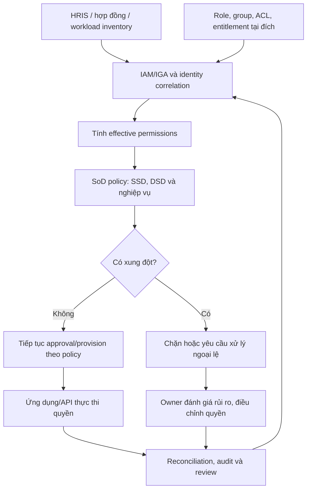
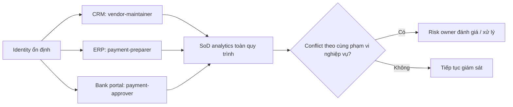

# Quy tắc phân tách trách nhiệm (Segregation of Duties) trong IAM

**Segregation of Duties (SoD)**, hay **phân tách trách nhiệm**, là nguyên tắc kiểm soát nhằm ngăn một chủ thể có thể tự mình thực hiện trọn vẹn những bước công việc **xung đột hoặc có khả năng che giấu sai phạm**. Trong quản lý danh tính và truy cập (Identity and Access Management — IAM), **quy tắc SoD** xác định các vai trò, quyền, hành động hoặc quan hệ nghiệp vụ **không được kết hợp** trong những điều kiện nhất định.

Ví dụ, nhân viên có thể **tạo yêu cầu thanh toán** nhưng không được **tự phê duyệt chính yêu cầu đó**. Một người quản trị có thể tạo tài khoản, nhưng việc cấp đặc quyền cao cho chính mình cần có phê duyệt độc lập. Quy tắc không chỉ giúp giảm gian lận: nó còn phòng lỗi vận hành, kiểm soát thay đổi nhạy cảm và tạo bằng chứng kiểm toán đáng tin.

Trong module **Identity Lifecycle** của IAM, SoD gắn với vòng đời **Joiner–Mover–Leaver (JML)**. Người mới phải được kiểm tra xung đột trước khi cấp role; người chuyển công việc phải bị thu hồi quyền cũ; người đã nghỉ phải mất các đường truy cập còn tồn dư. SoD cần phối hợp **IdP/SSO, SCIM, RBAC/ABAC, tài khoản dịch vụ, access request, approval, access review và audit**.

## 1. Quy tắc SoD kiểm soát điều gì?

Một quy tắc SoD mô tả **tổ hợp quyền hoặc hành động xung đột**, phạm vi áp dụng và cách xử lý. Nó thường trả lời:

1. **Ai?** Một identity, account, người dùng có nhiều account, đối tác hay workload.
2. **Được làm gì?** Các permission, role và thao tác nghiệp vụ cụ thể.
3. **Trên tài nguyên nào?** Tài khoản ngân hàng, hóa đơn, hợp đồng, tài nguyên cloud hoặc tenant.
4. **Khi nào xung đột?** Khi cùng được gán role, cùng kích hoạt trong phiên hay thực hiện hai bước trên cùng giao dịch.
5. **Hậu quả?** Chặn cấp quyền, từ chối giao dịch, yêu cầu điều chỉnh hoặc ngoại lệ được phê duyệt.
6. **Ai chịu trách nhiệm?** Process owner, data owner, Security/IAM và người phê duyệt ngoại lệ.

| Khái niệm | Ý nghĩa | Ví dụ |
| --- | --- | --- |
| **Business duty** | Trách nhiệm trong quy trình nghiệp vụ | Tạo đề nghị mua hàng |
| **Permission** | Quyền cho một hành động | `purchase-order.approve` |
| **Role** | Tập permission theo nhiệm vụ | `purchasing-approver` |
| **SoD conflict** | Tổ hợp quyền/hành động không được phép | Vừa tạo vừa duyệt cùng giao dịch |
| **SoD rule** | Chính sách biểu diễn xung đột và phạm vi | Creator không được là approver của đơn do mình tạo |
| **Violation** | Trạng thái hoặc hành động vi phạm rule | User thực hiện tự phê duyệt |
| **Mitigation** | Kiểm soát bù trừ khi ngoại lệ hợp lệ | Phê duyệt độc lập, giám sát tăng cường |
| **Exception** | Quyết định chấp nhận rủi ro trong giới hạn | Ủy quyền có thời hạn cho kỳ ứng cứu |

**SoD không đồng nghĩa “một người không được có nhiều role”.** Người dùng có thể hợp lệ với nhiều vai trò không xung đột. Quy tắc cần được thiết kế **đúng chức năng và tài nguyên**; cấm tùy tiện mọi tổ hợp sẽ làm giảm năng suất và tạo động cơ dùng tài khoản ngoài quản trị.

## 2. Tại sao cần phân tách trách nhiệm?

Khi một người có thể đề xuất, phê duyệt, thực thi và che giấu cùng một hoạt động, nguy cơ gian lận hoặc sai sót khó bị phát hiện tăng lên.

| Quy trình | Tổ hợp rủi ro | Biện pháp phân tách |
| --- | --- | --- |
| **Thanh toán** | Tạo và tự duyệt khoản thanh toán | Creator khác approver trên cùng giao dịch |
| **Mua sắm** | Tạo nhà cung cấp và duyệt thanh toán tới họ | Tách quản trị vendor khỏi quyết định thanh toán |
| **IAM** | Tự đề nghị rồi tự duyệt role admin | Approval độc lập, policy chặn self-approval |
| **Triển khai phần mềm** | Tự viết, tự duyệt và tự triển khai thay đổi nhạy cảm | Peer review và quyền triển khai được kiểm soát |
| **Kiểm toán** | Vừa sửa vừa xóa dấu vết audit | Tách quyền vận hành khỏi quản trị log |
| **Sao lưu/phục hồi** | Có thể thay đổi dữ liệu nguồn và xóa mọi bản sao | Giới hạn quyền xóa, phân tách quản trị backup |

SoD làm giảm **khả năng một chủ thể đơn lẻ hoàn tất chuỗi hành động rủi ro**. Tuy nhiên, nó không loại bỏ hoàn toàn rủi ro thông đồng giữa nhiều người; cần bổ sung audit, giới hạn đặc quyền, phê duyệt và giám sát.

## 3. Static SoD, Dynamic SoD và kiểm soát theo giao dịch

Cần phân biệt các lớp quy tắc vì chúng được thực thi tại những thời điểm khác nhau.

| Loại | Điều bị hạn chế | Thời điểm kiểm tra | Ví dụ |
| --- | --- | --- | --- |
| **Static Separation of Duties (SSD)** | Một subject không được đồng thời **được gán** các role xung đột | Khi cấp/gỡ role và trong recertification | Không đồng thời có `vendor-maintainer` và `vendor-payment-approver` trong phạm vi cấm |
| **Dynamic Separation of Duties (DSD)** | Không được đồng thời **kích hoạt** các role xung đột trong ngữ cảnh được định nghĩa | Khi tạo phiên, chọn role hoặc kích hoạt đặc quyền | Không bật hai vai trò tác nghiệp xung đột trong cùng phiên |
| **Transaction-level SoD** | Không được thực hiện hai bước xung đột đối với cùng một đối tượng/giao dịch | Khi API xử lý từng hành động | Người tạo hóa đơn không được phê duyệt hóa đơn ấy |
| **Workflow/approval SoD** | Người yêu cầu, phê duyệt, provision hoặc kiểm tra không được kiêm nhiệm trái policy | Trong access request, approval và vận hành | Không tự duyệt cấp quyền admin cho chính mình |

### Static SoD (SSD)

SSD là biện pháp **ngăn từ gốc** những tổ hợp assignment không được phép. Ví dụ chính sách cấm một người đồng thời có quyền quản lý thông tin tài khoản nhà cung cấp và quyền duyệt thanh toán cho nhà cung cấp đó.

Khi xin role mới, IAM phải tính **tập quyền hiệu lực sau khi cấp** (gồm nhóm, kế thừa role, gán trực tiếp) rồi kiểm tra conflict matrix. Chỉ so tên role mới với role của một hệ thống có thể bỏ sót xung đột liên ứng dụng.

### Dynamic SoD (DSD)

DSD có thể cho phép một người **đủ điều kiện với nhiều role**, nhưng không cho sử dụng đồng thời trong phiên theo quy tắc. Ví dụ người trực vận hành vừa đủ điều kiện thao tác xử lý sự cố vừa đủ điều kiện đánh giá kết quả, song chính sách có thể hạn chế việc kích hoạt cùng lúc.

**DSD không tự ngăn hành vi tự duyệt qua hai phiên liên tiếp.** Nếu nghiệp vụ cấm một người tạo và phê duyệt cùng giao dịch thì phải có kiểm tra **ở cấp đối tượng**, không dựa riêng vào trạng thái kích hoạt role.

### Transaction-level SoD

API có thể từ chối `approve` nếu `resource.created_by == subject.identity_id`, ngay cả khi người dùng có role `approver`. Điều này có thể phối hợp với kiểm soát phiên và SSD, thay vì thay thế chúng.

## 4. Xây dựng một quy tắc SoD rõ ràng

Một rule có thể được mô tả bằng những trường sau:

| Trường | Ý nghĩa | Ví dụ minh họa |
| --- | --- | --- |
| `ruleId` | Định danh ổn định | `sod-payment-creator-approver` |
| `description` | Lý do nghiệp vụ | Tránh tự phê duyệt thanh toán |
| `conflictingDuties` | Hai hoặc nhiều nhiệm vụ xung đột | Create payment, approve payment |
| `scope` | Tenant, công ty, account hoặc giao dịch | Cùng tenant và cùng payment |
| `constraintType` | SSD, DSD hoặc transaction-level | Transaction-level |
| `riskLevel` | Rủi ro khi vi phạm | High |
| `ruleOwner` | Chủ quy trình chịu trách nhiệm | Finance control owner |
| `effectiveFrom/Until` | Thời gian chính sách có hiệu lực | Theo quy trình thay đổi |
| `exceptionPolicy` | Điều kiện ngoại lệ và kiểm soát bù trừ | Approval độc lập có thời hạn |
| `version` | Phiên bản để audit | `2026.11` |

Các trường là **mô hình minh họa**, không phải schema chuẩn SCIM hay một định dạng chính sách bắt buộc.

Một rule cần giải thích rõ **tại sao hai nhiệm vụ xung đột**. Chỉ ghi “Role A không đi cùng Role B” mà không có owner, phạm vi và tác động sẽ khiến việc xử lý ngoại lệ hoặc thay đổi role trở nên tùy tiện.

## 5. Mô hình đánh giá SoD trong IAM



Quy trình cần có **nguồn quyền quan sát tại đích**. Một permission có thể đến từ membership nhóm lồng nhau, role kế thừa, account phụ, ACL trực tiếp hoặc role cục bộ được cấp ngoài IAM.

**Approval và provisioning chỉ là một phần của SoD.** Một quyết định `Approve` không làm cho tổ hợp xung đột trở nên hợp lệ nếu policy cấm, và một API không được chỉ tin vào việc IAM đã từng phê duyệt.

## 6. Ví dụ quy tắc ở cấp giao dịch

Xét nghiệp vụ phê duyệt khoản thanh toán:

```text
PERMIT approve_payment IF
    subject.lifecycle_status == "active"
    AND "payment-approver" IN subject.effective_roles
    AND subject.tenant_id == payment.tenant_id
    AND subject.identity_id != payment.created_by_identity_id
    AND payment.amount <= subject.approval_limit
    AND payment.status == "PENDING_APPROVAL"
ELSE DENY
```

Đây là **giả mã**. Thuộc tính `created_by_identity_id` phải được lưu bởi hệ thống nghiệp vụ, không cho client gửi tùy ý rồi tự xác định người tạo. Hạn mức, role, tenant và lifecycle status cũng phải đến từ nguồn tin cậy.

Lưu ý: Một người không có permission `payment-approver` phải bị từ chối trước dù không phải người tạo. Một người có role hợp lệ vẫn bị từ chối nếu chính họ tạo giao dịch. **RBAC và kiểm tra SoD ở cấp đối tượng cần cùng đúng**.

## 7. SoD conflict matrix

**Ma trận xung đột** là công cụ để định nghĩa và kiểm tra những tập nhiệm vụ/role không được phép kết hợp:

| Quyền A | Quyền B | Điều kiện xung đột | Hướng kiểm soát |
| --- | --- | --- | --- |
| Tạo thanh toán | Duyệt thanh toán | Cùng giao dịch, theo chính sách | Transaction SoD; có thể thêm SSD |
| Quản lý vendor | Duyệt chi trả vendor | Cùng đơn vị hoặc nhà cung cấp | SSD hoặc xét theo resource |
| Tạo user | Duyệt admin access | Yêu cầu do chính mình khởi tạo | Approval SoD |
| Sửa security policy | Vô hiệu/xóa audit log | Trong cùng phạm vi bảo vệ | SSD, giới hạn đặc quyền và log độc lập |
| Viết thay đổi production | Tự duyệt release | Với cùng change request | Workflow SoD |
| Quản trị backup | Xóa toàn bộ backup và log | Cùng hệ thống phục hồi | Tách vai trò, cần phê duyệt độc lập |

Không phải mọi cặp trên đều cần cấm tuyệt đối ở mọi tổ chức. Chủ quy trình phải xác định **mức rủi ro, ranh giới tài nguyên, điều kiện cụ thể và khả năng kiểm soát bù trừ** trước khi đưa vào policy.

**Không thiết kế conflict matrix chỉ theo tên role.** Khi một role được thêm permission mới, những xung đột trước đây có thể thay đổi mà tên role vẫn giữ nguyên.

## 8. SoD và least privilege

**Least privilege** đòi hỏi mỗi chủ thể chỉ có quyền cần thiết. **SoD** đòi hỏi một số tổ hợp quyền không được tập trung vào cùng chủ thể hoặc cùng giao dịch, ngay cả khi từng quyền có thể có lý do nghiệp vụ riêng.

Ví dụ một trưởng nhóm vừa có trách nhiệm tạo yêu cầu mua hàng vừa kiểm soát ngân sách. Từng trách nhiệm có thể là hợp lệ, nhưng **tự phê duyệt yêu cầu của mình** vẫn có thể bị cấm.

Để giảm vi phạm:

1. Tạo role theo chức năng đủ hẹp.
2. Tránh role composite có permission mâu thuẫn.
3. Dùng ABAC giới hạn theo tenant, dự án và đối tượng.
4. Dùng JIT/JEA/PAM với quyền đặc biệt có thời hạn khi phù hợp.
5. Phân định người yêu cầu, người duyệt, người provision và người kiểm tra.
6. Kiểm tra conflict trên **effective permission**, không chỉ assignment trực tiếp.

**JIT không tự giải quyết SoD.** Một quyền xung đột tồn tại trong 30 phút vẫn có thể đủ để tự tạo và duyệt một giao dịch; phải giới hạn hành vi ở cấp nghiệp vụ.

## 9. Kiểm tra SoD trong Access request và approval workflow

Khi người dùng yêu cầu một entitlement mới, hệ thống cần:

1. Xác nhận **requester** và **beneficiary** (có thể là hai người khác nhau).
2. Xác minh resource/tenant và quyền thực tế mà entitlement mang lại.
3. Tính quyền hiệu lực hiện có của beneficiary, kể cả role kế thừa.
4. Tính quyền giả định **nếu yêu cầu được cấp**.
5. Đánh giá SoD theo phiên bản rule hiện hành.
6. Nếu xung đột, **Reject**, đề xuất role khác hoặc chuyển tuyến ngoại lệ có thẩm quyền.
7. Nếu không xung đột, tiếp tục các bước approval khác; không tự động kết luận đủ điều kiện.
8. Trước provisioning, **đánh giá lại** vì quyền, trạng thái JML và dữ liệu có thể đã thay đổi.
9. Sau provisioning, readback và audit.

Một người có thể tự gửi request nhưng **không được tự phê duyệt quyền nhạy cảm của mình** nếu chính sách SoD cấm. Approver phải được tra cứu từ owner/policy đáng tin, không dựa vào `approverId` do client tự gửi.

## 10. Joiner: ngăn xung đột trước khi cấp quyền ban đầu

Khi **Joiner**, IAM tính bộ quyền **birthright** từ nguồn HRIS hoặc quan hệ có thẩm quyền. Nếu một business role gom những permission xung đột, việc cấp tự động có thể tạo rủi ro ngay ngày đầu.

Ví dụ:
- Nhân viên Finance được cấp `invoice-preparer` để tạo chứng từ.
- Quyền `invoice-approver` yêu cầu đánh giá độc lập.
- Nếu người đó đồng thời đủ điều kiện cho cả hai role, engine SoD xác định chính sách **cấm gán đồng thời** hoặc **cấm tự phê duyệt** tùy thiết kế.
- Workflow phải ghi rõ quyết định, owner và phạm vi.

**Không cấp quyền quá sớm chỉ vì account đã được provision trước ngày bắt đầu.** Trạng thái identity, eligibility và ngày hiệu lực phải được đánh giá tại thời điểm quyền thực sự có hiệu lực.

## 11. Mover: phát hiện role accumulation và xung đột mới

**Mover** thường làm xuất hiện SoD violation khi người dùng được cấp role mới nhưng role cũ chưa bị gỡ.

| Trước Mover | Vai trò mới | Xung đột có thể phát sinh | Biện pháp |
| --- | --- | --- | --- |
| `payment-creator` | `payment-approver` | Hai bước của chu trình thanh toán | Gỡ role cũ, áp dụng transaction SoD |
| `developer` | `production-release-approver` | Tự duyệt thay đổi do mình viết | Kiểm soát change ownership |
| `support-operator` | `security-auditor` | Tác nghiệp rồi tự kiểm tra dấu vết | Thu hồi quyền vận hành không còn cần |
| Quyền dự án A | Quyền kiểm toán dự án A | Vừa cập nhật vừa phê duyệt nguồn dữ liệu | Xem xét role/scope theo dự án |

Quy trình Mover an toàn là **tính lại desired entitlements**, không chỉ thêm quyền mới. Nếu có thời gian bàn giao, ngoại lệ cần owner, lý do, thời hạn và kiểm soát bù trừ.

**Chỉ gỡ nhóm tại IdP chưa chắc gỡ role cục bộ tại ứng dụng**. Cần reconciliation và kiểm tra permission thực tế tại ERP, CRM, Git platform hoặc API đích.

## 12. Leaver: thu hồi quyền không chờ chu kỳ SoD review

Khi nhân viên hoặc partner đã **Leaver**, các quyền nghiệp vụ không còn căn cứ phải được thu hồi theo thời điểm chấm dứt. SoD không phải là lý do để duy trì quyền trái phép hoặc trì hoãn deprovisioning.

Những việc cần thực hiện:

- Disable identity/account ở IdP hoặc directory để ngăn đăng nhập mới.
- Thu hồi role/group/ACL qua SCIM, connector hoặc API đích.
- Gỡ quyền approval, delegation và các nhiệm vụ kiểm soát liên quan.
- Kiểm tra account phụ, account đặc quyền và credential độc lập.
- Xử lý session, refresh/access token theo khả năng của ứng dụng.
- Đọc lại trạng thái entitlement và thử hành động bị cấm.
- Ghi kết quả thu hồi, owner và những sai lệch đang cần remediation.

**Disable SSO không tự chấm dứt mọi phiên ứng dụng; SCIM `active=false` không tự thu hồi tất cả token hoặc quyền cục bộ.** Chỉ được kết luận hoàn tất khi các đường truy cập liên quan đã được xử lý và kiểm chứng theo chính sách.

## 13. Phát hiện xung đột xuyên hệ thống

Một nhiệm vụ nghiệp vụ có thể trải qua nhiều ứng dụng: quản lý vendor trong CRM, tạo thanh toán trong ERP và phê duyệt chuyển tiền ở một cổng ngân hàng. Nếu chỉ kiểm tra SoD **trong từng ứng dụng riêng lẻ**, tổ hợp xung đột có thể bị bỏ sót.



Để phát hiện đúng cần:

- Correlate account từ nhiều ứng dụng về một **identity ID**.
- Ánh xạ technical entitlement sang **business duty** thống nhất.
- Xác định cùng pháp nhân, tenant, dự án, tài khoản hoặc transaction.
- Tính quyền trực tiếp và quyền qua group/role hierarchy.
- Phân biệt **quyền có thể thực hiện** với **hành động thực tế đã thực hiện**.
- Ghi nguồn, phiên bản rule và độ mới dữ liệu.

Một ma trận chỉ có tên role mà thiếu context thường gây nhiều false positive hoặc bỏ sót vi phạm thực sự.

## 14. Dynamic SoD và kiểm tra tại thời điểm thực thi

Một người được phép kích hoạt role approver theo ca trực chưa có nghĩa được phê duyệt mọi giao dịch. **API nghiệp vụ** phải thực thi kiểm tra theo dữ liệu nguồn đáng tin.

Ví dụ một thao tác `approveInvoice(invoiceId)` cần kiểm tra:

- Subject đã xác thực, còn active và có quyền `invoice.approve`.
- Invoice thuộc tenant và phạm vi dữ liệu được giao.
- Subject không phải người tạo giao dịch nếu chính sách cấm.
- Hạn mức và trạng thái hóa đơn còn hợp lệ.
- Không có quyết định phê duyệt trước đó gây xung đột.
- Các kiểm soát tính toàn vẹn giao dịch và ghi log còn hoạt động.

**Không dựa vào client để khai `createdBy`**. Server phải đọc dữ liệu giao dịch và identity ổn định. Nếu chỉ kiểm tra ở UI, kẻ tấn công có thể gọi API trực tiếp để vượt quy trình.

## 15. Ngoại lệ SoD và kiểm soát bù trừ

Không phải tổ chức nào cũng có đủ nhân sự để phân tách mọi nhiệm vụ. Trong tình huống khẩn cấp hoặc doanh nghiệp nhỏ, chính sách có thể cho phép **ngoại lệ được phê duyệt có thời hạn**, kèm kiểm soát bù trừ.

| Biện pháp | Mục đích | Giới hạn |
| --- | --- | --- |
| Approval độc lập | Người có thẩm quyền chấp nhận rủi ro | Không hợp thức hóa hành động bị cấm tuyệt đối |
| Thời hạn JIT | Giảm thời gian giữ quyền | Không tự ngăn tự duyệt giao dịch |
| Giới hạn scope | Hạn chế tài nguyên/giao dịch có thể tác động | Cần enforcement phía server |
| Giám sát phiên | Có bằng chứng thao tác | Không thay thế ngăn chặn |
| Đối chiếu hậu kiểm | Người thứ hai kiểm tra giao dịch | Chỉ phát hiện sau khi thao tác xảy ra |
| Dual control | Hai bên cùng phê duyệt hành động | Cần kiểm tra tính độc lập thực sự |
| Alert độ ưu tiên cao | Phát hiện sử dụng bất thường | Cần có đội phản hồi |

Mỗi ngoại lệ cần ghi **rule ID, subject, entitlement, resource, lý do, owner, người chấp thuận, ngày hết hạn và kết quả hậu kiểm**.

**Không biến ngoại lệ thành role vĩnh viễn**, không tự động cho phép chỉ vì approver vắng mặt và không dùng một cờ `emergency=true` không được xác thực để bỏ qua policy.

## 16. Break-glass privilege và SoD

**Break-glass** là cơ chế khẩn cấp để phục hồi quyền kiểm soát khi đường quản trị thông thường bị hỏng. Nó có thể cần đặc quyền rộng hơn JIT thường ngày, nhưng phải được thiết kế riêng:

1. Xác định tiêu chí sự cố và người có thẩm quyền kích hoạt.
2. Bảo vệ credential hoặc cơ chế truy cập dự phòng độc lập.
3. Ghi incident ID và giám sát mọi lần sử dụng.
4. Giới hạn hành động phục hồi khi khả thi.
5. Có approval/dual control hoặc hậu kiểm độc lập theo policy.
6. Kết thúc phiên, thu hồi quyền/secret liên quan và kiểm tra trạng thái.
7. Rà soát nguyên nhân và cập nhật quy tắc.

**Break-glass không có nghĩa SoD bị bỏ vĩnh viễn.** Nếu việc ngăn chặn trước không khả thi vì tình huống khẩn cấp, tổ chức phải áp dụng biện pháp bù trừ tương xứng và chứng minh đã trả quyền về trạng thái an toàn.

## 17. SoD với partner và service/workload identity

### Partner identity

Một người được xác thực qua IdP của đối tác vẫn cần authorization theo **partner ID, hợp đồng, tenant, sponsor và role thực tế**. Nếu partner được quyền tạo yêu cầu trong hệ thống của doanh nghiệp nhưng không được tự phê duyệt, SoD phải hoạt động tại ứng dụng đích, không chỉ ở IdP đối tác.

Khi hợp đồng kết thúc, quyền liên quan phải bị thu hồi dù partner IdP tiếp tục xác thực người dùng. Không dùng quyền nhóm B2B chung để bỏ qua phân tách trách nhiệm của từng tenant.

### Service account và workload

Một automation có thể tạo yêu cầu rồi gửi sang hệ thống khác. Nếu cùng một workload credential vừa **tạo**, vừa **duyệt** và **thực thi thanh toán**, SoD nghiệp vụ có thể bị vô hiệu mặc dù không có human user nào sở hữu cả hai role.

Các kiểm soát gồm:

- Mỗi workload có identity và owner rõ ràng.
- Phân tách dịch vụ tạo yêu cầu và dịch vụ chấp thuận/phát hành theo mức rủi ro.
- Không dùng chung token `admin` giữa pipeline, môi trường hoặc hệ thống.
- Giới hạn scope, audience, môi trường và thời hạn credential.
- Kiểm tra ai có quyền sửa pipeline hoặc secret để tránh vượt SoD gián tiếp.
- Khi owner kỹ thuật Mover/Leaver, chuyển ownership và thu hồi quyền cá nhân đối với credential.

**SoD không chỉ áp dụng cho con người**; nó áp dụng cho khả năng thực hiện một chuỗi nhiệm vụ rủi ro, kể cả thông qua automation.

## 18. IdP, SSO, SCIM và thực thi SoD

| Thành phần | Đóng góp | Giới hạn |
| --- | --- | --- |
| **HRIS / contract source** | Trạng thái quan hệ và vai trò nghiệp vụ | Không biết mọi quyền ứng dụng |
| **IdP / AD** | Account, group và một số claim | Có thể thiếu role cục bộ |
| **SSO/OIDC/SAML** | Xác thực liên kết và claim theo trust | Không tự ngăn xung đột giao dịch |
| **SCIM / connector** | Provision/deprovision user, group theo hỗ trợ | Không phải policy engine SoD chung |
| **RBAC / ABAC / PBAC** | Mô hình hóa role, thuộc tính và policy | Phải được enforcement thực tế tại API |
| **IAM/IGA** | SoD analysis trước cấp, review định kỳ | Cần observed state và mapping chuẩn |
| **Application PEP** | Chặn hành động xung đột tại tài nguyên | Phải dùng dữ liệu giao dịch tin cậy |
| **Audit / reconciliation** | Phát hiện sai lệch và bằng chứng | Không thay thế quyết định từ chối |

**ID token OIDC không phải access token cho API**. Access token hoặc session hợp lệ cũng chưa đủ để cho phép thao tác nếu rule SoD tại tài nguyên yêu cầu từ chối.

## 19. SoD trong Access review và recertification

Các chiến dịch review cần phát hiện không chỉ “quyền này còn cần không” mà còn “**tổ hợp quyền hiện tại có xung đột không**”.

Ví dụ:

| Identity | Quyền A | Quyền B | Đánh giá |
| --- | --- | --- | --- |
| Lan | `payment-creator` | `payment-approver` | Kiểm tra SSD và transaction SoD |
| Minh | `developer` | `release-approver` | Kiểm tra chính sách cùng change |
| Hòa | `audit-reader` | `audit-log-deleter` | Quyền xóa log có thể xung đột |
| Workload R | `invoice.create` | `invoice.approve` | Cần phân tách automation |
| Partner X | `contract.request` | `contract.approve` | Kiểm tra phạm vi partner/tenant |

Reviewer cần nhìn thấy **đường nhận quyền**, nguồn account và ngoại lệ đang hiệu lực. Nếu chọn Remove một quyền xung đột, hệ thống phải **deprovision, readback và xác minh** ở đích.

**100% item review đã được duyệt không đồng nghĩa 100% SoD violation đã được khắc phục**. Phải tách decision khỏi verified remediation.

## 20. Reconciliation và xử lý vi phạm SoD

```text
observed = effective_entitlements(identity, all_target_accounts)
conflicts = evaluate_sod_rules(observed, resource_scope, JML_state)

for each conflict:
    classify_risk_and_owner()
    choose_remove_change_or_time_bounded_exception()
    execute_controlled_remediation()
    verify_effective_access()
```

Đây là giả mã tư duy, không phải code có thể chạy trực tiếp. Trong thực tế còn cần SoD theo **giao dịch đã thực hiện** bên cạnh entitlement snapshot.

Quy trình chuẩn:

1. Thu thập observed permissions từ IdP/AD và ứng dụng đích.
2. Liên kết đúng account với identity, bao gồm account đặc quyền phụ.
3. Tính role hierarchy, nested group, direct grant và quyền từ policy.
4. Áp dụng conflict matrix theo scope và rule version.
5. Ưu tiên vi phạm có khả năng sửa/xóa dữ liệu hoặc che log.
6. Phân công owner; đánh giá thay role, giảm scope hoặc thu hồi quyền.
7. Thực hiện deprovision và xử lý phiên/token cần thiết.
8. Readback và negative authorization test ở hệ thống rủi ro cao.
9. Ghi bằng chứng, ngoại lệ, SLA và kiểm tra lại trong đợt tiếp theo.

**Connector báo thành công không chứng minh quyền đã mất hiệu lực**, đặc biệt nếu còn role gán cục bộ, token tự chứa hoặc phiên cache claim cũ.

## 21. Các lỗi thiết kế SoD phổ biến

| Sai lầm | Hậu quả | Khắc phục |
| --- | --- | --- |
| Chỉ so tên role | Bỏ sót quyền kế thừa hoặc permission mới | Tính effective permissions |
| Cấm quá rộng, không xét scope | Nhiều false positive và tắc nghiệp vụ | Xác định tenant/giao dịch/đơn vị |
| Chỉ kiểm SSD | Tự duyệt qua phiên hoặc giao dịch | Kết hợp DSD và transaction controls |
| Chỉ kiểm trước cấp quyền | Xung đột xuất hiện sau Mover hoặc đổi role | Event-driven và periodic re-evaluation |
| Cho tự phê duyệt ngoại lệ | Mất kiểm soát độc lập | Phân tách approver theo policy |
| Không liên kết account phụ | Người dùng có quyền xung đột ở nhiều account | Identity correlation |
| Không kiểm tra workflow automation | Workload có thể thực hiện cả hai bước | Service identity và policy theo nhiệm vụ |
| Không xử lý session/token sau revoke | Vi phạm vẫn thực thi được | Revoke/TTL và authorization hiện hành |
| Không lưu version của rule | Khó giải thích quyết định lịch sử | Policy versioning và audit |
| Chỉ báo cáo số conflict phát hiện | Không biết conflict đã bị xử lý chưa | Verified remediation và SLA |

Một quy tắc quá nhiều false positive sẽ khiến người dùng tìm đường vòng. Cần điều chỉnh rule theo quy trình nghiệp vụ thực, nhưng **không được giảm kiểm soát chỉ để làm đẹp số liệu**.

## 22. Kiểm thử quy tắc SoD

Một bộ kiểm thử nên bao gồm:

| Tình huống | Kết quả mong muốn |
| --- | --- |
| User có role creator, xin thêm role approver bị cấm SSD | Reject hoặc chuyển xử lý theo rule |
| User có hai role hợp lệ nhưng không được kích hoạt đồng thời | DSD chặn kích hoạt xung đột |
| User tạo rồi tự duyệt cùng giao dịch trong hai phiên | Transaction SoD từ chối |
| User thuộc nested group cấp quyền approver | Conflict detection nhận ra quyền gián tiếp |
| Role bị thêm permission nhạy cảm | Re-evaluate những người đang giữ role |
| Mover vẫn giữ quyền cũ | Phát hiện và revoke quyền tồn dư |
| Leaver có session cũ | API không tiếp tục chấp nhận hành động trái policy |
| Partner ở tenant A yêu cầu giao dịch tenant B | Từ chối trước hoặc cùng kiểm SoD |
| Workload tạo và duyệt cùng giao dịch | Chặn theo policy nghiệp vụ |
| Approver tự duyệt quyền admin cho mình | Workflow từ chối theo approval SoD |
| Ngoại lệ quá hạn | Không tiếp tục cấp/kích hoạt quyền |
| Connector gỡ role nhưng token cũ còn tác dụng | Negative test phát hiện cần xử lý phiên/token |

Kiểm thử phải bao gồm **API trực tiếp, thay đổi JML giữa lúc duyệt và cấp quyền, sự kiện đồng thời, cache policy và dữ liệu thiếu**. Không chỉ kiểm thử màn hình ẩn nút phê duyệt.

## 23. Audit và chỉ số quản trị SoD

Một bản ghi kiểm toán nên có **rule ID/version, identity ID, account, entitlement/role, resource scope, xung đột, thời điểm, quyết định, owner, approval/exception, lệnh remediation và kết quả readback**. Đối với giao dịch, cần correlation ID liên kết creator, approver và resource.

Không ghi plaintext password, OTP, access/refresh token, API key, cookie hoặc secret vào audit log. Phân quyền và bảo vệ tính toàn vẹn của log để người có đặc quyền nghiệp vụ không tự xóa dấu vết.

Các chỉ số hữu ích:

- **Active SoD conflicts:** số tổ hợp quyền xung đột đang hoạt động.
- **High-risk conflicts:** số xung đột có tác động lớn chưa xử lý.
- **Prevented toxic combinations:** số lần yêu cầu cấp quyền bị chặn vì rule.
- **Exception count/age:** số ngoại lệ và tuổi ngoại lệ.
- **Expired exceptions:** ngoại lệ quá hạn còn hiệu lực.
- **Remediation latency:** thời gian từ phát hiện đến thu hồi quyền thực tế.
- **Verified resolution rate:** tỷ lệ conflict đã được kiểm chứng không còn.
- **Mover-induced conflict rate:** tỷ lệ xung đột do đổi vai trò.
- **Transaction-level SoD denials:** số hành động tự duyệt bị từ chối.
- **Orphan/uncorrelated accounts:** account chưa liên kết identity để phân tích.
- **Cross-application coverage:** mức bao phủ hệ thống tham gia quy trình nghiệp vụ.

Không nên đánh giá thành công chỉ theo việc số conflict được báo cáo giảm. Số lượng thấp có thể do **thiếu dữ liệu quan sát**, chứ không phải quyền thực sự an toàn.

## 24. Tình huống tự kiểm tra

**Tình huống A:** Người dùng có role `payment-creator` và `payment-approver` nhưng công ty chỉ cấm tự duyệt giao dịch của mình. Có nhất thiết phải từ chối assignment thứ hai không? **Không nhất thiết** nếu policy chọn transaction SoD thay vì SSD; nhưng phải kiểm tra đúng yêu cầu tổ chức và thực thi tại API.

**Tình huống B:** Công ty có DSD cấm kích hoạt đồng thời creator và approver trong cùng phiên. Người dùng mở hai phiên để tự duyệt. DSD đã đủ chưa? **Chưa.** Cần transaction-level kiểm tra người tạo và người duyệt.

**Tình huống C:** Nhân viên Mover sang vị trí approver nhưng vẫn có role creator cũ. Có thể chỉ phê duyệt role mới không? **Không.** Phải đánh giá xung đột và thu hồi quyền không còn căn cứ.

**Tình huống D:** Group `Finance-Managers` được nest vào `Payment-Approvers`. Một user có conflict qua nhóm lồng nhau. Có thể bỏ qua vì không trực tiếp được gán role không? **Không.** Phải xét effective permissions.

**Tình huống E:** Service account có thể tự tạo và phê duyệt yêu cầu thanh toán. Đây có phải SoD violation không? **Có thể có**, vì SoD phải áp dụng theo khả năng thực hiện chuỗi hành động của workload, tùy policy nghiệp vụ.

**Tình huống F:** Reviewer chọn Remove quyền xung đột nhưng ERP vẫn chấp nhận token cũ. Có thể đóng vi phạm không? **Chưa.** Cần kiểm chứng quyền hiệu lực và xử lý session/token theo thiết kế.

## Ghi nhớ

**Quy tắc phân tách trách nhiệm (SoD)** giúp ngăn **một chủ thể tự thực hiện các nhiệm vụ xung đột**, gồm kiểm soát **Static SoD**, **Dynamic SoD**, **SoD theo giao dịch** và **SoD trong approval workflow**. Thiết kế chính xác cần **business duty, role/permission mapping, phạm vi tài nguyên, nguồn dữ liệu tin cậy, conflict matrix, owner, ngoại lệ có thời hạn và thực thi tại API**. Trong vòng đời **Joiner–Mover–Leaver**, cần kiểm tra trước khi cấp, đánh giá lại khi đổi nhiệm vụ, thu hồi khi không còn căn cứ và **xác minh quyền thực tế tại hệ thống đích**. Kết hợp **IdP/SSO, SCIM, RBAC/ABAC, quản trị service identity, access review, audit và reconciliation** để SoD không chỉ là ma trận trên giấy mà trở thành kiểm soát chống quyền truy cập và hành động rủi ro.
