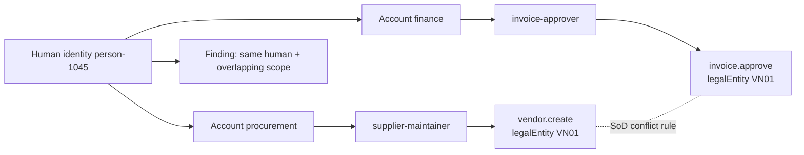
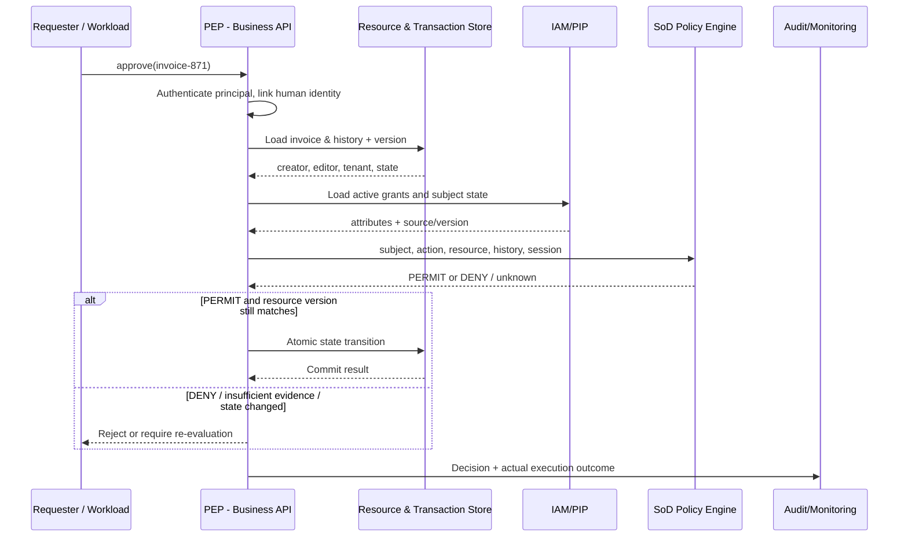
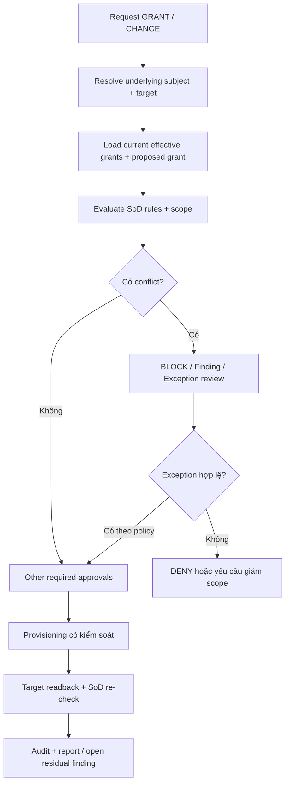
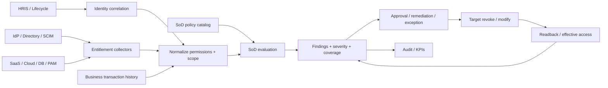

# Phát hiện vi phạm Segregation of Duties (SoD) trong vòng đời danh tính IAM

Một nhân viên thuộc phòng mua sắm có quyền tạo nhà cung cấp. Khi chuyển sang phòng kế toán, nhân viên được cấp quyền phê duyệt thanh toán nhưng quyền tạo nhà cung cấp cũ chưa bị gỡ. Dưới góc nhìn của từng ứng dụng, cả hai quyền đều “hợp lệ”: ứng dụng mua sắm vẫn ghi nhận role cũ, ứng dụng kế toán ghi nhận role mới. Nhưng khi kết hợp, một người có thể **tạo nhà cung cấp, thay thông tin thanh toán và phê duyệt chuyển tiền** mà không có sự kiểm tra độc lập. Đó là một ví dụ điển hình của **vi phạm hoặc xung đột Segregation of Duties (SoD)**.

Một lỗi khác tinh vi hơn: hệ thống IAM đã gỡ nhóm ở IdP, nhưng user còn **role trực tiếp tại SaaS**; tài khoản quản trị phụ hoặc token vẫn thực hiện được hành động bị cấm. Nếu chỉ so danh sách role trong directory, bộ phát hiện sẽ bỏ sót rủi ro thực sự.

**Phát hiện vi phạm SoD** là quá trình xác định những trường hợp mà **tập quyền hiện có, khả năng kích hoạt quyền hoặc các hành động đã thực hiện** của một chủ thể không đáp ứng quy tắc **phân tách nhiệm vụ, kiểm soát chéo hoặc độc lập trách nhiệm** do tổ chức thiết lập. Hệ thống phải xác định **vi phạm ở đâu, theo quy tắc nào, trên scope/resource nào, tại thời điểm nào, có bằng chứng gì và ai xử lý**.

Bài thuộc chương **Segregation of duties** của mô-đun **Identity Lifecycle** trong **Identity and Access Management (IAM)**. Trọng tâm là phát hiện xung đột quyền theo **Joiner–Mover–Leaver (JML)**, từ xác minh danh tính, tạo account và cấp quyền đến rà soát, thay đổi và thu hồi; kết nối với **IdP, SSO, SCIM, RBAC/ABAC, PAM/PIM, tài khoản dịch vụ, kiểm toán, reconciliation** và mục tiêu giảm **quyền truy cập tồn dư**.

> **Thông điệp chính:** Không thể phát hiện SoD chính xác chỉ bằng câu hỏi “user có hai role này không?”. Cần xét **quyền hiệu lực, chủ thể thực, tập hành động, resource/scope, thời điểm, lịch sử tác vụ và nguồn dữ liệu**; sau đó phân biệt **nguy cơ có thể xảy ra** với **vi phạm đã thực hiện**.

## 1. SoD là gì và vì sao phải phát hiện vi phạm?

**Segregation of Duties (SoD)** hay **phân tách nhiệm vụ** là nguyên tắc tổ chức và phân quyền sao cho những bước trọng yếu của một quy trình không bị một cá nhân hoặc một principal không phù hợp kiểm soát toàn bộ mà thiếu sự kiểm tra độc lập.

Những cặp nhiệm vụ thường cần xét:

- **Tạo nhà cung cấp** và **phê duyệt thanh toán** cho nhà cung cấp đó.
- **Khởi tạo giao dịch** và **phê duyệt chính giao dịch**.
- **Tạo yêu cầu quyền** và **tự phê duyệt yêu cầu đó**.
- **Phát triển/thay đổi mã nguồn** và **tự phê duyệt triển khai production** nếu chính sách yêu cầu độc lập.
- **Cấp quyền Administrator** và **tự xác nhận kết quả rà soát quyền**.
- **Thay cấu hình audit log** và **có quyền xóa bằng chứng giám sát**.
- **Sửa dữ liệu nhân sự** và **duyệt chi trả** cho cùng nghiệp vụ.
- **Quản lý secret** và **dùng secret để thay policy bảo vệ chính vault**.

Nguyên tắc này **không có nghĩa tất cả cặp quyền đều bị cấm ở mọi tổ chức**. Một xung đột chỉ được kết luận theo **SoD rule, phạm vi, rủi ro và mô hình vận hành cụ thể** đã được phê duyệt.

### 1.1. Từ nguyên tắc đến yêu cầu kỹ thuật

Một rule SoD cần trả lời:

1. Những **action/entitlement** nào phải tách biệt?
2. Áp dụng cho **cùng một người, cùng account hay cùng nhóm người**?
3. Áp dụng trên **mọi tenant** hay chỉ một project, tài nguyên hoặc giao dịch?
4. Cấm **đồng sở hữu quyền**, cấm **đồng kích hoạt**, hay cấm **thực hiện cả hai bước trên cùng giao dịch**?
5. Đường cấp quyền nào được tính: role, group, direct grant, delegation, nested membership, PAM activation, service identity?
6. Có **ngoại lệ hoặc kiểm soát bù trừ** được phê duyệt không?
7. Vi phạm được kiểm **trước khi cấp quyền, khi kích hoạt, khi thực thi hay định kỳ**?
8. Bằng chứng nào chứng minh còn quyền thực tế?

Nếu không trả lời những câu hỏi này, hệ thống dễ phát sinh **false positive** (báo xung đột không có thật) hoặc **false negative** (bỏ sót quyền xung đột).

### 1.2. SoD khác least privilege và access review

| Khái niệm | Trọng tâm | Ví dụ |
|---|---|---|
| **Least privilege** | Mỗi principal chỉ có quyền đủ để làm việc. | Không cấp Global Admin nếu chỉ cần đọc log. |
| **SoD** | Phân chia các nhiệm vụ xung đột để có kiểm tra độc lập. | Người tạo hóa đơn không tự phê duyệt hóa đơn đó. |
| **Access Review** | Người có thẩm quyền xác nhận quyền hiện tại còn cần và đúng không. | Manager/owner review role theo kỳ. |
| **Approval workflow** | Xác nhận yêu cầu cấp quyền trước khi provisioning. | Manager và data owner duyệt role. |
| **Reconciliation** | So quyền mong muốn với quyền hiện có/hiệu lực. | Phát hiện SaaS còn grant sau Mover. |
| **Audit** | Lưu vết ai đã làm gì, bằng quyền nào, khi nào. | Kiểm chứng creator và approver của một giao dịch. |

Một người có thể có hai quyền đều “cần cho công việc” nhưng **không được phép kết hợp** trên cùng resource hoặc tại cùng thời điểm. Vì vậy least privilege và SoD bổ trợ cho nhau.

## 2. Những loại vi phạm SoD phải phân biệt

### 2.1. Static Separation of Duties (SSoD)

**Static SoD** ngăn một subject được gán đồng thời những role hoặc entitlement xung đột theo phạm vi mà rule định nghĩa.

Ví dụ:

```text
Rule SOD-001:
  Cùng một human identity không được có cả:
    - vendor.create
    - payment.approve
  trong cùng legal entity.
```

Người dùng chỉ mới có hai quyền, chưa thực hiện thanh toán, vẫn có thể bị đánh dấu **xung đột phân quyền** theo SSoD.

Cần xét:

- Role assignment trực tiếp và gián tiếp.
- Nhóm lồng nhau.
- Account phụ của cùng nhân viên.
- Role đủ điều kiện kích hoạt (eligible) nếu rule áp dụng cả eligibility.
- Scope của từng quyền.

### 2.2. Dynamic Separation of Duties (DSoD)

**Dynamic SoD** cho phép một subject có khả năng sở hữu các quyền khác nhau, nhưng **không được kích hoạt hoặc sử dụng chúng theo tổ hợp bị cấm**.

Ví dụ một kỹ sư có thể đủ điều kiện làm operator hoặc auditor, nhưng không được **đồng kích hoạt hai vai trò** trong cùng phiên nếu chính sách cấm.

```text
Eligible:
  operator, auditor

Allowed active states:
  [operator] hoặc [auditor]

Denied active states:
  [operator, auditor]
```

Cần phân biệt “có hai role eligible” với “đã active cả hai”. Nếu rule chỉ cấm đồng kích hoạt, không nên báo eligible-only là vi phạm đã thực hiện; có thể ghi **potential conflict** để theo dõi.

### 2.3. Transaction-based hoặc object-level SoD

Một chủ thể có thể được cấp quyền tạo và duyệt chứng từ ở các phạm vi khác nhau, nhưng **không được tự duyệt chứng từ chính mình đã tạo**.

```text
DENY invoice.approve nếu:
  request.subjectHumanId == invoice.createdByHumanId
```

Ở đây, hai permission trên toàn hệ thống **không nhất thiết tự tạo static violation**. Vi phạm được xác định khi có request/action liên quan **cùng giao dịch hoặc resource**.

### 2.4. History-based SoD

Rule có thể phụ thuộc vào **ai đã thực hiện bước trước đó** trong workflow:

```text
Người đã thay bankAccount của vendor
không được là người duyệt payout đầu tiên
cho vendor đó trong cùng kỳ/transaction theo policy.
```

Cần lưu dữ kiện history từ hệ thống nghiệp vụ. Role inventory ở IdP **không đủ** để biết lịch sử thao tác.

### 2.5. Preventive và detective controls

- **Preventive:** chặn ngay trước khi cấp grant, kích hoạt role hoặc thực thi hành động.
- **Detective:** quét quyền hoặc phân tích audit log để phát hiện xung đột đã hình thành.
- **Corrective:** revoke/modify entitlement, thay người thực hiện, áp kiểm soát bù trừ, điều tra.
- **Compensating:** kiểm soát thay thế đã duyệt, ví dụ review độc lập sau giao dịch khi không thể tách tuyệt đối.

Một chương trình trưởng thành kết hợp preventive và detective; **phát hiện sau** không làm biến mất rủi ro trong thời gian quyền đã tồn tại.

### 2.6. Bảng phân biệt trạng thái phát hiện

| Trạng thái | Ví dụ | Cách kết luận |
|---|---|---|
| **Potential conflict** | User có eligible roles có thể kết hợp để nâng quyền, chưa active. | Rủi ro có khả năng, cần chính sách quyết định mức độ. |
| **Assignment conflict** | Role A và B cùng được gán trong phạm vi static rule. | Vi phạm SSoD nếu rule cấm assignment. |
| **Activation conflict** | Role A và B cùng active trong phiên bị cấm. | Vi phạm DSoD nếu rule cấm đồng active. |
| **Transaction violation** | Người tạo tự duyệt cùng hóa đơn. | Hành động vi phạm rule object/transaction. |
| **Historical conflict** | Một người làm hai bước bị cấm trong chuỗi nghiệp vụ. | Vi phạm theo hành vi và history. |
| **Exception in effect** | Có conflict nhưng exception đã duyệt, còn hạn. | Conflict vẫn hiện hữu; risk được kiểm soát/tiếp nhận có điều kiện. |
| **Unknown coverage** | Không đọc được role trực tiếp ở SaaS. | Chưa đủ bằng chứng để kết luận “không vi phạm”. |

## 3. Xác định rule catalog SoD trước khi quét quyền

Công cụ phát hiện cần một **bộ quy tắc SoD có owner và phiên bản**, không thể tự suy từ tên role.

### 3.1. Thành phần tối thiểu của một rule

| Trường | Câu hỏi phải trả lời |
|---|---|
| `ruleId`, `version` | Quy tắc nào và phiên bản nào đang áp dụng? |
| `businessProcess` | Quy trình nào cần phân tách? |
| `conflictingActions` | Cặp/bộ action/entitlement nào xung đột? |
| `ruleType` | Static, dynamic, object-level hay history-based? |
| `principalScope` | Một human identity, account, team hoặc workload? |
| `resourceScope` | Legal entity, tenant, project, resource hoặc transaction? |
| `timeScope` | Đồng thời, theo phiên hay trong một cửa sổ thời gian? |
| `severity` | Mức độ ưu tiên xử lý và rủi ro? |
| `requiredAttributes` | Những dữ liệu cần để đánh giá rule? |
| `sourceAuthorities` | Hệ thống nào cung cấp dữ kiện đáng tin? |
| `exceptionPolicy` | Ai được phê duyệt ngoại lệ và trong bao lâu? |
| `ruleOwner` | Ai chịu trách nhiệm nghiệp vụ/security? |
| `enforcementPoints` | Kiểm trước cấp, khi activation, tại API hay sau sự kiện? |

### 3.2. Ví dụ rule SSoD

```yaml
ruleId: SOD-PROCURE-PAY-001
version: v4
ruleType: STATIC
businessProcess: procure-to-pay
principalScope: UNDERLYING_HUMAN_IDENTITY
resourceScope:
  key: legalEntityId
conflictingCapabilities:
  - vendor.create
  - payment.approve
evaluate:
  assignmentState: EFFECTIVE_OR_DIRECT
severity: HIGH
onConflict:
  beforeGrant: BLOCK_AND_REVIEW
  existingAccess: CREATE_FINDING
ownerTeam: internal-controls
```

Đây là **schema minh họa**, không phải YAML của một nhà cung cấp hay ngôn ngữ policy chuẩn. `evaluate.assignmentState` cần được định nghĩa chính xác trong triển khai, chẳng hạn “assignment trực tiếp và kế thừa đã được xác minh tại target”, không được hiểu mơ hồ.

### 3.3. Ví dụ rule theo giao dịch

```yaml
ruleId: SOD-INVOICE-APPROVAL-002
version: v2
ruleType: TRANSACTION
subjectKey: underlyingHumanId
action: invoice.approve
resourceType: INVOICE
denyIf:
  sameHumanAs:
    - resource.createdByHumanId
    - resource.lastMaterialEditorHumanId
requiredResourceAttributes:
  - invoiceId
  - tenantId
  - createdByHumanId
  - lastMaterialEditorHumanId
ownerTeam: finance-controls
```

Một rule kiểu này không thể kiểm đầy đủ chỉ bằng bảng phân quyền. Cần **lịch sử và thuộc tính resource** có nguồn đáng tin.

### 3.4. Đừng nhầm “role name” với “business capability”

Một hệ thống tên role `FinanceEditor`, hệ thống khác tên `FIN_OPS_3`. Chúng có thể chứa các quyền khác nhau hoặc thay đổi qua phiên bản. Rule SoD nên liên kết tới **normalized business capabilities** (ví dụ `vendor.create`, `invoice.approve`) và có mapping đã kiểm duyệt từ permissions của từng target.

Nếu mapping role → permission thay đổi nhưng SoD catalog không cập nhật, bộ phát hiện có thể bỏ sót xung đột dù tên role giữ nguyên.

## 4. Đầu vào để phát hiện một vi phạm thực sự

Bộ phát hiện cần tổng hợp nhiều loại dữ liệu:

1. **Identity:** stable human ID, account liên kết, loại HUMAN/CONTRACTOR/WORKLOAD.
2. **Lifecycle:** ACTIVE, MOVER transition, LEAVER effectiveAt, contract expiry.
3. **Entitlement:** role, group, direct grant, nested membership, eligible/active activation.
4. **Capability:** quyền thực sự nằm trong từng role ở target.
5. **Scope:** tenant, legal entity, project, data classification, resource, action.
6. **History:** ai tạo, sửa, phê duyệt hoặc triển khai giao dịch.
7. **Session/credential:** token, PAM session, local admin, delegated access.
8. **Policy:** rule SoD, combining, exception, approval, version.
9. **Provenance:** nguồn, timestamp, độ mới và độ bao phủ.
10. **Actual state:** quyền còn hiệu lực ở ứng dụng/API/resource.

### 4.1. Phân biệt desired và actual

```text
Desired:
  Quyền mà IAM/IGA cho phép theo trạng thái hiện hành.

Assigned:
  Role/group/grant đang được cấu hình ở các hệ thống.

Effective:
  Tập hành động mà principal thực sự có thể thực hiện
  theo role hierarchy, scope và policy hiện hành.

Exercised:
  Những hành động thực tế đã xảy ra theo audit.
```

SoD có thể phát hiện **xung đột ở lớp assigned**, **xung đột ở lớp effective** hoặc **vi phạm exercised**. Báo cáo phải cho biết đang đánh giá lớp nào.

### 4.2. Không tin thuộc tính do client tự khai

Nếu một người yêu cầu duyệt thanh toán gửi:

```json
{
  "invoiceId": "invoice-871",
  "createdBy": "person-other",
  "approverId": "person-1045"
}
```

Backend không thể tin `createdBy` từ request body để chứng minh SoD. Phải lấy creator/last-editor từ **nguồn nghiệp vụ đáng tin**; actor lấy từ **phiên/token đã xác minh**. Nếu client tự đổi creator, rule chống tự duyệt có thể bị vô hiệu.

## 5. Chuẩn hóa quyền và tính effective access

### 5.1. Direct và inherited permission

Một user có thể được hưởng quyền qua:

- Role gán trực tiếp vào account.
- Group ở IdP/directory.
- Nhóm lồng nhau.
- App role nội bộ tại SaaS.
- Role hierarchy (role A kế thừa permissions của role B).
- Project/team membership.
- Delegation hoặc role assumption ở cloud.
- Eligible/active privilege trong PAM/PIM.
- Resource-based policies.
- Service principal hoặc credential được dùng thay mặt user.

Nếu bộ phát hiện chỉ đọc **group trực tiếp từ IdP**, nó không thể kết luận quyền thực sự tại SaaS hoặc cloud.

### 5.2. Ma trận entitlement → capability

Giả sử:

| Hệ thống | Entitlement | Capability chuẩn hóa | Scope |
|---|---|---|---|
| Procurement SaaS | `supplier-maintainer` | `vendor.create`, `vendor.update-bank` | Legal entity VN01 |
| Finance ERP | `invoice-approver` | `invoice.approve` | Legal entity VN01 |
| Finance ERP | `pay-runner` | `payment.release` | Legal entity VN01 |
| Procurement SaaS | `supplier-viewer` | `vendor.read` | Legal entity VN01 |
| Finance ERP | `finance-readonly` | `invoice.read` | Legal entity VN01 |

Một rule cấm `vendor.update-bank` kết hợp `payment.release` phải kiểm hai capability dù đến từ **hai ứng dụng khác nhau**.

### 5.3. Scope là điều kiện quan trọng

Ví dụ một nhân viên có:

```text
vendor.create tại legalEntity=VN01
payment.approve tại legalEntity=SG02
```

Nếu rule chỉ cấm cùng legal entity và không có quan hệ liên vùng, đây **chưa chắc là một vi phạm theo rule**. Ngược lại, nếu user có quyền payment approval toàn tổ chức, khả năng chồng lấn với VN01 có thể tồn tại.

Cần phép tính **giao của các scope** thay vì chỉ so role name. Với policy đặc biệt, một rule có thể cấm ở **mọi scope**, nhưng điều này phải được công bố rõ.

### 5.4. Mô hình capability graph



Sơ đồ nhấn mạnh SoD phải **liên kết cả hai account về cùng một underlying identity**; không chỉ quét role trong từng account.

## 6. Định danh thực của người dùng và tài khoản phụ

### 6.1. Một người có nhiều account

Một nhân viên có thể dùng:

```text
HR person:       person-1045
SSO account:     lan@example.invalid
Finance account: fin-lan
Admin account:   adm-lan
Legacy account:  ln1045
```

Nếu hệ thống SoD chỉ kiểm từng username, hai account khác nhau của cùng một người có thể vượt qua việc phân tách nhiệm vụ. Nên dùng **stable human identity ID**, account linkage được xác minh và quy tắc SoD phù hợp.

### 6.2. SSO/IdP identity mapping

Trong OIDC, cặp `(iss, sub)` có thể dùng để xác định subject của một issuer; trong SAML cần issuer và subject identifier được cấu hình ổn định.

Không nên dựa duy nhất vào email:

- Email có thể đổi hoặc tái sử dụng.
- Hai IdP có thể phát cùng email.
- Alias và account phụ có thể liên quan cùng người.
- Contractor có thể có account liên kết ở nhiều domain.

SoD detector cần **identity correlation có provenance** và cơ chế xử lý account chưa liên kết; không tự gộp hai người chỉ vì trùng tên/email.

### 6.3. Shared account và attribution

Một account shared như `root` hoặc `admin-shared` gây khó khi kiểm history-based SoD.

Nếu cả hai hành động được log dưới cùng username shared, có thể **không đủ bằng chứng để kết luận chính xác cùng người nào làm**. PAM broker/session correlation có thể hỗ trợ xác định acting human; nếu không có, phải ghi **ATTRIBUTION_UNKNOWN** thay vì tự suy ra.

### 6.4. Delegation và on-behalf-of

Một workflow có thể có:

- **Requester:** người yêu cầu.
- **Beneficiary:** người nhận quyền.
- **Acting principal:** người/workload thực hiện.
- **Delegator:** người giao quyền.
- **Approver:** người phê duyệt.
- **Resource owner:** người chịu trách nhiệm dữ liệu.

SoD cần biết rule áp dụng cho những vai trò nào. Ví dụ manager dùng tài khoản admin phụ để phê duyệt request do chính mình tạo **vẫn có thể là self-approval** nếu policy so underlying human ID.

## 7. Static SoD: phát hiện xung đột từ assignment

### 7.1. Quy trình phát hiện

1. Chọn rule SSoD và phiên bản.
2. Tập hợp account của cùng identity theo authority.
3. Lấy direct/inherited/eligible grants từ các target.
4. Chuẩn hóa quyền sang business capabilities.
5. Tính overlap scope theo rule.
6. Phân biệt grants còn hiệu lực và grants chỉ tồn tại trên inventory.
7. Kiểm exception có thẩm quyền và thời hạn.
8. Tạo finding với evidence + remediation owner.
9. Nếu phát hiện trước khi cấp, trả **BLOCK/ESCALATE** theo policy.
10. Sau sửa quyền, readback target rồi xác minh hết conflict.

### 7.2. Pseudocode phát hiện SSoD

```text
detectStaticSoD(humanIdentityId, rule):
    identities = identityResolver.getLinkedAccounts(humanIdentityId)
    grants = entitlementCollector.readAllRelevantTargets(identities)

    if grants.coverage < rule.requiredCoverage:
        record UNKNOWN_COVERAGE for missing targets

    capabilities = normalizePermissions(grants)
    sideA = capabilities.match(rule.conflictingCapabilityA)
    sideB = capabilities.match(rule.conflictingCapabilityB)

    for a in sideA:
        for b in sideB:
            if scopesOverlap(a.scope, b.scope, rule.scopeSemantics)
               and conflictStateMatches(rule, a, b):
                createOrUpdateFinding(
                    ruleId=rule.id,
                    identityId=humanIdentityId,
                    grants=[a.grantRef, b.grantRef],
                    evidence=[a.sourceVersion, b.sourceVersion]
                )
```

Đây là pseudocode. Trong thực tế, `scopesOverlap` và `conflictStateMatches` phải có **ngữ nghĩa đầy đủ** và kiểm thử riêng.

### 7.3. Ví dụ SQL cho bảng normalized permissions

Giả sử IAM đã có bảng tổng hợp đã chuẩn hóa với identity và scope. Query sau minh họa tìm cặp xung đột:

```sql
SELECT a.human_identity_id,
       a.legal_entity_id,
       a.grant_id AS create_grant,
       b.grant_id AS approve_grant
FROM effective_capabilities a
JOIN effective_capabilities b
  ON b.human_identity_id = a.human_identity_id
 AND b.legal_entity_id = a.legal_entity_id
WHERE a.capability = 'vendor.create'
  AND b.capability = 'payment.approve'
  AND a.assignment_state = 'EFFECTIVE'
  AND b.assignment_state = 'EFFECTIVE';
```

Query này **không phải một bộ SoD engine hoàn chỉnh**: chưa giải quyết scope hierarchy, cross-tenant rule, eligibility, validity window, exceptions, policy version, provenance hoặc dữ liệu thiếu. Dùng SQL chỉ khi **schema và semantics** đã được thiết kế đúng.

### 7.4. Định nghĩa conflict key

Một key finding có thể có dạng:

```text
findingKey = hash(
  ruleId,
  ruleVersion,
  underlyingIdentityId,
  normalizedScope,
  involvedGrantIdentifiers
)
```

Key giúp tránh tạo finding trùng do connector retry, nhưng **đổi grant/scope hoặc policy version** phải được xử lý có chủ đích. Không tự xóa lịch sử finding cũ khi quyền chuyển sang trạng thái khác.

## 8. Dynamic SoD: kiểm lúc kích hoạt hoặc hành động

### 8.1. Kiểm trước activation

Một subject có eligible role `security-auditor` và `production-operator`. Nếu rule DSoD cấm đồng kích hoạt trong cùng session:

```text
PERMIT activate(role=production-operator) nếu:
    subject.ACTIVE
    AND subject eligibleFor production-operator
    AND không có activeRole security-auditor
    AND roleScope phù hợp requestedTarget
    AND approval/MFA thỏa policy
```

Không nên chỉ kiểm lúc đầu phiên rồi cho role active vô thời hạn. Cần TTL, revocation và kiểm điều kiện ở target theo cách mà sản phẩm hỗ trợ.

### 8.2. Kiểm trên transaction

Ví dụ:

```text
action: purchaseOrder.approve
resource:
  purchaseOrderId: po-871
  createdByHumanId: person-1045

actingHumanId: person-1045
=> DENY (self-approval)
```

Điều kiện này nên được **enforce tại API/resource** trước khi commit. Detector kiểm audit log có thể phát hiện hành động sai đã xảy ra, nhưng không thay thế việc chặn từ đầu.

### 8.3. Lịch sử thao tác cần tin cậy

Một hệ thống có thể ghi:

```json
{
  "transactionId": "payment-871",
  "createdByHumanId": "person-1045",
  "bankDetailsChangedByHumanId": "person-0099",
  "approvedByHumanId": "person-0099",
  "approvedAt": "2026-12-01T09:15:00+07:00",
  "policyVersion": "sod-payment-v3"
}
```

Nếu rule cấm người thay bank account tự duyệt thanh toán, đây có thể là **vi phạm history-based SoD**. Nếu log thiếu `bankDetailsChangedByHumanId`, không được kết luận “không vi phạm” chỉ từ việc creator khác approver.

### 8.4. TOCTOU và concurrent requests

**Time-of-Check to Time-of-Use (TOCTOU)**: hai request được kiểm ở thời điểm khác nhau rồi thực thi đồng thời, làm thay đổi điều kiện SoD.

Ví dụ:

1. Request A đọc invoice state và lịch sử approver.
2. Request B cập nhật người chịu trách nhiệm.
3. A commit approval dựa trên metadata cũ.

Với thao tác nhạy cảm cần **transaction, concurrency control, version/conditional update hoặc revalidation** gần thời điểm commit.

## 9. Vai trò của PDP, PEP, PIP và policy administration

Trong policy-based authorization:

- **Policy Administration Point (PAP):** quản trị rule SoD, version, owner và approval.
- **Policy Decision Point (PDP):** đánh giá rule với subject/action/resource/environment/history.
- **Policy Information Point (PIP):** cung cấp thuộc tính và lịch sử từ IAM, HRIS, directory, target, workflow.
- **Policy Enforcement Point (PEP):** từ chối request/grant/activation nếu policy yêu cầu.

### 9.1. Sơ đồ kiểm soát



Một backend không được chỉ ẩn nút Approve ở UI. Nếu endpoint API có thể được gọi trực tiếp, PEP vẫn phải áp rule SoD theo principal và resource đáng tin.

### 9.2. Phân biệt kiểm trước cấp quyền và kiểm runtime

| Điểm kiểm | Câu hỏi | Kết quả |
|---|---|---|
| **Access request/IGA** | Cấp role này có tạo static conflict không? | BLOCK/REVIEW trước provisioning. |
| **PAM activation** | Kích hoạt role có gây DSoD conflict không? | DENY activation hoặc yêu cầu xử lý. |
| **Application API** | Actor có thể phê duyệt transaction này không? | PERMIT/DENY tại resource. |
| **Event monitoring** | Có hành động vi phạm đã xảy ra không? | Finding/incident và điều tra. |
| **Periodic reconciliation** | Các target đang có quyền xung đột không? | Phát hiện quyền tồn dư/cấu hình sai. |

Các lớp bổ trợ cho nhau. Một static conflict có thể được chặn trước cấp nhưng **không thay** kiểm self-approval cho từng invoice.

## 10. Tránh false positive và false negative

### 10.1. Những nguyên nhân false positive

- Hai quyền ở **hai legal entity khác nhau** nhưng rule chỉ cấm cùng entity.
- Role eligible chưa active trong rule chỉ cấm **đồng activation**.
- Grant đã hết hiệu lực nhưng inventory chưa cập nhật.
- Người có cùng email/tên bị gộp thành một identity sai.
- Một role được ghi tên “admin” nhưng quyền thực tế chỉ đọc.
- Exception hợp lệ, còn hạn và có kiểm soát bù trừ nhưng báo như chưa xử lý.
- Một tài khoản máy được suy ra là tài khoản cá nhân chỉ vì do người đó tạo.

### 10.2. Những nguyên nhân false negative

- SaaS direct grant không nằm trong IdP.
- Nested groups hoặc inherited roles bị bỏ qua.
- Account admin phụ không liên kết với HR person.
- Người dùng còn API key, SSH key hoặc session đặc quyền.
- Quyền qua delegation, on-behalf-of hoặc role assumption chưa được tính.
- Capability mapping lạc hậu so với role thực tế.
- Chỉ kiểm static assignments mà không đọc transaction history.
- Resource tenant/scope lấy từ client, không từ database.
- Ngoại lệ đã hết hạn nhưng engine vẫn coi còn hiệu lực.
- Cache đã giữ ALLOW từ trước Mover/Leaver.

### 10.3. UNKNOWN là một kết luận có giá trị

Nếu detector không đọc được một target, không nên trả **“No conflict”**. Hệ thống nên phân biệt:

```text
NO_CONFLICT_VERIFIED:
  Trong phạm vi dữ liệu đã xác minh, không có conflict theo rule.

CONFLICT_DETECTED:
  Đủ bằng chứng cho xung đột.

UNKNOWN_COVERAGE:
  Thiếu nguồn, dữ liệu lỗi/stale hoặc không đủ authority để kết luận.
```

Cần ghi phạm vi của kết luận. **Không thấy vi phạm** khác với **chứng minh không có vi phạm**.

## 11. SoD theo vòng đời Joiner–Mover–Leaver

### 11.1. Joiner — ngăn cấp quyền xung đột từ đầu

Trong Joiner:

1. HRIS xác nhận identity, department, manager và ngày hiệu lực.
2. IAM/IGA tạo account và tính **birthright roles**.
3. Rule SoD kiểm các role mặc định cùng role requestable.
4. Nếu có xung đột, không tự cấp toàn bộ rồi hẹn review sau.
5. Route tới resource owner/Security theo policy để điều chỉnh nhiệm vụ hoặc role.
6. Provision theo scope phù hợp và readback.
7. Theo dõi account phụ, direct grants và trạng thái chờ activation.

Một Joiner chưa đủ role theo công việc không nên được cấp Global Admin để “tạm làm việc”; cũng không nên coi account pre-provisioned là quyền đã active trước start date.

### 11.2. Mover — thời điểm dễ sinh SoD conflict

Nhân viên chuyển Procurement → Finance:

```text
Trước Mover:
  vendor.create (VN01)
  vendor.update-bank (VN01)

Sau Mover mong muốn:
  vendor.create          -> REVOKED
  vendor.update-bank     -> REVOKED
  invoice.approve        -> GRANTED
  payment.release        -> Không cấp nếu rule/risk không phù hợp
```

Nếu IAM thêm `invoice.approve` mà chưa gỡ `vendor.update-bank`, **static conflict** có thể xuất hiện, đặc biệt trong giai đoạn chuyển giao.

Cần:

- Tính **desired state** mới trước khi áp dụng.
- Phát hiện xung đột **trên trạng thái chuyển tiếp**, không chỉ trạng thái đích.
- Ưu tiên **revoke-before-grant** ở những xung đột rủi ro cao nếu workflow cho phép.
- Nếu cần song song quyền trong giai đoạn chuyển tiếp, phải có ngoại lệ/kiểm soát bù trừ được duyệt.
- Kiểm direct grants, nested groups, app-local roles và active sessions.
- Readback target để chứng minh quyền cũ đã mất.

### 11.3. Leaver — SoD và quyền tồn dư

Khi Leaver, mục tiêu chính là **thu hồi mọi quyền cá nhân không còn hợp lệ**, bao gồm quyền có thể gây xung đột:

- Đăng nhập mới ở IdP.
- User/Group, direct roles ở target.
- PAM eligible và active privileged grants.
- Local admin, SSH/API keys, tokens, sessions theo khả năng.
- Quyền duyệt đang pending trong workflow.
- Account phụ liên kết cùng identity.
- Delegated approvals và authorizations.
- Shared secret người đó từng biết theo đánh giá rủi ro.

Nếu hai entitlements từng xung đột đều đã được đánh dấu “removed” ở IAM nhưng một target vẫn cho phép thao tác, đó là **quyền tồn dư**; cần SoD/reconciliation dựa trên **actual effective state**.

### 11.4. Mover/Leaver events đến sai thứ tự

Ví dụ:

```text
Version 41: ACTIVE, department=PROCUREMENT
Version 42: ACTIVE, department=FINANCE
Version 43: TERMINATED

Connector nhận version 43 rồi lại nhận version 42.
```

Nếu version 42 được xử lý như mới và cấp role Finance, hệ thống có thể tái mở quyền cho Leaver. SoD detector và remediation engine cần version/effectiveAt, source authority, idempotency và kiểm desired state hiện hành.

### 11.5. Rehire không phục hồi xung đột cũ

Khi người từng Leaver trở lại:

- Xác minh identity linkage và hợp đồng/role mới.
- Không tự restore nhóm/role cũ từ bản sao trước Leaver.
- Chạy SoD check cho tập quyền mới.
- Không dùng exception lịch sử như chấp thuận vĩnh viễn.
- Reconcile các grant cũ có thể vẫn tồn tại ở SaaS.

### 11.6. Bảng JML và điểm phát hiện

| Sự kiện | Khi nào quét SoD? | Cần kiểm |
|---|---|---|
| Joiner | Trước role provisioning và sau readback. | Birthright + requestable roles không xung đột. |
| Mover | Khi tính desired, trong transition, sau readback. | Quyền cũ/new coexist, SoD runtime. |
| Leaver | Khi deprovision và khi xác minh. | Không còn quyền thực tế/approval cá nhân. |
| Contractor extension | Trước gia hạn và tại contract expiry. | Scope, sponsor, quyền cũ đã hết hạn. |
| Privileged activation | Trước, trong và sau JIT. | Eligible/active và SoD theo session. |
| Service decommission | Khi thay owner hoặc gỡ workload role. | Privileged credentials, delegated rights. |

## 12. IdP, SSO, SCIM và giới hạn quan sát SoD

### 12.1. IdP/SSO giúp xác định subject

**IdP** xác thực user và có thể cung cấp role/group claims qua SAML/OIDC. Nhưng:

- ID Token không phải tài liệu đầy đủ về effective access tại mọi API.
- Token/session có thể chứa claims cũ.
- SaaS có thể có quyền cục bộ không đồng bộ qua IdP.
- Người dùng có thể có account khác ở target.
- Một app có thể hỗ trợ local login hoặc API key ngoài SSO.

Do đó **SoD không thể kết luận chỉ từ việc user đăng nhập thành công hoặc từ danh sách group trong một ID Token**.

### 12.2. SCIM provisioning không tự phát hiện xung đột

SCIM thường hỗ trợ User/Group và những thuộc tính target triển khai. Một workflow có thể dùng SCIM để gỡ nhóm làm phát sinh xung đột, nhưng:

- SCIM success không xác minh mọi direct grants đã gỡ.
- Không phải SaaS nào cũng ánh xạ group 1:1 với role.
- Session và OAuth access token có thể vẫn dùng được.
- Permission liên kết resource có thể nằm ngoài SCIM.

Cần **readback từ target** và, với hành động nhạy cảm, kiểm tại PEP/API.

### 12.3. Phân tầng bằng chứng

| Tầng | Dữ liệu | Có thể kết luận gì? |
|---|---|---|
| HRIS | Identity, manager, department, lifecycle. | Người nào có trách nhiệm, trạng thái JML. |
| IAM/IGA | Desired grants, approvals, SoD scan. | Quyền nào nên tồn tại. |
| IdP/directory | Account, groups, SSO claims. | Quyền ở phạm vi IdP/directory. |
| SCIM/connector | Provisioning operation response. | Job được target xử lý ở mức API. |
| SaaS/cloud/DB | Direct/inherited roles, resource policies. | Actual assignments theo khả năng API. |
| PAM/PIM | Eligible, active, session và approval. | Trạng thái đặc quyền được PAM quản trị. |
| PEP/API | ALLOW/DENY action trên resource. | Effective enforcement tại đường cụ thể. |
| Audit | Hành động thực sự và attribution. | Hành vi đã xảy ra, với giới hạn coverage. |

**Một tầng không thay cho tầng khác.** Đặc biệt, có assignment conflict không chứng minh giao dịch gian lận đã xảy ra; còn không thấy assignment conflict không chứng minh runtime action SoD đã được thực thi đúng.

## 13. PAM/PIM, đặc quyền và những xung đột đặc biệt

### 13.1. Role eligible vẫn là rủi ro tiềm năng

Một user có:

```text
PIM eligible:
  security-auditor
  production-operator

PAM active:
  production-operator đến 10:00
```

Nếu static rule cấm **có cả hai role eligible**, đây là conflict assignment. Nếu dynamic rule chỉ cấm **đồng kích hoạt**, cần kiểm active state và session. Báo cáo phải chỉ rõ loại.

### 13.2. Đường tự nâng quyền

Một principal có thể không sở hữu trực tiếp hai capability xung đột nhưng có thể:

- Tự thêm mình vào nhóm phê duyệt.
- Sửa IAM policy hoặc cấp role cho account khác của mình.
- Đổi owner/resource metadata để qua ABAC.
- Sửa pipeline deploy chạy bằng service principal mạnh.
- Đọc secret của một account có quyền bị cấm.

Đây là **privilege escalation path** có thể làm vô hiệu SoD. Phát hiện cần mở rộng sang **khả năng cấp quyền hoặc điều khiển principal khác**, có ngữ nghĩa rõ và tránh gán mọi khả năng gián tiếp thành vi phạm đã thực hiện.

### 13.3. Break-glass

Emergency access có thể cố ý vượt một số bước phân tách thông thường khi sự cố nghiêm trọng. Nhưng cần:

- Trigger và phạm vi đã định nghĩa.
- Identity/owner được xác minh.
- Giới hạn thời gian.
- Audit, alert và review độc lập.
- Phê duyệt hoặc dual control khi khả thi.
- Revoke và readback sau sự kiện.

Không thể coi cờ `emergency=true` do client gửi là lý do tự động bỏ SoD. **Exception được cấp có điều kiện khác bỏ kiểm soát.**

### 13.4. Người duyệt quyền quản trị của chính mình

Một xung đột đặc biệt trong IAM:

```text
Requester: person-1045
Beneficiary: person-1045
Approver: person-1045 (qua account admin phụ)
Requested entitlement: cloud-org-admin
```

Nếu rule yêu cầu phê duyệt độc lập, phải so **underlying human identity**, không chỉ username/role. Một manager bấm Approve cho chính mình qua delegate account cũng cần được kiểm SoD theo quan hệ thật.

## 14. Service accounts, workload identities và SoD

### 14.1. Vì sao không thể dùng nguyên rule dành cho người?

Một service account không có HRIS manager như nhân viên. Nó có thể làm nhiều bước kỹ thuật tự động theo thiết kế, chẳng hạn tải dữ liệu rồi ghi kết quả.

Những câu hỏi cần xét:

- Workload có **owner team** và purpose rõ không?
- Principal có thể vừa **sửa code/pipeline** vừa **thay policy IAM** không?
- Người vận hành có thể điều khiển workload để gián tiếp thực hiện hành động bị cấm không?
- Có tách quyền build, sign, deploy và approve theo policy không?
- Credential có thể bị một nhóm khác đọc hoặc sử dụng ngoài scope không?
- Có environment separation production/staging và audience restrictions không?
- Có audit liên kết job/run với actor khởi tạo và approval chain không?

### 14.2. SoD trong CI/CD

Ví dụ giả định policy yêu cầu:

```text
Người sửa code trong PR
không được là người phê duyệt phát hành PR đó vào production
khi quy trình yêu cầu independent review.

Pipeline deployment principal:
  chỉ được deploy artifacts đã được ký/phê duyệt
  trong project và environment được chỉ định.
```

Cần kiểm:

- `commitAuthor`, `reviewer`, `releaseApprover` có cùng underlying human không.
- Ai được sửa workflow file/runner secrets.
- Workload identity chỉ nhận token đúng issuer/audience/scope.
- Không một actor thay artifact sau approval mà vẫn vượt release policy.
- Log phân biệt actor con người và service principal thực thi.

Không thể dựa duy nhất vào tên bot “deploy-service” để kết luận separation tồn tại.

### 14.3. Owner Leaver nhưng workload còn hợp lệ

Khi kỹ sư tạo service account rồi Leaver:

1. Thu hồi đặc quyền **cá nhân** của kỹ sư ở cloud, repo, vault, CI/CD.
2. Kiểm liệu họ từng đọc được secret của workload.
3. Bàn giao owner team.
4. Rotate/revoke credential cần thiết theo risk assessment.
5. Giữ workload còn nhu cầu hợp lệ, không xóa mù quáng.
6. Re-evaluate SoD giữa các team/roles sau khi chuyển ownership.
7. Nếu workload decommission, gỡ grants và kiểm target.

Người tạo service account không tự là “người đang thực thi mọi job” sau khi workload đã vận hành độc lập; cần attribution đúng.

## 15. Kiểm SoD trong approval workflow

### 15.1. SoD ở bước access request

Một policy có thể yêu cầu:

- Requester không tự phê duyệt.
- Manager xác nhận nhu cầu công việc.
- Data owner phê duyệt quyền tài nguyên nhạy cảm.
- Security/PAM owner phê duyệt privilege cao.
- SoD engine kiểm **tập quyền sau khi cấp**.
- Connector chỉ provision sau khi đủ approval và không còn conflict chưa xử lý.

Một approval manager **không tự cho phép** vi phạm SoD nếu policy không có exception route.

### 15.2. Kiểm trước và sau thay đổi



Với nhiều connector, có thể xảy ra **partial provisioning**. Không nên chỉ kiểm proposed state trước khi ghi rồi mặc định target áp dụng y nguyên; phải kiểm lại trạng thái thực tế.

### 15.3. Khi một request bị sửa sau approval

Nếu approver duyệt role `invoice-reader` nhưng requester/connector đổi thành `invoice-approver`, approval cũ không đủ.

Các trường nhạy cảm như role, action, target, tenant, resource scope, TTL, beneficiary phải được gắn vào **request revision** và khi đổi cần revalidate rule/approval phù hợp.

## 16. Access review và phát hiện SoD định kỳ

### 16.1. SoD trong campaign review

Một chiến dịch rà soát quyền có thể đặt câu hỏi:

- User còn cần role A không?
- Có role B xung đột với A không?
- Có user Mover/Leaver giữ direct role cũ không?
- Reviewer có đang **tự chứng nhận quyền của chính mình** không?
- Một privileged account có owner hợp lệ không?
- Có exception SoD sắp hết hạn không?
- Có target nào thiếu dữ liệu nên chưa thể kết luận?

Không nên chỉ hiển thị từng role riêng rẽ mà thiếu **cặp conflict**. Reviewer cần nhìn **toxic combination và scope thực tế** để đưa quyết định.

### 16.2. Reviewer cũng phải tuân SoD

Một người không nên được quyền **tự đóng finding SoD của mình** nếu chính sách yêu cầu người độc lập kiểm tra.

Ví dụ:

```text
Finding: person-1045 có vendor.create + payment.approve.

Remediation owner: Finance IAM operator.
Independent verifier: Internal Controls.

Cấm:
  person-1045 tự đặt finding = RESOLVED
  mà không có target readback/approval độc lập khi policy yêu cầu.
```

### 16.3. Review deadline không thay JML revocation

Nếu user Leaver ngày 10/12 nhưng campaign review due ngày 15/12, không được đợi ngày 15/12 mới gỡ role. SoD conflict có thể được phát hiện trong review, nhưng **Leaver deprovisioning có SLA riêng** theo chính sách.

### 16.4. Keep và Revoke không phải toàn bộ trạng thái

Một finding có thể ở:

- `CONFIRMED_CONFLICT`.
- `NEEDS_INVESTIGATION`.
- `EXCEPTION_APPROVED`.
- `REMEDIATION_IN_PROGRESS`.
- `APPLIED_UNVERIFIED`.
- `RESOLVED_VERIFIED`.
- `UNKNOWN_COVERAGE`.

Không xem `KEEP` là lời miễn trừ SoD vĩnh viễn nếu policy hoặc lifecycle đã thay đổi.

## 17. Kiến trúc phát hiện vi phạm SoD đa hệ thống

### 17.1. Thành phần

- **Rule catalog:** SoD rules, owners, versions.
- **Identity correlation:** liên kết HR person, admin accounts, service identities.
- **Target collectors:** directory, IdP, SCIM-integrated apps, SaaS, cloud, DB, PAM.
- **Entitlement normalization:** role → action/capability; direct/inherited/eligible.
- **Resource & history collectors:** tenant, owner, creator, approver, transaction state.
- **Evaluation engine:** static/dynamic/transaction/history rules.
- **Finding service:** deduplicate, severity, evidence, owner, status.
- **Workflow/remediation:** chặn cấp hoặc xử lý role/grant.
- **Verifier:** target readback và effective access checks.
- **Audit/reporting:** logs, risk KPIs, exceptions, coverage gaps.

### 17.2. Luồng tổng thể



Không nhất thiết phải có một service riêng cho từng box; đó là mô hình trách nhiệm. Với rule runtime, **PEP ở ứng dụng** nên gọi chính sách SoD trước hành động, không chờ batch collector.

### 17.3. Phát hiện theo batch, sự kiện và thời gian thực

| Cách | Khi nào chạy | Ưu điểm | Giới hạn |
|---|---|---|---|
| **Periodic batch scan** | Hàng ngày/theo kỳ được duyệt. | Tổng hợp nhiều hệ thống, phục vụ review. | Có độ trễ phát hiện. |
| **Event-triggered scan** | Sau Joiner/Mover/Leaver/grant change. | Phát hiện sớm khi quyền đổi. | Event có thể bị mất/lặp/sai thứ tự. |
| **Pre-provisioning check** | Trước khi cấp role. | Ngăn conflict mới. | Cần quyền thực tế hiện hành đủ mới. |
| **Pre-activation check** | Trước PAM/PIM activation. | Kiểm DSoD. | Không thay kiểm session/TTL sau đó. |
| **Runtime API enforcement** | Trước hành động nhạy cảm. | Chặn object/transaction SoD. | Cần latency và nguồn history phù hợp. |
| **Post-action audit analysis** | Sau khi hành động xảy ra. | Tìm violation đã được thực hiện. | Không thay preventive enforcement. |

**Độ trễ phát hiện** phải phù hợp rủi ro. Một quyền thanh toán không nên chỉ được quét mỗi quý nếu có khả năng gây hại cao.

## 18. SoD conflict và mô hình dữ liệu

### 18.1. Ví dụ dữ liệu đã chuẩn hóa

```json
{
  "underlyingIdentityId": "person-1045",
  "identityType": "HUMAN",
  "lifecycleState": "ACTIVE",
  "effectiveCapabilities": [
    {
      "capability": "vendor.create",
      "target": "procurement-saas",
      "grantId": "grant-100",
      "assignmentPath": ["group-procurement", "role-supplier-maintainer"],
      "scope": { "legalEntityId": "VN01" },
      "observedAt": "2026-12-01T09:00:00+07:00"
    },
    {
      "capability": "payment.approve",
      "target": "finance-erp",
      "grantId": "grant-200",
      "assignmentPath": ["direct-app-role"],
      "scope": { "legalEntityId": "VN01" },
      "observedAt": "2026-12-01T09:00:02+07:00"
    }
  ],
  "ruleVersion": "SOD-PROCURE-PAY-001/v4"
}
```

Các trường là ví dụ minh họa. Mỗi source có thể có snapshot/version và timestamp khác nhau; không được ngầm kết luận hai quan sát xảy ra cùng một thời điểm nếu collector chỉ có dữ liệu cũ.

### 18.2. Finding record

```json
{
  "findingId": "sod-finding-0871",
  "ruleId": "SOD-PROCURE-PAY-001",
  "ruleVersion": "v4",
  "underlyingIdentityId": "person-1045",
  "scope": { "legalEntityId": "VN01" },
  "findingType": "STATIC_ASSIGNMENT_CONFLICT",
  "severity": "HIGH",
  "evidenceGrantRefs": ["grant-100", "grant-200"],
  "status": "OPEN",
  "firstObservedAt": "2026-12-01T09:00:02+07:00",
  "lastObservedAt": "2026-12-01T09:00:02+07:00",
  "coverage": "BOTH_TARGETS_READ",
  "remediationOwner": "finance-access-control"
}
```

Không đưa password, raw token, secret hoặc transaction payload nhạy cảm vào finding.

### 18.3. Rule kết hợp nhiều capability

Một số quy tắc không chỉ là cặp A+B. Ví dụ rule có thể cấm **3 bước**: tạo vendor, sửa bank account, duyệt payment; hoặc cấm người có quyền **sửa audit log** kết hợp **phát hành production change**.

Dữ liệu cần biểu diễn **n-ary constraints** hoặc graph, không giả định mọi SoD chỉ có hai role. Tuy nhiên cấm từng cặp quá rộng có thể tạo false positives nếu nghiệp vụ chỉ cấm đầy đủ cả ba bước.

## 19. Phân loại severity và ưu tiên xử lý

### 19.1. Các yếu tố mức độ nghiêm trọng

- Khả năng thực hiện toàn bộ chuỗi hành động nhạy cảm.
- Quyền **active** hay chỉ **eligible**.
- Resource sensitivity và tenant/legal entity.
- Số lượng tiền/giao dịch/dữ liệu có thể ảnh hưởng.
- Có privileged escalation hoặc khả năng xóa audit không.
- Chủ thể đang ACTIVE, MOVER, LEAVER hay contractor expired.
- Có dấu hiệu hành động thực sự đã xảy ra không.
- Có compensating control đang hoạt động không.
- Độ mới và độ tin cậy của bằng chứng.
- Tính sẵn sàng của đường revoke và ảnh hưởng vận hành.

### 19.2. Ví dụ triage

| Finding | Phân loại gợi ý | Phản ứng |
|---|---|---|
| Một user có cả create-vendor + approve-payment cùng legal entity. | High potential conflict. | Kiểm scope, chặn grant mới, remediate quyền thừa. |
| Chính user đã tạo và duyệt một khoản thanh toán theo rule cấm. | Confirmed transaction violation. | Ưu tiên điều tra, bảo toàn bằng chứng, kiểm giao dịch. |
| Privileged role eligible kép, không active, rule DSoD. | Potential conflict tùy rule. | Kiểm activation controls và exception. |
| Leaver vẫn giữ payment.release tại ERP. | High residual access. | Thu hồi theo lifecycle và xác minh target. |
| Detector không đọc được target payment API. | Unknown coverage. | Escalate collector/owner, không đánh dấu clean. |
| Conflict với exception còn hạn, có kiểm soát độc lập. | Accepted conditional risk. | Theo dõi expiry, hiệu quả control và review. |

Severity là một **quyết định quản trị rủi ro**, không phải suy luận duy nhất từ số lượng role.

## 20. Ngoại lệ SoD và kiểm soát bù trừ

### 20.1. Khi nào cần exception?

Trong tổ chức nhỏ hoặc lúc xử lý sự cố, có thể không đủ nhân sự để tách hoàn toàn các nhiệm vụ. Tuy nhiên ngoại lệ cần được kiểm soát:

1. Xác định conflict và lý do chưa thể loại bỏ.
2. Giới hạn scope, resource/action và thời hạn.
3. Có phê duyệt bởi người có thẩm quyền rủi ro độc lập.
4. Xác định compensating controls như review hậu kiểm độc lập.
5. Ghi owner, expiry, evidence và lịch tái đánh giá.
6. Kiểm soát không cho exception vượt Leaver hoặc security revoke.
7. Tự phát hiện khi exception hết hạn hoặc điều kiện thay đổi.

### 20.2. Ví dụ exception record

```yaml
exceptionId: sod-exception-0042
ruleId: SOD-PROCURE-PAY-001
subjectId: person-1045
scope:
  legalEntityId: VN01
reason: "Chuyển giao công việc có kiểm soát"
validFrom: "2026-12-01T09:00:00+07:00"
validUntil: "2026-12-03T17:00:00+07:00"
riskOwnerId: person-risk-008
compensatingControls:
  - independentPaymentReview
  - dailyTransactionMonitoring
state: APPROVED
```

Ví dụ giả lập. Exception cần được **xác minh tại thời điểm phát hiện hoặc thực thi**; một bản ghi `APPROVED` đã hết hạn không được dùng để miễn trừ.

### 20.3. Compensating control không xóa conflict

Một reviewer độc lập kiểm giao dịch sau khi thanh toán có thể giảm rủi ro nhưng **không làm mất đi việc một user sở hữu hai quyền xung đột**. Báo cáo nên phân biệt:

- Conflict hiện hữu.
- Exception có thẩm quyền.
- Control bù trừ đang hoạt động hay chưa xác minh.
- Rủi ro còn lại.
- Hạn xử lý để trở về least privilege.

Không nên thay finding thành `NO_CONFLICT` chỉ vì có exception.

### 20.4. SoD và break-glass

Break-glass có thể cần override một số bước bình thường, nhưng phải có:

- Quy trình kích hoạt và identity được xác minh.
- Mục đích khẩn cấp cụ thể.
- Timestamps, scope, alert.
- Record hành động thực hiện.
- Independent post-event review.
- Revocation/readback sau sử dụng.

Ngoại lệ khẩn cấp không được trở thành **đường cấp Global Admin lâu dài**.

## 21. Khắc phục vi phạm SoD

### 21.1. Hướng xử lý chính

| Hướng | Khi phù hợp | Điều phải xác minh |
|---|---|---|
| **Revoke entitlement** | Quyền không còn cần theo công việc. | Target không còn effective permission. |
| **Reduce scope** | Chỉ cần quyền tại project/tenant nhỏ hơn. | Scope mới không còn overlap conflict. |
| **Split roles** | Role hiện quá rộng. | Permission mapping chính xác, không tạo đường khác. |
| **Reassign responsibility** | Có thể chuyển tác vụ duyệt cho người khác. | Người nhận có thẩm quyền và không xung đột. |
| **Time-box JIT activation** | Cần privilege ngắn hạn nhưng không đồng thời. | DSoD, TTL và session enforcement đúng. |
| **Compensating control** | Không thể tách ngay theo policy ngoại lệ. | Approval, independent review, expiry, risk owner. |
| **Decommission account** | Account không còn purpose/owner. | Không làm gián đoạn workload hợp lệ. |
| **Fix identity mapping** | Hai account bị liên kết sai hoặc chưa liên kết. | Authority/identity proofing và re-scan. |

### 21.2. Các trạng thái remediation

```text
DETECTED
  -> TRIAGED
  -> CONFIRMED or FALSE_POSITIVE or UNKNOWN
  -> REMEDIATION_PLANNED / EXCEPTION_REQUESTED
  -> REVOKE_OR_MODIFY_IN_PROGRESS
  -> APPLIED_UNVERIFIED
  -> VERIFIED_RESOLVED
```

Đây là flow khái niệm; với exception có thể có nhánh **EXCEPTION_APPROVED_UNTIL** và **REVIEW_DUE**. Không biến `APPLIED_UNVERIFIED` thành `VERIFIED_RESOLVED` khi chỉ có phản hồi connector.

### 21.3. Tách decision và execution

Một manager chọn “Remove role” là **quyết định xử lý**. Connector báo HTTP success là **thao tác đã được ghi nhận**. Readback SaaS không còn permission là **bằng chứng ở target**. Với một số risk cao, còn cần thử PEP/API để kiểm quyền hiệu lực và xử lý token/session cũ.

### 21.4. Chống rollback phục hồi quyền xung đột

Nếu connector gặp lỗi và rollback, không được tự khôi phục role cũ của Mover/Leaver chỉ vì snapshot provisioning trước đó có quyền ấy. Desired state phải được tính theo **lifecycle hiện hành**, policy SoD và ngoại lệ còn hạn.

## 22. Reconciliation và quyền truy cập tồn dư

### 22.1. Vì sao đối soát bắt buộc?

Một kết quả quét SoD từ IAM có thể khác kết quả ở target do:

- Connector thất bại hoặc xử lý bất đồng bộ.
- Role direct không do IAM quản trị.
- App-local admin grants.
- Nested group và inheritance.
- Token và session còn sống.
- Người dùng có account phụ.
- Event JML đến trễ hoặc lặp.
- Quyền vừa thay đổi nhưng cache chưa invalidation.

Do đó cần so:

```text
Current lifecycle & policy
  -> Desired entitlements
  -> Observed assignments
  -> Effective permissions
  -> SoD rule evaluation
  -> Evidence & exceptions
```

### 22.2. Kết quả reconciliation

| Kết quả | Ý nghĩa | Hành động |
|---|---|---|
| **MATCH** | Quyền thực tế phù hợp desired và không vi phạm rule trong phạm vi đã kiểm. | Giữ evidence, giám sát theo lịch. |
| **MISMATCH** | Có quyền không nên tồn tại hoặc thiếu quyền cần có. | Remediate theo risk, quét SoD lại. |
| **CONFLICT** | Các quyền hiệu lực tạo SoD violation. | Block/triage/remediate theo rule. |
| **UNKNOWN** | Không có đủ dữ kiện của một số target/scope. | Mở coverage gap; không tự kết luận sạch. |
| **EXCEPTION** | Conflict có ngoại lệ còn hạn. | Theo dõi controls, expiry và owner. |

Tên nhãn tùy hệ thống; không phải chuẩn chung. Quan trọng là **kết luận có phạm vi và bằng chứng**.

### 22.3. SoD conflict có thể là dấu hiệu quyền cũ sau Mover

Khi Mover, một người có role mới Finance và role cũ Procurement. Conflict detector có thể phát hiện cặp quyền; nhưng root cause là **quyền tồn dư** do chuyển vai trò chưa hoàn tất.

Remediation tốt không chỉ đóng finding SoD mà còn **sửa quy trình Mover**, kiểm direct grants, event ordering và target readback để tránh tái phát.

## 23. Audit log và bằng chứng vi phạm

### 23.1. Những gì cần lưu

- Rule SoD ID, version, owner.
- Principal/underlying identity và account links có nguồn.
- Conflicting capabilities, grant references và scope.
- Target system, assignment path, source version/observedAt.
- Loại violation: static/dynamic/transaction/history.
- Risk/severity, lifecycle state và event liên quan.
- Exception có hiệu lực hay đã hết hạn.
- Thời điểm phát hiện, lần xác minh mới nhất.
- Decision/approval và remediation owner.
- Operation IDs, target readback, closure outcome.
- Những dữ liệu chưa thu thập được hoặc không đủ thẩm quyền.

### 23.2. Ví dụ audit evidence

```json
{
  "eventType": "SOD_CONFLICT_DETECTED",
  "findingId": "sod-finding-0871",
  "ruleId": "SOD-PROCURE-PAY-001",
  "ruleVersion": "v4",
  "underlyingIdentityRef": "person-1045",
  "conflictingCapabilities": [
    "vendor.create",
    "payment.approve"
  ],
  "scope": { "legalEntityId": "VN01" },
  "grantEvidenceRefs": ["grant-100", "grant-200"],
  "findingState": "CONFIRMED",
  "sourceCoverage": "BOTH_TARGETS_READ",
  "observedAt": "2026-12-01T09:00:02+07:00",
  "remediationTicketRef": "iam-find-0112"
}
```

ID và dữ liệu đều minh họa. Không lưu password, raw tokens, private keys, session cookies hoặc dữ liệu thanh toán chi tiết không cần thiết trong log phát hiện SoD.

### 23.3. Audit có giới hạn attribution

Nếu một shared account thực hiện hành động, hệ thống chỉ ghi tên account mà không có PAM correlation, việc xác định **ai làm** có thể không chắc chắn. Báo cáo phải phản ánh mức bằng chứng, không gán tội hoặc kết luận hành vi cho một người khi thiếu attribution.

### 23.4. Bảo vệ bằng chứng khỏi người có đặc quyền

Một rủi ro SoD đặc biệt là admin có thể vừa thao tác nhạy cảm vừa xóa audit:

- Tách quyền quản lý log khỏi quyền vận hành.
- Áp retention và bảo vệ tính toàn vẹn log.
- Đồng bộ đồng hồ nguồn.
- Ghi sự kiện bypass và log ingestion failures.
- Giới hạn quyền đọc log chứa PII/metadata bảo mật.
- Giữ correlation giữa PAM session, target events và IAM findings.

## 24. KPI để đo hiệu quả phát hiện SoD

| KPI | Câu hỏi đo | Lưu ý |
|---|---|---|
| **SoD rule coverage** | Bao nhiêu quy trình/role nhạy cảm có rule được duyệt? | Không nên chỉ đếm số rule. |
| **Account linking coverage** | Bao nhiêu admin/secondary accounts đã gắn identity thật? | Sai mapping gây false result. |
| **Entitlement collection coverage** | Bao nhiêu target/direct grants đã được đọc? | Không đồng nghĩa mọi quyền đều có thể quan sát. |
| **Confirmed conflict count** | Bao nhiêu conflict đã xác minh theo rule? | Phân loại static/dynamic/transaction. |
| **Potential conflict count** | Bao nhiêu đường conflict chưa active/đã xảy ra? | Không gộp với confirmed action violation. |
| **Unauthorized conflict after grant** | Có conflict mới sau provisioning không? | Đo preventive control. |
| **Time to detect** | Từ grant/action xảy ra đến khi finding tạo. | Quan trọng với rủi ro cao. |
| **Time to remediate and verify** | Bao lâu tới khi target đã chặn quyền. | Không tính dừng ở connector ACK. |
| **Mover residual SoD rate** | Bao nhiêu Mover tạo coexistence quyền xung đột? | Phát hiện privilege creep. |
| **Post-Leaver privileged access** | Leaver còn đường admin/effective action nào? | Đo chặn quyền tồn dư. |
| **Exception aging** | Ngoại lệ tồn tại bao lâu, còn hợp lệ không? | Risk acceptance không xóa conflict. |
| **False-positive / confirmed ratio** | Rule mapping và scope có chính xác không? | Cần review theo loại rule. |
| **UNKNOWN coverage gap** | Nguồn dữ liệu nào chưa đủ để kết luận? | Không được ẩn khỏi dashboard. |

Một dashboard có “0 SoD conflicts” không có giá trị nếu chỉ quan sát được 20% hệ thống.

## 25. Kiểm thử tính chính xác của SoD detection

### 25.1. Ma trận test static/dynamic

| Test ID | Tình huống | Expected |
|---|---|---|
| `SOD-01` | Một human có hai grant xung đột cùng scope. | Static conflict được phát hiện. |
| `SOD-02` | Hai grant chỉ áp ở scope không giao nhau theo rule. | Không báo conflict của rule cùng scope. |
| `SOD-03` | Một grant qua nested group. | Vẫn phát hiện effective conflict. |
| `SOD-04` | Hai grant ở hai account phụ của cùng human. | Gộp đúng identity và phát hiện. |
| `SOD-05` | Hai người khác có cùng tên/email hiển thị. | Không gộp sai identity. |
| `SOD-06` | Eligible role A+B, rule chỉ cấm simultaneous active. | Không tự báo exercised violation; ghi potential nếu policy. |
| `SOD-07` | Active role A+B cùng session bị dynamic rule cấm. | DENY activation/action và/hoặc finding. |
| `SOD-08` | Người tạo tự duyệt cùng invoice. | DENY transaction theo rule. |
| `SOD-09` | Người tạo và người duyệt khác human, đủ điều kiện. | Không vi phạm self-approval rule. |
| `SOD-10` | Một người dùng account phụ để tự duyệt. | Vẫn DENY theo underlying human ID. |
| `SOD-11` | Missing creator/last editor cần cho rule. | Không tự PERMIT hành động nhạy cảm. |
| `SOD-12` | User gửi creator giả trong HTTP body. | Không dùng dữ liệu giả cho policy. |

### 25.2. Ma trận test lifecycle, target và exception

| Test ID | Tình huống | Expected |
|---|---|---|
| `SOD-13` | Joiner request role làm phát sinh toxic combination. | Block/review trước provisioning. |
| `SOD-14` | Mover thêm role mới trước khi gỡ role cũ. | Conflict được phát hiện ở trạng thái chuyển tiếp. |
| `SOD-15` | SCIM gỡ group cũ nhưng SaaS còn direct grant. | Finding chưa đóng, readback phát hiện. |
| `SOD-16` | Leaver còn local admin/token ở target. | Residual privilege được ghi nhận và xử lý. |
| `SOD-17` | Mover event version cũ đến sau Leaver. | Không tái cấp quyền. |
| `SOD-18` | JIT role đã hết TTL nhưng target còn active. | Detect/revoke, không đóng bằng trạng thái PAM. |
| `SOD-19` | Exception có authority, đúng scope và còn hạn. | Báo conflict có exception, giám sát control. |
| `SOD-20` | Exception hết hạn. | Quay lại trạng thái cần xử lý, không miễn trừ. |
| `SOD-21` | Rule version mới thay mapping permission. | Tái quét, không giữ kết luận cũ sai ngữ nghĩa. |
| `SOD-22` | Target không đọc được do connector outage. | UNKNOWN coverage, không NO_CONFLICT. |
| `SOD-23` | Shared account thiếu PAM attribution. | Không khẳng định actor người khi không đủ bằng chứng. |
| `SOD-24` | Workload với owner Leaver nhưng workload còn hợp lệ. | Triage/bàn giao, không xóa máy chỉ vì owner cá nhân. |
| `SOD-25` | Duplicate grant event hoặc detector retry. | Idempotent finding, không tạo trùng. |
| `SOD-26` | Grant bị revoke rồi readback vẫn còn privilege. | Finding chưa RESOLVED. |
| `SOD-27` | Resource tenant đổi khi action đang xử lý. | Re-evaluate/transaction chặn TOCTOU. |
| `SOD-28` | Người giải quyết tự duyệt closure finding của chính mình. | Chặn khi rule yêu cầu independent verifier. |

### 25.3. Kiểm thử positive cũng cần thiết

Một bộ phát hiện chỉ đánh dấu mọi user có hai role là conflict sẽ có nhiều false positives. Cần test cả **những kết hợp hợp lệ**:

- Hai quyền cùng tồn tại nhưng không giao scope khi rule áp dụng theo scope.
- Các action không nằm trong rule cấm.
- Người tạo và người duyệt khác human ID.
- Hai role eligible nhưng không active đồng thời trong DSoD.
- Một exception hợp lệ được ghi rõ trạng thái vẫn có conflict.
- Một account đã thu hồi và readback đầy đủ không còn effective permission.

**Negative test PASS khi quyền sai bị chặn; positive test PASS khi hành động hợp lệ không bị chặn nhầm.**

### 25.4. Mutation và property-based tests

Có thể kiểm năng lực test bằng cách tạo **biến thể rule sai trong sandbox**:

- Bỏ điều kiện cùng tenant/legal entity.
- Bỏ liên kết account phụ.
- Bỏ nested group.
- Đổi AND thành OR trong điều kiện conflict.
- Không kiểm expiry của exception.
- Bỏ kiểm transaction creator.
- Coi UNKNOWN là NO_CONFLICT.
- Bỏ rule revalidation sau Mover.

Nếu test suite vẫn PASS, coverage SoD còn lỗ hổng. Không sửa rule production để thử nghiệm trái phạm vi.

## 26. Case study: Mover làm phát sinh xung đột mua sắm - thanh toán

### 26.1. Bối cảnh

Công ty dùng:

- HRIS quản lý identity/manager/department.
- IdP/SSO và directory nhóm.
- Procurement SaaS với role quản lý nhà cung cấp.
- Finance ERP với role duyệt thanh toán.
- IAM/IGA làm request/provisioning/access review.
- SCIM/connector chỉ quản lý một phần User/Group.
- PAM quản lý quyền đặc biệt, SIEM thu audit.

Nhân viên **An** chuyển Procurement → Finance vào 09:00 ngày 01/12/2026.

### 26.2. Rule nghiệp vụ

```text
SOD-PROCURE-PAY-001:
  Không cho cùng một human identity có đồng thời:
    capability vendor.update-bank
    capability payment.approve
  trong cùng legal entity.

SOD-PAYMENT-002:
  Người thay bank details của vendor
  không được tự phê duyệt payment liên quan
  trong cửa sổ nghiệp vụ được policy định nghĩa.
```

Rule thứ nhất là ví dụ **static**, rule thứ hai là ví dụ **history/transaction-based**.

### 26.3. Trước Mover

```yaml
subjectId: person-an
department: PROCUREMENT
accounts:
  - procurement-an
  - finance-an
observedCapabilities:
  - capability: vendor.update-bank
    system: procurement-saas
    scope: VN01
  - capability: invoice.read
    system: finance-erp
    scope: VN01
```

Không có conflict từ cặp `vendor.update-bank` và `invoice.read` nếu rule không cấm.

### 26.4. Sau Mover nhưng target cũ chưa cập nhật

IAM desired state:

```yaml
department: FINANCE
desiredCapabilities:
  - capability: invoice.read
    scope: VN01
  - capability: payment.approve
    scope: VN01
revokedCapabilities:
  - vendor.update-bank
```

Actual state do connector Procurement lỗi:

```text
Procurement SaaS:
  vendor.update-bank = STILL EFFECTIVE

Finance ERP:
  payment.approve = EFFECTIVE

Result:
  STATIC SOD CONFLICT on VN01
```

Nếu detector chỉ xem IAM desired grants, sẽ **không phát hiện** vì desired state đã gỡ Procurement. Nếu chỉ xem Finance ERP, cũng không thấy mối liên hệ. Cần cross-target readback.

### 26.5. Xử lý

1. SoD engine mở finding với grant refs, source/version.
2. IAM kiểm trạng thái Mover và desired permissions.
3. Security/control owner quyết định mức ưu tiên, có thể chặn activation/payment approval theo policy cho tới khi gỡ quyền cũ.
4. Connector hoặc target owner gỡ direct/legacy grant ở Procurement.
5. Readback xác nhận `vendor.update-bank` không còn effective.
6. Kiểm session/token còn khả năng dùng quyền cũ hay không.
7. Chạy lại SoD rule.
8. Chỉ đánh dấu finding **VERIFIED_RESOLVED** khi đã đủ bằng chứng; nếu target không đọc được, giữ UNKNOWN.
9. Điều tra lý do connector bỏ sót để sửa quy trình Mover.

### 26.6. Tình huống nghiêm trọng hơn

Nếu audit ghi An **đã cập nhật bank account rồi tự phê duyệt khoản thanh toán**, có thể có **history-based SoD violation**, không còn chỉ là potential assignment conflict.

Nhóm xử lý phải bảo toàn evidence, kiểm giao dịch, đánh giá ảnh hưởng và thực hiện điều tra qua quy trình có thẩm quyền. **Phát hiện SoD không tự chứng minh gian lận hoặc động cơ của cá nhân**; nó là dấu hiệu vi phạm kiểm soát cần được xác minh.

## 27. Các sai lầm thường gặp

| Sai lầm | Hậu quả | Cách xử lý |
|---|---|---|
| Chỉ nhìn tên role. | Không hiểu capability thật. | Normalized permission catalog. |
| Chỉ xét một ứng dụng. | Bỏ sót conflict xuyên hệ thống. | Cross-target collection. |
| Chỉ dùng username. | Bỏ account phụ và self-approval. | Underlying identity linkage. |
| Chỉ đọc IdP groups. | Bỏ direct grants và role cục bộ. | Target readback, entitlement mapping. |
| Bỏ scope. | False positive với role khác legal entity hoặc false negative với global grants. | Scope overlap semantics. |
| Đồng nhất eligible và active. | Báo sai DSoD hoặc bỏ rủi ro SSoD. | Tách assignment/activation states. |
| Dùng client-supplied creator. | Người dùng giả metadata để tự duyệt. | Server-side resource/history. |
| Quét hàng quý cho quyền thanh toán nhạy cảm. | Phát hiện quá chậm. | Pre-grant/runtime/event checks. |
| Coi SCIM 200 là đã gỡ. | SoD vẫn tồn tại ở target. | Readback/effective-access tests. |
| Chấp nhận exception không expiry. | Toxic combination trở thành thường trực. | TTL/risk owner/control review. |
| Đóng finding khi connector ACK. | Không chứng minh conflict đã hết. | Verified target state. |
| Coi unknown source là zero conflict. | Báo cáo an toàn giả. | Explicit UNKNOWN coverage. |
| Không kiểm event ordering. | Quyền cũ tái xuất hiện sau Leaver. | Version/effectiveAt/idempotency. |
| Auto-delete service account vì owner Leaver. | Gián đoạn workload còn hợp lệ. | Owner handover/controlled decommission. |
| Reviewer tự xác nhận remediation. | Làm yếu độc lập kiểm soát. | Independent verification theo policy. |
| Rollback provisioning về snapshot trước Leaver. | Phục hồi quyền đã thu hồi. | Recompute desired current state. |
| Coi conflict là bằng chứng gian lận. | Kết luận vượt bằng chứng. | Phân biệt potential, confirmed access, historical action. |
| Coi không có finding là hệ thống sạch. | Bỏ thiếu coverage/rule mapping. | Coverage metrics và test âm tính. |

## 28. Bài tập tình huống

### Tình huống A — Cùng quyền, khác scope

Một nhân viên có `vendor.create` ở legal entity VN01 và `payment.approve` ở SG02. Rule chỉ cấm khi cả hai cùng legal entity.

**Câu hỏi:** Có nên báo violation không?

**Gợi ý:** kiểm giao của scope và ngữ nghĩa rule. Không mặc định có conflict chỉ vì tên capability trùng cặp.

### Tình huống B — Hai account, một người

Một người có `user-finance` để tạo payment và `adm-finance` để duyệt payment. Hệ thống SoD kiểm từng account riêng biệt.

**Câu hỏi:** Vì sao có thể bỏ sót self-approval?

**Gợi ý:** cả hai account phải liên kết với cùng underlying human ID; SoD rule áp vào human identity theo policy.

### Tình huống C — SCIM báo thành công

IAM gỡ nhóm có quyền duyệt payment. SCIM trả success nhưng ERP vẫn có direct role. Dashboard hiện `NO_CONFLICT`.

**Câu hỏi:** Chỗ nào sai?

**Gợi ý:** đồng nhất provisioning response với effective access. Phải readback ERP và kiểm direct grants.

### Tình huống D — Eligible nhưng chưa active

Một kỹ sư có eligible operator + auditor, không kích hoạt đồng thời. Rule DSoD chỉ cấm simultaneous active roles.

**Câu hỏi:** Có được đánh dấu “đã vi phạm runtime” không?

**Gợi ý:** không; có thể là potential conflict theo policy. Phân biệt assignment, activation và action.

### Tình huống E — Reviewer tự duyệt

Một manager tạo yêu cầu Global Admin cho chính mình bằng account thường, sau đó approve bằng account admin phụ.

**Câu hỏi:** SoD engine phải dùng khóa nào?

**Gợi ý:** underlying human ID của requester/beneficiary/acting approver, không chỉ account name.

### Tình huống F — Workload tự thay policy

Một CI/CD service principal có quyền deploy production và sửa trust policy để cấp role cao hơn.

**Câu hỏi:** Đó có phải rủi ro SoD?

**Gợi ý:** cần phân tích privilege escalation path và phân tách quyền quản trị policy với quyền thực thi deployment theo rule cụ thể; không chỉ nhìn hai role labels.

### Tình huống G — Người nghỉ việc còn session cũ

Leaver đã bị khóa ở IdP, nhưng session ERP vẫn có quyền phê duyệt.

**Câu hỏi:** SoD scan và lifecycle reconciliation nên báo gì?

**Gợi ý:** residual privilege/effective-access risk, kiểm session/token và target; không coi khóa IdP là bằng chứng hoàn tất.

### Tình huống H — Exception đã hết hạn

Một conflict được phép tồn tại đến 10/12 với daily independent review. Ngày 12/12 detector vẫn suppress finding vì trường `exception.status=APPROVED`.

**Câu hỏi:** Lỗi logic là gì?

**Gợi ý:** quên kiểm validity window, scope, control status và current lifecycle. Exception không được tồn tại vô hạn.

## 29. Checklist triển khai phát hiện vi phạm SoD

1. Có **SoD rule catalog** với ID, version, owner, scope và severity?
2. Đã phân biệt **static, dynamic, transaction và history-based SoD**?
3. Đã định nghĩa **potential conflict, effective conflict và violation đã thực hiện**?
4. Rule dùng capability thực thay vì chỉ so tên role mơ hồ?
5. Có mapping role/group → permission được duy trì theo target version?
6. Có tính **direct, inherited, nested group, delegated và eligible/active** grants?
7. Đã liên kết account thường, admin và legacy account về stable underlying human identity?
8. Có tránh gộp người khác nhau chỉ vì trùng email hoặc tên?
9. Shared accounts có attribution từ PAM/session nếu cần không?
10. Rule có xác định **tenant/legal entity/project/resource overlap**?
11. Có xác định time scope và expiry chính xác?
12. Có kiểm SoD **trước khi cấp quyền** qua access request/IGA?
13. Có kiểm SoD **trước PAM/PIM activation** nếu rule dynamic?
14. Có kiểm transaction SoD tại **backend/API/PEP**, không chỉ ở UI?
15. History-based rules có nguồn audit/resource provenance đáng tin?
16. Khi thiếu thuộc tính quan trọng, có xử lý UNKNOWN và ngăn fail-open ở action nhạy cảm?
17. Có tính tới quyền qua khả năng **tự nâng quyền, sửa policy, cấp role hoặc đọc secret**?
18. Có quét cross-system, không chỉ IdP groups?
19. Có test SoD khi **Joiner** tạo quyền mặc định và requestable?
20. Có test **Mover** trong trạng thái chuyển tiếp, không chỉ desired end state?
21. Có tránh grant-before-revoke gây xung đột cao theo policy?
22. Có test **Leaver** với direct grants, session/token và admin account phụ?
23. Có version/effectiveAt/idempotency để event cũ không tái cấp privilege?
24. Có xử lý contractor hết hạn, rehire và manager reassignment?
25. Service accounts/workloads có owner và rule phù hợp riêng, không dùng HR manager giả?
26. CI/CD có phân tách change author, approver, deployment principal và IAM policy editor?
27. Có quét privileged roles cả eligible lẫn active theo đúng loại rule?
28. Có policy riêng cho break-glass và independent review?
29. Exception có authority, scope, TTL, compensating controls và owner?
30. Exception hết hạn có tự trở lại hàng xử lý không?
31. Có phân biệt finding CONFIRMED, POTENTIAL, FALSE_POSITIVE và UNKNOWN_COVERAGE?
32. Có remediation owner và SLA theo risk tier?
33. Không tự coi manager approval hoặc SCIM success là hết SoD conflict?
34. Có readback target và kiểm quyền thực tế trước khi đóng finding?
35. Có tái quét rule sau role/permission mapping thay đổi?
36. Có log rule version, identity linkage, source timestamps và grant evidence refs?
37. Có hạn chế log PII, secrets và bảo vệ audit khỏi sửa/xóa trái phép?
38. Có test cross-scope, account phụ, nested groups, stale event, TTL và transaction TOCTOU?
39. Có KPI về coverage, false positive, time-to-detect và verified remediation?
40. Tổ chức có thể chứng minh **không chỉ đã phát hiện mà còn thực sự loại bỏ xung đột hoặc quản trị ngoại lệ đúng**?

## Kết luận

**Phát hiện vi phạm Segregation of Duties** là năng lực quan trọng để ngăn **một chủ thể hoặc một đường quyền** tập trung các bước xung đột trong cùng quy trình nghiệp vụ. Một bộ phát hiện đúng cần có **SoD rule catalog được quản trị, identity correlation, normalized capabilities, scope/time semantics, dữ liệu quyền thực tế và lịch sử giao dịch đáng tin**. Cần phân biệt static assignment conflict, dynamic activation conflict và hành động đã thực hiện; xử lý rõ false positives, ngoại lệ và các nguồn không đủ dữ liệu.

Trong **Identity Lifecycle**, kiểm SoD phải chạy từ **Joiner** trước khi cấp quyền, qua **Mover** để tránh coexistence giữa quyền cũ và mới, đến **Leaver** để xác minh quyền cá nhân thực sự bị thu hồi. **IdP/SSO** hỗ trợ xác thực và định danh, **SCIM/connector** thực hiện phần provisioning được hỗ trợ, **RBAC/ABAC/PBAC** quyết định quyền theo vai trò và ngữ cảnh, **PAM/PIM** quản lý đặc quyền còn **audit/reconciliation** cung cấp bằng chứng thực thi. Khi findings được kiểm chứng tại target, exception có kiểm soát và không có kết luận “an toàn” khi thiếu dữ liệu, doanh nghiệp mới có cơ sở giảm **quyền truy cập tồn dư** và duy trì tính độc lập trong các quy trình nhạy cảm.
