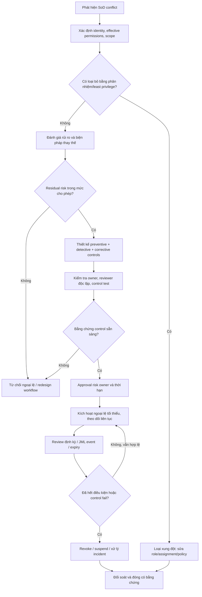
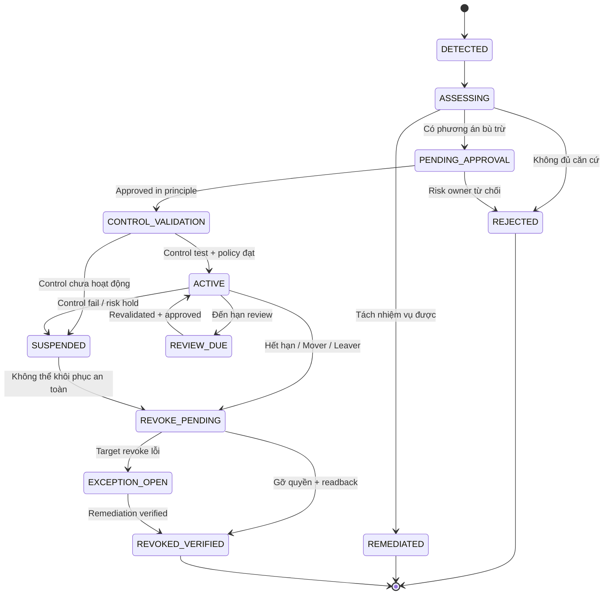

# Biện pháp bù trừ trong Segregation of Duties và quản lý vòng đời IAM

## Mục tiêu học tập

Sau bài học, người học có thể:

1. Giải thích **biện pháp bù trừ (compensating control)** khi xuất hiện xung đột **Segregation of Duties (SoD)**, nêu rõ vì sao biện pháp này **không tương đương loại bỏ xung đột**.
2. Phân biệt **kiểm soát phòng ngừa, phát hiện, khắc phục**, phương án tách nhiệm vụ chuẩn và trường hợp ngoại lệ phải chấp nhận rủi ro còn lại.
3. Nhận diện xung đột **Static SoD (SSoD)** và **Dynamic/transactional SoD (DSoD)** phát sinh từ **RBAC role, permission, group lồng nhau, ABAC policy, quyền trực tiếp, tài khoản đặc quyền và service account**.
4. Thiết kế gói bù trừ có **phạm vi hẹp, lý do hợp lệ, owner độc lập, thời hạn, bằng chứng, ngưỡng cảnh báo, SLA và điều kiện chấm dứt**.
5. Phân tích các kỹ thuật **dual control, maker–checker, phê duyệt độc lập, JIT/PAM, giới hạn giao dịch, logging bất biến, review hậu kiểm và reconciliation**.
6. Tích hợp bù trừ vào vòng đời **Joiner–Mover–Leaver (JML)** và hệ sinh thái **HRIS, IAM/IGA, IdP, SSO, SCIM, RBAC/ABAC, PAM** để ngăn quyền tồn dư.
7. Xử lý ngoại lệ khi reviewer mất thẩm quyền, event đến muộn, token còn claim cũ, ứng dụng không có cơ chế enforcement hoặc kiểm soát bù trừ không hoạt động.
8. Viết policy minh họa, thiết kế audit và phép kiểm thử để chứng minh **biện pháp bù trừ thực sự làm giảm rủi ro**, thay vì chỉ tồn tại trên giấy.

## 1. Biện pháp bù trừ là gì?

**Segregation of Duties (SoD)** là nguyên tắc phân tách những nhiệm vụ hoặc quyền có thể xung đột, nhằm ngăn một chủ thể đơn độc thực hiện trọn vẹn một chuỗi hành động nhạy cảm mà không có kiểm soát độc lập.

Ví dụ trong quy trình thanh toán, tổ chức có thể muốn **người tạo yêu cầu thanh toán không được tự phê duyệt yêu cầu đó**. Nếu một nhân viên đồng thời có quyền `payment.create` và `payment.approve`, tổ chức phải xem xét liệu người đó có thể tự tạo và tự phê duyệt khoản tiền hay không.

**Biện pháp bù trừ (compensating control)** là kiểm soát thay thế hoặc bổ sung được triển khai khi **không thể áp dụng đầy đủ kiểm soát SoD mong muốn**, nhằm giảm rủi ro phát sinh từ việc một người hoặc một principal nắm những quyền xung đột.

Ví dụ: tại một chi nhánh nhỏ chỉ có một nhân viên kế toán xử lý yêu cầu thanh toán. Thay vì cho người đó tự phê duyệt vô điều kiện, tổ chức yêu cầu:

- Thanh toán vượt ngưỡng được duyệt bởi người độc lập ở trụ sở.
- Người kế toán không tự sửa thông tin người thụ hưởng đã được xác nhận.
- Mọi giao dịch được ghi log có tính toàn vẹn và được đối chiếu với ngân hàng.
- Một reviewer khác thực hiện đối soát hàng ngày, nhận cảnh báo giao dịch bất thường.
- Quyền ngoại lệ có scope, ngưỡng và thời hạn; được rà soát trước khi gia hạn.

Những kiểm soát trên có thể **giảm** rủi ro; chúng không tự làm cho xung đột biến mất.

> **Nguyên tắc:** Ưu tiên loại bỏ xung đột bằng tách nhiệm vụ và least privilege. Chỉ dùng biện pháp bù trừ khi có căn cứ rõ, bảo vệ phù hợp mức rủi ro, chứng minh được hiệu lực, có người chịu trách nhiệm và có kế hoạch kết thúc ngoại lệ.

### 1.1. SoD control chuẩn và bù trừ khác nhau

| Khía cạnh | Kiểm soát SoD chuẩn | Biện pháp bù trừ |
|---|---|---|
| Mục tiêu | Ngăn một chủ thể có hoặc dùng cùng lúc quyền xung đột | Giảm rủi ro khi không thể tách nhiệm vụ đầy đủ |
| Cơ chế chính | Tách role, approval, người thực hiện hoặc transaction guard | Dual review, transaction limit, PAM/JIT, cảnh báo, đối soát |
| Xung đột quyền | Được loại bỏ hoặc ngăn sử dụng theo rule | Có thể vẫn tồn tại trong giới hạn ngoại lệ |
| Trách nhiệm | Theo role owner và policy SoD | Cần risk owner, control owner, reviewer độc lập |
| Thời gian | Áp dụng liên tục như kiểm soát nền | Thường có hạn, cần tái đánh giá |
| Bằng chứng | Assignment/authorization DENY hoặc kiểm soát nghiệp vụ | Chứng minh thiết kế và **kiểm soát vận hành thực tế** |
| Rủi ro còn lại | Phụ thuộc các đường vòng và lỗi triển khai | Phải được đánh giá, chấp thuận và theo dõi riêng |

**Không thể gọi một bản ghi “Risk accepted” là biện pháp bù trừ** nếu không có kiểm soát cụ thể nhằm giảm khả năng hoặc tác động của hành vi sai trái.

### 1.2. Vì sao SoD quan trọng trong Identity Lifecycle?

Vòng đời danh tính biến động liên tục:

- **Joiner:** quyền mới được cấp theo vị trí; người mới có thể vô tình nhận role chứa cả tạo và duyệt.
- **Mover:** quyền cũ không được gỡ, kết hợp với quyền mới thành tổ hợp xung đột.
- **Leaver:** role và credential cũ còn hoạt động, làm vô hiệu mọi cơ chế phân nhiệm.
- **Rehire:** role hoặc ngoại lệ từ kỳ làm việc trước được kích hoạt trở lại sai quy trình.
- **Workload lifecycle:** một bot, pipeline hoặc service account tích lũy quyền vượt nhu cầu vận hành.

Kiểm soát SoD và biện pháp bù trừ phải gắn với **thời điểm cấp, thay đổi, sử dụng và thu hồi quyền**, không chỉ được kiểm tra trong một bảng role định kỳ.

## 2. Các loại xung đột SoD cần hiểu trước khi bù trừ

### 2.1. Static SoD (SSoD)

**Static SoD** giới hạn việc **đồng thời được gán** các role hoặc quyền xung đột.

Ví dụ policy cấm một identity có đồng thời:

```text
Role A: PaymentCreator
  permissions: payment.create, payment.update

Role B: PaymentApprover
  permissions: payment.approve
```

Nếu user đã có Role A, IAM/IGA phải chặn hoặc chuyển review khi yêu cầu Role B theo rule tương ứng.

Tuy nhiên, chỉ so **tên role** có thể bỏ sót xung đột nếu permission tương tự đến từ role thứ ba, group lồng nhau, direct grant hoặc account quản trị riêng của cùng identity.

### 2.2. Dynamic SoD (DSoD)

**Dynamic SoD** giới hạn việc **đồng thời kích hoạt hoặc sử dụng** các role/quyền xung đột theo ngữ cảnh cụ thể.

Ví dụ: một người có thể được gán cả `payment.create` và `payment.approve` phục vụ nhiều ca công việc, nhưng **không được tạo và duyệt cùng một payment**.

Đây là kiểm soát theo **giao dịch hoặc resource**, không thể được thay thế bằng việc đơn giản kiểm tra “hai role không được active cùng session” nếu ứng dụng không hỗ trợ session role activation.

### 2.3. Xung đột quyền thực tế không chỉ nằm ở RBAC

| Đường cấp quyền | Ví dụ rủi ro |
|---|---|
| Role trực tiếp | User được gán cả Creator và Approver |
| Role hierarchy | Role quản lý kế thừa cả tạo và duyệt |
| Nested directory group | Thành viên group cấp cao được hưởng admin |
| Permission trực tiếp tại SaaS | Quyền approve được app owner gán ngoài IGA |
| ABAC policy | Điều kiện scope quá rộng khiến người dùng tự duyệt |
| IAM administrator | Có thể tạo account và tự gán role cao |
| API key/PAT | Credential cũ còn scope cho thao tác nhạy cảm |
| PAM eligible role | User có thể tự kích hoạt role conflict |
| Service account | Một pipeline vừa sửa code vừa đưa production |
| Delegated approval | Chủ thể dùng delegation để tự duyệt |

**Phải tính quyền hiệu lực từ mọi nguồn**, không chỉ quan sát hai group chính trong IdP.

### 2.4. SoD và least privilege liên quan nhưng không đồng nhất

Một người có ít quyền nhưng đúng hai quyền xung đột vẫn có thể gây rủi ro lớn. Ngược lại, tách nhiệm vụ có thể ngăn tự phê duyệt nhưng một role `ExportAllData` vẫn vi phạm least privilege.

Một thiết kế tốt kết hợp:

1. Cấp tối thiểu action/resource/scope/time.
2. Không cho một chủ thể vượt qua các bước độc lập.
3. Kiểm tra điều kiện ở runtime.
4. Giám sát và điều tra khi vẫn tồn tại ngoại lệ.

## 3. Khi nào mới cân nhắc biện pháp bù trừ?

Có thể cân nhắc khi **không khả thi tách nhiệm vụ** hoặc khi giải pháp chuẩn cần thời gian triển khai, chẳng hạn:

- Đơn vị nhỏ thiếu nhân sự độc lập tại địa phương.
- Ứng dụng legacy không tách được permission tạo và duyệt.
- Hệ thống SaaS chỉ có role rộng, thiếu transaction-level SoD.
- Thời gian khôi phục sự cố yêu cầu nhân viên on-call kiêm nhiều nhiệm vụ.
- Một quy trình chuyển đổi hệ thống đang trong giai đoạn ngắn chưa tách role.
- Một workload vận hành kỹ thuật cần kết hợp quyền mà platform chưa hỗ trợ delegation mịn.

**Không phải lý do đủ:** “Tách nhiệm vụ phiền”, “Cấp admin cho nhanh”, “Reviewer thường chỉ bấm Keep”, “Không ai kiểm tra”, hoặc “Đã có MFA nên SoD không cần nữa”.

### 3.1. Ba bước lựa chọn

1. **Loại bỏ:** có thể tách permission, dùng người duyệt độc lập, đổi workflow hoặc hạn chế API không?
2. **Giảm thiểu:** nếu chưa loại bỏ được, có thể thu hẹp scope, đặt hạn, yêu cầu dual control/JIT, chặn giao dịch tự duyệt không?
3. **Bù trừ có quản trị:** chọn các kiểm soát phát hiện và phản ứng đủ mạnh cho phần rủi ro vẫn còn; có risk acceptance, SLA và bằng chứng.

Không nên đi thẳng tới **risk acceptance** khi chưa thử phương án giảm quyền ít rủi ro hơn.

### 3.2. Trường hợp không nên chấp nhận ngoại lệ

Một số xung đột có thể tạo ra rủi ro vượt mức tổ chức được phép chấp nhận, hoặc yêu cầu bắt buộc của chính sách/chuẩn áp dụng. Khi đó không được tự cấp quyền với lý do “có log”.

Cần:

- Từ chối hoặc ngừng giao dịch.
- Tách role/người thực hiện.
- Thiết kế workflow thay thế có kiểm soát.
- Chuyển cấp có thẩm quyền và tham vấn compliance khi cần.
- Không tuyên bố “tương đương SoD” nếu kiểm soát không đạt mục tiêu.

Các ví dụ trong bài là **mô hình học tập**, không thay thế quy định ngành, pháp luật hoặc risk appetite của tổ chức.

## 4. Đánh giá rủi ro trước khi quyết định bù trừ

Một đánh giá cần trả lời **điều xấu nào có thể xảy ra khi không tách nhiệm vụ** và **biện pháp đề xuất làm giảm rủi ro đó bằng cách nào**.

### 4.1. Các yếu tố cần phân tích

| Yếu tố | Ví dụ |
|---|---|
| Asset/process | Thanh toán, payroll, deployment production, quản lý IAM |
| Conflicting capability | `vendor.create` + `payment.approve` |
| Threat scenario | Tạo người thụ hưởng giả rồi tự thanh toán |
| Impact | Thiệt hại tài chính, lộ dữ liệu, thay đổi sản xuất |
| Likelihood | Khả năng khai thác, tần suất giao dịch, mức exposure |
| Existing preventive controls | Scope, approval, MFA, token audience |
| Existing detective controls | Đối soát độc lập, alert, audit |
| Detection delay | Từ giao dịch tới khi phát hiện bất thường |
| Response delay | Từ phát hiện tới khi chặn/cô lập |
| Reversibility | Giao dịch có thể đảo ngược hay không |
| Control independence | Người chịu quyền xung đột có sửa/tắt được kiểm soát không |
| Residual risk | Rủi ro còn lại sau bù trừ |
| Risk owner | Người có thẩm quyền chấp nhận rủi ro trong hạn |

### 4.2. Ví dụ kịch bản thanh toán

```text
Conflict:
  vendor.create + payment.approve

Scenario:
  Người có cả hai quyền tự tạo nhà cung cấp giả
  rồi duyệt khoản thanh toán cho nhà cung cấp đó.

Proposed controls:
  - Nhà cung cấp mới phải được xác minh độc lập.
  - Thanh toán cho vendor vừa tạo bắt buộc dual approval.
  - Chỉ được thao tác trong phạm vi pháp nhân A.
  - Ngưỡng thanh toán và thời hạn ngoại lệ được giới hạn.
  - Hằng ngày reviewer khác đối soát vendor mới và payments.
  - Alert nếu người tạo vendor trùng người duyệt payment.

Residual risk:
  Vẫn có thể phát sinh trước khi đối soát, nên phải đánh giá
  ngưỡng và khả năng ngăn chặn trước khi tiền rời hệ thống.
```

Một báo cáo chỉ nói “daily audit sẽ xử lý” là chưa đủ nếu tiền đã chuyển không thể hoàn lại trước lần audit đầu tiên.

### 4.3. Ma trận rủi ro minh họa

| Xung đột | Khả năng tổn thất | Mô hình xử lý phù hợp |
|---|---|---|
| Tạo và tự duyệt thanh toán | Tài chính, gian lận | Transaction-level maker–checker, ngưỡng, đối soát |
| Tạo user và tự gán admin | Leo thang đặc quyền | Approval độc lập, role allowlist, dual control, PAM |
| Deploy code và tự bypass CI checks | Supply chain compromise | Protected branch, signed build, release gate |
| Tạo vendor và sửa tài khoản ngân hàng | Gian lận thanh toán | Xác minh ngoài băng, 2-person approval, change alert |
| Sửa log và tự kiểm toán log | Che giấu hành vi | Audit sink độc lập, immutable retention, SoD |
| Quản lý secret và duyệt chính request secret | Chiếm quyền hệ thống | Secret access approval độc lập, JIT, monitoring |
| Tạo báo cáo và tự xác nhận độ chính xác | Sai báo cáo | Đối chiếu nguồn độc lập, reviewer khác |
| Tự thay policy SoD và tự cấp quyền | Bypass kiểm soát | Change control cho policy, four-eyes, alert |

Chọn biện pháp theo **chuỗi rủi ro thực tế**; không gắn một checkbox “Compensating control exists” cho tất cả tình huống.

## 5. Ba lớp kiểm soát bù trừ

### 5.1. Preventive controls: giảm cơ hội trước hành động

Ví dụ:

- **Maker–checker** tại bước transaction.
- Approval độc lập cho grant đặc quyền.
- Giới hạn role/permission theo resource, tenant và thời gian.
- Bắt buộc JIT/PAM hoặc session proxy.
- Giới hạn số tiền, số lượng bản ghi và đối tượng được thao tác.
- Dual control khi sửa người thụ hưởng, account recovery hoặc policy IAM.
- Chặn tự phê duyệt dựa trên identity và resource provenance.

Phòng ngừa thường hiệu quả hơn phát hiện đối với hành động **khó đảo ngược**.

### 5.2. Detective controls: phát hiện vượt phạm vi

Ví dụ:

- Audit trail bảo đảm tính toàn vẹn.
- Cảnh báo real-time về người tạo trùng người duyệt.
- Phát hiện permission thay đổi không có approval.
- Báo cáo chênh lệch tài chính, đối soát ngân hàng.
- Review các session đặc quyền bởi người độc lập.
- Correlation giữa request, action, role elevation và nguồn HR.
- Reconciliation giữa desired và actual entitlements.

**Phải chứng minh log/alert được xem và xử lý**, không chỉ chứng minh có dashboard.

### 5.3. Corrective controls: hạn chế tổn thất sau phát hiện

Ví dụ:

- Suspend giao dịch chờ xác minh.
- Revoke role, PAM session, token/API key.
- Freeze account khi compromise.
- Đảo hoặc hoàn nguyên giao dịch nếu nghiệp vụ hỗ trợ.
- Chuyển incident cho security/finance owner.
- Thu hẹp policy, sửa role hierarchy và connector mapping.
- Rà soát quyền khác có cùng root cause.
- Lưu bằng chứng và cập nhật risk register.

Ba lớp thường cần kết hợp. Một detector không có người xử lý hoặc không có khả năng chặn kịp thời có thể **không bù được** rủi ro nguyên nhân.

### 5.4. Bảng đối chiếu rủi ro và kiểm soát

| Risk scenario | Phòng ngừa | Phát hiện | Khắc phục |
|---|---|---|---|
| Self-approve payment | Check `createdBy != approver` | Alert khi trùng principal | Hold/reverse theo chính sách |
| Self-grant admin | Dual approval và role scope | Log role change bất biến | Revoke admin, rotate credential |
| Unreviewed deploy | Protected pipeline/release gate | Audit build provenance | Rollback, incident review |
| Unauthorized export | Scope/limit, MFA step-up | Export analytics và alert | Revoke access, data incident |
| Leaver dùng token cũ | Account guard/introspection | Runtime log sau effective Leaver | Invalidate sessions/tokens |
| Service account tự duyệt | Tách principal/credential | Detect cross-service actions | Rotate credentials, disable action |

## 6. Maker–checker và dual control

**Maker–checker** phân tách người khởi tạo/nhập dữ liệu (**maker**) khỏi người kiểm tra/chấp thuận (**checker**). Đây thường là **kiểm soát phòng ngừa trực tiếp**, có thể đóng vai trò thiết kế SoD chuẩn hoặc biện pháp bù trừ cho xung đột role ở mức assignment.

### 6.1. Kiểm tra ở mức giao dịch

Một workflow thanh toán cần xác minh:

1. Maker đã tạo giao dịch nào?
2. Checker có identity khác maker không?
3. Checker có role và phạm vi cho phép duyệt giao dịch đó không?
4. Có chung account, delegated identity hoặc shared credential không?
5. Amount, vendor và dữ liệu quan trọng có thay đổi sau lúc checker xem không?
6. Người duyệt có quyền tự đổi trạng thái transaction để bypass gate không?
7. Thời hạn và security context của approval còn hiệu lực không?

```text
DENY approval WHEN
    payment.createdByIdentityId == actor.identityId

AND require:
    actor has payment.approve
    actor allowed tenant/branch scope includes payment
    payment.currentState == PENDING_APPROVAL
    approval references exact immutable payment version
```

Đây là pseudocode giải thích: **điều kiện cho phép phải là tổng hợp**, không chỉ một phép so ID. Nếu dùng identity alias hoặc account khác, phải map về cùng identity ổn định.

### 6.2. Dual control khác “hai nút bấm”

Hai account khác nhau có thể thuộc cùng một người. Một người cũng có thể được ủy quyền từ checker sang maker, gây tự phê duyệt gián tiếp.

Nên kiểm tra:

- Hai actor khác **identity**, không chỉ khác username.
- Không có chung service principal điều khiển cả bước.
- Không có delegation trái SoD.
- Không thể sửa record sau check mà không yêu cầu duyệt lại.
- Approval được ghi từ nguồn được xác thực.
- Hành động quan trọng chỉ commit sau khi mọi gate đạt.

### 6.3. Four-eyes principle

**Four-eyes** là nguyên tắc một hành động nhạy cảm được hai bên xem xét/cho phép theo policy. Nếu dùng cho quyền quản trị IAM, mỗi bên phải có thẩm quyền và sự độc lập thích hợp.

Không mặc định mọi thao tác cần bốn mắt; nhưng với hành động có hậu quả lớn, một approval độc lập trước commit thường mạnh hơn review sau khi thay đổi đã không thể đảo ngược.

## 7. Giới hạn giao dịch và phạm vi quyền

Một biện pháp bù trừ hữu ích là giảm **blast radius** khi người dùng cần đồng thời những capability xung đột.

### 7.1. Những giới hạn có thể áp dụng

- Tổng giá trị giao dịch theo ngày/ca.
- Ngưỡng cho từng payment hoặc approval.
- Danh sách vendor/beneficiary đã được xác minh.
- Tenant, branch, project, account mà principal được thao tác.
- Loại action: read-only, create-only, không export/bulk.
- Số bản ghi được xuất, rate limiting theo rủi ro.
- Khoảng thời gian và ca trực được phê duyệt.
- Resource allowlist trong PAM/JIT.
- Yêu cầu step-up khi vượt ngưỡng.

Các ngưỡng phải do **business/risk owner** phê duyệt; không có mức tiền hoặc duration chuẩn áp dụng mọi doanh nghiệp.

### 7.2. Tránh chia nhỏ giao dịch để vượt ngưỡng

Nếu một giao dịch trên ngưỡng cần dual approval, attacker có thể chia một khoản lớn thành nhiều khoản nhỏ.

Phải xem xét:

- Ngưỡng tích lũy theo identity, vendor, business entity và khoảng thời gian.
- Các khoản chuyển gần nhau và cùng beneficiary.
- Hành động tạo/sửa vendor trước các payment.
- Dấu hiệu replay hoặc split transactions.
- Giới hạn theo account và **cùng identity** để tránh dùng alias.

Transaction controls phải xét luồng nghiệp vụ, không chỉ một số cố định tại endpoint.

### 7.3. Ví dụ bảng giới hạn (chỉ minh họa)

| Tình huống | Guard | Reviewer/alert |
|---|---|---|
| Payment nhỏ trong scope | Require permission + no self-approval | Daily independent reconciliation |
| Payment vượt ngưỡng rủi ro | Independent pre-approval | Real-time alert |
| Payment tới vendor mới | Xác minh vendor ngoài băng | Finance control owner |
| Thay đổi bank account | Dual authorization + change freeze | Alert ngay, audit |
| Export dữ liệu nhạy cảm | Scope + MFA + export quota | Data owner monitoring |
| JIT production operation | Resource allowlist + TTL | PAM recording/review |

Không đánh đồng “dưới ngưỡng” với “không cần SoD” nếu policy yêu cầu phân nhiệm cho mọi giao dịch.

## 8. Privileged Access Management, JIT và JEA

Quyền cao có thể không tránh được trong hỗ trợ khẩn cấp, nhưng nên giảm **thời gian, phạm vi và khả năng dùng ngoài quy trình**.

### 8.1. Just-in-Time (JIT)

**JIT** cho phép kích hoạt quyền khi công việc thực sự cần, thường trong khoảng được phê duyệt.

Một ngoại lệ SoD cho production có thể yêu cầu:

- Incident/ticket đang mở.
- Operator đã xác thực MFA đủ mạnh.
- Người phê duyệt độc lập hoặc emergency policy hợp lệ.
- Role/scope cụ thể cho service hoặc cluster.
- `validFrom` và `validUntil` rõ ràng.
- PAM session control và audit.
- Revoke sớm khi Mover/Leaver hoặc security hold.
- Review sau thao tác.

Thời hạn ngắn **không thay việc chặn self-approval** nếu một hành động có thể gây hại trong vài giây.

### 8.2. Just-Enough Access (JEA)

**JEA** tập trung vào quyền **vừa đủ**. Người vận hành có thể được `service.restart` trên một service thay vì `cluster.admin` trên mọi cluster.

JIT và JEA nên phối hợp. Một `GlobalAdmin` cấp 20 phút vẫn có quyền ảnh hưởng toàn tổ chức trong 20 phút.

### 8.3. PAM không mặc nhiên khép mọi đường truy cập

PAM có thể giới hạn phiên qua proxy nhưng tài khoản vẫn có:

- SSH key cá nhân.
- Token cloud đã phát.
- App-local admin password.
- Personal access token.
- Session SSO độc lập.
- Local service account với role tương đương.

Vì vậy phải đối soát **mọi đường thực thi quyền**, không chỉ đóng một PAM session.

### 8.4. Break-glass

Break-glass có thể bỏ qua một phần approval chuẩn trong tình huống khẩn được định nghĩa trước, nhưng **không phải ngoại lệ vô hạn**.

Một kịch bản cần có:

1. Tiêu chí khẩn cấp đã được phê duyệt.
2. Danh tính và lý do người kích hoạt.
3. Phạm vi, duration và quyền cần thiết.
4. Monitoring độc lập và alert khi kích hoạt.
5. Hậu kiểm với người có thẩm quyền.
6. Revoke/rotate credential đúng quy trình.
7. Ghi mức rủi ro còn lại và ngoại lệ.
8. Không dùng break-glass để né SoD thường xuyên.

## 9. Review độc lập và kiểm soát phát hiện

### 9.1. Reviewer phải độc lập với người bị giám sát

Một kiểm soát “review giao dịch mỗi ngày” không có giá trị nếu **người tạo/duyệt giao dịch cũng là người duy nhất xác nhận review**.

Độc lập có thể được thiết kế bằng:

- Reviewer thuộc team/line khác với người thao tác.
- Reviewer không thể sửa/xóa log nguồn.
- Business owner hoặc finance controller có thẩm quyền.
- Security operations truy cập audit read-only.
- SoD cho chính chức năng gán reviewer và đóng exception.

Người review cần **thông tin đủ** để phát hiện bất thường; không chỉ một email tổng số lượng giao dịch.

### 9.2. Review cần chứng minh hành động thực sự

Bằng chứng nên gồm:

- Danh sách giao dịch/quyền được xem.
- Timestamp và phạm vi dữ liệu.
- Reviewer identity và authority.
- Những trường đã đối chiếu.
- Kết quả bất thường/không bất thường.
- Case/incident tạo khi phát hiện vấn đề.
- SLA điều tra và ngày đóng với bằng chứng.
- Không có dấu hiệu reviewer tự review giao dịch của mình.

Một dashboard được cấu hình sẵn nhưng không ai xem **không chứng minh detective control hoạt động**.

### 9.3. Frequency theo risk

Với payment có thể chuyển tiền không hoàn lại, review cuối tháng có thể quá trễ. Với thay đổi ít nhạy cảm và đảo được, daily/weekly review có thể đủ tùy policy.

Nên định nghĩa:

```text
Detection SLA: phát hiện sau tối đa bao lâu?
Acknowledgement SLA: ai phải nhận cảnh báo khi nào?
Response SLA: phải chặn hoặc sửa trong bao lâu?
Evidence SLA: khi nào hoàn tất bản ghi điều tra?
Escalation: nếu owner không phản hồi thì ai nhận tiếp?
```

Các SLA trên phải xuất phát từ mức rủi ro và năng lực vận hành, không lấy một con số tùy tiện để “đạt chứng nhận”.

## 10. Logging, integrity và giám sát có trách nhiệm

### 10.1. Những event cần có

Đối với giao dịch hay quyền xung đột, log có thể gồm:

```text
SOD_CONFLICT_DETECTED
COMPENSATING_CONTROL_EXCEPTION_REQUESTED
RISK_ASSESSMENT_COMPLETED
EXCEPTION_APPROVED
JIT_ROLE_ACTIVATED
PRIVILEGED_ACTION_ATTEMPTED
MAKER_CHECKER_CONTROL_EVALUATED
TRANSACTION_APPROVED_OR_DENIED
INDEPENDENT_REVIEW_COMPLETED
CONTROL_TEST_FAILED
EXCEPTION_EXPIRED
ROLE_OR_ENTITLEMENT_REVOKED
EFFECTIVE_ACCESS_VERIFIED
INCIDENT_ESCALATED
```

Mỗi event cần source, correlation và đúng actor; không tự tạo event “reviewed” khi chưa có reviewer thật.

### 10.2. Append-only và tamper detection

Có thể dùng:

- Audit sink tách khỏi hệ thống bị giám sát.
- Append-only hoặc storage có retention lock phù hợp.
- Hash/chuỗi hash, MAC hoặc chữ ký trong mô hình tin cậy.
- Đồng bộ timestamp và event sequence.
- Alert nếu log source ngừng gửi hoặc có gap.
- SoD giữa quản lý hệ thống và quản lý audit.
- Kiểm soát quyền đọc theo phân loại dữ liệu.

**Hash một log không chứng minh log đầy đủ hay dữ liệu ban đầu là sự thật**. Nếu operator có thể tắt logging trước khi thao tác, cần cơ chế phát hiện mất nguồn hoặc xác minh độc lập.

### 10.3. Không ghi credential

Tránh log password, session cookie, private key, access/refresh token, OTP, recovery code. Có thể ghi **token reference, principal ID, role ID, resource ID, request ID** theo data minimization và privacy policy.

Bằng chứng phải đủ để điều tra nhưng không tạo thêm bề mặt rò rỉ bí mật.

## 11. Gói ngoại lệ SoD phải có cấu trúc

Một ngoại lệ bù trừ cần được **định danh, phê duyệt, kiểm thử, theo dõi và chấm dứt**, không chỉ là một ô `approved=true`.

### 11.1. Metadata đề xuất

| Trường | Ý nghĩa |
|---|---|
| `exceptionId` | ID ngoại lệ |
| `identityId` / `accountId` | Chủ thể và tài khoản liên quan |
| `conflictRuleId` | Quy tắc SoD bị xung đột |
| `conflictingPermissions` | Các capability thực tế gây xung đột |
| `targetApplication/tenant` | Hệ thống và tenant |
| `resourceScope` | Tài nguyên chịu ngoại lệ |
| `businessJustification` | Vì sao không thể tách nhiệm vụ |
| `alternativesConsidered` | Biện pháp chuẩn đã cân nhắc |
| `riskRatingBefore/After` | Đánh giá rủi ro gốc/còn lại |
| `controlIds` | Những bù trừ cụ thể |
| `controlOwner` | Người chịu trách nhiệm vận hành control |
| `independentReviewer` | Người kiểm tra kết quả |
| `riskAcceptingAuthority` | Người chấp nhận residual risk |
| `validFrom/validUntil` | Cửa sổ ngoại lệ |
| `reviewDueAt` | Mốc rà soát lại |
| `approvalPolicyVersion` | Phiên bản quy định |
| `status` | Pending, active, expired, revoked, exception |
| `evidenceReferences` | Log, approval, control test, readback |
| `terminationCriteria` | Điều kiện ngoại lệ bắt buộc kết thúc |

### 11.2. Ví dụ JSON nội bộ

```json
{
  "exceptionId": "SOD-EXC-2026-0192",
  "identityId": "IDN-4207",
  "targetApplication": "FINANCE_PAYMENTS",
  "tenantId": "corp-vn",
  "conflictRuleId": "SOD-PAYMENT-MAKER-APPROVER",
  "conflictingPermissions": [
    "payment.create",
    "payment.approve"
  ],
  "businessJustification": "Ca hỗ trợ chi nhánh thiếu nhân sự tạm thời",
  "resourceScope": {
    "branchIds": ["BRANCH-A"]
  },
  "alternativesConsidered": [
    "Remote central checker",
    "Split role assignments"
  ],
  "controlIds": [
    "CTRL-TRANSACTION-DUAL-APPROVAL",
    "CTRL-DAILY-INDEPENDENT-RECONCILIATION",
    "CTRL-JIT-EXPIRY"
  ],
  "riskOwner": "FINANCE-CONTROLLER",
  "controlOwner": "FINANCE-OPERATIONS",
  "independentReviewer": "INTERNAL-CONTROL",
  "validFrom": "2026-12-03T02:00:00Z",
  "validUntil": "2026-12-10T02:00:00Z",
  "reviewDueAt": "2026-12-08T02:00:00Z",
  "approvalPolicyVersion": "sod-exception-v5",
  "status": "PENDING_CONTROL_VERIFICATION"
}
```

Đây là **schema minh họa**, không phải một tiêu chuẩn SoD, SCIM hay API của nhà cung cấp. Các role/ID cần được liên kết với catalog và quy trình thực tế của tổ chức.

### 11.3. Biện pháp bù trừ phải có test và owner

```text
CTRL-TRANSACTION-DUAL-APPROVAL
  Type: Preventive
  Owner: Finance platform owner
  Test: Maker cannot approve own payment
  Evidence: Backend decision + transaction event

CTRL-DAILY-INDEPENDENT-RECONCILIATION
  Type: Detective
  Owner: Finance controller
  Test: Independent reviewer checks all exception transactions
  Evidence: Review record + anomaly cases

CTRL-JIT-EXPIRY
  Type: Preventive/corrective
  Owner: IAM/PAM operations
  Test: Role no longer usable after validUntil or Leaver
  Evidence: PAM state + target readback + runtime DENY
```

Nếu một control chỉ có tên mà không có **ai vận hành, khi nào chạy và làm sao chứng minh**, nó chưa phải một biện pháp có thể tin cậy.

## 12. Quy trình phê duyệt một ngoại lệ



### 12.1. Trách nhiệm phê duyệt

Một quy trình có thể phân vai:

1. **Requester/beneficiary:** nêu nhu cầu.
2. **Business owner:** xác nhận việc tách nhiệm vụ có khả thi hay không.
3. **IAM/IGA owner:** tính quyền hiệu lực và xung đột.
4. **Application owner:** kiểm tra enforcement có hỗ trợ control không.
5. **Security/risk owner:** đánh giá bù trừ và residual risk.
6. **Independent approver:** phê duyệt khi policy yêu cầu.
7. **Control owner:** thực thi và chứng minh control.
8. **Auditor:** đánh giá sau, không tự sửa evidence.

Người được lợi từ ngoại lệ không nên tự là **người duy nhất chấp thuận residual risk** nếu policy yêu cầu độc lập.

### 12.2. Decision của exception khác approval quyền

Một ngoại lệ SoD được chấp thuận **không tự cấp role/permission**. Nó chỉ cho phép một **đường đánh giá quyền đặc biệt** trong phạm vi đã được duyệt. Việc cấp quyền vẫn cần:

- Identity/account hợp lệ.
- Request/entitlement approval khi cần.
- MFA/risk/SoD policy phù hợp.
- Scope và thời hạn.
- Provisioning/readback.
- Runtime enforcement.

Tương tự, một access request được duyệt **không tự hợp thức hóa xung đột SoD** nếu chưa có exception hợp lệ.

### 12.3. Không được gia hạn ngầm

Gia hạn ngoại lệ phải tái đánh giá:

- Nhu cầu thực tế còn không?
- Người dùng có Mover hoặc thay vai trò không?
- Có thể tách nhiệm vụ thay vì tiếp tục bù trừ không?
- Control độc lập còn vận hành tốt không?
- Có giao dịch bất thường hoặc incident không?
- Rủi ro còn lại có thay đổi không?
- Trần duration/cumulative exposure có bị vượt không?

Không tự sao chép `validUntil` thành một ngày xa hơn khi approver im lặng.

## 13. State machine ngoại lệ SoD



Đây là sơ đồ quy trình minh họa. Cần phân biệt **exception approved**, **control deployed**, **entitlement active**, **control monitoring active** và **revocation verified**.

### 13.1. Kiểm soát thất bại: phản ứng thế nào?

Nếu dual approval service lỗi hoặc review độc lập chưa được thực hiện đúng hạn, phải có policy fail-safe:

- Với hành động rủi ro cao: chặn, suspend hoặc chuyển review độc lập trước khi commit.
- Với giao dịch đang dang dở: hold/queue an toàn khi có thể.
- Mở incident hoặc exception có severity, owner, SLA.
- Không tự bỏ qua check rồi cho phép vì “control tạm thời unavailable”.
- Không âm thầm giữ exception ở trạng thái ACTIVE khi thực tế control không hoạt động.

Bản chất “bù trừ” là **đổi cơ chế kiểm soát**, không phải bỏ kiểm soát khi gặp lỗi.

## 14. RBAC/ABAC và cách chặn xung đột ở runtime

### 14.1. Role assignment không phản ánh toàn bộ giao dịch

Một người có cả role Creator và Approver ở hai scope khác nhau không nhất thiết có xung đột thực tế nếu scope không chồng lấn và policy bảo đảm tách biệt.

Ngược lại, một người chỉ có một role `FinanceSupervisor` có thể mang cả hai permission nếu role hierarchy cho phép.

Vì vậy cần phân tích:

```text
Assigned roles + inherited roles
    → Candidate permissions
    → Direct entitlements / ACL
    → Resource/tenant scope
    → Time-bound grants
    → Exception and SoD rules
    → Effective permissions at request time
```

### 14.2. ABAC hỗ trợ transactional SoD

ABAC có thể xét:

- `subject.identityId`.
- `subject.lifecycleState`.
- `subject.accountState`.
- `subject.allowedTenantIds`.
- `resource.createdByIdentityId`.
- `resource.approvedByIdentityId`.
- `action`.
- `environment.trustedTime`.
- `activeExceptionId`, scope và control status.
- `authenticationAssurance`.

Một rule minh họa:

```text
function canApprovePayment(actor, payment, context):
    require actor.lifecycleState == ACTIVE
    require actor.accountState == ENABLED
    require actor.effectivePermissions has payment.approve
    require actor.tenantScope includes payment.tenantId
    require payment.state == PENDING_APPROVAL
    require actor.identityId != payment.createdByIdentityId
    require context.authenticationAssuranceMeetsPolicy
    return PERMIT
```

Nếu chính sách nghiệp vụ **bắt buộc người tạo khác người duyệt**, không được thêm ngoại lệ `if exception active then ignore createdBy check` trừ khi một **kiểm soát thay thế được phê duyệt và thực thi** bảo đảm mục tiêu tương ứng. Một trường `exception=true` do client gửi càng không thể là căn cứ cấp quyền.

### 14.3. Decision khi có compensating control

Một mô hình khái niệm cho tình huống legacy không hỗ trợ phân nhiệm đầy đủ:

```text
Normal decision:
  Permit only when user has permission and no SoD conflict.

Exceptional decision:
  Permit only when:
    conflict is an approved exception in current scope
    AND exception still active and risk approval current
    AND mandatory compensating controls are operational
    AND transaction-specific independent gate passes
    AND account/lifecycle/tenant/role/time guards pass.

Otherwise:
  Deny / hold / review, never default Permit.
```

Cần phân biệt: một **detective-only** control sau hành động có thể **không đủ** cho thao tác không thể đảo ngược. Không phải mọi conflict có thể được bù trừ bằng cách “permit rồi log”.

## 15. Ví dụ backend Java: self-approval và exception guard

Đoạn sau là **pseudocode Java-oriented**; tên service và method giả định để minh họa, không phải API Spring Security có thể biên dịch ngay.

```java
@Transactional
public PaymentResult approvePayment(
        long paymentId, AuthenticatedPrincipal actor) {

    Payment payment = paymentRepository.findForUpdate(paymentId)
        .orElseThrow(NotFoundException::new);

    iamGuard.requireIdentityActive(actor.identityId());
    iamGuard.requireTargetAccountEnabled(actor.accountId());
    authorization.requirePermission(actor, "payment.approve");
    authorization.requireTenantAndBranchScope(actor, payment);
    authorization.requireFreshAuthentication(actor, "PAYMENT_APPROVAL");

    if (payment.createdByIdentityId().equals(actor.identityId())) {
        // Bình thường không cho maker tự approve.
        // Ngoại lệ chỉ đi tiếp nếu policy cụ thể có gate độc lập.
        ExceptionDecision exception =
            sodExceptionService.evaluatePaymentException(actor, payment);

        if (!exception.isApprovedAndInScopeAndOperational()) {
            throw new AccessDeniedException("SoD conflict");
        }

        independentGate.requireSecondAuthorizedIdentityApproval(
            payment.id(), payment.version(), exception.id()
        );
    }

    paymentPolicy.requirePendingAndUnchanged(payment);
    auditService.recordRequiredApprovalDecision(actor, payment);
    return paymentService.commitApprovedPayment(payment, actor);
}
```

### 15.1. Những điều bắt buộc ngoài đoạn pseudocode

- `@Transactional` chỉ có tác dụng khi framework thực sự áp transaction và service được gọi đúng đường.
- Lock/optimistic version phải chống **TOCTOU** giữa kiểm tra và commit.
- Cần bảo đảm independent approval tham chiếu **đúng version của giao dịch**, không chỉ payment ID.
- Audit obligation bắt buộc phải được xử lý với transaction/outbox phù hợp, tránh commit thành công nhưng mất evidence.
- Mọi API/batch/message consumer thực thi thanh toán phải dùng **cùng guard**.
- Service principal có quyền commit không được bypass decision tùy tiện.
- IdP/MFA proof không tự chứng minh entitlement và scope.
- Một exception có status ACTIVE trong database không tự chứng minh **control operational**.

### 15.2. Tách PEP, PDP và system of record

Có thể tổ chức:

- **PEP:** backend API/service giữ chốt thực thi.
- **PDP:** policy engine quyết định Permit/Deny/Indeterminate theo subject/action/resource/context.
- **PIP:** cung cấp identity lifecycle, grants, exception state, transaction owner, risk.
- **PAP:** quản lý policy, approval workflow, version và người sở hữu.

Tùy nền tảng, các thành phần có thể nằm trong cùng service. **Điều quan trọng là nguồn thuộc tính đáng tin và không có đường bypass enforcement**.

## 16. IAM/IGA, IdP, SSO, Directory và SCIM

### 16.1. IAM/IGA quản trị xung đột và ngoại lệ

IGA có thể:

1. Thu inventory identity/account/entitlement.
2. Tính effective permission và conflict rules.
3. Chặn access request vi phạm SoD.
4. Routing exception tới business/risk owner.
5. Lưu policy version, scope, expiry và controls.
6. Provision role/group khi đủ điều kiện.
7. Reconcile grants ở target.
8. Phát hiện Mover/Leaver làm ngoại lệ không còn hợp lệ.
9. Báo cáo kiểm toán và remediation.

Không phải mọi IGA có khả năng kiểm tra transactional SoD tại API ứng dụng. Khi hệ thống chỉ quản lý assignment, **backend vẫn phải enforce theo giao dịch**.

### 16.2. IdP và SSO

IdP hỗ trợ xác thực, MFA và group/application assignment. SSO qua SAML/OIDC truyền kết quả xác thực và claim, nhưng:

- Đăng nhập thành công không có nghĩa SoD được đáp ứng.
- Token có thể chứa role/group snapshot cũ sau Mover.
- Ứng dụng có thể giữ session sau khi IdP account bị disable.
- MFA chỉ cải thiện niềm tin về principal, không ngăn một principal có cả hai nhiệm vụ.
- Một group gỡ ở directory chưa chắc gỡ app-local role hoặc token.

Đối với quyền xung đột, backend cần **fresh authorization hoặc revocation** tương xứng rủi ro.

### 16.3. SCIM

SCIM 2.0 quản trị `User` và `Group` ở hệ thống đích khi nhà cung cấp hỗ trợ. Nó có thể thêm/gỡ membership hoặc deactivate account, nhưng **không có một semantics SoD hoặc compensating control chung cho mọi SaaS**.

Ví dụ: IGA gỡ User khỏi Group approvers qua SCIM:

```http
PATCH /scim/v2/Groups/scim-group-208 HTTP/1.1
Host: provisioning.example.org
Authorization: Bearer <redacted>
Content-Type: application/scim+json

{
  "schemas": [
    "urn:ietf:params:scim:api:messages:2.0:PatchOp"
  ],
  "Operations": [
    {
      "op": "remove",
      "path": "members[value eq \"scim-user-4207\"]"
    }
  ]
}
```

Đây là ví dụ minh họa; cần kiểm tra Group ID, User ID ở **SCIM server đích**, tenant, quyền PATCH và readback. **HTTP 2xx không bảo đảm app đã xóa mọi quyền, session hoặc token**.

### 16.4. Nested group, direct grants và app-local roles

Một người có thể mất group ở IdP nhưng còn `payment.approve` trực tiếp trong ứng dụng. Reconciliation SoD phải thu **actual entitlements** từ cả directory và app-specific API, không chỉ dữ liệu IGA mong muốn.

Khi hệ thống đích không đủ API inventory, báo cáo phải nêu **coverage gap**, không tự kết luận không có conflict.

## 17. Biện pháp bù trừ trong Joiner–Mover–Leaver

### 17.1. Joiner: không cấp ngoại lệ như birthright

Quyền cơ sở theo vị trí có thể được cấp tự động khi đủ điều kiện. Tuy nhiên, **ngoại lệ SoD không nên trở thành birthright** chỉ vì một job title hay department.

Với người mới, cần:

- Verify identity và account correlation.
- Xác định role/permission từ quyền tối thiểu.
- Chạy SoD check trước cấp.
- Nếu có conflict, loại bỏ hoặc gửi exception riêng.
- Không cho user dùng quyền nhạy cảm khi approval/control chưa đạt.
- Ghi ngày hiệu lực, owner, scope và expiry.

### 17.2. Mover: dừng ngoại lệ khi điều kiện thay đổi

Ví dụ An chuyển từ Sales sang Finance:

```text
Trước Mover:
  sales.customer.update
  sales.discount.approve (temporary exception)

Sau Mover:
  finance.invoice.read
  finance.payment.approve

Nguy cơ:
  Role Sales cũ không gỡ + Finance role mới
  tạo đường thao tác trên customer/payment ngoài chức năng.
```

Mover workflow cần tính lại desired roles, phát hiện conflict từ cả quyền cũ và mới, **vô hiệu exception không còn đúng scope/đơn vị** và thu hồi app-local grants.

Không dùng approval exception của manager cũ để hợp thức hóa role mới ở đơn vị khác.

### 17.3. Leaver: mọi ngoại lệ của người đã nghỉ mất giá trị truy cập

Khi Leaver có hiệu lực:

1. Account bị disable theo policy.
2. Ngoại lệ SoD không được tiếp tục cấp quyền hay giữ session.
3. Pending JIT/approval và scheduled activation phải bị chặn.
4. Revoke roles/groups/entitlements.
5. Kiểm tra token/session/API key, privileged account và direct grants.
6. Reconcile actual target state.
7. Mở incident/exception nếu không thể chứng minh đã chặn.

**Một risk owner đã approve ngoại lệ đến tháng sau không thể cho principal Leaver tiếp tục dùng quyền.**

### 17.4. Rehire và engagement epoch

Khi một identity được tuyển lại, cần gắn việc cấp quyền với **engagement/lifecycle version hiện hành**. Không khôi phục exception cũ chỉ vì email hoặc identity ID vẫn giống.

### 17.5. Contractor và guest

Contractor có thể cần ngoại lệ do ca trực hoặc thiếu nhân sự, nhưng hạn exception không được mặc nhiên vượt **mốc hết hợp đồng/sponsor authority**.

Đối với guest qua federation, IdP của đối tác xác thực thành công không chứng minh người đó còn được sponsor phê duyệt quyền nghiệp vụ của tổ chức.

## 18. Service account và workload identity

**Non-human identity (NHI)** như bot, CI/CD runner, microservice và scheduled job có thể giữ hai quyền xung đột hoặc được dùng để bypass SoD của con người.

### 18.1. Kịch bản pipeline

Một CI/CD service principal có thể vừa:

- Sửa source hoặc tạo artifact.
- Ký/duyệt release.
- Deploy lên production.
- Sửa audit trail.

Nếu một credential bị lộ, attacker có thể thay mã và đưa thẳng production, làm vô nghĩa review của con người.

Biện pháp:

- Tách principal build và deploy nếu khả thi.
- Protected branch, code owner review, artifact provenance và release gate.
- Token theo audience/action/resource, TTL ngắn.
- Workload federation hoặc managed identity thay secret tĩnh khi phù hợp.
- Policy kiểm tra **artifact được phê duyệt**, không chỉ role deployer.
- Audit độc lập và rollback/incident playbook.
- Owner team và service lifecycle rõ.

**Một token ngắn hạn không giải quyết entitlement vô hạn** nếu workload có thể xin token mới với quyền tương tự.

### 18.2. Confused deputy

Một workload có quyền mạnh có thể bị client yếu quyền yêu cầu thực hiện thao tác thay nó. PEP cần biết ai là **end-user actor**, ai là **service principal** và thao tác có được delegated đúng scope không.

Không cho phép một operator thiếu `payment.approve` gọi bot có quyền approve mà không qua chính sách tương đương.

### 18.3. Khi owner của service account Leaver

Phải phân biệt:

- **Con người Leaver:** thu hồi credential/quyền cá nhân.
- **Workload vẫn cần:** chuyển owner, rà soát scope và secret exposure.
- **Workload không còn cần:** decommission và revoke theo kế hoạch.
- **Chia sẻ credential với người đã nghỉ:** rotate/invalidate theo mức rủi ro.

Không xóa mù service principal thiết yếu chỉ vì người từng tạo nó nghỉ; nhưng cũng không giữ account mồ côi không owner và không control.

## 19. Control theo thời gian và trạng thái hoạt động

### 19.1. Ngoại lệ có hiệu lực theo khoảng thời gian

Một mô hình minh họa:

```text
Exception is eligible only if:
  validFrom <= trustedNow < validUntil
  identity lifecycle is ACTIVE
  account is ENABLED
  entitlement and scope still match approved exception
  compensating controls are OPERATIONAL
  risk/approval is not revoked
```

Thời gian nên dùng UTC hoặc ISO 8601 có offset và **trusted server time**, không dùng giờ do client gửi.

### 19.2. Hết hạn ngoại lệ khác hết hạn token

Ví dụ:

```text
14:00  Exception cho role production có hiệu lực.
14:05  JWT có role này được phát, exp=16:00.
14:30  Exception validUntil.
14:40  Backend chỉ tin JWT, không kiểm tra grant/exception hiện hành.
```

Nếu API vẫn Permit lúc 14:40, đã có **residual access**. Cần cơ chế runtime current-state check, introspection/revocation, session invalidation hoặc PAM lease khi phù hợp.

### 19.3. Scheduled revoke không đủ cho quyền cao

Một job xóa group có thể bị trễ do 429, queue backlog hoặc connector downtime. Do đó với quyền có tác động lớn, nên kết hợp **time-bound runtime guard** hoặc proxy/session enforcement với scheduled cleanup.

Nếu không thể revoke tức thì, phải công bố **độ trễ tối đa, nguy cơ, biện pháp bù bổ sung và exception owner**.

### 19.4. Control health là một thuộc tính authorization

Một ngoại lệ SoD có thể có thời hạn hợp lệ nhưng **reviewer độc lập đang vắng mặt**, log sink bị lỗi hoặc dual approval service đã dừng.

Nếu một control bắt buộc không vận hành, hệ thống phải áp trạng thái **SUSPENDED/REVIEW_REQUIRED/DENY** theo risk policy, không mặc định tiếp tục dùng exception.

## 20. Kiểm toán và bằng chứng vận hành

### 20.1. Hai nhóm evidence cần tách

1. **Governance evidence:** conflict, lý do, alternatives, owner/risk acceptance, policy, duration.
2. **Operational evidence:** control thực sự chạy, những giao dịch được chặn/được review, log/alert, remediation, target readback.

Một file PDF ký duyệt ngoại lệ có thể chứng minh governance intent nhưng **không chứng minh hệ thống đã triển khai dual approval**.

### 20.2. Ví dụ event audit

```json
{
  "eventType": "SOD_COMPENSATING_CONTROL_EVALUATED",
  "exceptionId": "SOD-EXC-2026-0192",
  "conflictRuleId": "SOD-PAYMENT-MAKER-APPROVER",
  "identityId": "IDN-4207",
  "targetAccountId": "PAY-U-882",
  "tenantId": "corp-vn",
  "action": "payment.approve",
  "resourceReference": "PAY-7401",
  "resourceVersion": 8,
  "policyVersion": "sod-exception-v5",
  "lifecycleSourceVersion": 93,
  "controls": {
    "independentApproval": "PASS",
    "scopeAndLimit": "PASS",
    "jitWindow": "PASS",
    "auditSink": "HEALTHY"
  },
  "decision": "PERMIT",
  "pepEnforcement": "TRANSACTION_COMMITTED",
  "independentReviewerIdentityId": "IDN-REVIEW-042",
  "correlationId": "IAM-SOD-73018"
}
```

Đây là schema minh họa, không phải định dạng chuẩn của XACML, SCIM hoặc sản phẩm cụ thể.

### 20.3. Mức độ xác minh

| Trạng thái | Điều được chứng minh |
|---|---|
| `EXCEPTION_REQUESTED` | Có yêu cầu ngoại lệ |
| `RISK_ASSESSED` | Có phân tích và người chịu trách nhiệm |
| `APPROVED` | Risk owner/approver đã chấp thuận |
| `CONTROL_CONFIGURED` | Đã cấu hình biện pháp |
| `CONTROL_TESTED` | Bài kiểm thử đạt trong phạm vi chỉ định |
| `CONTROL_OPERATIONAL_VERIFIED` | Control thực tế đang chạy với evidence |
| `ENTITLEMENT_ACTIVATED` | Đích nhận quyền theo scope |
| `TRANSACTION_GUARD_VERIFIED` | Giao dịch bị chặn/được phép đúng |
| `REVOKE_REQUESTED` | Đã yêu cầu thu hồi |
| `TARGET_REVOKED_VERIFIED` | Readback đích chứng minh gỡ quyền |
| `EFFECTIVE_ACCESS_DENIED` | API/PAM/session không còn cho dùng quyền |
| `EXCEPTION_OPEN` | Có sai lệch, chưa đủ bằng chứng |

Không dùng trạng thái `APPROVED` thay cho `CONTROL_OPERATIONAL_VERIFIED` hoặc `EFFECTIVE_ACCESS_DENIED`.

### 20.4. Audit và privacy

Bằng chứng có thể chứa thông tin giao dịch và nhân sự nhạy cảm. Cần phân quyền xem, retention, data minimization và integrity; không ghi password, token, API key, session cookie hoặc private key.

Một reviewer độc lập cần đủ dữ liệu để nhận diện bất thường nhưng không nhất thiết phải xem toàn bộ PII không liên quan.

## 21. Reconciliation và phát hiện SoD còn tồn dư

**Desired access** được tính từ lifecycle, role policy, approval, exception đang hợp lệ và scope đã duyệt. **Actual access** phải đọc được từ directory, PAM, ứng dụng và những grants trực tiếp.

### 21.1. So sánh desired với actual

| Desired / policy | Actual | Phân loại | Cách xử lý |
|---|---|---|---|
| SoD conflict phải bị cấm | User có hai quyền và có thể tự duyệt | **Unmitigated conflict** | Chặn, revoke hoặc triển khai control thật |
| Có exception hợp lệ trong scope A | App role toàn tenant | **Overprivileged** | Thu hẹp scope hoặc từ chối ngoại lệ |
| Exception đã hết hạn | Group/role vẫn có | **Expired exception active** | Revoke, readback |
| User đã Leaver | Session admin còn hoạt động | **Residual access** | Invalidate/disable, incident |
| Control cần independent review | Không có review record | **Compensating control failure** | Suspend/escalate |
| Role đã gỡ | Token cũ vẫn Permit | **Stale authorization** | Token/session/PDP handling |
| Rule SoD đúng trong IGA | App có direct grant trái rule | **Governance drift** | Reconciliation và revoke |
| Cần maker/checker khác identity | Hai account cùng identity duyệt | **Self-approval bypass** | Chặn/điều tra |
| Workload cần read-only | Service có admin | **Workload excess permission** | Sửa policy/rotate credential |
| Connector trả lỗi, actual không rõ | Không thể xác minh | **Unknown** | Mở exception, không kết luận an toàn |

### 21.2. Quyền có nhiều nguồn

Một user có thể nhận `payment.approve` từ role A và direct app grant B. Gỡ role A không nhất thiết thu hồi quyền hiệu lực nếu B còn.

Phải lưu **grant provenance**, role hierarchy, account mapping và scope. Không được báo SoD conflict đã khắc phục chỉ dựa trên một group removal.

### 21.3. Quản lý event và version

Nếu HR phát Mover/Leaver và queue nhận event cũ, IAM không được re-add quyền đã thu hồi.

Pseudocode:

```text
function reconcileSodException(exceptionId):
    exception = loadCurrentException(exceptionId)
    identity = loadCurrentAuthoritativeLifecycle(exception.identityId)
    actual = readCompleteTargetEntitlements(exception.target)

    if actual is UNKNOWN:
        openDataQualityException()
        return

    if identity.status != ACTIVE:
        enforceRevocation(exception, actual)
        verifyEffectiveAccessDenied()
        return

    conflict = calculateEffectiveConflict(identity, actual)
    controls = verifyRequiredControlOperationalState(exception)

    if not exception.isCurrent or not controls.allMandatoryPass:
        enforceRevocationOrTransactionHold(exception, actual)
        return

    if conflict.scopeExceedsApprovedException:
        holdAndEscalate("SCOPE_VIOLATION")
        return

    documentResidualRiskAndReadback()
```

Đây là pseudocode. Các thao tác thực tế phải có concurrency guards, idempotency và xử lý nguồn có nhiều grant.

## 22. Tổ chức vận hành và phân vai RACI

Một kiểm soát bù trừ không thể vận hành chỉ dựa vào lời hứa của người đang có quyền xung đột.

| Hoạt động | Owner chính | Phối hợp |
|---|---|---|
| Nhận diện conflict | IAM/IGA policy owner | App/data owner, security |
| Đánh giá business necessity | Process/business owner | Manager/sponsor |
| Đánh giá rủi ro còn lại | Risk/security owner | Process owner, compliance |
| Phê duyệt exception | Người có thẩm quyền theo policy | SoD reviewer độc lập |
| Triển khai control kỹ thuật | Application/IAM/PAM owner | Engineering/operations |
| Kiểm thử effectiveness | Owner kỹ thuật + reviewer độc lập | QA/security |
| Theo dõi alert/reconciliation | Control owner/SOC/finance control | App owner |
| Xử lý incident | Security + business owner | IAM, target owner |
| Chấm dứt/gia hạn ngoại lệ | Risk owner và access owner | IAM/IGA |
| Audit đánh giá bằng chứng | Audit/compliance độc lập | Chủ thể cung cấp evidence |

Đây là phân vai gợi ý; RACI thực tế phải chỉ ra ai **Responsible, Accountable, Consulted và Informed** cho từng nghiệp vụ, không dùng chung một role “IT” cho mọi trách nhiệm.

### 22.1. Kiểm tra independence của control owner

Nếu người có quyền xung đột cũng có thể:

- Tắt alert.
- Ghi đè audit log.
- Tự đóng incident.
- Tự chấp thuận ngoại lệ.
- Tự thay policy/reviewer.
- Chỉnh ngưỡng kiểm tra lên mức quá cao.

Thì control có thể không độc lập. Cần tách quyền quản trị policy/log và giám sát, hoặc có cơ chế giám sát độc lập đủ mạnh.

## 23. Metrics và cảnh báo

### 23.1. Chỉ số nên theo dõi

| Chỉ số | Ý nghĩa |
|---|---|
| **Open SoD conflict count** | Số xung đột còn tồn tại theo risk class |
| **Compensated conflict coverage** | Xung đột được gắn control có bằng chứng vận hành |
| **Unmitigated conflict count** | Xung đột không được xử lý đủ |
| **Exception duration P50/P95** | Thời gian duy trì ngoại lệ |
| **Overdue exception count** | Ngoại lệ quá hạn vẫn active |
| **Residual risk acceptance coverage** | Ngoại lệ có risk owner và acceptance đúng authority |
| **Control test pass rate** | Tỷ lệ kiểm thử control đạt |
| **Independent review SLA** | Mức tuân thủ review sau giao dịch |
| **Alert acknowledgement/response latency** | Độ trễ phát hiện và xử lý |
| **Maker–checker bypass attempts** | Số lần chặn tự duyệt hoặc bypass |
| **JML SoD recalc latency** | Từ Mover đến khi quyền/exception được cập nhật |
| **Expired-but-effective grant count** | Quyền còn hoạt động sau expiry |
| **SoD recurrence rate** | Xung đột tái phát do cấp quyền hoặc policy lỗi |
| **Privilege accumulation count** | Xung đột tạo bởi quyền cũ và mới |
| **Unowned exception count** | Ngoại lệ không có owner hiện hành |
| **Target reconciliation drift count** | Actual vs. approved scope không khớp |
| **Audit evidence completeness** | Có đủ quyết định, control execution, readback |

Cần định nghĩa mẫu số, nguồn dữ liệu, scope, timestamp và cách xác minh. Một “số xung đột bằng 0” có thể là do inventory không đủ, không phải nhờ quản trị tốt.

### 23.2. Cảnh báo ưu tiên cao

- User vừa tự cấp role và tự approve request admin.
- Payment do một identity tạo và duyệt.
- Control dual approval bị tắt nhưng ngoại lệ vẫn ACTIVE.
- Reviewer độc lập không review theo SLA cho giao dịch high risk.
- App role rộng hơn scope exception.
- Token/JIT session còn dùng sau ngoại lệ hết hạn.
- User Mover/Leaver vẫn giữ role xung đột.
- Một admin đổi rule SoD và ngay sau đó cấp quyền cho mình.
- Service account có thể sửa source rồi deploy không cần gate.
- Audit source ngừng gửi event hoặc có integrity mismatch.
- Break-glass được dùng lặp để xử lý nhu cầu thường xuyên.
- Người có quyền xung đột đồng thời quản lý evidence/control.
- Exception tự gia hạn nhiều lần không có review thật.

Alert cần severity, owner, SLA và runbook. Không mặc định mọi conflict là gian lận, nhưng không bỏ qua rủi ro vì “lịch sử chưa từng có sự cố”.

## 24. Những sai lầm thường gặp

| Sai lầm | Vì sao nguy hiểm | Cách sửa |
|---|---|---|
| Coi MFA là bù trừ cho self-approval | Xác thực mạnh không tách chức năng | Independent transaction approval |
| Coi log là đủ | Không ai review, không chặn hậu quả | Reviewer độc lập, SLA, response plan |
| Exception không expiry | Quyền xung đột tồn tại mãi | TTL, revalidation và auto revoke |
| Quyền rộng hơn phạm vi ngoại lệ | Blast radius tăng | Enforce resource/tenant scope |
| Risk owner chính là người hưởng quyền | Không độc lập | Authority và SoD policy riêng |
| Không thử control ở backend | UI có thể bị bypass | Test API/service/batch |
| Chỉ kiểm tra role trực tiếp | Bỏ sót nested/direct grants | Effective permission inventory |
| Gỡ group nhưng để token cũ | Residual access | Session/token/runtime guard |
| Không xét Mover/Leaver | Ngoại lệ từ job cũ còn hoạt động | Fresh lifecycle check + version |
| Control fail nhưng exception vẫn active | Không còn bù trừ thực tế | Fail-safe suspend/hold |
| Gia hạn ngoại lệ bằng một click | Không xem risk/alternative mới | Approval và control re-test |
| Reviewer tự kiểm tra việc mình làm | Thiếu phát hiện độc lập | Independent owner và protected logs |
| Không xử lý multi-tenant | Quyền từ tenant A dùng ở B | Tenant-bound grants/evaluation |
| Không phân biệt request và grant | Đánh dấu đã approve nhưng chưa có control | Evidence các giai đoạn |
| Đo review complete mà không đo remediation | Quyền vẫn có thể tồn dư | Target readback và runtime verification |

## 25. Kiểm thử kiểm soát bù trừ

### 25.1. Ma trận kiểm thử cốt lõi

| Tình huống | Kết quả mong muốn |
|---|---|
| User chỉ có `payment.create` | Không thể tự approve |
| User có cả hai role nhưng không exception | Deny theo SoD |
| User có exception hợp lệ, thiếu reviewer độc lập | Không commit giao dịch cần dual control |
| User có exception hợp lệ, đủ independent approval | Permit khi mọi guard khác đạt |
| Hai account thuộc cùng một identity tạo/duyệt | Bị xem là self-approval |
| Một payment bị sửa sau checker approval | Approval phải được đánh giá lại theo version |
| Reviewer không có authority | Deny |
| Exception vừa hết `validUntil` | Không còn Permit |
| User Leaver trước expiry | Revoke/chặn sớm |
| Mover làm mất eligibility | Không dùng ngoại lệ cũ |
| SSO token cũ còn role xung đột | Runtime guard từ chối theo policy |
| Control monitoring bị lỗi | Fail-safe, hold/escalate theo risk |
| Payment tách thành nhiều khoản nhỏ | Kiểm tra aggregate risk và flag |
| Vendor mới và payment bất thường | Dual control/alert hoạt động |
| Scope chỉ BRANCH-A nhưng request BRANCH-B | Deny |
| App-local direct grant bypass IGA role | Reconciliation phát hiện |
| Nested group mang admin ngoài mong đợi | Effective conflict được phát hiện |
| Workload có cả build và deploy | Release gate độc lập enforce |
| Reviewer tự đóng alert của giao dịch mình | Bị chặn hoặc escalated |
| Connector SCIM timeout khi revoke | Readback, retry idempotent, exception |
| Event Joiner cũ đến sau Leaver | Không tái kích hoạt role |
| JIT token còn hạn sau exception expiry | Token/session/runtime revoke hoặc deny |
| Exception approved nhưng control test chưa đạt | Không activation |
| Break-glass dùng ngoài tình huống khẩn | Alert và từ chối theo policy |
| Audit log bị mất event | Health monitoring/gap detection |
| Rehire có exception từ kỳ trước | Không tự restore |

### 25.2. Positive và negative test

**Positive test** xác nhận workflow vẫn cho phép một hoạt động hợp lệ khi đã có approval, kiểm soát độc lập và mọi guard đạt.

**Negative test** phải cố ý tạo self-approval, scope mismatch, delegated authority sai, token stale, exception hết hạn, missing attribute, event trễ và control outage. Chỉ kiểm thử “admin làm được” sẽ bỏ qua lỗi SoD.

### 25.3. Thử sự cố hệ thống

Một bài fault-injection an toàn trong môi trường thử nghiệm:

1. Cấp ngoại lệ mẫu scope hẹp.
2. Chứng minh dual approval chặn self-approve.
3. Giả lập log sink unavailable.
4. Kiểm tra policy fail-safe đã định.
5. Giả lập reviewer không phản hồi đúng hạn.
6. Kiểm tra escalation và không tự Keep.
7. Giả lập HR Leaver trong lúc role đang active.
8. Xác minh cache/session/token và permission thực tế.
9. Giả lập connector timeout sau lệnh revoke.
10. Readback rồi ghi `VERIFIED` hoặc `EXCEPTION_OPEN` đúng sự thật.

Không thực hiện giao dịch tài chính thật hoặc sửa log production để chứng minh test.

## 26. Tình huống thực hành: chi nhánh nhỏ muốn giữ quyền tạo và duyệt

**Bối cảnh:** Một công ty có chi nhánh A chỉ có một nhân viên tài chính, Minh. Do thiếu nhân sự, Minh cần tạo yêu cầu thanh toán và xử lý phê duyệt trong những ca khẩn. Hệ thống legacy có hai role `PaymentCreator` và `PaymentApprover` nhưng chưa hỗ trợ deny theo người tạo ở backend.

Tổ chức đề xuất ngoại lệ SoD trong 14 ngày, kết hợp dual review từ trụ sở, ngưỡng thanh toán, ghi log và đối soát. Trong lúc đó, các sự kiện sau xảy ra:

```text
Ngày 01:
  Minh yêu cầu cả hai role trong 14 ngày.
  Manager chi nhánh duyệt nhu cầu.
  Chưa có risk owner approval, nhưng IAM đã cấp group.

Ngày 02:
  Bộ phận kỹ thuật bật gửi log tài chính.
  Chưa cấu hình cảnh báo khi cùng identity tạo và duyệt.

Ngày 03:
  Minh tạo vendor V-019 rồi tạo payment P-771.
  Hệ thống cho Minh approve vì chỉ kiểm tra role.

Ngày 04:
  Reviewer ở trụ sở nghỉ phép; daily reconciliation không chạy.
  Exception vẫn hiển thị ACTIVE.

Ngày 05:
  HR phát Mover: Minh chuyển từ Finance sang Sales,
  có hiệu lực trong ngày.
  Token SSO cũ vẫn chứa role PaymentApprover.

Ngày 06:
  IAM gỡ directory group nhưng app-local permission
  và session cũ vẫn còn.

Ngày 07:
  Campaign báo "SoD reviewed = 100%" vì manager đã bấm Keep.

Ngày 14:
  Exception hết hạn; scheduled revoke bị lỗi connector 429.
  API vẫn chấp nhận token cũ tại một endpoint.
```

### 26.1. Câu hỏi phân tích

1. Vì sao manager duyệt nhu cầu chưa đủ cho phép ngoại lệ?
2. Xung đột nào tồn tại và hậu quả nghiêm trọng nhất là gì?
3. Có thể áp independent checker cho mọi payment hay chỉ một số giao dịch?
4. Kiểm soát nào phải xảy ra **trước** khi tiền rời hệ thống?
5. Tại sao chỉ bật log chưa phải bù trừ đủ mạnh?
6. Reviewer nghỉ phép có làm control mất hiệu lực không?
7. Khi HR Mover ngày 05, ngoại lệ phải được xử lý thế nào?
8. Vì sao gỡ directory group không chứng minh đã thu hồi quyền?
9. Quyết định Keep trong recertification có thể vượt quyết định Leaver/Mover không?
10. Khi connector trả 429, cần làm gì để tránh cửa sổ quyền tồn dư?
11. Nếu Minh dùng hai account cá nhân khác nhau để tạo và duyệt thì có độc lập không?
12. Những bằng chứng cần có để đóng case SoD an toàn?

### 26.2. Hướng giải

**Bước 1 — Phát hiện và phân loại rủi ro.** Hai permission `payment.create` và `payment.approve` có thể cho Minh tự chuyển tiền. Việc tạo/sửa vendor làm tăng nguy cơ gian lận. Cần đánh giá impact, khả năng đảo giao dịch và thời gian phát hiện.

**Bước 2 — Ưu tiên tách nhiệm vụ.** Nếu trụ sở có thể phê duyệt từ xa, đây có thể là cách loại bỏ tự phê duyệt ở mức giao dịch. Hệ thống phải chặn Minh approve chính payment của mình; ngoại lệ role assignment không được tự làm mất transaction guard.

**Bước 3 — Gói bù trừ đủ điều kiện.** Nếu legacy không hỗ trợ chia role, cần thiết kế gate độc lập trước commit, transaction limits, kiểm tra vendor độc lập, audit chống sửa, cảnh báo và review theo SLA. Risk owner phải chấp thuận residual risk và thời hạn. Chưa đủ approval/control test thì chưa nên cấp role xung đột.

**Bước 4 — Giám sát vận hành thật.** Log sink hoạt động chưa chứng minh reviewer đọc log. Khi reviewer vắng mặt, phải có backup reviewer hợp lệ hoặc suspend/risk hold theo policy, không âm thầm giữ ACTIVE.

**Bước 5 — Revalidate JML.** Mover ngày 05 làm mất eligibility Finance, nên ngoại lệ và role phải bị thu hồi theo mốc có hiệu lực. Không đợi ngày 14. Group gỡ nhưng app-local role và SSO token còn là residual access cần xử lý.

**Bước 6 — Chặn stale authorization.** Backend/PDP phải kiểm tra lifecycle và exception hiện hành; không chỉ tin chữ ký token. Nếu đích không hỗ trợ revoke tức thì, cần cơ chế giảm rủi ro, công khai giới hạn và theo dõi exception có owner.

**Bước 7 — Xử lý 429.** Dùng retry có backoff và giới hạn phù hợp, đọc lại actual state, tránh callback cũ regrant. Mở incident khi quyền rủi ro cao vẫn effective sau expiry.

**Bước 8 — Evidence và closure.** Lưu rule conflict, phương án khác, risk acceptance, control test, decision, target role, token/session handling, review độc lập, giao dịch được kiểm tra, Mover event và readback runtime. Chỉ đóng khi các lớp liên quan đã được xác minh hoặc nêu rõ exception chưa xử lý.

### 26.3. Bài tập đúng/sai

1. “Biện pháp bù trừ là kiểm soát giảm rủi ro khi không thể áp đầy đủ SoD mong muốn.”
2. “Nếu một người có MFA mạnh thì có thể tự duyệt mọi giao dịch do mình tạo.”
3. “Ngoại lệ SoD nên có owner, scope, thời hạn và residual risk acceptance.”
4. “Một sự kiện log được ghi nhưng không có ai review vẫn chứng minh detective control hoạt động đủ.”
5. “Maker–checker có thể là preventive control mạnh khi được enforce trước commit.”
6. “Hai account của cùng một identity chắc chắn là hai người độc lập.”
7. “RBAC role assignment có thể không cho biết xung đột theo resource trong DSoD.”
8. “Một role cấp cao có thể kế thừa những permission xung đột.”
9. “Nested group và direct app grant có thể tạo xung đột ngoài inventory IGA.”
10. “Một ngoại lệ đang ACTIVE có thể vượt lifecycle Leaver.”
11. “JIT làm giảm standing privilege nhưng không tự loại bỏ SoD.”
12. “SCIM User/Group tự chuẩn hóa control maker–checker cho mọi ứng dụng.”
13. “IdP token còn hạn có thể chứa role đã bị gỡ sau Mover.”
14. “Gỡ group ở IdP đủ chứng minh mọi app-local token đã bị revoke.”
15. “Một independent reviewer cần authority và không được tự sửa bằng chứng của mình theo cách mất độc lập.”
16. “Biện pháp bù trừ phát hiện sau một giao dịch không đảo ngược có thể không đủ.”
17. “Một ngoại lệ hợp lệ hôm nay có thể phải chấm dứt sớm khi Mover.”
18. “Rehire được dùng lại mọi ngoại lệ SoD của kỳ làm việc trước.”
19. “Một service principal có quyền mạnh có thể trở thành confused deputy.”
20. “Đóng PAM session chứng minh mọi SSH key/API token ngoài PAM đã mất.”
21. “Approval ngoại lệ và provisioning role là hai loại bằng chứng khác nhau.”
22. “Control failure phải được theo dõi và có hành vi fail-safe.”
23. “Risk acceptance tự nó thay thế việc triển khai control cụ thể.”
24. “Scope và duration của ngoại lệ cần được thực thi ở backend, không chỉ portal.”
25. “Có thể báo hoàn thành khi target chưa đọc lại chỉ vì connector trả HTTP 2xx.”
26. “SoD exception cần có test phản chứng và evidence vận hành.”

**Đáp án:** 1 Đúng; 2 Sai; 3 Đúng; 4 Sai; 5 Đúng; 6 Sai; 7 Đúng; 8 Đúng; 9 Đúng; 10 Sai; 11 Đúng; 12 Sai; 13 Đúng; 14 Sai; 15 Đúng; 16 Đúng; 17 Đúng; 18 Sai; 19 Đúng; 20 Sai; 21 Đúng; 22 Đúng; 23 Sai; 24 Đúng; 25 Sai; 26 Đúng.

## 27. Checklist vận hành một ngoại lệ SoD

### Trước khi cho phép

- [ ] Xác định đúng identity, account, tenant và entitlement.
- [ ] Tính effective permissions từ direct/inherited grants.
- [ ] Xác định xung đột theo action, resource và nghiệp vụ.
- [ ] Cân nhắc tách nhiệm vụ hoặc sửa role trước.
- [ ] Ghi threat scenario, impact và residual risk.
- [ ] Có business justification và người chịu trách nhiệm.
- [ ] Có risk approval đúng thẩm quyền, độc lập khi cần.
- [ ] Ghi controls cụ thể: preventive, detective, corrective.
- [ ] Kiểm tra control thực sự vận hành.
- [ ] Giới hạn action, resource, tenant, amount và duration.
- [ ] Có event/version guard với JML.
- [ ] Có kế hoạch audit, review, expiry và revoke.

### Trong thời gian hiệu lực

- [ ] Người dùng/account còn ACTIVE theo nguồn tin cậy.
- [ ] Exception chưa hết hạn và không bị supersede/revoke.
- [ ] MFA/PAM/JIT đúng mức yêu cầu.
- [ ] Transaction guard kiểm tra maker–checker và SoD.
- [ ] Control health còn đạt, log sink không mất sự kiện.
- [ ] Reviewer độc lập xử lý alert theo SLA.
- [ ] Không phát sinh direct grants ngoài ngoại lệ.
- [ ] Rà soát sự thay đổi role, policy, owner và tenant.

### Khi kết thúc hoặc có sự cố

- [ ] Chặn sử dụng quyền tại API/PAM khi hết điều kiện.
- [ ] Gỡ role/group/entitlement đúng grant provenance.
- [ ] Xử lý token/session/API key/credential liên quan.
- [ ] Readback target state và effective authorization.
- [ ] Ghi ngoại lệ nếu đích không thể xác minh đủ.
- [ ] Giữ lại bằng chứng approval/control/reconciliation.
- [ ] Review root cause và khả năng loại bỏ ngoại lệ trong tương lai.

## 28. Những nguyên tắc cần ghi nhớ

1. **Ưu tiên thực thi SoD thật sự trước khi dùng biện pháp bù trừ**. Ngoại lệ không phải giấy phép cấp quyền vượt mức.
2. **Biện pháp bù trừ phải giảm rủi ro cụ thể**, có owner, scope, time window, residual-risk acceptance và bằng chứng vận hành.
3. **Preventive, detective và corrective controls nên phối hợp**; với hành động không đảo ngược, review sau có thể không đủ.
4. **Maker–checker/dual control phải kiểm tra identity và phiên bản giao dịch**, không chỉ so username hoặc hai lần click.
5. **JIT/PAM và JEA giảm thời gian/phạm vi quyền**, nhưng không tự thay thế transaction SoD.
6. **RBAC, ABAC, nested groups, direct grants và account phụ đều có thể tạo quyền xung đột**; phải tính effective permissions.
7. **IdP/SSO xác thực, SCIM đồng bộ User/Group, IAM/IGA quản trị grants**, còn ứng dụng phải enforce nghiệp vụ tại runtime.
8. **Joiner không được tự nhận exception như birthright; Mover phải xét lại ngoại lệ; Leaver phải chặn quyền còn tồn tại**.
9. **Service accounts/workloads cũng cần SoD và owner riêng**, không để privileged bot bypass kiểm soát của người dùng.
10. **Bù trừ chỉ đáng tin khi control luôn operational**, có alert, independent reviewer, SLA và cách fail-safe khi lỗi.
11. **Approval, control deployment, target grant và effective authorization là các tầng riêng**, cần readback và audit từng tầng.
12. **Expiry, token/session revoke và event version là yếu tố cốt lõi để giảm residual access**, không chỉ lịch gỡ group.
13. **Đối soát actual vs. desired access giúp phát hiện ngoại lệ hết hạn, direct grants và quyền còn ở app**.
14. **Không gia hạn mù hoặc báo đã khắc phục khi thiếu evidence**. Sai lệch phải có owner, deadline và remediation.
15. **Mục tiêu cuối cùng là quyền được dùng đúng chủ thể, hành động, tài nguyên, thời điểm và bối cảnh**, đồng thời hạn chế cơ hội tự hoàn thành chuỗi thao tác gây hại.

Áp dụng đúng **Biện pháp bù trừ** trong chương **Segregation of duties** giúp tổ chức duy trì hoạt động ở các tình huống khó tách nhân sự hoặc hệ thống legacy chưa đủ khả năng, nhưng vẫn kiểm soát rủi ro bằng những cơ chế độc lập, có thể kiểm thử và truy vết. Khi kết hợp với HRIS, IAM/IGA, IdP, SSO, SCIM, RBAC/ABAC, PAM và vòng đời **Joiner–Mover–Leaver**, doanh nghiệp giảm quyền tích lũy, ngăn tự phê duyệt trái chính sách và phát hiện **quyền truy cập tồn dư** trước khi hậu quả lan rộng.
