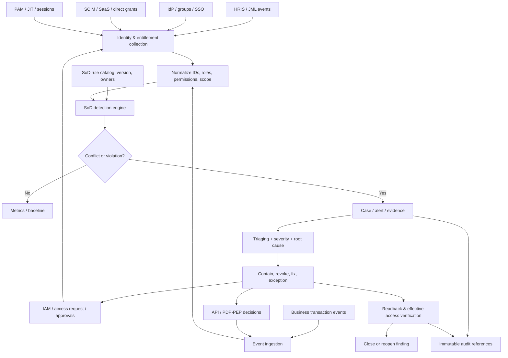
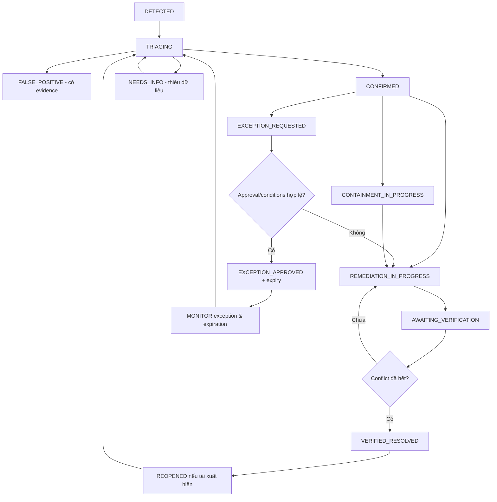

# Theo dõi vi phạm Segregation of Duties trong IAM: Phát hiện, xử lý và xác minh xung đột nhiệm vụ

**Theo dõi vi phạm Segregation of Duties (SoD)** là quá trình liên tục **thu thập tín hiệu, đánh giá các quy tắc phân tách nhiệm vụ, nhận diện xung đột hoặc hành vi trái chính sách, điều tra nguyên nhân, áp biện pháp xử lý và xác minh rủi ro đã được loại bỏ hoặc chấp nhận có kiểm soát**. SoD được dùng để ngăn một chủ thể nắm hoặc thực hiện trọn vẹn một chuỗi thao tác nhạy cảm mà lẽ ra phải có các bên độc lập.

Ví dụ, một nhân viên có thể được phép **tạo nhà cung cấp** trong hệ thống ERP hoặc **thực hiện thanh toán** trong ngân hàng điện tử, nhưng việc cùng một người có khả năng làm cả hai có thể tạo xung đột SoD. Một trường hợp khác: An được giao role `payment-maker` trước khi chuyển sang `payment-checker`, nhưng vẫn còn role cũ ở ứng dụng thứ hai; hoặc An đã tạo giao dịch trong phiên cũ rồi cố phê duyệt giao dịch đó sau khi đổi vai trò. Theo dõi SoD phải nhìn thấy cả **quyền được cấp** lẫn **hành động thực tế** chứ không chỉ so tên role tại một IdP.

Bài thuộc chương **Segregation of duties** của module `SECURITY_IDENTITY_ACCESS_MANAGEMENT_IDENTITY_LIFECYCLE`, tìm hiểu quản lý vòng đời danh tính theo **Joiner–Mover–Leaver (JML)**: xác minh, tạo tài khoản, cấp quyền, rà soát và thu hồi khi thay đổi vai trò. Nội dung kết nối **IdP, SSO, SCIM, RBAC/ABAC, tài khoản dịch vụ, kiểm toán và giảm quyền truy cập tồn dư**.

Mục tiêu của bài không chỉ là liệt kê rule SoD, mà là thiết kế một **vòng giám sát khép kín**: biết cái gì vi phạm, phát hiện bằng dữ liệu nào, đánh giá mức độ tin cậy ra sao, ai có trách nhiệm xử lý, xử lý thế nào để không phá vỡ quy trình hợp lệ và xác minh rằng quyền/hành vi nguy hiểm không còn xảy ra.

Sau bài học, bạn có thể:
- Phân biệt xung đột gán quyền (*Static SoD*), xung đột kích hoạt (*Dynamic SoD*) và xung đột theo giao dịch.
- Xây dựng catalog quy tắc và tín hiệu giám sát có chủ sở hữu, phiên bản, phạm vi, độ ưu tiên và thời hạn.
- Phát hiện xung đột xuyên role, group, ứng dụng, session, tài nguyên và tài khoản máy.
- Tổ chức quy trình *detect → triage → contain → remediate → verify → close*.
- Liên kết SoD với Joiner–Mover–Leaver, IdP/SSO/SCIM, PAM/JIT, RBAC/ABAC và audit.
- Thiết kế KPI, ma trận kiểm thử và xử lý ngoại lệ có kiểm soát.

## 1. Vi phạm SoD là gì và không phải là gì?

**SoD** (*Segregation of Duties*, còn được gọi *Separation of Duties*) phân chia những công việc có rủi ro để một cá nhân không thể tự thực hiện tất cả các bước cần kiểm tra độc lập. Tuy nhiên, cụm từ **“vi phạm SoD”** có thể được sử dụng cho các mức độ khác nhau:

| Mức độ | Nội dung được phát hiện | Ví dụ | Ý nghĩa |
| --- | --- | --- | --- |
| **Xung đột quyền tiềm tàng** | Một chủ thể có **khả năng** thực hiện hai nhiệm vụ bị cấm kết hợp | Có cả quyền tạo và phê duyệt thanh toán | Rủi ro thiết kế/cấp quyền; chưa chứng minh đã lạm dụng |
| **Xung đột kích hoạt** | Hai role/quyền không được phép dùng cùng phiên/ngữ cảnh nhưng đang active | Kích hoạt Maker và Checker cùng phiên | Vi phạm ràng buộc Dynamic SoD |
| **Hành vi bị chặn** | Chủ thể đã cố thực hiện thao tác trái SoD nhưng PEP từ chối | An cố duyệt hóa đơn do chính mình tạo, API trả Deny | Một tín hiệu quan trọng; cần phân biệt thử nghiệm, sai thao tác và lạm dụng |
| **Hành vi thực sự vi phạm** | Giao dịch bị thực thi trái chính sách | An tạo rồi phê duyệt cùng hóa đơn và thao tác đã được ghi nhận thành công | Có thể là sự cố kiểm soát cần khắc phục/điều tra |
| **Vi phạm thủ tục phê duyệt** | Có quyền hoặc thao tác hợp lệ về mặt kỹ thuật nhưng bỏ qua bước kiểm tra bắt buộc | Một thay đổi production được tự duyệt | Rủi ro tuân thủ/quy trình và kiểm soát |
| **Sai lệch không rõ** | Dữ liệu thiếu, mapping mơ hồ hoặc log không đầy đủ | Không biết tác nhân thực sau shared account | Chưa đủ căn cứ kết luận; cần điều tra |

**Không nên gọi mọi xung đột tiềm tàng là hành vi gian lận.** Cấp đồng thời hai permission rủi ro có thể là lỗi provisioning, role hierarchy hoặc dữ liệu chậm đồng bộ. Ngược lại, **không có xung đột role trong danh sách IAM không chứng minh không có vi phạm hành động**, vì quyền có thể đến từ trực tiếp tại SaaS, API key, tài khoản máy hoặc một đường thực thi không đi qua IAM.

### 1.1. Phòng ngừa và phát hiện là hai lớp khác nhau

- **Preventive control:** ngăn assignment, activation hoặc thao tác khi phát hiện xung đột. Ví dụ IAM từ chối gán role `payment-checker` khi chủ thể còn role `payment-maker` và chính sách cấm tổ hợp.
- **Detective control:** giám sát quyền, session và event để tìm những xung đột đã tồn tại hoặc hành động đi qua đường không được chặn.
- **Corrective control:** thu hồi quyền, sửa cấu hình, xử lý giao dịch và điều chỉnh nguyên nhân gốc sau khi phát hiện.
- **Compensating control:** kiểm soát bù trừ cho ngoại lệ được duyệt, như giám sát độc lập, dual approval hoặc giới hạn hành động và thời hạn.

Một **dashboard đỏ** không chặn được thanh toán trái chính sách. Monitoring phải kết nối với **PEP/API, quyền đích, đội vận hành và quy trình khắc phục** thì mới giảm rủi ro.

## 2. Ba tầng SoD cần được giám sát

### 2.1. Static Separation of Duties (SSD)

**SSD** áp dụng ràng buộc tại **thời điểm gán role/quyền**. Nếu policy cấm một user được giữ đồng thời `payment-maker` và `payment-checker`, IAM phải kiểm tra trước cấp và giám sát sau cấp ở các hệ thống đích.

```text
User: iam-user-1042
Role 1: payment-maker
Role 2: payment-checker

Rule: NOT (assigned(payment-maker) AND assigned(payment-checker))

Finding: STATIC_SOD_CONFLICT
```

Trong thực tế, cần phân biệt **role assignment trực tiếp**, **group lồng nhau** và **permission kế thừa qua role hierarchy**. Một người có thể không thấy tên `payment-checker` trong IAM nhưng vẫn nhận permission tương đương tại ứng dụng.

### 2.2. Dynamic Separation of Duties (DSD)

**DSD** hạn chế **kích hoạt các role xung đột trong cùng phiên/ngữ cảnh**, dù policy có thể cho phép một người được gán cả hai role cho nhiệm vụ ở các thời điểm khác nhau.

```text
Assigned roles: {support-operator, emergency-approver}
Session activated roles: {support-operator, emergency-approver}

Policy: không được kích hoạt đồng thời hai role này
Finding: DYNAMIC_SOD_ACTIVATION_CONFLICT
```

**Điều kiện “cùng phiên” phụ thuộc hệ thống**. Một ứng dụng chỉ dùng role claims trong JWT có thể không hỗ trợ khái niệm activated roles như RBAC có session. Khi đó phải thiết kế kiểm soát phù hợp tại PDP/PEP hoặc cơ chế JIT, không coi việc gắn nhãn DSD là đã có enforcement.

### 2.3. Object-level / Transaction-level SoD

Một người đã tạo hóa đơn không được phê duyệt **chính hóa đơn đó**, kể cả khi họ đã đổi role hoặc dùng phiên khác.

```text
payment.id         = payment-782
payment.createdBy  = iam-user-1042
approval.actor     = iam-user-1042

Rule: approval.actor != payment.createdBy

Nếu API cho phép phê duyệt thành công:
Finding: TRANSACTION_SOD_VIOLATION
```

Kiểm tra này yêu cầu dữ liệu **nguồn sự thật của giao dịch**, không chỉ role tại IAM. Nó cần tính đến ủy quyền, thay mặt, API app-only, batch job và trường hợp creator/approver được lưu bằng account ID khác nhưng cùng identity.

### 2.4. Bảng so sánh

| Tiêu chí | SSD | DSD | Transaction SoD |
| --- | --- | --- | --- |
| Đối tượng | User–role/permission assignment | Role activation hoặc capability trong phiên | Chuỗi hành động trên đối tượng nghiệp vụ |
| Thời điểm phù hợp | Trước cấp và đối soát sau cấp | Khi tạo/kích hoạt/sử dụng phiên | Khi thao tác và kiểm tra log nghiệp vụ |
| Dữ liệu bắt buộc | UA/PA, group, hierarchy, direct grants | Session/activation/JIT grants | Creator, approver, object ID, lịch sử |
| Điểm chặn | IAM/IGA provisioning và target policy | PAM/PEP/session policy | Backend API/PDP/transaction service |
| Giới hạn | Không nhận diện mọi hành vi trên cùng giao dịch | Không chặn self-approval xuyên phiên nếu chỉ xét activation | Có thể bỏ sót xung đột quyền chưa dùng |
| Cần giám sát | Quyền lệch và role stacking | Quyền active đồng thời trái policy | Hành động thực sự trái quy trình |

**Một hệ thống SoD hoàn chỉnh thường cần cả ba góc nhìn** vì mỗi góc nhìn phát hiện những vấn đề khác nhau.

## 3. Mô hình rủi ro và SoD rule catalog

Không nên dựa vào danh sách “hai role nào đó có vẻ nguy hiểm”. Tổ chức cần **catalog rủi ro SoD** liên kết mục tiêu nghiệp vụ, action cụ thể, nguồn dữ liệu, owner và chính sách.

| Rule ID | Nhóm hành động xung đột | Phạm vi | Mức độ mẫu | Kiểm soát |
| --- | --- | --- | --- | --- |
| `SOD-PAY-01` | Tạo và phê duyệt cùng thanh toán | Cùng giao dịch | Cao | Object-level Deny |
| `SOD-VEND-02` | Tạo nhà cung cấp và tự thực hiện thanh toán cho nhà cung cấp đó | Theo vendor/payment | Nghiêm trọng | Xuyên ứng dụng và nghiệp vụ |
| `SOD-IAM-03` | Yêu cầu/cấp quyền và tự phê duyệt yêu cầu của mình | Cùng access request | Cao | Independent approval |
| `SOD-AUD-04` | Thực hiện thay đổi bảo mật và sửa/xóa audit liên quan | Hệ thống kiểm toán | Nghiêm trọng | Role separation và immutable audit |
| `SOD-DEP-05` | Phê duyệt thay đổi production và tự deploy khi policy cấm | Change/deployment | Cao | Dual control/PAM |
| `SOD-HR-06` | Tạo/chỉnh bản ghi nhân sự và tự phê duyệt cùng thay đổi | Person/change | Cao | HR workflow SoD |

**Tên, mức độ và chính sách chỉ là ví dụ.** Các tổ chức phải xác định theo môi trường, nghĩa vụ kiểm soát và khả năng gây thất thoát/thay đổi dữ liệu.

### 3.1. Một rule cần những thông tin nào?

- **Rule ID, tên, phiên bản, owner** và mục đích kiểm soát.
- **Action/permission semantics** ở từng hệ thống, tránh chỉ so tên role.
- **Conflict scope:** cùng user, cùng session, cùng giao dịch, cùng vendor, cùng tenant hay toàn tổ chức.
- **Trigger:** request cấp quyền, activation, giao dịch, đồng bộ định kỳ hoặc sự kiện HR.
- **Nguồn dữ liệu:** Identity, account, role, grant provenance, transaction event.
- **Độ mới dữ liệu chấp nhận được** và cách xử lý khi thiếu.
- **Kết quả:** Deny, alert, case cần điều tra, hoặc exception theo policy.
- **Owner triage/remediation**, SLA và mức ưu tiên.
- **Cơ chế ngoại lệ:** có được phép không; nếu có thì ai duyệt, có điều kiện gì.
- **Bằng chứng audit** và test cases.
- **EffectiveFrom/EffectiveUntil** của policy để phân tích vi phạm lịch sử đúng ngữ cảnh.

Ví dụ cấu hình **minh họa**, không phải ngôn ngữ cụ thể của OPA/Cedar/XACML:

```yaml
ruleId: SOD-PAY-01
name: Prevent self approval of payment
version: 6
ownerTeam: finance-controls
appliesTo:
  action: payment.approve
  resourceType: payment
  environment: production
conflict:
  type: TRANSACTION_SOD
  expression: approver.identityId == payment.createdByIdentityId
decisionIfMatched: DENY
monitoring:
  onAuthorizationDecision: true
  onPaymentApprovedEvent: true
  lookbackDays: 30
dataRequirements:
  - trustedIdentityMapping
  - paymentCreator
  - approvalActor
  - actionOutcome
severity: HIGH
exceptions:
  allowed: false
```

Phần `expression` chỉ biểu đạt ý tưởng. **Không được tin trường creator hoặc approver do client tự điền**. Hệ thống giao dịch phải lưu tác nhân đáng tin và truy xuất nguồn dữ liệu có thẩm quyền. Policy `exceptions.allowed: false` cũng chỉ có giá trị nếu workflow/PEP thực thi.

## 4. Dữ liệu đầu vào cho giám sát SoD

Theo dõi SoD trong IAM cần liên kết nhiều lớp dữ liệu:

| Nguồn | Tín hiệu liên quan | Cần chú ý |
| --- | --- | --- |
| **HRIS/contractor registry** | `identityId`, status, department, manager, `effectiveAt` | Nguồn JML có thẩm quyền, sự kiện đến muộn |
| **IAM/IGA** | Business role, entitlement catalog, access request, approval, review | Desired state khác quyền thực tại đích |
| **IdP/directory** | User, group, nested membership, account disable, SSO context | Group chưa chắc là application role |
| **SCIM/API connector** | User/group/role ở ứng dụng, grant trực tiếp | Khả năng đọc đầy đủ và độ trễ đồng bộ |
| **PAM/PIM** | Privileged eligibility, JIT activation, session, command logs | Eligible khác active, session còn sau revoke |
| **Ứng dụng nghiệp vụ** | Creator, modifier, checker, approver, transaction result | Phải liên kết cùng business object |
| **Database/API/cloud** | Permission, actions, resource, account ID | Khả năng bypass qua đường khác |
| **Policy engine/PEP** | Permit, Deny, policy version, obligations | Deny chưa chứng minh có vi phạm thành công |
| **Audit/SIEM** | Authentication events, action outcomes, trace/correlation | Log có thể mất, trễ, trùng hoặc thiếu |
| **Task/change system** | Ticket, change owner, approvals, validity | Ticket không tự tạo quyền hợp lệ |

### 4.1. Identity mapping đáng tin

**Một người có thể có nhiều tài khoản:** account thường, admin account, SaaS account, database login, SSH principal hoặc workload đại diện. Nếu detector so username thay vì identity ID, có thể bỏ sót trường hợp một người tạo giao dịch bằng account A và duyệt bằng account B.

Cần duy trì:
- Khóa danh tính **ổn định** từ nguồn có thẩm quyền.
- Mapping account–identity có nguồn, version và thời gian hiệu lực.
- Quan hệ ủy quyền/delegation được xác minh.
- Workload principal và **human initiator** khi hành động máy được kích hoạt từ yêu cầu người dùng.
- Cờ **UNKNOWN/MAPPING_AMBIGUOUS** khi không đủ bằng chứng.

**Không tự gộp hai danh tính chỉ vì trùng email hoặc tên**; cũng không coi hai login khác nhau là chắc chắn hai người độc lập.

### 4.2. Dữ liệu có thể cũ hoặc không đầy đủ

Đọc một trang SCIM có thể chưa lấy hết users/groups; một ứng dụng có thể không hỗ trợ export quyền trực tiếp; JWT cũ còn role đã gỡ. Vì vậy mỗi nguồn cần ghi:
- `collectedAt`, `sourceEventAt`, `ingestedAt`.
- Số trang/tenant đã đọc và trạng thái completeness.
- Độ tin cậy account mapping.
- Version policy và permission mapping.
- Tình trạng quyền target: `PRESENT`, `ABSENT` hay `UNKNOWN`.

**UNKNOWN không được diễn dịch thành “không có xung đột”.** Ngược lại, thiếu dữ liệu cũng không đủ để kết luận một người đã cố ý vi phạm.

## 5. Kiến trúc giám sát SoD nhiều lớp



Giám sát có thể chạy **gần thời gian thực** qua event và **định kỳ** qua snapshot. Hai hướng bổ sung nhau:

- Event giúp phát hiện nhanh xung đột mới.
- Snapshot giúp tìm quyền đã tồn tại từ trước, event bị mất, role hierarchy thay đổi và grant ngoài IAM.
- Transaction log giúp phát hiện chuỗi hành động thực sự trái SoD.
- PDP/PEP chặn hành động tại thời điểm request; monitoring kiểm tra độ phủ và những đường không được chặn.

**Không có một detector trung tâm nào bảo đảm an toàn nếu ứng dụng vẫn có API hoặc tài khoản bypass ngoài PEP.** Cần kiểm soát ở tài nguyên và coverage tests.

## 6. Theo dõi vi phạm SSD tại thời điểm cấp quyền

Một luồng cấp quyền chuẩn có thể gồm:

1. Người dùng hoặc HR event đề xuất assignment mới.
2. IAM xác định **toàn bộ quyền hiện có**, gồm role trực tiếp, inherited và nguồn cấp ở target.
3. Detector đánh giá các cặp/tổ hợp SoD theo rule version hiện hành.
4. Nếu bị cấm, workflow **từ chối hoặc yêu cầu ngoại lệ đúng policy**.
5. Nếu cấp được, connector đồng bộ và **readback** ở đích.
6. Monitoring đối soát snapshot sau cấp để phát hiện conflict do drift hoặc manual grant.

Ví dụ:

```text
Assigned/derived permissions of An:
  payment.create     <- role payment-maker
  payment.approve    <- direct application grant

SoD rule:
  forbid coexistence(payment.create, payment.approve)

Detection:
  STATIC_SOD_CONFLICT
  Sources: IAM role + target direct grant
```

Nếu chỉ kiểm tra role `payment-maker` và `payment-checker` tại IAM, detector sẽ **bỏ sót direct application grant**. Quy tắc nên ánh xạ business roles tới **effective capabilities** của từng ứng dụng.

### 6.1. Giả mã kiểm tra SSD

```text
detectStaticSoD(subjectIdentityId, asOf):
    lifecycle = readTrustedLifecycle(subjectIdentityId, asOf)
    grants = collectAllGrantsForIdentity(subjectIdentityId, asOf)

    if grants.incomplete or grants.mappingAmbiguous:
        createFinding("INSUFFICIENT_ACCESS_EVIDENCE")
        return UNKNOWN

    capabilities = expandRoleHierarchyAndGroupMemberships(grants)
    capabilities = mapTargetEntitlementsToActions(capabilities)

    for each rule in activeStaticSoDRules(asOf):
        matched = evaluateConflict(
            rule,
            subjectIdentityId,
            capabilities,
            resourceScopes = capabilities.scopes
        )
        if matched:
            upsertFindingWithStableKey(
                subjectIdentityId, rule.id, rule.version,
                matched.grants, matched.scopes, asOf
            )

    return findings
```

Đây là **giả mã**, không phải thuật toán production. Quyền cần được chuẩn hóa đúng scope; ví dụ `payment.create` ở tenant A và `payment.approve` ở tenant B có thể có hoặc không xung đột tùy rule nghiệp vụ.

### 6.2. SoD phải quan tâm tới scope

Không phải cứ hai role có tên xung đột là luôn vi phạm. Chính sách có thể cấm trên **cùng pháp nhân**, **cùng tài khoản ngân hàng**, **cùng dự án** hoặc **toàn tập đoàn**. Nếu không mã hóa scope, detector sẽ sinh false positive lớn hoặc bỏ sót xung đột ở một số hệ thống.

## 7. Theo dõi vi phạm DSD trong session và PAM

DSD giám sát **những quyền được kích hoạt cùng lúc**. Tín hiệu thường đến từ PAM/PIM, session management, STS hoặc policy engine.

Ví dụ một nhân viên có thể đủ tư cách dùng role quản trị change khi trực ca, và role duyệt change trong ca khác. Chính sách cấm role này **active đồng thời trong cùng phiên**.

| Trường | Ví dụ |
| --- | --- |
| Principal | `iam-user-1042` |
| Session | `session-992` |
| Role activated | `deployment-executor` |
| Other active role | `deployment-approver` |
| Target | `prod-cluster-02` |
| Detection | `DYNAMIC_SOD_CONFLICT` |

Nên kiểm tra khi:
- Tạo phiên hoặc token mới.
- Kích hoạt role JIT.
- Thay đổi policy/role khi phiên đang hoạt động.
- Gia hạn phiên hoặc refresh token.
- Thu hồi role, Leaver/Mover hoặc session termination.

**Không chỉ kiểm tra khi login.** Role có thể được kích hoạt giữa phiên và authorization có thể thay đổi sau khi người dùng đã đăng nhập.

### 7.1. DSD không thay object-level SoD

Nếu An tạo giao dịch ở session 1 và duyệt ở session 2, hai role không active cùng lúc nhưng giao dịch vẫn vi phạm nếu policy cấm tự duyệt. Vì vậy phải giữ **lịch sử chủ thể gắn với object** để giám sát xuyên phiên.

### 7.2. Eligible và active khác nhau

- **Eligible privileged role:** chủ thể có thể xin/kích hoạt role sau approval. Đây là **rủi ro tiềm năng** cần kiểm tra entitlement và recertification.
- **Active privileged role:** role đã thực sự kích hoạt trong khoảng thời gian cụ thể. Đây là đầu vào cho DSD/session monitoring.
- **Used privileged action:** hành động đã xảy ra. Cần đối chiếu command/API log và target outcome.

Một dashboard không nên tô mọi eligible grant như “hành động vi phạm đã xảy ra”; nên phân tách rõ **tiềm năng**, **active** và **executed**.

## 8. Theo dõi SoD ở cấp giao dịch

**Giao dịch nghiệp vụ** là nơi có thể nhận diện **vi phạm đã thực sự xảy ra**. Với payment, một record có thể chứa:
- `paymentId`.
- `createdByIdentityId`.
- `reviewedByIdentityId`.
- `approvedByIdentityId`.
- `executedByPrincipalId`.
- Timestamps, tenant, amount, trạng thái và authorization outcome.

Một rule cơ bản:

```text
DENY payment.approve khi:
    subject.identityId == payment.createdByIdentityId

Giám sát:
    Nếu paymentApprovedEvent.success == true
    VÀ resolvedActorIdentityId == createdByIdentityId
    → TRANSACTION_SOD_VIOLATION
```

**Rule giả mã này cần mở rộng theo nghiệp vụ**: maker có thể được ủy quyền hợp pháp? Có các bước edit/change ownership? Một hành động máy thực thi theo phê duyệt của con người? Chỉ dựa vào một trường `createdBy` không đủ cho mọi quy trình.

### 8.1. Phải biết hành động nào **đã thành công**

Một log “attempt approve” không đồng nghĩa “approved”. Cần so khớp:
- Request received.
- PDP decision Permit/Deny.
- PEP enforcement.
- Transaction commit hoặc trạng thái nghiệp vụ cuối cùng.
- Event được phát sau commit khi nền tảng hỗ trợ.

Ví dụ:

| Trường hợp | Diễn giải đúng |
| --- | --- |
| An tự duyệt nhưng API trả 403, không commit | Attempt bị chặn; không phải giao dịch đã vi phạm thành công |
| PDP trả Deny nhưng giao dịch vẫn đổi trạng thái | Lỗi enforcement nghiêm trọng |
| API trả 200 “job queued”, batch chưa chạy | Chưa kết luận approval đã commit |
| Giao dịch đã approved bởi cùng identity | Vi phạm thực tế nếu policy cấm |
| Actor kỹ thuật là service account | Cần truy người khởi tạo/ủy quyền nếu có, không tự kết luận hai người khác nhau |

### 8.2. Chống bypass bằng API khác

Ứng dụng có thể có nhiều đường duyệt:
- Giao diện người dùng.
- REST API.
- Batch import.
- Mobile API.
- Admin console.
- Workload integration.

**Theo dõi chỉ một endpoint không có nghĩa mọi đường đều được bảo vệ.** Cần kiểm kê các action tạo cùng tác động nghiệp vụ và đặt PEP/transaction guardrail trên mọi đường.

## 9. SoD xuyên ứng dụng: Quyền kết hợp tạo rủi ro

Một hành vi nguy hiểm có thể đòi quyền từ **hai hệ thống riêng**.

Ví dụ:
1. User A có quyền tạo **vendor** trong VendorHub.
2. Cùng identity có quyền tạo hoặc thực thi **payment** trong FinanceCore.
3. Hai quyền riêng lẻ có thể hợp lệ, nhưng tổ hợp có thể vi phạm SoD nếu tổ chức yêu cầu independent check.

| Hệ thống | Quyền | Tác động |
| --- | --- | --- |
| VendorHub | `vendor.create` | Tạo đối tượng nhận tiền |
| FinanceCore | `payment.execute` | Chi trả |
| IdP | Group `vendor-management` | Có thể ánh xạ quyền tạo vendor |
| ERP | Direct role `payment-operator` | Có quyền thực thi thanh toán ngoài nhóm IdP |

Một detector xuyên hệ thống cần:
- Map nhiều target account về một **identity ID**.
- Chuẩn hóa action semantics.
- Kiểm tra **tenant/legal entity/vendor relationship**.
- Xem xét đường cấp direct/inherited/exception.
- Phân biệt **khả năng kết hợp** với **hành vi đã thực hiện**.

### 9.1. Không vội kết luận khi scope khác nhau

Nếu một người tạo vendor ở công ty con A và chỉ thanh toán cho công ty con B, rule có thể xác định đó là **không xung đột**, nếu rủi ro thực tế không giao nhau. Nhưng nếu chính sách cấm trên toàn tập đoàn, detector phải dùng **scope policy chính xác**, không tự nới.

### 9.2. Role catalog drift

Một role tên `finance-viewer` có thể bị đổi permission ở ứng dụng thành cho phép export hoặc approve. Nếu detector chỉ dựa tên role cũ, nó sẽ đánh giá sai. Cần version hóa **role-to-permission mapping** và theo dõi drift tại đích.

## 10. Giám sát theo thời gian thực và định kỳ

Nên phối hợp hai kiểu:

| Cơ chế | Trigger | Phát hiện tốt | Giới hạn |
| --- | --- | --- | --- |
| **Pre-grant check** | Access request, Joiner/Mover role assignment | Xung đột SSD trước cấp | Không nhìn thấy manual grant không qua workflow |
| **Post-provisioning readback** | Sau SCIM/API operation | Quyền thực tế vừa thay đổi | Target có thể chưa đồng bộ hoàn toàn |
| **Event-driven detector** | Role/group changed, JIT activated, transaction committed | Xung đột mới và hành vi gần thời gian thực | Event bị mất/trễ/trùng |
| **Scheduled full reconciliation** | Theo kỳ có risk-based cadence | Quyền tồn dư, direct grant, drift, event bị mất | Độ trễ theo chu kỳ |
| **Session/PEP telemetry** | Role activation, Permit/Deny, privileged action | DSD và bypass | Độ phủ PEP/session không đồng đều |
| **Access review/recertification** | Campaign hoặc sự kiện JML | Nhu cầu công việc và chứng nhận quyền | Quyết định reviewer không tự chặn action |

**Rule xử lý tại thời điểm request là kiểm soát phòng ngừa quan trọng nhất cho action nhạy cảm.** Giám sát sau sự kiện có thể rất nhanh nhưng vẫn là **sau** khi tác động xảy ra.

### 10.1. Time semantics

Cần lưu:
- `eventOccurredAt`: hành động xảy ra lúc nào theo nguồn.
- `sourceEffectiveAt`: khi role/quan hệ HR có hiệu lực.
- `ingestedAt`: khi detector nhận event.
- `evaluatedAt`: khi detector đánh giá.
- `policyVersion`: rule nào có hiệu lực khi đánh giá.
- `verifiedAt`: khi khắc phục được xác minh.

**Một event đến trễ không tự có nghĩa vi phạm xảy ra lúc nhận.** Khi điều tra lịch sử, nên dùng phiên bản rule và trạng thái đúng thời điểm, đồng thời áp policy hiện hành để quyết định rủi ro cần xử lý bây giờ.

## 11. Từ tín hiệu đến finding: Chuẩn hóa và tránh trùng

Nếu cùng conflict được phát hiện qua IAM role, group IdP và SaaS direct entitlement, có thể xuất hiện ba alert giống nhau. Detector cần gom thành **finding có định danh ổn định**, đồng thời giữ đủ bằng chứng nguồn.

Ví dụ khóa logic:

```text
findingKey = (
  subjectIdentityId,
  sodRuleId,
  policyScope,
  conflictObjectOrEntitlementSet,
  relevantEffectiveWindow
)
```

Không nên dùng mỗi `userId + ruleId` trong mọi trường hợp, vì cùng user có thể vi phạm rule trên **nhiều giao dịch khác nhau**, mỗi giao dịch cần điều tra riêng.

### 11.1. Tính idempotent

- Event lặp không tạo finding trùng.
- Scan định kỳ phát hiện cùng xung đột thì **cập nhật lastObservedAt** thay vì tạo cảnh báo mới mỗi lần.
- Một conflict được khắc phục rồi tái xuất hiện cần **reopen hoặc tạo case mới** có liên kết lịch sử.
- Rule version thay đổi cần đánh giá tác động đối với các finding còn mở, không xóa bằng chứng cũ.
- Sự kiện `REVOKED` cũ đến sau event `GRANTED` mới không được khiến detector kết luận sai rằng quyền đã biến mất.

### 11.2. Độ tin cậy của bằng chứng

| Bằng chứng | Điểm mạnh | Điều chưa chứng minh |
| --- | --- | --- |
| IAM desired role | Căn cứ được quản trị | Target đã thực thi đúng |
| IdP group observed | Group đang tồn tại tại IdP | SaaS/PEP có cùng semantics |
| SaaS role readback | Entitlement ở target | Session/token cũ đã được vô hiệu hóa |
| PEP Deny event | Attempt bị chặn tại một đường API | Không có đường khác bypass |
| Business commit event | Giao dịch thay đổi trạng thái | Người thực sự khởi tạo là ai nếu chỉ dùng shared account |
| Session recording | Hoạt động quan sát được | Cấm lệnh trước thực thi |
| Audit export thiếu trang | Một phần dữ liệu | Toàn bộ lịch sử đã đủ |

**Không tự nâng confidence của một finding nếu chỉ có dữ liệu thứ cấp**. Một tình huống có bằng chứng role và session rõ ràng khác với trường hợp chỉ suy từ tên group.

## 12. Phân loại mức độ ưu tiên và tác động

Không phải mọi xung đột SoD cần cùng mức xử lý. Một mô hình ưu tiên có thể xét:

| Yếu tố | Câu hỏi |
| --- | --- |
| Loại conflict | Chỉ có khả năng hay giao dịch trái policy đã thành công? |
| Tài nguyên | Production, tài chính, dữ liệu nhạy cảm hay môi trường thử nghiệm? |
| Quyền thực tế | Có quyền toàn hệ thống hay chỉ một đối tượng nhỏ? |
| Độ phủ | Một user hay nhiều user do role catalog sai? |
| Thời gian tồn tại | Xung đột mới hay kéo dài qua nhiều kỳ review? |
| Điều kiện bù trừ | Có dual approval, hạn mức và monitoring độc lập không? |
| Mức tin cậy | Dữ liệu đầy đủ, mapping chính xác, event commit có xác thực? |
| Trạng thái danh tính | ACTIVE, Mover, Leaver, account bị khóa, workload? |
| Tác động đã xảy ra | Có transaction commit, tiền đã chuyển hoặc dữ liệu đã bị sửa? |
| Khả năng chặn | PEP có thể Deny ngay hay target còn đường bypass? |

### 12.1. Ví dụ phân tầng

| Severity minh họa | Tình huống |
| --- | --- |
| **Critical** | Giao dịch trái SoD đã thành công và tác động lớn, hoặc PEP bị bypass trong tài nguyên nhạy cảm |
| **High** | Chủ thể có hai quyền xung đột và có khả năng thực thi trên production; không có kiểm soát bù trừ |
| **Medium** | Role conflict giới hạn scope, chưa ghi nhận hành động, có một số guardrail |
| **Low/Informational** | Cảnh báo cần làm rõ mapping hoặc cấu hình không đủ tác động thực tế |
| **Unknown** | Không đủ dữ liệu kết luận; phải bổ sung bằng chứng |

Đây không phải ma trận tiêu chuẩn bắt buộc. **Mức độ ưu tiên cần được policy của tổ chức phê duyệt**, có thể chịu ảnh hưởng của luật, kiểm soát tài chính, rủi ro bảo mật và nghĩa vụ quản trị.

## 13. Vòng đời xử lý một finding SoD

Một finding cần **owner, trạng thái, tác vụ và bằng chứng**.

| Trạng thái | Ý nghĩa |
| --- | --- |
| `DETECTED` | Detector ghi nhận tín hiệu có thể vi phạm |
| `TRIAGING` | Đang xác minh identity, scope, policy, dữ liệu và tác động |
| `CONFIRMED` | Có đủ căn cứ kết luận conflict/vi phạm theo rule |
| `FALSE_POSITIVE` | Không có conflict trong ngữ nghĩa rule sau khi xác minh |
| `CONTAINMENT_IN_PROGRESS` | Đang ngăn hành động có rủi ro cao |
| `REMEDIATION_IN_PROGRESS` | Gỡ quyền/sửa policy/sửa quy trình hoặc xử lý dữ liệu |
| `AWAITING_VERIFICATION` | Chờ readback và kiểm tra hiệu lực |
| `VERIFIED_RESOLVED` | Đã xác minh điều kiện vi phạm không còn |
| `EXCEPTION_APPROVED` | Rủi ro được chấp nhận tạm có điều kiện, còn phải theo dõi |
| `REOPENED` | Xung đột tái xuất hiện hoặc biện pháp xử lý không còn hiệu lực |

**FALSE_POSITIVE phải có lý do kiểm chứng**, không đơn thuần là người giữ quyền nói “tôi cần quyền”. **EXCEPTION_APPROVED không đồng nghĩa rủi ro đã biến mất**: nó phải được theo dõi riêng với owner và thời hạn.



### 13.1. Ai chịu trách nhiệm?

- **IAM/IGA:** quyền cấp, nguồn grant và connector.
- **Owner nghiệp vụ:** xác định nhiệm vụ, tác động và cách phân công lại.
- **Application/target owner:** diễn giải entitlement, thực thi thay đổi tại đích.
- **Security/GRC:** quản lý rule, rủi ro, ngoại lệ và chất lượng kiểm soát.
- **Incident response:** điều tra khi có bằng chứng lạm dụng hoặc tác động nghiêm trọng.
- **HR/contractor owner:** xác minh quan hệ JML nếu conflict liên quan trạng thái nhân sự.
- **Workload owner:** xác minh hành động của account máy và dependency.

Người giữ entitlement **không nên tự đóng finding rủi ro cao** khi chính họ là bên hưởng lợi từ việc giữ hai quyền xung đột.

## 14. Quy trình triage: Đừng xóa mọi quyền ngay khi thấy alert

Một quy trình xử lý tiêu chuẩn:

1. **Định danh:** ánh xạ tất cả target account về chủ thể thật, xác nhận tính độc lập của maker/checker.
2. **Khóa scope:** rule áp theo tenant, project, business object hay toàn tổ chức?
3. **Đọc dữ liệu hiện hành:** grant nào trực tiếp, grant nào inherited, token/session nào active?
4. **Kiểm tra policy version:** rule hiện hành và tại thời điểm event.
5. **Xác minh hành vi:** chỉ có khả năng, attempt bị Deny hay transaction đã commit?
6. **Tìm ngoại lệ hợp lệ:** scope, owner, approval, expiry, compensating controls có còn hiệu lực?
7. **Phân loại severity và mức tin cậy**; xác định có cần containment tức thì.
8. **Giao owner và SLA** cho việc gỡ quyền, phân công lại nhiệm vụ hoặc sửa kiểm soát.
9. **Bảo toàn evidence** và cập nhật case với lý do rõ ràng.

### 14.1. False positive phổ biến

- Role tên giống nhau nhưng permission khác nhau ở các ứng dụng.
- Hai quyền ở tenant không giao nhau, trong khi rule chỉ cấm trong cùng tenant.
- Một principal máy chỉ chạy tác vụ kỹ thuật, không phải actor quyết định nghiệp vụ.
- Event bị duplicate hoặc đến không đúng thứ tự.
- User từng có quyền nhưng đã được thu hồi trước thời điểm đánh giá.
- Role eligible nhưng detector tưởng là active.
- Snapshot role–permission cũ, permission đã được điều chỉnh.
- Account mapping gán nhầm login của hai người khác nhau.

Giảm false positive bằng **mô hình dữ liệu đúng**, không phải tắt rule hoặc tự cho mọi alert vào danh sách loại trừ vĩnh viễn.

### 14.2. False negative nguy hiểm hơn

- Quyền cấp trực tiếp ngoài IAM không được ingest.
- Group lồng nhau không được expand.
- API batch không phát event hành động nhạy cảm.
- Shared account không ghi được human initiator.
- Một user có hai account khác nhau không được map chung.
- Token hoặc session cũ còn quyền đã gỡ.
- Pipeline thiếu dữ liệu vì phân trang hoặc connector lỗi nhưng vẫn báo healthy.
- Chỉ kiểm tra SSD mà không kiểm tra self-approval trên object.

**Monitoring cần đo cả độ phủ dữ liệu và đường thực thi, không chỉ số alert**. “Không có cảnh báo” không chứng minh an toàn nếu detector không nhìn thấy dữ liệu.

## 15. Containment: Ngăn tác động trước khi làm sạch quyền

Khi finding có rủi ro cao, có thể cần **ngăn ngay khả năng thực hiện action** trong khi đánh giá nguyên nhân gốc.

Ví dụ các biện pháp tùy nền tảng:
- **Deny action** tại PEP/PDP đối với tổ hợp chủ thể–action–resource rủi ro.
- Vô hiệu hóa tạm một role hoặc assignment có scope rõ.
- Dừng phiên PAM/JIT hoặc thu hồi khả năng kích hoạt role xung đột.
- Giới hạn hạn mức giao dịch hoặc yêu cầu dual approval.
- Tạm dừng workflow nghiệp vụ nhạy cảm theo phê duyệt.
- Chặn token/session hoặc credential rủi ro khi hỗ trợ.
- Chuyển xử lý sang nhân sự độc lập có nhiệm vụ hợp lệ.

**Không phải mọi conflict đều cần khóa toàn bộ account**, vì có thể ảnh hưởng lớn tới hoạt động và không giải quyết nguồn quyền gốc. Containment phải **cân xứng với rủi ro**, có owner, thời hạn và kiểm chứng.

### 15.1. Nguyên tắc fail closed tại action nhạy cảm

Nếu API cần biết người tạo giao dịch nhưng nguồn dữ liệu không sẵn sàng, API **không nên tự giả định creator khác người phê duyệt**. Với action có yêu cầu SoD bắt buộc, thiếu dữ liệu là **không đủ căn cứ Permit**, trừ cơ chế khẩn riêng được phê duyệt.

### 15.2. Logging và bảo toàn bằng chứng

Khi nghi ngờ một giao dịch đã vi phạm SoD, cần bảo toàn:
- Transaction ID, các actor IDs đã xác minh.
- Event time và commit outcome.
- PDP decision, PEP enforcement.
- Session/role activation.
- Approval và rule version.
- Correlation ID giữa các hệ thống.

Không tự động xóa log hay tự ý sửa giao dịch vì muốn “không còn vi phạm trong dashboard”. Phải xử lý dữ liệu nghiệp vụ theo quy trình được ủy quyền, giữ audit.

## 16. Remediation: Thu hồi đúng quyền, sửa đúng nguyên nhân

Các hướng remediation:

| Nguyên nhân | Biện pháp bền vững |
| --- | --- |
| IAM gán đồng thời role xung đột | Sửa role assignment/eligibility; pre-grant SSD |
| Nested group hoặc role hierarchy cấp thêm quyền | Sửa mapping/inheritance và revalidate tác động |
| Direct SaaS grant không quản trị | Gỡ grant, đưa quyền vào catalog/owner/approval |
| SoD chỉ kiểm tra UI, API không chặn | Bổ sung PEP ở backend/transaction service |
| Mover còn role cũ | Reconcile JML, sửa deprovisioning pipeline |
| Token cũ vẫn dùng quyền | Cơ chế TTL, invalidation, session/authorization hiện hành |
| Shared admin account | Chuyển sang identity truy vết, tài khoản riêng/PAM khi phù hợp |
| Workload credential quá rộng | Giảm API scope, tách service principal, đổi credential |
| Role catalog lỗi | Sửa định nghĩa và kiểm thử tác động tới mọi thành viên |
| Approver tự phê duyệt | Sửa approval routing, SoD và workflow data checks |
| Log/action telemetry thiếu | Bổ sung event từ transaction commit và kiểm thử coverage |

### 16.1. Không thu hồi nhầm quyền hợp lệ

Một permission có thể đến từ **nhiều grant source**. Nếu gỡ một role cũ mà quyền khác vẫn hợp lệ, hệ thống không nên xóa nhầm entitlement cần cho nhiệm vụ khác. Ngược lại, nếu policy SoD cấm **khả năng hiệu lực** của một action, chỉ gỡ một đường cấp chưa đủ khi còn đường khác.

Cần **tính lại desired access** từ toàn bộ căn cứ còn hợp lệ, so với observed/effective access, rồi xử lý chính xác.

### 16.2. Remediation có thể là thay đổi công việc

Không phải lúc nào cũng cần gỡ toàn bộ role. Có thể:
- Chuyển người phê duyệt sang một nhân sự độc lập.
- Tách một nhiệm vụ hiện tại thành hai bước với owner khác nhau.
- Giảm quyền toàn cục xuống tenant hoặc đối tượng cụ thể.
- Chỉ cho phép JIT có dual control khi cần.
- Tái cấu trúc business role để ngăn conflict trên diện rộng.

Giải pháp phải loại bỏ **rủi ro thực**, không chỉ làm biến mất một cặp role tên xung đột trong báo cáo.

## 17. Xác minh kết quả: Desired, Observed và Effective Access

Ba lớp xác minh:

| Lớp | Câu hỏi | Ví dụ |
| --- | --- | --- |
| **Desired state** | Theo JML và chính sách, user được phép có quyền gì? | An chỉ được `payment-checker` sau Mover |
| **Observed state** | App/IdP/DB/PAM hiện ghi quyền gì? | Group maker đã gỡ nhưng role trực tiếp còn |
| **Effective access** | User thực sự có thể làm action bị cấm không? | API còn chấp nhận `payment.create` qua token cũ |

Một case SoD **chưa nên VERIFIED_RESOLVED** chỉ vì connector trả HTTP 200. Cần readback và, với rủi ro cao, kiểm thử đường truy cập có ý nghĩa: API Deny action xung đột, phiên đặc quyền không tiếp tục, hoặc business transaction không cho self-approval.

### 17.1. Giả mã xử lý và xác minh

```text
processSoDFinding(finding):
    evidence = loadCurrentTrustedEvidence(finding)
    if evidence.incomplete:
        setStatus(finding, NEEDS_INFO)
        assignOwnerAndSLA()
        return

    policy = loadApplicableSoDRule(finding.ruleId, evidence.asOf)
    classification = classifyConflict(policy, evidence)

    if classification == FALSE_POSITIVE:
        closeWithEvidence(finding)
        return

    if classification.highRisk:
        enforceContainmentThroughTrustedPEP(finding)

    plan = buildRemediationPlanWithGrantProvenance(
        finding, policy, currentDesiredAccess()
    )
    requireIndependentApprovalsWhenNeeded(plan)
    dispatchChangesIdempotently(plan)

    observed = readBackAllRelevantTargets(plan)
    if observed.incompleteOrStale:
        setStatus(finding, AWAITING_VERIFICATION)
        escalateIfSLAExceeded()
        return

    effective = verifyCriticalActionsNoLongerAllowed(plan)
    if policyConflictResolved(observed, effective, plan):
        setStatus(finding, VERIFIED_RESOLVED)
    else:
        reopenOrContinueRemediation(finding)
```

Đây là **giả mã học tập**. Trong hệ thống thực cần xử lý lỗi phân tán, batch không idempotent, event đến muộn, role mapping, quyền do ứng dụng khác sở hữu, token/session, SoD nghiệp vụ và biện pháp bảo vệ dữ liệu.

## 18. Ngoại lệ và chấp nhận rủi ro SoD

Một số tổ chức nhỏ có ít nhân sự hoặc cần hoạt động khẩn cấp. Có thể xuất hiện nhu cầu **ngoại lệ SoD**, nhưng ngoại lệ phải là **quyết định quản trị có căn cứ**, không phải “tắt cảnh báo cho người quen”.

Một exception nên có:

| Thuộc tính | Mục đích |
| --- | --- |
| `exceptionId`, rule ID | Biết ngoại lệ áp rule nào |
| Chủ thể/nhóm | Ai được phép có tổ hợp bất thường |
| Scope/action/resource | Không mở toàn hệ thống nếu chỉ cần một phần |
| Reason/task/change | Nhu cầu cụ thể |
| Owner/phê duyệt độc lập | Ai chấp nhận rủi ro |
| `validFrom/validUntil` | Ngoại lệ không vô thời hạn |
| Compensating controls | Giới hạn hạn mức, dual review, giám sát độc lập |
| Monitoring conditions | Tín hiệu nào vẫn phải cảnh báo dù có exception |
| Review/expiry | Khi nào xem lại và thu hồi |
| Audit reference | Bằng chứng truy vết |

**Một ngoại lệ SSD có thể cho phép người giữ hai role, nhưng không tự cho phép tự duyệt giao dịch** nếu object-level SoD vẫn bắt buộc. Phải ghi rõ **phạm vi exception** và những guardrail không thể vượt.

### 18.1. Trạng thái EXCEPTION_APPROVED có còn là finding?

Có. Việc chấp nhận rủi ro có thời hạn **không xóa conflict thực**. Dashboard có thể tách:
- Conflict chưa được xử lý.
- Conflict có ngoại lệ hợp lệ.
- Ngoại lệ sắp hết hạn.
- Ngoại lệ đã hết hạn nhưng quyền vẫn còn.
- Hành vi vượt scope ngoại lệ.

Một ngoại lệ hết hạn phải kích hoạt **re-evaluation và remediation**, không mặc định gia hạn chỉ vì chủ thể vẫn làm việc.

### 18.2. Không phải rule nào cũng được ngoại lệ

Các kiểm soát liên quan gian lận, điều kiện pháp lý hoặc chính sách an toàn nghiêm ngặt có thể **không cho phép exception**. Không được tự tạo cơ chế “manager approves” để vượt một rule có `exceptions.allowed=false` khi hệ thống chưa có thẩm quyền.

## 19. SoD trong Joiner: Ngăn role conflict ngay khi onboarding

Nhân viên mới được provision theo role catalog, group và ứng dụng.

Quy trình giám sát:
1. HRIS xác minh identity, `effectiveAt` và chức năng.
2. IAM tính **desired roles** theo job và approval.
3. SSD check so **tổ hợp quyền mới với tất cả quyền hiện có**, kể cả direct/inherited.
4. Role nào vi phạm thì từ chối hoặc chuyển theo exception policy.
5. Sau provisioning qua IdP/SCIM/API, detector **readback target entitlement**.
6. Đánh giá quyền thực tế không vượt scope, ghi log và issue nếu connector drift.
7. Với đặc quyền nhạy cảm, kiểm tra MFA/PAM/JIT và không mở quyền quá sớm.

Ví dụ Joiner ở bộ phận Accounts Payable được cấp `payment-maker`. Nếu connector mapping sai đồng thời cấp `payment-checker`, monitoring cần phát hiện **sau cấp**, kể cả workflow đầu tiên đã kiểm tra role đúng trên giấy.

**Không dùng việc cấp admin “để nhân viên mới đỡ thiếu quyền” làm ngoại lệ SoD ngầm.** Cần xác định đúng role/entitlement tối thiểu.

## 20. SoD trong Mover: Nguy cơ role stacking và stale entitlements

**Mover** là một trong những nguồn vi phạm SoD phổ biến: người dùng được cấp quyền ở vị trí mới nhưng quyền cũ không bị thu hồi hoàn toàn.

Ví dụ An trước là Maker, chuyển thành Checker:

| Thành phần | Trước Mover | Sau Mover đúng | Finding nếu sai |
| --- | --- | --- | --- |
| `payment-maker` role | Có | Gỡ đúng thời điểm | STATIC_SOD_CONFLICT nếu vẫn còn và Checker được cấp |
| `payment-checker` role | Không | Có sau approval | Không đủ nếu chưa gỡ Maker |
| Direct role trong SaaS cũ | Có thể có | Xử lý | EXCESS_DIRECT_GRANT |
| PAM session Maker | Có thể active | Kết thúc/thu hẹp theo policy | STALE_PRIVILEGED_SESSION |
| JWT/SSO claims cũ | Có thể mang quyền Maker | Cập nhật/giới hạn hiệu lực | STALE_EFFECTIVE_ACCESS |
| Giao dịch do An tạo trước Mover | Có | Không được tự duyệt nếu rule cấm | TRANSACTION_SOD_VIOLATION |

### 20.1. Thứ tự revoke và grant

Với xung đột nghiêm trọng, quy trình nên:
1. Thu hồi quyền Maker không còn căn cứ.
2. Xác minh trên target và các đường truy cập cần thiết.
3. Chỉ sau đó kích hoạt quyền Checker nếu policy yêu cầu tránh overlap.
4. Giữ object-level SoD đối với giao dịch Maker đã tạo trước đó.

Không được đánh dấu Mover hoàn thành chỉ vì **role mới đã xuất hiện**. Monitoring phải kiểm tra **quyền cũ đã thực sự không còn hiệu lực**.

### 20.2. Sự kiện đến sai thứ tự

Một event Mover cũ có thể đến sau Leaver, hoặc một retry provisioning cấp lại role Maker sau khi đã revoke. Cần:
- Identity/source version đáng tin.
- Kiểm tra trạng thái hiện hành trước mỗi grant.
- Idempotency và readback.
- Không cho callback cũ tự mở lại quyền trái JML.
- Alert khi grant trái desired state tái xuất hiện.

## 21. SoD trong Leaver: Truy cập tồn dư cũng là tín hiệu kiểm soát

Khi người dùng Leaver, quyền dựa trên quan hệ đã kết thúc không còn hợp lệ. SoD monitoring nên phối hợp với offboarding:

- Chặn đăng nhập mới tại IdP/directory.
- Thu hồi business/application roles, group, direct grants.
- Xử lý PAM/JIT eligibility, session và credential.
- Kiểm tra local accounts và API keys không qua SSO.
- Đối soát quyền target còn tồn tại sau `effectiveAt`.
- Xác minh transaction/API không cho subject tiếp tục thực thi action nhạy cảm.
- Xem xét các event vi phạm **trước và sau** thời điểm rời tổ chức.

Một người đã Leaver còn role Maker và Checker là rủi ro **cả SoD lẫn offboarding**. Việc chỉ đóng case SoD khi gỡ một trong hai role **không đủ** nếu account vẫn truy cập được hệ thống sau Leaver.

### 21.1. Rehire

Người quay lại làm việc phải được xác minh theo quan hệ mới và tính lại quyền. **Không tự phục hồi role/ngoại lệ SoD từ kỳ làm việc trước**, kể cả username/email giống nhau.

### 21.2. Nhiều quan hệ hợp lệ

Nhà thầu có hai hợp đồng độc lập có thể được phép thực hiện những nhiệm vụ khác nhau. Detector phải phân biệt **nguồn quyền theo quan hệ**, nhưng không tự coi hai hợp đồng như hai người độc lập khi SoD cấm cùng cá nhân làm cả hai bước.

## 22. SoD với service account, workload và automation

**Workload identity, service principal, CI/CD runner và tài khoản dịch vụ** cũng có thể tạo rủi ro SoD. Ví dụ một pipeline có khả năng **tạo thay đổi production**, **tự phê duyệt** và **tự deploy** mà không có bước kiểm tra độc lập.

| Tình huống | Rủi ro | Kiểm soát phù hợp |
| --- | --- | --- |
| CI job tự tạo và tự approve change | Không có independent review | Separate approval identity, protected pipeline |
| Service principal có quyền admin mọi tenant | Khả năng tác động quá rộng | Least privilege, resource scopes |
| Workload thực hiện thanh toán thay user | Backend dùng app-only permission bỏ qua SoD của caller | Propagate trusted initiator, enforce business approval |
| Shared automation account | Không biết cá nhân nào khởi tạo hành động | Run ID, initiator identity, approver, audit |
| Người owner nghỉ việc nhưng service key còn | Credential có thể tiếp tục được sử dụng | Chuyển owner, rotate/revoke secret theo rủi ro |
| Break-glass service account | Có thể bỏ qua phê duyệt thường | Giới hạn scope/time, alert, post-use review |

### 22.1. Actor máy và human initiator

Nếu `payment-service-prod` gọi API để thực hiện thanh toán, chính service principal có thể không phải người quyết định cuối. Cần lưu nguồn:
- Ai tạo yêu cầu?
- Ai phê duyệt?
- Quyết định có gắn cùng giao dịch không?
- Workload có đang thực hiện **nhiệm vụ đã được phê duyệt** không?
- Có thể chứng minh người dùng không dùng backend như một *confused deputy* để vượt quyền cá nhân không?

**Không chỉ so account máy với account người** rồi kết luận “hai chủ thể khác nhau nên đã có SoD”. Nếu máy hành động theo chỉ thị một người mà không có kiểm tra độc lập, ranh giới SoD có thể vẫn bị vi phạm.

### 22.2. Không dùng shared account làm bằng chứng hai bước độc lập

Nếu cả maker và checker cùng dùng một account chung, audit không thể chứng minh hai cá nhân độc lập đã thực hiện. Cần danh tính riêng, session attribution và approval records được bảo vệ, thay vì chỉ thêm một bước nút “Check”.

## 23. Liên kết IdP, SSO, SCIM, RBAC/ABAC và PBAC

| Thành phần | Đóng góp cho SoD | Điều không tự bảo đảm |
| --- | --- | --- |
| **HRIS/IAM** | Danh tính, JML, job/role eligibility | Trạng thái đã đến mọi SaaS |
| **IdP/SSO** | Authentication, session context, group/claims | Mọi permission nghiệp vụ đúng |
| **SCIM** | Đồng bộ user/group/thuộc tính theo khả năng target | Tự kiểm tra SoD trên transaction |
| **RBAC** | Role/permission assignments và SSD | Mọi xung đột theo object hoặc ngữ cảnh |
| **ABAC** | Subject/resource/environment conditions | Rule chính sách được thực thi trên mọi API |
| **PBAC/PDP** | Kết hợp rule và đưa decision | Action đã bị chặn nếu thiếu PEP |
| **PEP/API** | Chặn thao tác tại tài nguyên | Detector đã thu thập đầy đủ direct/inherited grants |
| **PAM/JIT** | Kích hoạt đặc quyền theo thời gian, session controls | Quyền đặc biệt không còn ở các đường ngoài PAM |
| **Reconciliation** | So desired/observed/effective, phát hiện drift | Tự xử lý mọi xung đột đúng nghiệp vụ |
| **Access review/recertification** | Owner xác nhận nhu cầu giữ quyền | KEEP không thay kiểm tra SoD lúc action |

Ví dụ API `payment.approve` nên kiểm tra đồng thời:
- Token/session hợp lệ và đủ mức xác thực.
- Role/permission phê duyệt cần thiết.
- Trạng thái nhân sự và JML hiện hành.
- Phạm vi tenant và hạn mức.
- Người tạo/đã sửa giao dịch.
- Quy tắc SoD trên business object.
- Approval/exception hợp lệ, nếu policy cho phép.
- Không có Deny bắt buộc.

**SoD monitoring có thể phát hiện thiếu sót, nhưng API phải ngăn ngay action trái chính sách ở thời điểm thực thi**.

## 24. Token, cache và “vi phạm đã xử lý trên giấy”

Giả sử An chuyển từ Maker sang Checker lúc 09:00. IdP gỡ Maker group ngay, nhưng một JWT phát lúc 08:50 vẫn còn claim Maker tới 10:00. Nếu API tin claim cũ và không kiểm tra quyền hiện hành, An có thể tiếp tục action Maker.

Vì vậy, remediation và verification phải xét:
- Token lifetime phù hợp với mức rủi ro.
- Introspection hoặc server-side authorization state khi cần.
- Session invalidation/rotation.
- Phân phối policy/role version.
- Cache key có đủ subject, action, resource, tenant, policy version.
- Freshness của status JML và grant.
- API/target nào còn cho phép hành động qua token cũ.

**Không có TTL “an toàn chung” cho mọi tổ chức.** Quyền duyệt thanh toán production có thể cần cơ chế revoke chặt hơn quyền xem tài liệu công khai nội bộ. SLA thu hồi phải dựa trên rủi ro và xác minh thực tế.

## 25. Audit trail cho finding SoD

Một finding nên trả lời:
- Rule nào, phiên bản nào bị khớp?
- Ai/chủ thể nào liên quan? Các account nào được map?
- Quyền/action nào xung đột? Từ nguồn nào?
- Scope tenant/resource nào?
- Đó là assignment conflict, activation conflict hay transaction violation?
- Đã có action thành công hay mới là attempt?
- Có exception hợp lệ không? Ai duyệt, còn hạn không?
- Ai triage và quyết định biện pháp?
- Quyền/phiên đã bị thu hồi ở target nào, khi nào?
- Bằng chứng readback và effective access ở đâu?
- Tại sao finding được đóng, thời điểm nào?

Ví dụ schema **minh họa**:

```yaml
findingId: sod-find-2048
ruleId: SOD-PAY-01
ruleVersion: 6
type: TRANSACTION_SOD_VIOLATION
subjectIdentityId: iam-user-1042
actorMappingConfidence: VERIFIED
resource:
  type: payment
  id: payment-782
  tenantId: org-17
evidence:
  createdByIdentityId: iam-user-1042
  approvedByIdentityId: iam-user-1042
  approvalOutcome: COMMITTED
  sourceEventId: payment-event-929
  policyDecision: UNKNOWN
eventOccurredAt: "2026-12-01T03:00:00Z"
detectedAt: "2026-12-01T03:00:14Z"
severity: HIGH
status: CONFIRMED
ownerTeam: finance-controls
containment:
  state: REQUESTED
  target: finance-api
correlationId: sod-workflow-fb72
```

**Không ghi token, password, client secret, session cookie, MFA secret, số tài khoản đầy đủ hoặc dữ liệu nhạy cảm không cần thiết vào log**. Dùng resource reference, reason code, hashing/pseudonymization khi phù hợp; bảo vệ truy cập log và giữ theo chính sách.

### 25.1. Evidence bất biến

Nếu một case bị đóng rồi mở lại, không được ghi đè mất quyết định trước. Cần audit append-only hoặc cơ chế truy vết thay đổi:
- Previous status/new status.
- Actor và thời điểm.
- Reason code.
- Policy version.
- Evidence reference.
- Approval, exception expiry và verifiedAt.
- Hành động thực thi/không thực thi tại target.

## 26. KPI và đo hiệu quả giám sát

| KPI | Cần phản ánh |
| --- | --- |
| **New SoD conflicts per period** | Xu hướng conflict mới theo rule và hệ thống |
| **Confirmed transaction violations** | Số giao dịch trái SoD đã thực thi |
| **Blocked self-approval attempts** | Tác vụ bị chặn đúng policy |
| **High-risk open findings** | Rủi ro đang tồn đọng |
| **Time to detect (TTD)** | Từ event/vi phạm đến phát hiện |
| **Time to contain** | Từ phát hiện đến chặn quyền/action |
| **Time to verified remediation** | Từ phát hiện đến xác minh xung đột được xử lý |
| **Overdue findings** | Case quá SLA theo mức độ |
| **Repeat/reopened findings** | Conflict tái xuất hiện hoặc remediation không bền |
| **False-positive rate** | Chất lượng rule/identity mapping |
| **Unknown/incomplete evidence rate** | Độ phủ dữ liệu và tính tin cậy |
| **Direct grants outside IAM** | Nguồn quyền không chịu governance |
| **Post-Mover role conflicts** | Role stacking/privilege creep |
| **Post-Leaver effective access** | Lỗ hổng offboarding |
| **Exception expiry violations** | Ngoại lệ hết hạn nhưng vẫn còn quyền |
| **PDP/PEP coverage** | Tỷ lệ đường action nhạy cảm được thực thi chính sách |
| **Critical events without owner** | Khả năng vận hành và trách nhiệm giải trình |
| **Policy/role mapping drift** | Sự sai khác giữa catalog và target |

### 26.1. Không “tối ưu” bằng cách giảm số cảnh báo

Một dashboard có 0 alert nhưng mất feed giao dịch có thể kém an toàn hơn dashboard có nhiều alert được phân loại tốt. Đo lường phải kết hợp:
- **Độ phủ** của target, account, role, policy và action.
- **Độ mới** của dữ liệu.
- **Tỷ lệ phát hiện đúng**.
- **Tỷ lệ đã chặn hoặc khắc phục xác minh**.
- **Thời gian rủi ro tồn tại**.
- **Số conflict được chấp nhận có kiểm soát**.

Giảm false positive bằng cải thiện rule và mapping; không giải quyết bằng **disable rule hàng loạt**.

## 27. Tình huống tổng hợp 1: Mover gây xung đột Maker–Checker

Giả sử An là nhân viên Finance. Trước ngày 01/12, An có `payment-maker`; từ ngày 01/12, An chuyển sang Checker.

| Thời điểm | Sự kiện | Kết quả mong đợi |
| --- | --- | --- |
| 08:55 | IAM nhận Mover có hiệu lực 09:00 | Lập kế hoạch revoke Maker rồi grant Checker |
| 09:00 | Gỡ Maker tại IdP nhưng direct app role còn | Detector phát hiện quyền thực tế còn |
| 09:02 | Checker role được cấp trước khi direct role Maker mất | `STATIC_SOD_CONFLICT` nếu scope trùng |
| 09:03 | PEP từ chối thao tác Maker ngoài quyền hiện hành | Containment thành công ở API có PEP |
| 09:05 | Connector gỡ direct role Maker | Readback trạng thái target |
| 09:06 | Token cũ còn claim Maker trên API phụ | Finding chưa VERIFIED_RESOLVED |
| 09:10 | API phụ xử lý token/session hoặc kiểm tra quyền hiện hành | Kiểm chứng Deny |
| 09:11 | Case được đóng kèm evidence | `VERIFIED_RESOLVED` |

**Bài học:** Gỡ group IdP không đủ. SoD monitoring cần nhìn **direct role, token, session, PEP và trạng thái đích**; provisioning phải bảo đảm không tạo cửa sổ overlap xung đột khi Mover.

## 28. Tình huống tổng hợp 2: Tự duyệt giao dịch xuyên phiên

An tạo thanh toán `payment-782` trong phiên Maker, sau đó chuyển role sang Checker. Hệ thống đã thu hồi Maker đúng theo SSD. Tuy vậy, API phê duyệt chỉ kiểm tra role Checker, không xét `createdBy`.

Chuỗi sự kiện:

```text
10:00  An tạo payment-782 khi có role Maker.
10:05  Maker bị revoke; An bắt đầu phiên Checker.
10:10  An gửi payment.approve(payment-782).
10:10  PDP chỉ thấy role Checker và Permit.
10:10  Payment service commit trạng thái APPROVED.
10:11  Transaction monitor so createdBy với approvedBy.
10:11  TRANSACTION_SOD_VIOLATION được phát hiện.
```

### 28.1. Triage và containment

- Xác minh `createdByIdentityId` và `approvedByIdentityId` đúng là cùng người, không phải account mapping lỗi.
- Xác minh event `APPROVED` đã commit.
- Kiểm tra những giao dịch khác có dấu hiệu tương tự.
- Ngăn self-approval ở **API/transaction service** theo rule hiện hành.
- Giao Finance Controls xử lý giao dịch và các hậu quả nghiệp vụ.
- Cập nhật kiểm thử regression trên mọi endpoint/batch path.
- Kiểm chứng PEP từ chối lặp lại cùng action trong điều kiện tương tự.

**Không giải quyết bằng cách gỡ role Checker khỏi mọi nhân viên** nếu lỗi thật nằm ở việc API thiếu object-level SoD. Cần sửa ranh giới kiểm soát đúng nguyên nhân.

## 29. Tình huống tổng hợp 3: SoD xuyên ứng dụng và workload

Bình được quyền tạo vendor tại VendorHub. Một backend thanh toán có app-only token quyền rộng; Bình có thể kích hoạt workflow mà backend tự thực hiện thanh toán cho vendor mới mà không cần approval độc lập.

| Lớp | Điều phát hiện |
| --- | --- |
| Identity mapping | Bình là human initiator của vendor creation và payment request |
| VendorHub | `vendor.create` thành công |
| Workflow | Không có checker độc lập |
| Payment service | App-only token thực hiện thanh toán |
| IAM roles | Bình không có `payment.execute` trực tiếp |
| Rule SoD | Cần independent approval trước khi trả tiền vendor do Bình tạo |
| Finding | Transaction/business-process SoD violation dù role IAM không trực tiếp xung đột |

**Bài học:** Nếu detector chỉ so role của Bình, sẽ không thấy rủi ro. Cần liên kết **người khởi tạo**, owner nghiệp vụ, approval object và service execution. Client Credentials không chứng minh hành vi đã được phê duyệt bởi người độc lập.

### Hướng xử lý

- Ràng buộc payment với approval record hợp lệ.
- Chặn payment service thực thi khi thiếu checker độc lập.
- Ghi human initiator trong audit chain theo nguồn tin cậy.
- Giảm API scope của workload và tách role nếu cần.
- Kiểm thử đường batch/mobile/API khác.
- Review giao dịch đã xử lý trong khoảng nghi ngờ và mở findings tương ứng.

## 30. Ma trận kiểm thử hệ thống theo dõi SoD

| Tình huống | Kết quả cần có |
| --- | --- |
| User được gán Maker rồi xin Checker trái SSD | Pre-grant Deny hoặc escalation theo policy |
| Role Maker cấp qua nested group | Detector vẫn nhìn thấy effective permission |
| Permission Checker được cấp trực tiếp ở SaaS | Đối soát phát hiện conflict dù IAM role thiếu |
| Hai role chỉ giao nhau ở tenant A | Rule đúng scope; không suy conflict tenant B nếu không áp dụng |
| User có role eligible nhưng chưa active | Phân loại potential/eligible đúng, không coi active |
| Hai role xung đột active cùng phiên | DSD violation hoặc chặn activation |
| User tạo ở phiên 1, duyệt ở phiên 2 | Object-level SoD chặn |
| Request duyệt bị PEP Deny | Attempt bị chặn, không ghi transaction commit |
| PDP Deny nhưng API vẫn commit | Finding enforcement failure nghiêm trọng |
| Batch API duyệt mà bỏ qua PEP | Detection bắt qua commit events/coverage tests |
| Một người dùng hai account | Map cùng identity, không coi hai người độc lập |
| Shared account thiếu human actor | UNKNOWN + finding attribution, không tự kết luận |
| Mover cấp Checker trước khi thu hồi Maker | Alert và xử lý overlap theo mức rủi ro |
| Leaver bị disable IdP nhưng local account còn active | Offboarding/SOD finding chưa đóng |
| Token Maker cũ còn dùng API | Chưa verified revoke |
| Workload thực thi thay người khởi tạo | Đánh giá human initiator và business SoD |
| Event tới trễ hoặc duplicate | Idempotency, đúng event time; không tạo hàng loạt case trùng |
| Target API bị timeout | Không suy target state thành ABSENT |
| Connector bỏ sót trang dữ liệu | UNKNOWN/INCOMPLETE; không báo mọi quyền sạch |
| Direct grant được gỡ nhưng rule IAM cấp lại | Reopen và sửa desired state/source |
| Exception hết hạn | Re-evaluate, alert, revoke theo policy |
| Rule version thay đổi | Audit lịch sử bảo toàn, case hiện tại được re-evaluate |
| Người đang bị điều tra tự đóng finding | Chặn nếu thiếu thẩm quyền/độc lập |
| Review campaign chọn KEEP role xung đột | SoD guardrail vẫn ưu tiên, không tái cấp quyền |
| Grant nguồn A bị gỡ nhưng nguồn B còn | Xử lý conflict dựa trên effective permission |
| Công việc khẩn break-glass | Dùng ngoại lệ có hạn, audit và hậu kiểm |
| Đã sửa role nhưng API vẫn cho action | Không đóng finding cho đến khi effective access được kiểm chứng |

**Cần kiểm thử cả đường giám sát và đường thực thi**, gồm event ingestion, policy matching, alert/case, remediation, readback, session và target API. Một unit test cho rule SSD chưa đủ chứng minh không thể tự duyệt giao dịch.

## 31. Checklist triển khai giám sát vi phạm SoD

1. Đã định nghĩa rõ **rủi ro SoD, action, scope, rule ID, owner và version** chưa?
2. Có phân biệt **assignment conflict, activation conflict, attempted violation và committed violation** không?
3. Detector có thu thập **direct, group, nested, inherited, application-level, PAM và workload rights** không?
4. Dữ liệu HR/IdP/SaaS/transaction có **stable identity mapping** và trusted actor attribution không?
5. Mỗi feed có **freshness/completeness**, xử lý missing data và phân trang không?
6. Có kiểm tra role hierarchy, business role mapping và **permission thực ở đích** không?
7. SSD có chạy **trước grant** và đối soát **sau provisioning** không?
8. DSD có theo dõi role/JIT activation và session updates không?
9. Object-level SoD có được thực thi tại **API/backend**, không chỉ theo UI hay session không?
10. Có xét xung đột **xuyên ứng dụng, tenant, workflow và human-initiated workload** không?
11. Có pipeline near-real-time và full reconciliation định kỳ để phát hiện event bị mất không?
12. Có phân loại **potential, attempted, blocked, committed** để không diễn giải sai báo cáo không?
13. Finding có owner, severity, evidence, status, SLA và cách xử lý false positive không?
14. Có **containment an toàn** với action rủi ro cao, không chỉ tạo ticket không?
15. Remediation có tính lại **desired entitlements** từ mọi grant source để tránh gỡ nhầm không?
16. Sau revoke có **readback và effective-access verification** khi cần không?
17. Mover có xử lý thứ tự **revoke-before-grant** nếu SoD yêu cầu không?
18. Leaver có làm mất hiệu lực role, local account, JIT, session/token/credential liên quan không?
19. Exception có **owner, scope, compensating controls và expiry** không?
20. Workload/service account có owner, API scope và credential lifecycle riêng không?
21. Có audit event/decision/PEP/outcome với **policy version, times và correlation** nhưng không chứa secret không?
22. KPI có đo **coverage, time-to-detect, time-to-contain và time-to-verify**, không chỉ số alert không?
23. Có kiểm thử mọi API/batch path cho thao tác nhạy cảm không?
24. Rehire và late events có được revalidate để tránh tái cấp quyền cũ không?
25. Quy trình có định nghĩa khi nào một case thật sự được **VERIFIED_RESOLVED** không?

## 32. Câu hỏi tự kiểm tra

**Câu 1.** User giữ cả role Maker và Checker nhưng chưa thực hiện thanh toán. Đã chứng minh có gian lận chưa?

**Trả lời:** Chưa. Đây là **xung đột quyền tiềm tàng (SSD)** nếu rule cấm tổ hợp. Cần ngăn/khắc phục quyền và điều tra phù hợp, không tự kết luận đã có giao dịch gian lận.

**Câu 2.** DSD ngăn hai role active cùng phiên. Nó có đủ để chống một người tạo rồi tự duyệt giao dịch qua hai phiên khác nhau không?

**Trả lời:** Không. Phải kiểm tra **creator và approver trên cùng business object** ở thời điểm approval, kể cả qua nhiều session hoặc sau Mover.

**Câu 3.** PAM ghi hình toàn bộ phiên admin. Có thể coi mọi thao tác trái SoD đã được ngăn không?

**Trả lời:** Không. Recording chỉ cung cấp quan sát/evidence; cần policy và **PEP/target enforcement** để chặn action trước hoặc khi thực thi.

**Câu 4.** IdP đã gỡ Maker group khi Mover. Vì sao detector vẫn có thể báo conflict?

**Trả lời:** Direct role ở SaaS, nested group, token/session cũ hoặc quyền đích chưa đồng bộ có thể còn. Phải đối soát **desired, observed và effective access**.

**Câu 5.** Một event cho biết PDP từ chối self-approval, nhưng không có transaction commit. Có phải vi phạm giao dịch đã xảy ra không?

**Trả lời:** Không. Đây là **attempt đã bị chặn**; cần ghi nhận đúng loại tín hiệu và không báo như giao dịch đã phê duyệt thành công.

**Câu 6.** Hai quyền xung đột xuất hiện ở hai ứng dụng khác nhau. SoD có cần xem xét không?

**Trả lời:** Có nếu kết hợp chúng tạo ra khả năng vi phạm quy trình. Cần map chung identity, semantics action và scope trên các hệ thống.

**Câu 7.** Workload app-only thực hiện thanh toán, còn người tạo vendor là một nhân viên. Có thể coi đây là hai actor độc lập đủ SoD không?

**Trả lời:** Không mặc định. Cần kiểm tra **người khởi tạo, approval độc lập và mục đích backend thực thi**; app-only token không thay thế kiểm soát nghiệp vụ.

**Câu 8.** Có exception SoD hợp lệ đến 17:00. Sau 17:00 quyền xung đột vẫn còn. Cần làm gì?

**Trả lời:** Re-evaluate rule, alert và khắc phục theo policy; không tự gia hạn exception. Nếu tiếp tục cần quyền, phải có quyết định mới có thẩm quyền.

**Câu 9.** Connector trả thành công sau khi gỡ role xung đột. Có thể đóng finding ngay không?

**Trả lời:** Không nên nếu chưa xác minh target và đường truy cập nhạy cảm. Cần **readback** và đánh giá session/token/effective action theo rủi ro.

**Câu 10.** Detector không ghi nhận vi phạm trong một tuần, nhưng feed API giao dịch bị mất ba ngày. Có thể báo “SoD fully compliant” không?

**Trả lời:** Không. Độ phủ và freshness của nguồn sự kiện không đạt; cần đánh dấu **UNKNOWN/INCOMPLETE**, khôi phục telemetry và kiểm tra khoảng thời gian bị thiếu.

**Câu 11.** Hai tài khoản đăng nhập khác nhau tạo và duyệt một hóa đơn. Có đủ chứng minh hai người độc lập không?

**Trả lời:** Không. Phải ánh xạ cả hai account về **identity con người đáng tin**, xét delegation và shared account; hai username không nhất thiết là hai người.

**Câu 12.** Vì sao review KEEP một role không được tự động đóng finding SoD?

**Trả lời:** KEEP xác nhận nhu cầu quyền theo reviewer, nhưng không vượt **policy SoD/deny bắt buộc**. Nếu role tạo conflict, vẫn cần giải quyết, giảm scope hoặc ngoại lệ có thẩm quyền và có hạn.

## Kết luận

**Theo dõi vi phạm SoD là một vòng kiểm soát liên tục, không phải một báo cáo danh sách role xung đột.** Muốn giám sát hiệu quả phải phân biệt **xung đột quyền SSD**, **xung đột kích hoạt DSD** và **vi phạm trên giao dịch thực**, thu thập dữ liệu đáng tin từ HR/IAM, IdP/SSO, SCIM/SaaS, PAM, API và transaction logs; nối các account về danh tính ổn định; đánh giá chính xác action, scope, thời gian và rule version. Một finding phải đi qua **phát hiện, triage, containment, remediation và verified resolution**, với ngoại lệ chỉ được giữ khi có chủ sở hữu, phạm vi, thời hạn và kiểm soát bù trừ hợp lệ. Trong **Joiner–Mover–Leaver**, giám sát SoD giúp ngăn xung đột ngay khi cấp quyền, phát hiện role stacking và token cũ khi chuyển vai trò, đồng thời kiểm tra các đường truy cập tồn dư sau khi nghỉ việc. Điều kiện cuối để khẳng định đã xử lý không phải “ticket đã đóng” hay “connector báo thành công”, mà là **quyền mong đợi, quyền quan sát được và khả năng thực thi thực tế** đã được đối soát phù hợp với chính sách.
