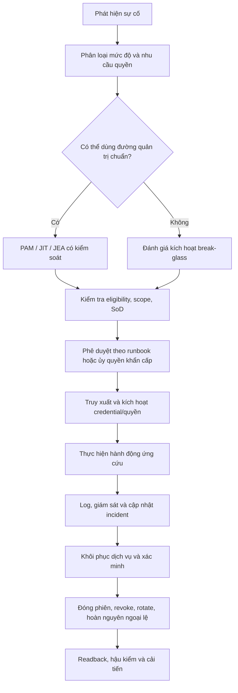

# Emergency access là gì trong quản lý vòng đời danh tính IAM?

**Emergency access** (*truy cập khẩn cấp*) là cơ chế cho phép **chủ thể được ủy quyền thực hiện các hành động cần thiết trong tình huống khẩn cấp** nhằm ứng cứu sự cố an ninh, khôi phục dịch vụ, bảo vệ dữ liệu hoặc duy trì hoạt động trọng yếu khi quy trình truy cập bình thường không đáp ứng được. Mục tiêu không phải cấp quyền quản trị vô điều kiện, mà là **duy trì khả năng xử lý tình huống nghiêm trọng với phạm vi, thẩm quyền, bảo vệ credential, giám sát và thu hồi thích hợp**.

Ví dụ, hệ thống **Identity Provider (IdP)** gặp sự cố làm toàn bộ quản trị viên không thể đăng nhập qua **Single Sign-On (SSO)**. Tổ chức có thể cần một đường truy cập khẩn cấp đã chuẩn bị từ trước để phục hồi cấu hình. Ở trường hợp khác, dịch vụ vẫn hoạt động nhưng kỹ sư ứng cứu cần **quyền sửa cấu hình production tạm thời**; quy trình **Privileged Access Management (PAM)** và **Just-in-Time (JIT)** có thể cấp quyền giới hạn với phê duyệt nhanh.

Hai ví dụ đều liên quan emergency access, nhưng **không phải mọi truy cập khẩn cấp đều là break-glass** và **không phải mọi break-glass đều có thể dùng một cấu hình chung**. Trong **Identity and Access Management (IAM)** theo **Joiner–Mover–Leaver (JML)**, emergency access phải gắn với danh tính còn hợp lệ, quyền tối thiểu phù hợp, trách nhiệm nhân sự và khả năng thu hồi thực tế sau sự cố. Nó phối hợp với **IdP, SSO, SCIM, RBAC/ABAC, service identity, kiểm toán và reconciliation** để ngăn đặc quyền tồn dư.

## 1. Emergency access giải quyết bài toán gì?

Các chính sách bảo mật thường đòi hỏi xác thực mạnh, phê duyệt trước, truy cập qua mạng được quản lý, PAM và quyền đúng chức năng. Đây là những kiểm soát cần thiết. Nhưng khi chính các thành phần đó gặp sự cố, hệ thống có nguy cơ **không còn đường phục hồi hợp lệ**.

Emergency access giải quyết mâu thuẫn giữa:

- **Tính bảo mật (confidentiality/integrity):** không cho người không đủ thẩm quyền sử dụng quyền đặc biệt.
- **Tính sẵn sàng (availability):** người ứng cứu phải có khả năng khôi phục dịch vụ ngay cả khi một thành phần IAM bị lỗi.
- **Khả năng truy vết (accountability):** phải biết ai đã yêu cầu, phê duyệt, sử dụng quyền nào và làm gì.
- **Tính kiểm soát sau sự cố:** quyền, phiên, token và ngoại lệ phải được thu hồi hoặc hoàn nguyên.

Một cơ chế khẩn cấp chỉ có credential quyền cao nhưng không có người chịu trách nhiệm, kịch bản sử dụng hoặc giám sát là **rủi ro bảo mật**, không phải giải pháp phục hồi hoàn chỉnh.

## 2. Phân biệt các cơ chế truy cập khẩn cấp

| Cơ chế | Tình huống phù hợp | Điểm cần lưu ý |
| --- | --- | --- |
| **Emergency access** | Tên gọi bao quát cho quyền phục vụ ứng cứu | Cần trigger, scope, owner, audit và quy trình đóng quyền |
| **Break-glass access** | Đường quản trị bình thường không còn khả dụng | Cần độc lập với thành phần lỗi và bảo vệ đặc biệt |
| **Just-in-Time (JIT)** | Quyền đặc biệt cần kích hoạt nhanh nhưng hệ thống PAM còn hoạt động | Giới hạn thời gian, scope và điều kiện kích hoạt |
| **Just Enough Administration (JEA)** | Người vận hành chỉ cần một tập thao tác phục hồi hạn chế | Giới hạn command/action và tài nguyên |
| **Privileged Access Management (PAM)** | Quản trị và giám sát quyền cao cả bình thường lẫn khẩn cấp | PAM có thể là điểm lỗi, cần phương án dự phòng |
| **Incident response authorization** | Cấp quyền theo vai trò và nhiệm vụ đội ứng cứu | Quyền phải gắn incident và thẩm quyền |
| **Account recovery** | Khôi phục quyền kiểm soát một tài khoản | Không mặc nhiên cho người dùng quyền quản trị hệ thống |

**Break-glass là một hình thức emergency access**, thường để vượt qua sự phụ thuộc đang gặp lỗi theo cơ chế dự phòng được phê duyệt. **JIT không đồng nghĩa break-glass**: cấp quyền admin tạm 30 phút qua PAM khi mọi dịch vụ bình thường là truy cập đặc quyền có thời hạn, chưa chắc là kích hoạt đường khẩn cấp.

## 3. Các tình huống có thể kích hoạt

| Kịch bản | Vì sao có thể khẩn cấp? | Phương án ưu tiên |
| --- | --- | --- |
| IdP/SSO outage | Không đăng nhập được cổng quản trị | Đường phục hồi độc lập đã được thử |
| Cấu hình MFA/conditional access sai | Admin hợp lệ bị khóa ngoài | Cơ chế tài khoản khẩn cấp phù hợp nền tảng |
| PAM outage | Không thể cấp quyền theo luồng bình thường | Runbook và phương án thay thế được kiểm soát |
| Dấu hiệu xâm nhập production | Cần cô lập hoặc khóa credential kịp thời | Quyền ứng cứu giới hạn theo incident |
| Lỗi dữ liệu hoặc dịch vụ trọng yếu | Cần thao tác phục hồi hạ tầng | JIT/JEA nếu vẫn hoạt động |
| Mất quyền quản trị do cấu hình sai | Không thể hoàn nguyên thay đổi | Recovery identity được quản trị |
| Đứt kết nối hệ thống duyệt | Phê duyệt trực tuyến không khả dụng | Quy trình ngoài băng đã định nghĩa |

Các sự kiện như muốn làm việc nhanh hơn, quên mật khẩu thông thường hoặc muốn bỏ qua quy trình change management **không tự trở thành tình huống emergency access**. Tổ chức phải định nghĩa **mức nghiêm trọng, điều kiện kích hoạt và thẩm quyền** trước khi cần sử dụng.

## 4. Vòng đời truy cập khẩn cấp



**Mọi giai đoạn phải có bằng chứng.** Nếu sự cố khiến một phần hệ thống giám sát không khả dụng, cần phương án lưu nhật ký độc lập hoặc khôi phục được bằng chứng. Không đưa mật khẩu hoặc token trực tiếp vào ticket sự cố.

## 5. Xác định điều kiện kích hoạt và thẩm quyền

Một chính sách emergency access cần nêu:

1. **Trigger:** sự cố thuộc loại nào và mức độ khẩn cấp nào.
2. **Eligibility:** người hoặc nhóm nào được tham gia ứng cứu.
3. **Authority:** ai được phê duyệt kích hoạt hoặc chấp nhận rủi ro.
4. **Resource scope:** hệ thống, tenant, môi trường, vùng dữ liệu nào được tác động.
5. **Allowed actions:** khôi phục account, sửa policy, restart service hoặc thao tác cụ thể.
6. **Duration:** thời gian quyền cần thiết, điều kiện kết thúc và expiry.
7. **Compensating controls:** giám sát, dual control, phê duyệt sau nếu cơ chế đặc biệt cho phép.
8. **Logging:** incident ID, danh tính người dùng, bước thực hiện và outcome.
9. **Recovery/cleanup:** đóng phiên, xử lý secret, kiểm tra mọi thay đổi.
10. **Exception process:** trường hợp thiếu approver hoặc hệ thống phê duyệt cũng đang lỗi.

**Không bắt buộc mọi hệ thống có cùng hai cấp phê duyệt hoặc cùng thời hạn.** Quy tắc phải phù hợp khả năng ứng cứu, mức rủi ro, quy định nội bộ và đặc thù nền tảng. Nhưng không nên để requester tùy ý tự bật cờ `isEmergency=true` rồi nhận quyền.

## 6. Least privilege trong tình huống khẩn cấp

**Least privilege không biến mất vì đang có sự cố.** Cần cấp **đủ để xử lý đúng vấn đề**, dù trong một số tình huống recovery account phải sở hữu quyền rộng để khôi phục cấu hình bị hỏng.

Ví dụ:

| Nhiệm vụ | Quyền nên ưu tiên | Quyền không nên mặc định |
| --- | --- | --- |
| Đọc log để chẩn đoán | Read-only log trong dự án | Global administrator |
| Restart service lỗi | Restart đúng service/host | Quyền thay đổi mọi service |
| Roll back một bản triển khai | Deploy/rollback của ứng dụng cụ thể | Owner toàn cluster |
| Khóa credential bị lộ | Rotate/revoke credential thuộc phạm vi sự cố | Đọc mọi secret không liên quan |
| Khôi phục cấu hình tenant IAM | Recovery privilege được kiểm soát | Dùng super-admin thường xuyên sau sự cố |

Nếu PAM vẫn hoạt động, **JIT kết hợp JEA** thường phù hợp hơn break-glass. Nếu đường PAM/IdP bị lỗi, quyền recovery có thể phải rộng hơn nhưng **đường sử dụng, người giữ, thời gian, giám sát và hậu kiểm** cần nghiêm ngặt tương xứng.

## 7. Bảo vệ và khôi phục credential khẩn cấp

Credential break-glass là mục tiêu hấp dẫn vì thường có khả năng vượt một số phụ thuộc của đường quản trị thông thường. Thiết kế cần:

- **Tách biệt:** không dùng cùng mật khẩu hoặc account cho vận hành hằng ngày.
- **Lưu giữ có kiểm soát:** vault, vật mang bảo mật hoặc phương thức được phê duyệt.
- **Đường truy xuất dự phòng:** không hoàn toàn phụ thuộc dịch vụ đang có khả năng hỏng.
- **Nhật ký truy xuất:** ai lấy, khi nào, căn cứ incident nào.
- **Bảo vệ mạnh:** phương thức xác thực và cơ chế bảo vệ phù hợp khả năng nền tảng.
- **Rotation theo rủi ro:** đặc biệt sau sử dụng hoặc khi nghi ngờ lộ.
- **Đối soát người giữ quyền:** cập nhật khi nhân sự Mover/Leaver.
- **Thử định kỳ:** đảm bảo có thể dùng trong tình huống thực mà không phát tán credential.

**Không lưu secret thô trong wiki, ticket, đoạn chat hay repository.** Runbook nên ghi cách truy xuất thông qua cơ chế an toàn, không ghi chính bí mật.

## 8. Emergency access và MFA

MFA giảm nguy cơ lạm dụng account đặc quyền. Song đường khẩn cấp phải xem xét **điểm lỗi chung**: nếu phương thức MFA cũng phụ thuộc hoàn toàn IdP hoặc dịch vụ đang mất khả dụng, tài khoản break-glass có thể trở nên vô dụng.

Giải pháp phụ thuộc nền tảng và threat model:

- Ưu tiên phương thức xác thực mạnh, có khả năng phục hồi.
- Đánh giá ràng buộc conditional access nào có thể gây lockout.
- Khi cần ngoại lệ, chỉ ngoại lệ **đối tượng và chính sách được xác định**, không tắt kiểm soát trên diện rộng.
- Bù bằng giới hạn truy xuất credential, giám sát, cảnh báo và hậu kiểm.
- Kiểm thử đường đăng nhập dự phòng trong các kịch bản phụ thuộc bị lỗi.

**Miễn một quy tắc conditional access không có nghĩa miễn mọi yêu cầu an ninh.** Chính sách truy cập khẩn cấp phải được xét duyệt như một cấu phần quan trọng của kiến trúc phục hồi.

## 9. Quản trị approval, SoD và dual control

Một người có thể có nhiệm vụ khắc phục sự cố nhưng không nên tự mình phê duyệt mọi quyền khẩn cấp ngoài phạm vi được giao. **Segregation of Duties (SoD)** giúp tránh sự tập trung quyền quyết định và thực thi.

Ví dụ một kịch bản có thể yêu cầu:
- Incident commander xác nhận mức nghiêm trọng.
- Resource owner hoặc security owner phê duyệt quyền nhạy cảm.
- Người ứng cứu nhận quyền theo nhiệm vụ.
- Người khác theo dõi hoặc hậu kiểm thay đổi quan trọng.

**Dual control** có thể yêu cầu hai người độc lập cùng tham gia truy xuất credential hoặc cho phép thao tác đặc biệt. Trong tình huống khẩn cấp thật, tổ chức có thể phải sử dụng **cơ chế ủy quyền ngoài băng hoặc hậu kiểm** đã được thiết kế, thay vì phụ thuộc một người không thể liên lạc.

Không biến `urgent=true` thành đường tắt bỏ qua SoD; cần ghi rõ căn cứ ngoại lệ, phạm vi, người chịu trách nhiệm và khi nào kiểm soát bình thường được khôi phục.

## 10. Runbook emergency access

Một runbook đủ dùng khi áp lực cao cần phân biệt **hướng dẫn thao tác** với **bí mật truy cập**.

| Phần | Nội dung cần có |
| --- | --- |
| **Điều kiện dùng** | Danh sách trigger và ngưỡng mức nghiêm trọng |
| **Phạm vi** | Tenant, environment, resource có thể phục hồi |
| **Người phụ trách** | Incident commander, custodian, approver, reviewer |
| **Liên lạc** | Kênh trong băng và ngoài băng |
| **Truy xuất credential** | Cách dùng kho bảo vệ, không chứa plaintext secret |
| **Thao tác khôi phục** | Mục tiêu và các bước tối thiểu được chấp nhận |
| **Kiểm tra thành công** | Chỉ báo dịch vụ/phân quyền hoạt động lại |
| **Ghi nhận bằng chứng** | Incident ID, timestamp, thay đổi thực hiện |
| **Đóng quyền** | Revoke/rotate/session cleanup/policy rollback |
| **Hậu kiểm** | Owner, deadline, remediation và bài học cải tiến |

Runbook phải có bản dự phòng phù hợp khi hệ thống wiki/ticket bị lỗi, nhưng **không nên công khai vị trí chứa credential và các yếu tố bí mật cho mọi nhân viên**.

## 11. Emergency access trong Joiner

Ở giai đoạn **Joiner**, người mới chỉ nên nhận quyền nền tảng cho nhiệm vụ chính. Trở thành thành viên nhóm ứng cứu **không tự đồng nghĩa** được giữ super-admin hoạt động thường trực.

Quy trình cần:

1. Xác minh identity và quan hệ từ HRIS.
2. Xác định năng lực, đào tạo và vai trò ứng cứu.
3. Phân loại tư cách **eligible** so với **active privilege**.
4. Bổ nhiệm người giữ quyền hoặc người phê duyệt theo thẩm quyền.
5. Thiết lập phương thức xác thực và giám sát phù hợp.
6. Kiểm tra quyền trong diễn tập có kiểm soát.
7. Ghi owner và thời hạn xem xét lại.

Ví dụ một kỹ sư mới được tham gia nhóm on-call, nhưng chỉ khi sự cố được xác nhận mới có thể yêu cầu quyền restart hệ thống production, và chỉ trong đúng môi trường được giao.

## 12. Emergency access trong Mover

**Mover** làm thay đổi nhiệm vụ, nhóm ứng cứu và khả năng tiếp cận credential:

| Thay đổi | Rủi ro | Việc cần thực hiện |
| --- | --- | --- |
| Chuyển từ SRE sang Product | Giữ quyền production khẩn cấp | Gỡ eligibility và role không còn cần |
| Chuyển team vận hành | Quyền tenant cũ tồn dư | Giảm scope sang tenant mới |
| Không còn là incident commander | Vẫn có khả năng phê duyệt | Gỡ delegation và cập nhật runbook |
| Chuyển vị trí giữ vault | Người cũ còn biết secret | Đánh giá rotation và chuyển custody |
| Rời ca on-call | Quyền JIT chưa hết hạn | Thu hồi/đóng phiên theo policy |

Nếu người đã biết mật khẩu recovery chuyển bộ phận, **chỉ xóa group IdP không làm họ quên credential**. Phải xem xét quyền vault, vật mang, truy cập ngoài băng và rotation theo đánh giá rủi ro.

## 13. Emergency access trong Leaver

Khi người quản trị hoặc người giữ credential nghỉ việc, IAM phải xử lý cả tài khoản thường và **đường khẩn cấp độc lập**:

1. Disable account/SSO bình thường và gỡ role nghiệp vụ.
2. Xóa eligibility emergency access, quyền phê duyệt và delegation.
3. Thu hồi quyền truy xuất vault, recovery document và vật mang.
4. Rotate hoặc thay credential mà người đó có thể vẫn biết.
5. Kiểm tra account phụ, session và token còn hiệu lực.
6. Chuyển custody cho người được ủy quyền khác.
7. Kiểm thử khả năng emergency access còn dùng được cho người hợp lệ.
8. Lưu kết quả readback và bằng chứng thu hồi.

**Leaver không được phép chờ chiến dịch access review hàng quý**. Đối với các đường truy cập độc lập khỏi IdP, không thể chỉ dựa vào `SCIM active=false` để kết luận credential emergency đã mất hiệu lực.

## 14. IdP, SSO, SCIM, RBAC/ABAC liên quan thế nào?

| Thành phần | Vai trò | Giới hạn cần nhớ |
| --- | --- | --- |
| **IdP/AD** | Xác thực, quản lý account và nhóm | Đường emergency có thể cần độc lập khỏi IdP lỗi |
| **SSO/OIDC/SAML** | Liên kết đăng nhập cho ứng dụng thường | Không tự kết thúc mọi phiên RP khi IdP bị disable |
| **SCIM/connector** | Provision/deprovision User/Group | Không thu hồi tự động mọi local emergency account |
| **RBAC** | Biểu diễn role ứng cứu và quyền khôi phục | Role quá rộng tạo blast radius lớn |
| **ABAC/PBAC** | Kiểm tra tenant, sự cố, thời gian, môi trường | Phụ thuộc nguồn thuộc tính tin cậy và PEP |
| **PAM/JIT** | Cấp quyền đặc biệt đúng thời điểm và giám sát | Cần tính tới sự cố của chính PAM |
| **IGA/JML** | Tính eligibility và quản lý vòng đời | Phải đọc trạng thái thực tế ở đích |
| **Audit/reconciliation** | Phát hiện sử dụng, quyền tồn dư và sai lệch | Không thay thế enforcement tại tài nguyên |

**ID token OIDC không phải access token dùng gọi API.** Một phiên emergency được xác thực thành công không có nghĩa có thể bỏ qua kiểm tra quyền trên từng tài nguyên. API vẫn phải xác minh credential đúng audience, scope, identity và policy ứng dụng.

## 15. Policy minh họa cho quyền ứng cứu

Với hệ thống có PAM/JIT còn hoạt động, có thể đặt policy cấp quyền ngắn hạn:

```text
PERMIT emergency_restart IF
    subject.lifecycle_status == "active"
    AND subject.emergency_eligibility == "approved"
    AND incident.status == "active"
    AND incident.severity IN allowed_severity_levels
    AND resource.service_id IN incident.approved_resources
    AND subject.identity_id IN incident.responders
    AND action == "restart"
    AND request_time < privilege.expiry
ELSE DENY
```

Đây là **giả mã**, không phải ngôn ngữ chính sách bắt buộc. Dữ liệu incident, resource scope, eligibility và expiry phải đến từ nguồn tin cậy phía server; **client không được tự khai mức độ sự cố để nâng quyền**.

Chính sách runtime cần xử lý sự kiện incident đóng hoặc nhân viên Mover/Leaver trước khi quyền hết hạn. Quyền trong access token/cache cũ có thể cần TTL ngắn, revoke hoặc kiểm tra trạng thái hiện hành.

## 16. Service identity và emergency access

Workload tự động có thể tham gia quy trình phục hồi nhưng **không nên chạy hằng ngày bằng credential break-glass**. Nếu job dùng key quyền cao để dự phòng khi IdP lỗi, key có thể bị lộ từ pipeline hoặc log và trở thành backdoor dài hạn.

Nên tách:

- **Normal workload identity:** account kỹ thuật với scope tối thiểu, owner rõ và credential lifecycle.
- **Recovery automation:** job được thiết kế riêng, có nhiệm vụ khôi phục cụ thể và guardrail.
- **Human emergency operator:** người có thẩm quyền kích hoạt/quản lý quyền recovery.
- **Audit identity:** dấu vết độc lập để biết ai khởi động job và job thực hiện gì.

Khi kỹ sư tạo workload đã Leaver, cần thay owner, thu hồi quyền cá nhân đối với secret và CI/CD. **Không xóa mù service account đang vận hành**, nhưng cũng không giữ tài khoản kỹ thuật quyền cao mà không có owner.

## 17. Kết thúc quyền emergency và xử lý hậu sự cố

Một incident chỉ được đóng về mặt quyền khi đã xem xét:

| Thành phần | Câu hỏi cần xác minh |
| --- | --- |
| **Admin session** | Phiên đặc quyền đã hết hiệu lực hoặc bị chấm dứt? |
| **Access/refresh token** | Token phát trong sự cố có còn gọi API được? |
| **Role/group/ACL** | Có quyền tạm thời chưa được gỡ? |
| **API key/secret** | Có bí mật mới tạo và chưa đưa vào quản trị? |
| **Emergency account** | Đã trả về trạng thái được bảo vệ và không dùng thường xuyên? |
| **Conditional access exception** | Rule miễn trừ tạm đã được hoàn nguyên? |
| **Security monitoring** | Những cảnh báo/log tắt tạm đã bật lại? |
| **Identity custody** | Owner, approver và custodian đã phù hợp? |
| **Resource changes** | Cấu hình khôi phục có đúng mục tiêu, không tạo quyền dư? |

**Đổi password không nhất thiết làm mọi token hoặc session lập tức hết hiệu lực**. Đối với JWT tự chứa, cần xem cách resource server đánh giá trạng thái, cơ chế revoke và tuổi token. Với hệ thống nhạy cảm, nên làm **negative authorization test** sau khi thu hồi.

## 18. Kiểm toán và cảnh báo

Mỗi lần dùng emergency access cần có dấu vết:

- Incident ID, trigger, mức nghiêm trọng và lý do.
- Người yêu cầu, người phê duyệt, người thực thi và danh tính đích.
- Resource/tenant/environment và các privilege được kích hoạt.
- Thời điểm kích hoạt và chấm dứt.
- Truy xuất credential từ vault/cơ chế dự phòng.
- Thao tác thay đổi policy, role, account, dữ liệu hoặc secret.
- Kết quả khôi phục, credential rotation và session cleanup.
- Readback quyền, ngoại lệ còn tồn và trách nhiệm xử lý.
- Liên kết với post-incident review và hành động cải tiến.

Nên gửi **cảnh báo ưu tiên cao** khi tài khoản khẩn cấp đăng nhập hoặc có hoạt động không gắn incident hợp lệ. Log cần được bảo vệ tính toàn vẹn và nếu khả thi nằm ngoài phạm vi mà operator có thể tự ý sửa/xóa. Không ghi mật khẩu, OTP, token, cookie hay khóa riêng vào log.

## 19. Diễn tập và bảo đảm tính sẵn sàng

Một kế hoạch trên giấy có thể thất bại khi thực tế xảy ra sự cố. Diễn tập nên kiểm tra **end-to-end**:

| Kịch bản diễn tập | Tiêu chí thành công |
| --- | --- |
| IdP chính không khả dụng | Đường recovery dùng được mà không phụ thuộc IdP lỗi |
| PAM bị mất kết nối | Phương án thay thế hoạt động theo policy |
| Người phê duyệt chính vắng mặt | Có người thay thế đủ thẩm quyền |
| Custodian đã Mover/Leaver | Không còn khả năng truy xuất credential |
| Người không đủ điều kiện yêu cầu quyền | Bị chặn hoặc không thể kích hoạt |
| Người dùng thử hành động ngoài incident scope | Bị từ chối nếu nền tảng hỗ trợ hoặc được phát hiện và xử lý |
| Sự cố kết thúc | Quyền được thu hồi; phiên và token được xử lý |
| Thay credential | Đường recovery vẫn dùng được cho người hợp lệ |
| Audit chính bị gián đoạn | Có kế hoạch bảo toàn và khôi phục bằng chứng |
| Runbook hoặc catalog thay đổi | Owner và đường thao tác vẫn chính xác |

**Không diễn tập bằng cách cố ý làm sập production** nếu không có kế hoạch và phê duyệt phù hợp. Có thể dùng môi trường kiểm thử, thao tác an toàn hoặc diễn tập giới hạn có kiểm soát.

## 20. Những sai lầm thường gặp

| Sai lầm | Hậu quả | Hướng khắc phục |
| --- | --- | --- |
| Dùng break-glass cho việc thường ngày | Bỏ qua PAM/approval và tăng nguy cơ lộ credential | Phân biệt đường chuẩn và đường khẩn cấp |
| Tài khoản khẩn cấp phụ thuộc SSO bị lỗi | Không thể khôi phục | Thiết kế đường dự phòng độc lập và thử định kỳ |
| Cất password trong wiki/ticket | Rò secret | Kho lưu giữ an toàn và kiểm soát truy xuất |
| Không có owner/custodian rõ ràng | Không ai bảo quản hoặc chịu trách nhiệm | Inventory và JML |
| Cấp toàn quyền cho mọi người trong on-call | Blast radius cao | Eligibility và JIT/JEA theo scope |
| Tắt MFA hoặc policy cho toàn bộ tenant | Lỗ hổng diện rộng | Ngoại lệ nhỏ nhất, bảo vệ bù trừ |
| Không có incident ID | Không truy vết được hành động | Bắt buộc record và audit theo policy |
| Quên thu hồi token/phiên | Đặc quyền tồn dư | Cleanup và negative test |
| Credential cũ còn biết sau Leaver | Cửa hậu ngoài IdP | Rotation và custody review |
| Không thử đường phục hồi | Quy trình có thể thất bại | Diễn tập và xác minh định kỳ |
| Dùng account emergency cho CI/CD | Backdoor kỹ thuật lâu dài | Workload identity riêng |
| Chỉ đếm số lần kích hoạt | Không đo được chất lượng kiểm soát | Metrics về thời gian thu hồi và hiệu quả phục hồi |

Không nên nhầm **ít lần dùng emergency access** với kiến trúc tốt: một đường dự phòng chưa từng thử có thể không sử dụng được đúng lúc tổ chức cần nhất.

## 21. Đo lường hiệu quả

Các chỉ số hữu ích:

- **Emergency access availability:** tỷ lệ diễn tập có thể dùng đường phục hồi.
- **Activation latency:** thời gian từ quyết định hợp lệ đến khi có quyền ứng cứu.
- **Unauthorized activation alerts:** kích hoạt không gắn incident hoặc không đủ thẩm quyền.
- **Privilege scope deviation:** thao tác vượt resource/action được duyệt.
- **Emergency access usage frequency:** tần suất và nguyên nhân dùng đường khẩn cấp.
- **Time to revoke:** thời gian thu hồi quyền sau khi kết thúc sự cố.
- **Residual privileged entitlement:** quyền admin, group, ACL hoặc token còn tồn dư.
- **Custody coverage:** tỷ lệ credential có owner, người giữ và cơ chế bảo vệ.
- **JML drift:** người đã Mover/Leaver còn quyền kích hoạt khẩn cấp.
- **Post-incident review completion:** tỷ lệ lần sử dụng có hậu kiểm và remediation.
- **Runbook freshness:** mức độ cập nhật của danh sách liên hệ, hướng dẫn và phụ thuộc.

Báo cáo nên tách **thành công phục hồi dịch vụ** khỏi **thành công thu hồi quyền**. Có thể đã khôi phục production nhưng vẫn còn session đặc quyền nguy hiểm.

## 22. Câu hỏi tự kiểm tra

**Tình huống A:** IdP bị lỗi nhưng tài khoản break-glass cũng cần xác thực qua chính IdP đó. Cơ chế có đạt mục tiêu không? **Không**, nếu không có đường dự phòng phù hợp và đã kiểm thử.

**Tình huống B:** Kỹ sư chỉ cần đọc log nhưng yêu cầu `global-admin` vì incident nghiêm trọng. Có nên cấp mặc định? **Không.** Cần ưu tiên quyền đủ cho nhiệm vụ, trừ khi có căn cứ recovery đặc biệt.

**Tình huống C:** Nhân viên Leaver từng biết password tài khoản khẩn cấp nhưng account SSO của họ đã disabled. Có thể coi đã an toàn? **Không.** Cần xử lý credential độc lập và quyền custodian.

**Tình huống D:** Một job production dùng mật khẩu break-glass hàng đêm để khởi chạy. Đây có phải kiến trúc hợp lý? **Không.** Workload cần identity kỹ thuật riêng với scope và vòng đời thích hợp.

**Tình huống E:** Đội ứng cứu kết thúc incident, gỡ role nhưng API vẫn chấp nhận access token cũ. Có thể đóng cleanup không? **Chưa.** Cần kiểm chứng quyền thực tế và xử lý token theo nền tảng.

**Tình huống F:** Cả IdP và hệ thống phê duyệt trực tuyến đều lỗi. Runbook bắt buộc đăng nhập qua IdP để được duyệt break-glass. Cần cải tiến gì? **Thiết kế thẩm quyền dự phòng ngoài băng** đã được phê duyệt và diễn tập.

## Ghi nhớ

**Emergency access** là **quyền truy cập được kiểm soát để ứng cứu hoặc khôi phục khi hoạt động trọng yếu gặp sự cố**, không phải cách bỏ qua chính sách cho công việc thường ngày. Nó có thể dùng **JIT/JEA/PAM** khi các dịch vụ này còn hoạt động, hoặc **break-glass** khi cần đường dự phòng độc lập. Thiết kế phải có **điều kiện kích hoạt, chủ thể đủ thẩm quyền, phạm vi quyền, bảo vệ credential, giám sát, thu hồi và diễn tập**. Trong **Joiner–Mover–Leaver**, cần quản lý người có thể kích hoạt và giữ bí mật, đồng thời đối soát **IdP/SSO, SCIM, RBAC/ABAC, service identity, session/token và audit** để quyền khẩn cấp **sẵn sàng khi cần nhưng không trở thành quyền tồn dư sau sự cố**.
