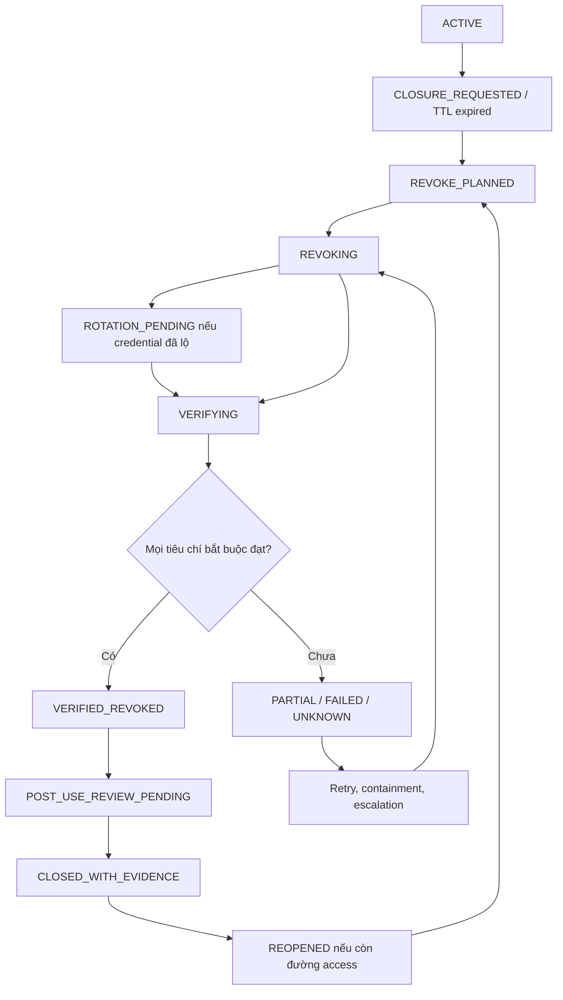
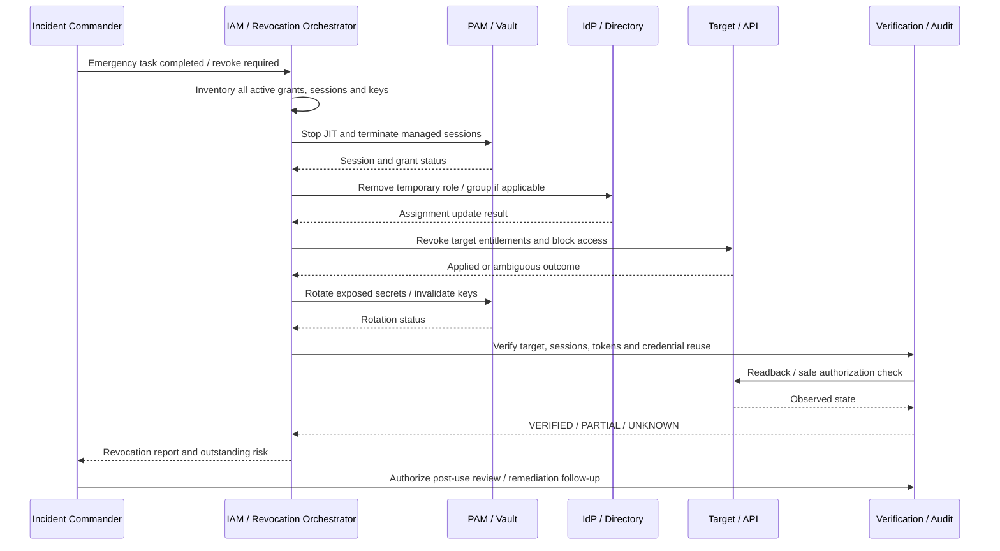

# Thu hồi sau sử dụng trong Emergency Access: Kết thúc đặc quyền khẩn cấp và xác minh không còn đường truy cập

**Thu hồi sau sử dụng** (*post-use revocation*) trong **Emergency Access** là quá trình **kết thúc quyền truy cập khẩn cấp đã được kích hoạt**, chặn các phiên và credential có thể tiếp tục sử dụng, thu hồi những entitlement không còn căn cứ, **xác minh kết quả tại hệ thống đích** và hoàn tất hậu kiểm. Hoạt động này đặc biệt quan trọng với *break-glass access*, tài khoản quản trị khẩn, quyền **Just-in-Time (JIT)**, truy cập khi IdP/PAM gặp sự cố và credential được tiết lộ theo quy trình cứu hệ thống.

Ví dụ, trong sự cố production, An được phép sử dụng quyền tạm `prod-operator` trong 45 phút để khôi phục `order-api`. Khi hệ thống hoạt động trở lại, việc đóng ticket `INC-482` hoặc nhấn “End session” trong PAM **chưa đủ** để khẳng định An không còn khả năng truy cập đặc quyền: phiên SSH có thể vẫn sống; token cloud hoặc Kubernetes còn hạn; một key được sao chép vẫn sử dụng được; account local có thể vẫn active. Một quy trình thu hồi đáng tin phải xử lý **từng đường truy cập**, rồi xác minh **quyền thực tế đã mất hiệu lực** theo yêu cầu bảo mật.

Bài thuộc chương **Emergency access** của module `SECURITY_IDENTITY_ACCESS_MANAGEMENT_IDENTITY_LIFECYCLE`. Module nghiên cứu **vòng đời danh tính Joiner–Mover–Leaver (JML)** từ xác minh và tạo tài khoản đến cấp quyền, rà soát và thu hồi khi thay đổi vai trò; kết nối **IdP, SSO, SCIM, RBAC/ABAC, tài khoản dịch vụ, kiểm toán và giảm quyền truy cập tồn dư**. Trong vòng đời đó, Emergency Access là **cơ chế ngoại lệ có kiểm soát** để xử lý sự cố, còn thu hồi sau sử dụng giúp ngoại lệ **không trở thành đặc quyền thường trực**.

Sau bài học, bạn có thể phân biệt các loại quyền khẩn cần thu hồi; lập danh mục phiên, token, secret, role và account liên quan; thiết kế workflow **end → contain → revoke → rotate → verify → review → close**; xử lý hệ thống đang lỗi hoặc không có readback; đo thời gian truy cập tồn dư; và liên kết post-use revocation với PAM/JIT, JML, SoD, audit và workload identity.

> **Nguyên tắc xuyên suốt:** “Đã yêu cầu thu hồi” (*revoke requested*), “đích báo đã áp dụng” (*revoke applied*) và “không còn sử dụng được quyền” (*revoke verified*) là **ba mức bằng chứng khác nhau**. Không dùng một cờ `CLOSED` để che giấu mức chưa được xác minh.

## 1. Vì sao truy cập khẩn cấp đặc biệt dễ để lại quyền tồn dư?

Quyền khẩn cấp thường được cấp dưới áp lực thời gian, khi các cơ chế bình thường gặp lỗi hoặc công việc phải được xử lý ngay. Nó có thể có các đặc điểm rủi ro:

- **Quyền rộng:** khôi phục hệ thống đòi khả năng sửa cấu hình, restart, thay route hoặc khôi phục dữ liệu.
- **Đường dự phòng:** account local hoặc credential dự phòng hoạt động khi SSO/PAM/IdP không sẵn sàng.
- **Thời gian không ổn định:** sự cố có thể kết thúc sớm hoặc kéo dài hơn cửa sổ dự kiến.
- **Nhiều hệ thống đích:** cloud, database, cluster, mạng, vault, SaaS cùng tham gia khôi phục.
- **Chia sẻ bằng chứng:** có thể cần giao ca, ghi incident timeline và review độc lập.
- **Nguy cơ bí mật bị lộ:** password/key có thể đã được tiết lộ cho người sử dụng theo cơ chế escrow; việc “trả lại mật khẩu” không làm người đó quên thông tin.

Nếu không thu hồi sau khi dùng, một quyền khẩn đã được cấp đúng lúc có thể trở thành **standing privilege** ngoài quản trị. Điều này đi ngược **least privilege** và làm tăng tác động khi danh tính hoặc máy vận hành bị chiếm đoạt.

### 1.1. Ba tình huống thường bị hiểu sai

| Sự kiện | Điều chắc chắn biết | Điều chưa được chứng minh |
| --- | --- | --- |
| Ticket incident chuyển `RESOLVED` | Nhiệm vụ vận hành được tuyên bố đã xử lý | Quyền PAM/JIT, token và session đã mất hiệu lực |
| PAM ghi `SESSION_ENDED` | PAM đã kết thúc phiên mà nó quản lý | Không còn kết nối trực tiếp/phiên khác ở target |
| IAM gỡ role khỏi IdP | Desired assignment/group đã đổi | Cloud, SaaS, token/credential và API đều đã từ chối |
| Credential vault nhận “check-in” | Thao tác trả/đóng checkout đã ghi | Secret trước đó không còn sử dụng được |
| SCIM connector trả thành công | Request đã được tiếp nhận/áp dụng theo ngữ nghĩa đích | Phiên cũ và direct application grants đều mất |
| User logout SSO | Một phần phiên đăng nhập đã được kết thúc | Access token hoặc tài khoản local độc lập bị vô hiệu |

**Kết quả cần quan tâm là quyền hiệu lực**, không phải chỉ trạng thái của ticket hoặc một connector.

## 2. Thu hồi cái gì? Lập danh mục bề mặt truy cập trước tiên

**Emergency Access** có thể xuất hiện ở nhiều tầng. Mỗi tầng cần cách kết thúc và xác minh khác nhau.

| Đối tượng | Ví dụ | Hoạt động thu hồi có thể cần | Bằng chứng mong đợi |
| --- | --- | --- | --- |
| **JIT role activation** | `prod-operator` trong PAM | Kết thúc activation/assignment | Role không còn active |
| **PAM/bastion session** | Phiên SSH/remote admin | Terminate session, chặn reconnect | Không còn phiên đặc quyền hợp lệ |
| **IdP/directory group** | `emergency-admins` | Gỡ membership/assignment | Readback không còn group |
| **Cloud temporary credentials** | STS/session token | Hết hạn, revoke/deny theo khả năng nền tảng | API đặc quyền không còn chấp nhận |
| **OAuth access/refresh token** | Token gọi quản trị API | Revoke refresh token và xử lý access token theo cơ chế hỗ trợ | API không còn cho action cần chặn |
| **API key/SSH key/certificate** | Key cấp để vào target | Disable/revoke/rotate key hoặc cert | Đường kết nối bằng credential cũ bị chặn |
| **Local break-glass account** | Account dự phòng trên host/DB | Reset credential, khóa/giới hạn theo chính sách | Không dùng được credential cũ; account trở về baseline |
| **Vault secret checkout** | Mật khẩu đã lộ cho người vận hành | Checkout close và rotate/replace | Secret cũ không xác thực được |
| **Database grant** | `db_admin` tạm | REVOKE role/privileges hoặc session | DB role và session được kiểm chứng |
| **Kubernetes RBAC/token** | ClusterRoleBinding/JIT kubeconfig | Gỡ binding, vô hiệu hóa token khi hỗ trợ, chặn session | Kubernetes API từ chối thao tác ngoài baseline |
| **Network access path** | VPN/jump-host/tunnel tạm | Thu hồi route/firewall grant/remote session | Không còn đường vào ngoài phạm vi |
| **Workload service principal** | Job khẩn dùng app-only token | Giảm API scope, revoke credential/role đặc quyền | Workload không gọi được action khẩn |
| **Temporary resource share** | Quyền truy cập dataset khẩn | Gỡ share/direct ACL | Tài nguyên không còn mở cho subject |

**Không có một lệnh “revoke all” dùng được cho mọi nền tảng.** Cách xử lý phụ thuộc loại credential, cơ chế cache, thời hạn token, API của đích và mức rủi ro.

### 2.1. Danh mục được xây trước khi cấp quyền

Một quy trình cấp Emergency Access tốt cần tạo **grant inventory** ngay khi phát hành:

- `emergencyGrantId` và `incidentId`.
- Chủ thể được cấp: human/workload identity ID ổn định.
- Target account, target system, resource scope.
- Role, permission hoặc session/credential được kích hoạt.
- Nguồn cấp: PAM/JIT, IdP, local account, SCIM, manual grant.
- `activatedAt`, `validUntil`, lý do và người phê duyệt.
- Đường thu hồi tương ứng, phụ thuộc và owner.
- Khả năng chặn tức thì và cách xác minh tại đích.
- Dữ liệu audit/correlation cho lần sử dụng.

**Không thể thu hồi đáng tin một quyền mà hệ thống không biết mình đã mở**. Nếu đặc quyền được cấp thủ công trong sự cố, phải ghi nhận đầy đủ sau khi ổn định và đối soát trên đích.

## 3. Phân biệt bốn thời điểm: Kết thúc nhiệm vụ, hết quyền, thu hồi và xác minh

Các thời điểm này có thể không trùng:

| Mốc | Ý nghĩa | Ví dụ |
| --- | --- | --- |
| `workCompletedAt` | Tác vụ khẩn đã hoàn thành về nghiệp vụ | 10:00 |
| `grantValidUntil` | Hết cửa sổ thời gian được phép dùng | 10:15 |
| `revocationRequestedAt` | Workflow gửi thao tác thu hồi | 10:01 |
| `revocationAppliedAt` | Target/connector xác nhận áp thao tác | 10:03 |
| `revocationVerifiedAt` | Đọc lại/kiểm chứng quyền cũ không còn hoạt động | 10:05 |
| `postUseReviewClosedAt` | Review hành động và hồ sơ hoàn tất | 15:30 |

**Quyền nên kết thúc khi không còn nhu cầu**, không đợi hết toàn bộ TTL nếu sự cố đã xong và cơ chế chặn an toàn khả thi.

Thời gian tồn dư có thể đo theo:

```text
revocationLag = revocationVerifiedAt - revocationRequiredAt

Trong đó revocationRequiredAt thường là mốc sớm nhất
khi grant hết thời hạn hoặc không còn căn cứ sử dụng,
theo chính sách và sự kiện có thẩm quyền.
```

Nếu quyền phải hết lúc 10:00 nhưng chỉ được xác minh mất lúc 10:20, có **20 phút chưa chứng minh chặn hoàn toàn**. Điều đó không tự chứng minh đã có truy cập trái phép trong 20 phút, nhưng là khoảng rủi ro phải ghi rõ.

### 3.1. Khi nào phải bắt đầu revocation?

Một hoặc nhiều trigger:

- Người chỉ huy incident xác nhận nhiệm vụ khẩn **đã hoàn tất**.
- User bấm kết thúc và hệ thống xác minh không còn tác vụ được phép.
- `validUntil`/TTL đến hạn.
- Policy phát hiện quyền khẩn đang sử dụng ngoài scope.
- Reviewer/owner thu hồi phê duyệt.
- Nhân sự Mover/Leaver, hợp đồng/ca trực kết thúc.
- Phát hiện credential bị lộ hoặc nghi ngờ tài khoản bị chiếm.
- Target/role/policy không còn đáp ứng điều kiện cấp quyền.
- Dịch vụ IdP/PAM phục hồi, đường break-glass cần được đóng theo quy trình.

**Nên có cả trigger theo sự kiện và cơ chế quét quyền quá hạn theo định kỳ**, vì event có thể bị mất, callback trễ hoặc scheduler lỗi.

## 4. Mô hình trạng thái cho thu hồi sau sử dụng

Một trạng thái `REVOKED` duy nhất thường không đủ cho hệ thống nhiều đích. Có thể thiết kế state machine tham khảo:

| Trạng thái | Ý nghĩa |
| --- | --- |
| `ACTIVE` | Quyền khẩn còn hiệu lực |
| `CLOSURE_REQUESTED` | Nhận yêu cầu kết thúc quyền |
| `REVOKE_PLANNED` | Đã xác định đường thu hồi, target và owner |
| `REVOKING` | Đang chặn/gỡ quyền |
| `ROTATION_PENDING` | Còn secret/key phải thay đổi vì đã bị tiết lộ |
| `VERIFYING` | Đang đọc lại quyền/session/token ở target |
| `VERIFIED_REVOKED` | Những tiêu chí chặn bắt buộc đã được xác minh |
| `PARTIAL` | Một số đích đã xử lý, các đích bắt buộc khác còn tồn đọng |
| `FAILED` | Có thao tác thu hồi thất bại cần can thiệp |
| `UNKNOWN` | Không đủ bằng chứng kết luận target còn quyền hay không |
| `POST_USE_REVIEW_PENDING` | Quyền đã đóng nhưng hậu kiểm chưa hoàn tất |
| `CLOSED_WITH_EVIDENCE` | Thu hồi và hậu kiểm đạt tiêu chí đóng |
| `REOPENED` | Phát hiện lại quyền tồn dư hoặc kết luận cũ không còn đúng |



**Đây là mô hình minh họa, không phải chuẩn bắt buộc của PAM hay IAM.** Phân biệt trạng thái tổng và từng target; không ép toàn bộ quy trình về `CLOSED` khi một credential khẩn còn sử dụng được.

### 4.1. Trạng thái phải dựa trên bằng chứng

Một workflow không nên cho client tự gửi `PATCH status=CLOSED_WITH_EVIDENCE`. Chỉ thành phần xác minh được ủy quyền mới ghi kết quả đã xác nhận, có **correlation ID, actor, thời gian, target evidence và policy version**.

## 5. Quy trình chuẩn: End → Contain → Revoke → Rotate → Verify → Review

Một workflow đáng tin nên có những bước sau.

### Bước 1 — Xác định kết thúc nhiệm vụ

- Xác nhận incident/task đã hoàn thành hoặc bị hủy.
- Xác định người đang giữ quyền, phiên còn mở, role active, target và credential đã được cấp.
- Kiểm tra có **tác vụ an toàn chưa kết thúc** hay quy trình bàn giao hợp lệ không.
- Ghi `revocationRequiredAt` từ sự kiện/phê duyệt/TTL.
- Chặn cấp mới hoặc gia hạn ngầm trong lúc đóng.

**Không đợi tất cả thay đổi vận hành được hoàn tác mới thu hồi quyền khẩn.** Việc khôi phục cấu hình và việc đóng đường truy cập là hai công việc liên quan nhưng tách biệt.

### Bước 2 — Containment: Ngăn thêm hành động rủi ro

- Dừng kích hoạt JIT mới với grant đang đóng.
- Chặn privileged action tại API/PDP/PEP theo policy hiện hành.
- Hạn chế/kết thúc phiên và đường remote access khi khả thi.
- Ưu tiên chặn key/token có nguy cơ bị lộ hoặc bị lạm dụng.
- Nếu không thể revoke ngay tại đích, cân nhắc **network isolation hoặc deny policy có kiểm soát** để giảm khả năng sử dụng.

Containment **không phải luôn là xóa toàn bộ tài khoản hoặc dừng mọi tiến trình**. Biện pháp phải xét khả năng gây gián đoạn và tác vụ khôi phục đang chạy, đặc biệt khi hệ thống vẫn chưa ổn định.

### Bước 3 — Revoke: Gỡ quyền và đường truy cập

- Kết thúc role assignment/activation khẩn.
- Gỡ group, target role, direct permission và exception có nguồn gốc từ grant.
- Revoke hoặc chặn token/credential theo khả năng nền tảng.
- Đóng session và tunnel/remote connection liên quan.
- Khôi phục trạng thái quyền **baseline được phê duyệt**, không áp một phép “undo” chung cho mọi thay đổi.

### Bước 4 — Rotate: Thay credential đã được tiết lộ

Nếu password, secret, API key hoặc private key đã được người vận hành biết hoặc nhận trong phiên khẩn, cần đánh giá và thực hiện **rotation/invalidation**. Không thể coi checkout kết thúc là secret đã an toàn.

Khi xoay vòng secret, cần:
- Xác định target và dependency thực sự dùng credential.
- Thay credential **mà không làm mất đường truy cập cứu hộ cuối cùng**.
- Cập nhật vault/consumers được ủy quyền, kiểm tra bằng credential mới.
- Vô hiệu credential cũ và kiểm chứng **không còn xác thực được**.
- Bảo vệ audit, không ghi secret mới/cũ vào ticket.

### Bước 5 — Verify: Đối soát từng hệ thống đích

- Readback account, role, group và grant trực tiếp.
- Kiểm tra session/PAM activation state.
- Kiểm tra token và key validity theo cơ chế hỗ trợ; với quyền nhạy cảm, thử **negative authorization test an toàn** tại API.
- Phân biệt `ABSENT`, `BLOCKED`, `UNKNOWN` và `STILL_PRESENT`.
- Ghi `verifiedAt`, nguồn evidence và người/hệ thống xác minh.

### Bước 6 — Post-use review: Xem lại toàn bộ việc sử dụng

- So action thực hiện với ticket/phạm vi đã cho phép.
- Đối chiếu approval và thời gian.
- Rà soát những thay đổi còn để lại trên hệ thống.
- Điều tra hành động ngoài scope hoặc session/command bất thường.
- Cập nhật runbook, policy, JIT scopes và những lỗ hổng phát hiện.
- Ghi kết quả chấp nhận/khắc phục, owner và ngày đóng review.

### Bước 7 — Close: Đóng bằng bằng chứng

Chỉ khi các tiêu chí bắt buộc được xác minh và hậu kiểm đã xong hoặc có **ngoại lệ/tồn đọng được duyệt với owner và SLA**, mới chuyển sang trạng thái đóng phù hợp. Không gắn nhãn “fully revoked” nếu một đích còn `UNKNOWN`.

## 6. Sơ đồ tương tác giữa Incident, PAM, IdP và target



Sơ đồ chỉ minh họa các vai trò. Với một số hệ thống, PAM có thể gọi trực tiếp target; một số API không cung cấp revoke token tức thì; và một số emergency account phải **hoạt động ngoài IdP** để chịu được sự cố IdP. Điều quan trọng là **không giả định một đường thu hồi duy nhất luôn sẵn sàng**.

## 7. Kết thúc phiên PAM/JIT: Phải phân biệt phiên và role

**PAM/JIT** thường hỗ trợ cấp quyền chỉ trong thời hạn ngắn. Nhưng nhiều khái niệm liên quan cần được quản lý riêng:

| Đối tượng | Trạng thái có thể có | Rủi ro nếu chỉ xử lý một phần |
| --- | --- | --- |
| JIT eligibility | Được quyền xin activation | Người dùng còn có thể kích hoạt lại nếu approval/rule chưa đổi |
| JIT activation | Role đang active | Quyền tiếp tục khi session cũ kết thúc |
| PAM managed session | SSH/RDP/DB session qua broker | Phiên khác ngoài broker vẫn còn |
| Target-side session | Session trên host/DB/cloud | Có thể sống sau khi PAM đóng cửa sổ |
| Credential checkout | Vault đã tiết lộ secret | Secret cũ vẫn có thể dùng để đăng nhập |
| Direct target role | Application/OS/DB role | Bypass PAM bằng đường trực tiếp |
| JIT approval record | Quyết định có hạn | Callback cũ có thể kích hoạt lại nếu thiếu guard |

Một tình huống điển hình:

```text
Grant: prod-operator / incident INC-482
JIT activation: EXPIRED
PAM session: ENDED
Cloud token: VALID UNTIL 11:00
Direct application role: PRESENT
Expected result: NOT FULLY REVOKED
```

Không được dựa vào nhãn `JIT_EXPIRED` để tự đánh dấu quyền đã mất hiệu lực nếu **token hoặc direct role** vẫn cho phép cùng action.

### 7.1. Không tự kéo dài grant khi sự cố kéo dài

Nếu sự cố chưa xong mà `validUntil` sắp hết, cần **quy trình gia hạn riêng** (reason, approval, scope, thời hạn) hoặc kiểm soát khẩn đã thiết kế sẵn. Không cho scheduler tự giữ role vô hạn chỉ vì ticket chưa đóng.

### 7.2. Thu hồi trước TTL

Khi nhiệm vụ đã hoàn thành sớm, quyền nên được thu hồi sớm nếu có thể. TTL là **giới hạn tối đa**, không phải thời gian phải giữ quyền cho đủ.

## 8. Thu hồi token, session và credential: Tại sao “expire” chưa đủ?

Token tự chứa, session cookie, refresh token, API key, certificate và password có cơ chế khác nhau.

### 8.1. OAuth/OIDC: Token và SSO session

- **ID token** truyền thông tin xác thực cho Relying Party; không phải access token để gọi API.
- **Access token** cho phép API khi còn hợp lệ và đúng issuer/audience/scope; nếu API chỉ kiểm tra chữ ký và `exp`, role đã gỡ chưa chắc làm token bị từ chối ngay.
- **Refresh token** có thể cấp access token mới; cần revoke/disable theo cơ chế IdP hoặc authorization server.
- **SSO session** có thể đã logout nhưng local app session vẫn tồn tại.
- **Back-channel logout/revocation** chỉ hiệu quả khi app/API thực sự triển khai và xử lý theo đặc tả hỗ trợ.

Vì thế, sau Emergency Access:
1. Gỡ/giảm entitlement có nguồn gốc từ grant.
2. Revoke refresh token/session theo khả năng.
3. Xem xét access token còn hạn và **đường chặn ở API**: introspection, server-side state, deny policy, session version hoặc TTL phù hợp rủi ro.
4. Không tuyên bố access token đã mất hiệu lực tức thì nếu nền tảng không hỗ trợ revoke trực tiếp.

### 8.2. SSH key và certificate

Nếu emergency flow cấp key/certificate:

- Thu hồi/loại khỏi danh sách được phép hoặc revoke theo hệ thống CA/SSH hỗ trợ.
- Kiểm tra các target/hosts đang tin key/certificate đó.
- Không để credential cũ tiếp tục dùng trên host bị bỏ sót.
- Xem xét session đã thiết lập trước khi key bị revoke.
- Tránh viết secret và private key vào audit.

### 8.3. Cloud temporary credentials

Credential ngắn hạn có thể không thu hồi tức thì theo cùng cơ chế trên mọi cloud. Khi cần chặn khẩn, phải kiểm tra **các cách vô hiệu hóa theo khả năng nhà cung cấp**, ví dụ thay policy/permission hoặc session constraints ở resource và tài khoản liên quan.

**Không suy rằng credential “short-lived” đã hết quyền ngay khi bỏ role khỏi UI**. Cần biết hiệu lực policy/caching và thời điểm token không còn được API chấp nhận.

### 8.4. Database sessions

Gỡ role DB có thể không chặn mọi session đang hoạt động theo cùng cách trên các engine. Cần xem:
- Role/grant hiện tại tại DB.
- Các connection pool hoặc session được mở trước đó.
- Khả năng terminate phiên.
- Tác động của transaction đang mở.
- Kiểm thử quyền thao tác trên đối tượng nhạy cảm sau khi revoke.

### 8.5. Kubernetes

Quyền có thể đến từ RBAC/RoleBinding/ClusterRoleBinding, service-account token, workload credential hoặc quyền cloud liên kết cluster. Gỡ một binding chỉ là một phần nếu token/key khác còn được chấp nhận. Cần kiểm tra **API effective permission**, namespace/resource và những đường truy cập ngoài kubeconfig khẩn.

## 9. Secret rotation sau break-glass: Không được chỉ “trả mật khẩu”

Một password emergency có thể được quản lý bởi vault nhưng **đã được tiết lộ** cho user hoặc chạy trong script trong thời gian sự cố. Khi checkout đóng, bản sao thông tin đó vẫn có thể tồn tại trong clipboard, terminal history, log hoặc trí nhớ.

Do đó, **rotation** là bước quan trọng khi mô hình truy cập có lộ secret:

1. Xác định tất cả **credentials đã phát lộ**, gồm mật khẩu local, API key và certificate/key nếu private key được cấp.
2. Xác định những consumer/automation hợp lệ đang dùng credential đó.
3. Tạo hoặc cập nhật credential mới trong hệ thống quản lý secret đáng tin.
4. Chuyển consumer có kiểm soát và xác nhận vẫn hoạt động.
5. Vô hiệu credential cũ và kiểm tra không còn dùng được.
6. Ghi lại **rotation reference và verification**, không ghi giá trị secret.

### 9.1. Không phải mọi quyền JIT đều cần rotate password

Nếu hệ thống dùng **federated identity hoặc ephemeral credential không tiết lộ secret dùng chung**, kết thúc grant/phiên có thể là biện pháp chính; không nên xoay vòng những credential không hề liên quan chỉ vì một ticket khẩn đã đóng.

Ngược lại, nếu một tài khoản local break-glass có mật khẩu tồn tại lâu và đã bị tiết lộ, **không rotate** là rủi ro rất lớn ngay cả khi quyền PAM được đánh dấu kết thúc.

### 9.2. An toàn của tài khoản cứu hộ tiếp theo

Một hệ thống có thể cần **ít nhất một cơ chế truy cập khẩn còn khả dụng** để xử lý sự cố IdP/PAM tiếp theo. Không nên khóa/xóa vĩnh viễn tài khoản cứu hộ duy nhất mà không có phương án thay thế đã được kiểm chứng.

Giải pháp thường là **đặt tài khoản về trạng thái baseline theo thiết kế, thay credential và tái bảo vệ trong vault/escrow**, chứ không xóa mù quáng mọi emergency identity.

## 10. Emergency Access khi IdP hoặc PAM không hoạt động

Đây là trường hợp thu hồi khó nhất: **kênh dùng để cấp quyền hoặc quản lý phiên có thể vẫn đang lỗi**.

Ví dụ tổ chức có account local khẩn dùng để khôi phục IdP. Khi IdP phục hồi, quy trình phải xử lý account local **bằng cơ chế ở target** chứ không giả định SCIM/SSO sẽ tự thu hồi nó.

### 10.1. Quy tắc thiết kế trước sự cố

- Duy trì **đường truy cập khẩn được bảo vệ độc lập** phù hợp với kiến trúc.
- Có owner và danh sách target chính xác cho từng emergency identity.
- Chuẩn bị **quy trình thu hồi/rotate thủ công được phê duyệt** nếu automation chưa hồi phục.
- Có phương thức ghi bằng chứng và dual control ngoài hệ thống lỗi khi cần.
- Không dựa hoàn toàn vào IdP để revoke tài khoản vốn tồn tại để khôi phục IdP.
- Kiểm tra định kỳ khả năng khôi phục và đóng quyền trong môi trường được phép.

### 10.2. Khi kênh tự động chưa phục hồi

Có thể:
1. Chặn hoặc giới hạn tài khoản ở target theo runbook.
2. Rotate credential được tiết lộ bằng cơ chế local/đích.
3. Kiểm tra session/permission bằng công cụ target còn hoạt động.
4. Ghi **manual evidence**, actor, thời điểm, approver và lý do.
5. Đưa finding `AUTOMATED_VERIFICATION_PENDING` nếu cần chờ IdP/PAM phục hồi để đối soát.
6. Khi hệ thống bình thường trở lại, đồng bộ và **đọc lại** trạng thái từ nguồn hệ thống.

**Manual fallback không đồng nghĩa không cần audit.** Có thể dùng quy trình bằng chứng ngoài hệ thống và nhập vào hệ thống kiểm toán sau khi phục hồi, bảo đảm chuỗi trách nhiệm giải trình.

### 10.3. Giảm rủi ro khóa mất cơ chế cứu hộ

Trước khi thay/khóa credential khẩn, cần xác nhận:
- Không có incident đang diễn ra cần quyền đó.
- Còn đường quản trị an toàn thay thế nếu một bước lỗi.
- Credential mới được kiểm thử theo quy trình được duyệt và bảo vệ.
- Việc đóng quyền không khiến tổ chức mất khả năng khắc phục sự cố tiếp theo.

**Thu hồi an toàn là khôi phục trạng thái bảo vệ ban đầu mà không làm mất khả năng ứng cứu đã được thiết kế.**

## 11. Phân biệt thu hồi quyền với hoàn tác thay đổi sản xuất

Trong Emergency Access, người vận hành có thể đã thực hiện:
- Restart hoặc failover.
- Sửa firewall/routing.
- Chuyển lưu lượng.
- Thay cấu hình database.
- Tạo account tạm.
- Mở khóa dữ liệu hoặc chỉnh policy.

**Kết thúc đặc quyền không đồng nghĩa tự động rollback toàn bộ các thay đổi này.** Một số thay đổi phải được **giữ lại** để dịch vụ ổn định; một số là thay đổi tạm và phải được hoàn nguyên.

| Đối tượng | Quy trình đúng | Ví dụ |
| --- | --- | --- |
| Quyền người sử dụng | Revoke/verify | Gỡ `prod-operator` của An |
| Secret đã tiết lộ | Rotate/verify | Reset password break-glass |
| Thay đổi ứng dụng/hạ tầng | Change review/rollback nếu cần | Firewall rule tạm được thu hẹp |
| Tài khoản được tạo trong sự cố | Owner review, chuyển quản trị hoặc xóa hợp lệ | Temporary diagnostic account |
| Dữ liệu nghiệp vụ thay đổi | Đối soát integrity và audit | Giao dịch đã sửa |
| Monitoring bị tạm hạn chế | Restore/verify baseline | Bật lại alert hoặc log pipeline |
| Backup hoặc restore | Kiểm tra kết quả và quyền truy cập | Snapshot được đặt đúng vùng bảo vệ |

**Không tự rollback máy móc** vì có thể gây gián đoạn dịch vụ vừa phục hồi. Nhưng cũng không nên bỏ lại firewall mở rộng, account tạm hay disabled security control mà không có owner và hạn xử lý.

### 11.1. Post-use change inventory

Sau sự cố, lập danh sách **mọi thay đổi còn hiệu lực** từ phiên khẩn: target, actor, thời gian, lý do, trạng thái, owner và decision **KEEP_CHANGE / ROLLBACK / MODIFY / INVESTIGATE**. Danh sách này độc lập với **quyền khẩn đã thu hồi**, nhưng phải liên kết qua incident/correlation ID.

## 12. SoD và dual control khi thu hồi

Thu hồi đặc quyền cũng là thao tác nhạy cảm: có thể làm mất quyền cứu hộ, ngắt dịch vụ hoặc che dấu một hành động ngoài chính sách.

Với hệ thống rủi ro cao:
- **Người dùng quyền** có thể yêu cầu đóng, nhưng không nên là người duy nhất chứng nhận quyền của chính mình đã mất.
- **PAM/IAM automation** thực thi thao tác theo policy.
- **Target owner** xác minh readback/quyền đích khi cần.
- **Security/Incident Commander** xét các ngoại lệ, credential lộ và audit bất thường.
- **Reviewer độc lập** làm post-use review theo mức rủi ro.

Một ví dụ SoD:
- An sử dụng account khẩn để sửa cấu hình IAM.
- Bình, là người có thẩm quyền độc lập, xác minh An đã hết quyền khẩn và review thay đổi.
- Nếu Bình cần sửa thêm cấu hình, đó là request có căn cứ riêng, không phải mượn lại phiên của An.

**Không biến dual control thành hình thức** bằng hai tài khoản cùng do một người kiểm soát, hoặc bằng một service principal tự tạo và tự phê duyệt tất cả thao tác.

## 13. Phân quyền khẩn với Joiner

Một nhân viên mới (**Joiner**) có thể được thêm vào đội trực incident, nhưng không vì vậy mà được giữ toàn bộ quyền khẩn.

Quy trình tốt:
1. HR/IAM xác minh danh tính và ngày hiệu lực.
2. Cấp role cơ sở/eligibility đúng nhiệm vụ theo phê duyệt.
3. Kiểm soát MFA/PAM và điều kiện đủ để kích hoạt.
4. Chỉ khi có incident hợp lệ mới kích hoạt grant có thời hạn.
5. Hết việc, **thu hồi activation và credential liên quan**.
6. Giữ role eligibility nếu nó vẫn đúng theo chính sách, nhưng không giữ active privilege.
7. Rà soát định kỳ những tài khoản cứu hộ và chủ sở hữu.

**Eligible không phải Active.** Việc Joiner được ghi danh trong roster cứu hộ không tự cho phép giữ session admin hoạt động sau từng sự cố.

## 14. Thu hồi đặc quyền khẩn khi Mover

**Mover** là lúc người dùng đổi đội, dự án, ca trực hoặc chức năng. Quyền khẩn có thể được cấp cho **nhiệm vụ cũ** và không được phép đi theo người đó sang vị trí mới.

Ví dụ An chuyển từ Platform Operations sang Audit:

| Thành phần | Trước Mover | Sau Mover mong đợi |
| --- | --- | --- |
| PAM eligible `prod-operator` | Có vì nhiệm vụ trực | Gỡ nếu không còn on-call |
| Emergency grant đang active | Có thể còn từ incident cũ | Kết thúc/thu hồi theo policy |
| SSH key dự phòng đã biết | Có | Revoke/rotate hoặc xử lý theo rủi ro |
| Cloud role direct | Có thể có | Gỡ khi không còn căn cứ |
| Session admin đang mở | Có thể sống | Terminate/re-evaluate |
| Audit permission | Không | Cấp read-only theo nhu cầu mới |

### 14.1. Thứ tự xử lý xung đột SoD

Nếu role cũ cho phép **deploy production** còn role mới được phép **duyệt thay đổi**, việc giữ cả hai trong thời gian Mover có thể vi phạm SoD. Có thể cần **revoke old role → verify → grant new role** theo chính sách, không chỉ thêm quyền mới rồi chờ thu hồi khi thuận tiện.

### 14.2. Event tới muộn

Nếu callback “emergency activation approved” cũ đến sau Mover, worker **không được kích hoạt lại** quyền đã mất căn cứ. Kiểm tra event version, trạng thái HR/role hiện hành và scope/expiry trước mọi thay đổi quyền.

## 15. Thu hồi quyền khẩn khi Leaver

**Leaver** làm kết thúc quan hệ cấp quyền cho người dùng; quyền emergency đặc biệt phải được đưa vào offboarding.

Một checklist Leaver cần:
- Chặn đăng nhập IdP/directory và account liên quan.
- Gỡ eligible/active PAM roles và emergency grants.
- Terminate phiên đặc quyền, remote access hoặc credential checkout.
- Thu hồi/rotate password, key/certificate/secret người đó từng sử dụng.
- Gỡ direct grants trên cloud, DB, Kubernetes, SaaS và local systems.
- Xử lý token/refresh/session theo cơ chế thực tế.
- Bàn giao runbook, vault ownership và ứng dụng mà người đó vận hành.
- Đối soát readback/effective access, theo SLA rủi ro.

**Disable một account ở IdP không đủ khi account break-glass được thiết kế hoạt động ngoài IdP.** Đây là đường truy cập quan trọng phải có kiểm soát offboarding riêng.

### 15.1. Leaver xảy ra khi sự cố chưa kết thúc

Ví dụ hợp đồng An hết lúc 17:00 nhưng incident đang tiếp diễn. Không tự để quyền An active vô hạn vì “chưa đóng incident”. Cần **bàn giao cho người khác đủ điều kiện**, thu hồi phiên/credential An và cấp quyền mới cho người nhận nhiệm vụ theo cơ chế khẩn hợp lệ.

### 15.2. Rehire và nhiều quan hệ

Không tự phục hồi emergency grant, secret hoặc session cũ khi một người quay lại. Nếu một người có nhiều quan hệ còn hiệu lực, chỉ giữ những entitlement có **nguồn và approval độc lập** còn hợp lệ; không để quan hệ khác duy trì quyền khẩn từ hợp đồng đã kết thúc.

## 16. Workload và service account được cấp quyền khẩn

Các job cứu hộ cũng có thể được cấp đặc quyền: backup restore worker, deployment pipeline, incident diagnostic service hoặc automation xoay khóa.

| Workload | Quyền khẩn có thể dùng | Thu hồi sau sử dụng |
| --- | --- | --- |
| `restore-job` | Đọc backup nhạy cảm, ghi target restore | Gỡ role tạm, key, session; xác minh job hoàn thành |
| `incident-diagnostics` | Thu thập logs/metrics trên production | Thu hẹp API scope, revoke credential tạm |
| `deploy-emergency` | Deploy artifact đã duyệt | Chặn workflow ngoài change window và gỡ quyền deploy |
| `db-repair-worker` | Thực thi một tác vụ sửa DB | Thu hồi DB role, session và secret tạm |
| `rotation-job` | Xoay vòng secret của một path | Gỡ quyền đọc/sửa các secret không còn cần |
| `network-recovery` | Cập nhật một số rule mạng | Gỡ quyền admin mạng tạm sau kiểm tra |

### 16.1. Không dùng account máy chung vô thời hạn

Mỗi workload cần:
- Service principal/workload ID ổn định.
- Owner/team và run ID.
- Scope action/resource.
- Giới hạn môi trường dev/staging/prod.
- Credential lifecycle và expiry.
- Approval/change/incident correlation.
- Audit về ai khởi tạo và ai phê duyệt.
- Decommission/rollback kế hoạch.

**Một app-only token có quyền mạnh không chứng minh yêu cầu người dùng phía trước đã được phê duyệt**. Backend phải kiểm tra quyền của human initiator khi workflow được yêu cầu từ người dùng, tránh *confused deputy*.

### 16.2. Hết nhiệm vụ nhưng workload vẫn chạy

Cần phân biệt **kết thúc quyền khẩn** với **dừng workload quan trọng**. Có thể giảm role/credential sau khi task xong thay vì xóa service principal cần thiết. Tuy nhiên, nếu workload được tạo **chỉ cho sự cố** thì cần decommission có kiểm soát, tránh orphan service accounts.

## 17. Grant provenance: Thu hồi theo căn cứ thay vì xóa toàn bộ quyền

Một permission có thể có từ nhiều nguồn:

```text
An / iam-user-1042
  ├─ baselineRole: platform-observer ------> logs.read
  ├─ emergencyGrant: INC-482 -------------> service.restart
  └─ approvedTask: maintenance-221 -------> logs.read
```

Khi `INC-482` kết thúc, phải gỡ **căn cứ service.restart khẩn**, không xóa bừa role quan sát cần cho công việc. Ngược lại, nếu action khẩn được cấp qua **direct grant khác** còn tồn tại, chỉ gỡ một group chưa chặn được tác động.

### 17.1. Quy trình tính lại quyền mong đợi

1. Tìm **mọi grant và source** của identity/target.
2. Đánh dấu emergency grant hết hiệu lực.
3. Tính lại **desired entitlement** từ các căn cứ còn hợp lệ.
4. So sánh với **observed entitlement** tại đích.
5. Thu hồi phần quyền không còn căn cứ; xử lý SoD.
6. Đánh giá **effective access** với những action rủi ro cao.
7. Đối soát sau khi các connector và cache ổn định.

**Không thể dùng một thao tác RemoveGroup chung khi group đồng thời phục vụ nhiều công việc** mà không kiểm tra nguồn cấp và hệ quả.

## 18. Desired, Observed và Effective Access sau emergency

Ba lớp trạng thái:

| Lớp | Câu hỏi | Ví dụ |
| --- | --- | --- |
| **Desired** | Sau khi nhiệm vụ kết thúc, người dùng **nên** có quyền gì? | Chỉ `platform-observer` |
| **Observed** | Hệ thống đích **đang ghi nhận** những quyền gì? | Group `emergency-admins` đã gỡ; DB role còn |
| **Effective** | Chủ thể **thực sự có thể làm gì**? | Token cũ vẫn gọi API sửa production |

Một hệ thống chỉ đối soát IdP có thể bỏ sót:
- Direct SaaS role.
- Local break-glass account.
- Cloud key đã phát.
- Kubernetes service-account token.
- Database session đã mở.
- Cached JWT hoặc session cookie.
- Access qua API phụ không kiểm tra quyền hiện hành.

**Quyền đã gỡ ở một nơi chưa đủ để kết luận quyền khẩn đã bị chặn ở mọi nơi.**

### 18.1. Không đánh dấu FAILED khi chỉ là UNKNOWN

Nếu connector timeout sau lệnh revoke, target có thể đã gỡ thành công nhưng chưa trả lời. Cần **readback trước retry** để tránh thao tác trùng hoặc lỗi. Nếu chưa xác minh được, ghi `UNKNOWN`/`PENDING_VERIFICATION` và owner, không tự suy success hay failure.

## 19. Pseudocode workflow thu hồi có kiểm soát

Ví dụ giải thuật **mang tính thiết kế**:

```text
onEmergencyAccessClose(grantId, reason):
    grant = loadEmergencyGrant(grantId)
    require(actorAuthorizedToClose(grant, reason))

    current = loadTrustedIdentityAndLifecycle(grant.principalId)
    targets = inventoryGrantTargetsAndCredentials(grant)

    markGrantNoLongerEligibleForActivation(grant)
    blockNewEmergencyActionsAtPEP(grant)

    for each target in targets:
        operation = planTargetSpecificRevocation(
            target, grant, current,
            desiredAccess = computeCurrentDesiredAccess()
        )
        dispatchWithIdempotencyKey(operation)
        recordOperationIdAndStatus(operation)

    if grant.exposedSecrets:
        scheduleCredentialRotationWithDependencyCheck(grant)

    markWorkflow(REVOKING)
    scheduleVerification(grantId)

verifyEmergencyRevoke(grantId):
    operations = loadAllTargetOperations(grantId)
    for each op in operations:
        observed = readBackTrustedTargetState(op.target)
        if observed.incompleteOrStale:
            markTarget(op.target, UNKNOWN)
            scheduleSafeRetryOrManualCheck(op)
            continue

        if op.secretWasRotated:
            verifyOldCredentialDisabledWithoutExposingSecret(op)

        if op.isHighRisk:
            verifySensitiveActionDeniedWhenSafe(op.target, op.principalId)

        markTargetFromEvidence(op.target, observed)

    if allMandatoryTargetsVerifiedRevoked()
       and exposedSecretsRotatedOrJustifiedNotNeeded()
       and allRequiredSessionsClosedOrBlocked():
        markWorkflow(VERIFIED_REVOKED)
        openPostUseReview()
    else:
        markWorkflow(PARTIAL_OR_VERIFYING)
        assignOwnerAndEscalateByRisk()
```

**Đây không phải code production.** Một triển khai phải có transaction/outbox khi cần, chống xử lý lặp, version để ngăn callback cũ, phân quyền actor, cơ chế retry/backoff, bảo vệ secret và xử lý những target không hỗ trợ immediate revocation.

### 19.1. Idempotency và concurrency

Một revoke có thể được kích hoạt đồng thời bởi:
- Incident commander đóng ticket.
- TTL scheduler.
- Security thu hồi vì nghi ngờ lạm dụng.
- HR phát Leaver.

Các trigger phải được **gộp hợp lệ** chứ không tạo bốn workflow phá nhau. Sử dụng `grantId + target + operation + generation/version` để phân biệt tác vụ; cập nhật trạng thái có version/CAS; không cho callback “activate approved” cũ mở lại quyền đã thu hồi.

### 19.2. Không regrant vì grant cũ vẫn có approval

Nếu IAM đọc một approval từng hợp lệ và phát lại sự kiện provisioning sau khi grant đã đóng, phải kiểm tra **active incident, time window, JML và policy hiện hành**. Approval lịch sử không phải bằng chứng quyền được phép sống lại.

## 20. Khi thu hồi thất bại hoặc đích không truy cập được

Một số sự cố khẩn xảy ra chính vì đích không ổn định. Thu hồi phải có phương án rõ cho **partial failure**.

| Lỗi | Nguy cơ | Xử lý đề xuất |
| --- | --- | --- |
| PAM offline | Không đóng được managed session | Dùng target-side control theo runbook, xác minh sau |
| IdP offline | Không gỡ group/refresh token được | Chặn ở target/PEP nếu có; manual evidence; retry |
| Cloud API rate limit | Revoke đến chậm | Backoff theo hướng dẫn API, tránh spam |
| Target không có readback | Không chứng minh trạng thái | Manual verification có owner, evidence |
| Timeout sau gửi revoke | Không biết đã gỡ chưa | Readback/idempotency trước retry |
| Vault rotation lỗi | Secret cũ còn có thể dùng | Containment, escalation và ưu tiên rotation |
| Token không thể revoke ngay | Access còn tới khi expiry nếu không có deny | Kiểm soát bổ sung tại API/resource, ghi rủi ro |
| Session đang chạy tác vụ dài | Ngắt có thể gây lỗi dữ liệu | Hướng dẫn xử lý an toàn và chặn action mới |
| Cấu hình baseline không rõ | “Rollback” có thể sai | Bảo toàn trạng thái, owner xác nhận rồi thay đổi |
| Event đến muộn | Quyền có thể được cấp lại | Version/revalidation, chặn stale callback |

### 20.1. Fail closed và break-glass nghịch lý

Khi chặn một grant khẩn, không để lỗi policy engine trở thành **Permit mặc định**. Nhưng việc khóa toàn bộ quyền cứu hộ duy nhất trong khi hạ tầng đang lỗi cũng có thể gây hậu quả nghiêm trọng. Cần thiết kế **đường quản trị khẩn được bảo vệ, có thời hạn và audit**, chứ không tự tắt hết kiểm soát.

### 20.2. Manual remediation

Nếu cần thao tác thủ công tại target, cần ghi:
- Ai làm, ai phê duyệt.
- Target và entitlement/credential nào.
- Thời gian và lý do.
- Thao tác đã áp theo nghĩa của target.
- Bằng chứng xác minh độc lập khi chính sách yêu cầu.
- Những bước còn chờ tự động đối soát sau phục hồi.

**Manual không đồng nghĩa unverifiable.** Nếu không thể đọc lại state bằng API, có thể dùng evidence từ giao diện/quy trình được duyệt; phải ghi rõ hạn chế của bằng chứng.

## 21. Post-use review: Đánh giá việc sử dụng quyền khẩn

Thu hồi là điều kiện cần; **hậu kiểm** giúp trả lời quyền khẩn có được sử dụng đúng mục đích và quá trình kết thúc có an toàn không.

Một post-use review nên xem:
1. **Căn cứ kích hoạt:** incident/change ID, người yêu cầu và người phê duyệt.
2. **Ai thực thi:** identity ID, target account, human initiator/workload.
3. **Phạm vi:** role, resource, thời hạn và đặc quyền đã dùng.
4. **Hành động:** command/API/transaction nào đã thực hiện.
5. **Kết quả:** thay đổi nào đã commit, thành công/thất bại hoặc chưa xác định.
6. **SoD:** người thực thi có tự phê duyệt hoặc chỉnh audit/policy không?
7. **Telemetry:** session recording, command audit, API logs có đầy đủ không?
8. **Changes còn tồn tại:** firewall rule, account tạm, logging disabled, service config.
9. **Revocation:** session, role, key, secret đã được chặn/rotate?
10. **Lessons learned:** scope có quá rộng, policy có thiếu đường enforcement, runbook cần sửa gì?

### 21.1. Recording không tự chứng minh tuân thủ

Session recording giúp điều tra nhưng **không chứng minh mọi thao tác đã bị ràng buộc**. Một API call ngoài bastion hoặc một script chạy qua service principal có thể không xuất hiện trong transcript. Nên đối chiếu logs từ target và nghiệp vụ.

### 21.2. Audit phải giảm thiểu dữ liệu

Không ghi **password, access/refresh token, API key, private key, session cookie, seed MFA** hay dữ liệu cá nhân không cần thiết vào log. Có thể dùng event ID, resource reference và reason code; quản lý phân quyền, mã hóa và thời hạn lưu phù hợp.

## 22. Ví dụ mô hình dữ liệu theo từng grant và target

Ví dụ **schema YAML minh họa**, không phải chuẩn của PAM/SCIM:

```yaml
emergencyGrantId: bg-2026-0482
incidentId: INC-482
principal:
  identityId: iam-user-1042
  actorType: human
  relationshipStatus: ACTIVE
privilege:
  role: prod-operator
  scope:
    environment: production
    service: order-api
activation:
  approvedBy: platform-oncall-lead
  activatedAt: "2026-12-01T02:00:00Z"
  validUntil: "2026-12-01T03:00:00Z"
closure:
  requestedAt: "2026-12-01T02:32:00Z"
  reason: TASK_COMPLETED
  status: VERIFYING
targets:
  - targetId: pam-broker
    operation: END_ACTIVATION_AND_SESSION
    state: VERIFIED_REVOKED
    verifiedAt: "2026-12-01T02:33:00Z"
  - targetId: cloud-control-plane
    operation: REVOKE_TEMPORARY_PRIVILEGE
    state: VERIFIED_REVOKED
    verifiedAt: "2026-12-01T02:35:00Z"
  - targetId: emergency-local-host
    operation: ROTATE_EXPOSED_PASSWORD
    state: PENDING_VERIFICATION
    owner: platform-security
  - targetId: incident-network-exception
    operation: REMOVE_TEMPORARY_ACCESS
    state: VERIFIED_REVOKED
    verifiedAt: "2026-12-01T02:36:00Z"
postUseReview:
  status: PENDING
  owner: security-review
```

Ở ví dụ trên, workflow **chưa đủ điều kiện CLOSED_WITH_EVIDENCE** vì local password chưa xác minh rotation, và post-use review chưa hoàn thành. Nó có thể báo “PAM and cloud privilege revoked” theo phạm vi đã xác minh, **không được báo “all emergency access safely closed”**.

### 22.1. Audit event

```json
{
  "eventId": "em-revoke-0098",
  "emergencyGrantId": "bg-2026-0482",
  "targetId": "cloud-control-plane",
  "eventType": "TARGET_REVOKE_VERIFIED",
  "actorType": "SYSTEM",
  "actorId": "iam-revocation-worker",
  "policyVersion": "emergency-access-v11",
  "reasonCode": "INCIDENT_TASK_COMPLETED",
  "verifiedAt": "2026-12-01T02:35:00Z",
  "evidenceRef": "audit-ref-2241",
  "correlationId": "incident-flow-INC-482"
}
```

Không thêm secret hay dữ liệu nhạy cảm vào event chỉ để thuận tiện debugging.

## 23. Đo lường: Không chỉ đếm số session đã đóng

Những chỉ số hữu ích:

| KPI | Ý nghĩa |
| --- | --- |
| **Time to revoke request** | Từ hết việc/hết hạn tới khi bắt đầu thu hồi |
| **Time to verified revoke** | Từ mốc phải thu hồi đến lúc mất quyền được xác minh |
| **Expired emergency grants still active** | Grant quá hạn nhưng còn hiệu lực |
| **Unverified credentials** | Secret/key đã cấp nhưng chưa xác nhận rotate/revoke |
| **Sessions remaining after incident closure** | Phiên đặc quyền còn mở |
| **Target coverage** | Bao nhiêu đích có readback/effective check |
| **Partial/UNKNOWN revocations** | Mức rủi ro chưa giải quyết |
| **Stale regrant after closure** | Callback/worker cấp lại quyền đã đóng |
| **Manual break-glass usage** | Mức phụ thuộc vào đường dự phòng ngoài SSO |
| **Post-use review completion** | Hậu kiểm đúng SLA |
| **Out-of-scope privileged actions** | Hành động vượt phạm vi khẩn |
| **Credential rotation lag** | Thời gian secret cũ có nguy cơ còn dùng được |
| **JML residual emergency access** | Quyền khẩn còn sau Mover/Leaver |
| **Temporary policy/network exceptions remaining** | Thay đổi bảo mật tạm chưa đóng |
| **Reopen/recurrence rate** | Grant/quyền đã báo xong nhưng xuất hiện lại |
| **Verified restore of recovery capability** | Đường cứu hộ an toàn đã được tái bảo vệ |

**Zero overdue tickets không chứng minh zero residual access**. Cần đo coverage và bằng chứng quyền thực tế, đặc biệt với API và tài khoản local ngoài IAM.

## 24. Tình huống tổng hợp 1: Incident production đã xong nhưng token còn hạn

An được cấp JIT `prod-operator` từ 10:00 đến 11:00 để khôi phục OrderAPI. Công việc hoàn tất lúc 10:20.

| Thời điểm | Sự kiện | Đánh giá |
| --- | --- | --- |
| 10:00 | PAM cấp JIT và mở phiên | Quyền khẩn active |
| 10:20 | Incident commander xác nhận nhiệm vụ hoàn tất | Cần revoke ngay |
| 10:21 | PAM đóng phiên và gỡ activation | Chỉ xác minh PAM |
| 10:22 | IAM gỡ role tạm tại IdP | Desired state đã đổi |
| 10:23 | Readback cloud cho thấy grant role không còn | Observed target giảm quyền |
| 10:24 | Kiểm tra cho thấy token cũ vẫn gọi được API privileged | **Effective access còn tồn dư** |
| 10:25 | Đội quản trị áp deny/revocation control phù hợp | Containment |
| 10:27 | Kiểm thử an toàn xác nhận privileged API bị Deny | VERIFIED_REVOKED tại API |
| 10:30 | Audit và hậu kiểm được lên lịch | Cần post-use review |

**Bài học:** Gỡ role không nhất thiết làm JWT/token cũ hết quyền ngay. Một hệ thống cần biết cơ chế chặn thực tế và SLA thu hồi.

## 25. Tình huống tổng hợp 2: Break-glass khi IdP bị sự cố

IdP không hoạt động; đội vận hành sử dụng **local emergency account** đã được lưu trong vault/escrow để khôi phục. Sau đó IdP phục hồi.

### 25.1. Sai lầm dễ gặp

- “IdP đã online” → tự kết luận tài khoản local khẩn không còn dùng được.
- “Password được check-in vault” → không rotate vì nghĩ đã hoàn tất.
- “Đã xóa local account” → làm mất đường khôi phục cho sự cố IdP lần sau.
- “Không có session trên PAM” → bỏ qua SSH/RDP session mở trực tiếp.

### 25.2. Quy trình tốt hơn

1. Xác định những người đã được phép sử dụng emergency credential và khoảng thời gian.
2. Kiểm tra session trực tiếp ở target và chặn sử dụng ngoài nhiệm vụ.
3. Rotate local password/credential vì đã được tiết lộ.
4. Cập nhật vault/escrow an toàn, kiểm tra đường cứu hộ theo runbook được duyệt.
5. Xác minh credential cũ không còn xác thực.
6. Đối soát quyền tại host/DB/SaaS và mọi exception tạm.
7. Đưa bằng chứng manual vào IAM/audit khi hệ thống phục hồi.
8. Post-use review command và những thay đổi production đã thực hiện.

**Điểm cần giữ:** tài khoản cứu hộ có thể vẫn tồn tại theo thiết kế, nhưng **secret cũ và phiên đã sử dụng không được tiếp tục là đường truy cập**.

## 26. Tình huống tổng hợp 3: Quyền khẩn trong workflow Mover/Leaver

Bình là kỹ sư on-call có role JIT eligible. Trong sự cố, Bình được cấp `cloud-production-maintainer`; sau đó chuyển sang nhóm Audit trước khi incident đóng.

| Thành phần | Rủi ro | Xử lý |
| --- | --- | --- |
| Eligible role của đội cũ | Mover vẫn có thể tự kích hoạt | Revoke eligibility khi mất căn cứ |
| Active JIT grant | Quyền còn đến TTL | Contain và thu hồi khi bàn giao |
| Cloud session/token | Tiếp tục gọi API | Chặn theo cơ chế target; verify |
| SSH key/cert cấp tạm | Vẫn dùng được trên host | Revoke hoặc rotate và readback |
| Task còn đang làm | Có thể cần người tiếp quản | Bàn giao nhiệm vụ, không bàn giao credential |
| SoD với role Audit | Giữ admin và auditor đồng thời | Áp revoke-before-grant khi policy yêu cầu |

Nếu Bình **Leaver**, offboarding có thẩm quyền phải chặn quyền khẩn, **không chờ incident owner nhớ đóng phiên**. Nếu công việc vẫn cần, cấp quyền riêng cho người thay thế đủ điều kiện và có approval.

## 27. Tình huống tổng hợp 4: Workload khẩn còn service principal quyền cao

Một restore job được cấp application role `storage-admin` để khôi phục database. Restore hoàn tất nhưng pipeline vẫn giữ secret và role admin.

### Điều phải kiểm tra

- Workload có còn cần hoạt động không?
- Grant có giới hạn đúng storage/bucket/database không?
- Token/secret nào đã phát; có secret bị lưu vào log không?
- Có job nào vẫn có khả năng kích hoạt credential cũ?
- Service principal có owner và kế hoạch decommission?
- Có tài nguyên nào được mở rộng access trong quá trình restore?

### Kết quả mong đợi

Nếu job tiếp tục phục vụ backup bình thường, có thể **giữ principal với quyền cơ sở hẹp**. Cần thu hồi role admin khẩn, rotate credential có rủi ro, xác minh API không còn cho thao tác ngoài baseline và lưu kết quả hậu kiểm. Nếu job chỉ tạo để cứu sự cố, thực hiện decommission có kiểm soát sau khi không còn phụ thuộc.

## 28. Ma trận kiểm thử thu hồi sau sử dụng

| Trường hợp | Kết quả bắt buộc |
| --- | --- |
| Incident đóng trước TTL | Revocation được khởi động, không chờ đủ TTL |
| TTL đến hạn nhưng ticket chưa đóng | Hết quyền theo chính sách; gia hạn phải được phê duyệt |
| PAM session đã đóng nhưng role còn active | Không báo fully revoked |
| Role bị gỡ nhưng access token còn dùng được | Phát hiện effective access tồn dư |
| Refresh token còn cấp token mới | Xử lý revoke/chặn theo cơ chế |
| Local break-glass password đã checkout | Rotate và verify credential cũ không còn dùng |
| Account cứu hộ là đường recovery duy nhất | Không xóa mù quáng; khôi phục baseline an toàn |
| IdP offline lúc revoke | Target-side/manual fallback có owner và evidence |
| SCIM/API trả 202 | Không coi đã verified trước readback |
| Timeout sau revoke | Kiểm tra target trước retry idempotent |
| Direct SaaS role cấp ngoài IAM | Phát hiện và thu hồi theo grant provenance |
| Group IdP gỡ nhưng session DB còn | Case chưa đóng hoàn toàn |
| SSH key cũ vẫn ở một host | Báo PARTIAL, xử lý host còn sót |
| Cloud token temporary còn hạn | Đánh giá deny/revocation control và thực tế API |
| Credential mới được rotate nhưng consumer chưa cập nhật | Chưa xác nhận an toàn vận hành |
| Grant có cả emergency và baseline source | Gỡ đúng căn cứ, giữ quyền cơ sở hợp lệ |
| Emergency grant bị cấp lại bởi callback cũ | Chặn bằng version/JML revalidation |
| Mover xảy ra khi grant còn active | Thu hồi theo vai trò mới, xử lý SoD |
| Leaver xảy ra khi incident chưa xong | Thu hồi quyền người cũ; bàn giao cho người mới |
| Workload app-only token có quyền lớn | Xác minh scope và credential sau incident |
| Session recording có secret | Bảo vệ/redact theo chính sách; không lộ cho reviewer tùy ý |
| Network exception tạm còn mở | Change follow-up, owner và expiry |
| Revocation thành công nhưng target readback lỗi | UNKNOWN/PENDING_VERIFICATION, không giả PASS |
| Post-use review thấy action ngoài scope | Mở investigation/corrective action, giữ audit |
| Grant quyền khẩn không có owner | Escalate và xử lý theo policy rủi ro |
| Một target chưa support auto-revoke | Manual remediation có evidence và SLA |
| Negative authorization test có thể gây thay đổi | Dùng test an toàn không phá hủy hoặc verification thay thế |
| Có phiên dài đang thao tác dữ liệu | Chặn action mới, kết thúc có kiểm soát và verify |

**Kiểm thử không chỉ workflow status.** Cần thử đường đăng nhập và API nhạy cảm ở mức an toàn, kiểm tra target-side session/token, phản hồi khi IdP/PAM không sẵn sàng và khả năng phục hồi tiếp theo của cơ chế cứu hộ.

## 29. Checklist thực thi sau mỗi lần emergency access

1. Đã ghi **incident/task ID, principal ID, target, scope và grant ID** chưa?
2. Đã xác định **thời điểm quyền phải kết thúc**, không chỉ lịch hết hạn không?
3. Có inventory đầy đủ **role, direct grant, group, session, key, token, certificate, secret** đã cấp không?
4. Đã **chặn kích hoạt mới và privileged action** ngoài nhiệm vụ chưa?
5. IAM/PAM đã gỡ role/activation JIT theo đúng nguồn cấp chưa?
6. Session ở bastion, host, database, cloud và ứng dụng có được xử lý không?
7. Với token tự chứa, có hiểu rõ **TTL và cách chặn thực tế** không?
8. Secret/password/key đã tiết lộ có được **rotate/invalidate và verify** không?
9. Nếu IdP/PAM lỗi, có **manual fallback ở target** và audit hay không?
10. Có giữ được một **đường cứu hộ an toàn** thay vì xóa mất account cần cho recovery không?
11. Những thay đổi cấu hình tạm, network rule, account tạm có được review riêng không?
12. Có tính lại desired entitlements từ **mọi grant source** để tránh xóa nhầm hoặc bỏ sót không?
13. Mover/Leaver/SoD có được revalidate trước mọi retry hoặc gia hạn không?
14. Workload service principal có owner, API scope và credential lifecycle rõ không?
15. Mọi target bắt buộc đều được **readback** với thời điểm và bằng chứng không?
16. Có kiểm tra **effective access** đối với action rủi ro cao khi cần không?
17. Trạng thái PARTIAL/FAILED/UNKNOWN có owner, SLA và biện pháp containment không?
18. Audit có **policy version, actor, timestamp, target outcome, correlation** nhưng không chứa secret không?
19. Post-use review đã so hành động thực tế với phạm vi được phê duyệt chưa?
20. Chỉ đóng hồ sơ “fully revoked” sau khi những tiêu chí xác minh bắt buộc đạt chưa?

## 30. Câu hỏi tự kiểm tra

**Câu 1.** Ticket đã đóng và PAM đã ghi `SESSION_ENDED`. Có thể kết luận quyền khẩn đã thu hồi hoàn toàn không?

**Trả lời:** Không. Cần kiểm tra role/entitlement ở target, token, key, account local và các session/đường truy cập ngoài PAM theo phạm vi thực tế.

**Câu 2.** Password break-glass đã được check-in lại vault. Vì sao vẫn cần xem xét rotation?

**Trả lời:** Vì người đã được tiết lộ mật khẩu **có thể vẫn biết giá trị cũ**. Check-in không làm credential cũ vô hiệu; phải thay/disable và verify theo chính sách.

**Câu 3.** Một account break-glass dùng để cứu IdP. Sau khi dùng xong có nên luôn xóa account đó không?

**Trả lời:** Không. Tùy thiết kế, account có thể cần tồn tại làm cơ chế recovery độc lập. Nên khôi phục baseline bảo vệ, rotate secret và kiểm chứng, tránh mất đường cứu hộ đã được thiết kế.

**Câu 4.** Gỡ role JIT lúc 10:00 nhưng JWT còn hạn đến 11:00. Vì sao cần kiểm tra API?

**Trả lời:** API có thể chỉ kiểm chữ ký và `exp` nên vẫn chấp nhận claim cũ. Cần cơ chế deny/revocation hoặc TTL theo rủi ro và **xác minh action đặc quyền không còn được phép**.

**Câu 5.** Incident khẩn đã kết thúc nhưng firewall rule tạm vẫn mở. Đây có phải chỉ là vấn đề cấp quyền người dùng không?

**Trả lời:** Không. Đây còn là **thay đổi cấu hình bảo mật cần hậu kiểm**. Phải review/thu hẹp/hoàn nguyên theo change process, tách khỏi việc revoke grant cho người dùng.

**Câu 6.** SCIM connector trả success, nhưng một session local vẫn cho phép admin action. Workflow nên ghi gì?

**Trả lời:** **PARTIAL hoặc PENDING_VERIFICATION**, không tuyên bố fully revoked; xử lý session và xác minh lại tại target.

**Câu 7.** Nhân viên chuyển từ Platform sang Audit khi incident chưa xong. Có thể tiếp tục để họ giữ quyền khẩn đến khi đóng ticket không?

**Trả lời:** Không mặc định. Phải revalidate eligibility/SoD, bàn giao nếu cần, thu hồi quyền cũ và cấp quyền mới cho chủ thể phù hợp theo approval.

**Câu 8.** Workload restore hoàn tất nhưng principal vẫn cần cho backup thường ngày. Có nên xóa principal không?

**Trả lời:** Không nhất thiết. Nên gỡ **đặc quyền khẩn**, giữ quyền baseline đủ dùng nếu còn căn cứ, đánh giá credential và verify; chỉ decommission khi workload thực sự không còn cần.

**Câu 9.** Một connector timeout khi gửi revoke. Có chắc quyền chưa bị gỡ không?

**Trả lời:** Không. Timeout có thể xảy ra sau khi target đã xử lý. Cần readback/idempotency trước retry, ghi UNKNOWN khi chưa đủ evidence.

**Câu 10.** Một grant có source từ role cơ sở và incident. Khi incident đóng, nên gỡ toàn bộ permission có tên đó không?

**Trả lời:** Không. Tính lại quyền mong đợi từ **mọi căn cứ còn hợp lệ**; thu hồi phần đặc quyền do incident tạo mà không phá quyền nền vẫn cần.

**Câu 11.** Vì sao một quyết định “revoke applied” chưa đủ để đóng post-use review?

**Trả lời:** Vì còn phải kiểm tra **tác động thực tế, credential đã lộ, thay đổi cấu hình tạm, audit và hoạt động ngoài phạm vi**. Applied khác Verified, còn post-use review là hoạt động quản trị độc lập.

**Câu 12.** Hệ thống không thể revoke một access token ngay lập tức. Có thể luôn báo “đã thu hồi” khi role ở IdP bị gỡ không?

**Trả lời:** Không. Phải nêu rõ giới hạn nền tảng, dùng kiểm soát bù trừ/TTL theo rủi ro và đo khoảng chưa chứng minh quyền đã mất hiệu lực.

## Kết luận

**Thu hồi sau sử dụng là bước quyết định để Emergency Access không trở thành đặc quyền tồn dư.** Một quy trình đáng tin bắt đầu khi nhiệm vụ kết thúc hoặc grant hết căn cứ, **chặn việc kích hoạt và hành động mới**, thu hồi role/entitlement, xử lý session, token và key, **rotate credential đã tiết lộ**, kiểm tra những thay đổi cấu hình tạm và **xác minh quyền thực tế ở từng hệ thống đích**. Đặc biệt, việc logout, đóng PAM session, gỡ group IdP hoặc nhận phản hồi connector **không tự chứng minh mọi đường truy cập đã bị chặn**. Cần duy trì bằng chứng rõ giữa *requested, applied và verified*, xử lý PARTIAL/UNKNOWN có owner/SLA, thực hiện post-use review và bảo vệ cơ chế cứu hộ cho sự cố tiếp theo. Liên kết chặt với **Joiner–Mover–Leaver, IdP/SSO, SCIM, RBAC/ABAC/PBAC, PAM/JIT, workload identity, SoD và kiểm toán** giúp tổ chức đóng quyền khẩn đúng lúc, đúng phạm vi và giảm tối đa rủi ro truy cập tồn dư.
