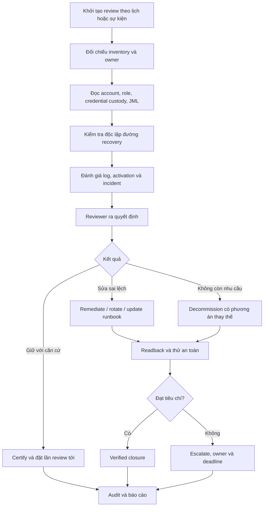

# Rà soát break-glass trong Emergency access và vòng đời IAM

**Rà soát break-glass** là quá trình kiểm tra định kỳ và theo sự kiện để xác nhận **đường truy cập quản trị khẩn cấp vẫn sử dụng được khi cần, chỉ người có thẩm quyền mới tiếp cận được, mọi lần sử dụng đều có bằng chứng và quyền phát sinh được thu hồi sau sự cố**. Đối tượng rà soát không chỉ là một tài khoản có tên “emergency”, mà còn bao gồm credential, người giữ quyền, đường xác thực, phạm vi đặc quyền, điều kiện kích hoạt, quy trình ứng cứu, phiên/token, cấu hình ngoại lệ và nhật ký.

Giả sử doanh nghiệp có tài khoản quản trị khẩn cấp để khôi phục Identity Provider (IdP) khi Single Sign-On (SSO) bị lỗi. Tài khoản vẫn đăng nhập được trong lần diễn tập gần nhất, nhưng kỹ sư quản lý credential đã chuyển bộ phận và một mật khẩu cũ từng được lưu trong tài liệu nội bộ. **Đánh giá duy nhất việc account có trạng thái Active sẽ bỏ sót rủi ro lớn**: người không còn nhiệm vụ có thể biết bí mật và sử dụng đường quản trị không phụ thuộc SSO.

Trong module **Identity and Access Management (IAM)** theo mô hình **Joiner–Mover–Leaver (JML)**, việc rà soát break-glass là một phần quản trị đặc quyền có liên quan tới **IdP, SSO, SCIM, RBAC/ABAC, PAM/JIT, tài khoản dịch vụ, access review, kiểm toán và reconciliation**. Mục tiêu là giảm quyền truy cập tồn dư **mà không làm mất khả năng phục hồi khi sự cố thực sự xảy ra**.

## 1. Mục tiêu và phạm vi rà soát

Một đợt rà soát tốt trả lời đồng thời bốn nhóm câu hỏi:

1. **Availability — còn dùng được không?** Đường truy cập có bị phụ thuộc vào IdP, MFA, PAM hoặc mạng đang cần khôi phục không?
2. **Security — có bị lạm dụng không?** Ai giữ credential, có giới hạn scope, có cảnh báo và cơ chế ngăn dùng thường xuyên không?
3. **Accountability — có truy vết được không?** Có incident ID, chủ thể thực thi, thay đổi, bằng chứng và hậu kiểm độc lập không?
4. **Lifecycle — đã cập nhật/thu hồi đúng chưa?** Người Mover/Leaver, phiên cũ, quyền tạm, secret và ngoại lệ có được xử lý không?

| Đối tượng rà soát | Ví dụ | Dấu hiệu cần chú ý |
| --- | --- | --- |
| Emergency account | Local admin hoặc recovery account của tenant | Account không có owner; bị dùng thường xuyên |
| Privilege | Tenant admin, restore, policy recovery | Scope rộng hơn nhu cầu hoặc permission thay đổi |
| Credential | Password, hardware authenticator, recovery material | Bí mật từng bị sao chép hoặc chưa thay sau sự cố |
| Custodian | Người giữ/quản lý phương thức truy xuất | Đã Mover/Leaver hoặc thiếu người thay thế |
| Đường xác thực | Local login, đường recovery độc lập | Phụ thuộc chính hệ thống dễ lỗi |
| Approval/runbook | Trigger, thẩm quyền, kênh ngoài băng | Thiếu ủy quyền khi approver vắng mặt |
| Session/token | Phiên quản trị và credential phát sinh | Còn hiệu lực sau khi incident đóng |
| Detection/audit | Alert đăng nhập, transcript, event log | Operator có thể xóa dấu vết |
| Remediation | Revoke, rotate, rollback policy | Item hậu kiểm chưa hoàn tất |

**Break-glass review khác việc tái chứng nhận mọi quyền admin thông thường**. Trọng tâm là tính **sẵn sàng của phương án khẩn cấp** đồng thời với mức bảo vệ cao hơn tương xứng quyền của nó.

## 2. Phân biệt các hoạt động review liên quan

| Hoạt động | Câu hỏi chính | Khi nào thực hiện? |
| --- | --- | --- |
| **Access review/recertification** | Ai còn cần entitlement? | Theo chu kỳ và sự kiện JML |
| **Break-glass design review** | Kiến trúc và quyền emergency có đúng nhu cầu phục hồi? | Sau thay đổi lớn và định kỳ |
| **Credential custody review** | Ai có thể truy xuất hoặc biết bí mật? | Theo chu kỳ, khi Mover/Leaver hoặc nghi lộ |
| **Emergency access drill** | Đường khẩn cấp có hoạt động trong điều kiện giả lập lỗi? | Theo lịch diễn tập được phê duyệt |
| **Post-use review** | Lần dùng cụ thể có hợp lệ, được dọn dẹp và kiểm chứng? | Sau mỗi lần kích hoạt |
| **Reconciliation** | Entitlement thực tế còn khác trạng thái mong muốn? | Theo sự kiện/định kỳ và sau remediation |

Một lần diễn tập đăng nhập thành công **không chứng minh** người giữ credential đã phù hợp; một cuộc review membership hoàn tất **không chứng minh** tài khoản còn sử dụng được khi IdP mất khả dụng. Cần các bằng chứng bổ sung nhau.

## 3. Inventory: phải biết đang có những đường break-glass nào

Trước khi review phải lập danh mục đầy đủ. Một hệ thống có thể có nhiều đường khôi phục khác nhau: tài khoản emergency của tenant, local administrator, recovery mode cơ sở dữ liệu, tài khoản quản trị thiết bị mạng hoặc credential dành riêng cho vault.

| Trường inventory | Ý nghĩa |
| --- | --- |
| `emergencyAccessId` | Định danh ổn định của cơ chế truy cập |
| `targetSystem` / `tenantId` | Hệ thống và tenant được phục hồi |
| `accountId` | Identity/account khẩn cấp tại đích |
| `allowedPurpose` | Những loại sự cố hoặc tác vụ được phép |
| `privilegeMapping` | Role/permission có thể sử dụng |
| `credentialCustodian` | Người/nhóm chịu trách nhiệm bảo quản |
| `accessProcedureOwner` | Chủ quy trình activation |
| `approvalPolicy` | Quy tắc kích hoạt, ngoại lệ, SoD |
| `credentialStorageReference` | Tham chiếu kho lưu an toàn, không phải secret |
| `lastSuccessfulTest` | Bằng chứng lần thử gần nhất |
| `lastActivation` | Lần sử dụng thực tế gần nhất |
| `reviewStatus` | Kết quả đánh giá và remediation còn mở |

Danh mục này là **mô hình minh họa**, không phải schema SCIM hay bắt buộc của nhà cung cấp. Không lưu mật khẩu, mã recovery hay khóa bí mật dưới trường metadata. Nếu còn tài khoản local/quản trị chưa có owner, phải ưu tiên điều tra vì nó có thể là đường truy cập tồn dư.

## 4. Chọn lịch rà soát theo rủi ro và sự kiện

Không có một tần suất cố định áp dụng cho mọi tổ chức. Lịch được quyết định bằng **mức đặc quyền, phụ thuộc hạ tầng, khả năng gây gián đoạn, nghĩa vụ kiểm soát và độ biến động nhân sự**.

Các sự kiện nên kích hoạt review bổ sung:

- **Mover/Leaver** của custodian, approver, incident commander hoặc thành viên đội khôi phục.
- Thay đổi **MFA, conditional access, federation hoặc SSO** có thể ảnh hưởng đường dự phòng.
- Thay đổi **role/permission** của tài khoản emergency hoặc kiến trúc tenant.
- Di chuyển **vault, secret storage, network access** hoặc thiết bị xác thực.
- Mỗi lần **activation** thực tế, dù thành công hay thất bại.
- Nghi ngờ **credential exposure**, sử dụng trái phép hoặc sự kiện an ninh.
- Diễn tập không đạt, cảnh báo không xuất hiện hoặc runbook lỗi thời.
- Thay đổi yêu cầu tổ chức, đối tác vận hành hoặc phương án disaster recovery.

Ví dụ có thể đặt lịch rà soát người giữ quyền hằng quý và diễn tập phương án theo kế hoạch riêng. Đây chỉ là minh họa: phải theo **risk assessment và policy** chứ không mặc nhiên coi “hằng quý” là chuẩn chung.

## 5. Quy trình rà soát end-to-end

**Không tự vô hiệu hóa tài khoản khẩn cấp cuối cùng chỉ vì thiếu một trường metadata** nếu hành động đó có thể làm mất khả năng phục hồi. Hãy đánh giá rủi ro, bảo vệ tạm thời, thiết lập phương án thay thế và thực hiện thay đổi có kiểm soát.

## 6. Rà soát thẩm quyền và người giữ credential

Một danh sách approver hoặc custodian có thể lỗi thời ngay khi nhân sự thay đổi. Reviewer cần xác minh:

1. Người có quyền truy xuất hiện vẫn có quan hệ công việc/hợp đồng hợp lệ?
2. Họ có còn được giao nhiệm vụ ứng cứu đúng hệ thống/tenant?
3. Người được ủy quyền thay thế có sẵn khi người chính vắng mặt?
4. Quyền truy xuất vault/thiết bị, chứ không chỉ group IdP, đã được cập nhật?
5. Có người nào từng biết mật khẩu, được sao chép secret hoặc giữ recovery material?
6. Có xung đột **Separation of Duties (SoD)** giữa người yêu cầu, người phê duyệt và người thực thi?
7. Có trường hợp một người giữ toàn bộ phương tiện truy cập và có thể sửa/xóa audit?
8. Liệu thay credential có ảnh hưởng khả năng kích hoạt của người được phép còn lại?

**Quyền đọc vault đã bị gỡ không làm người từng biết secret quên được nó**. Khi Mover/Leaver hoặc nghi lộ, cần đánh giá rotation, thu hồi vật mang và giám sát tương xứng.

## 7. Joiner: rà soát quyền trở thành người ứng cứu

**Joiner** vào đội vận hành/ứng cứu không mặc nhiên trở thành người có thể dùng break-glass. Cần kiểm tra danh tính, trách nhiệm, đào tạo, mức bảo đảm xác thực và phê duyệt tham gia.

Phân biệt:

- **Eligible:** được phép tham gia quy trình ứng cứu và có thể yêu cầu kích hoạt theo policy.
- **Custodian:** có trách nhiệm quản lý/giữ phương tiện khẩn cấp.
- **Approver:** có thẩm quyền chấp thuận hoặc quản trị ngoại lệ.
- **Active emergency privilege:** quyền thực tế đang sử dụng trong tình huống cụ thể.

Các vai trò có thể khác nhau. Người có nhiệm vụ trực on-call **không nên tự động được duy trì global-admin thường trực** nếu nhiệm vụ có thể giải quyết qua PAM/JIT/JEA.

## 8. Mover: cập nhật người và phạm vi khẩn cấp

| Sự kiện Mover | Sai lệch cần phát hiện | Việc nên làm |
| --- | --- | --- |
| SRE chuyển sang Product | Còn quyền đọc credential emergency | Thu hồi custody, đánh giá rotation |
| Kỹ sư đổi tenant phụ trách | Vẫn có quyền tenant cũ | Giảm phạm vi, cập nhật runbook |
| Người duyệt đổi bộ phận | Delegation phê duyệt còn active | Chuyển approver có thẩm quyền |
| Thay đổi nhóm on-call | Người không trực tiếp vẫn có kích hoạt JIT | Điều chỉnh eligibility và thời hạn |
| Chuyển ownership của vault | Người cũ còn bản sao recovery material | Thu hồi vật mang, kiểm tra bí mật cũ |

**Mover không chỉ thêm quyền mới**. Quyền cũ phải được thu hồi tại **mọi nơi**: IdP/AD, vault, tài khoản local, danh sách phê duyệt, cơ chế truy xuất ngoài băng và thiết bị xác thực.

## 9. Leaver: loại bỏ đường truy cập độc lập khỏi SSO

Đối với nhân viên/người giữ quyền đã nghỉ, quy trình Leaver cần xử lý:

1. Disable các tài khoản nghiệp vụ ở IdP/directory.
2. Thu hồi eligibility, quyền phê duyệt và membership nhóm ứng cứu.
3. Xóa quyền truy xuất credential trong vault và các kênh ngoài băng.
4. Thu hồi vật mang, thiết bị xác thực và tài liệu recovery nhạy cảm.
5. Đánh giá rotation secret có thể đã bị biết hoặc sao chép.
6. Chấm dứt session/token và quyền khẩn cấp đang active theo khả năng hệ thống.
7. Chuyển trách nhiệm cho custodian mới đủ điều kiện.
8. Đọc lại và diễn tập có kiểm soát để xác minh **đường recovery vẫn hoạt động**.

**Disable IdP chưa loại bỏ được đường break-glass không phụ thuộc IdP**. Nếu tài khoản recovery dùng credential riêng, việc thu hồi phải xảy ra chính tại cơ chế đó.

## 10. Đánh giá nguyên tắc least privilege và SoD

Một break-glass account có thể cần quyền cao để khôi phục policy đang hỏng. Tuy nhiên, reviewer vẫn cần kiểm tra **quyền đó có cần thiết để khôi phục hệ thống cụ thể hay không**.

| Câu hỏi | Dấu hiệu tốt |
| --- | --- |
| Account có thể khôi phục đúng hệ thống? | Có quyền cần thiết đã xác minh |
| Có cấp quyền toàn tenant cho tác vụ nhỏ? | Ưu tiên JEA/JIT khi đường thường còn hoạt động |
| Có thể tách các domain phục hồi? | Phạm vi đủ hẹp và inventory riêng |
| Có quyền sửa/xóa audit của chính mình? | Có kiểm soát độc lập và log bảo vệ |
| Có người tự lấy secret rồi tự phê duyệt mọi thao tác? | Kiểm soát bù trừ/dual control khi phù hợp |
| Có account chia sẻ không truy vết? | Gắn người sử dụng qua custody/incident/session |
| Có exception vĩnh viễn cho công việc hằng ngày? | Không; ngoại lệ được kiểm soát và hậu kiểm |

**Least privilege không có nghĩa giảm role khẩn cấp tới mức không thể phục hồi**. Cần thử khả năng recovery và dùng biện pháp giám sát, custody, phê duyệt bù trừ cho đặc quyền thật sự cần.

## 11. Kiểm tra tính độc lập của đường recovery

Một tài khoản khẩn cấp chỉ hữu ích nếu vẫn dùng được trong kịch bản lỗi mà nó được thiết kế để xử lý.

Reviewer nên tạo **dependency map**:

| Thành phần phụ thuộc | Câu hỏi rà soát |
| --- | --- |
| IdP / federation | Có phải đăng nhập qua chính IdP có thể hỏng? |
| MFA | Yếu tố xác thực phụ thuộc thiết bị/dịch vụ có thể mất? |
| Conditional access | Chính sách có vô tình khóa account khẩn cấp? |
| PAM/vault | Khi PAM outage, cách truy xuất bí mật dự phòng là gì? |
| Network/VPN/DNS | Đường quản trị có phụ thuộc hạ tầng đang cần cứu? |
| Monitoring | Sự kiện có được ghi và chuyển đi nếu một phần IAM mất? |
| Runbook/ticket | Người ứng cứu có thể đọc hướng dẫn khi wiki lỗi? |
| Nhân sự | Có người được ủy quyền trong các khung thời gian khác nhau? |

Không nên coi “loại trừ account khỏi một chính sách MFA” là đáp án mặc định. Phải **đánh giá threat model và hướng dẫn nền tảng**, chọn xác thực mạnh có khả năng dự phòng, kiểm soát tiếp cận và cảnh báo phù hợp.

## 12. Review hoạt động đăng nhập và lần kích hoạt thực tế

Mọi hoạt động sử dụng tài khoản khẩn cấp đều cần lý do được xác minh. Đối chiếu:

- **Login success/failure** của emergency account.
- **Credential retrieval** từ vault hoặc phương tiện dự phòng.
- **Incident/ticket ID** và điều kiện kích hoạt.
- **Người thực thi thực tế** và approver/incident commander.
- **Nguồn kết nối, thời gian, tài nguyên đích**.
- **Thay đổi role/policy/account, secret và cấu hình**.
- **Thời điểm đóng incident** so với thời gian session vẫn active.
- **Bằng chứng hậu kiểm**, phạm vi thay đổi và khôi phục.
- **Các đăng nhập không có incident**, đặc biệt ngoài diễn tập đã định.

Một lần đăng nhập break-glass không gắn incident hợp lệ cần **cảnh báo và điều tra**, nhưng không tự động kết luận hành vi ác ý nếu đó là lần kiểm thử đã được phê duyệt và lưu trữ sai correlation ID.

## 13. Post-use review: sau mỗi lần dùng break-glass

Rà soát sau sử dụng phải xác nhận **cả tính hợp lệ của quyết định kích hoạt lẫn kết quả dọn dẹp đặc quyền**.

Quy trình mẫu:

1. Đối chiếu lý do sử dụng với trigger/runbook.
2. Xác minh danh tính người truy xuất và người thao tác.
3. Kiểm tra ai phê duyệt, lý do ngoại lệ và mốc thời gian.
4. So sánh **các thay đổi thực tế** với phạm vi phục hồi được phép.
5. Xem credential có bị tiết lộ, sao chép hoặc nhập vào kênh không an toàn không.
6. Đóng/thu hồi session quản trị còn hoạt động.
7. Xử lý access/refresh token, API key hoặc secret phát sinh.
8. Hoàn nguyên conditional access exception, role tạm hoặc policy nới lỏng.
9. Kiểm tra các account mới, group/ACL và đường truy cập phụ được tạo.
10. Xác minh dịch vụ đã phục hồi và quyền bình thường được tái áp dụng.
11. Ghi các sai lệch chưa xử lý với owner, deadline và bằng chứng.
12. Tổ chức post-incident review độc lập, cập nhật quy trình và cảnh báo.

**Đổi password không tự bảo đảm mọi session/token đã mất hiệu lực**. JWT tự chứa có thể còn được API chấp nhận tới hạn nếu không có kiểm tra trạng thái hoặc cơ chế revoke phù hợp.

## 14. Quyền phát sinh và “privilege residue”

**Privilege residue** là quyền hoặc đường truy cập còn tồn tại sau khi hoàn tất ứng cứu. Một lần phục hồi có thể tạo nhiều nguồn tồn dư:

| Nguồn | Ví dụ | Kiểm chứng |
| --- | --- | --- |
| Role/group tạm | Cấp `cloud-admin` cho người ứng cứu | Readback entitlement tại IdP và cloud |
| Session | Phiên console chưa logout | Đóng hoặc vô hiệu phiên theo nền tảng |
| Token | Access token với claim admin cũ | Negative authorization test |
| API key | Khóa dự phòng tạo để sửa hệ thống | Inventory, revoke/rotate |
| Local account | Tài khoản phục hồi mới tạo | Quyết định giữ/xóa theo chính sách |
| Policy exception | Bỏ qua bước MFA hoặc policy điều kiện | Hoàn nguyên và kiểm thử |
| ACL | Quyền trực tiếp trên resource | So desired/observed state |
| Monitoring exception | Tắt cảnh báo để xử lý lỗi | Bật lại và kiểm chứng sự kiện |

**Connector báo HTTP 200 không phải bằng chứng mọi quyền đã biến mất**. Một ứng dụng SaaS có thể lưu role cục bộ trong khi IdP đã gỡ group. Cần reconciliation và readback tại nơi thực thi authorization.

## 15. IdP, SSO, SCIM và trạng thái quyền thực tế

| Thành phần | Rà soát điều gì? | Giới hạn |
| --- | --- | --- |
| **IdP/AD** | Account, group, emergency exclusion | Không quản lý mọi local recovery account |
| **SSO/OIDC/SAML** | Quan hệ federation và phiên liên quan | Disable IdP không đóng tất cả RP session |
| **SCIM/connector** | User/Group/role đã provision/deprovision | Không phải giao thức thu hồi mọi token |
| **RBAC** | Quyền phục hồi theo role | Role rộng có thể tạo quyền dư |
| **ABAC/PBAC** | Hạn chế theo resource/context/incident | Phải áp dụng ở PEP với dữ liệu tin cậy |
| **PAM/JIT/JEA** | Kích hoạt ngắn hạn, lệnh giới hạn | Có thể không khả dụng trong sự cố |
| **IGA/JML** | Người có eligibility và custody còn đúng? | Cần đọc nguồn thực tế |
| **Audit/reconciliation** | Lịch sử truy cập và quyền còn tồn dư | Không thay thế enforcement tại đích |

**ID token OIDC không được xem như access token dùng gọi API**. API phải kiểm tra issuer, audience, scope/permission và chính sách authorization phù hợp; việc đăng nhập emergency thành công không tạo quyền vô điều kiện với mọi resource.

## 16. Kiểm thử/diễn tập an toàn

Diễn tập break-glass phải cân bằng **tính sẵn sàng** với **nguy cơ gây gián đoạn**. Không tự làm hỏng production để thử.

| Kịch bản | Kỳ vọng |
| --- | --- |
| IdP chính không khả dụng trong mô phỏng | Đường dự phòng vẫn hợp lệ |
| PAM/vault mất kết nối | Có phương án lấy credential theo policy |
| Custodian chính vắng mặt | Người thay thế đủ thẩm quyền có thể xử lý |
| Custodian đã Leaver | Không còn truy xuất được credential hiện hành |
| Chỉ requester không có thẩm quyền | Không thể tự kích hoạt |
| Kích hoạt tài khoản không gắn incident | Có cảnh báo và kiểm tra |
| Quyền emergency chỉ cho tài nguyên A | Không tự có quyền trên B |
| Đăng nhập hợp lệ nhưng thao tác vượt phạm vi | Bị từ chối khi nền tảng hỗ trợ hoặc phát hiện/điều tra |
| Incident kết thúc | Session/token/quyền tạm được xử lý |
| Rotation credential | Người hợp lệ vẫn có thể phục hồi |
| Monitoring chính bị lỗi | Có kế hoạch giữ bằng chứng bổ sung |

Sau thử nghiệm, cần ghi **kịch bản, môi trường, người thực hiện, bước thành công/thất bại, lỗ hổng phát hiện và kế hoạch sửa**. Một tài khoản đăng nhập thành công không đủ chứng minh chạy được thao tác phục hồi quan trọng; nhưng cần kiểm thử phục hồi theo phương án an toàn đã phê duyệt.

## 17. Review tài khoản emergency ít sử dụng

Tài khoản break-glass thường **ít hoặc không dùng** trong vận hành bình thường. Vì vậy không thể dùng `lastLogin` thấp làm lý do duy nhất để xóa tài khoản hoặc tự hạ đặc quyền.

Cần đánh giá:

- **Vẫn có kịch bản phục hồi rõ ràng không?**
- Có đường phục hồi khác đã thử và được quản trị tốt hơn không?
- Account có cần quyền hiện tại để xử lý lỗi nghiêm trọng?
- Những người giữ credential còn hợp lệ không?
- Đăng nhập hiếm nhưng bất thường có được điều tra không?
- Lần kiểm thử gần nhất có đủ mới so với thay đổi kiến trúc?
- Credential có bị dùng bởi script hoặc công việc định kỳ trái mục đích không?

Nếu cơ chế không còn cần, việc **decommission** phải có kế hoạch thay thế và thử khả năng phục hồi trước khi xóa đường truy cập cuối cùng.

## 18. Service account, workload và đường phục hồi tự động

Workload có thể cần cơ chế ứng cứu, nhưng **không nên mượn credential break-glass làm khóa CI/CD hoặc cron job thường trực**.

Reviewer cần xác minh:
- Có service identity riêng, owner và scope tối thiểu không?
- Script recovery có yêu cầu xác nhận từ người có thẩm quyền khi phù hợp không?
- Secret có bị lưu trong pipeline variable dễ xem hoặc log không?
- Có cơ chế phòng replay, giới hạn môi trường/tenant và thời hạn không?
- Người tạo automation đã Mover/Leaver có còn quyền sửa job hoặc lấy secret không?
- Quyền máy–máy được đối soát với resource thực tế như thế nào?
- Nếu thu hồi service credential, có phụ thuộc nào phải xử lý trước?

**Không xóa mù workload quan trọng**, nhưng cũng không giữ một service account quyền cao mà không có owner hoặc căn cứ sử dụng. Đường emergency dùng cho con người và identity của workload nên được quản trị tách biệt.

## 19. Quyết định review và xử lý ngoại lệ

| Kết quả | Khi nào phù hợp? | Yêu cầu đi kèm |
| --- | --- | --- |
| **Certify / Keep** | Cơ chế cần thiết, quyền phù hợp, custody an toàn | Lý do, owner, lần review kế tiếp |
| **Reduce scope** | Có thể phục hồi với quyền ít hơn | Kiểm thử khả năng khôi phục |
| **Rotate credential** | Sau sử dụng, nghi lộ hoặc người giữ đổi | Phương án rotation và thử lại |
| **Change custodian** | Đội ứng cứu hoặc trách nhiệm thay đổi | Thu hồi custody cũ, cập nhật runbook |
| **Update dependencies** | SSO/MFA/PAM/network thay đổi | Diễn tập với kiến trúc mới |
| **Investigate** | Thiếu owner, log hoặc bằng chứng | Cảnh báo, deadline, kiểm soát tạm |
| **Decommission** | Không còn nhu cầu và có phương án an toàn | Change approval, recovery test trước xóa |
| **Exception** | Chưa thể xử lý sai lệch ngay | Owner, lý do, timebox, compensating controls |

Không được coi item **Overdue / No response** là tự động Keep. Với rủi ro cao, cần escalation, tăng giám sát hoặc xử lý tạm theo chính sách, đồng thời tránh làm mất khả năng phục hồi nếu không có phương án dự phòng.

## 20. Bằng chứng kiểm toán và các chỉ số

Mỗi review nên ghi **campaign/review ID, emergency access ID, target account, custodian, reviewer, policy version, snapshot time, dependency map, log/incident tham chiếu, quyết định, remediation và readback**.

Không ghi plaintext password, OTP, token, cookie, private key hoặc secret vào bằng chứng. Lưu log có integrity và phân quyền đọc, tốt nhất có đường bảo vệ độc lập với quyền mà break-glass đang kiểm soát.

| Chỉ số | Mục đích |
| --- | --- |
| **Custody review coverage** | Tỷ lệ cơ chế có người giữ quyền được tái xác nhận |
| **Recovery drill success rate** | Khả năng đường khẩn cấp hoạt động trong thử nghiệm |
| **Unauthorized activation count** | Lần sử dụng ngoài incident/diễn tập hợp lệ |
| **Activation detection latency** | Độ trễ cảnh báo khi break-glass được dùng |
| **Post-use review completion** | Tỷ lệ activation có hậu kiểm |
| **Residual emergency privileges** | Quyền/token/ACL còn sau khi đóng incident |
| **Credential rotation completion** | Bí mật phải thay đã được xử lý |
| **Mover/Leaver custody drift** | Người không còn nhiệm vụ vẫn truy xuất credential |
| **Dependency failures** | Những điểm lỗi chung làm đường recovery vô dụng |
| **Remediation verification rate** | Tỷ lệ vấn đề đã khắc phục và có readback |
| **Runbook freshness** | Thời gian từ lần cập nhật/diễn tập mới nhất |

**Ít lần kích hoạt không chứng minh break-glass an toàn hoặc sẵn sàng**. Tương tự, hoàn tất review trên biểu mẫu không chứng minh đã xử lý credential, session hay quyền dư.

## 21. Ví dụ: rà soát sau sự cố IdP

Tình huống minh họa: một chính sách đăng nhập cấu hình sai khiến quản trị viên không thể vào tenant. Đội ứng cứu dùng đường khẩn cấp để khôi phục.

| Hạng mục review | Phát hiện | Hành động |
| --- | --- | --- |
| Trigger | Mất khả năng đăng nhập bằng đường chuẩn | Xác nhận phù hợp runbook |
| Custodian | Người trực có thẩm quyền | Lưu bằng chứng lấy credential |
| Scope | Account sửa policy của tenant bị lỗi | Kiểm tra không có thay đổi ngoài incident |
| Monitoring | Có cảnh báo login emergency | Đối chiếu incident ID và log |
| Session | Phiên admin còn active sau phục hồi | Đóng hoặc vô hiệu theo nền tảng |
| Credential | Bí mật đã được truy xuất theo cơ chế chia sẻ | Đánh giá rotation và người từng tiếp cận |
| Policy | Ngoại lệ tạm không hoàn nguyên | Khôi phục policy, kiểm chứng |
| JML | Một người phê duyệt đã Mover | Cập nhật authority/owner |
| Recovery readiness | Đường thường đã hoạt động | Diễn tập kiểm tra an toàn và đóng incident |

Kết luận review cần phân biệt **dịch vụ đã khôi phục** và **quyền emergency đã được dọn sạch**. Nếu một exception còn active, hạng mục kiểm soát chưa thể đóng là hoàn tất.

## 22. Ma trận kiểm thử khi rà soát

| Tình huống | Kết quả mong muốn |
| --- | --- |
| Account không có owner | Điều tra ưu tiên, gán owner và kiểm soát tạm |
| Người giữ credential Leaver | Thu hồi custody, đánh giá rotation |
| Đổi MFA khiến đường recovery lỗi | Phát hiện qua kiểm thử và khắc phục |
| Break-glass bị dùng cho tác vụ hằng ngày | Cảnh báo, chuyển sang PAM/JIT |
| Hết incident nhưng token còn hoạt động | Không đóng remediation, xử lý phiên/token |
| Tài khoản chưa dùng trong thời gian dài | Review mục đích và thử khả dụng, không tự xóa |
| Reviewer thiếu thẩm quyền | Không được tự certify |
| Có local account chưa nằm inventory | Bổ sung inventory, điều tra ownership |
| Rotation thành công nhưng người hợp lệ không đăng nhập được | Phải xử lý recovery readiness |
| Connector báo revoke thành công nhưng role đích còn | Readback phát hiện và escalation |
| Workload dùng credential emergency | Xác định vi phạm, thay service identity phù hợp |
| Thiếu log của lần activation | Incident hậu kiểm chưa đạt, xử lý bằng chứng và cảnh báo |

## 23. Câu hỏi tự kiểm tra

**Tình huống A:** Một tài khoản break-glass chưa đăng nhập trong sáu tháng. Có nên xóa vì “không sử dụng” không? **Không tự động.** Phải đánh giá mục đích recovery, phương án thay thế và kết quả diễn tập.

**Tình huống B:** Nhân viên đã Leaver nhưng từng biết mật khẩu break-glass, dù IdP đã disable họ. Có cần hành động khác? **Có.** Xử lý custody và đánh giá rotation credential độc lập.

**Tình huống C:** IdP outage nhưng đường emergency vẫn gọi IdP để xác thực. Review nên kết luận gì? **Thiết kế không đáp ứng mục tiêu dự phòng đó** trừ khi có đường hoạt động độc lập phù hợp.

**Tình huống D:** Sự cố kết thúc, password được đổi nhưng admin token vẫn truy cập API. Có thể ghi hoàn tất cleanup không? **Chưa.** Cần xử lý token/session và kiểm chứng ở đích.

**Tình huống E:** Reviewer thấy account được cấp quyền rộng nhưng chỉ quyền đó mới đủ khôi phục policy lỗi. Có nhất thiết hạ quyền ngay? **Không;** phải đánh giá tính cần thiết, kiểm thử recovery và bổ sung giám sát/custody phù hợp.

**Tình huống F:** Một job dùng key break-glass hằng đêm. Review phải xử lý thế nào? **Không duy trì như credential thường trực**; thiết kế workload identity riêng và thu hồi phụ thuộc một cách có kiểm soát.

## Ghi nhớ

**Rà soát break-glass** phải chứng minh đồng thời **tính sẵn sàng phục hồi, mức bảo vệ đặc quyền, trách nhiệm người sử dụng và khả năng dọn sạch quyền sau sự cố**. Hãy kiểm tra **inventory, owner/custodian, tính độc lập của IdP/SSO/PAM/MFA, điều kiện activation, log, diễn tập, credential, session/token, policy exception và bằng chứng hậu kiểm**. Kết hợp kiểm soát **Joiner–Mover–Leaver, least privilege, SoD, IdP/SSO, SCIM, RBAC/ABAC, service identity và reconciliation** để cơ chế khẩn cấp **thực sự dùng được khi hệ thống lỗi nhưng không tạo một đường quản trị tồn dư và không kiểm soát**.
