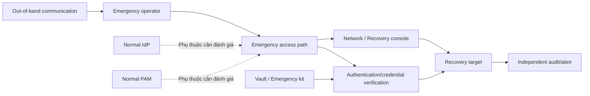
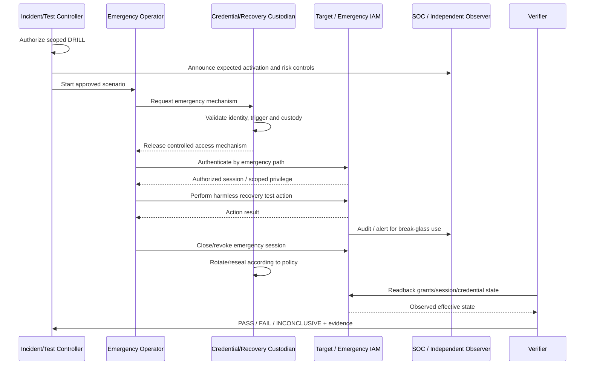

# Kiểm thử khẩn cấp trong IAM: Diễn tập Emergency Access và xác minh quyền Break-glass

Một doanh nghiệp sử dụng **Identity Provider (IdP)** và **Single Sign-On (SSO)** cho mọi tài khoản quản trị. Khi IdP gặp sự cố, kỹ sư không thể đăng nhập để sửa cấu hình xác thực. Tổ chức đã chuẩn bị một tài khoản **break-glass** nhằm khôi phục hệ thống, nhưng đến lúc cần thì tài khoản đó cũng yêu cầu đăng nhập qua chính IdP đang hỏng. Trong một tình huống khác, đường truy cập khẩn cấp hoạt động được, song sau khi sự cố kết thúc, quyền Global Administrator vẫn còn mở và người dùng tiếp tục dùng phiên cũ.

Hai lỗi này trái chiều nhưng cùng nguy hiểm: **không thể khôi phục hệ thống khi cần**, hoặc **mở được quyền khẩn cấp nhưng không đóng lại an toàn**.

**Kiểm thử khẩn cấp (Emergency Access Testing)** là hoạt động diễn tập có kế hoạch và có kiểm soát nhằm xác minh rằng cơ chế **Emergency Access / Break-glass** có thể được kích hoạt **đúng điều kiện, bởi đúng chủ thể, trên đúng phạm vi, trong thời gian thích hợp** khi các tuyến vận hành thông thường bị gián đoạn; đồng thời chứng minh các lớp **xác thực, phê duyệt, giám sát, kiểm toán, giới hạn quyền, thu hồi và phục hồi** vẫn đạt chính sách rủi ro của tổ chức.

Bài thuộc chương **Emergency access** trong mô-đun **Identity Lifecycle** của **Identity and Access Management (IAM)**. Trọng tâm là cách thiết kế, thực hiện và đánh giá một **bài kiểm thử khẩn cấp**, liên kết với **Joiner–Mover–Leaver (JML)**, IdP, SSO, SCIM, RBAC/ABAC, PAM/PIM, tài khoản dịch vụ, audit và reconciliation để giảm **quyền truy cập tồn dư**.

> **Kết quả PASS không chỉ là “tài khoản khẩn cấp đăng nhập được”.** Phải chứng minh đường truy cập khả dụng đúng tình huống, hành động được giới hạn, người không có thẩm quyền bị chặn, cảnh báo/bằng chứng được tạo, và **quyền sau sự cố đã đóng thực sự tại hệ thống đích**.

## 1. Kiểm thử khẩn cấp là gì?

**Emergency Access** là năng lực cho phép chủ thể được chỉ định thực hiện một tập hành động đặc biệt để khôi phục hoạt động hoặc xử lý sự cố nghiêm trọng khi quy trình truy cập bình thường không đủ khả dụng, không kịp thời hoặc không còn phù hợp. **Break-glass** là cách gọi phổ biến cho cơ chế kích hoạt quyền cứu hộ trong điều kiện được quy định.

**Kiểm thử khẩn cấp** khác việc chỉ cấu hình một tài khoản dự phòng. Một kế hoạch diễn tập phải trả lời:

1. Tình huống nào được công nhận là **emergency**?
2. Ai có thể **khởi xướng, cho phép và thực thi** quyền cứu hộ?
3. Điều gì xảy ra nếu IdP, MFA, PAM, vault, network hoặc approval system ngừng hoạt động?
4. Làm sao người vận hành nhận được thông tin/hướng dẫn cần thiết **mà không làm lộ secret**?
5. Có thể thực hiện **hành động phục hồi cụ thể**, chứ không chỉ đăng nhập?
6. Đường cứu hộ có vô tình cho phép quyền vượt tenant, ngoài môi trường hay quá thời hạn?
7. Việc sử dụng có tạo **alert, audit, attribution và post-event review** không?
8. Sau khi đóng khẩn cấp, role, session, token, key, local account hoặc shared credential có còn sử dụng được không?
9. Ai xác nhận **readback effective access** và xử lý ngoại lệ?
10. Khi thử nghiệm, làm sao tránh gây gián đoạn production hoặc phá hỏng cơ chế recovery thật?

### 1.1. Mục tiêu song hành: availability và security

| Mục tiêu | Kiểm thử cần chứng minh | Rủi ro nếu không kiểm |
|---|---|---|
| **Khả dụng (availability)** | Có đường phục hồi khi một phụ thuộc quan trọng lỗi. | Bị khóa khỏi hạ tầng cần sửa. |
| **Đúng người (identity assurance)** | Chỉ emergency operators đã được chỉ định sử dụng được. | Người ngoài chiếm quyền cứu hộ. |
| **Đúng hoàn cảnh** | Chỉ kích hoạt theo incident, trigger hoặc policy. | Break-glass bị dùng cho công việc thường ngày. |
| **Đúng phạm vi** | Role/action/target đủ để cứu hộ nhưng không rộng vô cớ. | Quyền đặc biệt gây tác động không kiểm soát. |
| **Có giám sát** | Alert và audit đến người độc lập khi dùng. | Hoạt động khẩn cấp không bị phát hiện. |
| **Thu hồi được** | Quyền/credential/session bị đóng sau sử dụng. | Quyền tồn dư sau khi khôi phục. |
| **Có thể kiểm toán** | Bằng chứng đủ để tái dựng ai, lúc nào, vì sao, đã làm gì. | Không thể giải thích sự kiện. |
| **Khả năng tái diễn** | Runbook được kiểm, cập nhật và diễn tập định kỳ. | Tài khoản/runbook hỏng theo thời gian. |

**Không có cơ chế cứu hộ hoàn toàn không rủi ro.** Bài test phải đánh giá đồng thời nguy cơ lockout và nguy cơ lạm dụng quyền.

### 1.2. Phân biệt các hoạt động liên quan

| Hoạt động | Trọng tâm | Khác với kiểm thử khẩn cấp ở đâu? |
|---|---|---|
| Emergency-access design | Thiết kế role, identity, credential và quy trình. | Chưa chứng minh quy trình thực sự chạy được. |
| Access review | Kiểm tra quyền cứu hộ còn cần và owner hợp lệ. | Không nhất thiết thử đường sử dụng khi sự cố. |
| Disaster recovery (DR) | Phục hồi dịch vụ, dữ liệu, hạ tầng. | Kiểm thử khẩn cấp tập trung quyền truy cập để thực hiện phục hồi. |
| Incident-response exercise | Diễn tập phát hiện/ứng phó sự cố rộng hơn. | Emergency access là một khả năng cần lồng ghép. |
| Security penetration test | Kiểm thử điểm yếu trong phạm vi được ủy quyền. | Emergency drill cần xác minh cả khả dụng và thu hồi. |
| PAM/PIM test | Kiểm JIT, vault, broker và privileged sessions. | Phải thêm giả định PAM/IdP không khả dụng. |
| JML deprovision test | Kiểm thu hồi theo Joiner/Mover/Leaver. | Emergency test kiểm thêm quy trình và account cứu hộ. |

## 2. Những tình huống phải có trong threat model

Không thể viết một bài test duy nhất gọi là “break-glass works” cho mọi kiến trúc. Trước hết cần liệt kê **sự cố đáng lo** và đường phục hồi liên quan.

| Tình huống | Thành phần bị ảnh hưởng | Câu hỏi kiểm thử |
|---|---|---|
| IdP/SSO outage | Login tập trung và claims mới. | Có phương án cứu hộ không phụ thuộc toàn bộ vào IdP này không? |
| MFA provider outage | Yếu tố xác thực thường ngày. | Cơ chế emergency có xác thực/kiểm soát thay thế được phê duyệt không? |
| PAM/vault unavailable | Broker, checkout và secret retrieval. | Có phương án recovery không vòng lại dịch vụ bị lỗi? |
| Directory lỗi/misconfiguration | Group, role, account. | Principal cứu hộ có thể khôi phục cấu hình đúng scope không? |
| Cloud tenant admin lockout | Cloud control plane. | Có emergency principal được nhà cung cấp hỗ trợ và bảo vệ không? |
| Network/bastion outage | Kênh tới máy chủ. | Có đường quản trị thay thế được kiểm soát không? |
| Certificate/key rotation lỗi | Mutual trust, token signing. | Có khả năng sửa chuỗi trust mà không phụ thuộc nó không? |
| Security policy khóa nhầm admins | Conditional access hoặc IAM policy. | Có đường sửa policy nhưng không mở cửa hậu thường trực không? |
| Ransomware/endpoint compromise | Máy trạm quản trị và credential. | Có môi trường quản trị sạch và phương án cách ly không? |
| Human operator không sẵn sàng | Người trực, approver, custodian. | Có người thay thế và cơ chế phân quyền phù hợp SoD không? |
| Emergency principal bị lộ | Tài khoản cứu hộ. | Có cách revoke/rotate/reseed và xác minh sau xử lý không? |
| Incident kéo dài quá TTL | Quyền được cấp tạm. | Gia hạn có được phê duyệt lại, không tự kéo dài không? |

### 2.1. Phân biệt lỗi một thành phần và lỗi chung nguyên nhân

Ví dụ thiết kế:

```text
Normal admin login -> IdP -> MFA provider -> PAM -> Target

Emergency login -> "Emergency Portal" -> Cùng IdP -> Cùng MFA provider
```

Mặc dù có portal thứ hai, **hai đường cùng phụ thuộc một điểm lỗi**. Bài test chỉ kiểm portal đang hoạt động lúc IdP khỏe mạnh sẽ không phát hiện vấn đề.

Cần lập **dependency graph** và diễn tập giả lập đúng phụ thuộc mất khả dụng. Không cần cố ý làm sập production để kiểm; có thể dùng môi trường DR/staging, fault injection đã được phê duyệt hoặc bài tabletop nếu không thể cô lập rủi ro.

### 2.2. Có thể mất một phần, không phải mất hết

IdP có thể vẫn phát token mới nhưng directory nhóm đã stale; vault hoạt động nhưng session broker lỗi; alert nhận được nhưng log pipeline đến chậm. Test phải xác định **giả định lỗi nào** đang được tạo ra, chứ không chấm PASS chỉ vì nút “Emergency Login” hoạt động.

## 3. Những mô hình emergency access cần phân loại

| Mô hình | Ví dụ sử dụng | Điều phải test riêng |
|---|---|---|
| **Emergency cloud tenant identity** | Quản trị tenant khi IdP/federation lỗi. | Độc lập phụ thuộc, quyền và giám sát đặc thù cloud. |
| **Local/built-in recovery account** | Sửa hệ điều hành/directory trong tình huống khóa tài khoản. | Phạm vi host, credential custody, đường network và rotation. |
| **PAM break-glass session** | Mở phiên quản trị được giám sát sau approval khẩn cấp. | PAM có hoạt động không; nếu PAM hỏng thì fallback là gì? |
| **Temporary privileged role/JIT** | Active role trong giới hạn 30 phút. | Eligibility, approval, TTL, target revoke và session cũ. |
| **Offline emergency kit** | Chứa tài liệu/secret đã niêm phong phục vụ phục hồi. | Custody, dual control, integrity, truy cập khi hệ thống offline. |
| **Emergency workload identity** | Tác vụ recovery tự động cần truy cập hạ tầng. | Owner, token trust, audience/scope, rotation và decommission. |
| **Vendor-supported recovery process** | Khôi phục quyền với sự hỗ trợ nhà cung cấp. | Preconditions, liên hệ, thời gian và bằng chứng, không giả khả năng. |

Các mô hình có thể kết hợp. Không nên ép mọi tình huống dùng một account Global Admin vĩnh viễn.

### 3.1. Emergency access không đồng nghĩa “bypass mọi policy”

Một cơ chế cứu hộ được thiết kế tốt vẫn phải:

- Xác định identity và nguồn trách nhiệm.
- Có trigger/mục đích rõ.
- Giới hạn quyền nếu kỹ thuật cho phép.
- Duy trì telemetry độc lập hoặc kiểm soát bù trừ.
- Kiểm soát expiry và thu hồi.
- Tuân thủ yêu cầu nhà cung cấp và security policy.

Khi một điều kiện bình thường không thể dùng trong outage, phương án thay thế phải được **phê duyệt trước và kiểm thử**, không tự ý bỏ xác thực để đạt availability.

## 4. Tiêu chí thành công phải được định nghĩa trước

Trước khi diễn tập, tổ chức cần có **emergency access contract** cho từng loại tài nguyên.

### 4.1. Thành phần của contract

| Thuộc tính | Nội dung mẫu |
|---|---|
| `scenarioId` | `EA-IDP-OUTAGE-01`. |
| `incidentClass` | IdP unavailable. |
| `targetSystem` | Identity administration staging/DR. |
| `recoveryAction` | Xem và sửa policy thử nghiệm được cho phép. |
| `eligibleOperators` | Danh sách/cấp vai trò emergency operators. |
| `authorizedTrigger` | Incident được xác nhận theo quy trình. |
| `approval/custody` | Dual control hoặc chế độ khác theo risk policy. |
| `authenticationAssurance` | Cơ chế tin cậy được hệ thống hỗ trợ. |
| `scope/TTL` | Quyền giới hạn theo target và thời gian. |
| `independentDependencies` | Những dịch vụ phải sẵn ngay khi IdP/PAM lỗi. |
| `alertEvidence` | Người nhận alert, correlation ID và thời hạn. |
| `revoke/reseal` | Những bước đóng quyền, đổi secret và kiểm chứng. |
| `failCriteria` | Không login được, vượt scope, thiếu audit, không revoke. |
| `cleanupOwner` | Người chịu trách nhiệm sau diễn tập. |

### 4.2. Một bài test phải có cả positive và negative criteria

**Positive acceptance:** operator hợp lệ, trong điều kiện emergency được khai báo, thực hiện **một hành động recovery test được phép**.

**Negative acceptance:** actor không được chỉ định, không có incident hợp lệ, dùng sai tenant, sai scope hoặc dùng credential đã hết hạn **không được quyền**.

**Closure acceptance:** mọi quyền/phiên/credential phát sinh bởi bài test đã xử lý; role ở target đúng desired state, audit và alert đủ bằng chứng.

Không thể báo PASS nếu positive thành công nhưng negative bị mở quyền.

## 5. Phân loại bài diễn tập theo mức độ can thiệp

### 5.1. Tabletop exercise

Đội incident response đi qua runbook và giả lập quyết định:

- Ai tuyên bố incident?
- Ai nắm quyền mở kit?
- Operator đang ở đâu và liên hệ bằng gì khi SSO/chat nội bộ lỗi?
- Ai phê duyệt nếu manager vắng mặt?
- Làm thế nào bảo toàn log và xử lý secret sau sự cố?
- Nếu người được chỉ định đã Leaver thì ai thay?

**Ưu điểm:** rủi ro kỹ thuật thấp, kiểm tra được people/process.

**Giới hạn:** không chứng minh credential hiện dùng được hoặc target thực thi quyền.

### 5.2. Sandbox functional drill

Dùng tenant/test environment cô lập với **identity, role và resource giả**:

- Kiểm authentication fallback.
- Kiểm có quyền hành động recovery đã chọn.
- Kiểm unauthorized DENY.
- Kiểm event/alert/audit.
- Kiểm revoke, rotation và readback.

**Giới hạn:** staging có thể không tái tạo đúng phụ thuộc, network hoặc security policy production.

### 5.3. DR environment exercise

Dùng môi trường disaster recovery được phê duyệt, mô phỏng outage ở các dependency chính, đồng thời xác minh recovery path có thể làm việc trong điều kiện gần thực tế.

Cần kiểm **cấu hình, routing, identity trust, secret custody, network và con người**, không chỉ một test endpoint.

### 5.4. Production controlled validation

Một số khả năng chỉ chứng minh được trên production hoặc tài khoản tenant thật. Khi đó:

- Phải có phê duyệt cụ thể, change window và scope.
- Dùng action **read-only/harmless** nếu đủ để xác nhận quyền.
- Không phá IdP, xóa account admin hay sửa policy bảo mật thật chỉ để test.
- Có observer, stop conditions và rollback/recovery đã kiểm.
- Không phát tán secret trong ticket, log hoặc chat.
- Thu hồi quyền và readback ngay sau phần test.

**Không có yêu cầu phải làm gián đoạn production.** Test hạn chế phạm vi nhưng mô tả đúng giới hạn bằng chứng vẫn có giá trị.

### 5.5. Kết hợp nhiều cấp

Một chương trình hợp lý có thể dùng:

1. Tabletop cho quy trình tổ chức.
2. Sandbox cho logic, security negative và TTL.
3. DR exercise cho kịch bản mất phụ thuộc.
4. Production-safe check chỉ khi cần chứng minh cấu hình thật và có phê duyệt.

Không đánh đồng PASS tabletop với PASS của full recovery path.

## 6. Phê duyệt, phạm vi và điều kiện an toàn khi test

### 6.1. Hồ sơ phê duyệt diễn tập

Một bài test nên có:

- Sponsor và test owner.
- Systems/tenants/accounts trong scope.
- Ngày/giờ và cửa sổ thực hiện.
- Mục đích và kịch bản mô phỏng cụ thể.
- Những thao tác **được phép và tuyệt đối không được làm**.
- Nhân sự trực, operator, observer, independent verifier.
- Cơ chế incident coordination khi bài test tạo sự cố ngoài dự kiến.
- Stop conditions và người có quyền dừng.
- Rollback/reseal/credential rotation plan.
- Kênh liên lạc ngoài IdP nếu cần.
- Risk acceptance cho những giới hạn không thể kiểm trực tiếp.

### 6.2. Stop conditions

Dừng bài kiểm ngay khi:

- Phạm vi thay đổi vượt phê duyệt.
- Có dấu hiệu tác động tới dữ liệu/người dùng thật ngoài kế hoạch.
- Cơ chế khôi phục/rollback không còn sẵn sàng.
- Credential bị lộ hoặc copy ra kênh không được phép.
- Operator/observer không thể xác định quyền đang active.
- Cảnh báo an toàn quan trọng không hoạt động khi policy yêu cầu.
- Trạng thái target không thể xác minh và việc tiếp tục có thể tăng rủi ro.

**Dừng test không có nghĩa xóa bằng chứng.** Phải giữ log, triage và xử lý quyền đã mở.

### 6.3. Tách danh tính người kiểm thử và người xác minh

Khi policy yêu cầu độc lập, một người không nên vừa:

- Kích hoạt quyền cứu hộ.
- Sửa cấu hình bảo mật.
- Tự xác nhận recording/log đầy đủ.
- Tự đánh dấu quyền đã thu hồi.

Independent verifier kiểm bằng chứng từ PAM/IdP/target trong phạm vi được ủy quyền. SoD và dual control giúp giảm khả năng tự hợp thức hóa hành động.

## 7. Chuẩn bị bài test: những điều phải có trước giờ diễn tập

### 7.1. Readiness checklist

- Tài khoản cứu hộ có owner, mục đích và inventory ID.
- Recovery identity còn hợp lệ theo policy, không bị vô hiệu hóa ngoài ý muốn.
- Chứng thực/secret được cất theo quy trình an toàn, có người giữ được chỉ định.
- Thông tin liên hệ emergency operator và backup contacts còn đúng.
- Runbook và dependency graph cập nhật.
- Quyền target đủ **để hoàn thành hành động recovery test**, không giả định bởi tên role.
- Đường network/bastion/console phục hồi đã được xem xét.
- Audit/alert destination, retention và viewers được xác định.
- Quy trình đóng quyền, rotation/reseal và readback đã chuẩn bị.
- Sandbox/DR fixtures được tạo sẵn; không dùng dữ liệu nhạy cảm thật không cần thiết.
- Ticket/incident giả lập được dán nhãn **DRILL** rõ để tránh nhầm sự cố thật.
- Risk owner phê duyệt phương án fallback nếu một bước không kiểm được.

### 7.2. Kiểm dữ liệu và quan hệ trong JML

Trước test cần đối chiếu:

- Ai đang là **emergency operator**?
- Ai từng là operator nhưng đã **Mover/Leaver**?
- Có tài khoản phụ hoặc shared credential mà người cũ biết không?
- Người quản lý/approver còn ACTIVE và có thẩm quyền không?
- Service account dùng cho recovery còn workload owner không?
- Có exception đã hết hạn, role eligible tồn dư hoặc local accounts ngoài inventory không?

Một quy trình chạy đúng về mặt kỹ thuật nhưng **chỉ người đã nghỉ việc mới có credential** là không đạt readiness.

## 8. Mô hình phụ thuộc và khả năng phục hồi

### 8.1. Dependency graph



Đường chấm là **phụ thuộc phải xác minh**, không có nghĩa mọi phương án emergency nên độc lập hoàn toàn với tất cả dịch vụ. Mục tiêu là có phương án hợp lệ cho **những lỗi trong threat model**.

### 8.2. Dependency mapping

| Thành phần | Khi hoạt động thường | Khi emergency | Test cần chứng minh |
|---|---|---|---|
| IdP | Xác thực admin SSO. | Có thể unavailable. | Phương án không khóa bởi outage IdP. |
| MFA | Chứng minh yếu tố thứ hai. | Có thể gặp lỗi riêng. | Cơ chế được phê duyệt và kiểm soát bù trừ nếu phụ thuộc này lỗi. |
| PAM | Cấp JIT/broker session. | Có thể unavailable. | Recovery path thích hợp và audit ngoài PAM khi cần. |
| Secret vault | Cung cấp credential an toàn. | Có thể unavailable. | Escrow/recovery design hoạt động, được bảo vệ. |
| Network/VPN | Kết nối quản trị. | Có thể mất tuyến. | Đường quản trị thay thế đúng phạm vi. |
| Communication | Gọi approver/on-call. | Chat/email SSO có thể lỗi. | Liên hệ ngoài băng phù hợp. |
| Target IAM | Thực thi role/grant. | Có thể lỗi một phần. | Hành động tối thiểu để phục hồi và cách đóng quyền. |
| Audit platform | Thu log/alert. | Có thể chậm hoặc thiếu. | Evidence dự phòng và reconciliation khi phục hồi. |

### 8.3. “Không có điểm lỗi chung” phải được chứng minh

Nếu emergency account đăng nhập bằng cloud identity nội bộ nhưng chính sách tenant chặn account đó bằng cùng Conditional Access rule bị cấu hình sai, cơ chế vẫn có thể lỗi chung. Test phải mô phỏng **những policy phụ thuộc đã được xác định** trong môi trường phù hợp.

Không tạo tài khoản “không thể giám sát, không thể thu hồi” chỉ để đạt độc lập; đó sẽ là cửa hậu ngoài quản trị.

## 9. Luồng end-to-end của một bài kiểm thử

### 9.1. Các bước

1. **Authorize drill:** có change/ticket và scope rõ.
2. **Establish baseline:** readback các role, active sessions, credentials và alerts trước test.
3. **Declare drill condition:** xác nhận kịch bản mô phỏng, đánh dấu không phải incident thật.
4. **Validate operator:** đối chiếu danh tính và authority theo quy trình khẩn cấp.
5. **Exercise access path:** mở phiên/quyền đúng cơ chế trong phạm vi được phép.
6. **Perform safe recovery action:** một thao tác test nhỏ nhưng đủ chứng minh capability.
7. **Run negative checks:** actor/scope/TTL không phù hợp phải bị từ chối.
8. **Verify monitoring:** alert/audit đến kênh độc lập, correlation ID đầy đủ.
9. **Close emergency:** kết thúc phiên, vô hiệu hóa grant, revoke hoặc reseal theo policy.
10. **Rotate credentials when required:** xử lý secret đã được sử dụng/tiết lộ.
11. **Read back effective access:** kiểm target, token/session/credential liên quan.
12. **Review evidence:** independent verifier chấm PASS/FAIL/INCONCLUSIVE.
13. **Post-drill actions:** remediation owners, update runbook, kiểm tái diễn.

### 9.2. Sơ đồ trình tự



Đây là luồng logic. Trong một IdP outage thật, audit/alert có thể tới kênh khác hoặc đến muộn; bài test phải xác định **nguồn và giới hạn bằng chứng**.

## 10. Kiểm thử tính khả dụng khi IdP/SSO lỗi

### 10.1. Những khả năng cần xác minh

- Emergency operator có thể mở tài nguyên/phần quản trị cần phục hồi mà không phụ thuộc đường SSO lỗi.
- Cơ chế xác thực fallback là cơ chế **được nhà cung cấp hỗ trợ và tổ chức phê duyệt**.
- Emergency principal không bị một rule misconfiguration phổ biến khóa cùng lúc.
- Identity của operator có thể được truy vết trong audit hoặc custody record.
- Các thao tác khôi phục dùng quyền phù hợp mà không mở tenant/environment khác.
- Sau phục hồi, tài khoản cứu hộ được quay về trạng thái sử dụng hạn chế.

### 10.2. Kịch bản sandbox

```text
Scenario:
  Normal IdP login -> SIMULATED_UNAVAILABLE
  Emergency path   -> AVAILABLE

Expected:
  1. Normal SSO test login bị thất bại theo kịch bản.
  2. Operator đúng authority mở được emergency console.
  3. Recovery test action thành công trên test resource.
  4. Người không có authority bị chặn.
  5. Alert/audit có correlation đến drill.
  6. Sau close, quyền/phiên ngoài policy không còn.
```

Nếu không thể mô phỏng IdP outage an toàn, có thể **test độc lập từng tuyến** và ghi **phần chưa chứng minh**. Không tuyên bố đã vượt qua IdP outage khi IdP vẫn là dependency không được kiểm tra.

### 10.3. Không nhầm tình trạng một phiên SSO đang tồn tại

Một operator có session được tạo từ trước có thể vẫn vào được console khi IdP outage, nhưng **không chứng minh người trực dự phòng có thể đăng nhập mới** lúc session cũ hết hạn. Test cần phân biệt:

- Normal login mới.
- Session ứng dụng đã tồn tại.
- Emergency login mới.
- Token/credential có hạn.
- Recovery sau khi toàn bộ session hết hiệu lực.

## 11. Kiểm thử trường hợp MFA provider lỗi

### 11.1. Phân loại lỗi MFA

Có thể là:

- Thiết bị của một operator bị mất.
- Push service của một nhà cung cấp lỗi.
- SMS/telecom unavailable.
- Authentication platform không gửi được challenge.
- Một loại authenticator không hoạt động.
- Sự cố xác thực lan đến toàn bộ nhân sự trực.

**Không suy ra rằng phải tắt MFA cho mọi tài khoản quản trị.** Phải thiết kế cơ chế emergency phù hợp, giảm phụ thuộc chung và có giám sát/kiểm soát bù trừ theo mức rủi ro.

### 11.2. Tiêu chí test

- Người không có authority vẫn không thể truy cập.
- Người có authority có phương án khôi phục đã được duyệt.
- Không dựa vào một thiết bị/nhân sự duy nhất.
- Credential hoặc recovery factor không được lưu trong ticket/chat thường.
- Việc sử dụng được alert/review.
- Không tạo bypass MFA thường trực cho tài khoản bình thường.
- Cơ chế recovery được reseal/rotate khi yêu cầu.

### 11.3. Authentication context và step-up

Khi IdP hoạt động, hệ thống có thể dựa vào SAML AuthnContext hoặc OIDC `acr`/`amr`/` để xác nhận mức authentication. Nhưng các claim này chỉ có ý nghĩa khi có **trust và mapping phù hợp**.

Khi IdP không hoạt động, emergency path không được tin một header `mfa=true` do người dùng tự gửi. Bài test negative phải thử trường hợp client tự khai trạng thái xác thực và xác minh PEP từ chối nếu không có proof được chấp nhận.

## 12. Kiểm thử khi PAM, vault hoặc session broker không sẵn sàng

### 12.1. Vấn đề vòng phụ thuộc

Một doanh nghiệp lưu credential khôi phục PAM **bên trong chính vault PAM**. Nếu vault lỗi, operator không thể lấy key để sửa vault.

Test cần hỏi:

- Recovery secret/custody nằm ở đâu?
- Có thể lấy đúng lúc khi PAM/vault không chạy không?
- Ai có thể lấy và cần những bước độc lập nào?
- Có cách xác minh integrity và tránh secret bị sao chép không?
- Credential ấy có thể dùng ở target trong scope cứu hộ không?
- Sau dùng, phải rotate/reseal những gì?

### 12.2. Phân biệt vault checkout và target authentication

Một bài test chỉ có log “checkout successful” chưa chứng minh credential còn hợp lệ tại target. Cần một **thao tác không phá hoại** trên tài nguyên thử nghiệm và readback khi thích hợp.

Ngược lại, nếu target chấp nhận credential dù PAM policy không cho phép, có thể tồn tại **đường bypass** cần ghi risk finding, không đơn thuần chấm PASS vì login được.

### 12.3. Khi broker không ghi được phiên

Không nên tự cho rằng mọi thao tác không còn cần audit. Có thể cần:

- Target-side audit logs.
- Independent observer.
- Video/console records theo quy định và không để lộ secret.
- Correlation theo incident/time/operator/host.
- Backfill vào audit store khi hệ thống phục hồi.
- Post-event independent review.

**Nguồn thay thế phải được thiết kế trước**; việc “người vận hành sẽ kể lại sau” không đủ với những hành động nhạy cảm.

## 13. Kiểm thử mạng, bastion và quyền trên target

### 13.1. Emergency login thành công chưa đủ

Một operator có thể vào web portal nhưng không chạm được target do:

- VPN hoặc bastion outage.
- DNS/route sai.
- Chính sách firewall chặn đường recovery.
- Certificate TLS hết hạn.
- Target role không cho phép action phục hồi.
- Cloud policy có explicit deny hoặc permission boundary.
- Phiên được cấp nhưng scope sai tenant.
- Target không đủ khả dụng để xác minh.

Bài test cần gắn với **recovery action có thể kiểm chứng** (ví dụ đọc cấu hình thử nghiệm hoặc sửa một tài nguyên test được phép) thay vì chỉ “đã login”.

### 13.2. Kiểm phạm vi/tenant

Nếu một emergency identity được phép sửa policy trong tenant A, test cần xác minh không tự mở quyền trong tenant B. Với môi trường nhiều cloud account/subscription, cùng một tên role không chứng minh cùng quyền.

Một số nền tảng có emergency admin quyền rất rộng theo thiết kế. Khi không thể thu hẹp permission trực tiếp, phải áp **compensating controls và giám sát độc lập**, không ghi là có resource scope enforcement nếu không tồn tại.

### 13.3. An toàn cho production

Không cố ý xóa firewall rules production, vô hiệu hóa identity tenant thật hoặc đổi quyền root để “xem có phục hồi được không” trừ khi có chương trình thay đổi được phê duyệt đặc biệt và kiểm soát đầy đủ. Dùng DR/staging hoặc những test actions vô hại để giảm khả năng gây sự cố mới.

## 14. Kiểm thử bảo mật: chỉ người hợp lệ được mở quyền

Khả dụng là một nửa bài toán. Nửa còn lại là ngăn một người tùy ý gọi “khẩn cấp” để vượt phân quyền.

### 14.1. Negative-case matrix

| Test ID | Trường hợp | Expected |
|---|---|---|
| `EA-NEG-01` | Actor không nằm trong emergency operator roster. | DENY/không cung cấp credential. |
| `EA-NEG-02` | Operator đã Leaver nhưng được cache trong roster. | DENY theo lifecycle policy. |
| `EA-NEG-03` | Operator Mover mất thẩm quyền. | Không cho dùng role cũ. |
| `EA-NEG-04` | Request không có incident/trigger hợp lệ. | Không kích hoạt hoặc require authorized review. |
| `EA-NEG-05` | Người yêu cầu tự gửi `emergency=true`. | Không tin client-supplied flag. |
| `EA-NEG-06` | Dùng credential sai tenant/environment. | Không vượt phạm vi đã thiết kế. |
| `EA-NEG-07` | Self-approval khi policy yêu cầu dual control. | Không kích hoạt. |
| `EA-NEG-08` | Delegate/approver hết hạn. | Không chấp nhận quyết định. |
| `EA-NEG-09` | Reuse approval cho action/scope khác. | DENY hoặc reapproval. |
| `EA-NEG-10` | Dùng token/session sau close/expiry. | Action nhạy cảm bị chặn. |
| `EA-NEG-11` | Credential cũ sau rotation. | Target từ chối sau cửa sổ chuyển đổi theo policy. |
| `EA-NEG-12` | Tài khoản thường cố kích hoạt role emergency. | DENY theo policy. |
| `EA-NEG-13` | Login hoặc activation không sinh cảnh báo bắt buộc. | Test FAIL. |
| `EA-NEG-14` | API dùng ID Token như access token. | Resource server từ chối token sai loại/audience. |
| `EA-NEG-15` | Break-glass từ endpoint không cho phép theo design. | DENY hoặc alert/exception, tùy policy. |
| `EA-NEG-16` | Replay callback/approval hết hạn. | Không mở quyền lần hai. |

### 14.2. “Có quyền khẩn cấp” không đồng nghĩa mọi action đều PERMIT

Một emergency operator có thể được sửa cấu hình IdP, nhưng không nhất thiết được:

- Đọc tất cả secret của doanh nghiệp.
- Tải dữ liệu khách hàng không liên quan tới recovery.
- Thay quyền tenant khác.
- Xóa audit log.
- Tạo account backdoor không thời hạn.

Test **negative authorization** tại resource giúp xác định quyền đã được thu hẹp đến đâu và nơi nào phải dùng compensating controls.

## 15. SoD, dual control và người phê duyệt thay thế

### 15.1. Separation of Duties trong emergency

**Segregation of Duties (SoD)** có thể yêu cầu phân tách:

- Người tuyên bố incident và người phê duyệt emergency access.
- Người mở credential kit và người dùng credential.
- Người thực hiện thay đổi và người xác minh kết quả.
- Người quản lý tài khoản cứu hộ và người có quyền xóa audit.
- Người đóng emergency finding và người đã dùng break-glass.

Với hệ thống nhỏ, không phải mọi bước đều tách được hai người; cần **policy ngoại lệ có kiểm soát** và independent post-event review.

### 15.2. Khi approver không thể liên hệ

Một runbook nên có:

- Primary và backup approvers.
- Delegation được phê duyệt, còn hạn.
- Out-of-band communication phù hợp.
- Escalation theo thời gian/risk.
- Quy trình emergency exception nếu cơ chế bình thường không khả dụng.
- Audit lý do dùng tuyến thay thế.

Không tự chuyển sang **auto-approve vô điều kiện** chỉ để giảm thời gian chờ; đây là một fail-open về quản trị.

### 15.3. Kiểm self-approval qua account phụ

```text
Human identity: person-1045
Normal account: operator@example.invalid
Privileged account: adm-operator

Requester = person-1045
Approver  = adm-operator
```

Nếu hai account cùng underlying human, policy cấm self-approval vẫn áp dụng. SoD test cần so **stable human ID**, không chỉ username.

### 15.4. Emergency dual control có thể cần fallback

Nếu bình thường cần hai custodians, nhưng một người không sẵn trong thảm họa, tổ chức phải định nghĩa trước điều kiện thay thế (không tùy tiện bỏ dual control). Diễn tập cần kiểm cả **quy trình chuẩn** và **phương án dự phòng được ủy quyền**.

## 16. Credential custody, secret release và rotation

### 16.1. Những loại credential liên quan

- Recovery password/account.
- SSH key hoặc certificate.
- Hardware-backed credential/recovery factor.
- Cloud emergency identity credential.
- Vault unseal/recovery material theo sản phẩm.
- API key hoặc token cho DR automation.
- One-time recovery code trong những hệ thống hỗ trợ.
- Tài liệu custody và thông tin liên hệ có giá trị nhạy cảm.

Không phải mọi mô hình cần secret tĩnh. Nền tảng hỗ trợ **short-lived/federated credentials** có thể giảm rủi ro copy credential, nhưng recovery path vẫn cần được kiểm khi issuer hoặc trust bị lỗi.

### 16.2. Custody test không tiết lộ secret

Bài test nên xác minh:

- Ai có quyền yêu cầu và mở vật liệu recovery.
- Cơ chế bảo vệ khi lưu, chuyển giao và sử dụng.
- Cách xác minh integrity/seal mà không ghi secret ra log.
- Quy trình mất người giữ key hoặc mất thiết bị.
- Cơ chế revoke/rotate/reseal sau khi kiểm.
- Có bản backup/recovery theo yêu cầu khả dụng.
- Có audit custody và người chứng kiến.

**Không sao chép secret thật vào Markdown, test fixture, screenshot, ticket hoặc CI log**. Dùng reference ID hoặc kết quả kiểm tra đã redact.

### 16.3. Rotation sau drill

Tùy kiểu credential và policy, sau khi sử dụng có thể cần:

1. Vô hiệu hóa credential cũ ở **target/issuer**.
2. Tạo credential mới theo cơ chế hỗ trợ.
3. Cập nhật escrow/vault và người được giữ.
4. Kiểm credential mới dùng được trong phạm vi recovery.
5. Xác minh credential cũ bị từ chối khi yêu cầu.
6. Xử lý session/token/cache đã phát sinh.
7. Ghi audit và bảo vệ bản backup.

**Vault ghi “rotated” không chứng minh target đã ngừng chấp nhận credential cũ**. Readback hoặc authentication validation trong môi trường được phép là bằng chứng quan trọng.

### 16.4. Khác nhau giữa password và token

| Đối tượng | Cách kết thúc hiệu lực cần test |
|---|---|
| Password shared | Rotation/revoke tại target, xử lý bản sao cũ. |
| SSH key | Gỡ principal/public key khỏi trust target hoặc thay cơ chế hỗ trợ. |
| API key | Disable/revoke key cũ ở bên phát hành. |
| OAuth access token | TTL/introspection/revocation/PEP state theo kiến trúc. |
| Refresh token | Revoke hoặc kiểm khả năng lấy token mới. |
| Session cookie | Invalidate session ở ứng dụng, kiểm sau logout/close. |
| Federated temporary credential | Expiry, audience/scope và policy state. |
| Certificate | Issuer/target trust update, revocation khả dụng và caching. |

Không thể dùng “đổi password” làm kết luận chung cho mọi loại token/credential.

## 17. Session management và thu hồi quyền sau sự cố

### 17.1. Emergency session lifecycle

```text
READY
  -> AUTHORIZED_FOR_DRILL
  -> ACTIVATION_PENDING
  -> ACTIVE
  -> RECOVERY_ACTION_COMPLETE
  -> REVOKING
  -> VERIFYING
  -> CLOSED_VERIFIED

Alternate:
  -> FAILED / UNKNOWN / INVESTIGATION
```

Đây là mô hình khái niệm, không phải schema bắt buộc của một sản phẩm PAM.

### 17.2. Expiry khác revoke

Giả sử:

```text
Emergency activation:
  validFrom = 09:00
  expiresAt = 09:30

Expected:
  09:29:59 -> quyền còn hợp lệ nếu thỏa policy.
  09:30:00 -> quyền hết hiệu lực nếu quy tắc dùng now < expiresAt.
```

Nhưng có thể xuất hiện:

- Cache ALLOW tại PDP/PEP.
- Session ở ứng dụng không hỏi lại role.
- Access token còn TTL dài.
- Direct target role bị bỏ quên.
- Local account vẫn mở.

Test phải phân biệt **trạng thái trên cổng PAM** với **khả năng làm action tại target**.

### 17.3. Revoke-before-close

Một trình tự kết thúc hợp lý:

1. Không cho mở thêm emergency sessions.
2. Thu hồi role active hoặc grant khẩn cấp có thể thu hồi.
3. Chấm dứt broker sessions nếu hỗ trợ và cần thiết.
4. Xử lý token, key, password theo policy.
5. Readback quyền tại target.
6. Thử một **negative action** trong sandbox hoặc với phương án an toàn được phê duyệt.
7. Chuyển credential custody về trạng thái niêm phong/quản trị.
8. Ghi kết quả cuối và residual findings.

Không đánh dấu `CLOSED_VERIFIED` khi chưa biết target đã gỡ quyền hay chưa.

### 17.4. Revocation latency

Nên đo **thời gian từ lệnh đóng quyền có hiệu lực** đến **khi target không còn chấp nhận hành động**. Nếu hệ thống chấp nhận một độ trễ theo risk policy, phải ghi rõ:

- Những đường quyền nào được kiểm.
- TTL tối đa và số liệu quan sát.
- Khả năng revoke tức thời hoặc chỉ chờ expiry.
- Kiểm soát bù trừ trong khoảng thời gian chờ.
- Ai chấp nhận rủi ro.

Không báo “thu hồi ngay lập tức” nếu chỉ nhìn trạng thái `EXPIRED` trong PAM portal.

## 18. Audit, alert và independent observation

### 18.1. Những sự kiện phải kiểm

- Emergency request được tạo và lý do.
- Operator identity và account liên kết.
- Acting approver/custodian và nguồn thẩm quyền.
- Emergency activation time/target/role/scope.
- Checkout/unseal hoặc release material theo policy.
- Login success/failure và access path.
- Hành động recovery thử nghiệm và kết quả.
- Attempts trái scope và security DENY.
- Session start/end, token/credential events.
- Rotation/reseal, revoke và target readback.
- Review/closure/exception và remediation ticket.

### 18.2. Alert phải tới nơi có người xử lý

Một alert hữu ích gồm:

- Event type `EMERGENCY_ACCESS_ACTIVATED`.
- Identity/target/role/reference ID.
- Incident/test correlation.
- Thời điểm đã chuẩn hóa.
- Người nhận thuộc SOC/on-call độc lập.
- Severity phù hợp.
- Trạng thái acknowledge/escalate.

Test nên xác minh **khả năng nhận và phản ứng**, không chỉ một dòng log đã được ghi trong source. Nếu nền tảng monitoring bị outage, phải có fallback và bổ sung evidence khi hồi phục.

### 18.3. Session recording và giới hạn

PAM session recording có thể giúp kiểm hành động, nhưng:

- Phiên ngoài PAM không được ghi bởi broker.
- Một số giao thức/API không hỗ trợ recording tương đương.
- Raw terminal output có thể chứa secret.
- Người có đặc quyền cao có thể gây ảnh hưởng tới audit nếu không tách quyền.
- Recording không tự chứng minh mọi hành động đã diễn ra đều được ghi.

Bài test cần đối chiếu **target-side logs, broker logs và incident records** theo phạm vi hỗ trợ; bảo vệ dữ liệu cá nhân và secret.

### 18.4. SoD trong audit review

Nếu cùng một operator có quyền xóa log của chính phiên cứu hộ, cần thêm kiểm soát:

- Audit store độc lập hoặc khó bị sửa đổi theo thiết kế.
- Quyền đọc/xóa được tách.
- Retention và integrity checks.
- Correlation với SIEM/target.
- Independent evidence reviewer.

Không ghi toàn bộ access token, private key, recovery codes hoặc mật khẩu vào hồ sơ test.

## 19. Kiểm thử Emergency Access theo Joiner–Mover–Leaver

Emergency identities thường ít được dùng, nên thay đổi người/quyền dễ bị bỏ sót.

### 19.1. Joiner: bổ nhiệm operator mới

Khi một kỹ sư mới được bổ nhiệm trực emergency:

1. Identity proofing, employment state và manager được xác minh.
2. Security/owner duyệt tư cách emergency operator.
3. Training/runbook được hoàn tất.
4. Account/credential/eligible role được cấp đúng scope.
5. Cơ chế authentication và custody được kiểm trong môi trường an toàn.
6. Không cấp quyền active ngoài nhu cầu chỉ vì gia nhập đội trực.
7. Lưu owner, backup operator và lịch diễn tập tiếp theo.

**Joiner có account SSO không tự là emergency operator**. Quyền cứu hộ cần có approval/eligibility riêng theo chính sách.

### 19.2. Mover: đổi đội hoặc phạm vi trách nhiệm

Một operator chuyển đội từ Cloud Platform sang Database:

- Thu hồi emergency eligibility/roles cũ không còn phù hợp.
- Gỡ operator khỏi custody/roster cũ.
- Đánh giá shared credentials mà người đó đã từng biết.
- Cấp emergency quyền mới theo scope và approval.
- Cập nhật escalation contacts và backup.
- Kiểm group, PAM/PIM eligible, direct cloud roles và local accounts.
- Readback sau thay đổi để ngăn **privilege creep**.

Không nên coi việc cấp thêm emergency DB role là hoàn tất Mover nếu role Cloud cũ vẫn có thể kích hoạt.

### 19.3. Leaver: không để người cũ còn là người duy nhất cứu hộ

Khi operator nghỉ việc:

1. Chặn personal accounts và privileged accounts theo policy.
2. Thu hồi emergency role/eligibility, delegated approvals và session.
3. Loại khỏi operator roster, custody và danh bạ emergency.
4. Rotate/revoke shared material người đó có thể đã biết theo risk assessment.
5. Bàn giao trách nhiệm cho operator khác.
6. Kiểm các target ngoài SSO và service credentials có liên quan.
7. Readback và tạo finding nếu không xác minh được.
8. Diễn tập lại phương án sau thay đổi nhân sự nếu cần.

**Không xóa bừa emergency account phục hồi chung** nếu đó là cơ chế sống còn chưa có thay thế; nhưng không được để người Leaver tiếp tục có khả năng sử dụng credential đó.

### 19.4. Ma trận JML

| Sự kiện | Trạng thái mong muốn | Test trọng yếu |
|---|---|---|
| Joiner | Operator mới chỉ có eligibility đã duyệt. | Không tự sử dụng Global Admin trước điều kiện. |
| Mover | Quyền cũ được gỡ, quyền mới đúng scope. | Emergency roster và target grants không tồn dư. |
| Leaver | Không còn quyền/custody cá nhân. | Credential/session/role cũ bị chặn. |
| Contractor expiry | Sponsor/approval kết thúc. | Không tiếp tục dùng emergency role sau hạn. |
| Rehire | Đánh giá tư cách emergency từ đầu theo hiện trạng. | Không tự hồi sinh quyền cứu hộ lịch sử. |
| Emergency owner Leaver | Có owner/backup thay thế. | Recovery vẫn khả dụng mà người cũ không truy cập được. |

### 19.5. Event đến trễ hoặc sai thứ tự

```text
Version 60: ACTIVE, team=cloud-operations
Version 61: ACTIVE, team=database-operations
Version 62: TERMINATED
```

Nếu message version 61 được phát lại **sau** version 62 và connector cấp Cloud/Database emergency role, có thể tái kích hoạt quyền cho Leaver.

Test cần **source version/effectiveAt, idempotency, current lifecycle state và target readback**; không chỉ kiểm thông điệp đến đúng thứ tự.

## 20. IdP, SSO, SCIM, RBAC/ABAC và PAM trong bài test

### 20.1. IdP/SSO

Thông thường IdP xác thực người vận hành bằng SAML/OIDC. Khi IdP outage, emergency path cần xem xét phương án không phụ thuộc cùng failure domain.

Phải phân biệt:

- **Authentication:** ai đang truy cập.
- **Emergency eligibility:** ai được phép kích hoạt.
- **Authorization:** action nào trên resource nào.
- **Activation/credential:** quyền nào đã thực sự mở.
- **Session:** quyền kéo dài bao lâu.
- **Deprovisioning:** làm sao đóng quyền và account.

Một token SSO hợp lệ không tự cấp đặc quyền; một emergency identity có thể có cơ chế xác thực riêng nhưng vẫn cần authorization và audit.

### 20.2. SCIM và provisioning

SCIM có thể đồng bộ User/Group/attributes nếu target hỗ trợ. Tuy nhiên:

- Không phải mọi emergency account đều chịu SCIM.
- SCIM `active=false` không tự kết thúc mọi app session/token.
- Privileged role trực tiếp có thể nằm ngoài group SCIM.
- Hệ thống hỗ trợ JIT qua API riêng.
- Connector báo thành công nhưng target thực thi bất đồng bộ.

Vì vậy sau test cần **reconciliation** trên target.

### 20.3. RBAC và ABAC

RBAC giới hạn role; ABAC có thể xét:

- Operator identity và trạng thái JML.
- Target tenant/project/environment.
- Emergency incident ID có thẩm quyền.
- Action type và resource classification.
- Session assurance và device posture.
- Thời hạn activation.
- Trạng thái emergency declared/closed.

Ví dụ pseudocode:

```text
PERMIT emergency.target.read khi:
  principal là designated emergency operator
  AND emergencySession.active
  AND emergencySession.scope chứa target
  AND trustedClock.now < emergencySession.expiresAt
  AND request.action được policy cho phép
  AND auditPolicy có cơ chế khả dụng hoặc fallback được duyệt
```

Không dùng một Boolean `emergency=true` từ caller làm căn cứ tự cấp quyền.

### 20.4. PAM/PIM

PAM/PIM có thể quản lý:

- Eligible/active privilege.
- Activation approvals.
- Vault/credential checkout.
- Session brokering.
- Audit/recording.
- Expiry/revocation.

Một bài emergency test phải hỏi: **nếu chính PAM/PIM lỗi**, phương án cứu hộ ở đâu và ai giám sát? Một màn hình PIM hiển thị `EXPIRED` cũng không đủ để tuyên bố resource không còn quyền.

## 21. Service accounts và workload recovery

### 21.1. Recovery automation cần identity riêng

Một hệ thống có thể sử dụng:

- CI/CD deployment principal.
- Backup/restore service account.
- Disaster-recovery bot.
- Cloud automation role.
- Kubernetes ServiceAccount.
- API client cho emergency monitoring.

Các principal này không có line manager như người lao động; nên có **workload owner, service catalog, purpose, environment và lifecycle**.

### 21.2. Các câu hỏi test

- Workload identity có thể xác thực khi normal issuer/network outage không?
- Có thể nhận credential đúng audience/scope không?
- Có thể phục hồi một test resource mà không có quyền xóa toàn cluster không?
- Credential có TTL, rotation và cơ chế revoke khi workload ngừng không?
- Người phát hành job có quyền sửa code/pipeline để tự nâng privilege không?
- Có gắn automation run với actor/ticket và target audit không?
- Khi owner human Leaver, workload còn hợp lệ được bàn giao chứ không tự xóa mù quáng?
- Có thể chặn workload đã decommission dùng credential cũ không?

### 21.3. Ví dụ contract workload

```yaml
workloadId: recovery-orchestrator
identityType: WORKLOAD
ownerTeam: platform-reliability
environment: dr-sandbox
allowedActions:
  - restore.verify
  - recovery-test.read
resourceScope: dr-project-42
credentialPolicy:
  shortLived: true
  audience: recovery-api
test:
  expectedAfterDecommission: DENY
  requireTargetReadback: true
```

Đây là dữ liệu minh họa, **không phải schema của một cloud provider**. Khi issuer của workload federation bị lỗi, phải có recovery design thích hợp chứ không mặc định chuyển sang static secret không quản lý.

## 22. Test cases tổng hợp: availability và security

### 22.1. Availability / activation matrix

| ID | Kịch bản | Expected |
|---|---|---|
| `EA-AV-01` | Normal IdP hoạt động. | Emergency path không tạo bypass vượt policy. |
| `EA-AV-02` | IdP giả lập unavailable. | Operator hợp lệ phục hồi đúng test target bằng tuyến phù hợp. |
| `EA-AV-03` | MFA provider bị lỗi theo kịch bản. | Có phương án được duyệt, vẫn có xác thực/kiểm soát bù trừ. |
| `EA-AV-04` | PAM/vault giả lập unavailable. | Recovery custody không bị khóa vòng phụ thuộc. |
| `EA-AV-05` | Bastion/VPN lỗi theo kịch bản. | Tồn tại đường thay thế đã duyệt hoặc giới hạn được ghi rõ. |
| `EA-AV-06` | Primary operator không thể liên hệ. | Backup operator/escalation hoạt động. |
| `EA-AV-07` | Primary approver vắng mặt. | Đường phê duyệt dự phòng hợp lệ, không auto-approve trái policy. |
| `EA-AV-08` | Recovery account bị disable do cấu hình. | Phát hiện FAIL và sửa trước incident thật. |
| `EA-AV-09` | Tài khoản đăng nhập được nhưng thiếu recovery permission. | FAIL, không chỉ đo login. |
| `EA-AV-10` | Target ở tenant khác. | Không mở quyền ngoài scope, có recovery plan phù hợp nếu là mục tiêu thực. |
| `EA-AV-11` | Monitoring pipeline delay. | Có audit/fallback evidence và đối soát sau phục hồi. |
| `EA-AV-12` | Emergency runbook đã đổi owner hoặc link lỗi. | Phát hiện và sửa readiness gap. |

### 22.2. Lifecycle / closure matrix

| ID | Kịch bản | Expected |
|---|---|---|
| `EA-LC-01` | Operator Joiner chưa đủ approval. | Không tự kích hoạt. |
| `EA-LC-02` | Operator Mover mất scope cũ. | Grant/roster cũ bị gỡ; quyền mới theo policy. |
| `EA-LC-03` | Operator Leaver vẫn có account phụ. | Không thể dùng emergency quyền cá nhân. |
| `EA-LC-04` | Người Leaver từng biết shared recovery secret. | Được xử lý rotation/revoke theo risk policy. |
| `EA-LC-05` | Event Mover cũ tới sau Leaver. | Không tái kích hoạt emergency grant. |
| `EA-LC-06` | JIT activation hết hạn. | Target chặn action sau expiry theo policy. |
| `EA-LC-07` | PAM báo CLOSED, API token còn hoạt động. | FAIL hoặc residual finding, không báo verified. |
| `EA-LC-08` | Vault rotated nhưng credential cũ vẫn dùng được. | FAIL rotation/readback. |
| `EA-LC-09` | Session broker đóng nhưng direct login vẫn mở. | Detect bypass và xử lý. |
| `EA-LC-10` | Workload owner Leaver. | Bàn giao owner và xử lý credential, không xóa workload hợp lệ vội. |
| `EA-LC-11` | Target API không trả trạng thái quyền. | UNKNOWN coverage, không PASS closure. |
| `EA-LC-12` | Audit không có event activation bắt buộc. | FAIL hoặc finding theo contract, không đóng sạch. |

## 23. Kiểm thử state transition và thời điểm

### 23.1. Trạng thái gợi ý

| Trạng thái | Ý nghĩa |
|---|---|
| `PREPARED` | Runbook, owner, credential và target sẵn sàng. |
| `AUTHORIZED` | Bài test/incident đã được phê duyệt đúng scope. |
| `ACTIVATING` | Đang hoàn tất kiểm tra identity/credential. |
| `ACTIVE` | Emergency quyền đang có hiệu lực. |
| `RECOVERY_VERIFIED` | Action phục hồi thử nghiệm được xác nhận. |
| `REVOKING` | Đang đóng session/grant/credential. |
| `VERIFYING` | Đang readback target và kiểm hiệu lực. |
| `CLOSED_VERIFIED` | Đã đóng theo phạm vi, có bằng chứng đủ. |
| `FAILED` | Một acceptance criterion không đạt. |
| `INCONCLUSIVE` | Không đủ dữ kiện/kịch bản chưa mô phỏng đầy đủ. |
| `INCIDENT_ESCALATED` | Có rủi ro phát sinh cần xử lý thực tế. |

### 23.2. Deadline và expiry khác nhau

- **Incident response deadline:** hạn bắt đầu khôi phục.
- **Recovery objective:** thời hạn mục tiêu để khôi phục năng lực được chọn.
- **Emergency activation TTL:** khoảng quyền cứu hộ có hiệu lực.
- **Credential rotation deadline:** hạn thay secret sau dùng.
- **Post-event review deadline:** hạn rà soát độc lập.
- **Remediation verification deadline:** hạn chứng minh quyền đã đóng.

Không dùng một trường `deadline` chung cho tất cả.

### 23.3. Kiểm boundary và clock

Nếu activation hợp lệ khi:

```text
validFrom <= trustedNow < expiresAt
```

Test tại:

- Ngay trước `validFrom`.
- Đúng `validFrom`.
- Ngay trước `expiresAt`.
- Đúng `expiresAt`.
- Sau `expiresAt`.
- Sau event revoke sớm.
- Khi target/cache có phiên bản trạng thái cũ.

Không dựa vào đồng hồ trình duyệt để quyết định TTL. Với các hệ thống phân tán, cần thiết kế xử lý clock skew và chấp nhận rủi ro có giới hạn.

## 24. Test data và YAML mô tả bài diễn tập

### 24.1. Test plan khái niệm

```yaml
drillId: ea-drill-20261201-001
title: "IdP outage - recovery path"
mode: DR_SANDBOX
scenario:
  category: IDP_UNAVAILABLE
  simulatedDependencies:
    - normal-sso
target:
  system: identity-admin-dr
  tenant: tenant-test-a
  recoveryAction: recovery-setting.read
operator:
  identityRef: person-test-operator-01
  role: emergency-operator
  requiresApprovedTrigger: true
controls:
  independentObserver: required
  identityVerification: required
  auditAlert: required
  expectedScope: tenant-test-a
  terminateAfterMinutes: 20
  postDrillReadback: required
forbiddenActions:
  - modify-production-tenant
  - disable-production-idp
  - export-real-secrets
expected:
  authorizedActivation: ALLOW
  unauthorizedActivation: DENY
  recoveryAction: SUCCESS
  postClosurePrivilege: DENY
  auditEvidence: COMPLETE
cleanup:
  credentialResealOrRotation: per-policy
  removeSandboxFixtures: true
```

Đây là **schema học tập**, không phải công cụ tự động cấu hình cloud/PAM. Không nhúng credential thật vào file test.

### 24.2. Bản ghi kết quả

```json
{
  "drillId": "ea-drill-20261201-001",
  "scenarioId": "EA-IDP-OUTAGE-01",
  "environment": "dr-sandbox",
  "startedAt": "2026-12-01T09:00:00+07:00",
  "authorizedOperator": true,
  "emergencyAuthentication": "PASS",
  "safeRecoveryAction": "PASS",
  "unauthorizedAccessCheck": "PASS",
  "alertObserved": "PASS",
  "postClosureReadback": "PASS",
  "credentialHandling": "PASS",
  "overallResult": "PASS",
  "evidenceRefs": [
    "audit/ea-drill-001/activation",
    "audit/ea-drill-001/target-readback"
  ]
}
```

Các giá trị chỉ là ví dụ. **Overall PASS** chỉ hợp lệ nếu thực sự có bằng chứng cho mọi tiêu chí bắt buộc của contract và giới hạn coverage được công bố.

### 24.3. Không lưu bí mật trong fixture

Fixture nên chứa:

- Synthetic identity IDs.
- Test roles và policy refs.
- Test resource/tenant IDs.
- Incident/drill reference IDs.
- Expected decisions.
- Evidence pointers và thời gian.

Không chứa recovery password, raw private key, raw JWT, client secret, session cookie hay recovery code.

## 25. Tự động hóa những phép kiểm an toàn

Không phải phần nào của emergency drill cũng nên tự động. Cần tách:

- **Automated safe assertions:** cấu hình tồn tại, role/owner hợp lệ, TTL, audit event, readback test tenant.
- **Human-controlled actions:** mở material nhạy cảm, dual-control approval, diễn tập production có ảnh hưởng và nhận quyết định rủi ro.
- **Tabletop evidence:** người thực hiện, giả định sự cố, điểm nghẽn và quyết định dự phòng.

### 25.1. Pseudocode test runner

```text
runEmergencyDrill(drill):
    require(drill.approved && drill.scopeIsAuthorized)
    require(drill.stopConditionsAreReady)

    baseline = readTargetState(drill.target)
    beginIndependentObservation(drill.correlationId)

    try:
        simulateOnlyApprovedFailure(drill.scenario)
        verifyNormalPathFailureAsExpected()

        emergencySession = activateUsingApprovedProcess(
            drill.operator,
            drill.target,
            drill.incidentRef
        )
        assertSessionWithinScope(emergencySession, drill.scope)

        assertSafeRecoveryActionSucceeds(
            drill.target, drill.recoveryTestResource
        )
        assertUnauthorizedActionsDenied()
        assertAlertAndAuditObservable()

    finally:
        revokeEmergencySessionAndGrantsIfAny()
        resealOrRotateCredentialsPerPolicy()
        restoreApprovedTestEnvironment()
        actualState = readTargetState(drill.target)
        recordClosureEvidence(actualState, baseline)

    return evaluateAllCriteriaOrMarkInconclusive()
```

Điểm quan trọng:

- Khối cleanup phải chạy cả khi test FAIL/timeout; nhưng **chỉ cleanup không đủ để tuyên bố đã revoke**, phải readback.
- Nếu cleanup thất bại, cần **incident escalation**, không ẩn lỗi.
- Fault injection chỉ trong phạm vi được phê duyệt.
- Automation không được tự phát tán credential hoặc bypass approval.
- Kết quả dựa vào observed access, không chỉ API response.

### 25.2. Java skeleton dùng Clock

```java
import java.time.Clock;
import java.time.Instant;

record EmergencyGrant(
    String principalId,
    String targetId,
    Instant validFrom,
    Instant expiresAt,
    boolean revoked
) {}

final class EmergencyPolicy {
    private final Clock clock;

    EmergencyPolicy(Clock clock) {
        this.clock = clock;
    }

    boolean isWithinGrantWindow(EmergencyGrant grant) {
        Instant now = Instant.now(clock);
        return !grant.revoked()
            && !now.isBefore(grant.validFrom())
            && now.isBefore(grant.expiresAt());
    }
}
```

Đây là ví dụ **logic thời gian**, không phải policy đầy đủ. Test production phải bổ sung identity, authorization, scope, approval, source authority và PEP enforcement. Sử dụng `Clock.fixed(...)` trong unit test giúp xác minh biên expiry mà không đổi đồng hồ hệ thống.

### 25.3. Nên tự động kiểm gì sau khi test?

- Grant/role còn active hay không.
- Eligible role còn đúng owner không.
- Session broker còn phiên của drill không.
- Direct target role có phát sinh ngoài baseline không.
- API test target còn cho action cấm không.
- Credential đã rotate/reseal theo policy chưa.
- Audit/alert delivery và correlation có đủ không.
- Test fixtures đã xóa đúng phạm vi chưa.
- Có unknown coverage và remediation tickets nào chưa đóng không.

## 26. Tình huống thực hành: IdP outage và khôi phục cấu hình

### 26.1. Bối cảnh

Doanh nghiệp dùng:

- HRIS và IAM/IGA quản lý JML.
- IdP/SSO làm login người dùng và admins.
- PAM/PIM cấp privileged roles và session.
- Cloud console/identity administration làm recovery target.
- SIEM và target audit thu sự kiện.
- Một phương án emergency operator có custody và approval riêng.

Chọn **DR sandbox tenant**, không tác động tenant production.

### 26.2. Điều kiện trước drill

1. Có change/ticket cho diễn tập.
2. Operator A và observer B được chỉ định, độc lập theo chính sách.
3. Account emergency và các quyền test đã inventory.
4. Cấu hình failure simulation chỉ làm mất **normal login path trong sandbox**.
5. Mục tiêu khôi phục là một test policy/resource **không nhạy cảm**.
6. Có thể restore sandbox và revoke test rights.
7. SOC biết drill để đối chiếu alert, không tắt detection một cách mù quáng.

### 26.3. Diễn biến

```text
09:00  Test controller mở drill, ghi baseline.
09:03  Normal IdP path trong sandbox được giả lập lỗi.
09:06  Operator A dùng emergency flow được phê duyệt.
09:07  Custody/approval được ghi, scope và trigger được xác minh.
09:09  Emergency session bắt đầu.
09:11  Operator A đọc/điều chỉnh một test setting đã phê duyệt.
09:12  Target trả kết quả, observer xác minh.
09:13  SOC nhận alert activation và action.
09:15  Operator kết thúc, IAM/PAM/target bắt đầu revoke.
09:17  Credential được xử lý theo policy.
09:20  Independent verifier readback, thử action không còn được phép.
09:25  Test controller đóng drill và tạo remediation findings nếu có.
```

Mốc thời gian chỉ minh họa, không phải SLA được khuyến nghị cho mọi nền tảng.

### 26.4. Kết quả kiểm theo lớp

| Lớp | Bằng chứng cần có |
|---|---|
| Operator identity | Acting identity được xác minh, còn authority. |
| Trigger | Incident/test đã được phê duyệt. |
| Dependence | Normal IdP lỗi giả lập, emergency path vẫn hoạt động. |
| Authorization | Chỉ recovery action test được phép. |
| Negative checks | Người sai authority/scope bị từ chối. |
| Recovery | Test setting được thao tác và kiểm đúng. |
| Audit/alert | SOC/observer có correlation và timestamp. |
| Closure | Role/session/credential trở về trạng thái được phê duyệt. |
| Effective access | Target chặn action sau revoke/expiry. |
| Documentation | Runbook, exceptions và findings được cập nhật. |

### 26.5. Nếu emergency login dùng được nhưng không có alert?

**Không đánh dấu PASS toàn phần.** Availability criterion có thể PASS, nhưng monitoring criterion FAIL. Cần mở finding và cân nhắc risk trước khi coi tuyến emergency đủ sẵn sàng.

### 26.6. Nếu PAM ghi CLOSED nhưng target vẫn PERMIT?

Đây là **quyền truy cập tồn dư**. Cần xem target grant, token/session, cache, local account hoặc direct role. Không thể kết luận đã kết thúc drill an toàn chỉ bằng trạng thái portal.

### 26.7. Nếu một điều kiện chỉ có thể kiểm bằng tabletop?

Ghi **INCONCLUSIVE/NOT_EXECUTED** cho phần kỹ thuật chưa được kiểm. Không nâng tabletop pass thành bằng chứng đầy đủ cho sự cố production thật.

## 27. Chấm kết quả PASS, FAIL và INCONCLUSIVE

### 27.1. Bộ trạng thái chuẩn hóa

| Kết quả | Diễn giải |
|---|---|
| **PASS** | Mọi acceptance criteria bắt buộc trong scope có bằng chứng đạt. |
| **FAIL** | Ít nhất một điều kiện bắt buộc không đạt; ví dụ không phục hồi được hoặc không revoke. |
| **INCONCLUSIVE** | Đã thử nhưng không đủ dữ liệu để xác nhận một điều kiện quan trọng. |
| **BLOCKED** | Chưa thể chạy vì approvals/dependencies chưa sẵn sàng. |
| **NOT_RUN** | Kịch bản chưa được thực hiện trong kỳ. |
| **NOT_APPLICABLE** | Không phù hợp kiến trúc hiện tại, có lý do/owner. |
| **PASS_WITH_FINDINGS** | Chỉ dùng nếu policy báo cáo cho phép và findings không vi phạm gate bắt buộc; không đồng nghĩa PASS sạch. |

Một lỗi **unauthorized emergency activation** hoặc **credential còn dùng sau revoke bắt buộc** thường phải được coi là lỗi an ninh nghiêm trọng, không bị che bởi nhiều PASS không quan trọng.

### 27.2. Gate trước khi tuyên bố recovery-ready

Có thể yêu cầu:

- Emergency identity/owner hợp lệ.
- Recovery action thực sự thành công.
- Không có đường bypass ngoài policy.
- Negative tests quan trọng PASS.
- Audit/alert được ghi nhận.
- Credential custody và closure được xác minh.
- Đường khôi phục không phụ thuộc vào failure domain đã chọn.
- Không còn residual privileges chưa được quản trị.
- Những phần UNKNOWN được nêu rõ, có owner và quyết định xử lý.

Không có một tỷ lệ PASS 95% áp dụng chung; **rủi ro của mỗi điều kiện** mới quyết định có được chấp nhận triển khai hay không.

### 27.3. Bằng chứng phải tái dựng được

Một reviewer độc lập phải có thể trả lời:

- Kịch bản gì được mô phỏng?
- Loại môi trường nào được dùng?
- Ai được chỉ định và ai thực hiện?
- Điều kiện trigger/approval nào có hiệu lực?
- Principal/role/target nào được sử dụng?
- Action nào đã thành công/thất bại?
- Quyền đã tồn tại từ khi nào tới khi nào?
- Target từ chối lại quyền sau revoke ở thời điểm nào?
- Có secrets nào được dùng và xử lý ra sao (không cần ghi giá trị)?
- Những rủi ro/ngoại lệ còn mở là gì?

## 28. KPI và chỉ số trưởng thành của chương trình diễn tập

| Chỉ số | Ý nghĩa | Lưu ý |
|---|---|---|
| **Emergency pathway coverage** | Bao nhiêu failure scenarios quan trọng đã được diễn tập? | Phân biệt tabletop vs functional. |
| **Recovery action success rate** | Số action recovery thử nghiệm đạt mục tiêu. | Login success không đủ. |
| **Time to authorized emergency access** | Từ trigger đến khi quyền hợp lệ có thể dùng. | Không khuyến khích bỏ approval để giảm thời gian. |
| **Time to verified recovery action** | Từ trigger tới khi action test đạt. | Đo phạm vi được kiểm. |
| **Unapproved activation attempts blocked** | Có chặn unauthorized principals không? | Không phải càng nhiều attempt càng tốt. |
| **Alert delivery/ack latency** | Từ activation tới alert được nhận/ack. | Cần đo trên kênh phù hợp khi IdP outage. |
| **Post-close privilege lifetime** | Từ close/revoke tới lúc target từ chối. | Đo residual access. |
| **Credential rotation verification** | Tỷ lệ secret đã thay và target từ chối bản cũ. | Không chỉ vault changed flag. |
| **Owner/roster freshness** | Operator/approver còn ACTIVE và đúng trách nhiệm. | Liên kết JML. |
| **Runbook dependency gaps** | Những bước cần dịch vụ đang bị giả lập lỗi. | Tránh single point of failure. |
| **Unknown evidence rate** | Bao nhiêu đường không thể readback. | Không báo sạch khi thiếu coverage. |
| **Remediation closure time** | Bao lâu giải quyết finding sau drill. | Cần independent verification. |

Không tối ưu KPI bằng cách chỉ chọn kịch bản dễ; nên ưu tiên rủi ro cao, phụ thuộc chung, quyền đặc biệt và các vấn đề từng phát hiện.

## 29. Tổ chức chu kỳ kiểm thử và quản trị thay đổi

### 29.1. Diễn tập theo lịch và theo sự kiện

Một chương trình có thể diễn tập:

- Theo kỳ đã được risk owner phê duyệt.
- Sau khi đổi IdP/federation/SSO routing.
- Sau khi thay MFA provider hoặc PAM/vault.
- Sau khi đổi cloud policies/tenant admin model.
- Khi emergency operator/approver Mover/Leaver.
- Sau rotation emergency credential.
- Sau sự cố thực tế tìm ra một điểm nghẽn.
- Sau khi thay đổi runbook hoặc DR architecture.

**Không có tần suất chung cho mọi tổ chức.** Lịch phụ thuộc rủi ro, nghĩa vụ và khả năng an toàn khi test.

### 29.2. Review sau diễn tập

Một cuộc post-drill review nên ghi:

1. Những gì đúng với dự kiến.
2. Điểm nghẽn về people/process/tool.
3. Vấn đề identity/role/approval.
4. Phụ thuộc chung vừa phát hiện.
5. Alert/audit hoặc attribution gaps.
6. Credential/session/revoke gaps.
7. Ảnh hưởng thực tế nếu kịch bản xảy ra production.
8. Remediation owner, due date và verification method.
9. Runbook/policy version cập nhật.
10. Những bài test cần chạy lại sau sửa.

Không đóng finding bằng dòng “đã cập nhật tài liệu” nếu lỗi là target còn grant. Phải **retest hoặc readback** kỹ thuật tương ứng.

### 29.3. Runbook là tài liệu vận hành sống

Runbook cần quản lý version/owner, có review khi topology hoặc nhân sự thay đổi, và phải truy cập được qua kênh phù hợp trong incident. Nếu runbook chỉ nằm trong wiki cần SSO đang hỏng thì test phải coi đó là **dependency gap**.

## 30. Những sai lầm thường gặp

| Sai lầm | Hậu quả | Cách tránh |
|---|---|---|
| Chỉ kiểm login break-glass. | Không biết có làm recovery action được không. | Kiểm action cụ thể tại target. |
| Test khi mọi service bình thường. | Không chứng minh đường sống khi IdP/PAM lỗi. | Mô phỏng failure domain phù hợp. |
| Cố tình làm sập production không có kế hoạch. | Gây outage thật hoặc mất kiểm soát. | Sandbox/DR hoặc production-safe validation. |
| Tài khoản cứu hộ dùng chính IdP đang hỏng. | Common dependency lockout. | Phân tích graph và recovery design. |
| Dùng account Global Admin thường trực cho mọi việc. | Standing privilege quá rộng. | Tách normal admin/JIT và emergency. |
| Tắt MFA vĩnh viễn “để phòng sự cố”. | Tạo bypass bảo mật lâu dài. | Cơ chế emergency có approval/monitoring riêng. |
| Chỉ có một operator hoặc một thiết bị. | Single human/device failure. | Backup custody/contacts theo policy. |
| Approver có thể tự duyệt toàn bộ. | Mất SoD. | Identity-level independence và exception rõ. |
| Gửi recovery password qua ticket/chat. | Lộ credential. | Controlled custody, references/redaction. |
| Vault rotated nhưng target còn chấp nhận secret cũ. | Credential residual access. | Target validation sau rotation. |
| PAM đánh dấu CLOSED nhưng session API còn. | Quyền vẫn hoạt động. | Effective-access readback. |
| Gỡ IdP group là đủ. | Local SaaS/cloud role còn. | Reconcile nhiều target. |
| Bỏ qua operator đã Mover/Leaver. | Người cũ vẫn có break-glass capability. | JML reconciliation + roster review. |
| Xóa workload recovery vì human owner Leaver. | Mất khả năng khôi phục. | Bàn giao owner, xử lý secret riêng. |
| Chỉ log trong broker có thể unavailable. | Không có audit khi emergency thật. | Target/independent evidence. |
| Không kiểm negative cases. | Ai cũng có thể kích hoạt khi giả emergency. | Unauthorized/scope/expiry tests. |
| Không định nghĩa stop conditions. | Test vượt phạm vi gây sự cố. | Safety owner, rollback và dừng có kiểm soát. |
| Chấm tabletop PASS như production recovery. | Đánh giá quá mức khả năng. | Gắn test level với evidence coverage. |
| Không chạy retest sau remediation. | Lỗi còn nguyên trong chu kỳ tiếp. | Verification/owner/closure deadline. |
| Bỏ UNKNOWN để đạt 100% PASS. | Tạo báo cáo an toàn sai. | Phân biệt INCONCLUSIVE/coverage gaps. |

## 31. Bài tập tình huống

### Tình huống A — Cửa cứu hộ cũng dùng IdP đang lỗi

Một nhóm tuyên bố đã có portal dự phòng, nhưng khi IdP ngừng hoạt động, portal chuyển người dùng về cùng trang SSO và không thể đăng nhập.

**Câu hỏi:** Bài test nào còn thiếu?

**Gợi ý:** dependency failure simulation. Cần kiểm đường emergency với giả định **normal IdP thực sự unavailable**, không chỉ test portal khi mọi thứ khỏe mạnh.

### Tình huống B — Đăng nhập được nhưng không sửa được cấu hình

Emergency account vào được console staging, nhưng policy không cho phép xem/cập nhật test setting cần để khôi phục một cấu hình hỏng.

**Câu hỏi:** Có thể báo PASS không?

**Gợi ý:** không. Login success khác recovery-action success; cần cập nhật contract/permission theo đúng khả năng cứu hộ và kiểm lại với action an toàn.

### Tình huống C — Credential cũ vẫn hoạt động

Sau drill, vault báo rotation complete. Một bản credential cũ trong sandbox vẫn mở được local admin session.

**Câu hỏi:** Điều kiện đóng quyền còn thiếu gì?

**Gợi ý:** xác minh credential cũ bị vô hiệu ở **target**, không chỉ bản lưu trong vault; xử lý session đã phát sinh.

### Tình huống D — Người vận hành nghỉ việc

Một người từng có nhiệm vụ mở emergency kit đã Leaver, nhưng không ai cập nhật roster, delegated approval và shared recovery material.

**Câu hỏi:** Kiểm thử JML cần làm gì?

**Gợi ý:** revoke quyền/custody cá nhân, đánh giá rotation secret đã biết, bổ nhiệm operator thay thế và diễn tập readiness lại.

### Tình huống E — Không có alert

Operator dùng emergency access đúng quy trình trong DR sandbox, làm recovery action thành công, nhưng SOC không nhận được bất kỳ cảnh báo nào dù contract yêu cầu.

**Câu hỏi:** Vì sao không thể chấm PASS toàn bộ?

**Gợi ý:** availability có thể đạt nhưng detection/audit acceptance FAIL; cần xem log routing, failure domain và compensating controls.

### Tình huống F — PAM hỏng và secret cứu hộ nằm trong PAM

Khóa khôi phục vault được giữ trong chính vault đó; operator không có đường truy cập khi service unavailable.

**Câu hỏi:** Phương án nào cần được đánh giá?

**Gợi ý:** recovery custody, escrow/backup được bảo vệ, dual control khi cần và test khả năng truy xuất **không phụ thuộc hệ thống đang hỏng**.

### Tình huống G — Bot khôi phục không có owner

Một recovery automation dùng service principal có quyền rộng; người tạo principal đã Leaver, nhưng service vẫn cần cho DR.

**Câu hỏi:** Có nên xóa ngay principal?

**Gợi ý:** xác định workload còn hợp lệ, bàn giao owner, giới hạn quyền, rotate/revoke credential từng bị truy cập, không xóa mù quáng.

### Tình huống H — Test xong nhưng không biết quyền còn không

PAM đóng phiên và trả SUCCESS. Tuy nhiên target cloud API không hỗ trợ readback trong thời gian thử, một access token còn thời hạn chưa được kiểm.

**Câu hỏi:** Chấm trạng thái nào phù hợp?

**Gợi ý:** **INCONCLUSIVE/UNKNOWN_COVERAGE** cho closure, không tự CLOSED_VERIFIED; có owner, phạm vi chưa kiểm và phương án xác minh bổ sung.

## 32. Checklist kiểm thử khẩn cấp trong IAM

1. Có **threat model** và những failure scenarios cụ thể cho Emergency Access?
2. Đã phân biệt IdP, MFA, PAM, vault, network, directory, cloud console và human dependencies?
3. Có xác định loại emergency account/role/credential và khả năng phục hồi tương ứng?
4. Mỗi đường có owner, backup, purpose và authority được xác minh?
5. Có runbook version, kênh truy cập trong outage và người chịu trách nhiệm cập nhật?
6. Bài test có phê duyệt rõ scope, actions, window và stop conditions?
7. Có phân biệt tabletop, sandbox, DR và production-safe validation trong báo cáo?
8. Không cố ý phá production nếu chưa có cơ chế an toàn và chấp thuận cụ thể?
9. Có baseline role/session/token/secret trước drill?
10. Có chứng minh normal path thất bại theo kịch bản, thay vì chỉ giả định?
11. Emergency path có thật sự không phụ thuộc failure domain được kiểm?
12. Operator được xác thực/được chọn đúng, không dùng client-supplied emergency flag?
13. Có control chống self-approval và SoD, hoặc exception được duyệt?
14. Có operator/approver dự phòng khi một người không liên lạc được?
15. Có thể thực hiện **một recovery action có ý nghĩa và an toàn** tại target?
16. Có kiểm unauthorized users bị chặn?
17. Có kiểm sai tenant/scope/resource/action bị chặn nếu policy yêu cầu?
18. Có kiểm quyền không tự mở rộng quá TTL hoặc khi incident đã đóng?
19. Có audit activation, target action và kết thúc quyền?
20. SOC/independent observer có nhận alert đúng thời điểm/kênh?
21. Có cơ chế lưu bằng chứng thay thế khi PAM/broker/audit chính lỗi?
22. Session recording có giới hạn coverage và được bảo vệ khỏi lộ secret?
23. Credential custody có cơ chế bảo vệ, không đưa secret vào ticket/log/source?
24. Có test rotation/reseal và target từ chối credential cũ theo policy?
25. Có xử lý token, refresh token, local login và session còn sống?
26. Sau close có **target readback/effective-access negative check**?
27. Có đánh dấu UNKNOWN khi không đọc được target/token/session?
28. Emergency operator Joiner có proofing/training/approval?
29. Mover có gỡ emergency eligibility/role/roster cũ?
30. Leaver có thu hồi quyền, custody và credential cá nhân?
31. Có chống stale Mover/Leaver events tái cấp emergency role?
32. Có xử lý contractor expiry và rehire không tự khôi phục quyền lịch sử?
33. Workload/service recovery có owner và identity/credential lifecycle riêng?
34. Có kiểm role, audience và environment của automation principal?
35. Có xử lý break-glass account/owner khi human creator đã rời tổ chức?
36. Có test boundary của TTL và xử lý clock/cache stale?
37. Có phân biệt **activation success, recovery success và closure verification success**?
38. Có report PASS/FAIL/INCONCLUSIVE/BLOCKED theo đúng bằng chứng?
39. Có KPI về dependency coverage, recovery time, alert latency và residual privilege?
40. Có owner, deadline và independent verification cho remediation findings?
41. Có test lại đường cứu hộ sau đổi IdP, PAM, MFA, cloud policy và credential?
42. Có thể chứng minh **sử dụng được khi khẩn cấp nhưng không trở thành cửa hậu thường trực**?

## Kết luận

**Kiểm thử khẩn cấp** là bước chứng minh một năng lực **Emergency Access / Break-glass** vừa **khả dụng khi hệ thống thông thường gặp sự cố**, vừa **không làm suy yếu kiểm soát an ninh sau khi phục hồi**. Một bài test hoàn chỉnh phải vượt ra ngoài kiểm login để kiểm **failure dependencies, authority, custody, recovery action, negative authorization, audit/alert, TTL, revocation, credential rotation và target readback**. Kết quả phải phản ánh đúng cấp độ diễn tập, các điều kiện chưa thể kiểm và những quyền tồn dư chưa xử lý.

Trong **Identity Lifecycle**, mọi emergency operator, account phụ, privileged role và workload identity đều có vòng đời: **Joiner** được kiểm trước khi cấp tư cách cứu hộ, **Mover** làm thay đổi quyền và người chịu trách nhiệm, **Leaver** phải thu hồi cả quyền lẫn khả năng sử dụng credential cũ. **IdP/SSO** hỗ trợ xác thực thông thường, **SCIM/connector** thực hiện phần provisioning được hỗ trợ, **RBAC/ABAC và PAM/PIM** giới hạn hoặc kích hoạt quyền đặc biệt; **audit/reconciliation** là cơ sở xác minh quyền thực tế sau sự cố. Một tổ chức chỉ có thể gọi cơ chế cứu hộ là đáng tin khi **đường phục hồi thật sự hoạt động trong failure scenario đã định và quyền được đóng có bằng chứng ở hệ thống đích**, không để **quyền truy cập tồn dư** trở thành cái giá phải trả cho khả năng phục hồi.
