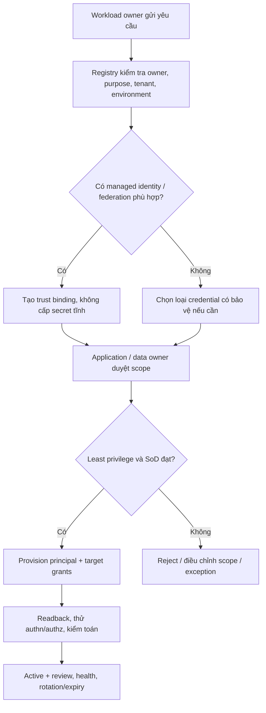
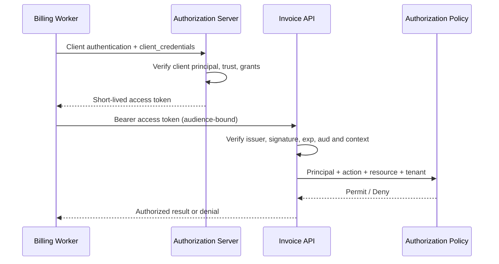
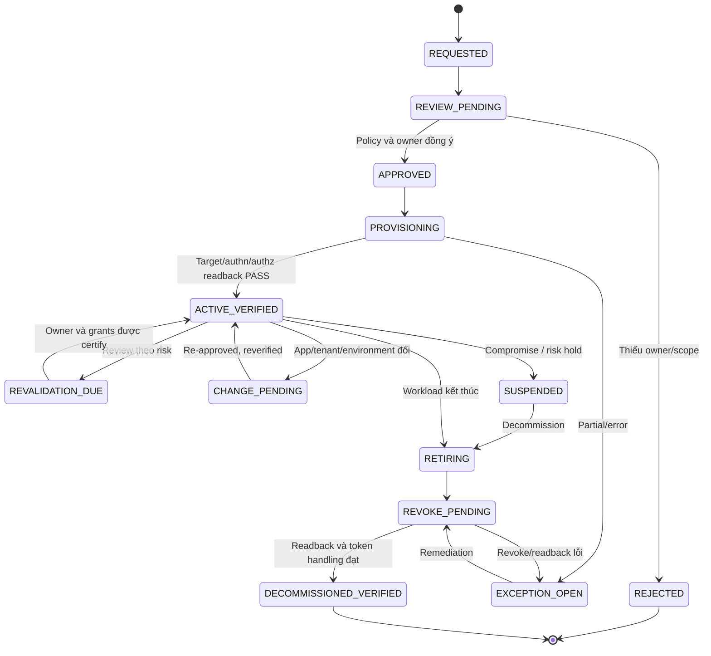

# Tài khoản dịch vụ chuyên biệt trong quản lý vòng đời danh tính IAM

## Mục tiêu học tập

Sau khi học xong bài này, người học có thể:

1. Giải thích **tài khoản dịch vụ chuyên biệt (dedicated service account)** là gì, phân biệt nó với tài khoản người dùng cá nhân, tài khoản dùng chung, **service principal**, **managed identity**, **workload identity**, tài khoản hệ điều hành và Kubernetes ServiceAccount.
2. Nêu được vì sao một **workload hoặc một mục đích tích hợp riêng** cần danh tính có thể định danh, có chủ sở hữu và phạm vi quyền riêng, thay vì tái sử dụng credential của nhân viên hay một account quản trị chung.
3. Thiết kế hồ sơ đăng ký service identity với **workload ID, owner team, sponsor, ứng dụng, môi trường, tenant, resource scope, authentication method, credential policy, lifecycle và bằng chứng**.
4. Vận dụng **least privilege**, **RBAC/ABAC**, resource scoping, token audience, workload attestation, secret management và thời hạn quyền để hạn chế blast radius.
5. Phân biệt **identity lifecycle**, **account lifecycle**, **credential lifecycle**, **grant lifecycle** và **session/token lifecycle** trong các hệ thống máy–máy.
6. Lựa chọn cơ chế xác thực phù hợp như **managed identity, workload federation, OAuth 2.0 client credentials, mTLS, chứng chỉ, secret trong vault** mà không chia sẻ password hoặc hard-code khóa.
7. Tích hợp quản lý service identity với **IdP, directory, IAM/IGA, SSO, SCIM, PAM và quản trị Joiner–Mover–Leaver** của những con người chịu trách nhiệm, nhưng không áp sai quy tắc nhân sự vào workload.
8. Thiết kế việc **rotate, revoke, decommission, reconcile, kiểm toán và xử lý sự cố** nhằm giảm tài khoản mồ côi, credential còn sống và quyền truy cập tồn dư.

## 1. Tài khoản dịch vụ chuyên biệt là gì?

**Tài khoản dịch vụ chuyên biệt** là một danh tính hoặc account được cấp **cho một ứng dụng, dịch vụ, tác vụ tự động hay một mục đích tích hợp được xác định rõ**, để hệ thống thực hiện hoạt động thay vì một con người đăng nhập trực tiếp. Trong từng nền tảng, nó có thể biểu hiện thành account của directory, service principal, identity của cloud, Kubernetes ServiceAccount, database login hoặc principal trong ứng dụng SaaS.

Từ **chuyên biệt** nhấn mạnh **sự tách biệt theo phạm vi trách nhiệm**: principal này không được tái sử dụng tùy tiện cho những workload không liên quan, không làm account cá nhân của nhân viên và không mặc nhiên có quyền quản trị toàn hệ thống.

Ví dụ công ty vận hành ba tác vụ:

- `billing-invoice-export` xuất hóa đơn đã duyệt sang kho dữ liệu.
- `customer-notification-worker` gửi thông báo giao dịch.
- `production-backup-job` sao lưu một tập dữ liệu theo lịch.

Thay vì để cả ba sử dụng account `svc-admin-shared` với quyền đọc/ghi tất cả cơ sở dữ liệu, mỗi tác vụ nên có **danh tính, cách xác thực, quyền và giới hạn tài nguyên phù hợp**. Nếu credential của worker thông báo bị lộ, attacker không nên mặc nhiên truy cập bản sao lưu hoặc có thể xuất hóa đơn.

### 1.1. Mô hình tư duy: identity, account, credential và permission

```text
Non-human identity (NHI)
    ├─ Workload/application identity
    │      └─ Một hoặc nhiều target account / principal
    │             └─ Authentication mechanism / credential
    │                    └─ Session / access token có thời hạn
    └─ Ownership, sponsor, environment và lifecycle

Authorization grant:
    Subject principal + Action + Resource scope + Conditions

Effective access:
    Grant hợp lệ + authentication tin cậy + policy hiện hành
    + target enforcement + không có revoke/security hold
```

Các lớp này **không phải một đối tượng duy nhất**. Một workload có thể có cloud managed identity và database login, hoặc một Kubernetes service account ánh xạ tới cloud identity qua federation. Chỉ thu hồi một credential chưa chắc đã thu hồi mọi đường truy cập.

### 1.2. Vì sao cần một tài khoản riêng?

| Lợi ích | Cơ chế | Rủi ro nếu dùng chung |
|---|---|---|
| **Attribution** | Event gắn tới workload principal cụ thể | Không phân biệt dịch vụ nào đã hành động |
| **Least privilege** | Cấp permission theo từng năng lực | Một account có union mọi quyền |
| **Isolation** | Workload A không tự có quyền của B | Compromise một dịch vụ ảnh hưởng nhiều hệ thống |
| **Credential rotation** | Quay vòng theo service mà không làm gián đoạn tất cả | Một secret đổi ảnh hưởng nhiều integration |
| **Revocation** | Chặn riêng ứng dụng đã bị compromise | Không thể revoke mà không gây outage diện rộng |
| **Ownership** | Một team chịu trách nhiệm account cụ thể | Không ai nhận trách nhiệm tài khoản mồ côi |
| **Audit** | Biết action/resource/tenant của từng principal | Log chỉ ghi `svc-shared` |
| **Lifecycle** | Decommission principal theo workload | Credential sống lâu hơn hệ thống nó phục vụ |

**Mức tách biệt phải gắn với trust boundary**. Không nhất thiết mỗi request hay mỗi replica ứng dụng tạo một account tồn tại lâu dài; có thể sử dụng **một logical workload identity** với token ngắn hạn được phát cho từng instance. Nhưng không nên gom nhiều ứng dụng khác owner, rủi ro hoặc tenant vào một principal lâu dài.

## 2. Phân biệt tài khoản dịch vụ và các loại danh tính khác

### 2.1. Bảng khái niệm

| Khái niệm | Mục đích | Ví dụ | Lưu ý |
|---|---|---|---|
| **Human user account** | Người sử dụng đăng nhập tương tác | `lan.nguyen` | Gắn HR Joiner–Mover–Leaver |
| **Shared human account** | Nhiều người dùng cùng credential | `admin-team` | Giảm attribution, nên tránh khi có thể |
| **Dedicated service account** | Một workload/mục đích tự động | `svc-billing-export` | Có owner, scope và lifecycle riêng |
| **Service principal** | Principal đại diện ứng dụng tại một IAM/IdP | `billing-api-client` | Tên/semantics phụ thuộc nhà cung cấp |
| **Cloud managed identity** | Identity được platform quản lý cho workload | Identity gắn compute/resource | Có thể không cần secret tĩnh do ứng dụng quản lý |
| **Workload identity** | Danh tính của chương trình/runtime | Identity pod, service, VM, job | Khái niệm rộng, không luôn là một account kiểu truyền thống |
| **Kubernetes ServiceAccount** | Kubernetes API identity của workload trong cluster | `invoice-worker-sa` | Không tự là cloud IAM role nếu thiếu mapping/federation |
| **OS service account** | Principal chạy process ở hệ điều hành | `svc-inventory` trên Linux/Windows | Có thể tách khỏi application/API identity |
| **Database service login** | Principal được database xác thực | `billing_reader` | Chỉ có scope trong DB theo cấu hình |
| **OAuth confidential client** | Client có khả năng bảo vệ phương thức xác thực theo ngữ cảnh | Backend API integration | Có thể dùng secret, private key hoặc mTLS |
| **Break-glass account** | Truy cập khẩn cấp có điều kiện | Emergency admin | Không nên dùng làm account cho job hàng ngày |

Một implementation có thể dùng nhiều loại cùng lúc. Ví dụ Java worker chạy dưới Linux service user, sử dụng Kubernetes ServiceAccount và lấy token cloud qua workload federation để đọc một bucket.

### 2.2. Service account có phải tài khoản “không có người sở hữu”?

Không. Nó **không đại diện cho một nhân viên đang thực hiện tương tác**, nhưng vẫn phải có:

- **Business owner/sponsor:** xác nhận lý do tồn tại và tác động tới nghiệp vụ.
- **Technical owner/team:** vận hành, rotate, xử lý sự cố, decommission.
- **Application/data owner:** phê duyệt quyền trên tài nguyên đích.
- **Risk/security owner:** quản trị trường hợp rủi ro cao và ngoại lệ.

Không nên ghi `owner=service-account` hay `owner=unknown` rồi xem như đã đáp ứng yêu cầu ownership.

### 2.3. Tài khoản chuyên biệt không đồng nghĩa tài khoản đặc quyền

Một account chuyên biệt có thể **chỉ đọc một queue**, hoặc có thể rất mạnh nếu được cấp quyền sai. Mục tiêu của dedicated identity là tách biệt và quản trị rõ; **least privilege** mới giới hạn điều nó được phép làm.

Service principal `backup-job` không mặc nhiên cần quyền `database.admin`. Có thể cần API backup, quyền ghi vào destination và capability khôi phục được tách riêng.

## 3. Các mô hình dedicated account thường gặp

### 3.1. Một tài khoản cho một workload và một môi trường

Ví dụ:

```text
svc-billing-export-dev
    → development dataset only

svc-billing-export-staging
    → staging dataset only

svc-billing-export-prod
    → approved production read/export scope

svc-customer-notification-prod
    → messaging API / notification scope only
```

Nếu dùng chung principal giữa development và production, một lộ lọt secret từ môi trường kiểm thử có thể leo lên production. Việc tách environment/account/tenant giúp hạn chế lateral movement.

### 3.2. Một identity logic, credential theo từng instance

Với managed identity hoặc workload federation, một service có thể dùng **logical workload principal** trong IAM nhưng mỗi instance nhận **token ngắn hạn** từ một authority đáng tin. Điều quan trọng là token gắn đúng **issuer, subject, audience, môi trường** và quyền đã được policy cho phép.

Không cần tự sinh secret cố định cho mọi pod nếu platform cung cấp phương thức identity ngắn hạn an toàn hơn.

### 3.3. Một principal cho một integration boundary

Nếu `erp-sync` gọi CRM và hệ thống kế toán, có thể phải có principal hoặc grant riêng cho từng API/tenant, để một backend không vô tình dùng token của đích A để gọi đích B. Dù cùng một ứng dụng, **audience-bound tokens** và scope theo tài nguyên vẫn cần thiết.

### 3.4. Những trường hợp cần nhiều service identity

- Các tenant có boundary hoặc owner khác nhau.
- Các dữ liệu có độ nhạy chênh lệch lớn.
- Các workload được deploy/vận hành bởi team độc lập.
- Production và development/staging.
- Quyền đọc dữ liệu và quyền quản trị infrastructure.
- Pipeline build và pipeline deploy.
- Dịch vụ xử lý secrets và dịch vụ phát thông báo.
- Công việc khẩn cấp tạm thời và công việc định kỳ.

Không mặc định một account được phép thay mặt **mọi microservice** chỉ vì chúng cùng nằm trong một Kubernetes namespace hoặc monorepo.

## 4. Threat model: tài khoản dịch vụ bị lạm dụng như thế nào?

### 4.1. Các nguy cơ điển hình

| Nguy cơ | Kịch bản | Biện pháp trọng tâm |
|---|---|---|
| Credential bị lộ | Secret hard-code trong repo hoặc log | Federation/managed identity, secret scanning, rotate |
| Quyền quá rộng | Worker có `*:*` trên cloud | Resource-scoped roles, permission review |
| Secret sống lâu | API key cũ chưa revoke sau thay đổi | Expiry, rotation, inventory |
| Account dùng chung | Nhiều team dùng `svc-global` | Tách principal và owner |
| Interactive login | Credential service bị dùng đăng nhập console | Chặn login tương tác khi không cần |
| Lateral movement | Token service A gọi hệ thống B | Audience/scope/tenant restriction |
| Confused deputy | User ít quyền dụ service quyền cao thực hiện thay | End-user + service authorization context |
| Stale permission | Workload đổi mục đích nhưng role cũ còn | Mover-like re-evaluation, reconciliation |
| Orphan service principal | Project dừng nhưng account vẫn active | Ownership + decommission |
| Untrusted runtime | Kẻ tấn công chạy workload giả mạo để lấy token | Workload attestation, issuer/subject binding |
| Token replay | Token bị lấy cắp và phát lại | TTL, audience, holder-of-key khi phù hợp |
| Overprivileged CI | Pipeline có cả build, approve và deploy | SoD, protected pipeline, separated principals |
| Human departure | Chủ sở hữu nghỉ, biết secret tĩnh | Transfer ownership, rotate/revoke affected credentials |

Một quyền mạnh nhất định có thể cần cho nghiệp vụ; nhiệm vụ quản trị là xác định **mức tin cậy cần thiết và giới hạn blast radius**, không chỉ đặt tên account bắt đầu bằng `svc-`.

### 4.2. Những giả định dễ sai

- “Không phải người nên không bị phishing”: secret có thể bị lộ qua code, ticket, CI log hoặc laptop của developer.
- “Token chỉ sống 10 phút nên entitlement an toàn”: workload có thể liên tục xin token mới nếu grant còn rộng.
- “Đã tắt account ở directory nên mọi session kết thúc”: app-local token, database connection hoặc key có thể còn hoạt động.
- “Service nằm trong nội bộ nên không cần authorization”: service-to-service call vẫn có thể bị chiếm quyền hoặc bị lợi dụng.
- “Cùng team nên dùng chung secret cho tiện”: khó phân biệt hành động, rotate và thu hồi.
- “Có MFA cho người quản trị nghĩa là API service đã an toàn”: máy–máy cần phương thức xác thực và authorization riêng.

## 5. Đăng ký service identity trong IAM/IGA

Mọi dedicated account nên được quản trị như một **asset có identity record** thay vì một username do developer tự tạo rồi bỏ quên.

### 5.1. Metadata tối thiểu

| Trường | Ý nghĩa |
|---|---|
| `serviceIdentityId` | Định danh NHI ổn định trong registry |
| `principalId` / `accountId` | ID thực tại IdP, cloud, directory hoặc target |
| `displayName` / `technicalName` | Tên có nghĩa, không dùng làm khóa duy nhất |
| `serviceName` / `workloadId` | Ứng dụng, job, pipeline được sở hữu |
| `businessPurpose` | Lý do nghiệp vụ cần identity |
| `businessOwner` / `sponsor` | Chịu trách nhiệm chính sách/nhu cầu |
| `technicalOwnerTeam` | Đơn vị vận hành và xử lý sự cố |
| `applicationOwner` / `dataOwner` | Người duyệt quyền tài nguyên |
| `environment` / `tenantId` | Trust boundary, nơi chạy |
| `targetSystems` | API, database, queue, storage cần truy cập |
| `permissionGrants` | Actions, roles, scopes đã duyệt |
| `authMethod` | Federation, managed identity, mTLS, certificate, secret |
| `credentialReference` | Tham chiếu vault/identity provider, không lưu secret |
| `lifecycleState` | Requested, Active, Suspended, Retiring, Decommissioned |
| `createdAt` / `lastAttestedAt` | Truy vết vòng đời |
| `reviewDueAt` / `expiry` | Hạn review và grant/credential expiry |
| `riskClass` / `policyVersion` | Phân loại rủi ro và quy định áp dụng |
| `provisioningEvidence` / `readbackEvidence` | Bằng chứng đã tạo/gỡ đúng |
| `incidentAndRotationRunbook` | Xử lý khi account/secret bị lộ |

Tổ chức có thể có nhiều bản ghi target account cho cùng một logical service identity. Cần **stable correlation** giữa chúng.

### 5.2. Hồ sơ mẫu

```json
{
  "serviceIdentityId": "NHI-00921",
  "workloadId": "billing-invoice-export",
  "purpose": "Export approved invoices to analytics",
  "owner": {
    "businessSponsor": "FINANCE-DATA-OWNER",
    "technicalTeam": "FINANCE-PLATFORM"
  },
  "environment": "PRODUCTION",
  "tenantId": "corp-vn",
  "authentication": {
    "method": "WORKLOAD_FEDERATION",
    "issuerPolicyId": "trusted-cluster-issuer",
    "subjectBinding": "namespace:billing/serviceaccount:invoice-export",
    "credentialStorage": "NO_STATIC_SECRET"
  },
  "targetGrants": [
    {
      "target": "INVOICE_API",
      "actions": ["invoice.read_approved"],
      "resourceScope": ["TENANT-VN"],
      "policyVersion": "invoice-export-v4"
    }
  ],
  "lifecycleState": "ACTIVE",
  "reviewDueAt": "2027-01-15T00:00:00Z",
  "riskClass": "HIGH"
}
```

Đây là **schema minh họa nội bộ**, không phải định dạng chuẩn SCIM, OAuth/OIDC hoặc một cloud IAM cụ thể. `reviewDueAt` và tên principal trong ví dụ chỉ minh họa; tổ chức tự quyết định tần suất theo risk.

### 5.3. Đừng gắn owner vào một email cá nhân duy nhất

Nếu record có `owner=lan@example.org` mà Lan Leaver, account có thể trở thành orphan. Nên dùng:

- Owner **team/group** có trách nhiệm.
- Business sponsor theo role chức năng.
- Backup owner hoặc escalation route.
- Danh sách người có quyền vận hành từ IAM.
- Workflow **transfer ownership** khi con người Mover/Leaver.

Email cá nhân có thể là một contact, nhưng **không phải nguồn thẩm quyền duy nhất**.

## 6. Quy trình yêu cầu tạo tài khoản dịch vụ chuyên biệt

### 6.1. Trình tự đề xuất

1. Đăng ký workload và mục đích nghiệp vụ.
2. Xác định owner, sponsor, target systems, environment và tenant.
3. Đánh giá đã có managed identity/federation phù hợp chưa.
4. Định nghĩa permission/action/resource scope tối thiểu.
5. Phân loại risk và kiểm tra SoD, điều kiện workload và thời hạn.
6. Phê duyệt bởi application/data owner và risk owner khi cần.
7. Tạo principal/account riêng qua quy trình có kiểm soát.
8. Cấu hình authentication method và secret/vault/federation trust.
9. Provision grants từ source có authority.
10. Readback account, role, policy, auth settings.
11. Thử xác thực/authorization bằng workload được phép trong môi trường an toàn.
12. Lưu evidence, thiết lập monitoring, rotation/review và decommission plan.

### 6.2. Sơ đồ cấp service identity



Không phải mọi hệ thống đều hỗ trợ federation; cũng không mặc định tạo service account trong IdP là bước bắt buộc nếu workload có identity native được quản trị tốt. Mục tiêu là **đúng trust boundary và quyền tối thiểu**, không nhân bản account không cần thiết.

### 6.3. Approval không tự tạo quyền

Cần phân biệt:

```text
REQUEST_APPROVED
  → principal_created?
  → authentication_binding_configured?
  → permission_grant_applied?
  → target_state_readback?
  → runtime authorization verified?
```

Nếu một bước lỗi, không báo “ready for production” chỉ vì ticket đã được phê duyệt.

## 7. Chọn phương thức xác thực cho tài khoản dịch vụ

### 7.1. Ưu tiên giảm secret tĩnh

Khi nền tảng hỗ trợ, **managed identity hoặc workload identity federation** thường giúp giảm việc ứng dụng phải cất một secret dài hạn. Thay vì copy password/API key vào file cấu hình, runtime nhận credential ngắn hạn gắn với identity được nền tảng xác minh.

Không có cơ chế nào tự động an toàn tuyệt đối: federation sai audience/subject, metadata endpoint bị lộ, role quá rộng hoặc runtime bị compromise vẫn gây rủi ro.

### 7.2. So sánh phương thức

| Phương thức | Cách vận hành | Cần chú ý |
|---|---|---|
| **Managed identity** | Platform cấp identity/token cho resource được quản trị | Scope grant, trust runtime, token caching |
| **Workload federation/OIDC** | Workload trình token/attestation tin cậy cho authority khác | Issuer, subject, audience, replay/expiry |
| **OAuth 2.0 client credentials** | Client xin access token dưới danh tính riêng | Client authentication, scope/audience, không có end-user |
| **mTLS client certificate** | Xác thực client bằng chứng chỉ và khóa riêng | PKI, SAN/subject binding, rotation, revocation |
| **Private-key JWT client authentication** | Client chứng minh sở hữu private key bằng assertion | Key storage, `iss/sub/aud/jti/exp` checks |
| **Vault-managed API secret** | Secret lưu trong vault, inject theo danh tính runtime | Rotation, audit, secret exposure, revoke |
| **Directory service account password** | Account domain/local với password | Cấm interactive nếu có thể, vault/rotation, scope |
| **Managed service account (nền tảng hỗ trợ)** | Platform/OS quản lý credential của service | Supported hosts, SPN/delegation/scope |
| **Static API key** | Khóa được gán cho client/integration | Không tự có audience hoặc expiry; giảm dùng khi có lựa chọn tốt hơn |

**Không dùng username/password của nhân viên cho máy–máy**. Khi người đó đổi mật khẩu hoặc Leaver, integration có thể đứt; đồng thời hành động của bot bị ghi như người dùng thật.

### 7.3. OAuth 2.0 client credentials

Trong client credentials, client được xác thực với authorization server và nhận access token theo grant và policy. Không có end-user login trong flow này.



Một request HTTP minh họa, **không có secret thật**:

```http
POST /oauth2/token HTTP/1.1
Host: idp.example.org
Content-Type: application/x-www-form-urlencoded

grant_type=client_credentials&scope=invoice.read_approved
```

Request trên **chỉ minh họa grant parameters**, chưa thể dùng để xác thực client một cách đầy đủ; phương thức client authentication như mTLS, private-key JWT hoặc secret phải được áp dụng theo cấu hình authorization server qua kênh bảo mật. Không truyền client secret trong tài liệu/log.

### 7.4. Token của service không phải token của người dùng

Một access token theo client credentials thể hiện quyền được cấp cho **client/service principal**, không mặc nhiên thể hiện ủy quyền của người dùng cuối.

Nếu service thực hiện hành động **on behalf of user**, API phải có mô hình delegated access rõ:

- Người dùng đã được xác thực và ủy quyền thế nào?
- Service có quyền thực thi action đó không?
- Có ràng buộc tenant/resource và audience không?
- Có cần token exchange hoặc delegated scopes theo platform không?
- Có chống confused deputy và impersonation không?

Không được dùng token mạnh của backend để nâng quyền mọi request từ user yếu quyền.

## 8. Workload identity federation: định danh đúng runtime

### 8.1. Các trường cần ràng buộc

Một trust policy cho workload thường cần xác minh:

- **Issuer:** ai phát bằng chứng về workload?
- **Subject:** workload/service account/repository/job nào?
- **Audience:** token dành cho authorization server hay dịch vụ nào?
- **Expiry và issued time:** có trong cửa sổ hợp lệ không?
- **Signature và trusted keys:** token được xác minh đúng không?
- **Environment/tenant:** workload production và staging được phân biệt không?
- **Runtime metadata/attestation:** nguồn có đủ tin cậy không?
- **Allowlist:** những subject được chấp nhận có cụ thể không?

Một cấu hình sai kiểu “chấp nhận mọi subject từ issuer công khai” có thể khiến job không liên quan đổi token lấy quyền production.

### 8.2. Pseudocode trust policy

```text
allowFederation(token) when
    token.issuer == TRUSTED_WORKLOAD_ISSUER
    AND token.audience == EXPECTED_TOKEN_EXCHANGE_AUDIENCE
    AND token.subject == "namespace:billing/serviceaccount:invoice-export"
    AND token.notExpired
    AND token.signatureVerified
    AND token.environmentBinding == PRODUCTION
    AND targetServiceIdentity == "NHI-00921"
```

Đây là mô hình ý tưởng, **không phải cú pháp chung** của AWS, Azure, Google Cloud, Kubernetes hoặc OPA. Chính xác trường claim và trust configuration phải theo sản phẩm được dùng.

### 8.3. Ngăn token cross-environment

```text
Staging:
  issuer/subject/audience phù hợp staging.
  Grant chỉ cho dataset staging.

Production:
  trust riêng cho runtime được phép production.
  Grant hẹp trên production target.

Rule:
  staging token không đổi lấy production privileged token.
```

Một credential/tokens do một platform cấp có thể vẫn mang claim hợp lệ nhưng không đủ điều kiện cho target khác. **Audience và resource authorization** cần kiểm tra độc lập.

## 9. Tài khoản dịch vụ tại hệ điều hành, database và Kubernetes

### 9.1. Linux service user

Một process có thể chạy dưới một **system user riêng** với quyền filesystem/network cần thiết:

```text
Process: billing-export-worker
OS principal: svc-billing-export
Filesystem:
    read-only access to necessary config
    write access only to dedicated working directory
Network:
    egress only to authorized API / log sink
Application credential:
    workload federation or vault reference
```

Không phải cứ chạy dưới non-root là hoàn tất security. Cần giới hạn filesystem, capabilities, kernel privileges, network, secret injection và system service permissions theo môi trường.

### 9.2. Windows service identity

Trong môi trường Windows/AD, có thể dùng **managed service accounts** hoặc principal phù hợp do platform quản lý credential. Cần xem xét host restrictions, SPN, delegation, logon rights và quyền tài nguyên.

Không dùng account domain admin để chạy một Windows service thông thường. Nếu service cần truy cập một share, hãy cấp quyền trên share và NTFS phù hợp thay vì thêm vào Domain Admins.

### 9.3. Database service login

Một job chỉ đọc báo cáo nên được cấp:

```text
Principal: billing-report-reader
Authentication: managed/federated identity if supported
Database: finance_reporting
Permissions:
    SELECT on approved views
Forbidden:
    CREATE USER / ALTER ROLE / DROP TABLE
    write transaction data
    read unrelated HR tables
```

Database login và application identity cần được correlation để truy vết; không nhất thiết cùng tên. Có thể áp row-level security hoặc ABAC logic để giới hạn tenant/branch.

### 9.4. Kubernetes ServiceAccount

Trong Kubernetes, mỗi namespace có thể có **ServiceAccount** chuyên biệt cho workload truy cập Kubernetes API. Pod có thể khai báo nó bằng `serviceAccountName`.

Ví dụ chỉ tạo ServiceAccount và một pod **không cần truy cập Kubernetes API**, nên không tự mount credential API:

```yaml
apiVersion: v1
kind: ServiceAccount
metadata:
  name: invoice-export
  namespace: billing
automountServiceAccountToken: false
---
apiVersion: v1
kind: Pod
metadata:
  name: invoice-export-demo
  namespace: billing
spec:
  serviceAccountName: invoice-export
  automountServiceAccountToken: false
  containers:
    - name: worker
      image: registry.example.org/billing/invoice-export:1.0.0
      resources:
        requests:
          cpu: "100m"
          memory: "128Mi"
        limits:
          memory: "256Mi"
```

Đây là **manifest minh họa**, không phải deployment production hoàn chỉnh. Container image, admission control, supply chain, securityContext, network policy, egress và secret handling cần thiết kế riêng.

Nếu cần Kubernetes API token hoặc cloud workload federation, **không thể đồng thời vô hiệu mount token rồi giả định SDK vẫn tự nhận được token**. Phải dùng cơ chế projected short-lived service account token hoặc binding cụ thể theo platform, với audience và trust policy thích hợp.

### 9.5. Không dùng default ServiceAccount cho mọi workload

Nếu nhiều pod cùng dùng default ServiceAccount và nó có quyền API rộng, compromise một pod có thể lạm dụng quyền của các pod khác.

Nên:

- ServiceAccount riêng theo workload/trust boundary khi cần.
- RBAC `Role`/`RoleBinding` hẹp trong namespace.
- Không tùy tiện dùng cluster-admin hoặc `ClusterRoleBinding` rộng.
- Cân nhắc `automountServiceAccountToken: false` cho workload không dùng API.
- Rà soát workload federation mapping ra cloud IAM.
- Theo dõi token audience, projected token TTL và event.

**Kubernetes ServiceAccount không phải tự động là identity của mọi database/cloud API**; cần trust binding và permission tương ứng.

## 10. Thiết kế quyền chuyên biệt bằng least privilege

### 10.1. Ma trận quyền theo tác vụ

| Workload | Quyền cần | Không nên có |
|---|---|---|
| Invoice export worker | Đọc hóa đơn đã duyệt, ghi một data sink | Payment approve, IAM admin |
| Notification service | Gửi message tới một queue/API | Đọc payroll, sửa customer master |
| Backup job | Tạo backup trên resource được chỉ định | Xóa backup lịch sử không kiểm soát |
| ETL transform | Đọc source dataset, ghi staging dataset | Query mọi schema production |
| Deploy bot | Deploy artifact đã được phê duyệt vào môi trường cụ thể | Sửa source và tự duyệt release |
| Health check | Đọc health/status endpoint | Secrets read, admin write |
| Finance integration | Đọc report đã được phép | Chuyển tiền hoặc tạo user |
| Secret rotation worker | Rotate một tập secret được sở hữu | Truy cập mọi secret toàn tổ chức |

### 10.2. Gắn quyền với action, resource, tenant và thời gian

```text
Allow when:
  serviceIdentityId == NHI-00921
  action == invoice.read_approved
  resource.tenantId == TENANT-VN
  resource.classification within approved scope
  service.lifecycleState == ACTIVE
  grant still valid
  caller token issuer/audience/expiry valid
  workload environment binding matches PRODUCTION
  no security hold or revoke
```

RBAC cung cấp permission qua role, ABAC có thể kiểm tra **tenant, resource, classification, time, environment**. Cần có PEP ở API, không chỉ ẩn endpoint khỏi network.

### 10.3. SoD giữa các workload

Một pipeline build artifact không nên tự sửa production IAM policy rồi deploy mà không có gate độc lập. Có thể tách:

- **Build identity:** đọc source, build, sign artifact theo quyền phù hợp.
- **Release approval identity:** phê duyệt artifact/version.
- **Deployment identity:** chỉ deploy artifact đã duyệt vào environment cụ thể.
- **Audit identity:** ghi/đọc log theo quyền riêng, không cùng quyền sửa log.

Không nhất thiết mỗi bước có một account tĩnh, nhưng các **khả năng xung đột** phải được phân tách bằng IAM và policy enforcement.

### 10.4. Không để principal tự cấp quyền cho mình

Một service principal có `iam.role.assign` trên chính nó có thể tự mở rộng quyền. Kiểm soát:

- Role assignment chỉ qua pipeline/IAM owner đã duyệt.
- Tách account quản trị identity khỏi runtime service.
- Policy/approval và audit bất biến.
- Gắn quyền cụ thể cho target/resource, không cho toàn tenant khi không cần.
- Alert nếu service principal có khả năng sửa policy hoặc cấp role.

## 11. Mẫu authorization theo RBAC/ABAC và principal type

Một PDP có thể nhận request như:

```json
{
  "subject": {
    "type": "WORKLOAD",
    "serviceIdentityId": "NHI-00921",
    "principalId": "SPN-BILLING-EXPORT",
    "environment": "PRODUCTION",
    "ownerTeam": "FINANCE-PLATFORM",
    "lifecycleState": "ACTIVE"
  },
  "action": "invoice.read_approved",
  "resource": {
    "tenantId": "TENANT-VN",
    "invoiceState": "APPROVED",
    "classification": "INTERNAL"
  },
  "context": {
    "credentialType": "FEDERATED_ACCESS_TOKEN",
    "audience": "INVOICE_API",
    "policyVersion": "invoice-export-v4"
  }
}
```

PDP/PEP phải lấy thuộc tính từ **nguồn đáng tin**; không nhận một JSON do client tự khai `lifecycleState=ACTIVE` rồi cấp quyền.

### 11.1. Phân biệt HUMAN và WORKLOAD

```text
If subject.type == HUMAN:
    check authoritative HR/contractor lifecycle,
          human account, MFA/SoD, entitlement.

If subject.type == WORKLOAD:
    check workload registry lifecycle,
          deployment/owner/trust binding,
          target grant, credential provenance.

Always:
    check action, resource scope, tenant, security hold,
          policy version, token validation, runtime enforcement.
```

Một service không có employment status; không được tạo HR record giả rồi dùng Joiner của con người để đánh giá nó. Tuy nhiên cả human và NHI đều cần **đúng owner, đúng quyền, đúng thời gian và thu hồi khi mất điều kiện**.

### 11.2. Policy không được fail open

Nếu PIP không lấy được trạng thái workload, metadata không chứng minh được principal hoặc PDP timeout, một hành động nhạy cảm phải **không được Permit** theo chính sách fail closed.

Không tự cho phép vì “đây là service nội bộ” hoặc “API cần hoạt động 24/7”. Với yêu cầu availability, hãy thiết kế cache/fallback có giới hạn và được phê duyệt trước, không mặc định `allow all`.

## 12. Vòng đời tài khoản dịch vụ: Request–Activate–Operate–Change–Retire

Service identity có vòng đời riêng, tương tự ý tưởng JML nhưng **không đồng nhất với hồ sơ nhân sự**.

### 12.1. State machine minh họa



Các trạng thái là **mô hình nội bộ minh họa**, không phải SCIM status chuẩn. Một account có thể vẫn tồn tại để lưu audit hoặc pháp lý sau decommission nhưng phải **không còn quyền tương tác**.

### 12.2. Lúc tạo mới

Đánh giá:

- Workload có thực tồn tại trong service catalog không?
- Có principal đã tồn tại cho cùng mục đích và đúng boundary không?
- Application/data owner đã duyệt permission/scope?
- Cơ chế authentication có phù hợp runtime?
- Có risk/SoD conflict hoặc quyền admin không cần thiết?
- Có expiry/review và decommission owner?
- Có runbook xử lý credential bị lộ?

### 12.3. Khi workload thay đổi

Một job ban đầu chỉ đọc hóa đơn được mở rộng thêm khả năng ghi sang hệ thống kế toán. Đây là **thay đổi mục đích và permission**, cần:

1. Ghi thay đổi mục đích/owner.
2. Đánh giá lại dữ liệu và scope.
3. Approval theo entitlement mới.
4. Bảo đảm không tích lũy grant cũ không còn cần.
5. Đánh giá credential trust binding có còn đúng.
6. Cập nhật monitoring và rotation.
7. Readback effective permission tại target.

Không thêm `write:*` vào account cũ chỉ vì developer thấy lỗi 403.

### 12.4. Khi workload dừng

Nếu service nghỉ hoạt động, cần:

- Ngừng phát hành credential/token mới.
- Thu hồi grants/roles/groups và resource ACL.
- Revoke secret/chứng chỉ/API key hoặc trust policy.
- Chặn app-local account/session và unmanaged credentials.
- Gỡ các binding trong CI/CD, Kubernetes/cloud phù hợp.
- Đọc lại target state, ghi exception nếu không xác minh được.
- Giữ audit record và ownership/decommission evidence theo retention.

## 13. Liên hệ Joiner–Mover–Leaver của người sở hữu

### 13.1. Người phụ trách Joiner

Nhân viên mới vào team có thể được cấp quyền **vận hành một service account**, nhưng không có nghĩa họ tự được cấp quyền API của workload cho chính account người dùng.

Ví dụ một engineer được phép deploy và xem log của `billing-export`. Engineer có quyền quản trị bằng account của họ; workload có principal riêng. Hai đối tượng phải được audit riêng.

### 13.2. Người phụ trách Mover

Khi owner chuyển team:

- Gỡ quyền cá nhân để quản lý secret/credential của workload nếu không còn phù hợp.
- Chuyển ownership và on-call responsibility.
- Kiểm tra các secret từng được biết hoặc download.
- Đánh giá có cần rotate, reissue hoặc thu hồi grant không.
- Đối soát delegated approval/role của owner cũ.
- **Không tự disable service account** nếu workload vẫn có business owner mới và còn phục vụ nghiệp vụ.

### 13.3. Người phụ trách Leaver

Khi người giữ secret hoặc owner rời tổ chức:

1. Revoke human account, admin access, personal tokens.
2. Xác minh ownership của workload và transfer trách nhiệm.
3. Xác định credentials nào người nghỉ từng có khả năng biết.
4. Rotate/revoke credential theo risk, không chỉ đổi tên owner.
5. Kiểm tra quyền deploy, vault access, CI/CD secret variables và PAM grants.
6. Xác minh service vẫn hoạt động an toàn hoặc lên kế hoạch decommission.
7. Ghi evidence từng bước, không để account trở thành orphan.

**Không lấy sự kiện Leaver của con người làm trigger xóa vô điều kiện mọi workload họ từng tạo**, vì có thể làm dừng dịch vụ thiết yếu. Nhưng quyền của con người và mọi credential bị lộ phải được thu hồi theo policy.

### 13.4. Rehire và contractor

Người được tuyển lại không tự nhận quyền quản lý workload cũ. Cần cấp lại theo vai trò hiện tại, xét SoD và owner approval.

Contractor có thể vận hành integration trong thời hạn hợp đồng; khi hợp đồng kết thúc, **quyền cá nhân, vault access và credential đã biết** phải được xử lý, còn workload tiếp tục hay dừng dựa trên owner và nhu cầu nghiệp vụ.

## 14. Quản lý credential của tài khoản dịch vụ

### 14.1. Credential lifetime khác account lifetime

| Lớp | Ví dụ | Khi đổi/hết hạn |
|---|---|---|
| Service identity | `NHI-00921` | Vẫn tồn tại nếu workload còn cần |
| Target account | Database login, cloud principal | Có thể giữ hoặc decommission riêng |
| Credential | Client secret, private key, certificate | Rotate/revoke, cấp credential mới |
| Grant/entitlement | `invoice.read_approved` | Reapprove, giảm scope hoặc revoke |
| Access token | Token OAuth short-lived | Expire/revoke/introspection theo nền tảng |
| Session/connection | DB connection, PAM session | Terminate hoặc refresh state |

Không coi `token.exp` ngắn là bằng chứng grant sẽ tự mất sau thời gian đó. Workload có thể tiếp tục lấy token mới nếu identity/grant còn hợp lệ.

### 14.2. Không hard-code secrets

Tránh:

```java
// Ví dụ SAI: không đặt secret thật trong source code.
String clientSecret = "hardcoded-secret";
```

Thay vào đó có thể dùng:

- Managed identity/federation không cần lưu secret tĩnh.
- Vault và SDK được cấp quyền theo runtime identity.
- Secret injection qua mechanism quản trị, không lưu plaintext trong repo.
- Secrets rotation và access logging.
- CI pipeline dùng secret reference/temporary credential.
- Không log environment chứa secrets hoặc token.
- Rà soát container image, history và artifact build.

### 14.3. Rotation và secret overlap

Một số ứng dụng hỗ trợ chạy song song secret cũ/mới trong cửa sổ chuyển đổi để tránh downtime.

```text
1. Tạo credential mới theo policy.
2. Cập nhật workload qua vault/identity provider.
3. Thử xác thực mới ở môi trường an toàn.
4. Chuyển production sang credential mới.
5. Đảm bảo không còn instance dùng credential cũ.
6. Revoke credential cũ theo cutover/expiry.
7. Readback trạng thái credential và log sử dụng.
```

Cửa sổ overlap phải giới hạn; không để “secret dự phòng” sống vô thời hạn. Khi có **compromise**, kế hoạch phản ứng có thể phải revoke ngay thay vì overlap theo lịch thông thường.

### 14.4. Certificate, key và mTLS

Với client certificate:

- Private key phải được bảo vệ tại runtime/HSM/vault theo risk.
- Chứng chỉ phải có subject/SAN/trust chain theo chính sách.
- API xác minh client certificate, issuer và mapping principal.
- Cần expiry/rotation và xử lý revocation.
- Không cho mọi certificate từ một CA dùng quyền như nhau.
- Một cert có thể bị copy; việc dùng mTLS không tự chứng minh workload runtime an toàn.

Khi chọn mTLS, cần phân biệt **xác thực kênh/client** với **quyền được thao tác resource**.

## 15. Secrets Manager/Vault và quyền sử dụng secret

Một secret vault không giải quyết được vấn đề nếu mọi workload đều có quyền `secrets.read_all`.

### 15.1. Quyền vault tối thiểu

Ví dụ:

```text
Workload:
  billing-invoice-export

Vault policy:
  read only: secret/billing/invoice-api-credential
  cannot list entire vault
  cannot rotate unrelated secrets
  cannot change vault access policy

Owner:
  Finance Platform

Audit:
  secret access event + workload principal + reason/context
```

Có thể thiết kế dynamic secrets hoặc credential ngắn hạn khi platform hỗ trợ, giảm secret tĩnh.

### 15.2. Secret injection

Khi đưa secret vào container/VM:

- Không in giá trị ra log và không gửi trong telemetry.
- Tránh truyền qua command-line arguments dễ bị process listing thu thập.
- Dùng permission filesystem/volume/memory phù hợp.
- Thiết lập cách reload khi rotation.
- Bảo đảm crash dump và debug endpoint không tiết lộ bí mật.
- Không cho mọi pod trong namespace đọc cùng secret nếu không cần.

### 15.3. Những trường hợp vault chưa đủ

- Secret đã bị copy ra ngoài vault.
- Client còn có session/token hợp lệ.
- Vault ACL sai và account khác đọc được.
- Secret rotation không cập nhật downstream.
- Application chấp nhận credential cũ dù vault đã xóa.
- Nhân viên Leaver vẫn có bản copy secret.

Cần đo **effective access ở target**, không chỉ trạng thái trong vault.

## 16. Policy mẫu cho dedicated service identity

Cấu hình YAML sau **chỉ là mô hình kiểm soát để học**, không phải file có thể chạy trực tiếp trong một IdP, SCIM, cloud IAM, Kubernetes admission policy hoặc Spring Security.

```yaml
policyId: dedicated-service-identity-v4
owner: IDENTITY-SECURITY
appliesTo:
  subjectType: WORKLOAD

registration:
  requireStableServiceIdentityId: true
  requireBusinessSponsor: true
  requireTechnicalOwnerTeam: true
  requireWorkloadPurpose: true
  requireEnvironmentAndTenant: true
  requireTargetDataOwnerApproval: true
  rejectUnknownOrInactiveOwners: true

authentication:
  preferred:
    - MANAGED_IDENTITY
    - WORKLOAD_FEDERATION
    - MTLS_OR_KEY_BASED_CLIENT_AUTH
  staticSecretOnlyWhenJustified: true
  prohibitPersonalHumanCredentials: true
  prohibitUnmanagedSharedSecrets: true
  interactiveLogin: DISABLED_UNLESS_EXPLICIT_EXCEPTION
  requireIssuerSubjectAudienceBinding: true
  requireCredentialRotationPlan: true

authorization:
  leastPrivilege: true
  requireActionResourceTenantScope: true
  evaluateCurrentGrantAtUse: true
  requireWorkloadLifecycleActive: true
  prohibitSelfGrantingPrivilege: true
  denyIfCriticalAttributeMissing: true
  denyCrossEnvironmentAccess: true

lifecycle:
  reviewOnOwnerOrPurposeChange: true
  reviewOnScopeChange: true
  decommissionWhenWorkloadRetired: true
  handleHumanOwnerMoverLeaver: true
  revokeCredentialsAndGrantsOnCompromise: true
  requireTargetReadback: true

governance:
  riskBasedRecertification: true
  auditTargetActions: true
  requireExceptionOwnerAndExpiry: true
  maintainOrphanAccountInventory: true
```

Ngữ nghĩa các giá trị như `MANAGED_IDENTITY` và `DISABLED_UNLESS_EXPLICIT_EXCEPTION` cần được mapping thành kiểm soát thật trên nền tảng được chọn.

### 16.1. Runtime authorization pseudocode

```text
function authorizeWorkloadCall(token, action, resource):
    principal = verifyTokenSignatureIssuerAudienceExpiry(token)
    if principal.type != WORKLOAD:
        return DENY("PRINCIPAL_TYPE_MISMATCH")

    service = lookupCurrentServiceIdentity(principal.stableId)
    if service is missing or service.state != ACTIVE:
        return DENY("SERVICE_NOT_ACTIVE")

    if not trustedRuntimeBindingMatches(principal, service):
        return DENY("WORKLOAD_BINDING_MISMATCH")

    grant = lookupCurrentApprovedGrant(
        service.id, action, resource.tenantId
    )

    if grant is missing or grant.expiredOrRevoked:
        return DENY("NO_EFFECTIVE_GRANT")

    if not grant.resourceScope.includes(resource):
        return DENY("RESOURCE_OUTSIDE_SCOPE")

    if service.securityHold or policyCannotBeEvaluated:
        return DENY_OR_INDETERMINATE_WITH_NO_ENFORCEMENT

    return PERMIT_WITH_REQUIRED_AUDIT
```

Đây là pseudocode mô hình hóa kiểm soát, không phải API có thể biên dịch. Với mọi quyết định nhạy cảm, PEP không cho thao tác nếu không có **Permit hợp lệ** và các obligations bắt buộc chưa được đáp ứng.

## 17. Java/Spring: sử dụng credential của workload mà không nhúng bí mật

Một Java service có thể dùng **SDK identity/provider** của nền tảng để lấy access token cho API. Đoạn dưới minh họa cách tách nguồn credential khỏi business code:

```java
// Pseudocode Java-oriented. IdentityProvider, Token và InvoiceApiClient
// là interface minh họa, không phải lớp có sẵn của Spring.
public final class InvoiceExportWorker {
    private final WorkloadIdentityProvider identityProvider;
    private final InvoiceApiClient invoiceApi;

    public InvoiceExportWorker(
            WorkloadIdentityProvider identityProvider,
            InvoiceApiClient invoiceApi) {
        this.identityProvider = identityProvider;
        this.invoiceApi = invoiceApi;
    }

    public void exportApprovedInvoices(String tenantId) {
        // Runtime identity provider quyết định cách xác thực workload.
        // Không hard-code password/client_secret ở business code.
        AccessToken token = identityProvider.getToken(
            "INVOICE_API",
            "invoice.read_approved"
        );

        invoiceApi.exportApprovedInvoices(tenantId, token);
    }
}
```

### 17.1. Điều cần kiểm tra thêm

- Token provider có xác minh đúng runtime identity/issuer/subject không?
- Token có đúng audience `INVOICE_API` không?
- Service principal có grant theo tenant và action đủ hẹp không?
- API có kiểm tra resource authorization không?
- Có cache/retry token theo TTL và lỗi an toàn không?
- Token không bị log hoặc chèn vào URL/query string.
- Có xử lý Mover của workload và revoke current grants?
- Credential được refresh khi rotate mà không cần hard-code lại?

### 17.2. Bảo vệ API đích

Không đủ để Java worker lấy được token. API đích phải:

```text
Verify token:
    issuer / signature / exp / nbf / audience
Resolve principal:
    stable service identity and environment
Authorize:
    action + resource + tenant + current grant
Enforce:
    backend PEP checks, not only UI
Audit:
    principal, action, resource reference, decision
```

Nếu API chỉ kiểm tra token hợp lệ rồi cho phép `/invoices/{id}` bất kỳ, vẫn có nguy cơ **Broken Object Level Authorization (BOLA)** hoặc cross-tenant access.

## 18. IdP, SSO, SCIM và service identity

### 18.1. IdP đối với workload

IdP hoặc authorization server có thể đăng ký OAuth client, service principal, public key và trust policy. Nhưng không phải mọi workload identity đều được tạo dưới dạng user account.

Cần quản lý riêng:

- Human IdP accounts cho engineer/operator.
- Workload OAuth clients hoặc service principals.
- Cloud IAM roles/managed identities.
- App-local integration accounts.
- Các resource binding giữa chúng.

Tài khoản dịch vụ không cần **một phiên SSO tương tác của nhân viên** cho mọi lần gọi API.

### 18.2. SSO là ngữ cảnh người dùng, không thay thế machine authentication

SAML/OIDC SSO chủ yếu giải quyết đăng nhập/federation người dùng vào relying party theo triển khai. Máy–máy thường dùng **client credentials, workload federation hoặc mTLS**, không giả lập browser login của một nhân viên.

OIDC có thể tham gia vào **workload federation** bằng issuer token, nhưng không nên đánh đồng **OIDC ID token dành cho đăng nhập** với access token dùng gọi API.

### 18.3. SCIM quản lý User/Group, không chuẩn hóa mọi NHI

SCIM 2.0 hỗ trợ quản lý `User` và `Group` ở service provider, có thể dùng để đồng bộ account/nhóm trong một số ứng dụng. **Không phải mọi service principal, managed identity hoặc workload role có schema SCIM chung**.

Nếu ứng dụng đích chỉ có SCIM User dành cho người, không nên tự tạo “nhân viên giả” để provision service identity khi nhà cung cấp có API/service principal riêng.

Trường hợp có service account được biểu diễn như một User ở hệ thống đích, cần:

- Gắn ownership và account type rõ ràng.
- Không kích hoạt interactive login nếu không cần.
- Ánh xạ đúng stable ID và tenant.
- Kiểm soát User.active/group/role theo capability đích.
- Readback và xử lý session/credential riêng.

### 18.4. Directory groups không tự là security boundary duy nhất

Một service account AD có thể nhận role qua directory group, nhưng app-local permission hoặc cached session vẫn tồn tại sau khi gỡ group. Cần effective access readback và revocation policy tương ứng risk.

## 19. Kiểm soát tương tác và phân tách account người–máy

### 19.1. Chặn login tương tác khi không cần

Một dedicated service account thường không cần:

- Đăng nhập vào email/portal như nhân viên.
- Truy cập desktop interactive.
- Được cấp quyền VPN chung.
- Tự reset password bằng kênh help desk của nhân viên.
- Có MFA “bằng điện thoại của một người” như account chia sẻ.

Tùy nền tảng, có thể cấu hình **deny interactive logon**, API-only capability hoặc hạn chế logon type, nhưng cần kiểm thử để không làm hỏng service cần batch/service logon.

### 19.2. Không chia sẻ credential cho người vận hành

Một engineer cần troubleshoot không nên được gửi password của service account qua chat. Thay vào đó:

- Cấp quyền xem log/service status bằng identity cá nhân.
- Dùng PAM/JIT elevation khi cần.
- Cho phép impersonation có kiểm soát chỉ nếu nghiệp vụ và nền tảng hỗ trợ, có audit.
- Bảo đảm không dùng credential service như một account con người bí danh.

Nếu buộc phải checkout secret trong ngoại lệ có thẩm quyền, cần ghi ai truy cập, scope, thời gian, review và rotate sau khi dùng theo policy.

### 19.3. Dấu vết actor trong hệ thống

Một audit event machine-to-machine có thể ghi:

```json
{
  "eventType": "INVOICE_EXPORT_REQUESTED",
  "principalType": "WORKLOAD",
  "serviceIdentityId": "NHI-00921",
  "principalId": "SPN-BILLING-EXPORT",
  "workloadId": "billing-invoice-export",
  "environment": "PRODUCTION",
  "tenantId": "TENANT-VN",
  "action": "invoice.read_approved",
  "resourceReference": "INV-BATCH-2026-12-03",
  "authorizationPolicyVersion": "invoice-export-v4",
  "decision": "PERMIT",
  "correlationId": "BILLING-JOB-2881"
}
```

Không đưa bearer token, private key, password hoặc secret vào audit event. Nếu service thực thi theo chỉ thị người dùng, có thể ghi **initiating human identity** bên cạnh **executing workload principal**, nhưng không được giả rằng mọi job có một human actor.

## 20. Privileged service accounts và PAM

### 20.1. Những quyền cần review tăng cường

- Cloud IAM role administrator.
- Database schema owner hoặc database admin.
- Secrets vault access rộng.
- Kubernetes cluster-admin.
- Domain/service account với delegation nhạy cảm.
- CI/CD deploy production.
- Backup delete/restore keys.
- Certificate authority hoặc signing key operations.
- Billing/payment execution.
- Audit log policy administration.

Một account chuyên biệt cho backup có thể vẫn quá mạnh nếu nó có quyền xóa toàn bộ bản sao lưu và vô hiệu logging.

### 20.2. PAM không chỉ dành cho con người

PAM/Privileged Identity Management có thể hỗ trợ cấp quyền ngắn hạn, quản lý/rotate secret và audit đối với service accounts, tùy sản phẩm. Những control cần kiểm tra:

- Credential checkout có được giới hạn không?
- Có thể thay static secret bằng managed identity hoặc dynamic secret không?
- Permission có scope và expiry không?
- Có tách account runtime khỏi account quản trị không?
- Khi rotate có cập nhật consumer không?
- Có khả năng phát hiện secret được sao chép ngoài PAM không?
- App/API có tiếp tục cho phép token cũ không?

Không khẳng định PAM revoke một session nghĩa là mọi API key/SSH key đã hết.

### 20.3. JIT/JEA cho workload

Một job migration có thể cần `schema.migrate` chỉ trong deployment window. Sau migration, grant phải được rút, dù workload principal vẫn tồn tại cho công việc read-only khác.

**JIT** giới hạn thời gian; **JEA** giới hạn năng lực. Cần cơ chế kích hoạt/expire/reconciliation ngay tại target khi rủi ro yêu cầu.

## 21. Access request và access recertification cho service identity

### 21.1. Request entitlement cho principal máy

Một yêu cầu quyền cần ghi:

```text
Requester: Engineer / service owner
Beneficiary: NHI-00921 (không phải account cá nhân)
Target: INVOICE_API / TENANT-VN
Action: invoice.read_approved
Resource scope: invoices APPROVED only
Purpose: export analytics
Time: theo lifecycle workload và grant expiry
Approver: Invoice API/Data Owner
Risk/SoD: reviewed
```

Approval phải gắn đúng workload, target tenant, role và request version; không dùng chữ ký của manager nhân sự như bằng chứng duy nhất nếu data owner mới có thẩm quyền.

### 21.2. Recertification

Một campaign NHI nên hỏi:

1. Workload còn tồn tại và chạy không?
2. Chủ sở hữu nào đang chịu trách nhiệm?
3. Tài nguyên và dữ liệu còn cần thiết không?
4. Grant nào được cấp trực tiếp/qua group/role?
5. Có credential tồn tại không dùng đến?
6. Có token/keys được phát hành ngoài danh mục không?
7. Quyền có rộng hơn scope công việc không?
8. Có SoD conflict hoặc principal tự cấp quyền không?
9. Có thể giảm quyền hoặc thay credential tĩnh bằng federation không?
10. Khi nào phải decommission và ai thực thi?

**Chọn Keep trong recertification không thay thế kiểm tra runtime** và không thể giữ account đang bị security hold.

### 21.3. Review bằng chứng sử dụng

“Last used” có thể là tín hiệu, nhưng cần phân biệt:

- Token issuance.
- OAuth client authentication.
- API request đã được authorized.
- Database query.
- Scheduled job heartbeat.
- PAM checkout.

Một account ít dùng có thể là công cụ disaster recovery; không nên xóa mù chỉ vì không có request tháng trước. Nhưng phải chứng minh owner, mục đích, cách bảo vệ và khả năng sử dụng khẩn cấp.

## 22. Reconciliation: desired và actual service access

### 22.1. Những nguồn cần đối chiếu

- Service/workload registry.
- Cloud IAM/IdP principals.
- Kubernetes ServiceAccounts và bindings.
- Directory/AD service accounts.
- API client registrations.
- Vault secrets/certificates.
- Database logins và roles.
- CI/CD service connections.
- Application-local integration users.
- IAM/IGA grants/approvals.
- Runtime access/token/session telemetry.

**Chỉ liệt kê tài khoản trong IdP không đủ** nếu hệ thống còn API keys hoặc database users ngoài IdP.

### 22.2. Ma trận sai lệch

| Desired state | Actual state | Rủi ro | Xử lý |
|---|---|---|---|
| Workload active, grant hẹp | Role đúng scope | Phù hợp trong phạm vi kiểm tra | Giữ + review |
| Workload retired | Principal/credential vẫn active | **Orphan NHI** | Revoke/decommission |
| Quyền read-only | Có quyền admin/write | **Overprivileged** | Hạ quyền, điều tra nguồn |
| Staging principal | Có role production | **Cross-environment exposure** | Revoke, sửa trust |
| Credential đã rotate | Key cũ vẫn dùng được | **Residual credential** | Revoke, target readback |
| Owner đã Leaver | Không có team kế nhiệm | **Unowned account** | Transfer/incident/risk review |
| Grant hết hạn | API vẫn Permit token cũ | **Stale authorization** | Token/session policy |
| Vault không còn secret | App nhận credential cũ | **Untracked copy** | Target revoke/rotate |
| Đã gỡ group | App còn direct role | **App-local drift** | Inventory/revoke |
| OAuth client bị disable | API key khác còn hoạt động | **Multiple access paths** | Thu hồi toàn bộ credential liên quan |
| NHI có approval | Target account chưa tạo | **Missing access** | Provision nếu vẫn đủ điều kiện |
| Account không có sponsor | Chưa biết business necessity | **Governance gap** | Review hoặc suspend theo risk |

### 22.3. Readback phải đủ nhiều tầng

Một decommission có thể gồm:

```text
Registry:
    NHI lifecycle = RETIRING/DECOMMISSIONED

Authorization server:
    Client disabled; token refresh/new issuance blocked

Cloud IAM:
    Role grants removed / trust policy removed

Vault:
    Secrets revoked/rotated; access policy removed

Database / SaaS:
    Account, role, API key and sessions handled

Runtime:
    The retired principal cannot perform protected action

Audit:
    All target readback evidence and exceptions attached
```

Một HTTP 204 ở một API không bảo đảm mọi lớp khác hoàn tất.

## 23. Monitoring, audit và KPI

### 23.1. Audit sự kiện vòng đời

```text
SERVICE_IDENTITY_REQUESTED
SERVICE_IDENTITY_APPROVED
PRINCIPAL_CREATED
TRUST_BINDING_CONFIGURED
CREDENTIAL_ISSUED
GRANT_PROVISIONED
TARGET_GRANT_READBACK_VERIFIED
SERVICE_IDENTITY_AUTHENTICATED
WORKLOAD_ACTION_AUTHORIZED_OR_DENIED
CREDENTIAL_ROTATION_STARTED
CREDENTIAL_ROTATION_COMPLETED
CREDENTIAL_REVOKED
OWNER_TRANSFER_REQUESTED
OWNER_TRANSFER_COMPLETED
SERVICE_IDENTITY_REVIEWED
DECOMMISSION_REQUESTED
GRANTS_AND_CREDENTIALS_REVOKED
EFFECTIVE_ACCESS_DENIED_VERIFIED
ORPHAN_IDENTITY_DETECTED
```

Cần lưu correlation ID, principal ID, account/tenant, policy version, actor/workload, event time và kết quả. Không log token hoặc secret.

### 23.2. Chỉ số quản trị

| KPI | Câu hỏi |
|---|---|
| **Total NHI/dedicated principals** | Có bao nhiêu workload identities? |
| **Unowned NHI count** | Bao nhiêu account không có owner hiện hành? |
| **Shared service credential count** | Bao nhiêu credential bị dùng chung ngoài trust boundary? |
| **Static credential proportion** | Mức phụ thuộc secret dài hạn ra sao? |
| **Credential age/rotation overdue** | Những secret nào quá tuổi theo policy? |
| **Managed identity/federation coverage** | Workload nào dùng secretless/short-lived mechanism? |
| **Excess privileged NHI grants** | Bao nhiêu principal có quyền admin không cần thiết? |
| **Cross-environment grant count** | Staging/dev có thể vào production không? |
| **Unregistered principal count** | Principal trong cloud/app không có registry record? |
| **Decommission residual access** | Account/token còn dùng sau retired? |
| **Owner Leaver handoff latency** | Bao lâu hoàn tất ownership transfer? |
| **Secret exposure incident count** | Bao nhiêu vụ rò rỉ credential? |
| **Grant reconciliation drift** | Desired vs actual permission chênh bao nhiêu? |
| **NHI recertification completion** | Review có người chịu trách nhiệm và bằng chứng? |
| **Token issuer/audience mismatch denial** | Có request sai token context không? |
| **Readback evidence completeness** | Đã xác minh đích sau grant/revoke chưa? |

### 23.3. Cảnh báo cần ưu tiên

- Một service principal mới có `GlobalAdmin` không có approval.
- Một account NHI bị tạo ở production bởi user không có thẩm quyền.
- Credential xuất hiện trong repository, image, CI log hoặc ticket.
- Service account có interactive login bất thường.
- Token cho staging được dùng gọi production API.
- Workload không còn deployment nhưng principal vẫn active.
- Role mới được thêm sau khi quyền đã bị revoke.
- NHI có nhiều keys không có owner, đặc biệt key quá hạn.
- Human owner Leaver nhưng vault access/credential không được xử lý.
- Principal gọi API ngoài audience/scope đã duyệt.
- Credential rotation không hoàn tất, old key vẫn được dùng.
- App-local token tiếp tục cho thao tác sau decommission.
- CI bot có thể tự cấp permission admin hoặc sửa audit logs.

Alert cần severity, owner, escalation và bằng chứng; một sự kiện lạ chưa tự chứng minh có tấn công.

## 24. Xử lý sự cố credential/service identity bị compromise

### 24.1. Một quy trình phản ứng điển hình

1. Nhận cảnh báo và xác định **principal/workload/target** bị ảnh hưởng.
2. Thu thập event và thời gian một cách bảo vệ evidence.
3. Đánh giá scope grant, tài nguyên có thể bị ảnh hưởng.
4. Hạn chế hoặc suspend access khi an toàn và phù hợp rủi ro.
5. Revoke/rotate credential liên quan, bao gồm copied secrets/keys.
6. Chặn phát token mới qua trust bị compromise nếu cần.
7. Invalidate token/session hoặc dùng runtime deny/introspection theo năng lực.
8. Kiểm tra lateral movement tới API/database/cloud khác.
9. Sửa nguyên nhân: secret hard-code, federation quá rộng, runtime compromise.
10. Cấp lại credential/trust theo phê duyệt mới sau khắc phục.
11. Readback quyền và kiểm tra effective access.
12. Ghi incident timeline, owner, residual risk và post-incident review.

### 24.2. Đừng chỉ rotate rồi xem là xong

Nếu attacker đã lấy **access token**, rotate client secret không nhất thiết làm token đã phát mất hiệu lực. Nếu đã lấy **private key**, cần revoke certificate/credential và xem trust binding. Nếu đã tạo **direct grant** mới, revoke secret cũ không xóa grant đó.

Ứng phó phải xét **identity, credential, grants, sessions và tất cả target**.

### 24.3. Availability và bảo mật

Một hệ thống không thể ngừng ngay có thể cần chuyển sang credential mới hoặc service principal thay thế trong kế hoạch có owner. Không vì lo downtime mà giữ credential nghi bị compromise vô thời hạn.

Cần phối hợp owner nghiệp vụ, IAM, security và vận hành để hạn chế ảnh hưởng nhưng vẫn thu hồi quyền sai.

## 25. Kiểm thử service identity chuyên biệt

### 25.1. Ma trận kiểm thử

| Tình huống | Kết quả mong muốn |
|---|---|
| Mỗi workload có principal riêng theo trust boundary | Không dùng chung account ngoài policy |
| Workload có quyền chỉ đọc API A | Không gọi API B hoặc action write |
| Principal staging xin token production | Bị từ chối theo issuer/subject/audience binding |
| Client secret sai/hết hạn | Authentication fail |
| Access token sai audience | API từ chối |
| Token chữ ký đúng nhưng thiếu permission | Authorization deny |
| Service account bị disabled | Không có access mới và xử lý session theo policy |
| Client credentials token không mang end-user | API không giả lập human approval |
| API yêu cầu user delegation nhưng chỉ có app token | Từ chối nếu không đủ mô hình ủy quyền |
| Kubernetes pod không cần API access | Không tự mount token khi policy yêu cầu |
| RoleBinding rộng hơn namespace cho phép | Policy/test phát hiện |
| Workload đổi từ read sang write | Cần approval/role update và readback |
| Worker retired nhưng credential còn tồn tại | Reconciliation báo orphan |
| Human owner Leaver | Quyền cá nhân revoke, workload owner chuyển |
| Secret từng lộ ở CI log | Rotate/revoke và incident response |
| Token cũ còn hạn sau grant revoke | Không Permit theo cơ chế revocation đã thiết kế |
| OAuth client được thêm role IAM admin ngoài policy | Deny/alert |
| Privileged bot vừa build vừa deploy | SoD gate hoặc exception đúng kiểm soát |
| Vault secret chỉ cho workload A | Workload B không đọc được |
| Hai tenant cùng username NHI | Stable target ID/tenant binding chống nhầm |
| Connector timeout khi decommission | Readback, retry idempotent và exception |
| App trả HTTP 204 nhưng role vẫn còn | Không đánh dấu revoked verified |
| Credential đã rotate nhưng old key còn dùng được | Báo residual credential |
| Tài khoản còn active sau khi project đóng | Lifecycle reconciliation phát hiện |
| Runtime metadata/issuer không xác minh được | Không cho Permit tác vụ nhạy cảm |
| Workload principal có direct app-local grant | Inventory phải phát hiện |
| Principal bị lạm dụng qua confused deputy | Kiểm tra end-user và service context |
| Review campaign thiếu owner | Không auto certify |
| NHI không có expiry/review | Báo governance exception theo policy |

### 25.2. Kiểm thử positive và negative

**Positive test** chứng minh một workload hợp lệ có thể xác thực và chỉ thực hiện hành động trong phạm vi đã duyệt.

**Negative test** phải cố ý thử access ngoài tenant, sai audience, token stale, secret cũ, privilege escalation, environment mismatch, role bị revoke, owner không hợp lệ và đường gọi trực tiếp bypass gateway.

### 25.3. Test fault injection

Một quy trình sandbox có thể:

1. Tạo principal thử nghiệm với grants hẹp.
2. Cấp token theo cơ chế xác thực hiện hành.
3. Xác nhận action được cho phép đúng scope.
4. Thử request action rộng hơn và ghi DENY.
5. Giả lập owner Mover/Leaver và kiểm tra quyền người vận hành.
6. Giả lập rotate secret khi nhiều instance đang chạy.
7. Thu hồi credential/grant trong khi token cũ vẫn còn hạn.
8. Kiểm tra API runtime deny hoặc document cửa sổ tồn dư.
9. Giả lập connector timeout khi decommission.
10. Readback target state và mở exception nếu chưa thể xác minh.

Không thử bằng secret production hoặc cố tình làm gián đoạn hệ thống thật nếu không có quy trình kiểm thử an toàn.

## 26. Tình huống thực hành: tài khoản dùng chung giữa ba dịch vụ

**Bối cảnh:** Doanh nghiệp vận hành invoice export, notification worker và backup job. Do triển khai nhanh, cả ba sử dụng service principal `svc-platform-global` với một client secret lưu trong cấu hình CI/CD. Principal có quyền đọc hóa đơn, gửi thông báo, ghi và xóa backup ở production.

Một kỹ sư là chủ sở hữu duy nhất của principal, không có business sponsor trong registry.

### 26.1. Timeline

```text
Ngày 01:
  Một kỹ sư tạo svc-platform-global với admin role để triển khai.
  Ba workload dùng chung một client secret.

Ngày 07:
  Worker notification in biến môi trường vào debug log.
  Client secret bị lộ trong artifact log.

Ngày 08:
  Security phát hiện token từ principal được dùng đọc
  hóa đơn vào khung giờ không có job export.

Ngày 09:
  Kỹ sư owner chuyển đội (Mover).
  Không ai cập nhật owner registry hoặc rotate secret.

Ngày 10:
  Team backup đề xuất rotate secret nhưng sợ
  làm gián đoạn cả ba workload nên trì hoãn.

Ngày 15:
  Một dự án không còn dùng notification worker.
  Principal vẫn có quyền gửi message và xóa backup.

Ngày 16:
  IGA gỡ group của kỹ sư owner ở IdP.
  Service principal, client secret và token vẫn dùng được.
```

### 26.2. Câu hỏi phân tích

1. Vì sao account `svc-platform-global` không đáp ứng nguyên tắc dedicated service identity?
2. Một secret dùng chung làm tăng blast radius và khó truy vết thế nào?
3. Việc kỹ sư Mover có nên xóa toàn bộ workload principal không?
4. Credential bị lộ trong CI/CD log cần xử lý gì ngoài việc xóa dòng log?
5. Vai trò admin của principal có thực sự cần cho ba dịch vụ?
6. Tách service identity theo workload giúp rotate an toàn hơn ra sao?
7. Nếu dùng managed identity/federation, những trust binding nào cần kiểm tra?
8. Gỡ group nhân viên ở IdP có thu hồi client secret của workload không?
9. Vì sao access token hiện hành có thể vẫn hoạt động sau khi rotate secret?
10. Khi notification worker dừng, những account/grant/secret nào cần decommission?
11. Làm sao kiểm tra không còn quyền xóa backup từ service export?
12. Bằng chứng nào chứng minh đã xử lý sự cố và quyền tồn dư?

### 26.3. Hướng giải

**Bước 1 — Phân loại và cô lập.** Ba workload có mục đích, data scope và vòng đời khác nhau; một principal admin dùng chung làm việc rò rỉ một secret có thể ảnh hưởng mọi nghiệp vụ. Cần xác định toàn bộ consumer/credential trước khi chuyển đổi, nhưng không trì hoãn ứng phó compromise vô thời hạn.

**Bước 2 — Chặn và rotate credential lộ.** Security phải đánh giá mức rủi ro và ngăn sử dụng credential đã bị lộ: revoke client secret/token theo khả năng, kiểm tra session/tokens, audit hành động bất thường và đưa credential mới qua kênh bí mật. Chỉ xóa log không làm attacker mất bản copy đã lấy.

**Bước 3 — Chuyển sang identities riêng.** Tạo `svc-invoice-export-prod`, `svc-notification-prod` và `svc-backup-prod` hoặc managed identities/federation tương ứng. Mỗi principal có owner, scope, target và policy khác nhau.

**Bước 4 — Cấp permission tối thiểu.** Invoice export chỉ đọc dữ liệu được duyệt; notification chỉ gửi qua message API; backup chỉ tạo và ghi backup theo chính sách, quyền xóa/restore riêng nếu không cần thường xuyên. Không sao chép role admin cũ sang tất cả principal.

**Bước 5 — Sửa ownership.** Mover của kỹ sư cần chuyển owner và thu hồi quyền cá nhân, nhưng không tự phá dịch vụ còn hoạt động. Cần xác nhận team chịu trách nhiệm, cập nhật runbook và xử lý secret mà kỹ sư từng có thể xem.

**Bước 6 — Giảm phụ thuộc secret tĩnh.** Nếu platform hỗ trợ, sử dụng managed identity hoặc workload federation với issuer, subject, audience và environment binding rõ. Không giả định federation đủ an toàn nếu bất kỳ job staging nào cũng nhận role production.

**Bước 7 — Decommission đúng thành phần.** Khi notification worker dừng, hủy quyền gửi message và credentials của nó, không đụng vô cớ invoice/backup identities. Phải readback target và inventory.

**Bước 8 — Xác minh runtime và audit.** Đối soát grants, app-local roles, access tokens, target permissions, event timeline và owner. Chỉ báo đã thu hồi khi có bằng chứng quyền không còn hiệu lực trong phạm vi kiểm tra, hoặc giữ exception minh bạch nếu không kiểm chứng được.

### 26.4. Bài tập đúng/sai

1. “Dedicated service identity là identity/account gắn với một workload hoặc mục đích được xác định rõ.”
2. “Một account bắt đầu bằng `svc-` tự động có quyền tối thiểu.”
3. “Một principal dùng chung khiến credential rotation và audit attribution khó hơn.”
4. “Service account không đại diện một người nhưng vẫn phải có owner và sponsor.”
5. “Managed identity luôn không thể bị lạm dụng vì không có password trong code.”
6. “Một access token client credentials tự chứng minh người dùng cuối đã duyệt hành động.”
7. “OAuth client credentials là một mô hình máy–máy không đòi browser SSO của nhân viên.”
8. “Token audience và issuer phải được kiểm tra theo API/resource.”
9. “Kubernetes ServiceAccount tự có quyền CloudAdmin trong mọi cloud.”
10. “Một pod không cần Kubernetes API có thể được cấu hình không tự mount service account token.”
11. “Tài khoản dịch vụ có thể có credential lifetime khác với entitlement lifetime.”
12. “Gỡ group của người owner ở IdP tự revoke mọi client secret của workload.”
13. “Owner Mover/Leaver cần handoff ownership và đánh giá secret đã biết.”
14. “Khi một workload dừng, mọi workload khác dùng account chung phải mất quyền ngay mà không cần kế hoạch.”
15. “Tách service identity theo environment giảm nguy cơ dev credential vào production.”
16. “SCIM chuẩn hóa mọi managed identity và workload federation của mọi nhà cung cấp.”
17. “Một service principal có thể trở thành confused deputy nếu dùng quyền mạnh thay user không có quyền.”
18. “Short-lived tokens giúp giảm cửa sổ nhưng không tự xóa grant quá rộng.”
19. “Một API response 2xx ở lệnh revoke chứng minh mọi session/token đã bị chặn.”
20. “Credential rotation nên có readback và xử lý old credential không còn được chấp nhận.”
21. “Workload registry có thể tách lifecycle NHI khỏi hồ sơ nhân sự.”
22. “Một service cần backup không mặc nhiên cần quyền xóa mọi backup.”
23. “Service account có thể cần SoD nếu pipeline vừa build vừa tự deploy production.”
24. “Grant của workload cần xét action/resource/tenant và chính sách hiện hành.”
25. “Chỉ kiểm tra directory inventory có thể bỏ sót database login hoặc API key.”
26. “Runtime deny cần được xác minh khi decommission, không chỉ xóa secret trong vault.”
27. “Một người có quyền vận hành service tự động có quyền API giống service đó.”
28. “Account đã retired nhưng còn token/credential dùng được là residual access.”

**Đáp án:** 1 Đúng; 2 Sai; 3 Đúng; 4 Đúng; 5 Sai; 6 Sai; 7 Đúng; 8 Đúng; 9 Sai; 10 Đúng; 11 Đúng; 12 Sai; 13 Đúng; 14 Sai; 15 Đúng; 16 Sai; 17 Đúng; 18 Đúng; 19 Sai; 20 Đúng; 21 Đúng; 22 Đúng; 23 Đúng; 24 Đúng; 25 Đúng; 26 Đúng; 27 Sai; 28 Đúng.

## 27. Checklist thiết kế và vận hành

### Trước khi cấp identity

- [ ] Workload đã có record trong service catalog.
- [ ] Có business sponsor và technical owner team.
- [ ] Đã xác định environment, tenant và trust boundary.
- [ ] Không tái sử dụng human account hoặc secret dùng chung không cần thiết.
- [ ] Có application/data owner phê duyệt target permissions.
- [ ] Đã chọn credential mechanism phù hợp, ưu tiên managed/federated nếu khả thi.
- [ ] Không hard-code secret vào source, image, CI log.
- [ ] Đã xác định action, resource, tenant và TTL/grant policy.
- [ ] SoD và khả năng tự cấp quyền đã được kiểm tra.
- [ ] Có rotation, incident, recovery, decommission owner.
- [ ] Có kế hoạch readback account, role, authentication và authorization.

### Trong khi hoạt động

- [ ] Workload còn ACTIVE và phục vụ mục đích đã duyệt.
- [ ] Owner/sponsor còn hợp lệ; backup owner và escalation tồn tại.
- [ ] Không có interactive login trái mục đích.
- [ ] Các token đúng issuer/audience và không bị ghi log.
- [ ] Grants không vượt action/resource/tenant/environment đã duyệt.
- [ ] Credential rotation hoạt động; old key bị revoke.
- [ ] Giám sát anomalous auth, privileged action và policy changes.
- [ ] IAM/IGA đối soát actual vs desired.
- [ ] Review entitlements/keys theo risk và thay đổi workload.
- [ ] Owner Mover/Leaver được xử lý không tạo orphan.

### Khi retire hoặc có sự cố

- [ ] Chặn token issuance/trust binding khi cần.
- [ ] Revoke/rotate credential, key, certificate và secrets.
- [ ] Gỡ role/group/permissions và direct grants ở các target.
- [ ] Xử lý session/token/API key còn hoạt động.
- [ ] Đọc lại target state và runtime authorization.
- [ ] Không gây tác động không cần thiết tới workload khác.
- [ ] Mở exception cho target không thể xác minh đủ.
- [ ] Lưu incident/decommission evidence theo retention.
- [ ] Cập nhật service catalog, owner và operational runbook.

## 28. Những nguyên tắc cần ghi nhớ

1. **Tài khoản dịch vụ chuyên biệt là một identity/account được quản trị theo workload hoặc mục đích**, không phải username `svc-` với quyền rộng.
2. **Tách principal theo workload, environment và trust boundary** giúp giảm blast radius, dễ rotate/revoke và audit.
3. **Identity, account, credential, grant và token/session có vòng đời khác nhau**; thu hồi một lớp không tự giải quyết tất cả.
4. **Ưu tiên managed identity, workload federation và credential ngắn hạn khi nền tảng phù hợp**; credential tĩnh phải được bảo vệ, rotate và giới hạn.
5. **OAuth client credentials và service-to-service identity không tự đại diện cho người dùng cuối**; delegation phải có mô hình riêng.
6. **RBAC/ABAC phải kiểm tra permission, action, resource, tenant, môi trường và thời gian**, không chỉ token signature.
7. **OS account, database login, cloud principal, Kubernetes ServiceAccount và SaaS integration user** có semantics khác nhau; cần mapping và ownership.
8. **Service account không phải human account** nhưng vẫn cần sponsor/owner team, access request, recertification và decommission.
9. **Owner Joiner/Mover/Leaver tác động tới quyền vận hành và secret exposure**, không tự đồng nghĩa tạo/xóa workload account.
10. **Không để shared secret, admin privilege, interactive logon hoặc direct grant không được quản lý** trở thành đường vượt kiểm soát.
11. **JIT/JEA, PAM và SoD áp dụng cả cho non-human identities**, đặc biệt CI/CD và quyền production.
12. **SCIM/IdP/SSO có vai trò hỗ trợ riêng**, không thay thế lifecycle và authorization của mọi workload identity.
13. **Reconciliation và readback cần bao phủ cloud, vault, directory, database, SaaS, tokens và runtime** trong phạm vi có thể quan sát.
14. **Khi compromise/decommission phải revoke cả grants và credentials, kiểm tra session/token tồn dư**, không chỉ đánh dấu account disabled.
15. **Bằng chứng cuối phải chứng minh quyền đã cấp và thu hồi đúng thực tế**, có owner, policy version, audit và exception minh bạch.

Quản trị tốt **Tài khoản dịch vụ chuyên biệt** trong chương **Service identity** giúp mỗi workload hoạt động với **một danh tính có trách nhiệm, quyền vừa đủ và cơ chế xác thực có thể thu hồi**, thay vì ẩn sau tài khoản con người hay credential dùng chung. Khi kết hợp với IAM/IGA, IdP, SSO, SCIM, RBAC/ABAC, PAM, quản trị secrets và vòng đời **Joiner–Mover–Leaver**, tổ chức tăng khả năng truy vết machine-to-machine, giảm đặc quyền tích lũy và hạn chế **quyền truy cập tồn dư** khi hệ thống hoặc con người thay đổi.
