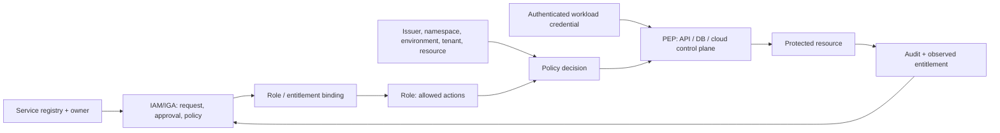
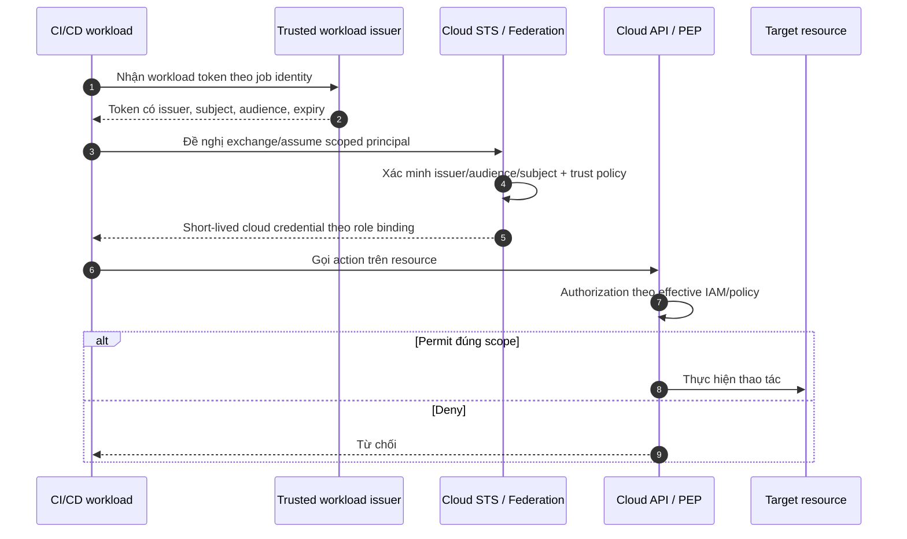
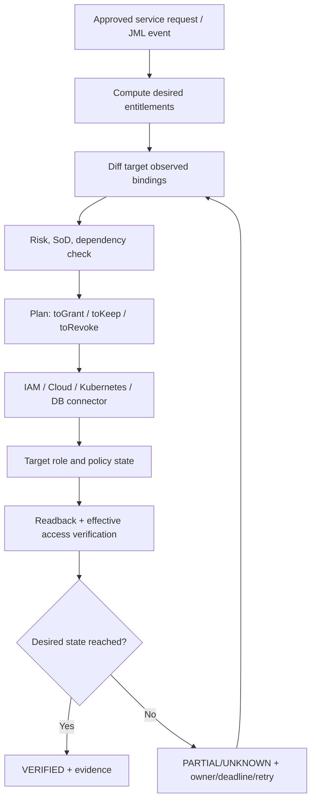

# Gán quyền cho service trong quản lý vòng đời danh tính IAM

## 1. Gán quyền cho service là gì?

**Gán quyền cho service** (*service authorization/entitlement assignment*) là quá trình xác định, phê duyệt, thiết lập và kiểm chứng **những hành động mà một danh tính dịch vụ hoặc workload được thực hiện trên tài nguyên cụ thể**, trong phạm vi, thời gian và điều kiện được phép. Đối tượng nhận quyền có thể là backend API, batch job, CI/CD pipeline, container, serverless function, tích hợp SaaS, bot hoặc controller tự động, thay vì một người dùng đăng nhập tương tác.

Ví dụ, service `invoice-sync` cần **đọc một queue hóa đơn** và **ghi kết quả đã xử lý** vào một bucket dự án. Nó không cần quyền xóa mọi bucket, thay IAM policy hoặc xem toàn bộ secrets của tổ chức. Nếu tiện tay gán `storage-admin` cho service này, một lỗi code hoặc credential bị chiếm có thể gây tác động vượt xa nhiệm vụ đồng bộ hóa đơn.

Trong module **SECURITY_IDENTITY_ACCESS_MANAGEMENT_IDENTITY_LIFECYCLE**, chủ đề thuộc chương **Service identity** và liên kết với quản lý vòng đời danh tính theo **Joiner–Mover–Leaver (JML)**: xác minh và đăng ký chủ thể, tạo account/workload identity, cấp quyền, rà soát khi chức năng hay owner thay đổi, và thu hồi quyền khi dịch vụ ngừng hoặc không còn đủ điều kiện. Các cơ chế liên quan gồm **IdP, SSO, SCIM, RBAC/ABAC, policy-based authorization, IAM/IGA, service account, kiểm toán và giảm quyền truy cập tồn dư**.

Mục tiêu của bài này là giúp người học:
- Phân biệt service identity, credential, role, permission và access token.
- Thiết kế **quyền tối thiểu theo action–resource–scope–condition**, không theo tên account đơn thuần.
- Chọn phương thức cấp quyền và xác thực phù hợp với máy–máy (*machine-to-machine, M2M*).
- Tổ chức request/approval, ownership, SoD, provisioning và runtime enforcement.
- Xử lý service onboarding, thay workload, đổi owner, ngừng dịch vụ, credential rotation và quyền còn tồn dư.
- Kiểm chứng hiệu lực quyền bằng inventory, readback, negative tests và audit.

> **Nguyên tắc:** danh tính dịch vụ được xác thực thành công **chưa có nghĩa** được phép thực hiện bất kỳ thao tác nào. Muốn truy cập tài nguyên, service phải có **entitlement phù hợp**, được điểm thực thi quyền kiểm tra và còn hiệu lực tại thời điểm request.

## 2. Phân biệt identity, principal, credential, role và permission

Những khái niệm thường xuất hiện chung trong cấu hình service nhưng có vai trò khác nhau.

| Khái niệm | Ý nghĩa | Ví dụ | Nhầm lẫn cần tránh |
| --- | --- | --- | --- |
| **Service/workload identity** | Danh tính logic của ứng dụng hoặc tác vụ | `svc-invoice-sync` | Không phải một người dùng HRIS |
| **Principal** | Chủ thể mà hệ thống đích dùng để xét quyền | Service principal, cloud workload principal | Có thể có ID riêng theo tenant/provider |
| **Service account** | Account kỹ thuật đại diện cho service trong nền tảng | Kubernetes ServiceAccount, account SaaS | Không phải mọi workload dùng cùng loại account |
| **Credential/authenticator** | Bằng chứng để xác thực principal | Certificate, signed token, client secret, managed identity | Có credential không có nghĩa có mọi permission |
| **Permission/privilege** | Một hành động được phép trên tài nguyên/scope | `queue:consume`, `object:write` | Tên action phải khớp semantics của target |
| **Role** | Tập permission được quản trị chung | `INVOICE_QUEUE_CONSUMER` | Role có thể quá rộng hoặc kế thừa quyền khác |
| **Role assignment/binding** | Quan hệ giữa principal và role trên scope | `svc-a` được gán role trên queue X | Binding không tự xác minh token/session đã phát |
| **Policy** | Quy tắc Permit/Deny và điều kiện | Chỉ cho workload từ production namespace ghi bucket A | Phải được thực thi, không chỉ được khai báo |
| **Access token/session** | Bằng chứng hoặc capability sử dụng tại runtime theo giao thức | OAuth 2.0 access token, mTLS session | Token có hạn và audience, có thể còn sống sau revoke |
| **Service owner** | Nhóm/người chịu trách nhiệm nghiệp vụ–vận hành | Đội Billing Platform | Owner không phải principal nhận quyền |

Một identity logic có thể xuất hiện thành **nhiều principal kỹ thuật** ở cloud, Kubernetes và SaaS. Ví dụ `invoice-sync` ở Kubernetes dùng service account `billing/invoice-sync`, đồng thời được ánh xạ đến một principal của cloud storage. Phải lưu **identity binding** giữa các đối tượng; không giả định tên giống nhau thì là cùng danh tính.

### Authentication khác authorization

**Authentication** trả lời: bên gửi request có chứng minh được là workload/principal đang tuyên bố hay không? **Authorization** trả lời: principal đó được thực hiện `object:write` trên bucket của tenant nào, với điều kiện nào?

**Provisioning** thiết lập account/role/binding; **runtime authorization** ở API/PEP quyết định từng thao tác; **reconciliation** so quyền mong muốn với quyền thực tế. Ba bước này phải được thiết kế riêng.

## 3. Vì sao quyền service cần được quản trị như một vòng đời?

Service thường chạy liên tục, tự động và có quyền truy cập vào API, database, secrets hoặc tài nguyên hạ tầng. Một quyền sai có thể bị sử dụng với tần suất cao mà không cần thao tác của người thật.

Những nguy cơ thường gặp:

1. **Quyền được cấp ban đầu quá rộng** để tích hợp nhanh và không được thu hẹp khi đưa vào production.
2. **Credential tồn tại dài hạn**, bị sao chép vào CI logs, config hoặc image.
3. **Role tích lũy sau thay đổi chức năng**: thêm quyền mới nhưng không gỡ quyền cũ.
4. **Service account mồ côi** khi người tạo nghỉ việc nhưng service vẫn hoạt động, hoặc service đã ngừng mà account vẫn active.
5. **Phạm vi môi trường không tách biệt**: development workload có thể thao tác trên tài nguyên production.
6. **Token hoặc trust policy quá rộng**: nhiều workload khác nhau cùng có thể nhận role.
7. **Delegation/impersonation** cho phép service gián tiếp sử dụng đặc quyền lớn hơn role hiển thị.
8. **Thiếu kiểm toán** vì nhiều ứng dụng dùng chung một account hoặc API key.

Một chương trình gán quyền phải bảo đảm câu hỏi **“ai/ứng dụng nào có thể làm gì, ở đâu và khi nào?”** được trả lời ở cả **thiết kế**, **cấu hình đang lưu** và **hành vi runtime**.

## 4. Vòng đời quyền của service và tương ứng Joiner–Mover–Leaver

Mô hình **JML** thường nói về nhân viên, nhưng có thể dùng như cách tư duy cho **vòng đời workload** với nguồn thẩm quyền khác HRIS.

| Giai đoạn của service | Tương ứng JML | Sự kiện có thẩm quyền | Hành động quyền |
| --- | --- | --- | --- |
| Đăng ký service mới | Joiner | Service registry/deployment được duyệt | Tạo identity, role tối thiểu, scope, owner |
| Đưa vào môi trường mới | Joiner hoặc Mover | Release/change record có hiệu lực | Cấp riêng quyền theo environment; kiểm tra trust |
| Thay nhiệm vụ/API/tenant | Mover | Thay đổi kiến trúc, repo hoặc manifest được duyệt | Tính `toGrant/toRevoke/toKeep`, rà SoD |
| Chuyển owner/team | Mover | Service catalog đổi ownership | Reassign owner, rà quyền và credential |
| Tạm dừng hoặc cô lập workload | Suspension | Incident hoặc policy risk | Chặn authentication/authorization phù hợp |
| Ngừng service/retire | Leaver | Service registry đánh dấu retired | Revoke roles, trust, credentials, sessions |
| Khởi chạy lại service | Rejoin/restore | Phê duyệt workload mới | Tính quyền từ policy hiện hành, không phục hồi mọi grant cũ |
| Nhân viên owner nghỉ việc | **Không mặc nhiên là service Leaver** | HRIS Leaver của người | Chuyển owner, rà credential, không xóa nhầm production |

**Nguồn sự thật của workload** có thể là CMDB/service registry, deployment catalog, GitOps/IaC repository được quản trị và application owner. **HRIS** có thẩm quyền xác nhận người chủ quản còn làm việc, nhưng **không trực tiếp quyết định** một batch job còn cần chạy hay không.

### Vòng đời của role cũng phải được quản lý

Không chỉ principal có lifecycle: **role definition**, **binding**, **policy**, **credential** và **federated trust** đều có version, owner, ngày hiệu lực và ngày hết hạn. Một role đang dùng có thể bị mở rộng permission mà không có binding mới; lúc ấy **blast radius của mọi service nhận role tăng**.

## 5. Kiểm kê service trước khi cấp quyền

Không nên cấp `admin` cho một service chỉ dựa trên tên repository hoặc người gửi ticket. Trước hết phải xác định service **được vận hành bởi ai và làm nhiệm vụ gì**.

Một service identity registry hữu ích có thể ghi:

| Trường | Ví dụ | Dùng để |
| --- | --- | --- |
| `serviceId` | `svc-invoice-sync` | Khóa logic ổn định |
| `ownerTeam`, `backupOwner` | `billing-platform` | Review, escalation, bàn giao |
| `businessPurpose` | Đồng bộ hóa đơn từ queue vào báo cáo | Chứng minh lý do |
| `applicationId` / `repoId` | `billing-sync-repo` | Liên kết source/deployment |
| `environment` | `production` | Giới hạn quyền |
| `workloadLocator` | Namespace/service account/job identity | Xác minh workload thật |
| `cloudPrincipalId` / `clientId` | ID do provider cấp | Liên kết tới target account |
| `trustIssuer`, `subjectPattern` | OIDC issuer và subject chính xác | Ngăn giả mạo hoặc trust rộng |
| `dataClassification` | Internal/Confidential | Định mức kiểm soát |
| `targetResources` | Queue và bucket được phép | Chuẩn hóa scope |
| `riskTier` | Medium/High | Approval, review và thời hạn |
| `sourceVersion` | Version của service registry | Chống event cũ |
| `status` | Planned/Active/Suspended/Retired | Quyết định quyền theo lifecycle |
| `reviewedAt`, `nextReviewAt` | Theo policy | Không để service vô chủ |

Một service có thể có **nhiều bản triển khai** ở dev/staging/prod. Đừng dùng chung một principal mạnh cho mọi môi trường chỉ vì cùng codebase. Khi phù hợp, tách service identities để giảm blast radius và dễ audit.

### Identity ID và target IDs

Dùng một khóa logic như `serviceId` để điều phối; tại target phải lưu **provider principal ID, account ID, role ID và resource ID**. Không tin tên hiển thị hoặc email giả cho service là khóa bất biến.

## 6. Quyền tối thiểu: action, resource, scope, condition và thời gian

**Least privilege** đối với service là việc chỉ cấp **tập thao tác cần thiết** trên **tài nguyên cụ thể**, dưới **những điều kiện phù hợp**, trong **khoảng thời gian cần thiết**.

Có thể biểu diễn một nhu cầu bằng:

```text
(subject, action, resource, scope, condition, validFrom, validUntil)

subject:    svc-invoice-sync@production
action:     queue:consume
resource:   invoice-events-prod
scope:      tenant=VN / billing
condition:  workload issuer/subject hợp lệ
validFrom:  Khi triển khai release đã duyệt
validUntil: Khi service hoặc nhiệm vụ bị retired
```

Mẫu này là **mô hình khái niệm**, không phải cú pháp API chuẩn của một cloud.

| Service cần | Cách cấp quyền quá rộng | Hướng giảm đặc quyền |
| --- | --- | --- |
| Đọc một queue hóa đơn | Quản trị toàn bộ messaging service | Consume một queue, đúng project/tenant |
| Ghi báo cáo vào bucket | `storage-admin` ở mọi bucket | PutObject vào prefix/kho chính xác; không delete nếu không cần |
| Đọc một secret kết nối | Quyền đọc tất cả secrets | Read một secret ID, môi trường production |
| Đọc dữ liệu khách hàng của tenant A | Quyền SELECT toàn DB | Chỉ schema/table/row của tenant A theo khả năng DB |
| Triển khai một ứng dụng | Admin toàn tổ chức cloud | Deploy đúng namespace/project, không sửa IAM policy |
| Đọc metrics | Quyền truy cập production shell | API metrics read-only với scope giới hạn |
| Gửi email thông báo | Quyền cấu hình toàn mail domain | Chỉ API send từ sender/domain được duyệt |

### Scope theo tài nguyên thật

Một policy cho phép `report:read` chưa đủ nếu không biết report thuộc tenant/pháp nhân nào. Khi quyền phụ thuộc resource, điểm thực thi phải lấy **resource ownership/tenant từ nguồn đáng tin phía server**, không chỉ từ query string do workload tự khai.

### Hạn và mục đích

Một service chạy lâu dài có thể cần binding bền vững, nhưng không có nghĩa **mọi quyền nguy hiểm phải tồn tại vô hạn**. Quyền migration, data backfill hoặc deployment production nên có hạn hoặc chỉ có hiệu lực theo job/release khi khả năng nền tảng cho phép.

## 7. RBAC, ABAC và PBAC khi cấp quyền cho service

**RBAC (Role-Based Access Control)** gom permission thành vai trò; **ABAC (Attribute-Based Access Control)** giới hạn theo thuộc tính của principal, resource và môi trường; **PBAC (Policy-Based Access Control)** tổ chức và đánh giá những quy tắc đó thành quyết định authorization có thể thực thi.



Ví dụ role `INVOICE_EVENT_CONSUMER` có `queue:read` và `queue:ack`. ABAC có thể yêu cầu `environment=production`, `tenant=VN`, đối tượng queue thuộc Billing và credential đến từ trust issuer đã duyệt.

**Role binding và policy có thể nằm cùng hệ thống**, nhưng không thể chỉ ghi một file YAML “cho phép” rồi tin quyền được áp. Phải biết **PDP/PEP hoặc engine của target thực sự dùng rule nào**, default behavior ra sao và resource scope được kiểm tra ở đâu.

### Quan hệ deny, allow và kế thừa

Nền tảng có thể hỗ trợ **explicit deny**, permissions boundaries, inherited role hoặc resource policy. Quyền hiệu lực **không luôn là phép hợp đơn giản**. Khi review, phải đọc semantics thực của provider và kiểm tra vai trò kế thừa, direct grant, group membership cùng điều kiện phủ định.

## 8. Thiết kế role catalog dành cho workload

Một **role catalog** cho service nên được người sở hữu ứng dụng hoặc tài nguyên phê duyệt, không được tự tạo bằng cách sao chép role của môi trường production sang mọi service.

| Trường role | Mục đích |
| --- | --- |
| `roleId` / `version` | Khóa và version ổn định |
| `businessPurpose` | Tác vụ nào đòi role |
| `ownerId` | Ai kiểm soát role definition |
| `permissions` | Action thực tế, không chỉ role display name |
| `eligibleServiceTypes` | API, batch, CI/CD, system connector… |
| `resourceScopes` | Project, tenant, namespace, prefix, schema |
| `environmentRestrictions` | Dev/staging/prod và đường triển khai hợp lệ |
| `trustRequirements` | Issuer/subject/audience, mTLS hoặc credential |
| `riskTier` / `sodConstraints` | Mức rủi ro và xung đột |
| `maxGrantDuration` | Giới hạn khi có quyền tạm |
| `targetMappings` | Cloud role, Kubernetes Role, DB grants, SaaS scopes |
| `lifecycleStatus` | Draft/Active/Deprecated/Retired |

### Tránh hai sai lầm thiết kế

**Role explosion:** tạo hàng nghìn role không phân biệt được nhiệm vụ, khiến reviewer chỉ duyệt theo tên. Có thể dùng role nghiệp vụ nhỏ kết hợp resource scope/ABAC thay vì mọi tổ hợp sinh ra một role mới, **nếu platform hỗ trợ**.

**Role quá rộng:** gom `read-secret`, `delete-data` và `grant-admin` vào một role `SERVICE_OPERATOR` cho tiện. Nên tách role theo ranh giới trách nhiệm và quyền nguy hiểm, tránh cấp qua wildcard rộng.

## 9. Yêu cầu gán quyền: ai đề nghị, ai phê duyệt?

**Yêu cầu cấp quyền cho service** cần có người chịu trách nhiệm rõ ràng và những mục dữ liệu đủ để phân tích rủi ro. Không coi một pull request được merge là phê duyệt an ninh mặc định nếu quy trình không có kiểm soát tương ứng.

Một yêu cầu tốt có thể gồm:

- `requestId`, `serviceId`, principal kỹ thuật, environment, tenant và target system.
- Permission/role cụ thể, resource IDs, scope và thời hạn.
- Mục đích nghiệp vụ, lý do không dùng role yếu hơn, ticket/change/release.
- Service owner, application/data owner, người chịu trách nhiệm chi phí nếu liên quan.
- Rủi ro dữ liệu/production, đường lan đặc quyền và SoD.
- Loại credential dự kiến và trust policy nếu federation.
- Điều kiện step-up/JIT với thao tác nhạy cảm, nếu nền tảng hỗ trợ.
- Kế hoạch thu hồi khi job kết thúc/retire và phương pháp readback.
- Policy/role catalog version, actor tạo request và chuỗi phê duyệt.

### Phân quyền các bên

| Bên | Điều cần xác nhận |
| --- | --- |
| **Service owner** | Workload còn hoạt động và thực sự cần chức năng |
| **Application owner** | Tác vụ, API và cấu hình ứng dụng phù hợp |
| **Data/resource owner** | Phạm vi dữ liệu, tenant, nhãn bảo mật phù hợp |
| **Platform/IAM owner** | Permission, trust, giới hạn role, cách provision/revoke |
| **Security/SoD authority** | Xung đột, đặc quyền cao, ngoại lệ hoặc rủi ro |
| **Approver độc lập** | Với quyền nhạy cảm, tránh requester tự cấp admin |
| **Connector operator** | Thực thi đúng target; không quyết định thay business owner |

**Một kỹ sư có quyền sửa pipeline không nhất thiết có quyền tự duyệt cấp `cloud-admin` cho chính pipeline đó.** Nếu hệ thống hỗ trợ policy-as-code, cần review độc lập đối với phần mở rộng quyền nguy hiểm.

## 10. Segregation of Duties (SoD) và rủi ro tự nâng quyền

**SoD** áp dụng cả với service. Dù workload không có ý định như con người, một identity có thể được cấu hình để **tự cấp thêm quyền hoặc vô hiệu kiểm soát**, tạo hậu quả lớn khi code hoặc credential bị chiếm.

| Quyền A | Quyền B | Xung đột tiềm ẩn |
| --- | --- | --- |
| Sửa chính sách IAM | Tự assume/gán role admin | Tự nâng đặc quyền |
| Triển khai code vào production | Tự duyệt pipeline/release | Bỏ qua kiểm soát thay đổi |
| Ghi dữ liệu thanh toán | Sửa audit log của giao dịch | Khó phát hiện thay đổi trái phép |
| Đọc secrets mọi service | Thực thi code tùy ý ở nhiều workload | Dễ lan lateral movement |
| Tạo service principal | Gán cho principal quyền rộng | Tạo danh tính “ẩn” có đặc quyền |
| Thay trust policy | Tạo token theo issuer do mình kiểm soát | Giả mạo đường federation |
| Xóa backup | Xóa audit và cảnh báo | Phá khả năng phục hồi/điều tra |

**SoD không chỉ kiểm tra tên role.** Cần xét quyền có hiệu lực và **chuỗi chuyển quyền**: một service có quyền sửa CI config dẫn đến việc chạy deployment bằng principal mạnh hơn; dù role ban đầu không ghi `admin`, blast radius vẫn lớn.

### Quyền impersonation và pass-role

Những quyền cho phép workload **đóng vai principal khác, ký token thay identity, gán role cho job hoặc chuyển credential** phải được phân loại là quyền có thể gây **privilege escalation**. Kiểm tra đồng thời **ai được impersonate**, **principal đích có permission gì**, **ràng buộc resource/condition** và **ai có thể điều khiển mã được chạy**.

## 11. Chọn phương thức xác thực máy–máy trước khi cấp quyền

Cấp quyền và xác thực là hai trục độc lập, nhưng phải thiết kế cùng nhau. **Một role tối thiểu vẫn không an toàn nếu credential đại diện cho role bị phát tán quá rộng**.

| Phương thức | Khi phù hợp | Rủi ro/kiểm soát |
| --- | --- | --- |
| **Managed identity** | Workload chạy trên nền tảng có identity tích hợp | Ràng buộc workload vào resource/environment; tránh share principal |
| **Workload identity federation** | CI/CD, Kubernetes hoặc workload từ một trust domain sang cloud khác | Kiểm issuer, audience, subject và trust policy cụ thể |
| **mTLS với certificate** | Service-to-service qua mesh/API hỗ trợ | Danh tính cert, rotation, revocation, trust chain |
| **OAuth 2.0 client credentials** | Service gọi API qua authorization server | Client authentication, scope, audience, token TTL |
| **Short-lived signed token** | Workload chứng minh provenance trong hệ thống hỗ trợ | Chữ ký, issuer, audience, hạn, replay protection |
| **Client secret/API key** | Tích hợp legacy khi chưa có lựa chọn tốt hơn | Vault, hạn, rotation, giới hạn scope, audit |
| **Static password** | Phụ thuộc sản phẩm cũ | Bảo vệ và thay thế dần nếu khả thi |

Ưu tiên **credential không cần giữ bí mật dài hạn** khi nền tảng hỗ trợ: managed identity, federation hoặc token ngắn hạn. Tuy nhiên, **không tuyên bố federation tự an toàn** nếu trust policy cho phép mọi job trong một repo/organization assume role production.

**SSO đăng nhập của con người** không phải mô hình bắt buộc của workload; service có thể không có browser session. **SCIM** có thể đồng bộ một số đối tượng identity, nhưng không tự thiết lập toàn bộ quyền M2M hoặc thay cơ chế token issuance.

## 12. OAuth 2.0 client credentials: scope và audience

Một service gọi API có thể dùng **OAuth 2.0 Client Credentials Grant** theo thiết kế authorization server. Client xác thực với authorization server và nhận **access token** cho tài nguyên được phép. Cần phân biệt:
- **Client credential** giúp authorization server xác thực client.
- **Scope** là yêu cầu/phạm vi quyền theo contract của server, không tự là bằng chứng được mọi API chấp nhận.
- **Access token** được resource server kiểm tra và chỉ sử dụng cho audience/resource được chỉ định.
- **API authorization** phải kiểm action/resource/tenant thực tế, không chỉ thấy một scope chung.
- **OIDC ID token** phục vụ xác thực danh tính cho client theo giao thức phù hợp, **không được dùng thay access token tùy ý**.

Ví dụ HTTP **minh họa**, credential đều là placeholder:

```http
POST /oauth2/token HTTP/1.1
Host: auth.example.test
Content-Type: application/x-www-form-urlencoded

grant_type=client_credentials&scope=invoice.events.read
```

Trong cấu hình thực tế, client còn phải **xác thực theo phương thức authorization server cho phép** (ví dụ private_key_jwt, mTLS hoặc client secret được bảo vệ). Request trên **không phải yêu cầu token chạy được hoàn chỉnh**; nó chỉ minh họa grant type và scope. Không hardcode client secret vào ví dụ, source control hoặc logs.

Một resource server khi nhận access token cần xác minh theo dạng token và hợp đồng: **issuer, audience, thời hạn, chữ ký nếu token là JWT, scope/role cần thiết, client/principal identity và chính sách tài nguyên**. Với opaque token có thể cần introspection hoặc cơ chế xác minh do authorization server quy định.

### “Có scope” chưa chắc “có quyền tài nguyên”

Token chứa `invoice.events.read` vẫn không nên được phép đọc queue của tenant khác nếu quyền phụ thuộc tenant. PEP/API phải kiểm tra **resource ownership, tenant, environment và policy hiện hành**, thay vì coi scope là giấy phép toàn hệ thống.

## 13. Workload identity federation: hai bước trust và authorization

**Federation** cho phép một workload từ hệ thống nguồn trình bằng chứng danh tính được hệ thống đích chấp nhận để nhận credential/token phù hợp, thường giảm nhu cầu dùng key tĩnh.

Một mô hình điển hình:



**Trust policy** trả lời: workload nguồn **nào được phép nhận/assume principal đích**? **Permission policy** trả lời: principal đích **được làm gì**? Hai lớp đều phải đủ hẹp.

Ví dụ một trust policy cho pipeline production nên ràng buộc theo **issuer, audience, repository, branch/tag hoặc environment, subject và event type** tùy claim đáng tin mà issuer cung cấp. Tránh wildcard như “mọi repo/mọi branch đều được nhận role deploy production”.

### Những dữ liệu không nên tự tin

Đừng tin `branch=main` do workload tự gửi trong HTTP body. Điều kiện trust phải gắn vào **assertion có chữ ký từ issuer đáng tin** và được xác minh đúng contract. Một issuer có thể dùng cú pháp subject khác hệ thống khác; không tự sao chép một policy giữa hai vendor mà không kiểm tra semantics.

## 14. Gán quyền cho service trong cloud IAM

Các nền tảng cloud thường có principal, role, resource policy và điều kiện cấp quyền khác nhau. Tư duy chung:

1. Xác định **workload identity thực tế** chạy trong môi trường nào.
2. Chọn **resource/project/subscription/account** mà quyền được áp.
3. Xác định **hành động tối thiểu** trên từng resource.
4. Kiểm tra **role có quyền leo thang** hoặc phụ thuộc vào trust policy khác không.
5. Thiết lập binding theo chính sách, qua IaC/API được duyệt.
6. Test **Permit đúng scope** và **Deny ngoài scope**.
7. Đọc lại role/policy/permission ở đích; ghi change và owner.
8. Rà soát định kỳ và khi có sự kiện lifecycle.

### Scope theo môi trường

Một pipeline dev có thể cần quyền deploy tới namespace dev, nhưng **không nên được thừa kế quyền production** do dùng cùng cloud principal. Cần tách ID, trust conditions và resource scope cho dev/staging/prod, hạn chế wildcard tenant hoặc subscription.

### Resource policy và principal policy

Quyền có thể phát sinh ở **policy gắn principal** hoặc **policy gắn resource**. Một service đã bị gỡ role trực tiếp vẫn có thể được cấp quyền qua **resource share, group membership hoặc policy khác**. Reconciliation phải kiểm tra tất cả đường cấp được target hỗ trợ.

## 15. Gán quyền cho Kubernetes ServiceAccount: ví dụ có thể thực hành

Trong Kubernetes, **ServiceAccount** là identity dành cho các process trong Pod. **Kubernetes RBAC** có các đối tượng Role/ClusterRole và RoleBinding/ClusterRoleBinding để phân quyền thao tác lên Kubernetes API.

Ví dụ workload `invoice-sync` trong namespace `billing` **chỉ đọc ConfigMap** trong namespace đó. Cấu hình sau **minh họa cho Kubernetes RBAC**:

```yaml
apiVersion: v1
kind: ServiceAccount
metadata:
  name: invoice-sync
  namespace: billing
---
apiVersion: rbac.authorization.k8s.io/v1
kind: Role
metadata:
  name: invoice-config-reader
  namespace: billing
rules:
  - apiGroups: [""]
    resources: ["configmaps"]
    verbs: ["get", "list"]
---
apiVersion: rbac.authorization.k8s.io/v1
kind: RoleBinding
metadata:
  name: invoice-config-reader-binding
  namespace: billing
subjects:
  - kind: ServiceAccount
    name: invoice-sync
    namespace: billing
roleRef:
  kind: Role
  name: invoice-config-reader
  apiGroup: rbac.authorization.k8s.io
```

Lưu ý:
- **Role** ở namespace `billing` không tự cấp quyền cho namespace khác; ClusterRoleBinding có phạm vi khác và phải được review riêng.
- `get/list` là **quyền đọc Kubernetes ConfigMap**, không phải quyền đọc queue hay bucket của cloud.
- Khi cần dùng ServiceAccount trong Pod, workload phải tham chiếu đúng account; không dựa vào `default` account vì dễ tích lũy quyền khó kiểm soát.
- Chỉ mount ServiceAccount token khi workload cần gọi API; đánh giá `automountServiceAccountToken` và token projected/short-lived theo khả năng phiên bản, nền tảng.
- Kubernetes ServiceAccount dùng để gọi Kubernetes API **khác** với cloud principal dùng để truy cập storage. Cầu nối workload identity/federation cần trust và role binding riêng.

**Không cho `ClusterRoleBinding` admin trên toàn cluster** chỉ để một Pod đọc ConfigMap. Ví dụ cũng không cấp quyền xem `secrets`; đó là tài nguyên nhạy cảm cần phê duyệt riêng.

## 16. Gán quyền cho database, queue và object storage

Một service thường cần nhiều target với mô hình authorization khác nhau. **Không gộp tất cả thành một credential có quyền quản trị**, vì một lỗ hổng tại API có thể dẫn tới mất dữ liệu hoặc thay hạ tầng.

| Tài nguyên | Permission thích hợp | Kiểm tra thêm |
| --- | --- | --- |
| Database | `SELECT` trên view/schema, `INSERT` vào bảng được phép | Row-level security, tenant isolation, tránh DDL/admin |
| Message queue | Consume/ack trên queue cụ thể | Không publish/delete queue nếu không cần |
| Object storage | Read/put một bucket/prefix | Không list toàn bộ hoặc delete không cần |
| Secrets manager | Read đúng secret ID | Có thể secret chứa credential mạnh hơn; rotation |
| KMS/encryption service | Decrypt/encrypt theo key/condition | Ngăn decrypt dữ liệu ngoài scope |
| Metrics/logging | Publish metrics hoặc read logs được phép | Log có thể chứa PII/secret |
| CI/CD artifacts | Read package/attestation đã duyệt | Ngăn ghi artifact/signature giả |
| HTTP API | Scope endpoint/action/tenant | Token audience, PEP object-level authorization |

### Database: quyền SQL không phải toàn bộ kiểm soát

Một DB role chỉ có `SELECT` vẫn có thể đọc **mọi dòng chứa dữ liệu nhạy cảm** nếu không có giới hạn schema/table/row. Với multi-tenant database, cần **tenant isolation do server/DB thực thi**, không dựa vào `WHERE tenant_id = ?` do client tự chọn mà không ràng buộc với principal đáng tin.

### Queue: phân tách producer và consumer

Một service nhận sự kiện hóa đơn có thể chỉ cần consume; service phát sự kiện chỉ cần publish. Nếu cả hai có quyền tạo/xóa queue hoặc chỉnh ACL, blast radius tăng mạnh. Kiểm tra cả **dead-letter queue, retry topic và admin API**, không chỉ queue chính.

### Object storage: phân biệt read, write, list và delete

Quyền `object:write` có thể không cần `object:list` hay `object:delete`. Prefix hoặc resource path phải được target IAM thực thi, đặc biệt khi nhiều tenant dùng chung bucket.

## 17. Multi-tenant, môi trường và phân loại dữ liệu

**Tenant isolation** là ranh giới quan trọng khi một service xử lý dữ liệu nhiều khách hàng. Một role cho phép `document:read` chưa xác nhận service được đọc tất cả documents.

Ví dụ:

```text
serviceId: svc-report-generator
environment: production
allowedActions: report:read, report:render
tenantScope: tenant-vn
dataScope: legalEntity=VN
deniedActions: user:grant-admin, report:delete
```

Các trường là mô tả **khái niệm**; triển khai thực phải kiểm tra target hỗ trợ deny, tenant condition và resource metadata ra sao.

### Các nguồn thuộc tính cần đáng tin

- Tenant/resource ownership lấy từ **resource server hoặc data catalog**.
- Workload environment lấy từ **runtime/platform identity**.
- Service lifecycle/owner lấy từ **service registry**.
- Role assignments lấy từ **IAM/IGA/target inventory**.
- Client scope/audience lấy từ **token được xác minh**, không lấy từ header không đáng tin.

Một yêu cầu API có body `{"tenantId":"tenant-vn"}` không thể tự chứng minh rằng service có quyền tenant VN. **PEP** phải dùng identity và resource metadata đáng tin để đánh giá.

## 18. Cấp quyền qua IaC/GitOps và policy-as-code

Với workload, **Infrastructure as Code (IaC)** hoặc **GitOps** giúp version hóa role bindings và hạn chế thao tác tay khó audit. Tuy nhiên, một commit vào repository **không tự đủ** để coi permission đã được phê duyệt hoặc thực thi.

Quy trình tốt:

1. Service owner mô tả thay đổi action/resource/scope và lý do.
2. Pipeline kiểm tra cú pháp, policy lints, wildcard, quyền nâng quyền và SoD.
3. Owner tài nguyên/Security review phần nhạy cảm theo policy.
4. Apply qua identity triển khai có quyền tối thiểu, không dùng `global-admin` thường trực.
5. Lưu commit/review/approval/change ID và policy version.
6. Đọc lại quyền ở target, không suy từ `terraform plan` hay `kubectl apply` thành công là đủ.
7. Cảnh báo **drift** nếu ai đó cấp direct grant thủ công ngoài IaC.
8. Khi service ngừng, tạo **revoke/deprovision plan** an toàn, xác minh dependency và đóng ownership.

**Cấu hình Git “mong muốn” có thể khác quyền đang có** do manual changes, API lỗi hoặc eventual consistency. Phải có observed state và reconciliation.

### Ví dụ manifest quyền khái niệm

```yaml
serviceId: svc-invoice-sync
ownerTeam: billing-platform
environment: production
target:
  type: object-storage
  resourceId: bucket-billing-reports
grant:
  actions:
    - object:put
  prefix: reports/processed/
  duration: service-lifecycle
approval:
  requiredOwners:
    - storage-resource-owner
    - service-owner
review:
  riskTier: medium
  reviewPolicyRef: workload-entitlement-v4
```

Đây **không phải cú pháp chính thức của một nhà cung cấp**, mà là **dạng dữ liệu đề xuất**. Trường `duration: service-lifecycle` chỉ có ý nghĩa nếu provisioning orchestrator biết xử lý service retirement và auto-revoke tương ứng.

## 19. Provisioning quyền: desired state và observed state

Sau approval, hệ thống phải **tạo hoặc cập nhật role bindings tại đích**. Điều quan trọng là phân biệt:

- **Desired entitlement:** quyền service **nên có** theo policy hiện hành.
- **Declared configuration:** quyền đã được khai báo/submit qua IaC, IAM API hoặc ticket.
- **Observed assignment:** role/binding đã tồn tại tại target.
- **Effective access:** service có thực sự thực hiện được action/resource đó không, sau khi tính deny/conditions/tokens.



### Không chỉ xem response code

Một cloud API trả success có thể chỉ xác nhận **binding được ghi**, trong khi quyền chỉ cập nhật sau khi cache/replication hoàn tất. Nếu có quyền được cấp qua đường khác, kết quả effective còn thay đổi. Cần xác định **điểm quan sát có thẩm quyền và SLA nhất quán**.

### Không tạo role khi ID correlation còn mơ hồ

Nếu target có hai principal cùng display name, không chọn bản ghi đầu tiên. Cần xác minh provider principal ID, tenant, issuer và service binding trước khi grant hoặc revoke để tránh cấp nhầm.

## 20. Thời gian cấp quyền: quyền thường trực, tạm thời và JIT

**Service chạy lâu dài** có thể cần quyền ổn định cho vòng đời nhiệm vụ; nhưng **job nhạy cảm** như migration, backfill hoặc deploy production chỉ cần một cửa sổ ngắn.

| Cách cấp | Khi thích hợp | Rủi ro cần xử lý |
| --- | --- | --- |
| **Long-lived binding** | Service nền vận hành thường xuyên | Review, owner, version, revoke khi đổi mục đích |
| **Time-bound assignment** | Batch job hoặc dự án có hạn | Auto-expiry và đối soát sau expiry |
| **JIT role activation** | Deployment hoặc thao tác sản xuất nhạy cảm | Approval/activation, audit, session/token còn tồn dư |
| **Short-lived federated credentials** | CI/CD, container từ trusted issuer | Trust policy hẹp, audience, token TTL |
| **Ephemeral service principal** | Job ngắn hạn được quản trị hoàn toàn | Cleanup, correlation và tránh tạo mồ côi |

**Thời hạn của credential khác thời hạn role.** Token có thể ngắn 10 phút nhưng nếu bất kỳ workload nào trong một repo được phép đổi lấy token mới để assume admin role, thì quyền dài hạn nằm ở **trust policy**. Ngược lại, xóa role nhưng không chặn token đã phát có thể để lại cửa sổ truy cập.

### Không áp JIT máy móc

Một job cần xử lý sự kiện liên tục không nên phải chờ con người phê duyệt từng request. Có thể dùng policy tự động đã duyệt, token ngắn hạn và role tối thiểu. Với thao tác bất thường/nguy hiểm, cần cơ chế phê duyệt hoặc step-up phù hợp **đầu vào machine workflow**.

## 21. Mover của service: thay API, quyền, environment hoặc owner

**Mover** đối với workload gồm thay nhiệm vụ, tách service, chuyển tenant, đổi môi trường, thay repo/issuer/namespace hoặc chuyển ownership.

Ví dụ:

```text
Before:
  svc-invoice-sync -> queue:consume(invoice-prod)
  svc-invoice-sync -> object:put(reports-prod/*)
  svc-invoice-sync -> secret:read(legacy-db-password)

After migration to managed database:
  KEEP   queue:consume(invoice-prod)
  KEEP   object:put(reports-prod/processed/*)
  REVOKE secret:read(legacy-db-password)
  GRANT  database:write(invoice-processed-table, tenant=VN)
```

Một thay đổi **không chỉ là cấp quyền mới**. Hệ thống phải tính `toRevoke`, `toGrant` và `toKeep` từ approved service catalog/version; nếu bỏ bước revoke, service tích lũy quyền theo thời gian.

### Thay đổi identity source/trust

Nếu CI/CD chuyển repo hoặc OIDC issuer, cần rà soát **trust conditions**. Không giữ trust cho issuer/repo cũ “để dự phòng” vô thời hạn. Nếu cần giai đoạn chuyển tiếp, ghi scope, owner, expiry và kiểm tra cả hai đường trust không làm mở quyền bất ngờ.

### Chuyển owner

Kỹ sư tạo service nghỉ việc hoặc chuyển bộ phận: cập nhật owner/backup owner, quyền vận hành, credential custody và reviewer assignment. **Không tự dừng service production** chỉ vì người chủ quản cũ Leaver, nhưng cũng **không để workload không owner giữ đặc quyền**.

## 22. Leaver/retirement của service: thu hồi quyền và trust

Khi service thực sự ngừng chạy, mục tiêu không chỉ là xóa một account mà là **không còn đường truy cập hợp lệ từ danh tính đó tới tài nguyên**.

Quy trình nên:

1. Nhận sự kiện `SERVICE_RETIRED`/workload decommission từ **service registry** có thẩm quyền.
2. Kiểm tra phụ thuộc: job, consumers, queue, dữ liệu, owner và nghĩa vụ retention.
3. Ngừng phát hành credential/token mới: disable principal, gỡ trust hoặc chặn activation tùy nền tảng.
4. Gỡ role/permission bindings ở cloud, SaaS, DB, Kubernetes, APIs và các resource policy.
5. Thu hồi/rotate secrets, certificates, keys và refresh tokens phù hợp; xử lý token đã phát theo khả năng sản phẩm.
6. Kết thúc session/JIT activation hoặc giảm TTL đối với những quyền rủi ro cao.
7. Gỡ scheduled grants, pending access requests và IaC/GitOps bindings cũ để tránh **tái cấp** sau revoke.
8. Đọc lại observed grants, kiểm tra denial ở runtime và ghi tình trạng `VERIFIED`/`PARTIAL`.
9. Lưu audit/evidence, xử lý dữ liệu và account deletion theo retention/backup policy.
10. Theo dõi một giai đoạn để phát hiện role/credential tái xuất hiện do controller cũ.

**Không xóa ngay account khi chưa hiểu dependency**, vì một workload có thể dùng principal chung cho các tác vụ hợp lệ khác. Tuy nhiên, quyền chưa thể thu hồi cũng phải được **đánh dấu rủi ro, hạn khắc phục và biện pháp bù**, không để mãi `PENDING`.

### Hai loại Leaver khác nhau

- **Human owner Leaver:** cần chuyển trách nhiệm, đánh giá credential và review; service có thể vẫn Active.
- **Service Leaver/retirement:** cần vô hiệu principal, trust và quyền của workload theo kế hoạch offboarding.

Đánh đồng hai trường hợp có thể gây outage hoặc để lại service account mồ côi.

## 23. Quyền tồn dư: access token, key, session và trust

Một lần thay role không làm tất cả credential hoặc authorization decisions cũ tự biến mất.

| Đường còn tồn tại | Vì sao nguy hiểm? | Biện pháp cần cân nhắc |
| --- | --- | --- |
| **JWT access token** | Có thể còn hiệu lực tới `exp` nếu resource server không kiểm tra trạng thái mới | Token ngắn hạn, introspection/revocation khi hỗ trợ, runtime policy check |
| **API key/PAT** | Tồn tại độc lập với IdP/SSO | Inventory, revoke và rotate |
| **mTLS certificate** | Cert đã phát vẫn có thể được trust tới hạn/cách revoke của hệ thống | PKI revocation/trust update, rotation |
| **Cloud role session** | Temporary credentials đã cấp có thể còn trong TTL | Session revoke/deny policy theo platform |
| **Kubernetes token** | Pod còn token hoặc service account còn bound role | Gỡ RBAC binding và kiểm tra API access |
| **Direct resource policy** | Quyền không nằm ở principal role chính | Inventory resource-side permissions |
| **Federation trust** | Workload cũ vẫn đổi lấy credential mới | Xóa trust binding/condition cũ |
| **Cached Permit** | PEP/PDP cache authorization theo quyền cũ | Invalidate, giới hạn TTL, policy/entitlement version |

### Phân biệt ba mốc thời gian

```text
T0: IAM/IGA quyết định REVOKE role
T1: Target đã xóa binding/trust và ghi observed state
T2: Resource server thực sự không chấp nhận action cũ
T3: Reconciliation xác nhận không còn đường cấp quyền liên quan
```

**T0 không đồng nghĩa T2/T3.** SLA thu hồi phải đo phù hợp với mức rủi ro và cơ chế token/runtime, không chỉ đo HTTP response của connector.

### Rotation không phải revocation toàn bộ quyền

Xoay một secret có thể làm credential cũ vô hiệu khi đúng phương thức, nhưng **principal vẫn có các role đã gán**. Nếu workload bị retired, cần gỡ **entitlement và trust**; chỉ rotation khóa không đủ.

## 24. Chính sách runtime: PEP cần kiểm tra action–resource thực tế

**Policy Enforcement Point (PEP)** là nơi API, cloud control plane, database hoặc proxy thực sự chặn request khi không có quyết định Permit hợp lệ. Một IAM policy trên giấy chưa đủ nếu endpoint có thể bị gọi qua đường bypass.

Các bước tổng quát:

1. Xác minh workload identity từ mTLS/token/session được tin cậy.
2. Kiểm issuer, audience, expiry, subject/client và các điều kiện được yêu cầu.
3. Resolve principal thành service identity ổn định và lifecycle status hiện hành khi cần.
4. Xác định action từ route/operation phía server.
5. Tải resource ID/tenant/classification từ nguồn đáng tin.
6. Đánh giá role, direct grants, deny, ABAC conditions, SoD và policy version.
7. Chỉ Permit đúng scope; áp obligations như audit, masking hoặc giới hạn rate nếu thuộc policy.
8. Ghi dấu vết quyết định và enforcement không chứa credential.

```text
authorizeServiceRequest(principal, action, resourceId):
    service = registry.resolveTrustedPrincipal(principal)
    if service == UNKNOWN or service.status != ACTIVE:
        return DENY

    resource = resourceStore.load(resourceId)
    if resource == NOT_FOUND:
        return DENY_OR_NOT_FOUND

    context = trustedPolicyContext(
        subject=service.id,
        action=action,
        resource=resource.id,
        resourceTenant=resource.tenantId,
        serviceEnvironment=service.environment
    )
    decision = policyEngine.evaluate(context)

    if decision.effect != PERMIT:
        return DENY
    if not decision.matchesExactContext(context):
        return DENY
    if not enforceRequiredObligations(decision):
        return DENY

    return ALLOW_WITHIN(decision.scope)
```

Đoạn trên là **pseudocode**. Hệ thống thật phải định nghĩa fail-safe khi PDP/PIP không khả dụng, cache, TOCTOU và xử lý token/phiên.

**Không dùng `if (token.valid) allowAll()`**: token hợp lệ chỉ là điều kiện xác thực; permission resource vẫn phải được đánh giá.

## 25. Ủy quyền thay mặt người dùng và confused deputy

Service có thể làm việc **thay mặt người dùng** (delegated access) hoặc **bằng quyền riêng của ứng dụng** (application permissions). Hai trường hợp không được nhập nhằng.

| Kiểu | Chủ thể và ngữ cảnh | Yêu cầu authorization |
| --- | --- | --- |
| **Application-only M2M** | Service gọi API bằng principal riêng | Chỉ các permission ứng dụng được cấp và scope tương ứng |
| **User-delegated request** | Service gọi thay một user đã xác thực | Kiểm cả quyền người dùng/delegation và quyền của service/client theo policy |
| **Service-to-service on-behalf-of** | API A gọi API B mang actor context | Audience, token exchange/delegation trust và actor binding phù hợp |
| **Impersonation** | Service được phép đóng vai principal khác | Kiểm soát mạnh target, điều kiện, thời hạn, audit; tránh dùng bừa |

**Confused deputy** xảy ra khi một service có quyền mạnh bị yêu cầu thực hiện tác vụ thay một actor không có quyền, nhưng backend chỉ kiểm tra quyền của service. Ví dụ user thường gọi API export qua backend có `data-export-admin`; nếu backend không kiểm tra user và tenant, nó có thể trở thành đường vượt quyền.

Khi cấp application permission, phải phân biệt **dịch vụ tự vận hành theo nhiệm vụ đã duyệt** với **dịch vụ làm thay từng người dùng**. Không dùng một access token ứng dụng có toàn quyền làm lý do bỏ qua kiểm tra user/resource tại downstream API.

## 26. Hủy, sửa và thu hồi grant khi nhiều nguồn cùng cấp

Một quyền có thể có **nhiều nguồn hợp lệ**: role cấp theo service type, một request tạm, resource policy hoặc một nhóm kỹ thuật. Nếu chỉ đảo ngược thao tác gần nhất, có thể:

- Gỡ quyền **vẫn cần** do một policy khác yêu cầu.
- Giữ quyền **không còn hợp lệ** vì direct grant ngoài IAM bị bỏ sót.
- Gây **drift** khi GitOps/controller tự gán lại role sau manual revoke.

Do đó nên lưu `grantSource`, `grantRequestId`, `roleVersion` và target IDs. Hủy request mới không có nghĩa phải xóa account dùng chung; Leaver của service phải xử lý **mọi đường cấp quyền** thuộc workload, kể cả ngoài request.

### Mẫu desired-state diff

```text
desired = computeApprovedEntitlements(service, currentPolicy)
observed = targetInventory.readAllRelevantGrants(service)

toGrant  = desired - observed (theo semantics target)
toRevoke = observed - desired
toKeep   = desired ∩ observed

for each change:
  verify provenance, ownership, policy and affected dependencies
  execute safely
  read back target and effective access
```

Phép trừ/giao là **mô hình tư duy**. Quyền theo role hierarchy, explicit deny, policy conditions và resource scope không phải tập các chuỗi đơn giản; cần engine chuyên biệt để tính đúng effective access.

## 27. Race condition, idempotency và eventual consistency

Trong hệ thống phân tán, cấp/thu hồi quyền có thể đến qua message queue, GitOps, IaC hoặc API bất đồng bộ. Các tình huống cần xử lý:

- Grant cũ được retry sau khi service đã Retired.
- Mover event đến chậm sau Leaver event.
- Connector timeout nhưng target đã thêm role thành công.
- Hai controller cùng thay role binding.
- Một pipeline tự apply lại manifest cũ, khôi phục quyền vừa bị Security gỡ.
- Readback từ replica chưa thấy bản cập nhật.
- Reuse display name làm gán quyền nhầm principal mới.

### Các kỹ thuật quan trọng

1. **Source event version và lifecycle generation:** xác định sự kiện mới nhất theo nguồn có thẩm quyền.
2. **Idempotency:** cùng một operation có ID không tạo role/binding trùng khi retry.
3. **Optimistic concurrency/ETag hoặc CAS:** hạn chế ghi đè cấu hình mới khi target hỗ trợ.
4. **Execution ledger:** ghi request/operation ID, attempt, HTTP result, target outcome.
5. **Readback trước retry không chắc chắn:** đặc biệt khi timeout sau commit.
6. **Desired-state reconciliation:** phát hiện quyền không còn phù hợp sau eventual consistency.
7. **Revocation priority:** ngăn grant stale tái cấp role của service Retired.
8. **Owner và deadline cho PARTIAL:** không biến quyền chưa xác minh thành “đã xử lý”.

**Không có transaction toàn cục tự động giữa IAM DB, cloud IAM, Kubernetes và SaaS**. Phải thiết kế các trạng thái `REQUESTED`, `RUNNING`, `UNKNOWN`, `PARTIAL`, `VERIFIED` phù hợp và khả năng khắc phục theo target.

## 28. Giả mã workflow gán quyền và đối soát service

Đây là **giả mã khái niệm**, không phải API của một sản phẩm. Mục tiêu là phản ánh các cổng quyết định trước khi triển khai role.

```text
reconcileServiceEntitlements(serviceEvent):
    require eventFromTrustedServiceRegistry(serviceEvent)
    require validLifecycleVersionAndEffectiveTime(serviceEvent)

    service = serviceRegistry.resolveStableServiceId(serviceEvent)
    if service == MISSING_OR_AMBIGUOUS:
        return BLOCKED_IDENTITY_CORRELATION

    policy = policyRegistry.loadApprovedVersion()
    requested = serviceAccessCatalog.load(service.id)

    if service.lifecycleStatus in [RETIRED, DISABLED]:
        desired = NONE
    else:
        require service.ownerIsActiveAndAuthorized()
        require requested.hasValidBusinessJustification()
        require approvedChangesMatchRoleAndResourcePolicy(requested)
        require noUnresolvedPrivilegedOrSoDConflict(requested)
        desired = policy.computeLeastPrivilegeForService(
            service=service,
            request=requested,
            environment=service.environment
        )

    observed = targetInventory.readEntitlementsAndTrust(
        service=service,
        includeDirectGrants=true,
        includeResourcePolicies=true,
        includeTemporaryGrants=true
    )

    plan = policyAwareDiff(desired, observed)
    plan = enforceRevocationBeforeConflictingGrant(plan)
    executionLedger.persistPlanWithVersionAndOperationIds(plan)

    for change in plan:
        require connectorIsLeastPrivilegedForTarget(change)
        current = serviceRegistry.loadCurrent(service.id)
        if current.lifecycleVersion != plan.lifecycleVersion:
            return REPLAN_WITH_CURRENT_SOURCE
        result = connector.executeIdempotently(change)
        executionLedger.recordOutcome(change, result)

    finalObserved = targetInventory.readBackAllRelevantScopes(service)
    effective = authorizationVerifier.evaluateSafeTests(service, finalObserved)

    if desiredEqualsVerifiedEffectiveState(desired, finalObserved, effective):
        audit.recordVerifiedServiceAccess(service.id, policy.version)
        return VERIFIED

    openPartialOrUnknownWithOwnerDeadline(service, finalObserved)
    return PARTIAL
```

Một triển khai thật phải xử lý **race giữa lần kiểm tra cuối và API grant**, dependency theo nhiều hệ thống, session/token đang sống, eventual consistency và những grant chưa có API quan sát. Với credential đã phát, `desired=NONE` **không tự là bằng chứng mọi token bị vô hiệu**.

### Không grant dựa vào approval cũ

Nếu approval của service còn từ tháng trước nhưng workload vừa đổi tenant hoặc Retired, worker phải **đánh giá lại policy và lifecycle version**. Không dùng một approval cũ để vượt trạng thái hiện hành.

## 29. Audit, ownership và định kỳ rà soát quyền service

Một chương trình quản trị service identity cần lưu bằng chứng **ai đề nghị**, **ai phê duyệt**, **điều gì đã thay đổi**, **quyền đang có** và **khi nào thu hồi**.

Audit record nên chứa:

- `serviceId`, workload/principal ID, owner/backup owner và môi trường.
- Role/permission/resource scope, grant source, risk tier, role/policy versions.
- Request/approval IDs, actor và reason; SoD/risk assessment.
- Credential type, trust issuer/subject/audience **dưới dạng metadata đã che thông tin nhạy cảm**.
- Connector operation IDs, target role bindings, thời điểm grant/revoke.
- Readback và runtime verification, trạng thái `VERIFIED`/`PARTIAL`/`UNKNOWN`.
- JML-equivalent events: service onboarding, owner change, environment migration, retirement.
- Incident/exception, hạn, owner và kiểm soát bù.

**Không log raw client secret, private key, access token, session cookie, certificate private material hoặc password**. Nếu cần tham chiếu secret, dùng secret manager ID/metadata được bảo vệ, có retention và phân quyền riêng.

### Chỉ số hữu ích

| KPI | Giúp trả lời |
| --- | --- |
| **Service identity ownership coverage** | Bao nhiêu principal có owner hợp lệ? |
| **Over-privileged services** | Bao nhiêu service có wildcard/admin role không có căn cứ? |
| **Standing privileged workload access** | Quyền cao thường trực có thể giảm qua JIT không? |
| **Cross-environment grants** | Dev/staging principal có quyền production không? |
| **Credential age/rotation coverage** | Secret tĩnh có quá hạn hoặc bị bỏ quên không? |
| **Workload trust breadth** | Trust policy có wildcard repo/branch/namespace quá rộng không? |
| **Mover privilege creep** | Service đổi chức năng nhưng quyền cũ còn bao nhiêu? |
| **Retired service active access** | Service đã ngừng mà principal/role/token vẫn còn? |
| **Revocation effective latency** | Từ quyết định revoke tới khi API thực sự Deny mất bao lâu? |
| **Desired-vs-observed drift** | Quyền ngoài IaC/IGA hoặc role bị cấp lại? |
| **Service review completion vs remediation** | Bao nhiêu item đã duyệt nhưng chưa gỡ quyền? |
| **Unknown/partial operations** | Có bao nhiêu grant/revoke chưa xác minh? |

Review nên theo **risk tier và sự kiện**, không chọn một chu kỳ duy nhất cho mọi service. Quyền production admin, data export, KMS decrypt hoặc trust rộng cần kiểm soát và rà soát chặt hơn quyền publish metrics thường.

## 30. Threat model: những lỗi phổ biến khi gán quyền cho service

| Tình huống | Rủi ro | Cách phòng ngừa |
| --- | --- | --- |
| **Một shared API key cho nhiều service** | Không truy nguyên service, khó revoke riêng | Principal/credential tách biệt, short-lived khi khả thi |
| **Cloud admin thay cho quyền queue read** | Một bug gây thiệt hại lớn | Role theo action/resource tối thiểu |
| **Wildcard trust subject** | Workload ngoài dự kiến assume quyền production | Ràng buộc issuer/audience/subject/environment |
| **OIDC token sai audience** | Dùng credential phát cho API A ở API B | Verify audience và token purpose |
| **Dùng ID token thay access token** | Sai ngữ nghĩa giao thức, bypass check | Dùng token đúng loại và kiểm contract |
| **Dev principal dùng production role** | Test code tác động dữ liệu thật | Tách principal và scope theo môi trường |
| **Client tự khai tenant** | Cross-tenant data leak | Resource-side authorization và trusted context |
| **Quyền impersonation quá rộng** | Tăng đặc quyền gián tiếp | Giới hạn target identities/roles và SoD |
| **Secret manager ReadAll** | Từ một service chiếm nhiều credential | Secret ID scope và bảo vệ đường dependency |
| **Gỡ role mà giữ federation trust** | Workload cũ vẫn nhận credential có đường quyền khác | Revoke role và trust; inventory mọi path |
| **Revoke bằng tay, GitOps cấp lại** | Quyền tồn dư sau remediation | Sửa desired source rồi đối soát target |
| **Owner nghỉ việc không bàn giao** | Service account vô chủ, không ai review | Service registry/backup owner và alerts |
| **Chỉ tin HTTP 200** | Target có thể còn direct grant hoặc session | Readback/effective access test |
| **Authn tốt nhưng API không kiểm action** | Principal được phép làm mọi việc | PEP/PDP với default deny |
| **Audit chứa access token** | Secret bị khai thác qua log | Redaction và access control |
| **Retry grant sau Leaver** | Tái cấp role cho service Retired | Version/generation và idempotency |

### Quyền đặc quyền chuỗi (*transitive privilege*)

Một service có `readSecret(A)`, secret A chứa credential của service B có `cloud-admin`. Effective blast radius thực tế của service A có thể bao gồm quyền của B. Tương tự quyền **gắn role cho workload khác** có thể cho phép tạo job dùng principal mạnh hơn. Phải xét **đường lan đặc quyền**, không chỉ bảng trực tiếp của principal A.

## 31. Ma trận kiểm thử gán quyền service

Kiểm thử nên dùng sandbox, workloads và resources tổng hợp; không thử quyền phá hoại trên production chỉ để chứng minh một Deny.

| ID | Kịch bản | Kết quả kỳ vọng |
| --- | --- | --- |
| SI-01 | Service active, role đúng scope, credential hợp lệ | Permit tác vụ được phê duyệt |
| SI-02 | Service không có entitlement | Deny |
| SI-03 | Scope chỉ queue A, thử queue B | Deny |
| SI-04 | Scope tenant VN, thử resource tenant khác | Deny |
| SI-05 | Token có signature hợp lệ nhưng sai audience | Deny |
| SI-06 | Token hết hạn hoặc issuer không tin cậy | Deny |
| SI-07 | OIDC federation subject sai branch/namespace | Không nhận cloud credential |
| SI-08 | Workload dev cố assume role prod | Bị từ chối |
| SI-09 | Client request scope cao hơn grant | Authorization server/PEP không mở quyền ngoài policy |
| SI-10 | Service principal không có owner | Block high-risk grant/triage owner |
| SI-11 | Owner Leaver nhưng workload còn chạy | Transfer ownership, không xóa workload mù quáng |
| SI-12 | Service Retired | Revoke role, trust, credential và kiểm denial |
| SI-13 | Mover đổi nhiệm vụ | Gỡ entitlement cũ, không privilege creep |
| SI-14 | Grant qua role được mở rộng permission | Trigger impact review |
| SI-15 | Direct grant ngoài role catalog | Reconciliation phát hiện |
| SI-16 | Resource policy còn Permit sau gỡ principal role | Không coi remediation verified |
| SI-17 | Kubernetes service account đọc ConfigMap đúng namespace | Permit theo RoleBinding |
| SI-18 | Cùng SA thử đọc Secrets ngoài scope | Deny |
| SI-19 | Worker bị cấp quyền impersonate admin | SoD/privilege review chặn hoặc escalate |
| SI-20 | API key bị rotate, key cũ còn dùng | Bị từ chối theo rotation policy |
| SI-21 | JWT cũ sau revoke | Bị chặn trong cửa sổ SLA theo runtime policy |
| SI-22 | Cloud role session còn sau remove assignment | Phát hiện và xử lý residual access |
| SI-23 | Connector timeout sau grant | Readback, không tạo principal/binding trùng |
| SI-24 | Event grant cũ đến sau Retired | Version check ngăn tái cấp |
| SI-25 | Hai controllers ghi policy cạnh tranh | Concurrency control hoặc reconcile có chứng cứ |
| SI-26 | Policy engine không khả dụng | Không fail open trên thao tác được bảo vệ |
| SI-27 | Người không có thẩm quyền duyệt role admin cho service | Từ chối và audit |
| SI-28 | API gọi thay người dùng nhưng user không có quyền | Không bị confused deputy |
| SI-29 | Credential dùng chung giữa hai environments | Phát hiện và chặn theo policy |
| SI-30 | Review quyết định REVOKE nhưng target còn role | Remediation PARTIAL, không verified |
| SI-31 | Audit có raw secret/token | Redaction/security check FAIL |
| SI-32 | SCIM Group gỡ nhưng SaaS direct admin grant còn | Effective access đối soát phát hiện |

### Tách ba mức PASS

1. **Policy test:** thiết kế role và điều kiện cho phép/từ chối đúng.
2. **Provisioning test:** target có binding/role đúng, không duplicate và xử lý lỗi tốt.
3. **Runtime/JML test:** sau grant/revoke/Mover/retire, service thực sự có hoặc mất quyền như desired state.

Một unit test PDP trả Deny chưa chứng minh backend không có **bypass path**. Với test không chạy được do vendor không hỗ trợ API hoặc môi trường thiếu điều kiện, ghi **SKIPPED/UNVERIFIED**, không biến thành PASS.

## 32. Tình huống end-to-end: service xử lý hóa đơn thay đổi kho dữ liệu

Một doanh nghiệp có service `invoice-sync` chạy trong Kubernetes, đọc queue hóa đơn, xử lý metadata và ghi kết quả vào object storage. Ứng dụng dùng cloud workload federation, IAM/IGA và service registry; người vận hành đăng nhập console qua IdP SSO nhưng workload **không dùng phiên SSO của người** để gọi API.

### Giai đoạn A — Service Joiner

Đội Billing đăng ký `serviceId=svc-invoice-sync`, owner và backup owner. Security phân loại tài nguyên hóa đơn là Confidential. Platform tạo Kubernetes ServiceAccount `billing/invoice-sync` và cấu hình trust với cloud principal chỉ cho **workload từ namespace/repo được duyệt**.

Service yêu cầu:

```text
queue:consume  invoice-events-prod
object:put     billing-reports/processed/*
Không yêu cầu: iam:grant-admin, object:delete-all, secrets:read-all
```

App/data owner xác nhận permission và scope, IAM kiểm tra SoD/privilege escalation. Role và trust được apply qua IaC, readback và test thành công `consume`/`put` đúng resource, đồng thời **deny** trên queue/bucket khác.

### Giai đoạn B — Mover kỹ thuật

Dự án chuyển từ kết nối database legacy sang managed DB. Service cần `database:insert` vào bảng tổng hợp nhưng không còn cần đọc `legacy-db-password`.

IAM tính:

```text
KEEP    queue:consume(invoice-events-prod)
KEEP    object:put(billing-reports/processed/*)
GRANT   database:insert(invoice_processed, tenant=VN)
REVOKE  secret:read(legacy-db-password)
```

Một role `secret-reader` cũ vẫn hiện trong cloud IAM do cấp trực tiếp, dù IaC đã xóa mapping. Reconciliation phát hiện và tạo remediation cho application owner, không báo hoàn tất chỉ vì merge request đã được duyệt.

### Giai đoạn C — Owner Leaver

Kỹ sư ban đầu tạo workload nghỉ việc. HRIS phát **Leaver của người**, service registry chuyển owner sang Billing Platform. IAM thu hồi tài khoản/quyền của nhân viên, kiểm tra ownership và credential liên quan đến service; **không tắt queue consumer production** chỉ vì creator không còn làm việc.

### Giai đoạn D — Retire service

Vài tháng sau hệ thống mới thay `invoice-sync`. Service registry xác nhận retirement. IAM ngừng trust để không cấp credential mới, gỡ cloud role, Kubernetes RoleBinding và database grants, xử lý các credential/session còn dùng, rồi readback. Ứng dụng thử an toàn các action cũ và thấy **Deny** trong scope kiểm chứng. Những thành phần không hỗ trợ kiểm runtime được ghi **giới hạn quan sát** cùng owner và deadline.

### Giai đoạn E — Evidence và kết luận

Audit liên kết **service ID → owner → request/approval → role/trust version → target bindings → observed access → revocation result**. Kết luận chỉ là `VERIFIED` khi những quyền thuộc phạm vi retirement đã được xử lý và kiểm chứng theo chính sách. Nếu token cũ còn hợp lệ tới TTL, trạng thái phải phản ánh **cửa sổ quyền tồn dư** cho đến khi được xử lý.

**Bài học:** gán quyền cho service là một **vòng đời có chủ quản và có khả năng thu hồi**, không phải thao tác cấp một tài khoản “máy” có quyền rộng rồi để nguyên.

## 33. Những hiểu lầm thường gặp

**1. “Service không phải người nên không cần owner.”** Chính vì không có manager HRIS, workload càng cần service owner, backup owner và lifecycle từ service registry.

**2. “Token có chữ ký đúng là được gọi mọi API.”** Resource server phải kiểm audience, scope/action, principal và quyền đúng resource.

**3. “Role tên reader nghĩa là không nguy hiểm.”** Reader của tất cả secrets hoặc dữ liệu khách hàng có blast radius lớn.

**4. “Một client secret cho tất cả integration dễ quản lý hơn.”** Share credential phá khả năng quy trách nhiệm, thu hồi riêng và cô lập rủi ro.

**5. “Dùng workload federation là không cần IAM role.”** Federation chứng minh đường tin cậy; resource permission vẫn phải giới hạn riêng.

**6. “Kubernetes ServiceAccount đồng nghĩa cloud service account.”** Chúng là các thực thể khác nhau; ánh xạ cần trust/role binding.

**7. “SCIM đồng bộ User/Group thì chắc mọi service principal đã có quyền đúng.”** SCIM không bao phủ toàn bộ kiểu role/trust/credential M2M.

**8. “Gỡ role trên IdP là chặn mọi token đang sống.”** Cần xử lý session/token và runtime authorization theo từng sản phẩm.

**9. “Xoay API key nghĩa là xóa mọi permission.”** Rotation và entitlement revocation là hai bước khác nhau.

**10. “Owner Leaver nghĩa là service phải Leaver.”** Workload vẫn có thể phục vụ nhiệm vụ hợp lệ; cần chuyển owner và rà soát.

**11. “Chỉ cần thêm quyền mới lúc đổi chức năng.”** Mover phải gỡ quyền cũ để tránh privilege creep.

**12. “CI/CD apply thành công chứng minh quyền an toàn.”** Cần readback, kiểm effective access và negative tests.

**13. “Group không còn member là đủ để kết luận revoke.”** Direct grants, resource policies và session có thể vẫn Permit.

**14. “Service-to-service trong mạng nội bộ không cần authorization.”** Workload bên trong cũng phải có identity và PEP ở tài nguyên.

**15. “Một timeout là API chưa làm gì.”** Target có thể đã áp thay đổi; cần readback trước khi retry.

**16. “Đã có IAM policy, không cần kiểm database row-level.”** Resource-level/tenant authorization vẫn bắt buộc khi quyền phụ thuộc dữ liệu.

## 34. Checklist gán quyền cho service trong IAM lifecycle

1. **Đăng ký service:** có `serviceId` ổn định, owner và backup owner, mục đích cùng môi trường vận hành không?
2. **Identity mapping:** service account, cloud principal, OAuth client, Kubernetes SA và target account được liên kết rõ không?
3. **Authentication:** chọn managed identity/federation/mTLS hoặc credential phù hợp, không hardcode secret?
4. **Token validation:** issuer, audience, subject, TTL, client và scope được kiểm theo contract chưa?
5. **Trust policy:** workload issuer, repo/branch/namespace/environment bị ràng buộc hẹp, không wildcard rộng?
6. **Role catalog:** role có permissions, owner, scope, version và risk tier được phê duyệt không?
7. **Least privilege:** action/resource/tenant/prefix/table được giới hạn đúng nhiệm vụ, tránh `*` và admin?
8. **RBAC/ABAC/PBAC:** role hierarchy, resource policy, deny và conditions có được đánh giá đúng semantics?
9. **Privilege chaining:** đã xét impersonation, pass-role, secrets access và khả năng cấp thêm quyền chưa?
10. **SoD:** requester, approver, pipeline, IAM policy editor có độc lập phù hợp không?
11. **Approval:** có lý do, role/resource owner, time window, ticket và phiên bản policy không?
12. **Separation:** dev/staging/prod có principal, trust và resource scopes phù hợp, tránh cross-environment?
13. **Kubernetes:** Role/RoleBinding ở namespace đúng, không dùng ClusterRoleBinding mạnh khi không cần?
14. **Cloud/database/queue:** quyền được gán đúng target, row/tenant isolation và API object-level authorization?
15. **Provisioning:** connector/IaC cấp quyền idempotent, có operation ledger và readback không?
16. **Joiner:** account/binding chỉ active sau phê duyệt và thời điểm service bắt đầu hợp lệ?
17. **Mover:** tính `toKeep/toGrant/toRevoke`, thu hồi quyền cũ, sửa trust, kiểm lại SoD?
18. **Owner change:** khi nhân viên owner Leaver có chuyển giao và rà credential mà không xóa nhầm workload?
19. **Service retirement:** đã chặn token mới, gỡ role/resource policies, trust, session/credential và quyền còn tồn dư?
20. **Rejoin:** không khôi phục role lịch sử từ identity/username cũ mà không review lại?
21. **Token/session:** có TTL/revocation strategy, đo được effective revocation latency?
22. **Runtime PEP:** API kiểm principal, action, resource, tenant và source trạng thái đáng tin; không fail open?
23. **Confused deputy:** service gọi thay user có kiểm thêm user/delegation scope, không chỉ app permission?
24. **Concurrency:** event version, idempotency, retry sau timeout và chống grant stale sau Retired?
25. **Reconciliation:** phát hiện direct grants, policy drift và GitOps tái cấp quyền ngoài desired state?
26. **Evidence:** có request/approval, role version, target IDs, readback và verification rõ ràng?
27. **Privacy/secrets:** audit không lưu client secret, token, private key, cookie hay dữ liệu nhạy cảm không cần?
28. **Review:** owner xác nhận định kỳ theo risk và khi service đổi chức năng, đặc biệt quyền admin/production?
29. **Monitoring:** có cảnh báo ownerless, over-privileged, cross-tenant grant, residual access và PARTIAL?
30. **Testing:** có test cả Permit đúng scope và Deny ngoài scope, Mover/Retire/credential revoke?

**Gán quyền cho service là kết hợp một danh tính máy có chủ quản với tập permission nhỏ nhất cần cho nhiệm vụ, trong phạm vi và thời gian được phép.** Hệ thống IAM phải kiểm soát **nguồn đăng ký dịch vụ, phê duyệt, RBAC/ABAC/PBAC, token/trust, provisioning, runtime authorization và reconciliation**. Khi workload thay chức năng hoặc ngừng hoạt động, quyền cũ, credential, federation trust và session phải được xử lý theo **vòng đời tương đương Joiner–Mover–Leaver**, có readback và audit. Mục tiêu cuối cùng không phải “service có tài khoản để chạy được”, mà là **service chỉ làm đúng việc cần thiết và không còn đường truy cập khi nhiệm vụ chấm dứt**.
