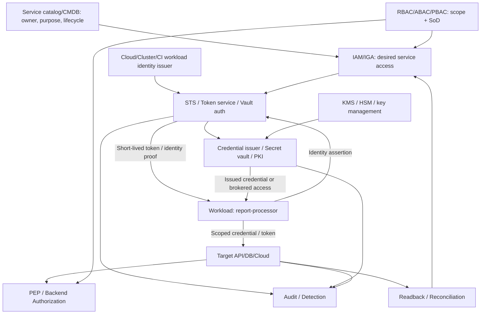
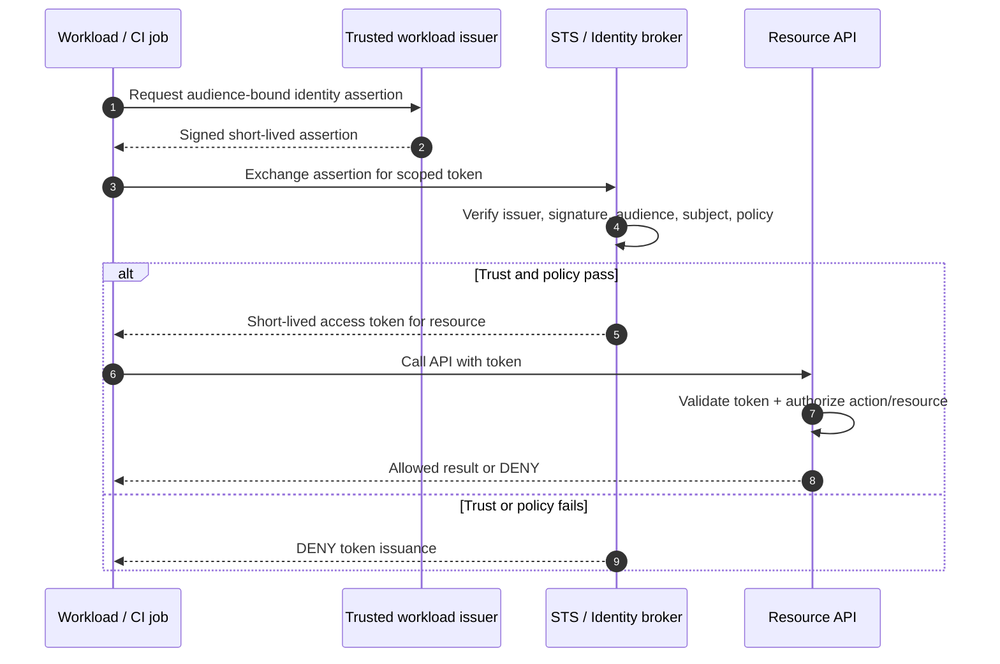
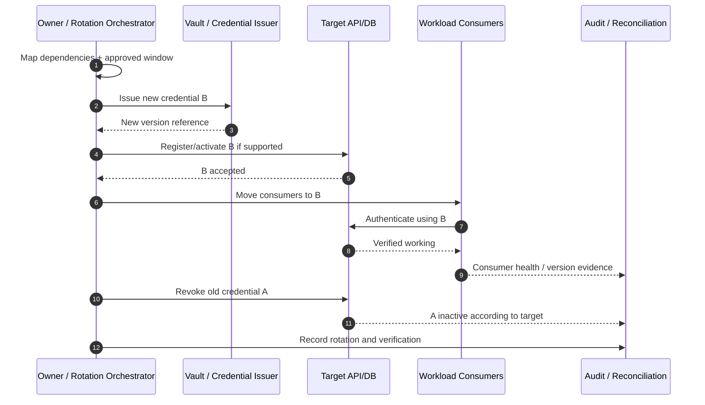

# Credential của service trong quản lý vòng đời danh tính IAM

## 1. Credential của service là gì?

**Credential của service (service credential)** là bằng chứng hoặc vật liệu xác thực được sử dụng để một **service, workload, ứng dụng, bot hoặc tiến trình tự động** chứng minh danh tính khi truy cập tài nguyên. Trong **Identity and Access Management (IAM)**, credential giúp hệ thống trả lời câu hỏi **“workload nào đang gọi?”**, sau đó chính sách truy cập quyết định **“workload được thực hiện hành động nào, trên tài nguyên nào, trong điều kiện nào?”**.

Ví dụ, một ứng dụng `report-processor` cần đọc dữ liệu từ database báo cáo hoặc gọi API lưu trữ. Ứng dụng có thể xác thực bằng:

- **Client secret** dành cho OAuth confidential client.
- **Private key** để ký client assertion hoặc dùng trong mTLS.
- **Chứng thư số** dùng để xác thực máy–máy.
- **Access token ngắn hạn** lấy từ một token service đáng tin cậy.
- **Workload identity** do cloud/orchestrator xác nhận, đổi lấy token phù hợp.
- **Database credential động** có thời hạn và quyền giới hạn.
- **API key tĩnh** trong hệ thống legacy, được bảo vệ và quản lý vòng đời.

**Credential không phải danh tính service.** Danh tính service là một thực thể được quản lý; credential là một **cách service chứng minh** danh tính đó. Một service có thể có nhiều credential đang hiệu lực để chuyển đổi an toàn, hoặc dùng danh tính workload mà không cần lưu secret dài hạn trong ứng dụng.

Trong module vòng đời danh tính theo **Joiner–Mover–Leaver (JML)**, service credential cần được quản trị song song với account con người: **đăng ký, cấp phát, phân quyền, vận hành, luân chuyển, thu hồi, kiểm toán và ngừng sử dụng**. Khi chủ sở hữu nhân sự thay đổi, quyền cá nhân phải được xử lý, nhưng service có thể vẫn cần duy trì để phục vụ hệ thống.

### 1.1. Ví dụ nhanh

Một nhân viên cấu hình job đồng bộ dữ liệu bằng service account `svc-report-sync`. Job cần quyền `report:read` trong tenant A. Phương án tốt là xác thực workload được triển khai thực tế, cấp token/credential **chỉ cho đọc dữ liệu báo cáo**, có thời hạn và nhật ký sử dụng.

Phương án rủi ro là tạo tài khoản `administrator` dùng chung, đặt mật khẩu trong repository rồi cho mọi developer biết. Khi một developer nghỉ việc, không thể dễ dàng xác định các bản sao secret, các job phụ thuộc và đường truy cập còn hiệu lực.

**Mục tiêu của bài:** hiểu cơ chế và nguyên tắc lựa chọn, sử dụng, xoay vòng và thu hồi credential của service sao cho đáp ứng **least privilege**, bảo mật, khả năng vận hành và giảm quyền truy cập tồn dư.

## 2. Phân biệt service identity với danh tính con người

| Đặc điểm | Danh tính con người | Service/workload identity |
|---|---|---|
| Chủ thể | Nhân viên, nhà thầu, đối tác | Ứng dụng, job, pod, máy, pipeline |
| Nguồn quản trị | HRIS/VMS/sponsor | Service catalog, CMDB, cloud/orchestrator, owner |
| Xác thực phổ biến | SSO, passkey, MFA | mTLS, workload federation, service credential, token |
| Vòng đời chính | Joiner–Mover–Leaver | Register–Deploy–Operate–Rotate–Decommission |
| Permission | Vai trò công việc, nhóm, scope | Quyền gọi API/DB/cloud tối thiểu |
| Người chịu trách nhiệm | Identity owner chính là người dùng | Business/technical owner của workload |
| Thời gian truy cập | Phiên làm việc có ngắt quãng | Chạy tự động, theo lịch hoặc liên tục |
| Rủi ro đặc thù | Credential phishing, quyền cũ sau Mover | Secret trong CI/CD, key bị copy, owner mồ côi |
| Thu hồi | Disable account, role, token/session | Revoke credential/role, stop workload, kiểm tra dependency |

**Không áp dụng nguyên xi MFA tương tác của con người cho tiến trình máy–máy.** Service thường không thể bấm xác nhận push hoặc nhập OTP cho từng request. Giải pháp là **xác thực workload bằng bằng chứng máy**, kết hợp danh tính, khóa, chứng thư hoặc federation được cấp/kiểm tra có kiểm soát.

### 2.1. Người quản trị service không đồng nghĩa service

Kỹ sư An có thể được quyền triển khai `svc-report-sync`. Quyền cá nhân của An và quyền service là **hai principal khác nhau**:

- An có thể gọi `deployment:update` và `service:configure`.
- `svc-report-sync` có thể gọi `report:read`.
- An **không tự kế thừa** mọi quyền của service để truy cập dữ liệu.
- Service **không tự kế thừa** quyền quản trị cloud của An.
- Khi An trở thành Leaver, IAM thu hồi quyền cá nhân, kiểm tra secret từng tiếp xúc và **bàn giao owner service**.

## 3. Phân biệt identity, account, credential, secret và token

| Thuật ngữ | Định nghĩa | Ví dụ |
|---|---|---|
| **Service identity** | Danh tính logic của workload | `svc-report-sync` |
| **Service account** | Account đại diện service ở nền tảng/đích | Kubernetes ServiceAccount, DB user |
| **Principal** | Chủ thể mà hệ thống authorization kiểm tra | Client/application ID hoặc workload subject |
| **Credential** | Bằng chứng để xác thực | Secret, private key, certificate, token |
| **Secret** | Giá trị cần được giữ bí mật | Client secret, API key, password |
| **Private key** | Thành phần mật mã riêng cần bảo vệ | Khóa ký client assertion |
| **Certificate** | Ràng buộc public key với thông tin danh tính theo PKI | X.509 client certificate |
| **Access token** | Bằng chứng ủy quyền để gọi resource server | OAuth access token cho API |
| **ID token** | Thông tin xác thực danh tính trong OpenID Connect | Token cho OIDC client, không thay access token API |
| **Entitlement/permission** | Quyền thực hiện hành động trên tài nguyên | `report:read` trên tenant A |
| **Lease** | Hợp đồng cấp credential/quyền có thời hạn | User DB động sống 15 phút |
| **Credential reference** | Tham chiếu nơi credential được quản lý | `vault://prod/report-reader` |

### 3.1. Không nhầm username/password của service với OAuth client ID/secret

Một OAuth **client ID** thường là định danh ứng dụng, **không phải secret**. Một **client secret** là thông tin cần giữ bí mật của confidential client. Sở hữu client ID đơn thuần **không chứng minh** caller là service hợp lệ.

### 3.2. Không coi access token là mã định danh bền vững

Access token có hạn dùng, audience, scope và có thể là token opaque hoặc JWT. **Service identity ID** cần ổn định ở catalog; **token value** không nên được dùng làm khóa chính để quản lý owner hay lịch sử truy cập.

## 4. Vì sao credential của service là mục tiêu tấn công hấp dẫn?

Credential service thường được dùng:

- Trong deployment pipeline và automation.
- Trên server/container chạy liên tục.
- Khi kết nối DB, cache, broker, SaaS hoặc cloud.
- Bên trong file cấu hình hoặc biến môi trường legacy.
- Trong nhiều môi trường nếu thiết kế tách quyền chưa tốt.
- Không có người dùng trực tiếp quan sát khi bị lạm dụng.

Những rủi ro điển hình:

1. **Hardcoded secret:** key được commit vào Git.
2. **Secret leakage:** token in vào log, trace, lỗi HTTP hoặc build artifact.
3. **Overprivilege:** bot đồng bộ có quyền admin toàn tenant.
4. **Secret reuse:** một credential dùng cho production và staging.
5. **No expiry:** API key tồn tại nhiều năm.
6. **No owner:** khi người tạo nghỉ việc, không ai biết service còn chạy ở đâu.
7. **Lateral movement:** attacker lấy credential của một workload để gọi API khác.
8. **Confused deputy:** một service có đặc quyền bị lợi dụng để thực hiện hành động cho caller không được phép.
9. **Stale grants:** quyền vẫn còn sau khi service bị decommission hoặc scope thay đổi.
10. **Rotation outage:** đổi secret đột ngột làm ngừng toàn bộ consumer.

**Bảo vệ credential cần đồng thời giảm khả năng lộ, giảm phạm vi tác động nếu lộ và bảo đảm có thể thu hồi.**

## 5. Các loại credential thường dùng cho service

| Loại | Cơ chế chính | Ưu điểm | Hạn chế |
|---|---|---|---|
| **Static password** | Username + password | Tương thích hệ thống cũ | Khó bảo vệ, chia sẻ, rotation |
| **API key** | Khóa gửi kèm API request | Tích hợp đơn giản | Có thể bị copy, thiếu expiry/scope |
| **OAuth client secret** | Client xác thực với authorization server | Hợp với confidential client | Là shared secret, cần quản trị |
| **Private key JWT assertion** | Client ký assertion để chứng minh possession | Không gửi shared secret | Cần PKI/key rotation và chống replay |
| **mTLS certificate** | Xác thực peer bằng chứng thư và private key | Xác thực mật mã hai chiều | Quản trị cert/trust chain/renewal |
| **Short-lived access token** | Dùng token giới hạn scope/audience | Giảm thời gian hiệu lực | Token có thể bị đánh cắp trong TTL |
| **Workload federation** | Đổi identity assertion của nền tảng lấy token | Tránh lưu credential dài hạn | Cấu hình trust/audience dễ sai |
| **Dynamic DB credential** | Tạo DB role/account tạm theo lease | Quyền và TTL hẹp | Phụ thuộc engine/target hỗ trợ revoke |
| **SSH certificate** | Chứng thư SSH thời hạn ngắn | Hạn chế key tĩnh | Cần CA/trust và chính sách host |
| **Cloud managed identity** | Cloud phát token cho workload được gắn identity | Giảm secret bootstrap | Gắn chặt trust cloud/instance config |

### 5.1. Không có loại credential tốt nhất cho mọi hệ thống

Ưu tiên thường là **danh tính workload có thể xác minh và credential ngắn hạn** khi hạ tầng hỗ trợ, song cần xét:

- Đích chấp nhận kiểu xác thực nào?
- Có cơ chế issuer/trust đáng tin?
- Phạm vi quyền và tenant được giới hạn ra sao?
- Có thể rotate/revoke không?
- Workload chạy ở cloud, Kubernetes, VM hay môi trường legacy?
- Có công cụ quản lý chứng thư hoặc vault không?
- Khả năng khôi phục khi issuer/vault bị lỗi?

**Không ép một hệ thống legacy dùng cơ chế mà nó không hỗ trợ**, nhưng phải có kế hoạch giảm phụ thuộc vào secret tĩnh.

## 6. Kiến trúc tham chiếu cho service credential



Sơ đồ cho thấy **một kiến trúc logic**, không phải mọi deployment đều cần từng thành phần độc lập. Ví dụ, cloud có thể phát token trực tiếp qua managed identity, hoặc vault có thể issue database credential động.

### 6.1. Hai ranh giới quyết định

- **Authentication:** service có thực sự là workload được gắn identity đã đăng ký không?
- **Authorization:** identity đó có được gọi `report:read` với `resource.tenant=A` tại thời điểm này không?

Một token có chữ ký hợp lệ có thể xác thực caller nhưng **không tự cho phép mọi action**.

## 7. Thiết lập niềm tin ban đầu: service được nhận credential bằng cách nào?

Trước khi cấp credential, hệ thống cần có **cơ chế chứng minh danh tính ban đầu (bootstrap/trust establishment)**.

### 7.1. Các nguồn tin cậy thường gặp

- **Cloud instance/workload identity:** nền tảng gắn identity với một instance hoặc tài nguyên được kiểm soát.
- **Kubernetes projected ServiceAccount token:** cluster phát token được ký cho service account và audience phù hợp.
- **CI/CD OIDC identity:** pipeline được issuer phát assertion ràng buộc repository/workflow/environment theo cấu hình.
- **Certificate enrollment:** workload chứng minh đủ điều kiện nhận client certificate qua cơ chế PKI.
- **mTLS registration:** trust anchor và subject/SAN của certificate được ánh xạ tới service identity.
- **Legacy bootstrap credential:** cần bảo vệ chặt, TTL/rotation và kế hoạch thay thế.

### 7.2. Một claim do caller tự gửi không đủ

Sai về nguyên tắc:

```json
{
  "service_name": "payment-service",
  "is_trusted": true,
  "requested_role": "cloud_admin"
}
```

Server không được xem các giá trị ấy là chứng minh caller. Phải xác minh **issuer, signature hoặc bằng chứng mật mã, audience, hạn dùng, subject binding và môi trường** theo mô hình trust đã cấu hình.

### 7.3. Service registration là bước quản trị

Một service nên được đăng ký trước khi cấp quyền:

- `service_identity_id` ổn định.
- Owner nghiệp vụ và owner kỹ thuật.
- Purpose, application, môi trường và tenant.
- Nguồn workload identity/issuer/trust domain.
- Những target và action cần thực hiện.
- Risk tier và phương pháp credential.
- Expiry, rotation/revocation mechanism.
- Kênh audit và quy trình decommission.

## 8. Static secret: khi nào vẫn phải dùng?

Nhiều API và DB legacy chỉ hỗ trợ **password hoặc API key tĩnh**. Khi không thể chuyển ngay sang token/certificate ngắn hạn, phải quản trị credential tĩnh như tài sản nhạy cảm.

### 8.1. Những yêu cầu tối thiểu

1. Secret có **owner và mục đích**.
2. Được tạo từ nguồn entropy đủ mạnh, không phải chuỗi dễ đoán.
3. Lưu trong **secret manager/vault**, không trong repository hoặc ticket.
4. Được phân quyền theo **workload/environment/tenant**.
5. Có cơ chế rotation và phụ thuộc consumer rõ ràng.
6. Không tái sử dụng cùng một secret giữa nhiều môi trường khi có thể tách.
7. Có ngày tạo, ngày thay, policy expiry/reevaluation và event audit.
8. Có cách phát hiện leak và revoke tại hệ thống đích.
9. Giảm plaintext exposure ở client và log.
10. Có kế hoạch chuyển sang phương án ngắn hạn nếu hệ thống hỗ trợ về sau.

### 8.2. Không dùng một service password cho nhiều account đích

Một mật khẩu dùng chung trên DB, API và máy chủ khiến một sự cố có thể mở nhiều đường truy cập. **Credential isolation** theo workload và target giúp giảm phạm vi ảnh hưởng và hỗ trợ rotation từng phần.

## 9. Credential động và quyền có thời hạn

**Dynamic credential** thường được tạo theo request, giới hạn quyền và thời hạn, chẳng hạn user DB tạm hoặc session token của cloud.

Ví dụ:

```text
Workload identity: svc-report-sync
Approved role: report_readonly
Target: reports-db / tenant-A
Request TTL: 15 minutes
        |
        v
Credential issuer verifies workload identity + policy
        |
        v
Creates short-lived DB credential
        |
        v
Workload reads reports within allowed scope
        |
        v
Lease expires / explicit revoke
        |
        v
Target-side revocation or expiry verified
```

### 9.1. Lease không phải bằng chứng thu hồi tức thời

Một vault có thể ghi lease `EXPIRED` trong khi connection DB hoặc credential tại target vẫn đang có hiệu lực do:

- Engine/plugin không hỗ trợ revoke ngay.
- Hệ thống đích cập nhật bất đồng bộ.
- Phiên DB đã mở chưa bị kết thúc.
- Tác vụ revoke lỗi hoặc không được kiểm tra.
- Credential đã được sao chép ra ngoài.

Với quyền nhạy cảm, phải **đối soát target** hoặc áp cơ chế hạn chế phù hợp, không dựa hoàn toàn vào timer trong vault.

### 9.2. Không gia hạn lease vô điều kiện

Việc renew nên kiểm tra **identity workload, source state, owner/policy, tenant và TTL tối đa**. Workload đã bị decommission hoặc bị đánh dấu compromised không được tự gia hạn chỉ vì vẫn giữ lease ID cũ.

## 10. Workload identity federation

**Workload identity federation** cho phép service dùng **bằng chứng danh tính do nền tảng đáng tin cậy phát hành** để lấy credential/token từ một bên cung cấp tài nguyên khác, giảm nhu cầu lưu secret tĩnh lâu dài.

Một luồng logic:



### 10.1. Những thuộc tính phải ràng buộc

- **Issuer:** ai ký assertion.
- **Subject:** workload instance, account, repository hoặc service identity phù hợp.
- **Audience:** token dành cho bên nhận/STS nào.
- **Issued at/expiry/not before:** có còn trong khoảng hợp lệ không.
- **Environment:** production/staging/test phải được phân biệt.
- **Trust scope:** cluster, namespace, repository, branch, deployment hoặc tenant.
- **Replay protections:** nonce/jti hoặc cơ chế phù hợp khi giao thức/issuer hỗ trợ.
- **Target permission:** role/scope mà assertion được phép đổi lấy.

Nếu trust policy chỉ kiểm tra “issuer thuộc cùng tổ chức” nhưng không ràng buộc **repository/workflow/environment**, một job ít tin cậy có thể xin quyền production.

### 10.2. Federation không làm mất hoàn toàn secret

Bản thân workload có thể không lưu secret dài hạn, nhưng issuer vẫn cần **khóa ký, cấu hình trust và kiểm soát vòng đời**. Những thành phần này là gốc tin cậy phải được bảo vệ và xoay vòng.

## 11. OAuth 2.0 Client Credentials cho service-to-service

**OAuth 2.0 Client Credentials grant** là luồng phù hợp khi **confidential client** yêu cầu access token **nhân danh chính client**, không phải thay mặt một người dùng đang tương tác.

Ví dụ minh họa dùng `client_secret_basic`, trong đó giá trị Authorization đã được che:

```http
POST /oauth2/token HTTP/1.1
Host: auth.example.org
Authorization: Basic <redacted-confidential-client-credential>
Content-Type: application/x-www-form-urlencoded
Accept: application/json

grant_type=client_credentials&scope=report.read
```

Authorization server xác thực client và quyết định có phát token cho scope phù hợp không. Một phản hồi **minh họa**:

```json
{
  "access_token": "<redacted-short-lived-token>",
  "token_type": "Bearer",
  "expires_in": 900,
  "scope": "report.read"
}
```

Đây là **ví dụ giao thức**, không phải endpoint hoặc credential thật. Trường `expires_in` cho thời gian còn hiệu lực tính từ lúc phát token theo nghĩa của response; giá trị cụ thể là chính sách của issuer.

### 11.1. Một số giới hạn quan trọng

- Client credentials không biểu diễn **ủy quyền của một user cụ thể**.
- Quyền caller là quyền **service principal**, không phải role của developer vận hành nó.
- Không dùng **OIDC ID token** để thay access token gọi API.
- Resource server cần kiểm tra issuer, audience, expiry, token validity và scope/permission theo hợp đồng.
- `scope=report.read` không tự chứng minh quyền đọc **mọi report mọi tenant**; cần authorization ở tài nguyên đích.
- Access token Bearer nếu bị lộ vẫn có thể bị dùng trong thời gian còn hiệu lực, trừ khi có thêm sender constraints hoặc revocation/authorization controls.

### 11.2. Client secret không phải lựa chọn duy nhất

Confidential client có thể dùng **private_key_jwt**, **mTLS client authentication** hoặc cơ chế khác mà authorization server hỗ trợ. Những phương án này cần quản trị khóa/chứng thư và trust riêng; không tự động an toàn nếu private key bị lộ.

## 12. private_key_jwt và xác thực client bằng khóa bất đối xứng

Thay vì gửi shared client secret, một service có thể dùng **private key** ký **JWT client assertion** để chứng minh mình sở hữu khóa đã đăng ký.

Một assertion thường cần ràng buộc:

- Client ID hoặc subject được đăng ký.
- Audience chỉ đúng token endpoint/issuer nhận assertion.
- Expiry ngắn và thông tin thời điểm phù hợp.
- Chữ ký bằng thuật toán được cho phép, khóa/JWK phù hợp.
- Replay protection theo khả năng của authorization server (ví dụ `jti`).
- Kiểm tra client registration và key version.

### 12.1. Quy trình logic

```text
Workload signs short-lived client assertion
    -> Authorization Server validates assertion
    -> Auth Server issues scoped access token
    -> Workload calls Resource API
    -> API validates token and authorizes resource action
```

**Đừng xem việc dùng JWT ký là an toàn nếu private key được để plaintext trong image/container**. Ưu tiên cơ chế bảo vệ khóa, không xuất khóa khi khả thi, và quản trị rotation.

### 12.2. Tránh confused deputy

Một service có quyền gọi nhiều API phải kiểm tra **caller và tác vụ mà caller muốn thực hiện** trước khi sử dụng token service của chính mình. Nếu không, user không có quyền có thể yêu cầu một service đặc quyền làm thay hành động ngoài phạm vi.

## 13. mTLS và chứng thư service

**Mutual TLS (mTLS)** cho phép cả hai bên kết nối trình bày và kiểm tra chứng thư theo cấu hình tin cậy. Với service-to-service, chứng thư có thể gắn public key với danh tính workload.

### 13.1. Những thành phần cần bảo vệ

- **Private key:** không được lộ hoặc bị sao chép tùy ý.
- **Certificate:** mang public key và thuộc tính danh tính, thường không phải secret.
- **Trust anchor/CA:** xác định chuỗi tin cậy được chấp nhận.
- **Subject Alternative Name (SAN):** định danh cần map vào service principal.
- **Validity:** thời gian hiệu lực và chính sách gia hạn.
- **Certificate issuance/revocation:** hoạt động quản trị PKI.
- **Resource policy:** mTLS authenticated không đồng nghĩa authorized.

### 13.2. Hai câu hỏi riêng

1. Certificate có **xác thực được peer** theo CA, SAN, validity và các quy tắc trust không?
2. Peer identity ấy có **quyền gọi action trên resource cụ thể** không?

Nếu certificate hợp lệ cho `service-A`, điều đó không có nghĩa service-A được `db:admin`.

### 13.3. Certificate rotation

Cần quản trị:

- Cấp certificate mới trước khi bản cũ hết hạn.
- Phân phối private key qua kênh phù hợp.
- Cập nhật trust bundle nếu thay CA.
- Có khoảng chuyển đổi phù hợp với hệ thống đích.
- Ngăn chấp nhận certificate cũ quá thời hạn chính sách.
- Thử nghiệm việc ngắt kết nối và tự reconnect an toàn.

Không giả định tất cả hệ thống đều kiểm tra CRL/OCSP như nhau; **khả năng thu hồi certificate trước expiry tùy thiết kế trust, kiểm tra revocation và chính sách kết nối**.

## 14. SPIFFE/SPIRE và danh tính workload

**SPIFFE** cung cấp khái niệm chuẩn hóa danh tính workload (ví dụ SPIFFE ID dạng URI) và định dạng tài liệu danh tính có thể xác minh; **SPIRE** là một triển khai có thể phát hành các bằng chứng tương ứng.

Ví dụ định danh mang tính minh họa:

```text
spiffe://example.org/ns/finance/sa/report-processor
```

Một workload có thể dùng chứng thư dạng **X.509 SVID** hoặc JWT-SVID tùy cấu hình hệ thống.

### 14.1. Lợi ích thiết kế

- Tách danh tính workload khỏi password tĩnh.
- Có thể gắn identity theo cluster/namespace/service account hoặc các thuộc tính được xác minh.
- Hỗ trợ certificate/token có thời hạn ngắn.
- Tích hợp chính sách service-to-service dựa trên identity đáng tin.

### 14.2. Điều vẫn cần thiết

- Bảo vệ trust domain và cơ chế attestation.
- Kiểm soát ai được đăng ký identity và mapping.
- Không chấp nhận một SPIFFE ID do client tự khai báo qua HTTP header chưa xác thực.
- Thiết lập audience/trust khi dùng JWT-SVID.
- Kiểm tra authorization riêng ở PEP.
- Quản trị issuance, rotation, logs và decommission.

**SPIFFE ID không phải permission.** Identity đáng tin chỉ là đầu vào để PDP/PEP đánh giá quyền.

## 15. Kubernetes ServiceAccount token và quyền workload

Trong Kubernetes, một **ServiceAccount** cung cấp danh tính cho workload tương tác với Kubernetes API và có thể là cơ sở cho federation với dịch vụ ngoài cluster.

### 15.1. Các lớp cần phân biệt

| Lớp | Ý nghĩa | Kiểm soát |
|---|---|---|
| Kubernetes ServiceAccount | Principal trong namespace/cluster | Registration và owner |
| Projected token | Bằng chứng danh tính có audience/expiry | TTL, token mount và audience |
| Kubernetes RBAC | Cho phép các action trên Kubernetes API | Role/RoleBinding scope |
| External workload federation | Đổi token KSA sang token provider ngoài | Issuer/subject/audience trust |
| Application RBAC/ABAC | Quyền trên resource nghiệp vụ | PEP/PDP tại ứng dụng |

### 15.2. Không cấp mặc định quyền đọc secret của cluster

Tài khoản chạy một web API có thể không cần gọi Kubernetes API. Nếu không cần, hạn chế token mounting theo thiết kế, không cấp role đọc `Secrets` tùy tiện.

Ví dụ manifest **minh họa** cho workload không cần truy cập Kubernetes API:

```yaml
apiVersion: v1
kind: ServiceAccount
metadata:
  name: public-web
  namespace: public
automountServiceAccountToken: false
```

Với workload **cần** projected identity token để federation, phải cấu hình token projection/audience và quyền tối thiểu theo nền tảng; không bê manifest `automountServiceAccountToken: false` vào mọi trường hợp mà không xét nhu cầu xác thực.

### 15.3. Tránh nhầm namespace với tenant nghiệp vụ

Namespace có thể là ranh giới triển khai, nhưng **tenant authorization của ứng dụng** vẫn cần kiểm tra riêng. Một pod trong namespace `finance` không tự được đọc dữ liệu mọi khách hàng.

## 16. Cloud managed identity và quyền IAM của cloud

Một số nền tảng cloud hỗ trợ **managed identity/service account/role session** để workload lấy credential/token mà không tự lưu access key dài hạn trong code.

Quy trình khái niệm:

1. Quản trị viên gắn service identity với tài nguyên cloud/runner phù hợp.
2. Cloud kiểm tra workload/instance có được phép dùng identity đó không.
3. Workload lấy token/credential qua endpoint/SDK được nền tảng cung cấp.
4. Target API xác thực token và đánh giá quyền.
5. Workload nhận credential mới khi credential cũ gần hết hạn.

### 16.1. Cần tách hai loại quyền

- **Quyền được sử dụng managed identity:** ai/instance nào có thể “assume” hoặc dùng identity.
- **Quyền của managed identity:** identity đó làm được gì trong cloud/resource.

Cấu hình sai một trong hai đều có thể tạo privilege escalation.

### 16.2. Bảo vệ metadata/credential endpoint

Không để một ứng dụng tùy ý yêu cầu proxy gọi metadata endpoint rồi trả token về cho attacker (**SSRF risk**). Cần cấu hình hạ tầng, chặn SSRF và kiểm soát quyền theo đặc điểm nền tảng.

### 16.3. Không tái sử dụng production identity ở staging

Nên có identity và policy riêng theo **môi trường** khi khả thi, để một bản build staging bị chiếm không có quyền production.

## 17. Secret manager/Vault trong vòng đời service credential

Khi phải lưu hoặc phát credential, **secret manager/vault** giúp quản trị lưu trữ, cấp quyền sử dụng, rotation, audit và đôi khi dynamic credential.

### 17.1. Mô hình hợp lý

```text
Service identity -> trusted authentication to vault
    -> policy restricts secret path / operation
    -> vault returns scoped credential or brokered handle
    -> service calls target
    -> lease / rotation / revocation monitored
```

### 17.2. Vault không phải nguồn quyền duy nhất

Một bot có thể bị gỡ quyền đọc secret tại vault nhưng vẫn giữ:

- API key đã lấy và lưu cục bộ.
- DB connection đang hoạt động.
- Certificate đã phát hành còn hạn.
- PAT từ một SaaS không đi qua vault.
- Local role trong target ứng dụng.

Vì vậy **revoke vault access** và **revoke target credential/effective access** là hai bước cần theo dõi riêng.

### 17.3. Mã tham chiếu tốt hơn plaintext trong cấu hình

Ví dụ mô hình cấu hình:

```yaml
service:
  name: report-processor
  environment: production
  identity_ref: workload/report-processor

database:
  endpoint: reporting-db.internal
  credential:
    provider: managed-secret-broker
    role_ref: reporting-readonly

authorization:
  target_tenant: tenant-a
  allowed_actions:
    - report:read
```

Đây là cấu hình **khái niệm**, không phải YAML có thể đưa vào Spring Boot/secret manager bất kỳ. Nó cố ý **không chứa mật khẩu, token hoặc private key**.

## 18. Tránh “secret zero”

**Secret zero** là bí mật ban đầu mà workload cần giữ để lấy các secret khác. Nếu để một vault root token trong image hoặc repository, tổ chức chỉ **đổi chỗ lưu secret** chứ chưa giải quyết rủi ro.

### 18.1. Các hướng giảm secret zero

- Workload identity federation với cloud/orchestrator.
- CI/CD OIDC assertion có ràng buộc môi trường.
- mTLS với private key được cấp và bảo vệ có kiểm soát.
- Identity attestation theo nền tảng.
- Credential bootstrap ngắn hạn và scope hẹp khi bắt buộc dùng.
- Secret broker với capability/token chỉ cho role cần thiết.

### 18.2. Bài toán vẫn có gốc tin cậy

Không có mô hình nào “không cần tin ai”: federation tin issuer, mTLS tin CA và hệ thống cấp certificate, vault tin auth method, cloud identity tin control plane. Cần **bảo vệ trust anchors, chính sách cấp danh tính và log quản trị**.

## 19. Least privilege: credential không được mang quyền quá rộng

Một service đọc dữ liệu báo cáo không cần các quyền:

- `identity:manage_all_users`.
- `policy:update`.
- `secret:read_all`.
- `production:admin`.
- `invoice:approve`.
- `billing:write`.

Ví dụ policy logic:

```text
PERMIT report:read IF
    subject.type == WORKLOAD
    AND subject.id == "svc-report-sync"
    AND subject.status == ACTIVE
    AND subject.environment == "production"
    AND subject.tenant_id == resource.tenant_id
    AND action.id == "report:read"

DENY OTHERWISE
```

### 19.1. RBAC, ABAC và PBAC cùng tham gia

- **RBAC:** service được gán role `report_reader`.
- **ABAC:** kiểm tra tenant, environment, resource classification, identity provenance.
- **PBAC:** dùng policy được quản trị để quyết định permit/deny.
- **PAM/JIT:** khi service cần quyền đặc biệt trong công việc ngắn hạn.
- **PEP:** bắt buộc kiểm tra ở API/DB/target thay vì chỉ ẩn endpoint.

### 19.2. Không cấp quyền “đọc tất cả secret” cho CI/CD

Một pipeline chỉ triển khai ứng dụng A thường chỉ cần quyền lấy secret/deployment token của A ở đúng môi trường. Nếu toàn bộ runner có quyền `vault:admin`, lộ pipeline có thể lộ credential nhiều dịch vụ.

## 20. Ranh giới audience, scope, tenant và môi trường

Bốn chiều thường bị kiểm tra thiếu:

| Chiều | Ý nghĩa | Sai lầm |
|---|---|---|
| **Audience** | Token dành cho resource server nào | Dùng token API-A để gọi API-B |
| **Scope/permission** | Caller có thể làm hành động gì | `report.read` bị coi như `report.admin` |
| **Tenant/resource scope** | Phạm vi dữ liệu của quyền | Workload tenant A đọc dữ liệu tenant B |
| **Environment** | Production/staging/dev | Token staging được chấp nhận ở production |

### 20.1. Validate tại resource server

Resource server phải kiểm tra **issuer, signature hoặc introspection hợp lệ, expiry, audience, client identity/scope và policy theo resource**. Với JWT cần tránh chấp nhận thuật toán không cho phép hoặc khóa không khớp trust config.

### 20.2. Scope không đủ cho resource-level authorization

Một token có `report.read` có thể chỉ nên đọc báo cáo dự án P1. API vẫn phải so sánh `subject.tenant`, `resource.project`, classification và trạng thái hiện hành.

### 20.3. Service identity không cho phép bypass user authorization

Nếu một backend service đang làm việc **thay mặt user**, cần mô hình delegated authorization rõ ràng: token exchange/delegation hoặc user context được bảo vệ. Không dùng token service toàn quyền để bỏ qua kiểm tra quyền của user khởi tạo.

## 21. Vòng đời credential: đăng ký, phát hành, sử dụng, thu hồi

```mermaid
stateDiagram-v2
    [*] --> REGISTERED
    REGISTERED --> APPROVED: Owner + policy review
    APPROVED --> ISSUING: Workload trust verified
    ISSUING --> ACTIVE: Credential issued and target accepts
    ACTIVE --> RENEWING: Near expiry
    RENEWING --> ACTIVE: New valid credential verified
    ACTIVE --> ROTATING: Security / lifecycle / policy event
    ROTATING --> ACTIVE: New active; old retired
    ACTIVE --> SUSPENDED: Incident / uncertain trust
    SUSPENDED --> ROTATING: Safe recovery
    ACTIVE --> REVOKING: Decommission / expiry / compromise
    SUSPENDED --> REVOKING: Revoke decision
    REVOKING --> REVOKED_VERIFIED: Target-side evidence
    REVOKED_VERIFIED --> RETIRED
    RETIRED --> [*]
```



### 21.1. Không đồng nhất các trạng thái

| Trạng thái | Đã biết | Chưa thể kết luận |
|---|---|---|
| `REGISTERED` | Service có identity record | Credential đã phát hành |
| `ISSUED` | Issuer đã tạo credential | Target đã chấp nhận |
| `ACTIVE` | Credential có thể được dùng | Mọi request đều được phép |
| `ROTATING` | Có kế hoạch/thao tác thay secret | Secret cũ đã hết hiệu lực |
| `REVOKE_REQUESTED` | Đã gửi yêu cầu thu hồi | Target đã xóa quyền |
| `REVOKED_VERIFIED` | Có bằng chứng revocation theo phạm vi | Những hệ thống ngoài phạm vi cũng an toàn |
| `RETIRED` | Service/credential kết thúc vòng đời | Mọi backup đã xóa theo chính sách |

### 21.2. Nhiều credential cùng active để chuyển đổi

Một service có thể tạm có **key A và key B** trong khoảng rotation nếu issuer/target hỗ trợ. Điều quan trọng là **thời hạn overlap giới hạn và revoke A có xác minh**.

## 22. Luân chuyển static credential không gây outage

Một quy trình rotation cần phối hợp **issuer/vault, target và consumers**.



### 22.1. Khi đích chỉ cho một secret active

Không phải hệ thống nào cũng hỗ trợ dual-key overlap. Nếu chỉ cho **một password active**, cần:

- Biết chính xác ứng dụng sử dụng account đó.
- Quản lý khoảng gián đoạn hoặc cơ chế refresh phù hợp.
- Thay password và cập nhật consumers có phối hợp.
- Đọc lại trạng thái kết nối và credential cũ.
- Không restore secret đã bị lộ khi rotation thất bại.
- Có phương án khôi phục an toàn và incident escalation.

### 22.2. Khi quá trình rotation timeout

Không tự kết luận thất bại rồi thay secret thêm lần nữa. Có thể target đã nhận B nhưng response bị mất. Cần **readback an toàn**, kiểm tra active key version/connection theo năng lực target và ghi trạng thái `UNKNOWN` nếu chưa xác minh.

## 23. Rotation chứng thư và khóa bất đối xứng

Với mTLS, SSH certificate hoặc private-key client authentication, rotation thường gồm:

1. Tạo key pair mới hoặc nhận key được bảo vệ theo nền tảng.
2. Hoàn tất issuance theo identity/CA có thẩm quyền.
3. Đăng ký public key/certificate hoặc trust chain.
4. Cập nhật workloads và xác minh kết nối.
5. Chuyển traffic có kiểm soát.
6. Thu hồi/hết hạn private key/cert cũ theo khả năng.
7. Xóa quyền truy cập không còn cần và ghi audit.

### 23.1. Private key và certificate có nghĩa khác nhau

- Certificate chứa **public key**, thường có thể được phân phối.
- **Private key** cần được giữ bí mật, có thể sử dụng thiết bị/SDK hỗ trợ ký không xuất khóa.
- Certificate hết hạn hoặc bị revoke không nhất thiết làm **mọi phiên đang mở** bị đóng ngay; cần xem handshake, session resumption và chính sách target.

### 23.2. Rotation CA là thay đổi lớn

Đổi CA/trust domain có thể khiến hàng loạt service không kết nối được. Cần **trust bundle transition, phân phối theo vùng, kiểm thử tương thích và kiểm tra chống chấp nhận CA sai**.

## 24. TTL, renewal, revocation và session tồn dư

Những khái niệm này dễ bị đồng nhất:

| Cơ chế | Làm gì? | Giới hạn |
|---|---|---|
| **TTL** | Đặt thời hạn credential/token | Có thể còn phiên hoặc cache tùy target |
| **Renewal** | Gia hạn hoặc phát bản mới | Phải kiểm tra caller còn hợp lệ |
| **Token revocation** | Thông báo/ghi nhận token mất hiệu lực | Resource server phải hỗ trợ/kiểm tra |
| **Credential rotation** | Thay giá trị secret/key được chấp nhận | Bản sao secret cũ có thể còn đến khi target chặn |
| **Role revoke** | Gỡ quyền gán cho principal | Token/permission cache có thể chậm cập nhật |
| **Session termination** | Kết thúc phiên đang hoạt động | Không tự thu hồi credential khác |
| **Account disable** | Chặn account theo cơ chế target | Cần xác minh các đường độc lập |

### 24.1. JWT ngắn hạn và revoke

Một access token JWT đã phát hành thường có thể được resource server xác minh cục bộ. **Không thể mặc định thu hồi tức thời mọi JWT chỉ bằng đổi role trong IdP**. Có thể cần thời hạn token ngắn, token introspection, denylist, session-version check hoặc authorization động phù hợp thiết kế.

### 24.2. Renewal khi owner/service thay đổi

Trước khi cấp token hoặc lease mới, phải kiểm tra **service status, environment, policy, trust và owner governance** khi cần. Không dùng một credential/lease bị decommission để xin credential mới vô hạn.

## 25. Java/Spring: cách truy cập service credential an toàn

Trong ứng dụng Java, nên dùng **SDK hoặc provider phù hợp** để lấy token/credential qua workload identity hoặc secret broker. Tránh hardcode password/client secret vào source code.

### 25.1. Cấu hình khái niệm

```yaml
application:
  name: report-processor
  environment: production

service_identity:
  provider: workload_federation
  audience: reporting-api
  identity_ref: workload/report-processor

downstream:
  api_endpoint: https://reports.internal.example.org
  required_scope: report.read
  tenant: tenant-a
```

Đây là YAML **minh họa**, không phải cấu hình Spring Boot thực thi trực tiếp.

### 25.2. Mã giả Java với credential provider

```java
public final class ReportSyncService {
    private final WorkloadIdentityProvider workloadIdentity;
    private final ScopedTokenProvider tokenProvider;
    private final ReportApiClient reportApi;

    public void synchronizeReports(String projectId) {
        WorkloadAssertion assertion =
            workloadIdentity.obtainAssertion("trusted-sts");

        ScopedAccessToken token =
            tokenProvider.exchangeForToken(
                assertion,
                "reporting-api",
                "report.read"
            );

        // API vẫn phải kiểm tra token, tenant và project.
        reportApi.readReports(
            token.asProtectedHandle(),
            "tenant-a",
            projectId
        );

        // Không ghi assertion/token vào log hoặc exception.
    }
}
```

Các interface trên là **mã giả**, không phải thư viện chuẩn có sẵn. Ứng dụng thực tế cần chọn SDK được hỗ trợ, cấu hình TLS/issuer/audience đúng, xử lý cache token, expiry/refresh, retry, timeout và không giữ bearer token lâu hơn cần thiết.

### 25.3. Tách credential acquisition khỏi business logic

Một `CredentialProvider` hoặc SDK adapter có thể quản lý **refresh trước expiry**, đồng thời giảm việc từng service tự code OAuth hoặc lưu token tùy tiện.

Tuy nhiên abstraction không được che dấu **scope/tenant**: một method `getAdminToken()` dùng chung cho mọi tác vụ dễ tạo overprivilege. Nên cung cấp API rõ **resource, audience và mục đích**.

## 26. CI/CD và service credential cho pipeline

CI/CD runner thường cần:

- Đọc artifact và source có kiểm soát.
- Build/test.
- Ghi container image.
- Deploy vào môi trường được ủy quyền.
- Lấy credential cần thiết của ứng dụng theo phạm vi.

### 26.1. Trust của pipeline phải hẹp

Nếu dùng OIDC/federation, trust policy nên ràng buộc **repository, workflow, branch/tag, environment và audience** theo năng lực issuer. Không cho mọi pipeline từ cùng tổ chức assume role production.

### 26.2. Một bộ quyền mẫu

| Pipeline | Quyền cần | Không nên có |
|---|---|---|
| PR test | Đọc source và test resources | Production secrets hoặc deploy admin |
| Staging deploy | Deploy service A ở staging | Production account admin |
| Production deploy | Deploy bản đã duyệt của service A | Sửa IAM policy cho toàn tổ chức |
| Secret rotation job | Rotate đúng credential target A | Đọc mọi secret không liên quan |
| Audit job | Đọc metadata được ủy quyền | Sửa role/credential |

### 26.3. Build artifact không được chứa secret

Khi build Docker/JAR, cần tránh đưa secret vào:

- Source code và commit history.
- Build args có thể lưu trong layer/history.
- Container image layer.
- Log CI.
- Test report, snapshot hoặc stack trace.
- Artifact package và file cấu hình được phân phối công khai.

Secret dùng lúc chạy nên lấy từ runtime/provider phù hợp; nếu build cần credential, dùng cơ chế secret của build platform với scope và thời hạn được quản trị.

## 27. Service-to-service authorization và chống confused deputy

Một hệ thống microservice có thể có:

```text
User -> Frontend -> Order Service -> Payment Service
                      |
                      +-> Inventory Service
```

Order Service có token service riêng để gọi Payment Service. Nếu một user không có quyền hoàn tiền gửi yêu cầu `refund=true`, **Order Service phải kiểm tra quyền user/luồng nghiệp vụ** chứ không lấy token service của mình gọi Payment API vô điều kiện.

### 27.1. Hai lớp principal

- **Workload principal:** Order Service đang gọi Payment Service.
- **Business principal/delegated user:** người dùng hoặc workflow nào yêu cầu hành động.

Authorization cần biết khi nào phải kiểm tra **cả hai**. Không nhồi một user ID do HTTP client khai báo vào token context mà không xác minh.

### 27.2. Các biện pháp giảm rủi ro

1. Mỗi service có identity riêng, không dùng shared `backend-admin`.
2. Token có audience/resource phù hợp.
3. Scope chỉ cho action thật sự cần.
4. Request được kiểm tra ownership/tenant tại backend.
5. Có audit liên kết user/workflow và service principal.
6. Tách quyền phát hành token khỏi quyền tự quản lý policy.
7. Với delegated calls, dùng mô hình token exchange/on-behalf-of khi nền tảng hỗ trợ và đúng yêu cầu.
8. Không tin các header như `X-User-Role` nếu không có bảo vệ từ gateway/mesh được xác thực.

## 28. Cấp service credential và governance của owner

Trước khi tạo credential, tổ chức nên có **quy trình service registration/approval**.

| Bước | Người chịu trách nhiệm | Bằng chứng |
|---|---|---|
| Đăng ký service | Technical owner/Service owner | Service ID, purpose, môi trường |
| Xác định target | App/Data owner | API/DB/tenant và action cần |
| Xác định risk tier | Security/IAM | Privilege, dữ liệu, blast radius |
| Chọn auth method | Platform/Security | Federation/mTLS/secret-based |
| Phê duyệt role/scope | Owner/IGA | Least privilege, SoD |
| Issue credential | Trusted issuer/vault | Credential ref, version, expiry |
| Tích hợp ứng dụng | Engineering | SDK/secret handling test |
| Verification | Target owner/QA | Đúng action được phép, deny cho action khác |
| Vận hành | SRE/Service owner | Renewal/rotation/alert |
| Decommission | Service owner/IAM | Revoke và target readback |

### 28.1. Quyền phát credential là quyền đặc biệt

Một người có quyền tạo client secret hoặc đăng ký public key mới cho một service có thể **giả danh service**. Phải kiểm soát:

- Ai được thêm credential version mới.
- Ai được thay trust/redirect/audience hoặc role.
- Ai phê duyệt quyền cloud của service principal.
- Ai xem audit/usage và thay owner.
- Ai có quyền thu hồi credential.

Không chỉ bảo vệ bản thân secret; phải bảo vệ **management plane** của credential.

## 29. Service owner thay đổi theo Joiner–Mover–Leaver

Nguồn nhân sự có thẩm quyền thay đổi **người quản trị service**, trong khi service có vòng đời riêng.

### 29.1. Joiner của owner

Nhân viên mới có thể được cấp quyền **quản lý service** sau xác minh danh tính, MFA và phê duyệt. Điều đó không đồng nghĩa được xem plaintext mọi secret hoặc có role admin tại target.

### 29.2. Mover của owner

Khi An chuyển từ team Reporting sang Billing:

1. Xác định service/secret An đang sở hữu hoặc có quyền quản trị.
2. Chuyển owner sang người/team được duyệt.
3. Gỡ quyền quản trị cá nhân không còn cần.
4. Đánh giá credential An đã từng thấy hoặc sao chép; rotate theo rủi ro.
5. Đảm bảo workload còn chạy với identity và permission hợp lệ.
6. Đối soát quyền vận hành và credential tại target.

Nếu An còn assignment Reporting hợp lệ trong thời gian bàn giao, scope có thể được giữ **có hạn và được phê duyệt**, không mặc nhiên cắt toàn bộ.

### 29.3. Leaver của owner

Khi owner nghỉ việc:

- Disable quyền đăng nhập/quản trị của **người đó**.
- Thu hồi PAT, SSH key và quyền deploy cá nhân.
- Kiểm tra service credential từng được owner biết hoặc quản trị.
- Rotate credential tĩnh có nguy cơ.
- Bàn giao service ownership/approval.
- Giữ workload hợp lệ tiếp tục vận hành theo catalog và policy.
- Chỉ decommission service khi có quyết định/ngày hiệu lực riêng.

**Không tự xóa service account hay secret đang cần cho production chỉ vì owner trở thành Leaver.**

## 30. Service identity lifecycle: decommission có kiểm soát

Một service kết thúc vòng đời khi ứng dụng, job hoặc integration không còn được sử dụng.

### 30.1. Những bước cần thực hiện

1. Nhận quyết định decommission từ Service/App Owner có thẩm quyền.
2. Xác định tất cả deployment, tenant, target và consumers.
3. Dừng job hoặc traffic theo kế hoạch.
4. Gỡ service khỏi các role/group/permission.
5. Thu hồi cloud identity trust bindings, OAuth clients/credentials, certificates, API keys.
6. Thu hồi vault leases và secret access.
7. Xử lý DB user, local account và PAT/SSH key.
8. Kiểm tra session/connection còn hoạt động.
9. Xác minh không còn principal/credential được phép dùng tại target.
10. Giữ audit/metadata theo retention rồi retire identity record.

### 30.2. Không nhầm disable với delete

**Disable service identity** thường chặn issuance hoặc sử dụng mới theo cơ chế. **Delete account** có thể xóa metadata cần điều tra hoặc gây tác động đến tài nguyên. Cần policy retention và thứ tự an toàn.

### 30.3. Reuse service name là rủi ro

Nếu service `payment-worker` bị xóa rồi tên được cấp lại cho workload khác, mọi trust rule dựa duy nhất trên tên có thể vô tình cấp quyền cũ. Nên dùng **immutable identity ID hoặc versioned service registration** cùng quy tắc rõ khi tạo lại.

## 31. Xử lý lỗi: Vault, IdP hoặc token issuer không sẵn sàng

Service credential có tác động trực tiếp tới availability. Một ứng dụng không lấy được token mới có thể ngừng hoạt động, còn fallback thiếu kiểm soát có thể mở lỗ hổng.

| Sự cố | Rủi ro | Hành vi an toàn |
|---|---|---|
| STS/issuer timeout | Không lấy được token mới | Retry/backoff có giới hạn; không dùng root token dự phòng |
| Vault không truy cập được | Workload không lấy secret | Cache theo chính sách hoặc fail-safe, cảnh báo |
| Token hết hạn | API từ chối | Refresh/reissue đúng grant, không tắt kiểm tra exp |
| Certificate hết hạn | mTLS handshake lỗi | Renewal cảnh báo trước hạn, kiểm tra đường khôi phục |
| Audience sai | Token bị từ chối | Sửa trust config; không bỏ audience validation |
| JWKS/trust data lỗi | Không xác minh được signature | Cache key tin cậy theo policy hoặc fail-closed |
| Rotation nửa chừng | Một số consumer dùng key cũ | Quản lý overlap, retry và readback |
| Account bị revoke | Service không còn quyền | Không tự tạo account/secret khác để bypass |
| Target revoke timeout | Credential có thể còn dùng được | Readback, exception có owner |
| Audit sink lỗi | Mất dấu vết | Buffer/audit resilience hoặc chặn action rủi ro theo policy |

### 31.1. Cache token cần giới hạn

Có thể cache token chưa hết hạn để giảm tải STS, nhưng phải:

- Gắn với audience/scope/tenant.
- Không dùng token sau expiry.
- Cân nhắc invalidation/revocation nếu chính sách yêu cầu.
- Bảo vệ process memory và tránh serialize vào log.
- Không chia sẻ token của service A cho service B tùy tiện.
- Không bỏ kiểm tra trạng thái account khi target yêu cầu freshness.

### 31.2. Fail-closed không có nghĩa tắt mọi hệ thống mãi mãi

Một số tác vụ không nhạy cảm có thể vận hành ở **chế độ suy giảm được thiết kế trước**. Nhưng **thiếu token hợp lệ không được tự biến thành PERMIT** cho thao tác admin, xuất dữ liệu nhạy cảm hoặc thay role.

## 32. Ứng phó khi service credential bị lộ

Nếu phát hiện API key, client secret hoặc private key trong repository/log, cần coi đó là **sự cố credential** chứ không chỉ xóa dòng code.

### 32.1. Các bước xử lý

1. **Triage:** xác định credential ID, owner, target, scope và môi trường.
2. **Containment:** hạn chế API/service token theo khả năng, chặn lạm dụng ở gateway/target.
3. **Revoke/rotate:** vô hiệu hóa credential bị lộ tại issuer/target, phát credential thay thế an toàn.
4. **Consumer update:** cập nhật workloads/deployments phụ thuộc.
5. **Session/token review:** kiểm tra token/lease/session đã cấp, revoke khi có cơ chế.
6. **Audit investigation:** tìm truy cập bất thường và hành động trong thời gian có nguy cơ.
7. **Secret cleanup:** xử lý repository, artifact, logs, backup theo chính sách; không ngộ nhận việc xóa git commit làm secret mất hiệu lực.
8. **Verification:** kiểm tra credential cũ bị từ chối, credential mới hoạt động đúng scope.
9. **Root-cause fix:** secret scanning, workload identity, scoped roles và approval guards.
10. **Post-incident review:** bằng chứng, owner, thời gian phát hiện/thu hồi.

### 32.2. Không tự restore secret đã lộ

Nếu rotation gây lỗi, **không khôi phục API key/mật khẩu đã bị lộ** để nhanh chóng phục hồi hệ thống. Cần phương án phát secret mới thứ hai hoặc chuyển sang cơ chế an toàn được duyệt.

### 32.3. Đánh giá blast radius

Một secret có quyền `cloud:admin_all` có phạm vi khác secret `db:read_only` cho một schema. Incident severity và remediation phải xét **quyền thực tế**, không chỉ loại credential.

## 33. Audit: service nào dùng credential nào?

Audit phải giúp trả lời: **workload nào chứng minh danh tính ra sao, lấy credential nào, gọi hành động gì và quyền đã được thu hồi chưa?**

| Trường | Mục đích |
|---|---|
| `event_id` / `correlation_id` | Liên kết issuance, API và revocation |
| `service_identity_id` | Danh tính logic ổn định |
| `workload_instance_ref` | Instance/pod/job trong phạm vi cần thiết |
| `owner_team` | Nhóm chịu trách nhiệm |
| `credential_id_ref` / `key_version` | Tham chiếu bí mật/khóa, **không phải giá trị secret** |
| `credential_type` | Federation, mTLS, client secret, dynamic DB |
| `issuer` / `audience` | Nguồn và bên nhận token |
| `target_system` / `tenant` | Đích và phạm vi |
| `action` / `scope` | Quyền được yêu cầu/thực thi |
| `policy_version` | Căn cứ authorization |
| `issued_at` / `expires_at` | Mốc hiệu lực |
| `revoked_at` / `verified_at` | Mốc thu hồi và bằng chứng |
| `result` / `reason_code` | PERMIT/DENY/ERROR, redacted reason |
| `source_event_id` | Liên hệ service lifecycle hoặc JML owner |

### 33.1. Ví dụ event audit

```json
{
  "event_id": "service-cred-2026-0091",
  "correlation_id": "trace-7710",
  "service_identity_id": "svc-report-sync",
  "subject_type": "WORKLOAD",
  "environment": "production",
  "credential_type": "WORKLOAD_FEDERATION",
  "credential_ref": "token-issue-7710",
  "issuer": "trusted-issuer",
  "audience": "reporting-api",
  "scope": "report.read",
  "target_tenant": "tenant-a",
  "policy_version": "SERVICE-ACCESS-V5",
  "issued_at": "2026-11-23T09:00:00Z",
  "expires_at": "2026-11-23T09:15:00Z",
  "result": "ISSUED"
}
```

Đây là record minh họa và không chứa token thực tế. **Không log password, client secret, private key, bearer token, signed assertion hoặc session cookie**.

### 33.2. Audit phù hợp privacy và security

Audit service-to-service có thể làm lộ cấu trúc hạ tầng và tên tài nguyên. Áp quyền đọc, retention, integrity protection, monitoring và giảm dữ liệu theo chính sách.

## 34. Reconciliation credential và quyền service tồn dư

**Reconciliation** so sánh **quyền mong muốn** theo service catalog/IAM với **quyền thực tế** ở issuer, vault và target.

```text
Desired:
  svc-report-sync
    -> ACTIVE in production
    -> report:read tenant-a
    -> no production_admin
    -> key version B only

Observed:
  reporting API -> report:read allowed
  cloud IAM -> production_admin direct role PRESENT
  OAuth provider -> key A still ACTIVE
  vault -> key B current

Findings:
  UNEXPECTED_PRIVILEGE: production_admin
  STALE_CREDENTIAL: key A
  REMEDIATION_REQUIRED
```

### 34.1. Ba lớp xác minh

1. **Identity policy state:** service đăng ký/owner/role đúng.
2. **Credential state:** khóa/token/secret đã được cấp/rotate/revoke đúng.
3. **Effective target state:** API/DB/cloud thực sự cho phép hoặc từ chối action theo phạm vi.

Một bản ghi `vault key A deleted` chưa chứng minh OAuth provider hoặc SaaS API **không còn nhận key A**.

### 34.2. Kết quả thu hồi phải có trạng thái rõ

- `REQUESTED`: đã phát yêu cầu revoke.
- `ACKNOWLEDGED`: đích đã nhận.
- `APPLIED`: đích báo thay đổi trạng thái.
- `VERIFIED`: có bằng chứng credential/permission không còn dùng được trong phạm vi.
- `UNVERIFIED`: không đủ readback, có owner/exception.
- `FAILED`: lệnh thất bại hoặc quyền vẫn tồn tại.
- `SUPERSEDED`: task grant cũ không còn hợp lệ.

**Không báo service fully decommissioned** khi một credential admin quan trọng vẫn `UNVERIFIED`.

## 35. Theo dõi metrics và sức khỏe credential của service

| KPI | Ý nghĩa |
|---|---|
| **Service identity owner coverage** | % identity có owner còn hợp lệ |
| **Static credential inventory** | Số secret dài hạn đang được sử dụng |
| **Short-lived credential coverage** | % service dùng token/credential ngắn hạn phù hợp |
| **Credential age** | Thời gian từ lần tạo/rotate gần nhất |
| **Upcoming expiry count** | Số certificate/token/secret sắp hết hạn |
| **Rotation verified rate** | % rotation đã được xác minh ở target và consumer |
| **Revocation verification lag** | Thời gian từ revoke yêu cầu đến xác minh |
| **Orphan service identity count** | Service không owner/purpose hợp lệ |
| **Overprivileged workload count** | Service có quyền vượt nhu cầu |
| **Cross-environment credential reuse** | Secret dùng ở nhiều môi trường |
| **Credential exposure response time** | Thời gian phát hiện lộ đến revoke verified |
| **Failed authentication anomalies** | Đăng nhập service lỗi hoặc bất thường |
| **Stale credential count** | Key cũ còn active ngoài chính sách |
| **Decommission residual-access age** | Quyền tồn dư sau khi service ngừng hoạt động |
| **Unverified target count** | Target không có bằng chứng revoke |
| **Secret in build/log incidents** | Lỗi bảo vệ secret trong pipeline/vận hành |

### 35.1. Đừng đo chỉ số làm lệch mục tiêu

Tăng số lần rotation không tự động tăng an toàn nếu mỗi lần làm lộ secret hoặc gây downtime. Nên đo **rotation được xác minh**, mức giảm secret tĩnh và khả năng revoke theo sự cố.

### 35.2. Ngưỡng cần dựa trên policy

Không có một TTL hay lịch rotation chuẩn cho mọi service. Những credential khác nhau có risk, target capabilities và availability requirements khác nhau; cần xác định theo tổ chức và nghĩa vụ tuân thủ.

## 36. Ví dụ xuyên suốt: service đồng bộ báo cáo

Giả sử tổ chức có:

- **Service catalog/CMDB** quản lý `svc-report-sync`.
- **CI/CD** deploy workload vào Kubernetes.
- **IdP/OIDC issuer hoặc cloud federation** cung cấp danh tính workload.
- **Token broker/STS** cấp token ngắn hạn.
- **Reporting API** dùng RBAC/ABAC bảo vệ tài nguyên.
- **Vault** quản lý một số legacy secret còn bắt buộc.
- **IAM/IGA** theo dõi owner, role và audit.

### 36.1. Giai đoạn A — Đăng ký service

Service owner đăng ký:

```text
service_identity_id = svc-report-sync
owner_team = Finance Platform
environment = production
purpose = Synchronize approved reports
allowed_target = reporting-api
allowed_scope = report.read
allowed_tenant = tenant-a
credential_method = workload_federation
```

IGA/owner phê duyệt quyền read-only. Không cấp `report:export`, `report:update` hoặc `cloud:admin`.

### 36.2. Giai đoạn B — Cấp và dùng token

Kubernetes workload nhận assertion có audience đúng. STS xác minh issuer/subject/trust và cấp access token ngắn hạn. Reporting API xác minh token và policy **theo tenant, report và action thực tế**.

Một token bị gửi sang API khác có audience không khớp phải bị từ chối.

### 36.3. Giai đoạn C — Owner Mover

Kỹ sư An chuyển team. IAM thu hồi quyền quản lý deployment/vault của An, bổ nhiệm owner mới và kiểm tra An có từng xem legacy API key không. **Service tiếp tục chạy** vì purpose và workload identity vẫn hợp lệ.

### 36.4. Giai đoạn D — Phát hiện secret lộ

Một build log vô tình chứa token/secret legacy. Security:

1. Xác định credential ref và target.
2. Revoke/rotate credential tại issuer/target.
3. Sửa CI logging và secret handling.
4. Phân phối credential mới cho consumer.
5. Đối soát credential cũ không còn hợp lệ.
6. Điều tra hành động bất thường theo audit.

### 36.5. Giai đoạn E — Decommission

Sau khi hệ thống báo cáo mới thay thế job, service owner phê duyệt decommission:

- Stop job và traffic.
- Gỡ role trên Reporting API.
- Revoke federation trust/credential cũ.
- Xóa secret/lease không còn cần theo policy.
- Kiểm tra không còn quyền và phiên ở target.
- Ghi `REVOKED_VERIFIED` theo phạm vi trước khi retire identity.

**Bài học:** service credential có vòng đời riêng; chủ sở hữu con người, issuer, secret manager và resource server phải phối hợp để không để lại quyền tồn dư.

## 37. Ma trận kiểm thử bảo mật và vòng đời

| Tình huống | Kết quả kỳ vọng |
|---|---|
| Client gửi `service_name=admin` không có bằng chứng | Không xác thực |
| Issuer signature sai | Từ chối assertion |
| Token đúng chữ ký nhưng audience sai | Resource server từ chối |
| Token đã hết hạn | Từ chối |
| Token còn hạn nhưng scope thiếu | Action bị DENY |
| Workload tenant A truy cập resource tenant B | DENY theo resource scope |
| Service read-only gọi `report:delete` | DENY |
| Confidential client không có secret/key hợp lệ | Token endpoint từ chối |
| OIDC ID token dùng để gọi API | API từ chối nếu không chấp nhận theo hợp đồng |
| PR pipeline xin production role | Trust/policy từ chối |
| Staging workload xin token production | Từ chối theo environment binding |
| ServiceAccount không cần Kubernetes API | Không có API token/quyền dư |
| KSA token có audience không phù hợp STS | STS từ chối |
| SPIFFE ID tự khai qua HTTP header | Không xem là authenticated identity |
| mTLS certificate SAN sai | Không chấp nhận peer |
| Certificate hết hạn | Không lập kết nối theo policy |
| CA/trust domain thay mà node chưa cập nhật | Phát hiện lỗi, không bỏ verification |
| API key bị lộ trong Git | Incident, revoke/rotate và xử lý lịch sử |
| Secret xuất hiện trong log | Redaction/secret scanning fail và remediation |
| Vault token bị copy | Revoke token, đánh giá secret đã truy cập |
| Rotation B được tạo nhưng consumer vẫn dùng A | Không báo verified |
| Rotation timeout, trạng thái không rõ | Readback trước khi retry |
| Key A vẫn active sau switch sang B | Stale credential finding |
| Lease DB hết hạn nhưng DB user còn active | UNVERIFIED, tiếp tục revoke |
| Service được phép đọc vault nhưng không được issue admin credential | Policy từ chối |
| Owner nhân viên trở thành Mover | Gỡ quyền cá nhân, giữ service hợp lệ |
| Owner nhân viên Leaver | Chuyển owner, đánh giá rotate, không xóa bot mù |
| Workload bị decommission nhưng JWT cũ còn | Xử lý TTL/revocation/target authorization |
| Decommission job grant cũ bị retry | SUPERSEDED, không cấp lại |
| Hai môi trường dùng chung một API key | Phát hiện và lên kế hoạch tách |
| Service identity không có owner | Recertification exception |
| User giả mạo workload bằng tên HTTP | Target/STS không tin claim tự khai |
| Service làm thay user chưa được ủy quyền | Backend chặn confused deputy |
| Quyền admin ở target còn nhưng catalog đã revoke | Reconciliation phát hiện drift |
| Token issuance rate tăng bất thường | Security alert và điều tra |
| STS không sẵn sàng | Retry/fail-safe theo chính sách, không fail-open |
| Private key không xuất được nhưng endpoint bị lạm dụng để ký | Kiểm tra quyền gọi signer và audit |
| Metadata endpoint bị truy cập qua SSRF | Chặn lộ token ở hạ tầng/ứng dụng |
| Audit chứa bearer token/private key | Test bảo vệ log thất bại |
| Service name bị tái sử dụng cho workload khác | Identity ID/trust binding ngăn quyền cũ |
| Target không hỗ trợ readback | UNVERIFIED có owner và kiểm soát bù |

## 38. Những sai lầm thường gặp

| Sai lầm | Rủi ro | Cách giảm thiểu |
|---|---|---|
| Dùng account admin của người làm credential bot | Không có ranh giới identity, khó offboard | Service identity riêng |
| Hardcode client secret trong code | Secret leak qua repository/build | Vault/workload identity |
| Một secret dùng cho nhiều service/tenant | Lateral movement | Credential isolation |
| Dùng ID token cho API | Sai loại token/audience | Access token đúng hợp đồng |
| Chấp nhận token vì signature đúng, bỏ audience | Token confusion | Validate issuer/audience/scope |
| Tin `service_name` do client gửi | Impersonation | Cryptographic authentication |
| Scope toàn quyền để “đỡ lỗi” | Blast radius lớn | Least privilege và resource checks |
| Không bảo vệ private key của mTLS | Attacker giả danh service | Key protection, PKI lifecycle |
| Không rotate certificate trước expiry | Outage | Renewal automation và alert |
| Tắt TLS verification khi lỗi | MITM | Sửa trust/cert đúng cách |
| Dùng secret vault root token cho mọi app | Secret zero | Federation và scoped auth |
| Coi xóa secret ở vault là target đã revoke | Key cũ còn sống | Target-side revocation và readback |
| Coi JWT hết hạn là phiên DB cũng hết | Session tồn dư | Quản lý connection/session riêng |
| Không phân biệt workload owner và workload account | Xóa bot khi owner nghỉ | Service catalog và owner transfer |
| Mover chỉ gỡ group người, bỏ PAT/secret đã xem | Credential tồn dư | Rotation theo rủi ro |
| Decommission chỉ xóa deployment | Cloud IAM role/API key vẫn còn | Reconciliation end-to-end |
| Không kiểm tra CI/CD issuer claims | Pipeline dev assume prod role | Bound subject/environment/audience |
| Không biết consumer khi rotation | Đổi secret làm outage | Dependency inventory |
| Retry issue credential mù sau timeout | Nhiều token/key khó thu hồi | Idempotency và readback |
| Chỉ đo số secret trong vault | Không biết quyền thực tế | Effective access metrics |
| Log access token để debug | Credential exposure | Metadata-only logs |
| Không ngăn stale grant sau service retirement | Quyền bị hồi sinh | Source/version/policy recheck |

## 39. Checklist thiết kế credential cho service

Trước khi đưa một workload vào production, cần kiểm tra:

- **Identity:** service có ID ổn định, purpose và owner rõ?
- **Ownership:** business/technical owner còn hoạt động, có backup owner?
- **Authentication:** dùng workload identity/federation/mTLS khi phù hợp, tránh secret tĩnh lâu hạn?
- **Trust:** issuer, subject, audience, environment và tenant được ràng buộc?
- **Credential:** private key/secret/token được bảo vệ, không nằm trong source/log/image?
- **Authorization:** API/DB chỉ cho hành động và resource cần thiết?
- **Scope:** token không vượt audience/tenant/environment?
- **Rotation:** có consumer inventory, quy trình thay và test không gây outage?
- **Expiry/revocation:** TTL, renewal, revoke và session behavior đã hiểu theo target?
- **JML:** owner Mover/Leaver sẽ xử lý quyền cá nhân, handoff và credential đã lộ thế nào?
- **Service lifecycle:** điều kiện decommission và readback quyền tồn dư rõ?
- **Incident:** có cách revoke nhanh credential bị lộ và điều tra log?
- **Availability:** khi issuer/vault lỗi có safe fallback theo policy?
- **Audit:** có service ID, target, action, credential ref và policy version, không lộ secret?
- **Reconciliation:** có đọc được credential/role thực tế từ target, có owner cho UNVERIFIED?
- **Testing:** có negative test cross-tenant, wrong audience, invalid trust và stale grant?
- **Governance:** ai được tạo credential mới, đổi owner và tăng quyền của service?
- **Privacy:** dữ liệu log, account mapping và retention được giới hạn phù hợp?

## 40. Nguyên tắc cần ghi nhớ

**Credential của service là phương tiện một workload chứng minh danh tính để xin truy cập tài nguyên; nó không phải permission và cũng không phải chính service identity.** Quản lý credential tốt cần kiểm soát cả **cấp phát, sử dụng, rotation, revocation và trạng thái thực tế ở hệ thống đích**.

Những nguyên tắc cốt lõi:

1. **Tách principal người và service:** không dùng tài khoản cá nhân làm bot, không cho service thừa hưởng admin role của owner.
2. **Ưu tiên danh tính workload và credential ngắn hạn:** giảm phụ thuộc vào secret tĩnh khi khả thi.
3. **Tránh secret zero:** không hardcode vault super-token hoặc cloud key vào ứng dụng.
4. **Xác minh bằng chứng tin cậy:** issuer, subject, chữ ký/certificate, audience, environment và expiry.
5. **Phân biệt AuthN/AuthZ:** service xác thực thành công vẫn phải được kiểm tra RBAC/ABAC/PBAC cho từng resource/action.
6. **Giới hạn scope và blast radius:** token/credential theo tenant, môi trường và API đích.
7. **Bảo vệ secret/key trong vòng đời:** lưu an toàn, truyền qua TLS, không log, không tái sử dụng rộng.
8. **Quản lý rotation không gây outage:** hiểu dependency, version, overlap và target-specific behavior.
9. **Không tin TTL là revoke hoàn tất:** token, credential, role và session có thể tồn tại khác nhau.
10. **Kiểm toán service issuance và target actions:** log metadata, correlation ID và verification scope.
11. **Kết nối JML owner:** Joiner cấp quyền quản trị đúng vai trò, Mover thu hồi quyền cá nhân cũ, Leaver bàn giao owner và đánh giá credential đã biết.
12. **Quản trị workload độc lập HRIS:** service catalog/CMDB là nguồn quan trọng cho owner, purpose và decommission.
13. **Không bỏ sót đặc quyền PAM/Vault/CI:** credential quản trị và bot pipeline có thể có rủi ro lớn hơn tài khoản người dùng thông thường.
14. **Chống stale grants:** không replay job cấp credential khi service đã bị retire hoặc policy thay đổi.
15. **Xác minh ở đích:** một lệnh revoke hoặc một khóa xóa khỏi vault chỉ là bước trung gian cho tới khi quyền hiệu lực được kiểm tra.

**Kết luận:** credential của service an toàn khi **đúng workload được xác thực bằng bằng chứng đáng tin, chỉ nhận quyền tối thiểu trong thời gian cần thiết và quyền đó có thể thu hồi với bằng chứng rõ ràng**. Kết hợp quản trị service identity với **IdP/OIDC, SSO, SCIM, RBAC/ABAC/PBAC, Vault, PAM, CI/CD, kiểm toán và vòng đời Joiner–Mover–Leaver của owner** giúp giảm nguy cơ lộ bí mật, cấp quyền quá rộng và **quyền truy cập tồn dư**.
