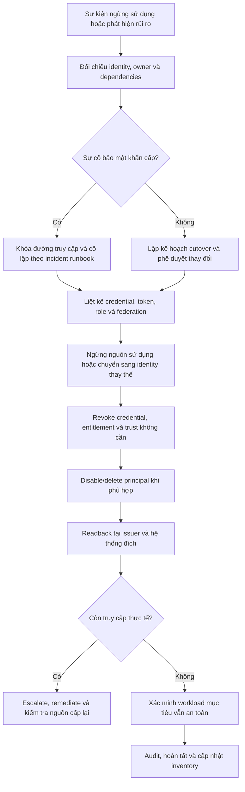

# Thu hồi service identity trong IAM Identity Lifecycle

**Thu hồi service identity** (*service identity revocation/deprovisioning*) là quá trình chấm dứt hoặc giới hạn một cách có kiểm soát **khả năng xác thực và quyền truy cập của danh tính phi con người** khi dịch vụ, workload, tích hợp hoặc mục đích sử dụng không còn hợp lệ. Trong **Identity and Access Management (IAM)**, mục tiêu không chỉ là xóa một tài khoản: phải ngăn các credential, token, vai trò, nhóm và phiên còn sót tiếp tục truy cập tài nguyên, đồng thời tránh làm gián đoạn workload còn phụ thuộc hợp lệ.

Ví dụ, một job xuất báo cáo dùng service account `report-exporter` với quyền đọc database và ghi dữ liệu vào một bucket. Khi job ngừng hoạt động, tổ chức cần thu hồi token/API key, role đọc dữ liệu, quyền ghi bucket và service identity tại nơi cấp phát. Nếu chỉ xóa tên account trong bảng quản lý mà khóa truy cập vẫn hợp lệ tại resource server, **quyền truy cập tồn dư** vẫn tồn tại.

Chủ đề thuộc vòng đời danh tính IAM theo mô hình **Joiner–Mover–Leaver (JML)**: service identity không phải nhân viên nhưng cần các sự kiện tương tự **khởi tạo, thay đổi mục đích/quyền, ngừng sử dụng**. Quy trình liên quan đến **IdP, SSO, SCIM, RBAC/ABAC, quản lý credential, kiểm toán và account reconciliation**, song không thể giả định mọi cơ chế dành cho human identity đều áp dụng trực tiếp cho workload.

## 1. Service identity là gì và vì sao thu hồi khó?

**Service identity** định danh một thành phần phần mềm hoặc quy trình tự động: ứng dụng backend, batch job, CI/CD runner, microservice, agent, bot hoặc tích hợp hệ thống. Danh tính đó có thể sử dụng:

- Service account ở directory, cloud IAM hoặc nền tảng ứng dụng.
- OAuth 2.0 client và access token với `client_credentials`, khi được nền tảng hỗ trợ.
- Managed identity hoặc workload identity federation.
- API key, client secret, certificate, SSH key hay credential trong secret manager.
- Kubernetes ServiceAccount kết hợp cơ chế token và quyền RBAC.
- Database login, role hoặc account kỹ thuật cục bộ.
- Principal của hệ thống SaaS, queue, storage hoặc cloud provider.

Một workload có thể có **nhiều credential cho cùng identity** và **nhiều identity cho các môi trường khác nhau**. Đồng thời, token đã cấp có thể vẫn hợp lệ sau khi secret gốc bị xóa. Thu hồi an toàn phải biết **identity nào, dùng credential nào, truy cập resource nào và còn phụ thuộc ra sao**.

| Thành phần | Có thể cần thu hồi | Lưu ý |
| --- | --- | --- |
| Identity/principal | Service account, cloud principal, OAuth client | Có thể liên kết nhiều workload |
| Credential | Password, key, certificate, client secret | Mỗi credential có vòng đời riêng |
| Token | Access token, refresh token nếu có, phiên kỹ thuật | Độ trễ thu hồi phụ thuộc resource server |
| Entitlement | Role, group, policy binding, ACL | Có quyền trực tiếp và kế thừa |
| Trust configuration | Federated identity binding, audience, subject | Có thể cho phát token mới |
| Execution environment | Deployment, job, runner, secret mount | Tiến trình có thể đang giữ credential |
| Ownership | Owner, team, hợp đồng và mục đích | Phải tránh tài khoản vô chủ |

**Xóa credential không đồng nghĩa gỡ quyền của principal**. Ngược lại, gỡ role không bảo đảm token đã phát hành mất khả năng thực thi ngay lập tức.

## 2. Khi nào cần thu hồi?

Một service identity cần được rà soát hoặc thu hồi khi:

1. Ứng dụng, job, pipeline hoặc tích hợp **ngừng hoạt động**.
2. Workload được **di chuyển sang managed identity** và credential cũ không còn cần.
3. Dự án, tenant, hợp đồng đối tác hoặc môi trường **kết thúc**.
4. Có dấu hiệu **credential bị lộ, sử dụng trái phép hoặc bị chiếm**.
5. Quyền đã cấp **quá rộng**, không còn nhiệm vụ hoặc bị thay đổi phạm vi.
6. Owner/team chịu trách nhiệm đã đổi nhưng không có người tiếp nhận hợp lệ.
7. Credential **hết hạn**, phải thay thế hoặc bị policy loại bỏ.
8. Account được phát hiện **orphan**, trùng lặp hoặc không có bằng chứng sử dụng hợp lệ.
9. Kết quả **access review/recertification** yêu cầu Revoke/Reduce.
10. Một sự kiện JML của nhân sự ảnh hưởng tới người nắm secret hoặc vận hành workload.

**Owner nhân sự nghỉ việc không phải bằng chứng workload đã hết nhiệm vụ.** Cần phân biệt **thu hồi quyền cá nhân của owner** với **ngừng service identity đang phục vụ nghiệp vụ**, chuyển ownership và xác minh phụ thuộc trước khi hành động.

## 3. Phân biệt disable, revoke, rotate và delete

| Hành động | Mục tiêu | Dùng khi nào | Không nên suy luận |
| --- | --- | --- | --- |
| **Disable principal** | Chặn hoặc hạn chế khả năng identity hoạt động theo nền tảng | Incident, chờ xác minh, ngừng dịch vụ | Không chắc vô hiệu mọi token đã cấp |
| **Revoke credential** | Không còn chấp nhận secret/key/cert cụ thể | Credential lộ hoặc hết nhu cầu | Không chắc xóa role/ACL |
| **Rotate credential** | Thay bí mật cũ bằng bí mật mới | Workload vẫn cần chạy, secret có rủi ro | Không phải decommission identity |
| **Revoke entitlement** | Gỡ permission, role, group, policy binding | Giảm scope hoặc ngừng một quyền | Identity có thể vẫn xác thực được |
| **Revoke token/session** | Hạn chế quyền sử dụng token/phiên còn tồn | Thu hồi khẩn cấp hoặc hậu sự cố | Phụ thuộc khả năng nhà phát hành và API |
| **Delete identity** | Xóa principal khỏi hệ thống quản lý | Đã ngừng sử dụng và hết phụ thuộc | Không được thay cho kiểm chứng revoke |
| **Remove federation trust** | Chặn đường đổi workload assertion thành token | Không còn tin một issuer/subject/audience | Không nhất thiết vô hiệu token cũ |
| **Retire deployment** | Ngừng nguồn phát sinh yêu cầu | Job/dịch vụ được tắt có kiểm soát | Không chắc secret đã bị loại khỏi bản sao |

**Thu hồi** là kết quả bảo mật mong muốn: chủ thể không còn sử dụng được đường truy cập không hợp lệ. **Xóa** chỉ là một thao tác kỹ thuật, có thể gây hỏng phục hồi và không nhất thiết thu hồi đủ.

## 4. Kiểm kê trước khi thu hồi

Không thể thu hồi an toàn một identity mà không biết nó đang được sử dụng ở đâu. Bản ghi inventory tối thiểu nên có:

| Trường | Mục đích | Ví dụ minh họa |
| --- | --- | --- |
| `serviceIdentityId` | Khóa định danh không phụ thuộc tên hiển thị | `svc-report-042` |
| `principalId` | Định danh tại hệ thống cấp danh tính | `cloud-principal-198` |
| `workloadId` | Liên kết job hoặc service | `daily-report-exporter` |
| `ownerTeam` | Đội chịu trách nhiệm | `analytics-platform` |
| `environment` | Ranh giới môi trường | `production` |
| `tenantId` | Ranh giới tổ chức/khách hàng | `tenant-a` |
| `credentialRefs` | Tham chiếu vault/secret, không lưu secret | `vault/ref/report-042` |
| `permissions` | Quyền hiệu lực tại hệ thống đích | `dataset.read` |
| `dependencies` | Producer/consumer và lịch job | `batch-report-01` |
| `lastObservedUse` | Tín hiệu hoạt động cùng nguồn/timestamp | `2026-11-20T06:00Z` |
| `lifecycleStatus` | Active, retiring, revoked, archived | `retiring` |
| `revokeOwner` | Người phụ trách xử lý sự cố/thay đổi | `iam-ops` |

Đây chỉ là **mô hình dữ liệu minh họa**, không phải schema SCIM hoặc một API cụ thể.

Những nguồn cần đối chiếu có thể bao gồm cloud IAM, IdP/directory, secrets manager, CI/CD, Kubernetes, database, ứng dụng SaaS và log resource server. **Không sử dụng một mình `lastUsed` để khẳng định an toàn khi xóa**: workload có thể chỉ chạy theo quý, dùng khi disaster recovery hoặc gửi request qua cơ chế không được ghi nhận đầy đủ.

## 5. Threat model: rủi ro của quá trình revoke

| Rủi ro | Kết quả xấu | Kiểm soát |
| --- | --- | --- |
| Xóa identity dùng chung | Nhiều service cùng dừng | Inventory, dependency graph và xác nhận owner |
| Chỉ xóa một API key | Key khác vẫn hoạt động | Liệt kê mọi credential/version |
| Token cũ còn được chấp nhận | Kẻ tấn công tiếp tục gọi API | TTL, revoke/introspection, kiểm tra quyền hiện hành |
| Secret đã bị sao chép | Xóa bản trong vault không xóa bản sao | Thu hồi tại issuer/resource, rotation |
| Gỡ quyền ở đích nhưng source sync còn | Connector cấp lại quyền | Sửa authoritative source/desired state |
| Credential chứa trong image/log/backup | Quyền bị tái kích hoạt từ bản cũ | Thu hồi credential và quản lý artefact/bản sao |
| Thu hồi identity sai tenant | Gây outage hoặc bỏ sót | Khóa định danh ổn định, môi trường và scope |
| Worker chạy song song khi deprovision | Thao tác không nhất quán | Kế hoạch cutover, pause, fencing |
| Đóng ticket khi connector báo 200 | Quyền hiệu lực vẫn còn | Readback và negative authorization test |
| Không chuyển owner khi Mover/Leaver | Credential vô chủ | JML ownership reconciliation |

Cần phân biệt **revoke thông thường có kế hoạch** và **revoke khẩn cấp do xâm nhập**. Trong sự cố lộ credential, ưu tiên chặn truy cập nhanh và cô lập nguồn rủi ro; việc giảm gián đoạn vẫn quan trọng nhưng không được kéo dài đặc quyền bị chiếm.

## 6. Quy trình thu hồi theo trạng thái



Các bước phải được điều chỉnh theo nền tảng; một số tình huống cần **disable hoặc revoke tức thì trước khi hoàn tất phân tích phụ thuộc**. Quy trình phải có người ra quyết định, mức độ rủi ro và cách khôi phục phù hợp, không máy móc áp dụng cùng thứ tự cho mọi hệ thống.

## 7. Thu hồi có kế hoạch: tránh gián đoạn workload

Với một ứng dụng sắp ngừng hoặc chuyển sang identity mới:

1. **Xác định owner và phê duyệt retirement**, gắn ticket/change ID.
2. **Tìm toàn bộ consumer** sử dụng identity, credential, service principal hoặc role tương ứng.
3. **Tạo identity thay thế** nếu workload tiếp tục hoạt động; chỉ cấp quyền tối thiểu theo resource/action.
4. **Cập nhật workload deployment** và secret reference, không đưa secret vào source code.
5. **Cutover có giám sát:** theo dõi các yêu cầu bằng identity cũ và mới.
6. **Ngừng việc phát token mới** từ đường tin cậy cũ khi có căn cứ.
7. **Thu hồi tất cả credential cũ**, gỡ entitlement và liên kết federation không còn cần.
8. **Kiểm tra API/database/storage** không chấp nhận quyền cũ; đồng thời ứng dụng mới vẫn hoạt động.
9. **Vô hiệu/xóa principal** khi phụ thuộc đã được xử lý.
10. **Đóng vòng kiểm toán**, đánh dấu identity retired và lưu bằng chứng.

Một thời gian chuyển tiếp có thể cần thiết khi client chưa thể đổi đồng thời. Nếu có **overlap** giữa credential cũ và mới, phải đặt thời hạn chặt, theo dõi sử dụng và quy trình kết thúc; không duy trì hai đường truy cập vô hạn.

## 8. Thu hồi khẩn cấp khi credential bị lộ

Khi secret, certificate, API key hoặc federated trust có dấu hiệu bị chiếm:

- Kích hoạt **incident response** và xác định hệ thống, credential, tài nguyên, tenant bị ảnh hưởng.
- **Chặn credential tại phía issuer/đích** theo khả năng nền tảng; không chỉ xóa bản secret trong repository.
- Cô lập workload hoặc giảm scope nếu có dấu hiệu kẻ tấn công còn điều khiển runtime.
- Thu hồi/giảm role, policy binding hoặc trust relationship liên quan nếu cần.
- Xem xét **token đã cấp** và cơ chế vô hiệu hóa/TTL/introspection/resource-side denial.
- **Tạo secret thay thế bằng quy trình bảo vệ an toàn** nếu ứng dụng cần tiếp tục chạy.
- Kiểm tra log bất thường: phát token, truy cập dữ liệu, thay role, hành động sau thời điểm lộ.
- Tìm bản sao secret trong pipeline, image, log, cấu hình, artifact và những môi trường khác.
- Kiểm tra **authorization thực tế** ở API/resource server, không chỉ trạng thái dashboard IAM.
- Ghi evidence, thời điểm chặn, owner, tác động và quyết định khôi phục.

**Đổi secret chỉ chặn việc xác thực mới bằng secret cũ**, trừ khi nền tảng có cơ chế liên kết để vô hiệu các token/phiên đã phát. Không hứa rằng mọi JWT đã cấp lập tức vô hiệu chỉ nhờ rotation.

## 9. Thu hồi credential: cần nhìn theo từng loại

### Password và API key

Một service account có thể có nhiều key hoặc password thay thế. Phải tìm tất cả credential đang active, scope, tuổi và nơi phân phối. **Xóa một secret trong vault không xóa giá trị đã được sao chép vào runner đang chạy**. Revocation tại issuer mới là bước quan trọng để chặn sử dụng.

### Client secret/certificate của OAuth client

Ứng dụng dùng `client_credentials` có thể chứng minh danh tính bằng client secret, private key JWT hoặc mTLS, tùy authorization server. Khi thu hồi cần xử lý credential đó tại authorization server, đồng thời đánh giá **access token đã phát** cho resource server.

Nếu có nhiều key/certificate cùng active, cần chỉ rõ **key ID hoặc certificate thumbprint** và không vô hiệu nhầm credential mới khi đang cutover. Cần kiểm tra issuer, audience và scope của token được chấp nhận.

### Workload identity federation

Federation cho phép workload nhận token mà không nhất thiết giữ secret lâu dài. Điều này **không có nghĩa không cần thu hồi**: trust policy có thể vẫn cho cùng workload subject yêu cầu token mới.

Thu hồi có thể cần bỏ **subject/issuer/audience binding**, điều kiện môi trường, quyền của service principal hoặc liên kết resource. Phải kiểm chứng cả **không còn phát token mới** lẫn **không thể tiếp tục dùng token cũ vượt chính sách**.

### Managed identity

Với managed identity, credential thường do nền tảng quản lý. Để thu hồi quyền cần sửa/xóa role assignment, policy và association với workload; việc loại một workload khỏi môi trường không nhất thiết tự gỡ mọi entitlement đã gán.

**Không áp dụng một lệnh “delete key” cho mọi loại service identity**. Cần chọn hành động theo mô hình xác thực thực tế.

## 10. Token và session: khác với credential nguồn

Một access token đã phát hành có thể là **bearer token** được resource server chấp nhận đến `exp` dù client secret vừa bị thu hồi. Với token có introspection, kiểm tra trạng thái trực tuyến có thể hỗ trợ vô hiệu sớm; với JWT tự chứa và kiểm tra offline, thời gian tồn dư thường phụ thuộc TTL và cơ chế đánh giá bổ sung.

```text
Credential dùng để xin token
       |
       v
Authorization Server ----> Access Token ----> Resource Server
       |                       |
  Revoke credential       Token còn hạn?
       |                       |
Ngăn cấp token mới       Cần kiểm tra cơ chế revoke
```

Các biện pháp có thể phối hợp:

- Access token sống ngắn phù hợp workload.
- Revocation/introspection nếu nền tảng hỗ trợ.
- Resource server kiểm tra trạng thái principal, role hoặc policy phiên bản hiện hành ở tác vụ rủi ro cao.
- Hủy session/server-side credential khi có tính năng.
- Gỡ role/ACL để deny quyền ngay cả khi token còn được chấp nhận cho xác thực.
- Phát hiện và xử lý token phát từ identity đã retired.
- Theo dõi độ trễ từ quyết định revoke đến khi API thật sự từ chối.

**Không nhầm ID token OIDC với access token gọi API**. Service-to-service thông thường sử dụng access token phù hợp audience và scope; thu hồi phải được đánh giá tại **điểm thực thi authorization**.

## 11. RBAC/ABAC và quyền hiệu lực sau thu hồi

Một service identity có thể nhận quyền qua:

- Role cloud IAM trực tiếp.
- Group directory hoặc group ở SaaS.
- Role kế thừa từ project/organization/subscription.
- Resource ACL hoặc database grants.
- ABAC/PBAC theo thuộc tính workload, tenant và environment.
- Federation trust cho phép nhận danh tính khác.
- Credential phụ hoặc identity thứ hai có cùng quyền.

Ví dụ service `orders-sync` không còn được phép ghi bucket A. Chỉ gỡ role `bucket-writer` trực tiếp chưa đủ nếu workload vẫn được hưởng `storage.admin` ở cấp project cha.

```text
effective_permissions(identity, resource)
    = direct_grants
    + inherited_roles
    + group_based_entitlements
    + policy_based_access
    + other_valid_trust_paths
```

Đây là mô hình tư duy; phép cộng không phải thuật toán authorization chuẩn. Khi đối soát cần xét **deny precedence, điều kiện policy và đúng ngữ cảnh runtime**. Không dùng tên role hoặc kết quả connector đơn lẻ để suy ra quyền thực tế đã mất.

## 12. Thu hồi qua IdP, SCIM và ứng dụng đích

**IdP/Directory** có thể quản lý danh tính kỹ thuật hoặc group, nhưng không phải mọi service identity nằm trong IdP nhân viên. **SCIM** hỗ trợ đồng bộ User/Group ở ứng dụng hỗ trợ giao thức, còn việc quản lý OAuth client, secret, cloud role hay certificate thường cần API chuyên dụng.

| Lớp | Việc cần làm | Giới hạn |
| --- | --- | --- |
| **IdP/AD** | Disable account kỹ thuật, gỡ group nếu liên quan | Không luôn quản lý local service principal |
| **SSO** | Kiểm tra các phụ thuộc federation nếu service dùng | SSO dành cho người dùng không tự thu hồi key máy–máy |
| **SCIM/connector** | Deprovision User/Group/entitlement được hỗ trợ | SCIM không là chuẩn revoke mọi OAuth token |
| **Cloud IAM** | Gỡ principal binding, role, policy/trust | Cần kiểm tra kế thừa và eventual consistency |
| **Application/database** | Revoke role, ACL, account, session | Có thể có quyền gán cục bộ ngoài IAM |
| **Secret manager** | Ngừng cấp secret, quản lý phiên bản và rotation | Xóa secret record không thu hồi bản sao |
| **Kubernetes/CI-CD** | Gỡ service account binding/secret refs/runner permission | Token/runtime cũ cần đánh giá riêng |
| **Audit/reconciliation** | Đọc lại và xác nhận deny | Không thay thế enforcement tại API |

**SCIM `active=false` không phải cam kết mọi token, khóa hoặc ACL mất hiệu lực**. Cần xác định hệ thống nào là nguồn thẩm quyền và đâu là đường thực thi quyền.

## 13. Quan hệ với Joiner–Mover–Leaver

### Joiner — tạo workload identity và kiểm soát từ đầu

Khi tạo service identity, cần biết workload ID, owner, mục đích, môi trường, resource scope, credential lifecycle và cơ chế revoke. **Đặt expiry và phương án ngừng sử dụng ngay từ bước cấp quyền** sẽ giúp thu hồi có thể kiểm chứng, thay vì phải điều tra tài khoản vô chủ sau nhiều năm.

### Mover — thay đổi dịch vụ và người chịu trách nhiệm

Mover của service identity có thể là chuyển project/tenant, đổi môi trường, đổi chức năng API hoặc thay team owner. Khi đó cần **tính lại desired entitlements**, cấp quyền mới hợp lệ, gỡ quyền cũ và xử lý credential/tokens phụ thuộc.

Mover của **nhân viên giữ secret** là sự kiện riêng: gỡ quyền cá nhân đối với vault, pipeline và deployment; chuyển owner workload. Không mặc định tắt identity của service chỉ vì người tạo đã chuyển bộ phận.

### Leaver — ngừng workload hoặc quan hệ

Nếu workload bị ngừng, thực hiện retirement có kiểm soát, chặn đường token/credential và gỡ quyền ở đích. Nếu **partner contract** hết hạn, xem xét thu hồi identity kỹ thuật do đối tác sử dụng, kể cả key độc lập với user SSO. Nếu **owner nhân sự nghỉ việc**, tập trung thu hồi quyền người đó và chuyển ownership trước khi thay đổi service identity.

**Human Leaver và Service Leaver khác nhau về trigger và phụ thuộc**; cả hai đều cần tránh quyền truy cập tồn dư.

## 14. Owner, approver và Separation of Duties

Service identity phải có **owner kỹ thuật hoặc nhóm chịu trách nhiệm rõ ràng**, nhưng người sở hữu workload không nên có khả năng tự tạo, tự phê duyệt rồi tự cấp quyền admin ngoài mọi kiểm soát.

Một workflow thu hồi có thể có:

| Vai trò | Trách nhiệm |
| --- | --- |
| Workload owner | Xác nhận mục đích, phụ thuộc và phạm vi decommission |
| Application/resource owner | Xác nhận entitlement và tài nguyên bị ảnh hưởng |
| IAM/PAM team | Thực thi thay đổi identity, role, credential |
| Security/incident commander | Quyết định chặn khẩn cấp khi có rủi ro |
| Operator/SRE | Thực hiện cutover và giám sát sức khỏe workload |
| Independent reviewer | Xác nhận bằng chứng và remediation |

**SoD không được trở thành lý do trì hoãn chặn credential đã bị chiếm trong sự cố**. Tổ chức có thể chuẩn bị thẩm quyền ứng cứu khẩn cấp trước và thực hiện hậu kiểm độc lập, nhưng phải ghi căn cứ rõ ràng.

## 15. Reconciliation: desired state và observed state

Sau thu hồi cần đọc lại **quyền thực tế** từ nơi cấp và nơi sử dụng.

```text
desired = permitted_access(workload_id, current_purpose, approved_scope)
observed = effective_access(principal, roles, groups, ACL, token_paths)

excess = observed - desired
missing = desired - observed
```

Đây là **mô hình logic**, không phải phép trừ có thể áp dụng máy móc cho mọi ABAC policy. Cần quan sát cả quyền phát token, role kế thừa, cache và phiên đang sử dụng.

Một chu trình khép kín:

1. Xác định identity/principal chính xác và tất cả đường credential.
2. Tính quyền mong muốn sau thay đổi hoặc retirement.
3. Thu hồi tại hệ thống nguồn có thẩm quyền.
4. Đọc lại trạng thái issuer, group, role, policy và ứng dụng đích.
5. Kiểm tra resource server có **từ chối hành động đã thu hồi** hay không.
6. Theo dõi độ trễ propagation và xử lý quyền còn tồn.
7. Ghi evidence, thời gian, owner và các ngoại lệ chưa đóng.

**Một connector trả trạng thái thành công chỉ chứng minh thao tác quản lý đã được chấp nhận, không chứng minh quyền runtime đã hết hiệu lực.**

## 16. Negative authorization test sau thu hồi

Cần kiểm thử cả **không phát token mới** và **không tiếp tục truy cập bằng đường cũ**.

| Kịch bản | Kỳ vọng |
| --- | --- |
| Credential đã revoke xin access token mới | Bị từ chối |
| Federated workload subject đã hủy trust | Không đổi được assertion lấy token mới |
| Access token cũ còn hạn gọi API | Bị từ chối theo tiêu chí thu hồi hiện hành; nếu không hỗ trợ revoke tức thì, phải quản trị cửa sổ tồn dư |
| Role đọc database đã gỡ | Không thể thực hiện truy vấn bằng quyền đã thu hồi |
| Group ở IdP đã gỡ nhưng SaaS có direct role | Readback phát hiện role còn tồn |
| Cloud role trực tiếp gỡ nhưng role project cha còn | Effective permission test phát hiện truy cập |
| Pipeline vẫn mount secret cũ | Chặn sử dụng credential và xử lý bản sao |
| Workload mới sau cutover | Vẫn hoàn thành tác vụ hợp lệ |
| Tenant A đã thu hồi | Không truy cập tenant A bằng credential/identity cũ |
| Service account retired nhưng job cũ chạy lại | Không tái tạo đường truy cập trái chính sách |
| Owner đã Leaver | Người cũ không còn lấy secret hoặc deploy |
| Connector retry event cũ | Không cấp lại quyền đã thu hồi |

Nếu một nền tảng chỉ có thể vô hiệu token sau TTL, báo cáo phải thể hiện **giới hạn kỹ thuật và khoảng thời gian rủi ro**; không ghi thành công tức thì khi chưa có cơ sở.

## 17. Tránh race condition và re-provision ngoài ý muốn

Quy trình revoke có thể chạy song song với provisioning hoặc deployment:

- Workflow A yêu cầu remove một group.
- Workflow B retry lệnh grant cũ từ queue.
- Pipeline C tái triển khai secret cũ.
- Application D cache role cho phiên đang hoạt động.

Thiết kế cần:

1. **Version hoặc generation** của desired state để xác định lệnh mới nhất.
2. **Idempotency key** cho các thao tác revoke/retry.
3. **Fencing** để grant cũ không hồi sinh entitlement đã bị loại.
4. **Kiểm tra JML và resource scope trước grant**.
5. **Propagation monitoring** giữa IdP, connector và hệ thống đích.
6. **Event ordering** và xử lý duplicate/out-of-order events.
7. **Periodic reconciliation** nhằm phát hiện quyền được cấp lại.
8. **Negative test** sau thời gian cache/propagation phù hợp.

Không kết luận retirement hoàn tất chỉ từ việc account biến mất khỏi giao diện inventory. Một deployment còn cấu hình credential cũ có thể tự khởi động lại hoặc tìm đường truy cập khác.

## 18. Ví dụ: thay API key bằng workload federation

Một service `inventory-sync` đang dùng API key lâu dài để đọc kho dữ liệu. Tổ chức chuyển sang federated workload identity:

1. Xác định workload, owner, môi trường, issuer và API resource.
2. Thiết lập federated identity binding giới hạn **subject, audience và môi trường**.
3. Chỉ cấp role `inventory.read` trên resource được duyệt.
4. Cấu hình ứng dụng lấy token theo đường mới; không ghi token vào log.
5. Kiểm thử truy cập hợp lệ, denied access ngoài scope và khả năng vận hành.
6. Chuyển traffic, theo dõi mọi lần dùng API key cũ.
7. Revoke key cũ tại issuer, xử lý secret trong CI/CD và vault.
8. Kiểm tra key cũ **không thể tiếp tục dùng**; rà soát token đã cấp.
9. Thu hồi role/identity cũ nếu không còn được dùng ở nơi khác.
10. Cập nhật inventory và đánh dấu remediation verified.

**Thay API key bằng federation không tự giảm quyền** nếu trust binding quá rộng. Phải giới hạn principal và các permission thực sự cần.

## 19. Ví dụ: ngừng CI/CD service account

Một pipeline đã ngừng sử dụng nhưng vẫn có secret với quyền deploy production. Quy trình:

| Phát hiện | Hành động | Bằng chứng |
| --- | --- | --- |
| Pipeline bị archived | Xác nhận không còn job/runner phụ thuộc | Owner và change ID |
| Service principal còn active | Disable/revoke theo nền tảng | Trạng thái principal |
| Secret có trong runner và vault | Revoke credential nguồn, xóa tham chiếu/bản sao có kiểm soát | Key version/secret reference |
| Role production còn gán | Gỡ role và policy binding | IAM readback |
| Token cũ có thể còn hiệu lực | Kiểm tra runtime và TTL/revoke | API deny test |
| Nhân viên tạo pipeline đã nghỉ | Kiểm tra quyền cá nhân đối với repository/secret | JML evidence |
| Terraform/GitOps còn định nghĩa grant | Cập nhật desired state để không tái tạo | Config review |
| Retire hoàn tất | Ghi owner, thời điểm, kết quả đối soát | Audit trail |

Nếu chỉ xóa secret khỏi repository nhưng principal vẫn có quyền và credential khác còn active, việc thu hồi chưa hoàn thành.

## 20. Partner integration và cross-tenant access

Một integration của đối tác có thể dùng OAuth client, API key hoặc certificate để truy cập dữ liệu theo hợp đồng. Khi hợp đồng kết thúc:

- Chặn mọi đường cấp token/credential có thể dùng tiếp theo hợp đồng.
- Thu hồi scope, role, policy binding và quyền theo **partner ID, contract ID, tenant**.
- Gỡ trust federation nếu không còn quan hệ tin cậy.
- Kiểm tra token đã phát và account kỹ thuật ở SaaS/ứng dụng nội bộ.
- Xác minh API từ chối truy cập dữ liệu ngoài hợp đồng hoặc sau ngày hết hiệu lực.
- Bảo vệ dữ liệu và log cần lưu theo nghĩa vụ hiện hành, không xóa bừa chứng cứ.
- Thông báo chủ hệ thống và theo dõi sai lệch chưa xử lý.

**Partner IdP vẫn xác thực được nhân viên đối tác không có nghĩa integration của đối tác còn quyền ở doanh nghiệp**. Authorization phía resource server phải dựa trên hợp đồng, subject, tenant và policy hiện hành.

## 21. Đo lường chất lượng thu hồi service identity

| Chỉ số | Ý nghĩa |
| --- | --- |
| **Service identity inventory coverage** | Tỷ lệ workload có principal, owner và entitlement được ghi nhận |
| **Orphaned service identities** | Danh tính không xác định được owner hoặc mục đích |
| **Credential revoke completion** | Tỷ lệ key/secret dự kiến thu hồi đã bị chặn tại issuer |
| **Residual effective privileges** | Quyền còn tác dụng sau quyết định deprovision |
| **Time to deny** | Thời gian từ quyết định revoke đến khi API thật sự từ chối |
| **Unrotated exposed credentials** | Credential nghi lộ chưa được thay/thu hồi |
| **Token lifetime exposure window** | Khoảng rủi ro do token đã cấp chưa bị vô hiệu |
| **Re-provision incidents** | Lệnh grant cũ hoặc IaC tái tạo quyền đã gỡ |
| **Retirement outage rate** | Sự cố do xóa identity khi còn consumer hợp lệ |
| **JML owner drift** | Người đã Mover/Leaver còn quản lý secret hoặc workload |
| **Verified remediation rate** | Tỷ lệ mục thu hồi đã có readback/deny evidence |
| **Access review exception age** | Tuổi quyền kỹ thuật chưa có quyết định cuối |

Báo cáo nên **tách trạng thái “đã gửi lệnh revoke” khỏi “đã chặn quyền thực tế”**. Các quyền có khả năng thay policy, xóa log hoặc xuất dữ liệu nhạy cảm cần ưu tiên theo rủi ro, không chỉ theo số lượng.

## 22. Kiểm toán và bảo quản bằng chứng

Một bản ghi thu hồi có giá trị cần gồm **identity/principal ID, workload/owner, resource/tenant, reason, ticket/incident, thời điểm bắt đầu, người phê duyệt, quyết định về phụ thuộc, các credential/role bị thay đổi, response connector, readback, negative test và kết quả cuối**.

Đối với credential phải lưu **tham chiếu hoặc fingerprint không nhạy cảm**, không lưu plaintext password, private key, access token, refresh token, cookie hoặc secret trong ticket và audit log.

Cần bảo vệ tính toàn vẹn của bằng chứng; người có quyền vận hành workload không nên có thể tùy ý xóa toàn bộ audit của chính mình. Với incident, log hiện trạng trước khi revoke có thể cần được giữ phục vụ điều tra theo quy trình được phép.

## 23. Checklist thực hành trước khi đóng yêu cầu revoke

- [ ] Xác định đúng service identity, issuer, tenant, môi trường và owner.
- [ ] Biết mục đích hiện tại và các workload/consumer phụ thuộc.
- [ ] Phân loại planned retirement hay emergency compromise.
- [ ] Có quyết định phê duyệt hoặc thẩm quyền incident phù hợp.
- [ ] Đã xử lý cutover/stop workload khi cần.
- [ ] Đã liệt kê **mọi credential và token path**.
- [ ] Đã revoke secret/key/certificate không còn hợp lệ tại issuer.
- [ ] Đã gỡ role, group, ACL, policy binding và trust không còn cần.
- [ ] Đã xem xét account phụ, quyền kế thừa và môi trường khác.
- [ ] Đã sửa IaC/GitOps/connector desired state tránh tái cấp.
- [ ] Đã đọc lại entitlement tại source và target.
- [ ] Đã kiểm tra API/resource server từ chối quyền bị thu hồi.
- [ ] Đã đánh giá cửa sổ token/session tồn dư và biện pháp xử lý.
- [ ] Đã xác minh những workload hợp lệ khác không bị ảnh hưởng.
- [ ] Đã ghi audit, owner, deadline và exception nếu chưa thể xử lý hết.
- [ ] Đã cập nhật inventory sang trạng thái retired/revoked phù hợp.

## 24. Câu hỏi tự kiểm tra

**Tình huống A:** Đội vận hành xóa client secret nhưng access token còn hạn vẫn gọi API thành công. Thu hồi đã hoàn tất chưa? **Chưa.** Phải đánh giá TTL và khả năng revoke/authorization tại resource server.

**Tình huống B:** Kỹ sư tạo service account đã nghỉ việc, nhưng service thanh toán vẫn chạy. Có nên xóa account ngay? **Không mặc nhiên.** Chuyển owner, thu hồi quyền cá nhân và xác minh workload trước khi thay đổi identity.

**Tình huống C:** Đã gỡ role trực tiếp, nhưng service vẫn có quyền qua role kế thừa từ cloud project. Vấn đề là gì? **Effective entitlement còn tồn dư**; cần đối soát đường kế thừa.

**Tình huống D:** Service chuyển từ API key sang federation nhưng trust cho mọi repository trong organization. Có phải đã đạt least privilege? **Không.** Giới hạn issuer/subject/audience và resource scope.

**Tình huống E:** Pipeline đã xóa nhưng Terraform vẫn định nghĩa role binding của service principal. Điều gì có thể xảy ra? **Re-provision/privilege resurrection** khi chạy lại IaC; phải sửa desired state.

**Tình huống F:** SCIM trả HTTP 204 khi deprovision, nhưng ứng dụng SaaS vẫn giữ role cục bộ cho service account. Có nên đóng ticket? **Không.** Cần readback và remediation tại ứng dụng.

**Tình huống G:** Một token cũ không thể bị thu hồi ngay và có TTL còn 10 phút. Có thể ghi “revoke tức thời hoàn tất” không? **Không.** Phải ghi giới hạn, giảm rủi ro và xác minh khi hết cửa sổ tồn dư.

## Ghi nhớ

**Thu hồi service identity** là việc **chấm dứt khả năng xác thực và authorization không còn hợp lệ của workload**, không chỉ xóa tài khoản hoặc secret. Một quy trình đầy đủ phải xác định **owner, consumer, resource scope, credential, token, role/group/ACL, trust và quyền kế thừa**, xử lý riêng **planned cutover** và **emergency compromise**, rồi **readback và kiểm chứng API từ chối quyền cũ**. Trong **Joiner–Mover–Leaver**, cần phân biệt vòng đời workload với vòng đời nhân viên giữ secret; phối hợp **IdP/SSO, SCIM, RBAC/ABAC, service account governance, access review, kiểm toán và reconciliation** để loại bỏ quyền truy cập tồn dư **mà không vô tình làm ngừng dịch vụ còn hợp lệ**.
