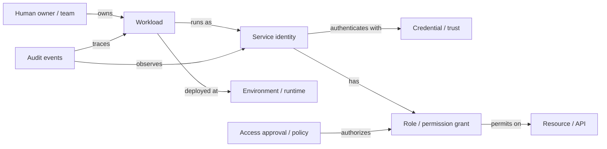
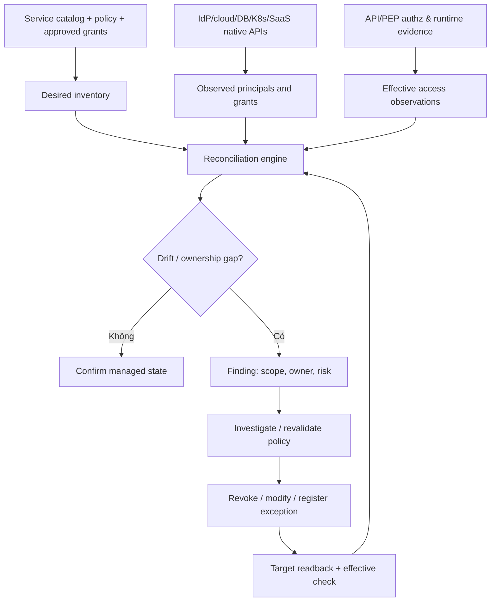
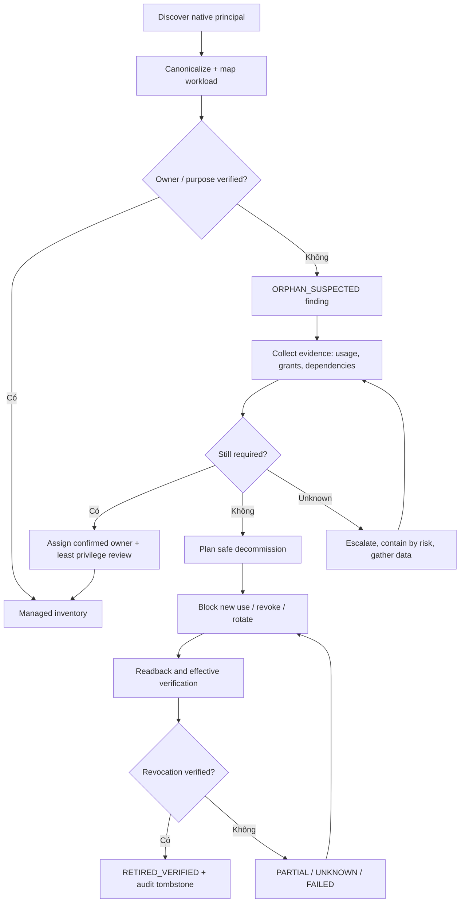

# Kiểm kê service identity trong IAM: Nhìn thấy, xác định chủ sở hữu và quản trị danh tính máy

**Kiểm kê service identity** (*service identity inventory*) là việc **phát hiện, định danh, chuẩn hóa, liên kết và duy trì danh sách đáng tin về những danh tính không phải người dùng** đang được ứng dụng, dịch vụ, máy chủ, container, pipeline hoặc tác vụ tự động sử dụng để xác thực và truy cập tài nguyên. Một bản kiểm kê hữu ích không chỉ trả lời **“có bao nhiêu tài khoản dịch vụ?”**, mà còn chỉ ra **danh tính này thuộc workload nào, ai chịu trách nhiệm, nó xác thực bằng gì, được quyền làm gì, hoạt động ở đâu, có còn cần thiết và khi nào phải được thu hồi**.

Ví dụ, hệ thống báo cáo có pipeline `report-sync-prod` dùng một service principal để gọi Reporting API. Pipeline còn có một Kubernetes ServiceAccount và lấy secret từ vault. Nếu kiểm kê chỉ ghi “có một user tên report-sync”, đội IAM có thể bỏ sót **hai danh tính kỹ thuật, nhiều credential và một số grant** cùng liên quan đến một workload. Khi nhân viên sở hữu pipeline nghỉ việc, doanh nghiệp có nguy cơ để lại API key không owner hoặc xóa nhầm principal khiến báo cáo production ngừng hoạt động. Kiểm kê đúng sẽ liên kết các thực thể này mà không đánh đồng chúng.

Bài thuộc chương **Service identity** của module `SECURITY_IDENTITY_ACCESS_MANAGEMENT_IDENTITY_LIFECYCLE`. Module tập trung vào quản lý vòng đời danh tính theo **Joiner–Mover–Leaver (JML)**: xác minh, tạo tài khoản, cấp quyền, rà soát và thu hồi khi thay đổi vai trò. Kiểm kê service identity là nền tảng để kết nối **IdP, SSO, SCIM, RBAC/ABAC, tài khoản dịch vụ, kiểm toán** và giảm các quyền tồn dư trong hệ thống tự động.

Sau bài học, bạn có thể thiết kế phạm vi kiểm kê danh tính máy; phân biệt danh tính, tài khoản, credential, role và workload; xác định nguồn dữ liệu và khóa định danh; xây dựng bản ghi inventory có chủ sở hữu; phát hiện principal mồ côi, secret cũ và đặc quyền rộng; đối soát quyền mong đợi–quan sát được–hiệu lực; tổ chức quy trình đăng ký, review và decommission; đồng thời triển khai kiểm soát khi chủ sở hữu con người Joiner–Mover–Leaver.

## 1. Vì sao phải kiểm kê danh tính dịch vụ?

Trong nhiều tổ chức, số **non-human identities (NHI)** có thể rất lớn vì mỗi ứng dụng, job, môi trường và tích hợp cần tự xác thực. Danh tính máy thường không xuất hiện trong danh sách nhân viên, không có manager HR trực tiếp và có thể được tạo bằng Terraform, CI/CD, giao diện cloud hoặc thao tác thủ công trên target.

Những rủi ro tiêu biểu:

- **Không thấy hết:** service account cục bộ, application principal, API client hoặc robot account không nằm trong IdP trung tâm.
- **Không rõ owner:** người tạo đã chuyển nhóm hoặc nghỉ việc; không ai biết principal còn phục vụ gì.
- **Credential sống lâu:** password/API key/service principal secret chưa xoay vòng, không còn ai biết đang dùng ở đâu.
- **Quyền quá rộng:** job chỉ cần ghi báo cáo nhưng có role admin toàn tenant.
- **Dùng chung danh tính:** nhiều workload sử dụng một account/key, gây khó quy trách nhiệm và thu hồi.
- **Drift:** IaC/policy khai báo một scope nhưng grant trực tiếp tại target rộng hơn.
- **Không có thời hạn:** principal dùng cho PoC vẫn còn quyền production sau khi dự án kết thúc.
- **Khó offboard:** nhân viên Leaver nhưng credential họ từng biết hoặc sở hữu vẫn hoạt động.
- **Ảo giác an toàn:** account không thấy dùng trong log, nhưng telemetry thiếu hoặc quyền vẫn có thể bị khai thác.

**Kiểm kê không tự thay thế bảo vệ credential hay authorization.** Nó tạo ra **khả năng quan sát và quyền sở hữu rõ ràng** để các biện pháp cấp quyền, giám sát, luân chuyển khóa và thu hồi được thực thi đúng.

### 1.1. Câu hỏi một inventory phải trả lời được

| Câu hỏi | Ví dụ câu trả lời có thể kiểm chứng |
| --- | --- |
| Đây là danh tính nào? | `spn-report-sync-prod`, immutable principal ID của cloud tenant |
| Nó phục vụ workload nào? | `report-sync`, deployment production, runbook được duyệt |
| Ai chịu trách nhiệm? | Đội Analytics Platform; owner và người dự phòng |
| Nó sống ở đâu? | Cloud account A, Kubernetes namespace `reporting` |
| Xác thực bằng gì? | Workload federation hoặc credential reference trong vault |
| Có quyền gì? | `reports.write` chỉ cho `org-17` |
| Quyền đến từ đâu? | IaC role assignment và approved service onboarding |
| Có còn được dùng? | Last-seen API event với nguồn telemetry và độ tin cậy |
| Có đúng least privilege? | Desired–observed–effective permission đã đối soát |
| Khi nào phải đánh giá lại? | Review due date hoặc sự kiện thay đổi owner/deployment |
| Làm sao thu hồi? | Target-specific deprovision + credential revoke + readback |

**Một hàng trong spreadsheet chỉ có tên, password và ghi chú “dùng production” không phải inventory phù hợp**. Không nên lưu mật khẩu/secret thô trong bảng kiểm kê.

## 2. Service identity là gì? Đừng đánh đồng mọi thực thể

**Service identity** là danh tính được dùng để chứng minh **một dịch vụ, workload hoặc chương trình tự động là ai** khi gọi hệ thống khác. Tên gọi và cơ chế có thể khác nhau theo nền tảng.

| Khái niệm | Ý nghĩa | Ví dụ |
| --- | --- | --- |
| **Workload** | Phần mềm/tác vụ đang chạy | `report-sync`, `payment-worker` |
| **Service identity / principal** | Chủ thể được hệ thống tin cậy định danh | Cloud service principal, managed identity |
| **Service account** | Tài khoản dành cho chương trình hoặc dịch vụ | Account DB/OS, Kubernetes ServiceAccount |
| **Credential** | Phương tiện chứng minh danh tính | Password, secret, private key, certificate, token |
| **Session** | Trạng thái xác thực hoặc sử dụng tại thời điểm cụ thể | Cloud STS session, DB connection, OAuth token |
| **Role/entitlement** | Những khả năng được cấp | `storage.objectViewer`, `billing.read` |
| **Grant/assignment** | Mối quan hệ cấp quyền có nguồn gốc | Principal được gán role vào một resource |
| **Human owner** | Người chịu trách nhiệm quản trị | Kỹ sư trực thuộc đội nền tảng |
| **Technical owner team** | Đội quản lý vòng đời service | `platform-analytics` |
| **Resource/permission owner** | Bên quyết định quyền trên tài nguyên | Data owner hoặc API owner |

**Một workload có thể dùng nhiều service identities**, và một identity có thể được tái sử dụng bởi nhiều workload (điều thường cần hạn chế). Một service identity cũng có thể có **nhiều credential đang hoạt động** trong thời gian rotation. Vì vậy không được mặc định quan hệ 1:1 cho mọi trường hợp.

### 2.1. Những nhóm identity thường gặp

- **OS/domain service account:** account Linux/Windows hoặc directory được daemon, service hay scheduled task dùng.
- **Directory/IdP application principal:** ứng dụng hoặc service principal được đăng ký để xác thực, gọi API và nhận quyền.
- **OAuth/OIDC client:** danh tính client được nhận diện qua `client_id`; tùy loại client có thể dùng secret, private key, mTLS hoặc cơ chế khác.
- **Cloud workload identity:** service account, managed identity hoặc IAM principal gắn với workload.
- **Kubernetes ServiceAccount:** danh tính Kubernetes API của pod/workload, thường đi kèm token gắn với audience và lifetime theo cơ chế cluster.
- **CI/CD runner, automation bot, integration user:** principal phục vụ build, deploy, đồng bộ hoặc kết nối SaaS.
- **Database user/role cho ứng dụng:** danh tính DB để kết nối và truy cập schema.
- **Certificate-based identity:** workload được xác thực qua chứng chỉ, chẳng hạn dịch vụ dùng mTLS.
- **Federated workload identity:** workload lấy credential ngắn hạn dựa trên quan hệ tin cậy với issuer ngoài thay vì giữ secret dài hạn.
- **Robot account trong SaaS:** account dùng tích hợp khi sản phẩm chưa hỗ trợ machine principal chuyên biệt.

**Một tài khoản người dùng thông thường bị script tái sử dụng không tự biến thành service identity được thiết kế tốt.** Nếu automation dùng username/password của nhân viên, inventory phải phát hiện kiểu sử dụng này như **rủi ro attribution và credential lifecycle** để có kế hoạch tách sang danh tính máy đúng chuẩn.

### 2.2. Human identity và service identity khác gì?

| Chiều so sánh | Human identity | Service/workload identity |
| --- | --- | --- |
| Chủ thể | Người lao động, nhà thầu, đối tác | Ứng dụng, job, máy, service |
| Nguồn vòng đời | HRIS, contractor/partner registry | Service catalog, CMDB, IaC, deployment registry |
| Xác thực | Passkey/MFA/SSO, tùy policy | Credential, workload attestation, federation, mTLS |
| Review quyền | Manager + app/data owner | Workload owner + API/resource owner |
| Tần suất thay đổi | Theo JML, dự án, vai trò | Theo deployment, service lifecycle, rotation, environment |
| Thu hồi | Offboarding và target deprovisioning | Decommission workload, revoke trust/credential/grants |
| Audit | Ai thực hiện hành động? | Workload nào, run nào, ai khởi tạo/phê duyệt? |
| Rủi ro | Privilege creep sau Mover | Orphan principal/secret lâu đời, reuse và drift |

**SSO tương tác và MFA của con người không phải công thức bắt buộc cho mọi workload**. Thay vì yêu cầu bot tự điền OTP, nên dùng hình thức xác thực máy phù hợp và tránh biến tài khoản nhân viên thành credential dùng chung.

## 3. Phạm vi kiểm kê: Không chỉ principal có trong IdP

Một inventory đầy đủ cần xác định **hệ thống nào được xem là nguồn đối tượng** và **hệ thống nào là nguồn bằng chứng sử dụng**.

| Bề mặt | Có thể tìm thấy | Tín hiệu hữu ích |
| --- | --- | --- |
| **IdP / directory** | Application registrations, service principals, domain service accounts, groups | Principal ID, grants, owner, status |
| **Cloud IAM** | Managed identities, IAM service accounts, roles, bindings, trust relationships | Resource scope, policy, last-used nếu có |
| **Kubernetes** | ServiceAccounts, RoleBindings, ClusterRoleBindings, token/secret references | Namespace, workload mapping, quyền API |
| **OS / host** | Local/domain accounts dùng service, scheduled task identities | Service configuration, login policy, owner host |
| **Database** | Application users, database roles, credential mapping | Schema/table privileges, connection records |
| **CI/CD** | Runner identity, deployment service connections, environment credentials | Pipeline/repo/project, protected environments |
| **Secrets manager / PKI** | Secret/key/certificate metadata, lease, rotation state | Credential reference, issuer, expiry, consumer |
| **SaaS / integrations** | API clients, integration accounts, application permissions | App scope, owner, last activity |
| **Service catalog / CMDB** | Workloads, environments, business services, owners | Purpose và dependency |
| **IaC / GitOps** | Desired principals, assignments và trust policies | Source of truth cấu hình, drift |
| **Audit / SIEM / API gateway** | Authentication and API usage | Last observed use, actor, credential ID nếu có |
| **Network / service mesh** | Service-to-service identities và mTLS authorization | Workload-to-workload flows, certificate issuers |

Không phải tất cả nền tảng đều hỗ trợ cùng API khám phá. Cũng **không phải mọi service identity đều được quản lý bởi SCIM**: SCIM chủ yếu cung cấp mô hình và giao thức cho user/group provisioning theo khả năng hệ thống, chứ không tự kiểm kê toàn bộ cloud IAM, credential hoặc workload runtime.

### 3.1. Inventory coverage là một chỉ số bắt buộc

Bản kiểm kê chỉ đáng tin khi ghi rõ:
- Tenant, subscription, project, account, cluster, namespace và database đã quét.
- Những nguồn được quyền đọc **đầy đủ**, nguồn chỉ đọc một phần.
- Thời điểm thu thập và độ mới cho phép.
- Các nguồn chưa có connector.
- Lỗi phân trang, rate limit, ACL, timeout hoặc thiếu quyền đọc.
- Các loại principal không được nguồn đó hỗ trợ liệt kê.

**Không nhìn thấy một principal không có nghĩa nó không tồn tại** nếu connector không đủ quyền hoặc không quét mọi resource scope.

## 4. Mô hình dữ liệu: Bản ghi inventory tối thiểu

Một identity record nên tách **identity metadata** khỏi credential secret và runtime/session details.

| Nhóm | Trường cần có | Ý nghĩa |
| --- | --- | --- |
| **Canonical identity** | `serviceIdentityId`, `principalType` | Khóa nội bộ ổn định và phân loại |
| **Native identity** | `provider`, `tenant/account/project`, `nativePrincipalId` | Định danh ở nhà cung cấp |
| **Tên và mô tả** | `displayName`, `purpose` | Dễ hiểu nhiệm vụ nghiệp vụ |
| **Workload liên kết** | `workloadId`, `deploymentRef` | Principal phục vụ thành phần nào |
| **Environment** | dev/staging/prod, region/cluster/namespace | Scope thực tế |
| **Chủ sở hữu** | `ownerTeamId`, `technicalOwnerId`, `backupOwnerId` | Trách nhiệm giải trình |
| **Nguồn quản trị** | `createdBySource`, `managedBy`, `iacRef` | Ai quản lý vòng đời |
| **Trạng thái** | `lifecycleStatus`, `observedStatus` | Managed, orphan suspected, retired… |
| **Quyền** | `entitlementRefs`, `grantSources`, `resourceScopes` | Khả năng và căn cứ cấp |
| **Credential references** | `credentialIds`, `authMethod` | Credential tồn tại, không lưu giá trị bí mật |
| **Trust configuration** | `issuer`, `audience`, `subjectConditions` | Ranh giới workload federation |
| **Vòng đời** | `createdAt`, `lastReviewedAt`, `reviewDueAt`, `retireAfter` | Lịch quản trị |
| **Hoạt động** | `lastObservedUseAt`, `telemetrySource`, `confidence` | Dùng khi nào, bằng chứng mạnh đến đâu |
| **Thu thập** | `collectedAt`, `sourceVersion`, `completeness` | Tính cập nhật và chất lượng dữ liệu |
| **Audit** | `correlationId`, `policyVersion`, `changeRef` | Truy vết quyết định và thay đổi |

**Không lưu raw password, access token, refresh token, private key hay certificate private material trong inventory**. Lưu tham chiếu đã phân quyền tới vault/PKI/credential metadata là đủ cho mục đích quản trị.

### 4.1. Đừng lấy displayName làm khóa

Các tên `report-sync`, `svc-prod`, `default` có thể trùng trên nhiều tenant/project/namespace. Email alias hoặc client display name có thể đổi. Khóa ổn định nên bao gồm **native immutable ID + security boundary** phù hợp với loại principal, và một canonical ID riêng của inventory.

Ví dụ:
- Cloud principal: provider + tenant/account ID + object/principal ID.
- Kubernetes ServiceAccount: cluster identity + namespace + ServiceAccount name, cộng **native UID** nếu cần phân biệt một object bị xóa/tạo lại cùng tên.
- Database account: database instance/cluster + native user identifier.
- OAuth client: authorization server/issuer + client ID theo mô hình sản phẩm.

**Không giả định client ID hoặc username là duy nhất trên toàn doanh nghiệp.**

## 5. Ví dụ inventory record có cấu trúc

Đây là **mẫu YAML thiết kế**, không phải định dạng bắt buộc của cloud, SCIM hoặc một sản phẩm IAM:

```yaml
serviceIdentityId: nhi-000842
principalType: CLOUD_SERVICE_PRINCIPAL
displayName: report-sync-prod
provider:
  name: example-cloud
  tenantId: tenant-17
  nativePrincipalId: principal-9bb1
workload:
  workloadId: report-sync
  serviceCatalogRef: svc-reporting-29
  environment: production
  deploymentRef: reporting/prod/report-sync
ownership:
  ownerTeamId: analytics-platform
  technicalOwnerIdentityId: iam-user-1042
  backupOwnerIdentityId: iam-user-1175
  approvalOwnerTeamId: reporting-api
purpose: Synchronize approved monthly reports
auth:
  method: WORKLOAD_FEDERATION
  issuerRef: ci-issuer-prod
  subjectConditionRef: trust-rule-118
  allowedAudienceRef: reporting-api
credentials:
  - credentialId: federation-trust-118
    credentialType: FEDERATED_TRUST
    secretMaterialStoredHere: false
authorization:
  - grantId: grant-0901
    action: reports.write
    resourceScope: org-17
    source: infra-as-code
    approvalRef: AR-470
lifecycle:
  status: MANAGED
  registeredAt: "2026-10-15T08:00:00Z"
  lastReviewedAt: "2026-11-01T07:00:00Z"
  nextReviewDueAt: "2027-02-01T07:00:00Z"
observation:
  collectedAt: "2026-11-23T02:30:00Z"
  lastObservedUseAt: "2026-11-22T23:11:00Z"
  source: cloud-iam-and-api-audit
  completeness: VERIFIED_FOR_SCANNED_SCOPE
```

Với `auth.method=WORKLOAD_FEDERATION`, không có nghĩa hệ thống “không có credential”: token và trust relationship vẫn tồn tại, nhưng tổ chức có thể **giảm secret tĩnh phải lưu và luân chuyển**. Inventory cần biết issuer, subject/audience constraints và nơi principal được phép sử dụng federation.

### 5.1. Mối quan hệ nên lưu riêng

Với hệ thống lớn, một bảng/collection identity khó biểu diễn hết các quan hệ nhiều–nhiều. Có thể mô hình hóa:



Nhờ tách quan hệ, khi một service principal phục vụ hai deployment, inventory không phải sao chép thành “hai principal khác nhau”. Nhưng việc **dùng chung một principal** cần được đánh giá về least privilege và khả năng thu hồi độc lập.

## 6. Quy trình khám phá ban đầu: Chọn nguồn có thẩm quyền

Một inventory đáng tin không nên chỉ import một danh sách tên từ CSV. Nên kết hợp:

1. **Service/workload catalog:** các workload được phê duyệt đang cần identity gì?
2. **Target discovery:** những principal thực sự tồn tại ở directory/cloud/DB/SaaS/host?
3. **Credential discovery bằng metadata:** vault/PKI/secret manager có credential nào gắn với principal?
4. **Authorization discovery:** principal được gán role/permission ở tài nguyên nào?
5. **Runtime discovery:** deployment, pod, job, task hoặc service connection dùng identity đó?
6. **Audit discovery:** những principal nào xuất hiện trong authentication/API events?
7. **Ownership reconciliation:** service principal nào chưa liên kết owner/workload rõ ràng?

### 6.1. Nguồn sự thật khác nhau cho từng thuộc tính

| Thuộc tính | Nguồn ưu tiên theo thiết kế | Nguồn đối soát |
| --- | --- | --- |
| Workload còn được phê duyệt | Service catalog/CMDB hoặc owner registry | Deployment/IaC |
| Principal có tồn tại | Provider/directory/target native API | Inventory snapshot |
| Credential có tồn tại | Vault/PKI/credential metadata | Cloud/API settings |
| Grant đang có | Target IAM/role/ACL API | IaC, IGA desired state |
| Quyền được phép có | Policy, approved request và service baseline | Target grants |
| Lần sử dụng cuối | Audit/auth/API telemetry | Target last-used nếu có |
| Chủ sở hữu | Service registry/team assignment đã duyệt | IaC tags, repo metadata |
| Nhân viên owner còn làm việc | HRIS/contractor registry | IAM identity data |
| Quyền hiệu lực | Target/PDP/PEP theo môi trường | Mô phỏng policy và negative tests an toàn |

**Không có một nguồn tuyệt đối đúng cho mọi thuộc tính.** Một service catalog ghi workload đã nghỉ nhưng cloud IAM vẫn thấy principal; đây là **finding cần xử lý**, không phải lý do tự xóa một trong hai dữ liệu.

## 7. Chiến lược khám phá: Event-driven và quét định kỳ

Nên phối hợp hai dòng:

| Cơ chế | Trigger | Phát hiện tốt | Hạn chế |
| --- | --- | --- | --- |
| **Register on create** | IaC hoặc deployment tạo principal | Có owner, purpose ngay từ đầu | Bỏ sót thao tác manual |
| **Event-driven discovery** | Cloud audit, IAM event, registry change | Phát hiện gần thời gian thực | Event có thể mất, trễ hoặc trùng |
| **Scheduled inventory scan** | Theo lịch dựa trên rủi ro | Shadow identities, drift, orphan | Độ trễ và API quota |
| **Credential metadata scan** | Vault/PKI rotation & expiry events | Secret/cert cũ hoặc không owner | Không chứng minh principal còn dùng |
| **Access reconciliation** | Grant/role changes, review cycle | Quyền rộng hoặc quyền lệch | Cần mapping permission |
| **Runtime correlation** | CI/CD job, pod/deployment | Principal đang được workload nào dùng | Runtime ephemeral và thay đổi nhanh |

**“Real-time inventory” không tự đúng chỉ vì có event stream.** Cần scheduled scan để phát hiện event bị mất, account được tạo ngoài chuẩn và thay đổi khi connector chưa hoạt động.

### 7.1. Thu thập theo scope có chủ đích

Với một cloud tenant có nhiều account/project, connector cần lập danh sách scope được ủy quyền, ghi rõ success/failure từng scope và xử lý pagination. Nếu không đủ quyền xem một project, không được ghi `0 service identities` tại project đó.

Các trường hữu ích ở cấp scan:

```yaml
scanId: nhi-scan-20261123
source: cloud-iam
scope: tenant-17
startedAt: "2026-11-23T02:00:00Z"
finishedAt: "2026-11-23T02:08:00Z"
scannedProjects: 18
expectedProjects: 19
paginationComplete: true
failedScopeIds:
  - project-restricted-19
completeness: PARTIAL
nextAction: REQUEST_READ_ACCESS_AND_RESCAN
```

Một kết quả scan **PARTIAL** phải tạo finding coverage, không được dùng để khẳng định principal ở project chưa đọc đã bị xóa.

## 8. Chuẩn hóa định danh và chống trùng

Cùng một thực thể có thể xuất hiện trong:
- Cloud IAM với native principal ID.
- IaC với tên resource.
- CI/CD service connection.
- Audit logs với credential key ID.
- Vault secret metadata.
- Service catalog với workload ID.

Đừng gộp chỉ dựa trên tên. Quy trình hợp lý:

1. Chọn **canonical service identity ID** do inventory quản lý.
2. Gắn native immutable ID và **security boundary** (tenant/account/cluster).
3. Liên kết aliases và historical names.
4. Liên kết **credential ID** với principal bằng nguồn đáng tin, không suy từ chữ giống nhau.
5. Tách **workload ID** khỏi principal ID.
6. Giữ version/history khi principal bị xóa và tái tạo cùng tên.
7. Đánh dấu `MAPPING_AMBIGUOUS` nếu thiếu căn cứ xác định.

### 8.1. Ví dụ name reuse

Một Kubernetes ServiceAccount tên `deploy-bot` trong namespace `ci` bị xóa, sau đó tạo lại cùng tên. Nếu inventory chỉ lưu `cluster/ci/deploy-bot`, nó có thể nhầm object mới với lịch sử token/grant của object cũ. Cần lưu **UID/generation hoặc version được nền tảng cung cấp** và lịch sử liên kết đúng.

### 8.2. Nhiều principal cho cùng workload

Một workload `payment-api` có thể dùng:
- Kubernetes ServiceAccount để gọi Kubernetes API.
- Federated cloud principal để đọc secrets.
- Database user để ghi giao dịch.
- Certificate identity để giao tiếp mTLS.

Đó là **bốn loại principal/credential trong một workload graph**, không phải một account duy nhất. Mỗi loại cần owner, scope, revocation path và kiểm tra permission riêng.

### 8.3. Một principal dùng cho nhiều workload

Nếu `shared-prod-admin` được nhiều job sử dụng, inventory phải biểu diễn **nhiều consumer cùng trỏ tới một principal**. Đây là dấu hiệu rủi ro: khi một job bị chiếm, mọi privilege của principal có thể bị sử dụng; rotate key có thể làm hỏng tất cả job. Nên xây kế hoạch **tách principal theo workload và environment**.

## 9. Ownership: Không có owner thì chưa thể quản trị vòng đời

Service identity thường không có manager HR. Vì vậy inventory cần xác định **người/đội chịu trách nhiệm theo hệ thống**, không chỉ người đã nhấn nút tạo account.

| Vai trò | Trách nhiệm |
| --- | --- |
| **Service/workload owner** | Khẳng định workload còn tồn tại và cần identity |
| **Technical owner** | Triển khai, rotate credential, theo dõi hoạt động và xử lý lỗi |
| **Backup owner** | Thay thế khi owner chính vắng mặt hoặc Leaver |
| **API/resource owner** | Phê duyệt resource scope và permission |
| **IAM/Security** | Policy, review cadence, least privilege, ngoại lệ, audit |
| **Platform/target owner** | Thực hiện revoke/disable/readback ở đích |
| **Business owner** | Xác nhận mục đích nghiệp vụ và hậu quả decommission |

**CreatedBy không đồng nghĩa Owner.** Người tạo ban đầu có thể là nhà thầu hoặc kỹ sư từ nhóm khác. Ownership phải là một **quan hệ được xác nhận**, có team và quy trình chuyển giao.

### 9.1. Điều kiện owner hợp lệ

Một owner record nên đạt:
- Identity hoặc team vẫn active và có thẩm quyền.
- Có đường liên hệ/assignment trong hệ thống làm việc.
- Owner biết workload và principal phục vụ cái gì.
- Có backup/rotation plan cho rủi ro cao.
- Có người được quyền chấp thuận **giữ hoặc thu hồi**.
- Có review deadline và audit khi đổi owner.

Không để `ownerEmail=unknown@example.invalid` hoặc tên cũ thành bằng chứng có trách nhiệm giải trình.

### 9.2. Khi owner nghỉ việc

HR phát Leaver của technical owner **không tự động làm service principal phải bị xóa**, vì workload có thể đang chạy production. Nhưng nó bắt buộc kích hoạt:
1. Tìm service identities do người đó tạo hoặc sở hữu.
2. Chuyển ownership sang team/backup được xác nhận.
3. Đánh giá password/key/secret người đó có thể biết.
4. Rotate/revoke credential theo rủi ro.
5. Kiểm tra user có direct admin grant trên principal, vault hay pipeline không.
6. Xác nhận inventory và approval authority đã được cập nhật.

**Offboarding con người và decommission workload là hai vòng đời có liên hệ, không phải một công tắc xóa chung.**

## 10. Inventory credential: Quản lý metadata, không lưu bí mật

Cùng một principal có thể xác thực bằng nhiều cách:

| Loại | Có thể kiểm kê | Rủi ro/kiểm soát |
| --- | --- | --- |
| Password dùng cho OS/DB account | Credential ID, target, vault ref, rotation status | Dùng chung, hardcode, không expire |
| OAuth client secret | Client/principal ref, issuer, expiry, vault ref | Secret dài hạn, lưu trong CI logs |
| X.509 certificate | Issuer, subject/SAN, serial/credential ref, expiry | Private key bị sao chép, cert còn được trust |
| SSH key | Public-key fingerprint/key ID, account/host bindings | Authorized keys còn trên host cũ |
| Cloud access key | Key ID, principal ref, creation/last-used metadata | Key không owner, scope rộng |
| Federated trust | Issuer, subject conditions, audience, token exchange config | Trust quá rộng, issuer/branch spoofing do rule lỗi |
| Managed identity | Provider resource link, principal ID, allowed scopes | Quyền gán sai target/tenant |
| Short-lived token/session | Issuer/audience/time/trace metadata phù hợp | Token vẫn hiệu lực sau revoke role |
| Vault dynamic credential | Lease/ref, TTL và consumer | Lease không được revoke, owner thiếu |

**Không ingest secret value hoặc private key vào central inventory**. Việc truy xuất credential thô, nếu thực sự cần cho một thao tác được ủy quyền, phải diễn ra qua hệ thống quản lý secret và kiểm soát audit riêng.

### 10.1. Credential không phải identity

Khi rotate client secret, **service principal có thể không đổi** nhưng credential ID và thời hạn thay đổi. Nếu inventory coi secret ID là serviceIdentityId, mỗi lần rotation sẽ tạo danh tính “mới”, làm hỏng lineage và access review.

Ngược lại, khi principal bị xóa/recreate cùng tên, **không được tự gán credential và grants cũ cho principal mới**.

### 10.2. Theo dõi nhiều credential cùng lúc

Trong rotation an toàn, credential mới và cũ có thể **cùng tồn tại một khoảng chuyển tiếp**. Inventory phải biết:
- Credential mới phát lúc nào.
- Consumer nào đã chuyển.
- Credential cũ đã disable/revoke khi nào.
- Có bằng chứng API không chấp nhận credential cũ chưa.
- Có lý do ngoại lệ nếu credential cũ vẫn cần tồn tại.

**Rotation completed trong vault không đủ** nếu target vẫn chấp nhận credential cũ hoặc có consumer chưa chuyển.

## 11. Federation, managed identity và identity trust

Những mô hình không giữ secret tĩnh giúp giảm một số rủi ro, nhưng inventory vẫn phải theo dõi **quan hệ tin cậy**.

Ví dụ CI/CD dùng OIDC workload federation:
- Issuer của token là CI provider.
- Subject claim biểu diễn repo/branch/environment phù hợp.
- Audience được giới hạn cho cloud token exchange.
- Cloud principal được phép nhận token và gắn quyền.
- Pipeline thực tế chỉ deploy đúng môi trường.

Một trust rule quá rộng (chẳng hạn cho mọi branch/repository của một tổ chức dùng production role) có thể khiến workload khác giả danh phạm vi được phép theo chính sách issuer. Inventory cần lưu **issuer + subject/audience constraints + workload/owner + target role**.

### 11.1. OAuth client có thể không có secret

Một OAuth client công khai (*public client*) có thể có client ID nhưng không dùng client secret. Service/backend workload thường là *confidential client* hoặc workload được xác thực phù hợp, nhưng không nên suy từ sự hiện diện của `client_id` rằng tồn tại một password phải rotate. Kiểm kê đúng **auth method** và **credential/trust object**.

### 11.2. Chứng chỉ và SPIFFE-like workload identity

Một hạ tầng service mesh có thể cấp identity theo workload và certificate ngắn hạn. Inventory không cần lưu từng certificate ephemeral như một service account độc lập lâu dài. Thay vào đó:
- Ghi **định danh workload bền vững** và trust domain.
- Ghi issuer/control plane, certificate lifecycle policy.
- Theo dõi các credential đang hiệu lực theo lô/lease khi cần điều tra.
- Kiểm soát allowed callers/callees và policy gắn với identity.

**Thời hạn credential ngắn không tự bảo đảm quyền tối thiểu** nếu principal vẫn có policy cho phép gọi mọi dịch vụ.

## 12. Inventory quyền: Assigned, inherited và effective permissions

Một service principal có thể được cấp quyền:
- Trực tiếp trên resource.
- Qua role IAM hoặc group/role hierarchy.
- Qua cloud resource policy hoặc trust relationship.
- Qua Kubernetes RoleBinding/ClusterRoleBinding.
- Qua database role/grant.
- Qua OAuth scopes hoặc application permissions.
- Qua quyền truy cập một secret/path trong vault.
- Qua đường mạng/ACL hoặc policy của API gateway.

| Lớp | Câu hỏi | Ví dụ |
| --- | --- | --- |
| **Desired** | Theo catalog/policy, principal nên có quyền gì? | Chỉ `reports.write` trên `org-17` |
| **Assigned** | Hệ thống cấp grant nào? | Cloud role `storage-admin` ở project A |
| **Inherited** | Có quyền được kéo theo role/group không? | `admin` bao gồm quyền delete |
| **Observed** | Target hiện thấy account/role/policy gì? | Role vẫn active ngoài IaC |
| **Effective** | API/PEP thực sự cho phép hành động nào? | Có thể xóa dữ liệu production hay không? |

**Không nên đánh giá least privilege chỉ bằng tên role**. Một role như `reader` có thể có phạm vi toàn tenant hoặc được sửa permission sau khi được phê duyệt.

### 12.1. Provenance của grant

Một entitlement nên gắn:
- `grantId`/policy assignment ID.
- Native role/policy và resource scope.
- Source: IaC, access request, application admin, auto-provisioning.
- Approval/ticket/owner.
- Effective time và expiry.
- Direct hay inherited.
- Target observation và version.

Khi không có căn cứ từ catalog nhưng target có grant, đánh dấu **UNMANAGED_DIRECT_GRANT** hoặc finding tương tự thay vì xóa dấu vết.

### 12.2. Nhiều grant source

Một permission có thể được cung cấp đồng thời bởi baseline workload role và JIT grant. Thu hồi JIT không nên làm mất quyền cơ sở vẫn cần, nhưng nếu permission cuối cùng vẫn quá rộng qua đường khác, inventory phải chỉ ra **tất cả đường cấp**.

## 13. Vòng đời riêng của service identity

Service identity không hoàn toàn tuân theo HR Joiner–Mover–Leaver, nhưng vẫn cần một **service lifecycle** có trạng thái và owner rõ ràng.

| Trạng thái tham khảo | Ý nghĩa | Hành động |
| --- | --- | --- |
| `DISCOVERED` | Thấy principal tại target nhưng chưa đầy đủ metadata | Điều tra mapping/owner |
| `REGISTRATION_PENDING` | Đang xác nhận workload, purpose, owner | Kiểm tra nguồn và approval |
| `REGISTERED` | Đã có bản ghi inventory đáng tin | Thiết lập review và lifecycle policy |
| `MANAGED_ACTIVE` | Principal phục vụ workload đã duyệt | Theo dõi grants/credential/usage |
| `REVIEW_REQUIRED` | Đến hạn review hoặc có thay đổi quan trọng | Owner attestation và đánh giá scope |
| `ORPHAN_SUSPECTED` | Thiếu owner/workload hợp lệ | Điều tra, containment theo rủi ro |
| `DECOMMISSION_PLANNED` | Workload/principal sắp nghỉ | Kiểm tra dependency và kế hoạch thu hồi |
| `DISABLING` | Đang chặn xác thực/thu hồi quyền | Target operations và audit |
| `VERIFYING_REVOKE` | Đang đối soát quyền ở đích | Readback/effective check |
| `RETIRED_VERIFIED` | Đã xác nhận principal không còn đường truy cập cần thu hồi | Lưu hồ sơ lịch sử, không tự khôi phục |
| `EXCEPTION_MANAGED` | Quyền hoặc lifecycle ngoài chuẩn đã được chấp nhận có hạn | Owner, expiry, compensating controls |

Các trạng thái chỉ là **mô hình tham khảo**. Không nên coi `ORPHAN_SUSPECTED` đồng nghĩa “xóa ngay”; một principal thực sự còn production traffic có thể thiếu owner vì registry lỗi.

### 13.1. Tách lifecycle status và observed status

Một identity được `DECOMMISSION_PLANNED` trong service catalog nhưng vẫn `ACTIVE` tại cloud; không thể lấy trạng thái business planning để tự tuyên bố nó đã bị revoke.

```text
inventory.lifecycleStatus = DECOMMISSION_PLANNED
target.principalStatus    = ENABLED
target.credentialStatus   = VALID
target.authorization     = PRESENT

Conclusion: NOT_RETIRED
```

### 13.2. Không xóa lịch sử sau decommission

Khi principal bị retire, vẫn cần lưu **tombstone/lineage** đủ để nhận diện các event cũ, audit, key đã thu hồi và trường hợp tên được tái sử dụng. Thời gian lưu phụ thuộc chính sách và yêu cầu pháp lý, không nhất thiết giữ mọi secret/PII.

## 14. Đăng ký service identity mới (*service Joiner*)

Một quy trình chuẩn có thể bắt đầu từ service onboarding:

1. Đăng ký workload với service catalog, owner và purpose.
2. Xác định target environments và những API/resource cần truy cập.
3. Chọn cơ chế xác thực: managed identity, workload federation, mTLS hoặc secret được bảo vệ.
4. Tạo principal **qua IaC/API được quản trị** khi có thể.
5. Định nghĩa grants theo **least privilege, action–resource–scope**.
6. Gắn approval của API/resource owner cho quyền nhạy cảm.
7. Lưu canonical/native ID và credential metadata reference.
8. Kiểm tra owner/team vẫn hợp lệ, policy và SoD nếu cần.
9. Xác minh từ target rằng principal hoạt động **chỉ trong phạm vi được phép**.
10. Lên lịch review, rotation/expiry và kế hoạch decommission.

**Không nên tạo trước một service principal global-admin rồi để đội phát triển “tự giảm sau”**. Thiết kế đúng scope từ đầu giảm chi phí thu hồi quyền thừa.

### 14.1. Schema đăng ký tối thiểu

```yaml
registrationRequestId: SRV-ID-0042
workloadId: report-sync
environment: production
ownerTeam: analytics-platform
purpose: Update approved reports for one tenant
principalKind: WORKLOAD_FEDERATION
targetResources:
  - reporting-api/org-17
requestedActions:
  - reports.write
credentialPlan: SHORT_LIVED_FEDERATED
reviewPlan:
  triggerOnOwnerChange: true
  triggerOnPermissionChange: true
approval:
  requiredOwners:
    - reporting-api-owner
    - platform-security
```

Đây là dữ liệu minh họa; không phải schema bắt buộc của SCIM hay cloud IAM.

## 15. Service Mover: Thay đổi workload, scope hoặc môi trường

Một workload có thể chuyển team, đổi repository, chuyển từ staging sang production, thay cloud account hoặc đổi phương thức xác thực.

Khi đó cần **đánh giá lại inventory và grant**:

| Thay đổi | Rủi ro nếu không cập nhật | Kiểm soát |
| --- | --- | --- |
| Đổi team owner | Không ai review hoặc rotate đúng hạn | Chuyển ownership có xác nhận |
| Đổi repository/CI branch | Trust OIDC issuer/subject cũ vẫn được phép | Thu hẹp trust, kiểm tra branch/environment |
| Chuyển staging → production | Scope/secret test có thể xuất hiện ở prod | Principal tách môi trường, reapproval |
| Thêm tenant mới | Quyền vượt dữ liệu ban đầu | API/data owner phê duyệt scope |
| Đổi service architecture | Identity cũ vẫn tồn tại | Phân tích dependency và decommission |
| Chuyển sang managed identity | Client secret cũ còn hoạt động | Rotate/revoke secret, readback |
| Thay business process | Permission cũ không còn cần | Review và thu hồi theo nguyên tắc tối thiểu |

### 15.1. Không chỉ cộng thêm quyền mới

Nếu `report-sync` ngừng ghi vào project A và chuyển sang project B, quy trình không nên chỉ cấp quyền B mà để quyền A vĩnh viễn. Cần **gỡ scope A**, rà soát token/secret và xác minh trước khi đóng thay đổi.

### 15.2. Chuyển quyền theo thứ tự

Một số thay đổi cần cấp quyền mới trước để tránh downtime; một số liên quan SoD hoặc dữ liệu nhạy cảm cần **revoke-before-grant** để tránh chồng đặc quyền. Thứ tự phải dựa trên rủi ro, có rollback/verification, không có một công thức đúng cho mọi workload.

## 16. Service Leaver: Decommission an toàn

Khi workload được gỡ bỏ, service identity liên quan không nên tiếp tục tồn tại với quyền active. Nhưng phải kiểm tra **phụ thuộc và khả năng sử dụng chung** trước khi thu hồi.

Quy trình:

1. Xác nhận service đã ngừng theo nguồn có thẩm quyền.
2. Thu thập **principal/credential/grant consumers** thực tế.
3. Xác định còn job, deployment, timer hoặc automation nào dùng identity không.
4. Chặn tạo phiên/token mới theo chính sách.
5. Thu hồi assignments, direct grants và trust relationships không còn cần.
6. Vô hiệu/rotate credential, revoke certificate/key/secret theo cơ chế.
7. Kết thúc session/lease đang hoạt động khi cần.
8. Gỡ principal khỏi target hoặc disable, tùy khả năng nền tảng và chính sách.
9. Đối soát observed/effective access ở resource quan trọng.
10. Lưu audit/tombstone và cập nhật inventory là `RETIRED_VERIFIED`.

**Xóa một resource trong IaC không tự bảo đảm mọi credential/session đã mất hiệu lực**, đặc biệt nếu có direct grants, account ngoài IaC hoặc token còn hạn.

### 16.1. Principal dùng chung

Nếu hai job vẫn dùng một principal, không thể retire principal khi chỉ một job ngừng. Điều này là cơ hội **tách identity theo workload** trước khi decommission để bảo đảm không ảnh hưởng job khác.

## 17. Kết nối với Joiner–Mover–Leaver của con người

JML con người và service lifecycle có thể giao nhau qua **ownership, credential knowledge, approval, runtime access và quyền quản trị**.

| Sự kiện JML | Điều cần kiểm tra trong service identity inventory |
| --- | --- |
| **Joiner vào đội vận hành** | Người mới được quyền quản trị principal nào, có cần vault/API access? |
| **Mover đổi nhóm** | Người đó có còn quyền owner, rotate, deploy hoặc grant trên workload cũ? |
| **Leaver** | Người đó có biết password/key, có approval/owner role, repo/CI access hoặc token dùng chung? |
| **Rehire** | Không khôi phục tự động secret, approval hay quyền admin cũ |
| **Nhà thầu hết hợp đồng** | Gỡ quyền người, chuyển ownership workload, đánh giá credential bị biết |
| **Chuyển người phụ trách** | Có owner kế nhiệm đủ thẩm quyền, audit của việc chuyển giao không? |

Ví dụ Bình tạo service principal `billing-batch-prod` khi làm Platform. Sau khi Bình chuyển sang Finance, principal vẫn cần chạy nightly batch. Cách xử lý đúng:
- **Giữ principal** nếu workload còn hợp lệ.
- Gỡ quyền quản trị của Bình trên principal/vault/pipeline nếu không còn nhiệm vụ.
- Chuyển owner sang Platform team và người dự phòng.
- Đánh giá và rotate credential mà Bình có thể đã biết.
- Review quyền app-only của principal theo scope hiện hành.

**Không tự xóa service identity vì người tạo rời công ty**, cũng không để ownership của principal mồ côi vì người tạo đã Leaver.

## 18. Phát hiện orphan, shadow và dormant service identities

Các nhãn cần phân biệt:

| Nhóm | Dấu hiệu | Lưu ý |
| --- | --- | --- |
| **Orphaned identity** | Không có owner/workload được xác nhận | Có thể vẫn phục vụ production |
| **Shadow identity** | Tồn tại tại target nhưng không có trong catalog/IaC được quản trị | Có thể tạo thủ công khi incident |
| **Dormant identity** | Không thấy sử dụng trong thời gian quan sát | Telemetry có thể thiếu hoặc job chỉ chạy hiếm |
| **Overprivileged identity** | Grants rộng hơn chức năng | Cần phân tích action/resource thực |
| **Expired credential** | Certificate/key/secret quá hạn nhưng record vẫn tồn tại | Có thể đã không dùng, vẫn phải xác minh |
| **Orphan credential** | Credential không map được principal/consumer | Điều tra leak/scope trước khi xóa |
| **Unmanaged direct grant** | Assignment không có approval/source catalog | Khả năng drift, khó thu hồi bền |
| **Cross-environment identity** | Một principal/key dùng dev và prod | Rủi ro lan truyền đặc quyền |

### 18.1. Không xóa chỉ vì “last used = never”

Một identity có thể dùng cho **disaster recovery**, quarterly batch hoặc nhiệm vụ khẩn cấp. “Never used” có thể phản ánh thiếu telemetry, API không có last-used hoặc account chỉ được dùng khi recovery. Cần:
1. Xác minh nguồn và độ bao phủ của log.
2. Tìm owner và dependency thực tế.
3. Kiểm tra schedule/DR runbook.
4. Có kế hoạch disable thử an toàn, theo dõi và rollback khi cần.
5. Chỉ decommission sau khi chứng minh không còn căn cứ.

### 18.2. Với principal rủi ro cao không owner

Không để trong trạng thái `ORPHAN_SUSPECTED` vô thời hạn. Cần **case, severity, owner điều tra và SLA**, có thể áp containment phù hợp để chặn action nguy hiểm, nhưng phải tránh làm gián đoạn khôi phục thiết yếu.

## 19. Đối soát inventory: Desired, Observed và Effective

Inventory phải được duy trì bằng **reconciliation** thay vì chỉ được tạo một lần.



Các dạng drift:

| Desired | Observed | Diễn giải sơ bộ |
| --- | --- | --- |
| Có principal và grant được duyệt | Khớp đầy đủ | Không thấy lệch ở scope đã kiểm tra |
| Không có principal | Target vẫn có | Shadow/orphan hoặc decommission chưa hoàn tất |
| Chỉ read permission | Target có admin role | Excess privilege |
| Principal ACTIVE | Target bị disable | Có thể lỗi vận hành/cấu hình, không tự re-enable |
| Credential rotated | Target còn chấp nhận credential cũ | Rotation chưa hoàn tất |
| Grant revoked | Token/session cũ vẫn cho phép action | Residual effective access |
| Catalog owner A | Registry owner B | Ownership drift cần xác minh |

**Không auto-fix mọi drift**. Ví dụ observed account bị disable do ứng phó sự cố; nếu desired state còn ACTIVE trong catalog, một reconcile thiếu kiểm soát có thể **tự bật lại quyền bị khóa đúng lý do**. Trước mọi grant mới phải kiểm tra policy, JML và incident/security state hiện hành.

### 19.1. Unknown khác absent

Nếu connector timeout, thiếu phân trang hoặc không có quyền đọc, không được suy `ABSENT`. Ghi `UNKNOWN/INCOMPLETE` và khôi phục khả năng quan sát trước khi quyết định thay đổi quyền.

## 20. Kiểm kê quyền hiệu lực và ranh giới API

Một identity có thể có role được gán nhưng bị ABAC/deny policy hạn chế; cũng có thể role nhìn hẹp nhưng resource policy hoặc trust relationship mở thêm quyền.

Trong kiểm kê, cần hiểu:

- **RBAC:** role/permission assignments, kế thừa và scope.
- **ABAC:** attribute của subject, resource, environment như tenant, classification, time.
- **PBAC/PDP:** cách policy được đánh giá và quyết định Permit/Deny.
- **PEP/API:** điểm thực thi kiểm soát.
- **Trust relationships:** ai có thể nhận token/assume role hoặc gọi như principal này.
- **Resource policies:** tài nguyên có cho access từ principal/issuer khác không.

### 20.1. Effective permissions khó liệt kê tuyệt đối

Không phải hệ thống nào cũng cung cấp API “liệt kê mọi hành động hiệu lực” vì kết quả còn phụ thuộc resource/transaction/time. Inventory nên lưu:
- Những grants quan sát được.
- Mô phỏng/đánh giá policy khi hỗ trợ.
- Những **critical action checks** hoặc negative tests an toàn theo phạm vi.
- Độ tin cậy và hạn chế của kết luận.

Không nói “identity chắc chắn không có quyền ghi” chỉ vì một công cụ không thấy role ghi khi tồn tại resource-level sharing ngoài nguồn đó.

## 21. Kiểm kê service identity trong Kubernetes

Kubernetes thường có nhiều lớp danh tính:

1. ServiceAccount object trong một namespace.
2. RoleBinding/ClusterRoleBinding và quyền API server.
3. Pod/deployment/job tham chiếu ServiceAccount.
4. Token projection/lease, issuer và audience.
5. Workload federation hoặc cloud IAM binding liên quan.
6. Network/service mesh identity khác nếu triển khai.

Ví dụ:

```yaml
workloadId: order-worker
clusterRef: prod-cluster-02
namespace: orders
serviceAccountName: order-worker
serviceAccountUid: k8s-uid-82f2
podWorkloads:
  - deployment/order-worker
kubernetesPermissions:
  - verb: get
    resource: configmaps
    scope: namespace/orders
cloudFederationRef: trust-order-worker-prod
ownerTeam: order-platform
```

**Đây là record inventory minh họa, không phải Kubernetes API object hợp lệ để apply.**

### 21.1. Không coi mọi token pod là một service identity độc lập

Token ngắn hạn có thể được phát liên tục theo pod và audience. Inventory bền vững nên lấy **workload/service-account identity và trust relationship** làm trục chính; lưu token/lease metadata khi cần điều tra, không tạo hàng triệu principal giả cho mỗi token.

### 21.2. Không quên default ServiceAccount

Pod không được cấu hình ServiceAccount riêng có thể dùng ServiceAccount mặc định theo namespace. Inventory cần kiểm tra **workload thực dùng danh tính nào** và RBAC của identity đó; không giả định `default` luôn vô hại hoặc luôn có toàn quyền.

## 22. Kiểm kê CI/CD, robot account và automation

Một pipeline triển khai có thể có nhiều đường xác thực:
- CI service connection.
- OIDC trust với cloud.
- Registry credential để kéo image.
- Vault access để đọc secret.
- Kubernetes ServiceAccount hoặc deployment token.
- SaaS API key cho thông báo.

| Trường | Câu hỏi kiểm kê |
| --- | --- |
| Repository/project | Pipeline thuộc dự án nào? |
| Branch/environment | Ai được phép tạo token production? |
| Human approver | Bước deploy nhạy cảm do ai phê duyệt? |
| Principal ID | CI job dùng identity nào tại cloud/API? |
| Credential/trust | Static secret hay federation? |
| Privileged actions | Có thể deploy, đổi IAM policy hay xóa resource? |
| Rotation/review | Khi nào secret/trust được xem lại? |
| Job run correlation | Có thể nối hành động với run/commit/artifact nào? |

**Không lấy tên CI robot làm bằng chứng authorization của một con người**. Nếu backend dùng app-only token để làm việc thay người dùng, cần tách **workload principal**, **human initiator** và **approver** để tránh *confused deputy* và vi phạm SoD.

### 22.1. Trust bị mở rộng

Một workflow staging dùng cùng principal production có thể khiến code thử nghiệm tiếp cận tài nguyên nhạy cảm. Inventory nên phát hiện **reuse giữa environment** và trust conditions quá rộng; chọn principal và policy tách biệt khi có thể.

## 23. Kiểm kê account dịch vụ tại OS và database

Không phải mọi máy đều dùng cloud identity hiện đại. Một số daemon chạy bằng domain/local service account, scheduled task dùng password hoặc ứng dụng kết nối DB bằng user chung.

### 23.1. OS/domain account

Cần thu thập:
- Account native ID, domain/host và status.
- Services/tasks đang chạy bằng account.
- Interactive login có được phép không?
- Group memberships, local admin, sudo/privileges.
- Host scope và network access.
- Credential management/rotation plan.
- Owner của ứng dụng/host.

**Một domain service account được gắn trên 200 máy** có thể có phạm vi ảnh hưởng rất lớn khi credential bị lộ. Kiểm kê nên hỗ trợ tìm toàn bộ consumers trước khi rotate.

### 23.2. Database account

Cần hiểu account được dùng bởi ứng dụng nào, kết nối tới instance/schema nào, quyền `SELECT/INSERT/UPDATE/DDL` thực tế, role inheritance, connection pools và credential storage.

Khi decommission, xóa DB user trước khi xác minh mọi service không còn dùng có thể gây downtime. Ngược lại, gỡ user khỏi IaC mà DB account vẫn tồn tại có thể để lại quyền ngoài quản trị.

### 23.3. Dùng shared account

Nếu nhiều ứng dụng dùng chung `db_app_admin`, inventory cần đánh dấu **SHARED_PRINCIPAL** và consumers đầy đủ. Đây thường là đối tượng cần chuyển dần sang **mỗi workload một principal với scope hẹp**.

## 24. Risk scoring và thứ tự ưu tiên xử lý

Không nên xử lý mọi record như nhau. Một mô hình ưu tiên có thể xét:

| Tín hiệu | Câu hỏi |
| --- | --- |
| Privilege level | Có quyền admin, tạo user, sửa IAM policy, export dữ liệu? |
| Resource sensitivity | Production, dữ liệu cá nhân/tài chính, secret vault? |
| Credential type | Password/key dài hạn hay short-lived federation? |
| Credential exposure | Có lưu trong code, file config, ticket hoặc log không? |
| Owner status | Owner có tồn tại và đủ thẩm quyền? |
| Usage | Có hoạt động gần đây? Telemetry có tin cậy không? |
| Blast radius | Principal dùng bao nhiêu account, project, environment? |
| Grant provenance | Direct/unmanaged hay policy/IaC được duyệt? |
| Token/trust scope | Issuer, subject/audience có quá rộng không? |
| Lifecycle mismatch | Workload đã retire nhưng principal còn enabled? |
| Review freshness | Đã quá hạn recertification chưa? |
| SoD risk | Có khả năng tạo và tự phê duyệt cùng hành động không? |

Các nhãn `LOW/MEDIUM/HIGH/CRITICAL` là **định nghĩa quản trị của tổ chức**, không phải tiêu chuẩn cố định có thể áp dụng mù quáng.

### 24.1. Một số ưu tiên thực tế

- **Ưu tiên cao:** principal admin production không owner, static key dài hạn, permission ngoài IaC.
- **Ưu tiên cao:** identity đã retire nhưng target vẫn enabled hoặc có active tokens.
- **Ưu tiên cao:** một trust cho phép pipeline không tin cậy giả danh principal production.
- **Ưu tiên trung bình:** cert sắp hết hạn và có owner/rotation plan.
- **Theo dõi:** principal chỉ đọc không còn dùng, có owner và kế hoạch loại bỏ.

Một principal “không dùng 90 ngày” không mặc định Critical; mức độ phụ thuộc vào **quyền, rủi ro và bằng chứng**.

## 25. Quy trình phát hiện và xử lý principal mồ côi

Một vòng xử lý tham khảo:



### 25.1. Cơ chế tìm owner

Các bằng chứng có thể gồm:
- IaC repo owner và commit lineage.
- Service catalog association.
- Deployment/job runtime references.
- Vault metadata owner.
- Billing/project owner.
- API access patterns.
- Change ticket tạo principal.
- Target owner xác minh.

Không nên coi `createdByUser` là kết luận duy nhất; người đó có thể chỉ làm hộ theo ticket và không còn liên quan.

### 25.2. Thu hồi an toàn

Trước disable, cần kiểm tra phụ thuộc, lịch job, DR runbook và phương án rollback. Với principal rủi ro cao nhưng không owner, có thể áp **temporary deny/containment** theo policy song song điều tra thay vì tiếp tục giữ quyền vô hạn.

## 26. Access review và recertification cho service identity

Service identities cần review riêng vì **manager HR không biết việc ứng dụng làm**. Reviewer nên là service/workload owner cùng API/resource owner, IAM/Security hỗ trợ.

Các câu hỏi review:

1. Workload còn tồn tại và được phê duyệt không?
2. Principal có còn cần, hay đã có managed identity/federation thay thế?
3. Những resource và action được phép có khớp mục đích hiện hành không?
4. Có dùng chung principal giữa các workload/tenant không?
5. Credential nào còn active, có quá hạn, bị lộ hoặc không owner?
6. Có quyền direct/inherited ngoài catalog không?
7. Last observed use có đủ tin cậy? Có job hiếm hoặc DR không?
8. Có trust audience/subject quá rộng không?
9. Có SoD hoặc privileged access cần dual control không?
10. Có plan giảm quyền/decommission và owner/SLA không?

### 26.1. Kết quả review

| Decision | Ý nghĩa | Công việc theo sau |
| --- | --- | --- |
| `KEEP` | Identity/grants đang có còn phục vụ nhiệm vụ đúng scope | Ghi evidence; không tự gia hạn credential |
| `MODIFY` | Scope/permission/trust quá rộng | Giảm quyền, kiểm thử runtime |
| `ROTATE` | Credential cần thay, không nhất thiết đổi identity | Rotate, chuyển consumer và revoke old secret |
| `SPLIT` | Một principal đang dùng cho nhiều workload | Thiết kế identities tách, migration |
| `REVOKE/RETIRE` | Không còn căn cứ | Deprovision + verify |
| `ESCALATE` | Không đủ owner/data | Finding có owner và SLA |
| `EXCEPTION` | Lệch chuẩn được chấp nhận có hạn | Approval, scope, expiry và compensating controls |

**KEEP không phải lệnh GRANT hay RENEW**. Nếu principal đã bị disable do incident, snapshot cũ chọn KEEP không được tự bật lại quyền.

## 27. Bảo mật inventory: Bản đồ danh tính cũng là dữ liệu nhạy cảm

Inventory tập trung có thể cho thấy mọi principal, API, trust, scope, owners và đường kết nối của doanh nghiệp. Nếu truy cập trái phép, đây là **bản đồ giúp kẻ tấn công xác định tài nguyên giá trị cao**, dù không chứa secret thô.

Các kiểm soát cần thiết:

- **RBAC/ABAC** cho quyền xem, sửa metadata, chứng nhận owner và thực thi revoke.
- **Least privilege** cho các connector discovery; thường chỉ cần read-only cho scan.
- Tách quyền **inventory read**, **policy edit**, **credential rotation** và **grant administration**.
- Không ghi password/secret/token/private key trong inventory, log hoặc alert.
- Mã hóa và phân loại metadata nhạy cảm, hạn chế export bulk.
- Ghi audit mọi thay đổi owner/scope/trust và API access nhạy cảm.
- Xác minh nguồn dữ liệu để tránh kẻ xấu sửa owner và tự cấp quyền.
- Kiểm tra các webhook/callback và event ingestion chống spoof/replay.
- Kiểm soát thời gian lưu và xóa dữ liệu không còn căn cứ.
- Không cấp cho inventory connector quyền admin chỉ để lấy số lượng principal.

### 27.1. Inventory không phải vault

Bảng ghi `vaultRef=secret/report-sync-prod` chỉ là **tham chiếu quản trị**. Nó không thay hệ thống lưu trữ/luân chuyển secret và không cấp quyền đọc secret cho người xem inventory.

### 27.2. Phân tách nhiệm vụ

Người tự tạo principal không nên tự phê duyệt cấp admin và chứng nhận mọi quyền nhạy cảm của principal đó nếu policy yêu cầu độc lập. Có thể cần API owner/Security phê duyệt và reviewer khác xác minh.

## 28. Audit và lineage của mỗi danh tính

Một inventory nên lưu các mốc:

| Sự kiện | Bằng chứng cần giữ |
| --- | --- |
| Principal created | Native ID, creator/service workflow, approval, timestamp |
| Principal discovered | Source, scope, collectedAt, confidence |
| Owner assigned/changed | Owner cũ/mới, người phê duyệt, lý do |
| Credential issued/rotated/revoked | Credential ID, vault/PKI reference, outcome, verifiedAt |
| Role granted/removed | Entitlement, scope, provenance, policy version |
| Trust updated | Issuer, audience/subject policy version, approver |
| Workload moved | Project/environment cũ/mới, dependency |
| Review completed | Reviewer, decision, scope, reason code |
| Anomaly detected | Finding ID, source evidence, severity |
| Principal disabled/deleted | Operation, target response, readback evidence |
| Reappeared/recreated | New native ID/generation, lifecycle lineage |

Một ví dụ **event audit**:

```json
{
  "eventId": "nhi-evt-5509",
  "serviceIdentityId": "nhi-000842",
  "nativePrincipalRef": "tenant-17/principal-9bb1",
  "eventType": "ENTITLEMENT_RECONCILIATION_FINDING",
  "findingType": "EXCESS_DIRECT_GRANT",
  "resourceScope": "org-17/reporting-api",
  "source": "cloud-iam-readback",
  "sourceObservedAt": "2026-11-23T02:30:00Z",
  "policyVersion": "nhi-policy-v7",
  "correlationId": "reconcile-118",
  "ownerTeamId": "analytics-platform"
}
```

Audit cần **sự kiện, người/hệ thống thực hiện và trạng thái đã xác minh**. Không ghi credential thô, payload chứa token hoặc hồ sơ nhân viên không cần thiết.

## 29. KPI kiểm kê service identity

| Chỉ số | Ý nghĩa |
| --- | --- |
| **Discovered principal count by type/env** | Phân bố danh tính máy |
| **Inventory source coverage** | Tỷ lệ tenant/project/cluster/DB/SaaS được quét đủ |
| **Verified ownership coverage** | Bao nhiêu principal có owner/team còn hợp lệ |
| **Unknown/ambiguous mapping** | Độ tin cậy liên kết principal–workload |
| **Orphan/Shadow identities** | Danh tính không có căn cứ quản trị |
| **Overprivileged principals** | Role/permission vượt baseline |
| **Credential expiry/rotation overdue** | Secret/key/cert cần xử lý |
| **Long-lived static credential ratio** | Mức phụ thuộc vào credential khó thu hồi |
| **Workload federation adoption** | Xu hướng giảm secret tĩnh khi phù hợp |
| **Cross-environment principal reuse** | Khả năng lan truyền quyền giữa môi trường |
| **Direct grants outside IaC/catalog** | Drift governance |
| **Dormant identities pending decision** | Backlog điều tra quyền không dùng |
| **Service identities without backup owner** | Rủi ro continuity |
| **Post-Leaver owner transfer overdue** | Owner con người đã rời nhưng principal chưa chuyển |
| **Time to verified decommission** | Từ quyết định retire đến lúc target từ chối quyền |
| **Retired-but-enabled findings** | Principal đáng lẽ mất hiệu lực nhưng còn hoạt động |
| **Unverified token/session after revoke** | Khoảng quyền tồn dư |
| **Recertification completion** | Quyền được review đúng lịch |
| **High-risk exceptions overdue** | Ngoại lệ hết hạn nhưng chưa khắc phục |
| **Recreated principal outside workflow** | Principal bị xóa rồi xuất hiện lại không được phê duyệt |

**Số principal ít không tự tốt hơn** nếu nhiều workload dùng chung một key admin. **Số principal nhiều không tự xấu hơn** nếu mỗi workload có identity riêng, scope tối thiểu và lifecycle được kiểm soát.

## 30. Tình huống 1: CI/CD có quyền production nhưng không có owner

Một pipeline `release-prod` sử dụng cloud principal `deploy-admin-legacy`. Người tạo đã Leaver; IaC repository không còn định nghĩa principal này nhưng target vẫn có role admin.

### Tín hiệu phát hiện

| Nguồn | Bằng chứng |
| --- | --- |
| Cloud IAM | Principal native ID vẫn `ENABLED` |
| Audit | Token dùng lần gần nhất khi deploy production |
| IaC | Không có principal trong desired resources |
| CI/CD | Service connection còn trỏ tới client ID |
| HR | Người owner cũ đã Leaver |
| Vault | Client secret còn active, rotation quá hạn |

### Phân tích

Không được xóa ngay vì pipeline sản xuất còn dùng. Nhưng cũng không được mặc định giữ admin vô hạn. Quy trình:
1. Tạo finding `UNOWNED_PRIVILEGED_IDENTITY` có severity phù hợp.
2. Xác định team hiện vận hành pipeline và phê duyệt ownership.
3. Kiểm tra action thật: pipeline chỉ cần deploy một service hay toàn tenant?
4. Tạo/tách principal có scope hẹp, ưu tiên federation nếu phù hợp.
5. Chuyển service connection, kiểm thử deploy theo change window.
6. Thu hồi admin grant và client secret cũ, verify API không còn chấp nhận.
7. Decommission principal legacy hoặc chuyển về baseline có kiểm soát.
8. Ghi audit, owner và ngày review tiếp theo.

**Điểm học:** Owner Leaver là **trigger rà soát và chuyển giao**, không phải lý do làm hỏng production; inventory giúp đổi credential/quyền đúng thứ tự.

## 31. Tình huống 2: Một workload có ba danh tính

Ứng dụng `order-worker` chạy trong Kubernetes và gửi dữ liệu tới database, sử dụng cả cloud object storage.

| Thành phần | Principal | Permission |
| --- | --- | --- |
| Kubernetes API | ServiceAccount `orders/order-worker` | Chỉ đọc config trong namespace |
| Cloud storage | Federated cloud principal `order-blob-writer` | Ghi bucket `order-events-prod` |
| Database | DB user `order_ingest` | INSERT vào một số bảng |
| Deployment runner | CI principal `deploy-orders-prod` | Chỉ deploy namespace ứng dụng |

Nếu chỉ ghi “service account order-worker”, inventory bỏ sót quyền ở cloud, DB và CI. Cần nối bằng **workload ID + environment + native principal IDs**, nhưng giữ **vòng đời credential/grant riêng**.

Khi ứng dụng chuyển bucket storage, cần:
- Cập nhật permission của cloud principal.
- Gỡ quyền bucket cũ.
- Kiểm tra database/Kubernetes principals có bị ảnh hưởng không.
- Đọc lại quyền target.
- Ghi lineage cho workload migration.

**Điểm học:** “Một workload” không có nghĩa “một danh tính”; kiểm kê phải dùng identity graph và scope.

## 32. Tình huống 3: Kubernetes danh tính tạm và owner đổi nhóm

Một deployment `metrics-collector` mở rộng pod theo tải. Mỗi pod nhận token ngắn hạn qua ServiceAccount `monitoring/collector`. Owner đội Observability chuyển sang nhóm khác.

Nếu inventory tạo một identity row cho mỗi pod token, số lượng tăng liên tục và không phản ánh rủi ro. Nên:
- Giữ **ServiceAccount/workload identity** là thực thể bền vững.
- Liên kết cluster, namespace, deployment, service-account UID và issuer.
- Ghi token lifetime/audience policy; sử dụng session-level telemetry khi cần.
- Chuyển owner team và backup, kiểm tra grant RBAC.
- Khi deployment retired, gỡ bindings/trust/credential đường đích, verify.
- Không xóa tất cả namespace vì chỉ một deployment ngừng.

**Điểm học:** Inventory danh tính bền vững và event/token telemetry có **độ hạt khác nhau**.

## 33. Tình huống 4: Service principal có secret bị lộ

Một API client dùng client secret dài hạn để gọi Reporting API. Secret xuất hiện trong log CI; principal còn có quyền rộng trên hai tenant.

Quy trình:
1. Xác định principal ID và credential ID từ inventory, không công bố secret.
2. Xác định mọi workloads/consumers và resource scope.
3. Thực hiện incident containment phù hợp và revoke/rotate credential.
4. Chuyển consumers sang credential mới hoặc federation an toàn.
5. Thu hồi credential cũ, kiểm chứng target không chấp nhận nữa.
6. Rà soát access logs để xác định dấu hiệu sử dụng bất thường.
7. Giảm quyền từ hai tenant xuống tenant thật sự cần.
8. Cập nhật owner, incident reference, remediation verifiedAt và review schedule.

**Không chỉ sửa secret trong pipeline rồi cho rằng đã xử lý**, vì credential cũ có thể vẫn được API chấp nhận. Cần xác minh việc revoke và scope.

## 34. Pseudocode cho pipeline kiểm kê và đối soát

Pseudocode dưới đây mô tả tư duy, **không phải mã production**:

```text
runServiceIdentityInventory():
    scopes = loadAuthorizedDiscoveryScopes()

    for each scope in scopes:
        result = enumerateNativePrincipalsWithPagination(scope)
        recordScanCompleteness(scope, result)

        if not result.complete:
            openCoverageFinding(scope, result.reason)
            continue

        for each nativePrincipal in result.principals:
            canonicalId = resolveCanonicalIdentity(
                provider = scope.provider,
                securityBoundary = scope.boundaryId,
                nativeId = nativePrincipal.immutableId
            )

            if canonicalId is ambiguous:
                openMappingFinding(nativePrincipal)
                continue

            upsertIdentityObservation(
                canonicalId,
                nativePrincipal,
                source = scope,
                collectedAt = nowTrusted()
            )

            linkWorkloadsAndOwnersFromTrustedRegistry(canonicalId)
            linkCredentialMetadataReferences(canonicalId)
            linkTargetGrantsAndTrustPolicies(canonicalId)
            linkUsageEvidence(canonicalId)

    for each identity in identitiesWithFreshCompleteEvidence():
        desired = computeDesiredFromApprovedWorkloadsAndPolicy(identity)
        observed = readObservedPrincipalsAndPermissions(identity)
        effective = assessCriticalEffectiveAccessIfSupported(identity)

        if identity.ownerNotVerified:
            createOrUpdateFinding("OWNER_UNVERIFIED", identity)
        if desired != observed:
            createOrUpdateFinding("ACCESS_DRIFT", identity)
        if identity.secretOrCertificateOverdue:
            createOrUpdateFinding("CREDENTIAL_LIFECYCLE_GAP", identity)

        doNotAutoGrantOrDeleteFromSingleObservation()
        assignOwnerSeverityAndNextAction()
```

Với hệ thống thực tế, cần thêm:
- Pagination/backoff và API rate limits.
- Identity mapping confidence, tombstone và lịch sử native IDs.
- Idempotency, concurrency và event reordering.
- Quyền đọc của connector, token bảo vệ và audit.
- Logic so permission theo scope và deny/ABAC.
- Xử lý sự kiện HR/Leaver hay incident mới trước **mọi cấp quyền**.
- Outbox/queue đáng tin cho công việc remediation.
- Negative authorization test an toàn khi cần, không tạo thay đổi phá hủy.

**Không biến inventory scanner thành một actor có quyền tự cấp admin hoặc tự xóa principal không owner** mà không qua workflow policy và approval có thẩm quyền.

## 35. Ma trận kiểm thử inventory

| Ca kiểm thử | Kết quả mong đợi |
| --- | --- |
| Cùng displayName ở hai cloud tenants | Hai native principals riêng, không gộp nhầm |
| Principal bị xóa rồi tạo lại cùng tên | Lưu lineage và native generation mới |
| Kubernetes ServiceAccount tên giống ở namespace khác | Phân biệt bằng cluster/namespace/UID |
| Workload dùng hai cloud principals | Cả hai được nối về workload |
| Một principal phục vụ hai jobs | Hai consumer links, cảnh báo shared identity khi cần |
| Secret rotate tạo credential ID mới | Không tạo service identity giả mới |
| Principal có client ID nhưng dùng federation | Không suy ra tồn tại client secret |
| Credential có ở vault nhưng không thấy principal | Orphan credential finding cần điều tra |
| Principal có target role nhưng catalog không có | Shadow/unmanaged grant finding |
| IdP group bị gỡ nhưng direct SaaS grant còn | Reconciliation không coi đã revoke hết |
| Event create bị mất | Scheduled scan vẫn tìm thấy principal |
| Connector thiếu quyền ở một project | Coverage PARTIAL, không báo project rỗng |
| API phân trang bị bỏ sót | Detection incomplete, không kết luận không tồn tại |
| Audit last-used trống vì nguồn thiếu log | UNKNOWN, không tự xóa |
| Tài khoản DR lâu không dùng | Kiểm tra runbook/owner trước retire |
| Workload owner Leaver | Chuyển owner, đánh giá credential đã biết |
| Workload decommission nhưng principal còn enabled | Finding cần revoke/verification |
| Principal disabled do incident nhưng catalog ACTIVE | Không tự bật lại vì desired drift |
| Token cũ còn dùng API sau role revoke | Chưa verified effective revocation |
| Trust rule OIDC quá rộng | Finding về issuer/subject/audience scope |
| Principal có role admin production ngoài IaC | High-risk unmanaged grant |
| Nhân viên dùng personal account trong script | Phát hiện human credential misuse |
| Service principal dùng dev và prod | Báo cross-environment reuse theo policy |
| API client chạy behalf user qua app-only token | Ghi human initiator và kiểm tra authorization nghiệp vụ |
| Một permission từ hai sources | Provenance đúng, revoke không xóa nhầm quyền khác |
| Reviewer KEEP principal đã retired | Không tự regrant từ snapshot cũ |
| Batch service cần database và cloud | Mỗi target grant/credential có status riêng |
| Secret bị lộ qua CI | Tạo incident, rotate/revoke và xác minh |
| Discovery source trả timeout | Không tự suy account ABSENT |
| Owner email đổi nhưng immutable ID giữ nguyên | Không mất ownership lineage |
| Service name bị tái sử dụng cho workload mới | Không kế thừa approval/grants cũ |
| Certificate hết hạn nhưng runtime còn credential khác | Không gộp tất cả trạng thái auth thành một |
| Scanner cố lưu private key vào inventory | Bị chặn/redacted theo policy |
| Retired identity xuất hiện lại ngoài workflow | Reopen finding và xác minh nguyên nhân |

**Kiểm thử không chỉ đếm số principal**, mà phải thử identity mapping, scope, ownership, credential lifecycle, permission, discovery completeness và kết quả decommission tại đích.

## 36. Checklist vận hành kiểm kê service identity

1. Đã xác định đầy đủ **tenant, cloud account/project, cluster, namespace, host, DB, SaaS và CI/CD** cần quét chưa?
2. Có phân biệt **principal, workload, account, credential, session và grant** không?
3. Mỗi identity có **canonical ID** và native ID trong security boundary đúng không?
4. Có tránh gộp theo tên/email hiển thị hoặc client ID không đủ scope không?
5. Có owner team, owner kỹ thuật, backup và resource owner được xác minh không?
6. Workload purpose, business impact và dependency được ghi rõ chưa?
7. Có **auth method**, credential ID/vault ref, expiry, rotation state mà không lưu secret thô không?
8. Trust federation có issuer, subject/audience constraints và môi trường đúng không?
9. Quyền trực tiếp, inherited, resource policy, group và JIT có được liên kết không?
10. Có tính/kiểm tra **desired, observed và effective access** khi khả thi không?
11. Dữ liệu mỗi nguồn có collectedAt, scope, completeness và failure reason không?
12. Có phối hợp event-driven ingestion với **scheduled full scan** không?
13. Có xử lý pagination, rate limit, lỗi quyền đọc và missing telemetry không?
14. Identity mồ côi hoặc shadow có owner điều tra, severity và SLA không?
15. Có phát hiện principal/key dùng chung nhiều workload hoặc môi trường không?
16. Credential quá hạn, static secret dài hạn và key chưa rotate có được cảnh báo không?
17. Joiner/Mover/Leaver của owner con người có kích hoạt reassignment/review không?
18. Decommission workload có phân tích consumer, revoke grants, credential và readback không?
19. Có chặn regrant từ event/snapshot cũ sau incident, Mover hay Leaver không?
20. Access review có reviewer hiểu kỹ thuật và API/resource scope không?
21. Có bảo vệ inventory bằng RBAC/ABAC, audit và data minimization không?
22. Có quy trình ngoại lệ với owner, scope, expiry và compensating controls không?
23. KPI có đo coverage/quality, không chỉ số principal không?
24. Có lưu tombstone để không nhầm principal mới với identity cũ không?
25. Khi một account bị disable/revoke, đã **xác minh target** thay vì tin một phản hồi connector chưa đầy đủ chưa?

## 37. Câu hỏi tự kiểm tra

**Câu 1.** Service identity và credential có phải một đối tượng không?

**Trả lời:** Không. **Identity/principal** biểu diễn chủ thể, **credential** là phương tiện để chứng minh chủ thể. Một principal có thể có nhiều credential và đổi key mà không đổi danh tính.

**Câu 2.** Một ứng dụng chạy trên Kubernetes có ServiceAccount, cloud principal và DB user. Có nên ghi một dòng tên ứng dụng rồi coi đủ inventory không?

**Trả lời:** Không. Nên liên kết **một workload với nhiều principal và các grant/credential riêng** để có thể quản lý scope và thu hồi từng loại.

**Câu 3.** Cloud IAM không trả về principal trong một project vì connector bị thiếu quyền. Có được kết luận principal đã xóa không?

**Trả lời:** Không. Trạng thái đúng là **UNKNOWN/INCOMPLETE** cho scope đó. Cần xử lý quyền đọc và quét lại.

**Câu 4.** Một service principal đã không được dùng trong 120 ngày. Có thể xóa ngay không?

**Trả lời:** Không tự động. Cần kiểm tra **telemetry, owner, scheduled job/DR runbook, dependency, privilege và rủi ro** trước khi decommission.

**Câu 5.** Người tạo API client đã nghỉ việc nhưng nightly batch vẫn chạy production. Nên xóa service principal luôn không?

**Trả lời:** Không. Cần **chuyển owner, đánh giá/luân chuyển secret và quyền quản trị cá nhân**, sau đó giữ hoặc retire principal dựa trên vòng đời workload, không dựa riêng vào Leaver của người tạo.

**Câu 6.** Vì sao một client đăng ký OAuth có `client_id` chưa đủ để kết luận đang có client secret?

**Trả lời:** Client có thể dùng authentication method khác hoặc là public client. Phải kiểm kê **phương thức xác thực và credential/trust thực tế**, không suy từ tên object.

**Câu 7.** Inventory có role `reader` trên cloud. Có đủ chứng minh principal chỉ đọc đúng một tenant không?

**Trả lời:** Chưa. Phải kiểm tra **scope tài nguyên, role permissions, inheritance/resource policies và các deny/ABAC constraints** khi có.

**Câu 8.** Tại sao cần lưu serviceIdentityId tách với displayName?

**Trả lời:** DisplayName có thể đổi hoặc trùng; native principal có thể bị xóa/tạo lại cùng tên. ID ổn định kết hợp native ID/security boundary cho phép **liên kết chính xác và giữ lịch sử**.

**Câu 9.** IaC báo principal đã bị gỡ, nhưng token cũ vẫn gọi API production thành công. Đã hoàn tất decommission chưa?

**Trả lời:** Chưa. **Desired state và effective access còn lệch**; phải chặn token/session hoặc quyền API theo khả năng và xác minh tại target.

**Câu 10.** Vì sao một principal dùng chung bởi nhiều pipeline thường khó quản trị hơn?

**Trả lời:** Nó tăng blast radius, khó quy trách nhiệm từng job, và rotate/revoke có thể làm gián đoạn nhiều consumer. Nên đánh giá **tách identity theo workload/environment và scope tối thiểu**.

**Câu 11.** Nếu dùng workload federation và không lưu static secret, có còn cần inventory không?

**Trả lời:** Có. Cần biết **principal, issuer, subject/audience constraints, workload owner, target role và trust lifecycle**. Federation giảm một loại rủi ro nhưng không xóa yêu cầu quản trị quyền.

**Câu 12.** Khi nào nên đánh dấu một service identity là RETIRED_VERIFIED?

**Trả lời:** Khi lifecycle đã được phê duyệt đóng, các **grant, credential/trust, session và đường truy cập bắt buộc** đã được thu hồi hoặc chặn và có bằng chứng readback/effective verification theo rủi ro; không chỉ do record bị xóa khỏi catalog.

## Kết luận

**Kiểm kê service identity là nền móng của quản trị danh tính máy trong IAM.** Một bản inventory đáng tin không chỉ liệt kê account mà liên kết **workload → principal → credential/trust → grant → resource → owner**, phân biệt **desired, observed và effective access**, công bố độ phủ và độ mới của dữ liệu, đồng thời phát hiện **orphan, shadow, dormant và overprivileged identities**. Nó phải được cập nhật bằng registration, events, quét định kỳ và reconciliation; lưu secret bằng tham chiếu an toàn thay vì giá trị thô; dùng review có thẩm quyền, rotation và decommission có kiểm chứng. Kết nối inventory với **Joiner–Mover–Leaver** giúp chuyển giao owner, thu hồi quyền người vận hành và credential có rủi ro khi thay đổi nhân sự mà không làm đứt dịch vụ hợp lệ. Kết hợp **IdP/SSO, SCIM theo khả năng, RBAC/ABAC/PBAC, PAM/JIT, service catalog, vault và audit** giúp giảm quyền tồn dư mà vẫn giữ khả năng vận hành có kiểm soát.
