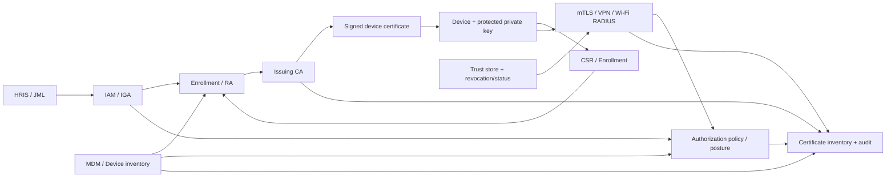
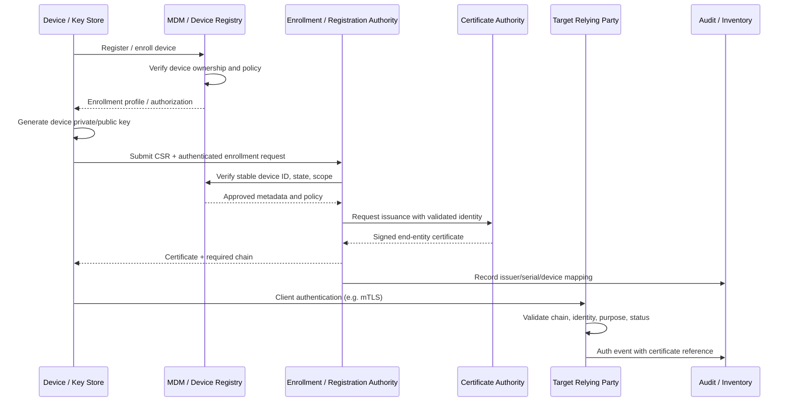
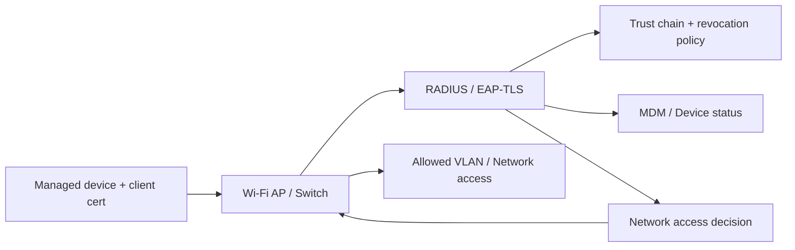
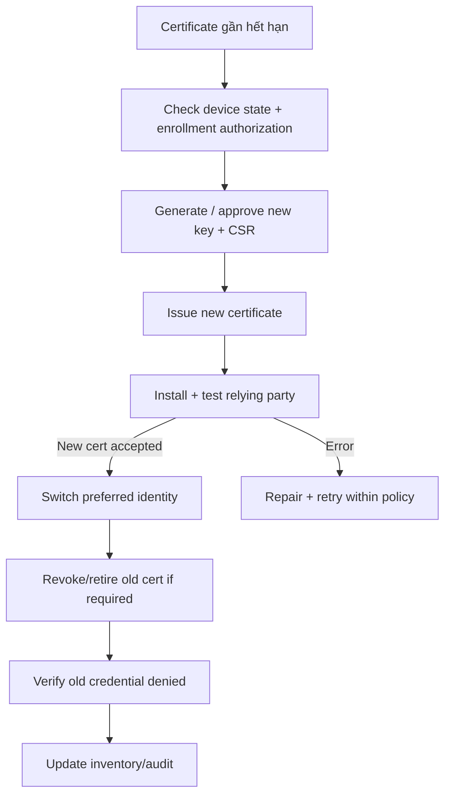

# Device certificate: Chứng thư số thiết bị trong quản lý vòng đời Machine Identity và IAM

Một máy tính doanh nghiệp được cấp quyền truy cập Wi-Fi nội bộ bằng chứng thư số, một gateway công nghiệp sử dụng **mutual TLS (mTLS)** để gửi dữ liệu lên nền tảng, còn một laptop khác đã bị đánh cắp nhưng certificate của nó vẫn còn hạn sáu tháng. Nhìn bề ngoài, cả ba thiết bị đều xuất trình được một **device certificate** do hệ thống PKI tin cậy cấp. Tuy nhiên, tổ chức cần trả lời những câu hỏi khác nhau: **đây có đúng là thiết bị đã đăng ký không, private key có an toàn không, thiết bị còn thuộc tổ chức không, chứng thư đã bị thu hồi chưa, và thiết bị được phép truy cập tài nguyên nào?**

**Device certificate (chứng thư số thiết bị)** là chứng thư số, phổ biến nhất theo chuẩn **X.509**, dùng để liên kết **khóa công khai (public key)** với một **định danh thiết bị** theo chính sách của **Certification Authority (CA)**. Khi bên giữ **private key** thực hiện một giao thức chứng minh sở hữu khóa phù hợp, bên xác minh có thể kiểm tra rằng kết nối đang sử dụng khóa tương ứng với chứng thư. Việc xác minh này chỉ đáng tin nếu **chuỗi chứng thư, CA, mục đích sử dụng, tên/định danh, thời hạn, trạng thái thu hồi và các điều kiện chính sách** được kiểm chính xác.

Trong mô-đun **Identity Lifecycle** của hệ thống **Identity and Access Management (IAM)**, bài **Device certificate** thuộc chương **Machine identity**. Nội dung tập trung vào **vòng đời danh tính thiết bị** từ đăng ký, chứng thực, cấp/đổi chứng thư đến vô hiệu hóa và thu hồi khi thiết bị, workload hoặc chủ sở hữu thay đổi. Bài kết nối **Joiner–Mover–Leaver (JML)**, IdP, SSO, SCIM, RBAC/ABAC, tài khoản dịch vụ, PAM, kiểm toán và reconciliation nhằm giảm **quyền truy cập tồn dư**.

> **Nguyên tắc trọng tâm:** Một certificate hợp lệ chỉ giúp xác thực **khóa và định danh mà CA đã chứng nhận trong một phạm vi tin cậy cụ thể**; nó không tự chứng minh thiết bị an toàn, không tự xác thực người đang sử dụng thiết bị và không tự cấp quyền truy cập mọi tài nguyên.

## 1. Device certificate là gì?

Trong PKI, chứng thư số chứa một **public key**, một số thông tin nhận diện/điều kiện sử dụng và chữ ký số của tổ chức phát hành. CA ký chứng thư bằng khóa phát hành của mình. Bên tiếp nhận xây dựng và xác minh chuỗi tin cậy từ certificate thiết bị tới **trust anchor** mà hệ thống đã cấu hình.

Một chứng thư số dùng cho thiết bị có thể phục vụ:

- **TLS client authentication/mTLS:** ứng dụng hoặc thiết bị chứng minh danh tính khi kết nối đến API/broker.
- **Wi-Fi 802.1X với EAP-TLS:** xác thực thiết bị hoặc user/device qua certificate theo cấu hình supplicant và RADIUS.
- **VPN certificate authentication:** xác minh client trước khi truy cập network.
- **Device management:** định danh thiết bị trong kênh quản trị MDM/UEM khi sản phẩm hỗ trợ.
- **IoT/edge onboarding:** xác thực gateway, sensor hoặc controller khi chúng kết nối cloud.
- **Service-to-service identity:** trong một số môi trường, certificate gắn với workload hoặc service chạy trên thiết bị, nhưng cần phân biệt hai loại định danh này.

### 1.1. Certificate không phải private key

| Thành phần | Bản chất | Yêu cầu bảo vệ |
|---|---|---|
| **Private key** | Khóa bí mật dùng để ký/chứng minh sở hữu khóa. | Bảo mật nghiêm ngặt; ưu tiên không thể xuất nếu nền tảng hỗ trợ. |
| **Public key** | Khóa có thể chia sẻ để bên khác xác minh chữ ký. | Kiểm tính liên kết với certificate và chính sách. |
| **Device certificate** | Dữ liệu chứng thực public key cùng identity/thuộc tính do CA ký. | Có thể công khai theo giao thức; bảo vệ tính toàn vẹn và sử dụng đúng ngữ cảnh. |
| **CA certificate** | Chứng thư của CA, có thể thuộc root hoặc intermediate. | Tin cậy theo trust store/policy; không xem mọi CA đều tương đương. |
| **Trust anchor** | Khóa/chứng thư được cài làm gốc tin cậy. | Quản trị chặt trust store và thay đổi. |
| **Device record** | Bản ghi thiết bị trong inventory/MDM/CMDB. | Liên kết certificate với asset/owner/lifecycle đúng nguồn. |

Đánh cắp **certificate public** chưa đủ để mạo danh nếu attacker không có private key tương ứng. Ngược lại, một private key bị sao chép có thể cho phép nhiều endpoint sử dụng danh tính giống nhau cho tới khi key/certificate bị vô hiệu theo cơ chế xác minh của hệ thống.

### 1.2. Vì sao dùng certificate thay vì shared password?

Mỗi thiết bị có thể có cặp khóa riêng và CA quản lý quá trình cấp, giảm nhu cầu dùng một password/API key chung cho hàng nghìn thiết bị. Trong mTLS/EAP-TLS, thiết bị thường **chứng minh sở hữu private key** mà không gửi private key cho server.

Tuy nhiên certificate **không tự có cơ chế chống sao chép**. Mức bảo vệ thực tế phụ thuộc vào nơi sinh/lưu khóa, kiểm soát enrollment, attestation và khả năng revoke.

### 1.3. Device certificate khác user certificate và server certificate

- **Device certificate:** liên kết public key với identity thiết bị/endpoint theo policy của CA.
- **User certificate:** liên kết public key với identity người dùng theo quy trình được quy định; đôi khi dùng để đăng nhập cá nhân.
- **Server certificate:** phục vụ xác thực server endpoint, thường có SAN DNS/IP và EKU phù hợp với TLS server authentication.
- **Workload certificate:** liên kết khóa với workload/service identity, chẳng hạn một SPIFFE ID, không mặc nhiên là physical device identity.
- **CA certificate:** dùng xác nhận chuỗi phát hành, không phải certificate endpoint thông thường.

Cùng một định dạng X.509 có thể được dùng cho các vai trò khác nhau, nhưng **trust policy, SAN, EKU, private-key custody và lifecycle** phải phù hợp với từng trường hợp.

## 2. Các trường quan trọng trong chứng thư X.509

Một certificate thường có các thành phần:

| Trường/extension | Vai trò | Lưu ý khi kiểm |
|---|---|---|
| **Subject** | Thông tin chủ thể theo schema của issuer. | Không chỉ tin Common Name (CN) để nhận dạng target. |
| **Subject Alternative Name (SAN)** | Các định danh bổ sung như DNS, IP, URI, email hoặc dạng khác. | Kiểm SAN phù hợp loại identity và protocol. |
| **Issuer** | Tên tổ chức/CA phát hành. | Tên không đủ; cần xác minh chữ ký và chuỗi tin cậy. |
| **Serial Number** | Số định danh của certificate trong phạm vi issuer. | Dùng cùng issuer để nhận dạng một certificate, không thay stable device ID. |
| **Not Before / Not After** | Khoảng hiệu lực về thời gian. | Clock đáng tin, chú ý rollover và time skew. |
| **Subject Public Key Info** | Public key và thuật toán. | Kiểm thuật toán/key strength theo chính sách. |
| **Signature Algorithm** | Thuật toán ký certificate. | Chặn thuật toán yếu/không được phép. |
| **Basic Constraints** | Phân biệt CA và end-entity, giới hạn CA chain. | Thiết bị dùng end-entity cert; kiểm chain. |
| **Key Usage (KU)** | Mục đích mật mã mà khóa có thể dùng. | Cần phù hợp với giao thức. |
| **Extended Key Usage (EKU)** | Mục đích ứng dụng như TLS client/server authentication. | Không dùng cert cho mục đích khác trái EKU/policy. |
| **Authority/Subject Key Identifier** | Hỗ trợ tìm liên kết khóa/chứng thư trong chain. | Không thay kiểm chữ ký và đường tin cậy. |
| **AIA/CDP** | Thông tin hỗ trợ lấy issuer/status nếu được triển khai. | Không mặc định client sẽ tải hoặc kiểm revocation. |
| **Certificate Policies** | OID mô tả chính sách cấp phát của CA. | Chỉ có ý nghĩa nếu relying party thực sự kiểm/hiểu. |

### 2.1. Ví dụ hiển thị certificate minh họa

```text
Version:              3
Serial Number:        00A19F42
Issuer:               CN=Corp Device Issuing CA
Subject:              CN=managed-device-1045
Validity:
    Not Before:       2026-12-01T00:00:00Z
    Not After:        2027-03-01T00:00:00Z
Subject Public Key:   P-256 (example)
Basic Constraints:    CA:FALSE
Key Usage:            digitalSignature
Extended Key Usage:   clientAuth
Subject Alt Name:     URI:urn:corp:device:device-1045
```

Đây chỉ là **bản mô tả**, không phải chứng thư PEM hợp lệ. Doanh nghiệp cần lựa chọn thuật toán, trường định danh và profile certificate theo yêu cầu hệ thống, tiêu chuẩn và thư viện TLS được dùng. SAN URI như ví dụ **không tự tạo ý nghĩa chuẩn** nếu bên xác minh chưa định nghĩa rõ cách diễn giải.

### 2.2. Issuer, serial và fingerprint dùng để làm gì?

Một inventory có thể lưu:

- **Issuer + serial:** nhận dạng instance certificate.
- **Fingerprint** (ví dụ SHA-256): nhận diện dữ liệu chứng thư cụ thể.
- **Public-key identifier:** nhận diện khóa dùng trong bản ghi.
- **Stable device ID:** khóa quản lý asset, không phụ thuộc certificate hiện tại.
- **Enrollment transaction ID:** theo dõi quá trình cấp chứng thư.
- **Owner/workload ID:** liên kết device với người/đội/tài nguyên.

Khi renew, certificate có thể đổi **serial và fingerprint** trong khi **device identity vẫn giữ nguyên**. Không nên thay device ID bằng CN hoặc serial số chứng thư.

## 3. Machine identity, device identity và asset identity

### 3.1. Ba khái niệm liên quan nhưng không đồng nhất

- **Machine identity:** danh tính kỹ thuật cho một thực thể không phải người; bao gồm thiết bị, service, workload, robot hoặc agent.
- **Device identity:** danh tính một endpoint/thiết bị hoặc một thực thể phần cứng được quản lý.
- **Asset identity:** mã tài sản/CMDB để quản lý sở hữu, vị trí, bảo hành hoặc vòng đời vận hành.

Một laptop có thể có mã asset và stable device ID, đồng thời sở hữu nhiều certificate cho **Wi-Fi, VPN, device management**. Các certificate có thể do những CA khác nhau cấp và có lifecycle riêng.

### 3.2. Vì sao không gắn device certificate trực tiếp với một nhân viên?

Một laptop có thể:

1. Được cấp cho nhân viên A.
2. Được thu hồi khi A Mover/Leaver.
3. Được wipe/re-enroll.
4. Được cấp lại cho nhân viên B.

Nếu certificate chỉ định danh **device**, không có quy định nó xác thực **user A**. Khi A rời công ty, tổ chức có thể cần revoke/rotate certificate tùy tình huống và chính sách, nhưng **không được giả định** rằng mọi certificate máy luôn mất hiệu lực hoặc phải giữ nguyên. Cần xem **custody, re-enrollment, private-key integrity và policy của từng target**.

### 3.3. Device không phải luôn là workload

Một máy chủ vật lý có thể chạy 20 service. Một certificate cho host **không tự cho phép** 20 service có identity độc lập; nếu dùng chung private key, khó cô lập service và truy vết.

Thiết kế có thể chọn:

- **Device/host certificate:** dùng để chứng minh endpoint quản lý.
- **Workload/service certificate:** cấp cho từng service/pod/agent.
- **User certificate:** cho người sử dụng nếu policy yêu cầu.

Giữa chúng cần liên kết rõ, không nhập chung bằng một trường `machine=true`.

## 4. Kiến trúc phát hành và sử dụng Device certificate

Một hệ thống thường có:

- **Device registry / CMDB / MDM-UEM:** quản lý device ID, owner, trạng thái, enrollment và posture.
- **Registration Authority (RA):** kiểm enrollment request/điều kiện cấp phát theo mô hình PKI.
- **Certification Authority (CA):** ký certificate và quản trị issuer/key/policy.
- **Hardware security / TPM / Secure Enclave / Secure Element:** có thể giúp tạo/giữ khóa khó xuất.
- **Enrollment protocol/service:** SCEP, EST, ACME hoặc cơ chế riêng nếu hệ sinh thái hỗ trợ.
- **Certificate inventory:** mapping certificate ↔ device ↔ owner ↔ application target.
- **Relying party / verifier:** RADIUS, VPN gateway, API gateway, TLS server hoặc service.
- **Revocation/status service:** CRL/OCSP hoặc cơ chế/short-lived certificate phù hợp.
- **IAM/IGA/IdP/PKI workflow:** trạng thái vòng đời người, device/workload và authorization policy.
- **Audit/SIEM/reconciliation:** bằng chứng cấp, sử dụng, đổi, thu hồi và hiệu lực thật.

### 4.1. Sơ đồ trách nhiệm



Đây là kiến trúc **logic**. Các nền tảng có thể tích hợp RA/CA/enrollment vào một sản phẩm hoặc cung cấp chứng thư qua MDM. Điều quan trọng là **ai kiểm điều kiện cấp, ai ký, ai tin, ai thực thi và ai đóng vòng đời**.

### 4.2. Trust boundary

Có ít nhất bốn ranh giới:

1. Device chứng minh sở hữu private key.
2. CA/RA quyết định certificate nào được phép cấp và tên thiết bị nào được chứng nhận.
3. Verifier quyết định có tin certificate/issuer/identity cho giao thức này không.
4. Authorization engine quyết định identity/device có quyền truy cập resource cụ thể không.

Không được coi bước (1)–(3) tự bao gồm bước (4).

## 5. Chuẩn bị enrollment: device có thực sự đủ điều kiện nhận certificate?

Trước khi cấp certificate, cần xác định:

- Device có **stable device ID** đã được đăng ký bởi nguồn tin cậy không?
- Thiết bị thuộc doanh nghiệp, đối tác hay BYOD?
- Ai là owner, custodian, team hoặc service sponsor?
- Device đang `REGISTERED`, `ENROLLING`, `MANAGED`, `QUARANTINED`, hay `RETIRED`?
- Enrollment được khởi tạo bằng phương thức đã được ủy quyền không?
- Có yêu cầu kiểm thiết bị đủ điều kiện như MDM compliance, boot state hoặc hardware attestation không?
- CA sẽ cấp tên/SAN nào và bên verifier sẽ diễn giải thế nào?
- Certificate dùng cho purpose nào: Wi-Fi, VPN, mTLS, device management?
- Key được sinh ở đâu, có chống export không?
- Có chống **enrollment replay/duplicate identity** không?
- Quyền truy cập có hạn và cách revoke/rotate đã định nghĩa chưa?

### 5.1. Device enrollment khác user login

**Enrollment** là việc đưa device vào phạm vi quản trị, gắn với một identity và chính sách cấp phát. User có thể cần đăng nhập qua IdP/SSO để **khởi tạo** enrollment, nhưng điều đó không tự chứng minh device đang trong trạng thái an toàn.

Ví dụ người dùng A đăng nhập SSO trên một máy không được quản lý rồi yêu cầu certificate cho device ID thuộc công ty. Nếu RA chỉ kiểm user login mà không kiểm **device binding**, hệ thống có thể cấp certificate sai đối tượng.

### 5.2. Bootstrap trust là bài toán khó

Thiết bị chưa có certificate cần chứng minh nó được phép enroll bằng cơ chế bootstrap, chẳng hạn:

- Mã/secret enrollment ngắn hạn có giới hạn và liên kết device.
- Dấu hiệu phần cứng hoặc manufacturing identity được hệ thống tin và kiểm.
- Enrollment qua MDM/UEM đã xác minh thiết bị.
- Provisioning tại xưởng với quy trình khóa/asset custody.
- Hardware attestation được nhà sản xuất/nền tảng hỗ trợ.
- Phê duyệt thủ công và kiểm soát vật lý cho thiết bị rủi ro cao.

Không có một bootstrap method phù hợp cho mọi hệ thống. Điểm quan trọng là **không cho thiết bị tự chọn bất kỳ identity/SAN của thiết bị khác** mà RA không xác minh.

## 6. Private key: sinh, lưu và chống sao chép

### 6.1. Tại sao bảo vệ private key là trọng tâm?

Một verifier trong TLS tin rằng client đã chứng minh sở hữu private key tương ứng với certificate. Nếu khóa bị sao chép, attacker có thể chứng minh sở hữu khóa tương tự trên máy khác. **X.509 certificate không tự phát hiện bản sao key**.

Mức bảo vệ phụ thuộc vào:

- Chỗ key được sinh ra.
- Khả năng export key.
- Quyền sử dụng key trên hệ điều hành.
- Sự bảo vệ của secure hardware.
- Cách khôi phục/sao lưu.
- Mô hình privilege của process có quyền gọi key.
- Cơ chế giám sát thay đổi thiết bị hoặc anomalous usage.

### 6.2. Software key vs hardware-protected key

| Cách lưu | Đặc điểm | Giới hạn |
|---|---|---|
| Software key file | Dễ tích hợp với nhiều client. | Có thể bị sao chép nếu quyền file/host bị xâm phạm. |
| OS key store | Kiểm quyền truy cập bằng hệ điều hành. | Không mặc nhiên chống export trên mọi nền tảng. |
| TPM-backed key | Có thể sinh và dùng khóa được bảo vệ bởi TPM theo API/nền tảng. | Cần kiểm policy, key attestation nếu muốn chứng minh ràng buộc phần cứng. |
| Secure Element | Phần cứng bảo vệ thao tác khóa. | Khả năng, provisioning và recovery tùy thiết bị. |
| HSM-backed key | Bảo vệ khóa với hệ thống chuyên dụng. | Thường phù hợp server/gateway/CA, cần thiết kế hiệu năng và availability. |

**Hardware-backed ≠ uncompromisable**. Malware có quyền gọi thao tác ký trên thiết bị có thể lợi dụng khóa mà không xuất được nó; remote attestation/posture có thể bổ sung kiểm soát.

### 6.3. CSR và Proof of Possession

Trong nhiều quy trình, thiết bị:

1. Tự sinh cặp khóa.
2. Tạo **Certificate Signing Request (CSR)** chứa public key và các thuộc tính đề nghị.
3. Chứng minh đang kiểm soát private key theo cơ chế của CSR/enrollment.
4. RA kiểm identity, ownership, policy và quyền đăng ký.
5. CA ký certificate theo dữ liệu đã kiểm.

**CSR có chữ ký chứng minh việc yêu cầu có thể gắn với private key**, nhưng **không tự chứng minh người gửi được phép mang identity/SAN đó**, key là non-exportable, hay device đang compliant. Những điều này cần nguồn xác minh riêng.

### 6.4. Attestation khác certificate issuance

**Hardware attestation** có thể cung cấp bằng chứng về khóa hoặc trạng thái thiết bị trong một trust model nhất định. Nó không đồng nhất với X.509 client certificate và không tự mang tới quyền truy cập.

Nếu policy yêu cầu `hardwareBacked=true`, RA/verifier phải kiểm evidence do nguồn đáng tin cấp, **không tin flag do device tự khai**.

## 7. Luồng cấp phát: từ registration đến certificate issued

### 7.1. Mô hình tuần tự



Sơ đồ không bắt buộc một giao thức enroll cụ thể. Các bước authentication, device validation và signing có thể khác thứ tự theo hệ sinh thái, nhưng **không được bỏ bước xác minh identity trước khi cho phép cấp SAN đã có ý nghĩa bảo mật**.

### 7.2. SCEP, EST, ACME và cơ chế riêng

| Phương thức | Có thể dùng trong bối cảnh | Điều cần lưu ý |
|---|---|---|
| **SCEP** | Enrollment certificate được nhiều hệ sinh thái quản lý thiết bị sử dụng. | Phải bảo vệ bootstrap/challenge và authorization mapping. |
| **EST** | Enrollment qua HTTPS với các cơ chế xác thực theo triển khai. | Cần trust bootstrap, authentication và kiểm danh tính ở RA. |
| **ACME** | Tự động cấp/renew certificate theo cơ chế được CA và client hỗ trợ. | Không suy rằng mọi ACME CA đều phát hành device-client certificate. |
| **MDM/UEM native flow** | Certificate profile gắn enrollment/management device. | MDM authorization và liên kết đến inventory phải đúng. |
| **Vendor/IoT provisioning** | Thiết bị factory/field theo trust model riêng. | Kiểm manufacturer trust, key ownership, transfer và revocation. |

Tên giao thức **không tự đảm bảo** issuance an toàn. Phải kiểm cụ thể protocol profile, CA policy, client software và identity proofing.

### 7.3. Kiểm trước khi issue

Một chính sách cấp phát có thể mô tả:

```text
PERMIT issueDeviceCertificate nếu:
  device.registryState == MANAGED
  AND device.enrollmentAuthorized
  AND deviceId lấy từ registry có thẩm quyền
  AND requestedIdentity matches approvedDeviceIdentity
  AND CSR proves possession of corresponding private key
  AND keyAlgorithm meets policy
  AND requestedEKU is permitted for certificateProfile
  AND device not RETIRED/QUARANTINED by policy
  AND issuanceCount/duplicate constraints satisfied
```

Đây là pseudocode cho RA. Các điều kiện `device.registryState` và attestation phải được lấy từ hệ thống đáng tin; không nhận JSON `{"managed":true}` như bằng chứng tự thân.

## 8. Định danh trong certificate và mapping vào inventory

### 8.1. Định danh phải ổn định và không tái sử dụng tùy tiện

Các cách định danh có thể gồm:

- SAN URI chứa stable device ID theo namespace nội bộ.
- SAN DNS/IP khi đúng mục đích giao thức.
- OtherName/OID được CA và relying party thống nhất.
- Subject field theo profile của doanh nghiệp.

Không sử dụng bừa **hostname** hoặc **serial phần cứng** làm identity toàn cục nếu chúng có thể đổi, trùng, bị giả hoặc không phù hợp với policy.

Ví dụ:

```yaml
deviceRecord:
  deviceId: device-1045
  assetId: asset-laptop-078
  deviceType: CORPORATE_LAPTOP
  lifecycleState: MANAGED
  ownerTeam: endpoint-operations
  assignedHumanId: person-1045
  managementAuthority: uem-prod
certificateIdentity:
  sanType: URI
  sanValue: "urn:corp:device:device-1045"
  intendedUse: tls-client-auth
  profile: wifi-device-v3
```

Đây là schema minh họa. Khi laptop được giao cho người khác, **`assignedHumanId` có thể đổi** nhưng device ID vẫn giữ; nếu wipe/re-enroll, profile và certificate có thể được tái cấp.

### 8.2. Kiểm chống đăng ký chồng identity

RA cần ngăn:

- Device A tự xin SAN của device B.
- Một bootstrap token dùng lại không đúng policy.
- Hai certificate còn hiệu lực ngoài dự kiến cho cùng key/device.
- Clone máy ảo/IoT image mang cùng private key.
- Thiết bị đã RETIRED được enroll lại bằng challenge cũ.
- Enrollment tại sai tenant/org.
- Certificate profile dùng clientAuth nhưng bị cấp như serverAuth trái policy.

**Nhiều certificate cùng device ID không nhất thiết sai** nếu đang trong giai đoạn overlap renewal hoặc dùng các purpose khác nhau. Inventory phải ghi được quan hệ và lý do.

## 9. Device certificate trong TLS và mTLS

### 9.1. TLS server authentication và mTLS

Trong TLS thông thường, client xác thực **server certificate** để tránh kết nối tới endpoint giả mạo. Trong **mTLS**, server cũng yêu cầu và xác minh **client certificate**. Thiết bị client dùng private key để chứng minh quyền sở hữu khóa trong handshake.

Luồng logic:

```text
Device -> Server: Kết nối TLS
Server -> Device: Server certificate / chain
Device: Xác minh server trust và tên đích
Server: Yêu cầu client authentication
Device -> Server: Client certificate / chain
Device: Chứng minh sở hữu client private key
Server: Kiểm client chain, purpose, identity và policy
Server -> Authorization layer: deviceId + context
Authorization layer: Cho hoặc từ chối action/resource cụ thể
```

Trình tự chi tiết khác nhau theo phiên bản TLS, thư viện và chế độ handshake. **Không bao giờ được bỏ xác thực server** chỉ vì client đang dùng mTLS.

### 9.2. Những gì mTLS chứng minh

Nếu triển khai đúng, mTLS có thể chứng minh peer kiểm soát private key tương ứng với client certificate được CA tin cậy cấp. Nó **không tự chứng minh**:

- Thiết bị còn được doanh nghiệp quản lý.
- Hệ điều hành đã vá lỗ hổng.
- Người sử dụng hiện tại là nhân viên A.
- Certificate chưa bị copy sang thiết bị khác.
- API caller được quyền xem dữ liệu tenant B.
- Principal còn ACTIVE ở IAM/MDM.
- Session không bị tận dụng bởi phần mềm độc hại trên thiết bị.

Cần thêm device inventory/attestation/posture và authorization.

### 9.3. TLS client auth profile

Verifier cần kiểm ít nhất:

- Chuỗi chữ ký PKI tới trust anchor phù hợp.
- Validity và policy về thời gian.
- EKU/client authentication và KU theo TLS stack/policy.
- Basic Constraints và critical extensions.
- Thuật toán/chữ ký/key strength theo chuẩn triển khai.
- SAN/identity binding với registry đã phê duyệt.
- Issuer/profile thuộc tập CA dành cho **device identity** này.
- Revocation/status theo risk policy và khả năng giao thức.
- Target/tenant audience của certificate nếu policy xác định.
- Quản trị session/caching phù hợp thời hạn/cập nhật status.

Dựa vào `Subject CN=managed-device` hoặc `issuerName="Corp CA"` mà không xác minh signature/chain/identity là không an toàn.

## 10. Wi-Fi 802.1X/EAP-TLS và VPN

### 10.1. EAP-TLS cho mạng doanh nghiệp

Một mô hình thường có:

- **Supplicant:** thiết bị người dùng.
- **Authenticator:** switch hoặc access point.
- **Authentication server:** RADIUS/AAA, có thể kiểm EAP-TLS.
- **Certificate PKI:** CA cấp certificate máy/người dùng theo profile.
- **Policy/NAC:** xác định VLAN, network access hoặc mức hạn chế.



Các nút thể hiện trách nhiệm. Trong triển khai thật, việc AAA kết nối MDM online, tần suất kiểm trạng thái và chế độ 802.1X thay đổi theo nhà cung cấp.

### 10.2. Device cert khác user certificate trong EAP-TLS

- **Machine authentication:** chứng minh thiết bị được đăng ký.
- **User authentication:** chứng minh người dùng theo cơ chế/phân đoạn cấu hình.
- **Combined policy:** có thể yêu cầu cả thiết bị và user hoặc posture trong mô hình NAC/conditional access.

Nếu chỉ có machine certificate, không được tự kết luận người ngồi trước máy là nhân viên hợp lệ hoặc có quyền vào tất cả mạng nội bộ.

### 10.3. VPN certificate authentication

VPN gateway có thể yêu cầu client certificate. Nhưng cấp certificate chỉ nên mở kênh theo policy; **quyền vào hệ thống nội bộ** vẫn cần segment/ACL/app authorization. Một certificate còn hạn của laptop Leaver không nên tạo VPN access khi thiết bị đã bị đánh dấu retired/lost.

### 10.4. Rủi ro kiểm nhầm trust

Một gateway tin mọi certificate của một CA chung có thể vô tình chấp nhận certificate dành cho **mục đích khác** nếu không kiểm EKU/profile/identity. Cần phân tách CA/trust policy theo use case hoặc áp constraints đúng, không xem “chữ ký của CA nội bộ” là giấy phép truy cập toàn bộ.

## 11. Device posture, Zero Trust và quyền truy cập

### 11.1. Certificate là tín hiệu authentication

Device certificate có thể là một tín hiệu mạnh trong **Zero Trust** khi kết hợp với:

- Device registry còn hiệu lực.
- MDM compliance và quản trị endpoint.
- Security posture/patch state.
- Risk assessment.
- Người dùng đã xác thực nếu tài nguyên yêu cầu.
- RBAC/ABAC của ứng dụng.
- Network/context và resource sensitivity.
- Policy về tenant, project và thời hạn.

“Có certificate” không thay thế “device đang healthy”.

### 11.2. Điều kiện ABAC minh họa

```text
PERMIT api.report.read nếu:
  tls.clientCertificate đã được xác minh cho intended purpose
  AND certificateDeviceId liên kết device registry hợp lệ
  AND device.lifecycleState == MANAGED
  AND device.complianceState == COMPLIANT theo nguồn tin cậy
  AND device.tenantId == resource.tenantId
  AND principal có quyền report.read trên resource
  AND session/risk đáp ứng policy
```

Một gateway có thể cung cấp verified device ID cho backend qua **kênh/trust được bảo vệ**; backend không được tin header `X-Device-Id` do client trực tiếp tự gửi.

### 11.3. Certificate-authentication và human authorization

Laptop của A có certificate của tổ chức. Nếu B sử dụng laptop ấy, identity thiết bị có thể vẫn hợp lệ. Cần xác thực **user B** riêng khi resource gắn với quyền cá nhân. Không dùng device certificate làm bằng chứng duy nhất rằng A đang đăng nhập.

### 11.4. Session cache và posture freshness

Posture và revocation có thể thay đổi giữa các lần handshake. Relying party phải xác định:

- Mức độ mới của trạng thái MDM.
- Thời hạn cache của decision.
- Khi nào cần reauth/session termination.
- Cách chặn lost device nhanh.
- Cách vận hành nếu posture service unavailable.

Không suy từ một certificate còn `NotAfter` trong tương lai rằng trạng thái rủi ro vẫn được chấp nhận tới ngày ấy.

## 12. Device certificate trong vòng đời Joiner–Mover–Leaver

### 12.1. Joiner — nhân viên nhận thiết bị công ty

Một quy trình có thể là:

1. HRIS xác minh Joiner, manager, start date.
2. IAM/IT cấp laptop có asset/device ID.
3. MDM/UEM enroll thiết bị và áp baseline.
4. Device tạo private key (ưu tiên bảo vệ phần cứng khi hỗ trợ).
5. RA kiểm eligibility, SAN binding và enrollment source.
6. CA cấp certificate đúng profile (Wi-Fi/VPN/mTLS).
7. RADIUS/VPN/API xác minh certificate và trạng thái device.
8. Sau ngày hiệu lực và policy phù hợp, user có quyền nghiệp vụ riêng.
9. Inventory ghi device ↔ certificate ↔ assigned owner ↔ target và review date.

**Nhân viên Joiner chưa ACTIVE** có thể được chuẩn bị thiết bị/enrollment nhưng không nên có quyền tài nguyên hoạt động trước ngày hiệu lực nếu policy không cho phép.

### 12.2. Mover — chuyển bộ phận, thay owner hoặc thay mục đích thiết bị

Khi nhân viên chuyển bộ phận:

- Xác định device còn cùng owner không hay được bàn giao.
- Tính lại quyền mạng, VPN, ứng dụng và certificate profiles cần dùng.
- Kiểm liệu certificate cũ gắn entitlement quá rộng theo department không.
- Gỡ role/group/ACL cũ ở IdP, NAC, VPN hoặc target theo policy.
- Reissue certificate nếu tên/profile/trust requirement thay đổi.
- Không gỡ device certificate dùng cho quản lý máy chỉ vì department đổi nếu mục đích quản lý vẫn hợp lệ và policy cho phép.
- Kiểm phiên và entitlement tồn dư.
- Đối soát cert inventory với trạng thái MDM/target.

### 12.3. Leaver — nhân viên rời tổ chức

Cần tách **quyền người dùng** và **quyền thiết bị**:

1. HRIS thông báo Leaver có thời điểm hiệu lực.
2. IdP/IAM khóa quyền cá nhân, chặn SSO và thu hồi ứng dụng.
3. Thu hồi/thu giữ thiết bị theo chính sách.
4. Nếu device mất/không trả hoặc private key có nguy cơ lộ: revoke certificates, block device identity tại các PEP liên quan.
5. Nếu thiết bị được tái sử dụng: wipe/re-enroll, đánh giá rekey/reissue trước khi bàn giao.
6. Thu hồi user-bound credentials, VPN sessions và token liên quan.
7. Kiểm MDM device state, CA status, VPN/RADIUS/API allow/deny.
8. Ghi evidence và finding khi không thể xác minh.

**Không có quy tắc phổ quát “Leaver luôn revoke mọi certificate của máy”**: một thiết bị công ty có thể tiếp tục thuộc tổ chức và chạy management services. Nhưng người đã Leaver không được giữ đường truy cập hữu hiệu qua thiết bị hoặc credential từng kiểm soát.

### 12.4. Ma trận JML

| Sự kiện | Desired identity/device state | Kiểm chứng |
|---|---|---|
| Joiner chưa đến ngày bắt đầu | Thiết bị có thể prepared; quyền user chưa active. | No unauthorized production access. |
| Joiner ACTIVE | Managed device và certificate đúng profile. | Handshake + ABAC user/device policies. |
| Mover | Quyền cũ gỡ, profile mới khi cần. | Reconciliation mạng/VPN/app. |
| Leaver trả máy | User quyền gỡ; device được thu giữ/wipe và quản trị lại. | Token/session và device custody readback. |
| Leaver không trả máy | Device LOST/RETIRED theo policy, certificate/key bị xử lý khẩn. | NAC/VPN/API từ chối theo đường kiểm. |
| Thiết bị chuyển cho nhân viên mới | Re-enroll/rekey nếu yêu cầu; không thừa kế quyền user cũ. | New assignment + credential inventory. |
| Contractor hết hạn | Quyền sponsor/user ngừng; device thuộc ai cần xác định. | Contract expiry + certificate status/policy. |
| Device decommission | Certificates/keys/trust bindings không còn dùng. | Revoke, dispose key, target DENY. |

### 12.5. Sự kiện sai thứ tự

```text
Version 52: person A ACTIVE, device assigned A
Version 53: person A TERMINATED, device QUARANTINED
Version 54: device wiped + REASSIGNED to person B

Nếu event version 52 đến muộn và cập nhật lại owner A,
workflow không được mở quyền/certificate cũ cho A.
```

Cần stable event IDs, version/effectiveAt, identity/device state riêng và idempotency. Với device reassign, một **enrollment generation** mới giúp tránh event cũ ghi đè vòng đời mới.

## 13. State machine riêng cho certificate và device

### 13.1. Certificate lifecycle

```text
REQUESTED
  -> VERIFIED_ENROLLMENT
  -> ISSUED
  -> INSTALLED
  -> ACTIVE
  -> RENEWING / REKEYING
  -> SUPERSEDED
  -> EXPIRED

Các nhánh:
  -> REVOKED
  -> FAILED_ISSUANCE
  -> QUARANTINED_BY_POLICY
  -> UNKNOWN_STATUS
```

`SUPERSEDED` có thể là trạng thái **inventory** (certificate cũ được thay) chứ không phải một trạng thái chuẩn nằm trong X.509. Certificate cũ chỉ thật sự không được chấp nhận nếu **hết hạn, bị revoke hoặc policy của relying party chặn**.

### 13.2. Device lifecycle

```text
DISCOVERED -> REGISTERED -> ENROLLING -> MANAGED
MANAGED -> NONCOMPLIANT -> QUARANTINED
MANAGED -> LOST / STOLEN
MANAGED -> REASSIGNING -> MANAGED (new enrollment generation)
MANAGED -> RETIRED -> DECOMMISSIONED
```

Đây là mô hình gợi ý. Device có thể `MANAGED` nhưng certificate đã `EXPIRED`; hoặc certificate còn hạn trong khi device đã `LOST`. **Hai vòng đời phải được đối soát, không nhập một.**

### 13.3. Các bất biến

- Không issue certificate cho device ID không có authorization enrollment đáng tin.
- Một certificate `REVOKED` không được phục hồi thành `ACTIVE` chỉ vì event MDM cũ.
- Device LOST/RETIRED không được tiếp tục nhận quyền mạng theo policy dù certificate còn hạn.
- Key mới cần liên kết certificate mới và enrollment generation phù hợp.
- Không có private key export nếu profile yêu cầu non-exportability và nền tảng hỗ trợ.
- Endpoint không được kết luận PASS nếu certificate expired nhưng verifier vẫn ALLOW trái policy.
- Gia hạn certificate không tự gia hạn quyền user, contract hoặc entitlement.
- Thu hồi một certificate không đồng nghĩa mọi phiên trước đó bị chấm dứt.

## 14. Renewal, rotation và rekey

### 14.1. Vì sao certificate cần vòng đời chủ động?

Nếu 50.000 máy cùng được cấp chứng thư một ngày và đều hết hạn sau 12 tháng, không có renewal scheduler thì hệ thống có thể gặp sự cố truy cập diện rộng. Ngoài ra, certificate còn hạn nhưng thiết bị đã mất hoặc bị xâm phạm vẫn gây rủi ro.

Do đó cần:

- Inventory theo `NotAfter`.
- Cảnh báo sớm phù hợp nhóm thiết bị, khả năng kết nối và SLA.
- Automated renewal có authorization rõ.
- Rekey/rotation khi key policy, owner, risk hoặc profile yêu cầu.
- Overlap certificate cũ/mới có giới hạn để tránh downtime.
- Xác minh target có chấp nhận mới và không chấp nhận cũ sau thời điểm cần cắt.
- Có xử lý offline devices, failed enrollment và enrollment retry.

### 14.2. Renewal khác rekey

- **Renewal:** cấp certificate mới; tùy CA/profile có thể tái sử dụng hoặc thay khóa.
- **Rekey:** sinh cặp khóa mới, cấp certificate tương ứng và gỡ khóa/certificate cũ theo policy.
- **Revocation:** CA/issuer ghi nhận certificate không còn được chấp nhận theo cơ chế trạng thái, nhưng verifier phải thực sự kiểm.
- **Replacement/re-enrollment:** có thể thay cả device management binding và key/certificate.

Khuyến nghị thực tế thường ưu tiên **khóa mới khi phù hợp chính sách bảo mật**, đặc biệt nếu nghi ngờ key exposure. Không khẳng định mọi quy trình renew bắt buộc sinh key mới trong mọi sản phẩm.

### 14.3. Kế hoạch chuyển đổi an toàn



### 14.4. Khi thiết bị offline vào ngày renewal

Một IoT gateway có thể mất kết nối trong nhiều tuần. Cần xác định:

- Certificate expiry có thể làm thiết bị **mất khả năng kết nối để renew** hay không.
- Có đường recovery/enrollment riêng không phụ thuộc certificate đã hết hạn?
- Có policy về clock/trust bootstrap hợp lệ cho offline restart?
- Có thể gửi certificate mới an toàn qua kênh đã đăng ký không?
- Quyền tạm/ngoại lệ có làm tăng rủi ro không?
- Khi thiết bị quay lại, xử lý trạng thái MDM/CA và revoked key thế nào?

**Không giải quyết bằng cách tắt certificate validation hoặc chấp nhận mọi cert expired vô thời hạn.** Cần thiết kế recovery cụ thể và giới hạn.

## 15. Thu hồi certificate: CRL, OCSP và short-lived certificates

Một certificate còn thời hạn không có nghĩa CA hoặc doanh nghiệp vẫn muốn tin nó. Khi device mất, key bị lộ, thiết bị bị đưa ra khỏi inventory hoặc certificate phát hành sai, tổ chức có thể cần **revocation** trước `NotAfter`.

### 15.1. Certificate Revocation List (CRL)

**CRL** là danh sách các certificate đã bị CA thu hồi trong một kỳ phát hành danh sách, được CA ký và công bố theo cơ chế PKI. Relying party phải:

- Lấy CRL từ nguồn được policy chấp nhận.
- Xác minh chữ ký/issuer, thời hạn dữ liệu và phạm vi CRL.
- So khớp certificate theo issuer + serial.
- Quyết định hành vi nếu CRL không thể tải hoặc đã quá cũ.

**CA đã thêm certificate vào CRL ≠ mọi client đang dùng CRL mới**. Caching, mạng offline và chính sách client có thể tạo khoảng trễ.

### 15.2. Online Certificate Status Protocol (OCSP)

**OCSP** có thể cho biết trạng thái certificate theo thông tin responder được tin cậy/ủy quyền. Relying party cần xác minh response, chữ ký/responder authorization, tính mới của dữ liệu và cách xử lý khi không truy cập được responder.

Một phản hồi `good` theo ngữ nghĩa OCSP thông thường **không chứng minh endpoint lành mạnh hay account được phép dùng API**; nó chỉ liên quan trạng thái certificate theo phạm vi của responder.

### 15.3. Short-lived certificates

Có thể dùng certificate thời hạn ngắn để giảm thời gian tiếp tục tin credential nếu không có revocation online đáng tin trong mọi tình huống. Nhưng:

- Cần automated renewal và clock đúng.
- Thiết bị offline có thể mất kết nối khi cert hết hạn.
- Certificate sống ngắn **vẫn có khoảng lạm dụng trước expiry** nếu key lộ.
- Cần policy chặn device LOST/RETIRED ở PEP hoặc kênh khác khi đòi thu hồi nhanh.
- Không cho renewal tự động ở device đã bị thu hồi quản lý.

### 15.4. Phân biệt revoke, expire và denylist

| Biện pháp | Nơi ghi nhận | Điều cần kiểm |
|---|---|---|
| **CA revocation** | CRL/OCSP hoặc trạng thái issuer hỗ trợ. | Verifier có thực sự kiểm và nhận dữ liệu mới không? |
| **Expiry** | `NotAfter` trong certificate. | Verifier có từ chối sau expiry không? |
| **Device denylist** | NAC/API/MDM/authorization policy. | Có chặn mọi đường liên quan không? |
| **Rekey/rotation** | Device/CA/registry. | Certificate/key cũ còn được chấp nhận không? |
| **Account/entitlement revoke** | IAM/IdP/SaaS/PAM/target. | Session/token/app role cũ đã bị xử lý chưa? |
| **Network quarantine** | NAC/VPN/segmentation. | Thiết bị còn đường quản trị/khôi phục hợp lệ không? |

**Không có biện pháp nào tự thay cho mọi biện pháp khác.** Thu hồi user quyền ở SSO không mặc nhiên revoke device certificate; revoke device certificate không tự logout user khỏi SaaS session đã tạo.

## 16. Revocation checking khi offline và rủi ro fail-open

### 16.1. Relying party không truy cập được status service

Giả sử API gateway yêu cầu client certificate. Gateway kiểm chain và thấy chứng thư còn hạn, nhưng OCSP responder không truy cập được.

Các chính sách có thể gồm:

- **Fail-closed:** từ chối authentication khi không đủ trạng thái bắt buộc.
- **Fail-open có điều kiện:** cho phép một số loại truy cập với dữ liệu status đã cache và giới hạn được duyệt.
- **Chế độ cô lập/hạn chế:** chỉ cho phép resource ít nhạy cảm hoặc endpoint phục hồi.
- **Short-lived trust:** dựa vào TTL ngắn nếu hệ thống đã thiết kế phù hợp.

Không có một câu trả lời chung cho mọi môi trường. Với quyền **production admin hoặc dữ liệu nhạy cảm**, việc không kiểm được trạng thái revoke có thể phải bị chặn; với thiết bị công nghiệp offline có thể cần policy đặc thù và điều khiển mạng hạn chế.

### 16.2. Những trường cần đưa vào thiết kế

| Thuộc tính | Câu hỏi |
|---|---|
| `statusSource` | CRL, OCSP, denylist hay combination? |
| `statusFreshness` | Dữ liệu tối đa có thể cũ bao lâu? |
| `statusCacheTTL` | Cache có được dùng sau update không? |
| `unreachableBehavior` | DENY, limited access hay ngoại lệ? |
| `riskTier` | Dữ liệu/role nào không được fail-open? |
| `sessionReauth` | Khi trạng thái đổi, phiên cũ xử lý ra sao? |
| `recoveryMode` | Cách cho thiết bị hợp lệ phục hồi nếu bị khóa do outage? |
| `auditRequirement` | Có ghi lý do dùng cached status hoặc exception không? |

### 16.3. Nguy cơ từ TLS session resumption

Mỗi handshake mới có thể xác minh certificate tùy cấu hình; các kết nối lâu sống hoặc resumption có thể có **ngữ nghĩa kiểm lại khác nhau** theo TLS stack. Relying party phải xác định:

- Thời gian sống của session.
- Cơ chế reauthentication nếu hỗ trợ.
- Khi nào policy/revocation được áp lại.
- Cách terminate connection tới device bị chặn.
- Deadline tối đa để mọi đường API từ chối device LOST.

Không khẳng định “CRL được cập nhật nên mọi socket hiện tại tự đóng”. Cần kiểm **data plane behavior**.

## 17. Ứng phó compromise, thiết bị thất lạc và clone khóa

### 17.1. Các tình huống gây mất tin cậy

- Laptop bị mất, chưa thu hồi khỏi nhân viên.
- Malware sử dụng private key từ máy được quản lý.
- Software private key bị copy ra máy thứ hai.
- Factory image bị đóng gói với cùng key.
- Firmware/device identity bị giả trong enrollment.
- Certificate profile phát hành SAN trùng không hợp lệ.
- RA token/challenge bị lộ.
- CA hoặc intermediate key bị xâm phạm.
- Relying party dùng trust store quá rộng, không kiểm EKU.
- Device được bán/thanh lý nhưng certificate/key chưa xử lý.

### 17.2. Quy trình ứng phó cho thiết bị mất

1. Nhận sự kiện `LOST/STOLEN` có thẩm quyền.
2. Xác định stable device ID và tất cả cert active/renewing gắn với device.
3. Chặn device identity ở các PEP/NAC/VPN liên quan theo risk policy.
4. Revoke certificate ở issuer phù hợp.
5. Thu hồi sessions/tokens/app access có liên quan, không chỉ thay cert.
6. Hủy hoặc khóa renewal authorization để thiết bị không tự enroll lại.
7. Đối chiếu CRL/OCSP cache và target status checks.
8. Bảo toàn evidence, xác định khả năng lộ dữ liệu.
9. Nếu tìm lại device, thực hiện attestation/re-enrollment/rekey theo policy.
10. Không đóng incident trước khi biết **phạm vi nào đã chặn và phạm vi nào UNKNOWN**.

### 17.3. Lộ private key không thể chữa bằng đổi Subject

Nếu cùng private key được dùng để cấp certificate mới, attacker giữ private key vẫn có thể dùng chứng thư mới nếu lấy được nó và được quyền. Khi có nghi ngờ key compromise, cần **rekey thật**, revoke cert cũ và cắt mọi authorization dựa trên credential đã lộ.

### 17.4. Factory cloning

Một lỗi IoT nguy hiểm là cài **cùng một certificate và private key** vào hàng loạt thiết bị trước khi xuất xưởng. Khi một máy bị chiếm đoạt, mọi máy chia sẻ identity bị ảnh hưởng, không thể phân biệt chúng bằng mTLS.

Phương án tốt hơn:

- Sinh key duy nhất trên mỗi thiết bị nếu khả thi.
- Gắn manufacturer/device attestation theo trust model.
- Ghi key/cert mapping và phát hiện trùng fingerprint/public key.
- Tránh dùng shared factory credential lâu dài làm device identity.
- Xử lý chuyển từ manufacturing identity sang operational identity có audit.

## 18. CA trust lifecycle, trust-store rotation và issuer compromise

### 18.1. CA cũng có vòng đời

Relying parties tin root/intermediate CA theo trust store. Khi thay CA, không thể chỉ cấp device certificate mới và hy vọng mọi server tự tin issuer mới.

Cần kế hoạch:

1. Chuẩn bị CA mới và certificate profiles.
2. Xác minh policy, name constraints/path validation, thuật toán.
3. Cập nhật **trust stores của relying parties** trong phạm vi được kiểm soát.
4. Kiểm client mới dùng chain mới kết nối được.
5. Cấp/renew cert theo issuer mới.
6. Quan sát tỷ lệ handshakes và lỗi theo hệ thống.
7. Gỡ issuer cũ khỏi trust stores khi migration hoàn tất theo policy.
8. Revoke/decommission certificates và keys cũ đúng yêu cầu.
9. Ghi audit/trust inventory và fallback plan.

### 18.2. Trust store không được quá rộng

Nếu API production chỉ chấp nhận một **Device Issuing CA** của tenant A, việc tin toàn bộ root nội bộ có thể mở cửa cho certificate khác mục đích nếu issuer constraints và authorization không đủ.

Một policy có thể kiểm:

- Trust anchor cụ thể.
- Intermediate chain hoặc issuer policy OID.
- EKU/KU và allowed SAN namespace.
- Registry status theo tenant.
- Device type/classification.
- Device ID không bị revoke tại policy layer.

**Cấu hình trust policy là một phần của authorization boundary**, không chỉ là cài thêm CA certificate.

### 18.3. CA key compromise

Nếu CA signing key bị xâm phạm, revoke từng device certificate có thể không đủ vì attacker có thể phát hành cert giả trong phạm vi issuer đó.

Cần kế hoạch incident response cấp PKI:

- Cô lập issuer/key và dừng issuance.
- Xác định phạm vi CA chain bị ảnh hưởng.
- Cập nhật trust stores, gỡ trust CA không còn đáng tin theo phương án phục hồi.
- Cấp lại cert từ CA sạch.
- Kiểm xác minh chain trên mọi relying party.
- Audit certificate issuance logs và các ngoại lệ.
- Cân bằng recovery availability với yêu cầu không tin issuer bị xâm phạm.

Đây là kịch bản khác **một device private key bị lộ**, phải được diễn tập riêng.

### 18.4. Trust-store distribution là vấn đề vận hành

Một phần fleet có thể vẫn dùng firmware cũ không nhận CA mới. Không nên tắt certificate validation để “tạm tương thích”. Thay vào đó, cần compatibility/rollout plan, inventory theo firmware/OS, test canary và thời hạn chuyển đổi có chủ đích.

## 19. Device certificates, IdP/SSO và sự khác biệt quyền người dùng

### 19.1. Device authentication không phải SSO user authentication

**IdP/SSO** chủ yếu xác minh user identity theo giao thức như SAML/OIDC. Device certificate có thể:

- Xác thực endpoint cho mạng/VPN.
- Được IdP hoặc Conditional Access sử dụng như một **tín hiệu** theo cơ chế nhà cung cấp.
- Xác thực một service/client với API.
- Hỗ trợ proof-of-possession trong những mô hình cụ thể.

Nhưng nó không mặc nhiên mang thông tin user lifecycle và không thay thế login người dùng. Một laptop có chứng thư hợp lệ vẫn không cho user chưa có role đọc báo cáo nhạy cảm.

### 19.2. Chứng thư có thể hết hiệu lực không đồng thời với login

| Trạng thái | Device cert | User IdP | Quyết định hợp lý theo policy |
|---|---|---|---|
| Managed laptop, user ACTIVE. | Valid. | Valid. | Có thể cho truy cập nếu ABAC/RBAC thỏa. |
| Lost laptop, user ACTIVE. | Có thể còn thời hạn. | User login còn valid. | Device bị chặn theo lost-device policy. |
| Managed shared workstation, user Leaver. | Có thể vẫn valid để quản trị máy. | User Leaver disabled. | User không được truy cập, máy được quản trị theo policy. |
| Personal BYOD bị unenroll. | Cert bị revoke hoặc hết policy trust. | User vẫn ACTIVE. | Chặn kênh yêu cầu managed device. |
| Cert expired, user ACTIVE. | Invalid. | Valid. | Không cho dùng kênh cần device certificate. |
| Certificate renewed, user bị Mover. | Valid mới. | Role cũ không còn hợp lệ. | Không cấp lại entitlement cũ từ certificate. |

### 19.3. Không nhúng quyền người dùng vào SAN vô thời hạn

Một certificate có SAN device ID không nên được coi là “vé” cố định cho department hoặc project nếu owner có thể thay. Nếu profile có business attributes, cần làm rõ:

- Chúng có thể stale khi Mover không?
- Có reissue ngay khi thay?
- Relying party có kiểm current policy và source không?
- Xử lý các phiên cũ trước khi renew thế nào?

Với dữ liệu quyền biến đổi thường xuyên, **authorization runtime** thường cần dựa vào nguồn policy hiện hành thay vì thuộc tính tĩnh lâu dài trong certificate.

## 20. SCIM, directory, RBAC/ABAC và ranh giới provisioning

### 20.1. SCIM không tự quản lý PKI

**SCIM** chủ yếu đồng bộ Users/Groups và thuộc tính theo triển khai. Không phải một cơ chế X.509 issuance/revocation chuẩn cho device certificates.

Một pipeline có thể gồm:

```text
HRIS Joiner/Mover/Leaver
  -> IAM/IdP account and group lifecycle
  -> MDM/device assignment and policy
  -> RA/CA certificate issuance or revocation
  -> NAC/VPN/mTLS relying parties
  -> Target authorization & reconciliation
```

SCIM có thể tham gia **user/group provisioning** nhưng không suy rằng `SCIM DELETE` tự revoke mọi device certificate, session hoặc private key.

### 20.2. RBAC quyết định khả năng quản trị certificate

Một IAM RBAC policy có thể tách:

- Enrollment operator.
- Device inventory reader.
- RA approver.
- CA certificate issuer.
- Revocation operator.
- Trust-store administrator.
- Audit reviewer.
- Emergency recovery custodian.

Không nên để một người dễ dàng **tự duyệt enrollment, phát hành SAN bất kỳ, gắn trust CA mới và xóa log** nếu tổ chức đòi SoD.

### 20.3. ABAC quyết định quyền dựa trên context

ABAC có thể xét:

```text
Subject:
  authenticatedDeviceId
  device.lifecycleState
  device.complianceState
  human.userState (nếu có)
  service/workload owner

Resource:
  tenantId
  sensitivity
  allowedDeviceTypes
  environment

Environment:
  authTime
  networkZone
  riskScore
  revocationStatusFreshness
```

Không để caller tự ghi `device.compliant=true` trong request body. PDP/PIP phải lấy từ MDM hoặc nguồn có thẩm quyền; PEP phải chặn API/resource khi policy DENY.

### 20.4. Cert-auth mTLS không thay OAuth/OIDC authorization

Một API có thể yêu cầu **cả mTLS device identity** và **OAuth access token** đại diện user/workload. Khi đó:

- mTLS xác thực endpoint/key.
- OAuth access token đưa claims/quyền theo issuer/audience/scope.
- Resource server xác minh đúng **loại token, issuer, audience, expiry**.
- Policy ràng buộc device, principal và resource.
- Không dùng ID Token thay access token.
- Token binding/certificate-bound tokens chỉ được coi là có hiệu lực nếu giao thức/issuer/resource server **cùng triển khai và kiểm chứng**.

Một certificate device hợp lệ **không cho phép bỏ kiểm token/app role**.

## 21. Device certificate trong hệ IoT, edge và service accounts

### 21.1. Khác biệt ở fleet IoT

Máy công ty thường có MDM/UEM và người dùng. IoT gateway có thể:

- Được sản xuất ở nơi khác.
- Vận hành trong môi trường offline.
- Có firmware cũ và tài nguyên hạn chế.
- Thường không có user login trực tiếp.
- Chạy liên tục và phải kết nối broker/cloud.
- Có vòng đời dài hơn certificate.
- Có manufacturer identity và operational certificate khác nhau.

PKI cần tính tới **provisioning tại xưởng, transfer ownership, secure boot/attestation nếu có, batch rollout, thời gian hệ thống, offline renewal, revocation và decommission**.

### 21.2. Factory identity vs operational identity

Một thiết bị có thể có:

1. **Manufacturer identity:** dùng chứng minh thiết bị với quy trình onboarding của tổ chức.
2. **Operational identity:** CA của doanh nghiệp cấp cho mục tiêu mTLS trong tenant/project cụ thể.

Không nên sử dụng manufacturer certificate để cấp **mọi quyền production** chỉ vì nó được một CA nhà sản xuất tin. Phải áp quy tắc enrollment, ownership và provisioning trước khi đưa vào business environment.

### 21.3. Workload certificate không nhất thiết là device certificate

Service mesh có thể cấp certificate ngắn hạn cho workload identity. Ví dụ namespace URI theo **SPIFFE** là một mô hình workload identity, thường được dùng trong những hệ thống hỗ trợ, **không tự chứng minh một máy vật lý cụ thể**.

Nếu một device bị compromise nhưng service cert tái cấp trên thiết bị đó, cần kiểm:

- Trust của workload attestor/agent.
- Node identity và workload identity.
- ACL của secret/key.
- Service account permissions.
- Short-lived credential rotation.
- Workload decommission và owner.

### 21.4. Service principal và credential lifecycle

Một service account có thể dùng certificate cho client authentication hoặc signed assertions tùy giao thức. Cần inventory:

- Service/workload ID và owner team.
- Certificate/issuer/key reference.
- Permitted client identity/audience.
- API permission/scope.
- Issuance/renewal/revocation mechanism.
- Deployment pipeline và secret distribution.
- Rotation strategy và rollback.
- Audit linking workload run/job với principal.

Không giả lập HRIS manager cho workload. Vòng đời owner **Leaver** có thể buộc rà soát/rotate credentials đã được cá nhân đó quản trị, nhưng workload hợp lệ có thể tiếp tục dưới owner mới.

## 22. Privileged device certificates, PAM và thiết bị quản trị

### 22.1. Certificate trên privileged workstation

Một tổ chức có thể yêu cầu admin chỉ truy cập production từ thiết bị quản trị được quản lý (privileged access workstation). Device certificate chứng minh **endpoint registered**; PAM/IdP có thể bổ sung:

- User identity và MFA/step-up.
- Approval và JIT role activation.
- Device posture.
- Network isolation.
- Session recording/audit.
- Resource scope/TTL.
- SoD và privileged role owner review.

**Có device certificate không đồng nghĩa người dùng được Global Admin.** Tách authentication thiết bị khỏi authorization của administrator.

### 22.2. Break-glass khi PKI/IdP lỗi

Nếu mọi tài khoản cứu hộ cần certificate do một CA/status service đang offline, hệ thống có thể bị **circular dependency**. Emergency access phải có recovery design phù hợp mà không biến thành cơ chế bypass thường trực không kiểm soát.

Diễn tập cần xác minh:

- Trust store và issuer failure scenarios.
- Recovery identities không phụ thuộc duy nhất thành phần cần cứu.
- Custody/SoD/audit độc lập phù hợp.
- Credentials sau emergency được rotate/reseal khi policy cần.
- Quyền cứu hộ không còn effective sau kết thúc.

## 23. Java: thiết lập mTLS với KeyStore và TrustStore

Một ứng dụng Java có thể dùng **KeyStore** cho client identity và **TrustStore** cho CA/server certificates mà ứng dụng tin cậy. Ví dụ sau chỉ cho thấy **thiết lập SSLContext**, không phải một hệ thống device enrollment hay authorization hoàn chỉnh.

### 23.1. Client-side SSLContext skeleton

```java
import javax.net.ssl.KeyManagerFactory;
import javax.net.ssl.SSLContext;
import javax.net.ssl.TrustManagerFactory;
import java.io.InputStream;
import java.nio.file.Files;
import java.nio.file.Path;
import java.security.KeyStore;
import java.security.SecureRandom;
import java.util.Arrays;

public final class DeviceTlsContext {
    private DeviceTlsContext() {}

    public static SSLContext create(
            Path identityStorePath,
            char[] identityPassword,
            Path serverTrustStorePath,
            char[] trustPassword
    ) throws Exception {
        KeyStore identity = KeyStore.getInstance("PKCS12");
        try (InputStream in = Files.newInputStream(identityStorePath)) {
            identity.load(in, identityPassword);
        }

        KeyManagerFactory kmf = KeyManagerFactory.getInstance(
            KeyManagerFactory.getDefaultAlgorithm()
        );
        kmf.init(identity, identityPassword);

        KeyStore serverTrust = KeyStore.getInstance("PKCS12");
        try (InputStream in = Files.newInputStream(serverTrustStorePath)) {
            serverTrust.load(in, trustPassword);
        }

        TrustManagerFactory tmf = TrustManagerFactory.getInstance(
            TrustManagerFactory.getDefaultAlgorithm()
        );
        tmf.init(serverTrust);

        SSLContext context = SSLContext.getInstance("TLS");
        context.init(
            kmf.getKeyManagers(),
            tmf.getTrustManagers(),
            new SecureRandom()
        );
        return context;
    }
}
```

Ở hệ thống thật:

- Secret password phải được cấp an toàn, tránh hardcode/log; bên gọi chịu trách nhiệm vòng đời và xóa bộ đệm nhạy cảm khi khả thi.
- Private key có thể nằm trong provider/keystore phần cứng, không phải file PKCS#12.
- Trust store phải có **đúng CA/server trust**; không cài trust-all `X509TrustManager`.
- **Hostname verification** phải được bật theo HTTP/TLS client stack; `SSLContext` một mình không tự xác định policy xác minh hostname cho mọi API.
- Lựa chọn protocol/cipher suite và validation policy phải tuân cấu hình nền tảng.
- **Revocation checking** không được mặc định là đã bật chỉ vì dùng `TrustManagerFactory`; cần cấu hình/kiểm riêng theo JDK và PKIX deployment.
- Sau handshake, application/server vẫn phải **authorization** theo principal/device/resource scope.

### 23.2. Một HTTP client minh họa

```java
import java.net.URI;
import java.net.http.HttpClient;
import java.net.http.HttpRequest;
import java.net.http.HttpResponse;
import javax.net.ssl.SSLContext;

public final class ExampleDeviceRequest {
    public static void callApi(SSLContext tlsContext) throws Exception {
        try (HttpClient client = HttpClient.newBuilder()
                .sslContext(tlsContext)
                .build()) {
            HttpRequest request = HttpRequest.newBuilder()
                .uri(URI.create("https://device-api.example.invalid/health"))
                .GET()
                .build();
            HttpResponse<String> response = client.send(
                request, HttpResponse.BodyHandlers.ofString()
            );
            System.out.println("HTTP status: " + response.statusCode());
        }
    }
}
```

**Lưu ý tương thích Java:** `HttpClient` API có mặt trong các JDK hiện đại, nhưng việc gọi `close()` qua try-with-resources tùy phiên bản JDK; ví dụ nêu ý tưởng, không cam kết biên dịch trên mọi release. Không dùng domain ví dụ để gửi dữ liệu thật. Việc API trả 200 **không chứng minh server đã yêu cầu client certificate** nếu server không cấu hình mTLS bắt buộc.

### 23.3. Server-side phải yêu cầu client auth

Một mô hình cấu hình server-side:

```yaml
tls:
  enabled: true
  requireClientCertificate: true
  trustedDeviceIssuers:
    - corp-device-issuing-ca
  expectedClientEku: clientAuth
  trustedDeviceIdSource: verified-san-uri
  certificateRevocationPolicy: high-risk-strict
authorization:
  deviceStateMustBe: MANAGED
  requireDeviceInventoryBinding: true
  enforceResourceTenant: true
  requireApplicationPrincipalWhenNeeded: true
```

Đây là **pseudoconfig**, không phải file của framework nào. Một `SSLContext` hợp lệ ở server mà không bật yêu cầu **client authentication** sẽ không tự triển khai mTLS.

## 24. Certificate inventory và reconciliation

### 24.1. Inventory phải nối certificate với identity thật

Một bản ghi có thể lưu:

```json
{
  "deviceId": "device-1045",
  "assetId": "asset-laptop-078",
  "deviceState": "MANAGED",
  "assignedHumanId": "person-1045",
  "ownerTeam": "endpoint-operations",
  "certificatePurpose": "VPN_CLIENT_AUTH",
  "certificateIssuerId": "corp-device-issuing-ca-02",
  "serialNumber": "00A19F42",
  "fingerprintSha256": "synthetic-fingerprint-reference",
  "sanDeviceId": "urn:corp:device:device-1045",
  "validFrom": "2026-12-01T00:00:00Z",
  "expiresAt": "2027-03-01T00:00:00Z",
  "certificateInventoryState": "ACTIVE",
  "keyProtection": "TPM_BACKED_IF_VERIFIED",
  "enrollmentGeneration": 5,
  "lastTargetSeenAt": "2026-12-01T09:25:00Z"
}
```

Dữ liệu **giả lập**. `TPM_BACKED_IF_VERIFIED` nhấn mạnh thuộc tính key protection phải có evidence, không chỉ tự khai.

### 24.2. Desired, issued và observed

```text
Desired (MDM/IAM):
  device được phép dùng profile và tenant nào?

Issued (CA):
  certificate nào đã được cấp cho device/SAN/key?

Installed (device/MDM):
  device thực sự có certificate/key gì?

Trusted (relying party):
  target còn chấp nhận issuer/serial/device identity nào?

Effective:
  API/NAC/VPN hiện chấp nhận thao tác/kết nối nào?
```

**Quản lý certificate ở CA khác với kiểm quyền thực tế ở target**. Nếu CA revoke một cert nhưng VPN gateway dùng CRL cũ, desired state đã thay đổi nhưng effective access vẫn còn.

### 24.3. Finding taxonomy

| Finding | Ví dụ | Hành động |
|---|---|---|
| `CERT_EXPIRED_IN_USE` | Gateway vẫn nhận certificate expired do cấu hình lỗi. | Sửa verifier, test negative và kiểm khác. |
| `LOST_DEVICE_CERT_ACTIVE` | Laptop LOST nhưng VPN vẫn ALLOW. | Revoke/denylist/session xử lý. |
| `DUPLICATE_DEVICE_ID` | Hai device dùng cùng identity. | Điều tra clone/issuer mapping. |
| `DUPLICATE_PRIVATE_KEY` | Fleet cùng public key/key material ngoài policy. | Rekey/reissue và đánh giá compromise. |
| `UNKNOWN_CERT_OWNER` | Cert không map tới asset/workload owner. | Assign owner, triage, hạn xử lý. |
| `UNAUTHORIZED_ISSUER` | Target tin CA chưa được duyệt. | Sửa trust store/CA policy. |
| `WRONG_EKU_OR_SCOPE` | Cert serverAuth được dùng như device client identity. | Kiểm verifier profile và reissue. |
| `REVOCATION_NOT_ENFORCED` | CA revoked, target còn cho phép. | Kiểm CRL/OCSP/cache/revoke policy. |
| `STALE_OWNER_MAPPING` | Laptop đổi nhân viên nhưng cert policy gắn owner cũ. | Re-enroll/adjust grants/reconciliation. |
| `RENEWAL_FAILURE` | Thiết bị không cấp được cert mới trước hết hạn. | Remediate theo device criticality. |
| `UNKNOWN_TARGET_COVERAGE` | Không đọc được trạng thái VPN/IoT gateway. | Ghi UNKNOWN, không báo MATCH. |

### 24.4. Kết luận MATCH/MISMATCH/UNKNOWN

- **MATCH:** trong phạm vi đã kiểm, certificate, registry, CA và relying-party policy phù hợp desired state.
- **MISMATCH:** cấp sai purpose, device LOST còn quyền, key/cert stale hoặc target vẫn tin certificate bị thu hồi.
- **UNKNOWN:** thiếu collector, target readback, trạng thái OCSP/CRL hoặc không biết effective session.

Không gộp **UNKNOWN** vào “healthy”. Đặc biệt không dùng một certificate inventory `ACTIVE` làm bằng chứng target đang chấp nhận đúng certificate.

## 25. Audit và telemetry của Device certificate

### 25.1. Những event nên thu thập

- Device registration và proofing/enrollment source.
- CSR submitted, RA authorized/denied, CA issued.
- Certificate serial/issuer/fingerprint, profile, SAN namespace.
- Install success/failure theo MDM nếu hỗ trợ.
- mTLS/EAP-TLS/VPN authentication result.
- Truy cập resource được cho phép/từ chối theo device ID.
- Certificate renewal, rekey, overlap cutover.
- Device LOST/QUARANTINED/RETIRED.
- Revocation requested/applied, CRL/OCSP publishing status.
- Session/token invalidation và relying-party deny evidence.
- Owner reassignment/Mover/Leaver và credential handoff.
- Trust-store/CA/profile policy changes.
- Emergency access/issuer recovery.
- Findings, exceptions, remediation và verify.

### 25.2. Audit event minh họa

```json
{
  "eventType": "DEVICE_CERTIFICATE_AUTHORIZATION",
  "eventId": "devcert-event-0201",
  "deviceId": "device-1045",
  "certificateRef": {
    "issuerId": "corp-device-issuing-ca-02",
    "serialNumber": "00A19F42"
  },
  "targetSystem": "corp-vpn",
  "action": "vpn.connect",
  "decision": "DENY",
  "reasonCode": "DEVICE_LOST",
  "deviceRegistryVersion": 56,
  "policyId": "vpn-managed-device-v4",
  "observedAt": "2026-12-01T09:30:00Z"
}
```

Đây là sự kiện ví dụ. Không lưu private key, raw OAuth token, session cookie, enrollment secret hoặc dữ liệu người dùng vượt nhu cầu kiểm toán.

### 25.3. Privacy và correlation

Certificate có thể mang định danh thiết bị gần với người dùng; correlation với HRIS có thể tạo dữ liệu cá nhân. Cần:

- Giới hạn retention, access và mục đích xử lý.
- Không nhúng PII không cần thiết vào Subject/SAN vì certificate có thể xuất hiện trên network/logs.
- Dùng stable opaque ID thay email hoặc tên người nếu phù hợp.
- Bảo vệ audit khỏi admin có khả năng xóa bằng chứng của mình.
- Có source/timestamp/version để phân biệt enrollment hiện hành với bản cũ.
- Giữ đủ thông tin điều tra certificate bị clone hoặc mTLS dùng trái phép.

## 26. KPI/SLO của chương trình certificate lifecycle

| Chỉ số | Đo điều gì? | Chú ý |
|---|---|---|
| **Certificate inventory coverage** | Tỷ lệ certificate liên kết được device/service owner. | Phân biệt fleet không quan sát được. |
| **Renewal-before-expiry rate** | Tỷ lệ renew/rekey đúng hạn. | Không đo riêng request submission. |
| **Near-expiry certificates** | Số chứng thư sắp hết hạn theo risk tier. | Phân loại thiết bị offline/critical. |
| **Revocation-to-deny latency** | Từ quyết định revoke tới target từ chối kết nối/action. | Không dừng ở CA status update. |
| **Hardware-bound key coverage** | Tỷ lệ khóa có evidence bảo vệ phần cứng. | Không tin self-report. |
| **Duplicate identity/key detections** | Phát hiện clone/sai issuance. | Cần loại trừ renewal overlap hợp lệ. |
| **Unmanaged certificates accepted** | Cert không đủ MDM policy vẫn được target chấp nhận. | Dấu hiệu authorization gap. |
| **Expired/revoked acceptance failures** | Verifier còn chấp nhận cert sai. | Ưu tiên cao. |
| **CA trust-store compliance** | Target đúng issuer/trust policy version. | Tránh trust-all internal CA. |
| **Unknown revocation coverage** | Nơi không kiểm được CRL/OCSP/effective access. | Không báo zero findings giả. |
| **Device JML drift** | Owner thay nhưng cert/grant cũ còn theo người. | Mover/Leaver handoff risk. |
| **Certificate issuance policy violations** | SAN/profile/trust cấp sai. | Đo RA/CA governance. |

Một dashboard hiển thị “99% certificate chưa hết hạn” **không nói được** liệu target có chặn laptop bị mất hoặc có chấp nhận khóa đã bị lộ hay không.

## 27. Kiểm thử chức năng, an ninh và vòng đời

### 27.1. Enrollment / key tests

| ID | Kịch bản | Expected |
|---|---|---|
| `DC-01` | Device registered/managed, CSR hợp lệ. | Chỉ issue profile/identity đã cho phép. |
| `DC-02` | Device chưa enroll nhưng gửi CSR tự khai MANAGED. | DENY. |
| `DC-03` | Device A xin SAN của device B. | DENY identity spoofing. |
| `DC-04` | CSR thiếu proof-of-possession hợp lệ. | Không issue. |
| `DC-05` | Requested EKU không thuộc profile. | Reject hoặc chuẩn hóa chỉ theo policy, không cấp tùy ý. |
| `DC-06` | Bootstrap token bị replay ngoài ngữ nghĩa. | Không cấp trái phép. |
| `DC-07` | Device RETIRED tiếp tục automatic renewal. | DENY. |
| `DC-08` | Hai thiết bị clone dùng chung key ngoài policy. | Detect/triage, rekey thích hợp. |
| `DC-09` | Key policy yêu cầu TPM nhưng không có attestation tin cậy. | Không khẳng định compliant; block nếu bắt buộc. |
| `DC-10` | Enrollment từ tenant sai. | DENY. |

### 27.2. Authentication / authorization tests

| ID | Kịch bản | Expected |
|---|---|---|
| `DC-11` | mTLS client đúng cert/key/CA/profile. | TLS auth thành công theo policy. |
| `DC-12` | Certificate tự ký không thuộc trust store. | DENY. |
| `DC-13` | Issuer tên giống CA tin cậy nhưng chữ ký không hợp lệ. | DENY. |
| `DC-14` | Cert expired hoặc chưa NotBefore. | DENY theo thời gian tin cậy. |
| `DC-15` | Cert không phù hợp EKU/KU. | DENY cho purpose sai. |
| `DC-16` | SAN/device ID khác registry được duyệt. | DENY hoặc không gán identity. |
| `DC-17` | Certificate đúng nhưng device LOST. | Resource/NAC/VPN phải DENY theo policy. |
| `DC-18` | Device đúng nhưng user Leaver. | User không được action cá nhân. |
| `DC-19` | Device chứng thư hợp lệ ở tenant A, request tới B. | DENY cross-tenant. |
| `DC-20` | Gateway tin cert client nhưng không require client auth. | Test FAIL mTLS requirement. |
| `DC-21` | Client bỏ hostname verification server. | Test FAIL server-auth requirement. |
| `DC-22` | Caller tự gửi `X-Device-ID` giả. | Không tin header chưa được bảo vệ. |
| `DC-23` | User không có role nhưng laptop managed. | App authorization DENY. |
| `DC-24` | OAuth token sai audience dù mTLS thành công. | API DENY. |

### 27.3. Revocation / reliability / JML tests

| ID | Kịch bản | Expected |
|---|---|---|
| `DC-25` | CA revoke cert nhưng target cache CRL cũ. | Phát hiện revocation latency/cấu hình sai. |
| `DC-26` | OCSP không reachable cho high-risk resource. | Hành vi đúng fail policy, không fail-open tùy tiện. |
| `DC-27` | TLS session mở trước khi revoke. | Kiểm session termination/revalidation theo SLA. |
| `DC-28` | Renewal thành công, cert mới được target chấp nhận. | PASS acceptance. |
| `DC-29` | Cert cũ vẫn active quá overlap window. | Finding, revoke/deny và verify. |
| `DC-30` | Device offline quá hạn cert. | Recovery path đúng policy, không trust-all. |
| `DC-31` | Mover đổi owner/department, ACL cũ còn. | Detect residual authorization. |
| `DC-32` | Leaver lấy laptop đi, cert còn hạn. | Lost/Leaver controls chặn VPN/API. |
| `DC-33` | Thiết bị trả công ty và cấp lại nhân viên B. | Re-enrollment/custody/permission đúng policy, không thừa hưởng A. |
| `DC-34` | Event assignment cũ đến sau enrollment generation mới. | Không gán lại identity hoặc quyền cũ. |
| `DC-35` | Service identity owner Leaver nhưng workload còn hợp lệ. | Handover + rotate theo rủi ro, không xóa mù quáng. |
| `DC-36` | Trust CA mới chưa có trên một gateway. | Detect canary failures trước rollout toàn fleet. |
| `DC-37` | Root/intermediate CA bị đánh dấu compromised. | Incident recovery path được kích hoạt. |
| `DC-38` | CA API báo revoke success, gateway vẫn ALLOW. | Remediation chưa VERIFIED. |
| `DC-39` | Target offline/không đọc được access state. | UNKNOWN, không báo MATCH. |
| `DC-40` | Device profile được gán client cert nhưng API cho phép quyền admin ngoài scope. | FAIL authorization, không chỉ kiểm TLS. |

### 27.4. Cách đánh giá đúng PASS

- **Enrollment PASS:** CA cấp đúng profile cho đúng device đã xác minh.
- **Authentication PASS:** verifier thực sự kiểm chain/identity/purpose và proof-of-possession.
- **Authorization PASS:** resource chỉ cho action/tenant đúng policy.
- **Revocation PASS:** certificate/grant không còn cho phép truy cập trong phạm vi và deadline đã định.
- **Reconciliation PASS:** trạng thái giữa CA, registry, device, target phù hợp.
- **UNKNOWN:** không đủ nguồn hoặc không test được quyền thực tế.

Đừng kết luận hệ thống “đã revoke” chỉ vì database CA có `status=REVOKED`.

## 28. Case study: laptop mất và certificate VPN còn hạn

### 28.1. Bối cảnh

Doanh nghiệp có:

- HRIS/IGA theo dõi nhân viên và manager.
- IdP/SSO quản lý user sessions.
- UEM/MDM quản lý laptop và device inventory.
- RA/CA cấp certificate VPN/EAP-TLS.
- VPN gateway, RADIUS và network segmentation.
- Hệ thống SaaS có quyền ứng dụng riêng.
- SIEM và reconciliation theo dõi thông tin target.

Nhân viên **Minh** được giao laptop `device-1045`, có chứng thư VPN còn hạn 60 ngày. Minh báo mất thiết bị khi đi công tác.

### 28.2. Trạng thái trước sự cố

```yaml
deviceId: device-1045
assignedHumanId: person-minh
deviceState: MANAGED
certificate:
  issuer: corp-device-issuing-ca-02
  serial: 00A19F42
  purpose: VPN_CLIENT_AUTH
  status: ACTIVE
  notAfter: "2027-03-01T00:00:00Z"
vpnPolicy:
  requireDeviceManaged: true
  requireUserAuthentication: true
  allowedTenant: tenant-a
```

Ví dụ giả lập, không phải cấu hình gateway thật.

### 28.3. Khi báo mất

1. Security xác minh incident và device stable ID.
2. MDM chuyển `deviceState=LOST`.
3. IAM/network policy chặn device tại VPN/NAC.
4. CA revoke certificate liên quan và ngăn enrollment trái phép.
5. VPN xử lý session đang mở theo quy tắc.
6. Kiểm account/session của Minh có dấu hiệu xâm phạm không.
7. Audit lưu issuer + serial, device ID, timestamps, policy version.
8. Relying-party test xác minh device certificate không mở VPN nữa.
9. Nếu target không đọc được, báo UNKNOWN và tiếp tục giám sát/khắc phục.

### 28.4. So sánh ba trạng thái

| Bước | CA/MDM | VPN target | Kết luận |
|---|---|---|---|
| 09:00 | Device LOST. | VPN vẫn ALLOW cert/session cũ. | Residual device access. |
| 09:05 | CA REVOKED. | CRL cache chưa cập nhật; ALLOW mới vẫn có thể xảy ra. | Revocation chưa verified. |
| 09:10 | Policy denylist + new CRL được gateway áp. | Handshake mới DENY. | New connection đã bị chặn. |
| 09:12 | Session termination hoàn tất. | Session cũ không còn cho API/network action. | Kiểm closure theo phạm vi. |

Các mốc thời gian chỉ minh họa, không phải cam kết CRL/OCSP tự đồng bộ trong 5 phút.

### 28.5. Nếu tìm lại máy sau 2 tuần

Không đơn giản đổi CA status từ REVOKED thành ACTIVE. Với chứng thư đã revoke, cần quy trình **device inspection, wipe/re-enrollment/rekey/certificate mới** theo chính sách. Xác minh thiết bị không còn malware và inventory assignment phù hợp trước khi cấp lại quyền.

### 28.6. Nếu Minh Leaver ngay sau đó

User quyền cần chặn theo HRIS Leaver, độc lập với máy bị mất. Không suy từ CA revoked rằng **mọi SaaS refresh token, app role hoặc local account** của Minh đã bị thu hồi. Hai workflow phải cùng được theo dõi và đối soát.

## 29. Case study: IoT gateway offline và hết hạn certificate

### 29.1. Bối cảnh

Một nhà máy có 5.000 gateway edge gửi dữ liệu qua mTLS tới broker. Một nhóm thiết bị nằm ở vùng mạng không ổn định, chỉ kết nối vài ngày một lần.

Chính sách giả lập:

- Mỗi gateway có một key/cert riêng.
- Client certificate hạn 90 ngày.
- Renew được bắt đầu trước hạn 20 ngày khi có kết nối.
- Broker yêu cầu issuer/profile và device status hợp lệ.
- Device đã RETIRED không được renew.
- Có out-of-band recovery được kiểm soát cho thiết bị offline lâu.

### 29.2. Sự cố

Một gateway offline 45 ngày, quay lại khi certificate đã expired. Nếu thiết bị không thể vào API enrollment vì API cũng yêu cầu certificate còn hạn, quá trình tự phục hồi rơi vào vòng khóa.

Phương án thiết kế cần đánh giá:

- Bootstrap/recovery identity riêng theo policy.
- Tài liệu vận hành để đưa gateway về trạng thái tin cậy.
- Clock chính xác trên thiết bị.
- Key handling và re-enrollment authorization.
- Phương án không đồng loạt cho tất cả cert expired kết nối như bình thường.
- Rate limiting/giám sát khi nhiều thiết bị quay lại cùng lúc.
- CA/issuer/network availability.

### 29.3. Bài học

**Thời hạn ngắn giúp giảm độ dài rủi ro nhưng làm tăng yêu cầu automation và recovery**. Không có chính sách certificate validity duy nhất tốt cho mọi laptop/IoT gateway/workload. Cần cân bằng security, offline constraints, tính liên tục và khả năng quan sát.

## 30. Những lỗi thiết kế thường gặp

| Sai lầm | Hậu quả | Khắc phục |
|---|---|---|
| Coi certificate còn hạn là thiết bị còn được tin. | Lost/retired device tiếp tục truy cập. | Device status + revocation/PEP policy. |
| Gắn identity vào CN/hostname dễ trùng. | Mạo danh hoặc mapping sai. | Stable ID + SAN/profile/registry authority. |
| Tin mọi cert của root nội bộ. | Chấp nhận issuer/purpose ngoài scope. | Restrict issuer/EKU/SAN và policy. |
| Không xác minh TLS server certificate. | Client bị dẫn tới server giả. | Chain + hostname verification. |
| Không require client certificate ở server. | API vận hành mà không có mTLS thật. | Strict client-auth setting/test. |
| Dùng certificate user thay device identity tùy tiện. | Nhầm người và máy. | Phân biệt identity types. |
| Tin CSR identity do device tự khai. | Cert cấp cho tên thiết bị khác. | RA verification, authorization. |
| Dùng một private key cho cả fleet. | Clone mTLS credentials. | Unique per-device key, key protection. |
| Tin hardware-bound flag tự báo. | Assurance không có bằng chứng. | Verified attestation nếu policy yêu cầu. |
| Chỉ phát hành, không có inventory/revocation. | Device rời tổ chức vẫn được tin. | Lifecycle end-to-end. |
| Đợi expiry khi laptop LOST có rủi ro cao. | Cửa sổ lạm dụng kéo dài. | Denylist/revoke/session mitigation. |
| CA revoke nhưng gateway không kiểm. | Relying party vẫn cho truy cập. | CRL/OCSP policy + target tests. |
| Coi OCSP good là thiết bị healthy. | Posture/khoản quyền vẫn sai. | MDM and ABAC authorization. |
| Tự fail-open khi status service offline. | Certificate bị revoke có thể tiếp tục dùng. | Risk-based outage policy. |
| Renewal hàng loạt sát expiry. | Fleet outage. | Staggered scheduler và canary. |
| Renew bằng key cũ khi key compromised. | Attacker vẫn giữ private key. | Rekey và revoke. |
| Không phân biệt device và human JML. | Xóa account máy hợp lệ hoặc giữ quyền user sai. | Vòng đời riêng và account mapping. |
| Dùng SCIM disable thay CA revoke. | Certificate vẫn được target chấp nhận. | CA/MDM/NAC workflow riêng. |
| Gỡ CA cũ khỏi trust tất cả ngay lập tức. | Thiết bị chưa renew mất kết nối. | Phased CA rotation. |
| Không tách workload certificate khỏi host cert. | Khó cô lập service/privileges. | Purpose-based identities. |
| Không kiểm API authorization sau mTLS. | Device cert thành quyền truy cập toàn hệ thống. | PEP RBAC/ABAC per resource. |
| Chỉ báo issued/revoked từ CA. | Không đo effective access. | Target readback và reconciliation. |
| Ghi private key/token vào audit. | Rò rỉ credential. | Log references, redaction, ACL. |
| Tự kết luận sạch khi target không đọc được. | Ẩn quyền tồn dư. | UNKNOWN coverage và follow-up. |

## 31. Bài tập tình huống

### Tình huống A — Cert hợp lệ, máy đã LOST

Laptop có certificate còn 90 ngày, nhưng MDM đã đánh dấu `LOST`. VPN vẫn cho đăng nhập qua client certificate.

**Câu hỏi:** Bước kiểm nào đang thiếu?

**Gợi ý:** policy binding tới device lifecycle, CA revoke/denylist và kiểm effective access tại VPN; certificate validity không thay lost-device state.

### Tình huống B — CSR yêu cầu SAN của máy khác

Device A tạo key mới và gửi CSR có `SAN=urn:corp:device:device-B`. RA chỉ kiểm chữ ký CSR.

**Câu hỏi:** Có thể issue không?

**Gợi ý:** không. CSR proof-of-possession không chứng minh quyền sử dụng device ID của B; RA phải xác minh nguồn identity/asset binding.

### Tình huống C — SSO Leaver nhưng device vẫn hợp lệ

Nhân viên A nghỉ việc, laptop công ty được thu lại và chuyển cho B. Certificate máy còn hạn, SSO account A bị vô hiệu.

**Câu hỏi:** Có nên luôn revoke certificate máy ngay khi A Leaver không?

**Gợi ý:** cần xem custody, security/ownership và certificate purpose. User A phải mất quyền; máy có thể được quản trị tiếp, thường cần wipe/re-enroll/rekey theo policy khi bàn giao.

### Tình huống D — CA revoke nhưng API vẫn cho action

Certificate đã REVOKED tại issuer. API gateway vẫn chấp nhận do CRL cũ hoặc không cấu hình revocation check.

**Câu hỏi:** Có thể đóng remediation không?

**Gợi ý:** không. Phải kiểm gateway/PEP từ chối theo SLA và xử lý sessions/cache liên quan.

### Tình huống E — Có mTLS nhưng user không có quyền

Thiết bị công ty mTLS thành công, sau đó gửi API `exportPayroll` với principal không có role payroll-exporter.

**Câu hỏi:** API nên quyết định thế nào?

**Gợi ý:** DENY theo application authorization; mTLS chỉ xác thực device/key trong scope.

### Tình huống F — Một private key cho hàng nghìn sensor

Nhà sản xuất nạp cùng một private key vào mọi sensor. Một sensor bị đánh cắp, attacker tạo thêm nhiều kết nối mTLS.

**Câu hỏi:** Lỗi nguyên tắc nào?

**Gợi ý:** không có danh tính/key duy nhất mỗi device; phải bảo vệ key, issuance và có chiến lược migration/rotation.

### Tình huống G — Thiết bị offline qua expiry

Một gateway hợp lệ không thể renew vì đã hết certificate và enrollment API bắt buộc cert còn hạn.

**Câu hỏi:** Thiết kế cần tính trước gì?

**Gợi ý:** recovery/bootstrap path được xác minh, quản trị key/clock và kiểm soát rủi ro; không tắt validation vĩnh viễn.

### Tình huống H — CA mới được cấp nhưng verifier chưa trust

CA đã ký certificate mới cho 10.000 laptop. Một VPN gateway chưa cập nhật trust store nên tất cả client lỗi.

**Câu hỏi:** Quy trình migration thiếu gì?

**Gợi ý:** phân phối trust anchors theo giai đoạn, canary, compatibility monitoring và rollout kế hoạch trước mass issuance.

## 32. Checklist triển khai Device certificate trong IAM

1. Đã phân biệt **device identity, workload identity, human identity và asset ID**?
2. Có inventory mọi certificate theo issuer+serial, fingerprint, profile, SAN, device/owner và expiry?
3. Mỗi thiết bị có stable ID từ registry/MDM có thẩm quyền?
4. Enrollment có xác minh owner, tenant, lifecycle và mục đích certificate?
5. RA kiểm SAN/device ID thay vì tin CSR tự khai?
6. CSR có proof-of-possession phù hợp và key policy được kiểm?
7. Private key có được sinh/lưu an toàn, non-exportable nếu profile yêu cầu và nền tảng hỗ trợ?
8. Thuộc tính hardware-backed/attestation có evidence đáng tin?
9. Không dùng shared private key trên nhiều devices ngoài kiến trúc đặc biệt đã kiểm rủi ro?
10. Có certificate profile riêng theo Wi-Fi, VPN, mTLS, service/workload?
11. Verifier có kiểm **chain, trust anchor, KU/EKU, SAN, expiry, algorithm và critical extensions** phù hợp?
12. TLS client có xác minh server identity/hostname đúng?
13. Server thật sự **require client certificate** khi cần mTLS?
14. Có giới hạn issuer/trust namespace theo tenant và purpose?
15. Không coi certificate valid là thiết bị healthy/managed?
16. Có kiểm MDM lifecycle/compliance từ nguồn đáng tin cho quyền nhạy cảm?
17. Human auth/SSO và application authorization có độc lập với device cert?
18. Có ngăn client giả mạo device ID qua HTTP headers?
19. ABAC/RBAC/PEP có kiểm resource/action/tenant và grant state?
20. Có xử lý direct grants, OAuth tokens và sessions riêng với device certificate?
21. Joiner có enrollment/issuance theo ngày hiệu lực và authorization?
22. Mover có rà soát owner, device profile và entitlement cũ?
23. Leaver có revoke user access và xử lý device custody/credentials đúng policy?
24. Reassignment có wipe/re-enroll/rekey khi rủi ro hoặc policy yêu cầu?
25. Lost/stolen/retired device có bị chặn ngay cả khi cert chưa hết hạn?
26. Có chiến lược renewal/rekey sớm, canary và staggered schedule?
27. Có phương án recovery cho offline IoT devices khi certificate expired?
28. Có CRL/OCSP hoặc revocation/status design phù hợp relying parties?
29. Khi status provider outage, verifier có hành vi fail policy rõ?
30. Có đo revocation-to-effective-deny latency và session/caching?
31. Có kiểm sau revoke rằng credential cũ không còn được chấp nhận theo phạm vi?
32. Có trust-store/CA rollover plan và issuer compromise playbook?
33. Có phân quyền tách RA/CA/trust admin/revocation/audit theo SoD?
34. Có owner và lifecycle riêng cho service/workload identities?
35. Có kiểm manufacturer→operational credential transition đối với IoT?
36. Có audit issuance, renewal, revoke, authentication, owner/MDM changes và trust updates?
37. Không ghi private key, token, enrollment secret hoặc dữ liệu nhạy cảm quá mức vào logs?
38. Reconciliation có so **desired, issued, installed, trusted và effective** không?
39. Có ghi rõ MATCH/MISMATCH/UNKNOWN cho những hệ thống chưa readback được?
40. Test matrix có bao phủ spoofed enrollment, cloned keys, expired cert, wrong EKU/SAN/tenant, revoke/cache và user Leaver?
41. Có kiểm phụ thuộc IdP, PAM, CA, CRL/OCSP và recovery trong emergency design?
42. Khi certificate được cấp lại, có tránh kích hoạt quyền user cũ hoặc service principal đã decommission?
43. Có SLA/owner xử lý unauthorized issuance và quyền thiết bị tồn dư?
44. Có thể chứng minh rằng **thiết bị hợp lệ được xác thực đúng, thiết bị mất/hết quyền bị chặn và tài nguyên vẫn được phân quyền riêng**?

## Kết luận

**Device certificate** là thành phần chủ chốt của **machine identity**, giúp liên kết một public key với danh tính thiết bị trong một hệ thống tin cậy PKI. Giá trị của nó không nằm ở việc “certificate có chữ ký và còn hạn” mà ở **enrollment đúng đối tượng, bảo vệ private key, kiểm chain/SAN/EKU/purpose, policy trạng thái thiết bị, cơ chế renewal/rekey/revoke và thực thi authorization tại relying party**. Một certificate có thể nhận diện endpoint nhưng không thay thế hoàn toàn user identity, workload identity, thiết bị an toàn hay quyền vào tài nguyên.

Trong **Identity Lifecycle**, doanh nghiệp phải quản trị song song **vòng đời thiết bị**, **vòng đời certificate/khóa**, **vòng đời người sử dụng** và **vòng đời workload/service account**. Sự kiện **Joiner–Mover–Leaver** thay đổi ownership và entitlements, trong khi **IdP/SSO** xác thực người dùng, **SCIM/connector** thực hiện các bước đồng bộ được hỗ trợ, **RBAC/ABAC/PAM** áp giới hạn quyền và **CA/MDM/NAC/API** quyết định identity thiết bị còn được tin hay không. Chỉ khi **audit/reconciliation và target readback** xác minh việc thu hồi thực sự làm hệ thống đích từ chối quyền không hợp lệ, doanh nghiệp mới có thể giảm **quyền truy cập tồn dư** mà không làm gián đoạn các thiết bị và dịch vụ hợp lệ.

