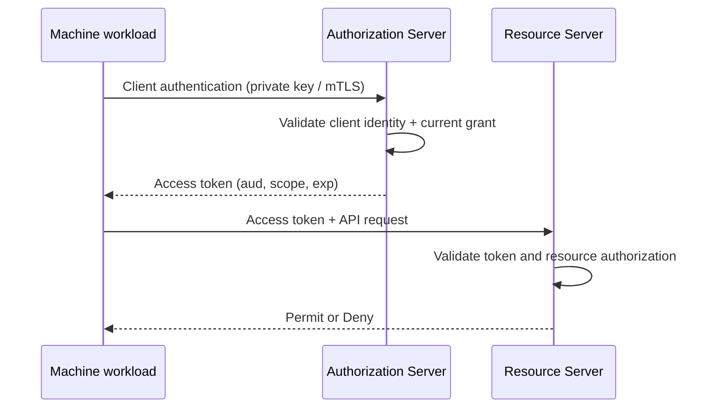
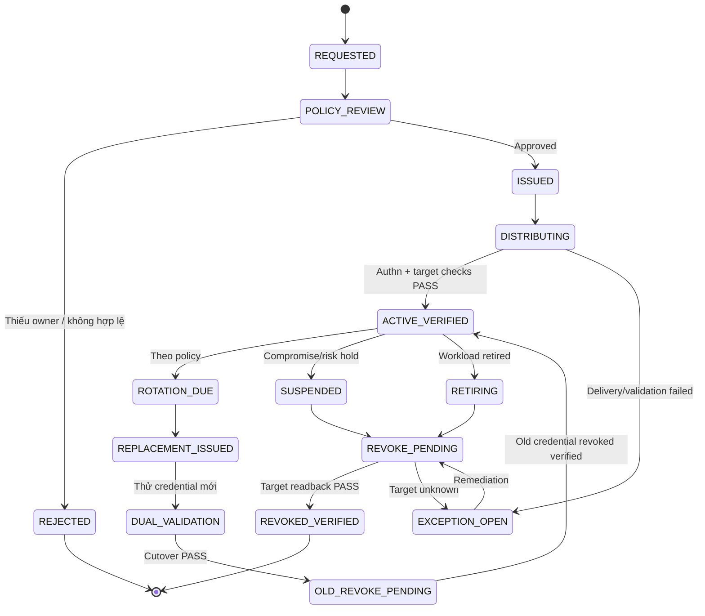
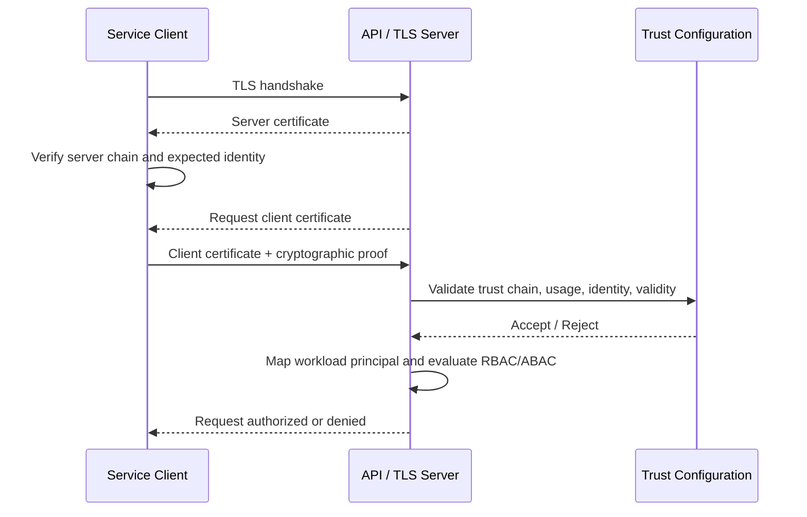
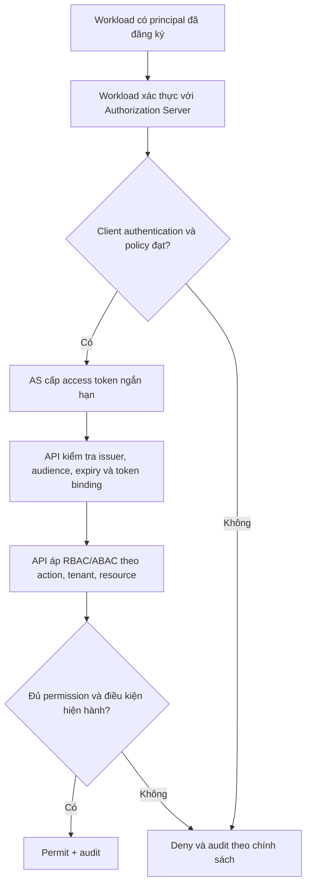

# Machine credential trong quản lý danh tính máy và vòng đời IAM

## Mục tiêu học tập

Sau bài học, người học có thể:

1. Giải thích **machine credential** là gì; phân biệt nó với **machine identity**, **service/workload account**, quyền truy cập (**authorization grant**) và **token/phiên**.
2. So sánh các hình thức **API key, shared secret, password, private key, client certificate, mTLS, OAuth access token, client assertion, SSH key, Kubernetes ServiceAccount token** và credential dựa trên workload federation.
3. Thiết kế vòng đời **đăng ký, phát hành, phân phối, sử dụng, quan sát, luân chuyển, gia hạn, thu hồi và hủy** credential cho các máy, dịch vụ, job hoặc thiết bị.
4. Lựa chọn cơ chế xác thực **machine-to-machine (M2M)** theo risk, trust boundary, khả năng kiểm chứng runtime và điều kiện vận hành.
5. Ngăn **hard-coded secrets, credential sharing, replay, long-lived keys, audience confusion, cross-tenant misuse** và các đường truy cập tồn dư.
6. Tích hợp **IAM/IGA, IdP, PKI, KMS/HSM, secrets manager, OAuth/OIDC, SCIM, RBAC/ABAC, PAM** mà không đánh đồng xác thực với cấp quyền.
7. Liên kết credential lifecycle với **Joiner–Mover–Leaver (JML)** của người sở hữu và lifecycle của service/workload, kể cả khi có thay đổi mục đích hoặc decommission.
8. Xây dựng inventory, audit, reconciliation, runbook sự cố và test để chứng minh credential không còn dùng được sau khi hết hạn/thu hồi.

## 1. Machine credential là gì?

**Machine credential** là vật chứng hoặc dữ liệu xác thực mà một **máy, service, ứng dụng, workload, job tự động hoặc thiết bị** sử dụng để chứng minh danh tính hoặc quyền được phép thiết lập một phiên/nhận token. Tùy giao thức, credential có thể là **bí mật đối xứng**, **khóa riêng bất đối xứng**, **chứng chỉ đi kèm bằng chứng sở hữu khóa riêng**, **token mang quyền (bearer token)** hoặc **bằng chứng do môi trường chạy đáng tin phát hành**.

Ví dụ: job `invoice-export` chạy trên Kubernetes muốn gọi API báo cáo. API không nên tin yêu cầu chỉ vì nó đến từ một IP nội bộ hoặc có header `service=invoice-export`. Hệ thống có thể yêu cầu workload chứng minh danh tính thông qua token ngắn hạn do IdP/issuer đáng tin phát hành; API xác minh issuer, audience, thời hạn và policy cho hành động `invoice.read_approved` trên tenant được phép.

**Credential không tự đồng nghĩa permission.** Một credential hợp lệ có thể xác thực principal thành công nhưng principal đó vẫn không được đọc dữ liệu ngoài dự án hoặc tự cấp quyền quản trị.

### 1.1. Phân biệt năm lớp quan trọng

| Lớp | Câu hỏi | Ví dụ |
|---|---|---|
| **Machine/workload identity** | Workload nào đang tham gia? | `nhi-invoice-export-prod` |
| **Account/principal** | Đối tượng nào được IAM/target nhận diện? | OAuth client ID, cloud service principal |
| **Credential/authentication proof** | Workload chứng minh mình là principal bằng gì? | Private key, certificate, signed assertion |
| **Authorization grant** | Principal được làm gì, trên resource nào, khi nào? | `invoice.read` ở tenant VN |
| **Session/access token** | Dữ liệu dùng trong một lần hoặc một khoảng truy cập? | JWT access token TTL ngắn, mTLS session |

Một service có thể dùng **một machine identity** nhưng nhiều credential qua thời gian do rotation; cũng có thể dùng nhiều principal tại các target độc lập. Credential bị rotate không nhất thiết đổi identity, và identity bị disable không tự làm mọi token đã phát hết hiệu lực ngay.

### 1.2. Machine credential khác user password ở đâu?

Cả người và máy đều cần xác thực, nhưng máy thường:

- Không có thao tác người dùng nhập OTP vào mỗi lần chạy.
- Khởi động và scale tự động, nhiều instance.
- Có khả năng bị lộ bí mật qua image, CI/CD, log, environment variable hoặc metadata endpoint.
- Cần cấp/rotate credential mà không làm gián đoạn dịch vụ.
- Có trust boundary giữa các environment, tenant, cluster và cloud account.
- Cần owner là **team hoặc sponsor chịu trách nhiệm**, dù principal không phải người.
- Có nhiều lớp thời hạn khác nhau: private key, certificate, trust policy, access token, grant.
- Có thể hoạt động sau khi nhân viên tạo nó đã Mover/Leaver.

Vì vậy không được thiết kế credential máy như “một mật khẩu nhân viên dùng vĩnh viễn trong file cấu hình”.

## 2. Vì sao quản trị machine credential quan trọng trong IAM?

Một machine credential bị lộ có thể trở thành **khả năng truy cập tự động, số lượng lớn và khó nhận thấy**, đặc biệt khi gắn với quyền cao.

Một tình huống điển hình:

```text
CI job bị cấu hình in biến môi trường
  → client secret xuất hiện trong build log
  → attacker lấy secret
  → dùng OAuth client credentials xin access token mới
  → API chấp nhận principal có role dữ liệu rộng
  → dữ liệu bị đọc ngoài thời điểm job hợp lệ
```

Nếu secret còn hạn nhiều năm và token mới được phát tùy ý, chỉ giảm TTL của từng token từ 60 phút xuống 10 phút **không chặn khả năng xin token mới**.

Các mục tiêu quản trị chính:

1. **Định danh đúng workload** và tránh account/credential dùng chung vô danh.
2. **Giảm secret tĩnh** khi có cơ chế identity ngắn hạn, được platform bảo vệ.
3. **Giới hạn phạm vi quyền** theo action, resource, tenant, environment.
4. **Chủ động expiry/rotation/revocation** khi thay đổi workload hoặc nghi ngờ lộ bí mật.
5. **Chống giả mạo và replay** bằng kiểm tra issuer/audience/nonce/thời hạn theo giao thức.
6. **Ghi audit thực chất** cho credential issuance và quyền hiệu lực.
7. **Đối soát mọi đường cấp quyền**, kể cả app-local API keys, database logins và token cũ.
8. **Hạn chế residual access** khi Joiner–Mover–Leaver và decommission.

## 3. Phân loại machine credentials

### 3.1. Những dạng thường gặp

| Credential | Bản chất | Cách chứng minh | Nguy cơ nổi bật |
|---|---|---|---|
| **Service account password** | Bí mật đối xứng | Gửi/thực hiện giao thức dựa password | Copy, tái dùng, long-lived |
| **API key** | Chuỗi bí mật hoặc identifier+secret | Header, ký request hoặc cơ chế app | Có thể là bearer không ràng buộc audience |
| **OAuth client secret** | Bí mật client lưu tại AS | Client authentication | Lộ secret có thể xin token mới |
| **Private key** | Bí mật bất đối xứng | Chữ ký/challenge-response | Copy key, export, trust sai |
| **X.509 client certificate + private key** | Certificate công khai liên kết public key | TLS client authentication, possession proof | Key theft, CA trust quá rộng, expiry |
| **Signed client assertion JWT** | Chữ ký dùng private key | AS xác minh assertion | Replay, sai `aud`/`jti`/`exp` |
| **OAuth access token** | Token được issuer cấp | API xác minh token/PoP | Bearer replay, scope quá rộng |
| **JWT-SVID/X.509-SVID** | Workload identity document theo SPIFFE | Signature/TLS với trust domain | Sai trust domain/binding, runtime compromise |
| **SSH private key/host key** | Khóa đăng nhập hoặc định danh host | SSH protocol | Reuse key, trust host sai |
| **Kubernetes projected SA token** | Token service account ngắn hạn | API/issuer xác minh claim | Audience/RBAC sai, pod token bị lấy cắp |
| **Device credential trong TPM/HSM** | Khóa gắn phần cứng | Sign/attestation theo platform | Provisioning sai, quyền dùng khóa quá rộng |
| **Database credential** | Password, certificate hoặc federated token | DB driver/protocol | Account dùng chung, privilege tích lũy |

Một certificate X.509 bản thân **không phải bí mật**; **private key** gắn với certificate mới cần được bảo vệ. Bên xác thực cần xác minh không chỉ certificate chain mà cả **khả năng sở hữu private key**, thời hạn và chính sách ánh xạ principal.

### 3.2. Credential vs token

Một credential dài hạn như client private key có thể dùng để **xác thực client** và lấy access token ngắn hạn. Access token đó cũng là **vật chứng truy cập** tại resource server; nếu là bearer token, ai cầm được token có thể thử sử dụng trong giới hạn của token.



Do đó có thể cần thu hồi/đổi **cả credential xác thực client lẫn tokens đã phát**, tùy khả năng revocation và thiết kế tài nguyên.

### 3.3. Identity document và access token không đồng nghĩa

Một OIDC ID token dùng cho relying party xác định người/workload trong luồng tương ứng **không tự là access token dành cho API khác**. Khi workload federation dùng JWT từ issuer làm **subject token** để đổi lấy credential đích, authorization server phải xác minh trust policy chứ không chuyển tiếp token tùy tiện cho API.

Tương tự, SPIFFE SVID xác nhận workload identity trong trust domain, nhưng **không tự cấp quyền đọc mọi resource** của tổ chức.

## 4. Tĩnh, ngắn hạn và hardware-backed: chọn theo rủi ro

### 4.1. Secret tĩnh

Một API key hoặc client secret lưu trong vault có thể vận hành được với hệ thống legacy. Tuy nhiên:

- Có thể bị copy nhiều nơi và khó biết bản nào đang dùng.
- Rotation cần cập nhật nhiều consumer nếu dùng chung.
- Có thể thiếu audience/expiry ở mức protocol.
- Nếu account có role rộng, lộ credential dẫn tới blast radius lớn.
- Xóa khỏi vault không thu hồi bản copy đã rò rỉ.

Vì vậy secret tĩnh cần **credential inventory, vault access control, rotation, target revocation, logging và hạn quyền**; không nên được coi là phương án mặc định không cần đánh giá.

### 4.2. Credential ngắn hạn

Managed identity, workload federation, certificate ngắn hạn hoặc dynamic secrets giúp giảm thời gian credential bị đánh cắp còn sử dụng được. Nhưng phải kiểm tra:

- Runtime nào có thể xin credential mới?
- Issuer có thực sự xác thực workload?
- Token mới có đúng audience/tenant/scope?
- Role được cấp lâu dài có quá rộng không?
- Có thể chặn reissuance khi workload bị suspend không?
- Cache và retry có làm kéo dài cửa sổ tồn dư không?

**TTL ngắn không thay thế least privilege và khả năng thu hồi quyền gốc.**

### 4.3. Hardware-backed keys

HSM, TPM, secure enclave hoặc KMS có thể hạn chế việc export private key và cung cấp API ký. Điều này giảm nguy cơ copy key ra ngoài, nhưng:

- Một workload bị compromise vẫn có thể **yêu cầu phần cứng ký** trong khi có quyền sử dụng khóa.
- Identity/trust policy cho phép dùng key phải được quản trị.
- Không phải loại khóa nào cũng hỗ trợ non-exportability hoặc attestation như nhau.
- Cần quản trị vòng đời certificate, recovery và key rotation.
- Phải ghi audit ai/việc gì đã yêu cầu phép ký.

Không tuyên bố “khóa nằm trong HSM” là bằng chứng mọi hành động được phép.

## 5. Đăng ký machine credential vào inventory

Một credential không có owner, nơi dùng và thời hạn rất dễ thành **orphan secret** sau khi dịch vụ dừng hoạt động.

### 5.1. Metadata cần có

| Trường | Vai trò |
|---|---|
| `credentialId` | ID ổn định trong inventory |
| `principalId` / `machineIdentityId` | Ai sở hữu credential |
| `workloadId` | Service/job/device nào sử dụng |
| `credentialType` | API_KEY, CERTIFICATE, CLIENT_SECRET, KEY_PAIR, FEDERATED_TOKEN |
| `issuer` / `trustDomain` | Ai phát hành hoặc xác nhận nguồn |
| `audience` / `targetServiceIds` | Target nơi credential có thể dùng |
| `ownerTeam` / `businessSponsor` | Trách nhiệm vận hành và nghiệp vụ |
| `environment` / `tenantId` | Trust boundary |
| `keyId` / `certificateSerial` | Truy vết phiên bản mà không lưu bí mật |
| `vaultReference` / `keyHandle` | Nơi lưu hoặc handle của khóa |
| `createdAt` / `notBefore` / `expiresAt` | Cửa sổ thời gian |
| `rotationPolicy` / `nextRotationDueAt` | Kế hoạch đổi credential |
| `lastAuthenticatedAt` | Tín hiệu sử dụng, có độ tin cậy |
| `status` | ISSUED, ACTIVE, RETIRING, REVOKED, EXPIRED |
| `grantReferences` | Quyền hiện hành gắn principal |
| `trustPolicyVersion` | Cấu hình xác thực liên quan |
| `compromiseIncidentRef` | Tham chiếu sự cố nếu có |
| `decommissionEvidenceRef` | Bằng chứng credential đã hết đường sử dụng |

**Không lưu giá trị password, private key hay bearer token thô trong inventory.** Inventory nên giữ tham chiếu tới vault/KMS và metadata đã được bảo vệ theo RBAC.

### 5.2. Ví dụ credential record

```json
{
  "credentialId": "MCR-2026-00318",
  "machineIdentityId": "NHI-INVOICE-EXPORT-PROD",
  "principalId": "OIDC-CLIENT-INVOICE-EXPORT",
  "workloadId": "invoice-export",
  "environment": "PRODUCTION",
  "tenantId": "tenant-vn",
  "credentialType": "ASYMMETRIC_CLIENT_AUTH",
  "issuer": "CORPORATE_AUTH_SERVER",
  "keyId": "kid-prod-17",
  "keyHandle": "KMS-HANDLE-INVOICE-17",
  "audience": "CORPORATE_TOKEN_ENDPOINT",
  "ownerTeam": "FINANCE-PLATFORM",
  "businessSponsor": "FINANCE-DATA-OWNER",
  "status": "ACTIVE",
  "notBefore": "2026-12-01T00:00:00Z",
  "expiresAt": "2027-03-01T00:00:00Z",
  "rotationPolicy": "ROTATE_BEFORE_EXPIRY",
  "trustPolicyVersion": "client-auth-v6"
}
```

Đây là **schema vận hành minh họa**, không phải một định dạng chuẩn OAuth/SCIM hay cấu hình có thể dùng trực tiếp. Ngày, ID và rotation policy chỉ phục vụ ví dụ.

### 5.3. Credential inventory không được suy từ secret store duy nhất

Có thể có API key trực tiếp trên SaaS, SSH authorized key, certificate gắn thiết bị, database user/password, Kubernetes token và cloud access key không được quản lý qua vault chung. Một inventory đầy đủ cần đối soát các **issuer và target** thực tế.

## 6. Vòng đời machine credential

### 6.1. Trạng thái tham khảo



Sơ đồ là **mô hình nội bộ**, không phải state machine chuẩn của PKI, OAuth hoặc SCIM. Trong một số hệ thống credential đã `EXPIRED` nhưng chưa được xóa; điều quan trọng là verifier **không còn chấp nhận** và không còn đường cấp credential thay thế trái policy.

### 6.2. Các bước quản trị

1. **Request:** đăng ký workload, owner và target.
2. **Review:** chọn cơ chế, phạm vi, risk, approval.
3. **Issue:** phát credential/đăng ký public key/trust binding.
4. **Deliver:** đưa vật chứng vào runtime bằng kênh bảo mật.
5. **Activate:** target kiểm tra credential, principal và policy.
6. **Observe:** ghi sử dụng, health, expiry, anomalous access.
7. **Rotate:** cấp mới, chuyển workload, thu hồi cũ.
8. **Suspend/Revoke:** chặn khi compromise, thay mục đích hoặc hết điều kiện.
9. **Decommission:** gỡ trust, grants, keys, sessions và inventory.
10. **Verify:** đọc lại issuer/target và thử hành vi deny khi phù hợp.

Không gộp `ROTATION_COMPLETE` với `OLD_CREDENTIAL_REVOKED_VERIFIED` nếu credential cũ vẫn có thể được dùng.

## 7. Quy trình cấp phát credential an toàn

### 7.1. Quyết định ai được phát credential

Một yêu cầu cấp credential nên có:

- Workload và principal ID đã được đăng ký.
- Loại môi trường/tenant.
- Owner, sponsor và application/data owner.
- Mục đích, target API/resource, scope.
- Loại xác thực có thể dùng và reason nếu phải chọn secret tĩnh.
- Thời gian hiệu lực, expiry và rotation policy.
- Chứng cứ workload hoặc host hợp lệ.
- SoD/risk check; đặc biệt với quyền admin và CI/CD.
- Provisioning/readback và phương án thu hồi.

Cần tách **quyền tạo credential** với **quyền cấp tài nguyên**. Một người có thể tạo private key cho một principal đã đăng ký nhưng không tự có quyền cấp role global admin cho principal đó.

### 7.2. Ai tạo private key?

Có thể dùng:

- **Workload/runtime/KMS/HSM tạo key pair:** private key không đi qua portal/IAM operator.
- **PKI/CA ký CSR:** chỉ nhận CSR/public key và chứng minh quyền đối với identity.
- **Vault phát dynamic secret:** service nhận một credential có TTL theo policy.
- **Cloud managed identity:** platform tự quản lý quá trình nhận credential tạm thời.

Nên tránh mô hình “central operator tạo private key plaintext rồi gửi qua email/chat cho service owner”, vì khó kiểm soát việc copy và xóa.

### 7.3. Không nhầm issuance với authorization

PKI ký certificate xác nhận một identity/key theo quy trình, nhưng API đích vẫn phải kiểm tra:

```text
Certificate valid?
Private key possession proven?
Issuer trusted for this identity?
Subject/SAN mapped to expected workload?
Credential not expired or revoked?
Principal currently enabled?
Action and resource allowed by current policy?
```

**Cert chain hợp lệ không tự cho phép đọc mọi dữ liệu**. Certificate nhận dạng một client không phải API authorization policy.

## 8. Phát hành và kiểm chứng X.509 machine certificate

### 8.1. Các thành phần PKI

- **Private key:** dữ liệu bí mật dùng ký/chứng minh sở hữu.
- **Public key:** chia sẻ để verifier kiểm tra chữ ký.
- **Certificate:** public key và thông tin subject/SAN, validity, issuer, extensions, chữ ký CA.
- **Certificate Authority (CA):** thực thể ký chứng chỉ theo chính sách.
- **Trust anchor:** CA hoặc tập nguồn tin cậy được verifier chấp nhận.
- **CSR:** yêu cầu ký certificate, thường chứa public key và yêu cầu thuộc tính.
- **Certificate chain:** đường từ end-entity tới trust anchor.
- **Revocation information:** CRL/OCSP hoặc cơ chế riêng nếu nền tảng sử dụng.

Certificate chỉ an toàn khi verifier **xác minh chain, validity, intended usage, identity binding và revocation** theo policy và năng lực giao thức. Không tin mọi CA trong một trust store rộng cho mọi workload.

### 8.2. SAN quan trọng hơn tên hiển thị

Với workload trong nội bộ, hệ thống có thể dùng URI SAN chứa workload identity, chẳng hạn một SPIFFE ID theo trust domain. Với TLS server certificate, xác minh tên DNS/identity theo quy định TLS và client dùng.

Ví dụ minh họa:

```text
SPIFFE-like workload identity:
    spiffe://corp.example/billing/prod/invoice-export

Target API policy:
    allow this identity to call invoice.read_approved
    on tenant-vn only

Other identity:
    spiffe://corp.example/billing/dev/invoice-export

Do not implicitly trust dev as prod.
```

**SPIFFE ID là URI danh tính**, không phải quyền. Tên subject chỉ hữu ích nếu CA/issuer đã chứng minh được workload đó và verifier ánh xạ đúng.

### 8.3. Key Usage và Extended Key Usage

Một verifier TLS có thể cần kiểm tra thuộc tính certificate phù hợp với vai trò **client authentication** hoặc **server authentication**, bên cạnh chain/identity/expiry. Không nên lấy certificate được cấp cho mục đích khác rồi coi là client credential có quyền ở API.

Các policy về key algorithm, strength, path length, EKU, issuer và trust store phải dựa trên nền tảng/tiêu chuẩn đang triển khai, không tự hard-code một cấu hình cho mọi hệ thống.

### 8.4. Rotation certificate và trust anchor

Khi certificate hết hạn:

1. Phát key/certificate thay thế theo policy.
2. Xác minh verifier tin CA/chain cần thiết.
3. Bảo đảm workload đã nhận key/certificate mới.
4. Quan sát authentication theo certificate mới.
5. Thu hồi hoặc để certificate cũ hết hạn theo cutover được phê duyệt.
6. Xác minh không còn connection/session sử dụng credential cũ ngoài policy.

Rotation **leaf certificate** khác rotation **CA/trust anchor**. Đổi trust anchor cần kế hoạch tương thích riêng và có thể ảnh hưởng nhiều workload.

## 9. Mutual TLS (mTLS) và xác thực hai chiều

Trong TLS một chiều, client xác minh server; trong **mTLS**, server cũng yêu cầu client chứng minh sở hữu private key gắn với certificate của client. Khi triển khai đúng, mTLS hỗ trợ xác thực máy–máy mà không cần gửi password.



Sơ đồ rút gọn, không diễn giải đầy đủ thông điệp từng phiên bản TLS. **mTLS xác thực kênh/client**, nhưng API vẫn cần kiểm tra authorization cho action/resource.

### 9.1. Những lỗi thường gặp với mTLS

- Server chỉ kiểm tra “certificate do một CA tin cậy cấp” rồi cho mọi client quyền như nhau.
- Không kiểm tra đúng URI SAN/DNS SAN hoặc EKU theo policy.
- Client không xác minh identity của server, cho phép machine-in-the-middle.
- Cùng một private key được copy sang hàng trăm workload.
- Endpoint nhận bearer token ở đường phụ không dùng các guard tương đương.
- Mất kiểm soát trust store hoặc certificate rotation.
- Coi certificate hết hạn là đã đóng mọi phiên có sẵn mà không kiểm tra.
- Nhầm certificate fingerprint với identity ổn định khi thay certificate.

### 9.2. Sender-constrained access tokens

Một số mô hình OAuth có thể ràng buộc access token với chứng chỉ client mTLS hoặc khóa chứng minh sở hữu, thay vì chỉ dùng bearer token. Điều này làm việc copy **token riêng lẻ** khó bị lạm dụng hơn, nếu verifier kiểm tra đúng binding.

Tuy nhiên, nếu attacker chiếm luôn private key hoặc runtime ký được, sender constraint không tự bảo đảm an toàn. Lựa chọn phải theo năng lực AS/API và rủi ro.

## 10. OAuth 2.0 client credentials cho machine-to-machine

### 10.1. Luồng khái niệm



**Client credentials** thể hiện ủy quyền cho **chính client/service principal**, không tự đại diện cho người dùng cuối. Nếu ứng dụng cần hành động thay người, phải có delegated authorization rõ ràng; không dùng app-only token để bỏ kiểm tra permission của user.

### 10.2. Ví dụ request rút gọn

```http
POST /oauth2/token HTTP/1.1
Host: auth.example.org
Content-Type: application/x-www-form-urlencoded

grant_type=client_credentials&scope=invoice.read_approved
```

Request này **chưa có thông tin client authentication** và chỉ minh họa tham số grant. Triển khai thực tế cần phương thức xác thực client an toàn (ví dụ `private_key_jwt` hoặc mTLS nếu được hỗ trợ) và TLS; không ghi secret thật trong ví dụ/log.

### 10.3. Bảo vệ token đúng cách

API phải kiểm tra phù hợp loại token và thỏa thuận với issuer, tối thiểu:

- Trusted issuer và khóa/signature hoặc introspection response đáng tin.
- Audience dành cho API hiện tại.
- Thời hạn `exp`, `nbf` nếu có, clock skew giới hạn.
- Client/principal identity và các claim hợp lệ theo profile.
- Scope/role không vượt grant hiện hành và resource policy.
- Tenant, environment, resource ownership.
- Token binding hoặc proof-of-possession nếu được yêu cầu.
- Thời điểm revoke/security hold và access policy hiện hành với quyền nhạy cảm.

**Không chấp nhận một JWT bất kỳ chỉ vì decode JSON được**. Decoder không thay việc xác minh cryptographic signature và semantics claim.

## 11. Private-key JWT và assertion authentication

Một confidential client có thể chứng minh danh tính với **JWT assertion được ký bởi private key** mà AS tin public key tương ứng.

Một assertion thích hợp có thể có các claim:

| Claim | Vai trò |
|---|---|
| `iss` | Định danh client/issuer theo profile được dùng |
| `sub` | Chủ thể client |
| `aud` | Token endpoint hoặc audience yêu cầu |
| `iat` | Thời gian phát hành nếu profile dùng |
| `exp` | Hạn assertion |
| `jti` | ID giúp chống replay khi AS thực thi kiểm tra |
| `kid` (header) | Khóa công khai dùng verify |

**Cú pháp, claim bắt buộc và semantics cụ thể phải theo OAuth client assertion profile và cấu hình authorization server.**

### 11.1. Vì sao phải kiểm tra audience và replay?

Một JWT assertion ký đúng nhưng được gửi tới **AS khác** hoặc dùng lại nhiều lần có thể dẫn đến xác thực sai đích nếu verifier không ràng buộc audience, hạn và các điều kiện replay.

Không coi một assertion dài hạn như client secret mới; nên có lifetime ngắn và cơ chế dùng một lần/replay check theo chính sách.

### 11.2. Xác thực client và access token khác nhau

```text
Private-key JWT:
    Client ký một assertion để xác thực chính mình với AS.

Access token:
    AS phát hành token cho client gọi resource server.

API authorization:
    Resource server xác minh token và hành động/resource.
```

Không dùng client assertion gửi trực tiếp tới API đích như bearer access token, trừ khi API có thiết kế/giao thức minh bạch cho trường hợp đó.

## 12. Workload identity federation

### 12.1. Ý tưởng

**Workload identity federation** cho phép workload chứng minh mình thuộc một môi trường đáng tin, rồi đổi bằng chứng đó lấy credential/token cho hệ thống đích **mà không cần cất một secret dài hạn do developer quản lý**.

Ví dụ CI job chạy tại một pipeline đáng tin có thể nhận OIDC token gắn với repository, branch/environment và job context; cloud IAM chỉ cho phép role deployment nếu issuer, subject, audience và điều kiện ràng buộc khớp.

### 12.2. Những guard quan trọng

```text
Trusted issuer             == issuer đã đăng ký
Subject / workload claim   == workload hoặc pipeline được phép
Audience                   == intended token-exchange endpoint
Environment                == production (nếu role production)
Tenant / organization      == đúng boundary
Signature and lifetime     == valid
Target role mapping        == allowlist hẹp
Service lifecycle          == active, no security hold
```

Một trust policy chấp nhận **mọi subject của một issuer**, hoặc dùng wildcard repository/namespace không cân nhắc, có thể khiến workload ngoài phạm vi xin credential production.

### 12.3. Quyền phía issuer và phía resource server

Federation có hai bước khác nhau:

1. **Issuer/trust verifier** đánh giá đúng workload runtime, audience và proof.
2. **Target authorization** giới hạn principal được làm gì ở resource server.

Workload được phép đổi token không đồng nghĩa có quyền `storage.admin`; phải cấu hình permissions/roles/scopes riêng.

### 12.4. Rủi ro runtime compromise

Nếu attacker chiếm pod/runner được tin cậy, họ có thể dùng runtime để xin token mới dù không biết static secret. Cần bảo vệ:

- Pod/runner admission, image provenance và host runtime.
- Workload audience, subject/namespace/repository binding.
- Service account permissions.
- Isolation giữa build và deploy.
- Egress/network và metadata endpoint access.
- Monitoring bất thường ở issuer và target.

**Secretless giảm một kiểu rủi ro, không thay thế bảo vệ runtime và least privilege.**

## 13. Kubernetes ServiceAccount token và SPIFFE/SPIRE

### 13.1. Kubernetes ServiceAccount không tự là cloud principal

Một Kubernetes `ServiceAccount` là danh tính API của workload **trong Kubernetes cluster**. Khi pod cần API token, có thể dùng projected service account token với audience và expiration phù hợp.

Ví dụ manifest minh họa:

```yaml
apiVersion: v1
kind: Pod
metadata:
  name: billing-worker
  namespace: billing
spec:
  serviceAccountName: billing-export
  automountServiceAccountToken: false
  containers:
    - name: worker
      image: registry.example.org/billing/worker:1.0.0
      volumeMounts:
        - name: workload-token
          mountPath: /var/run/workload-identity
          readOnly: true
  volumes:
    - name: workload-token
      projected:
        sources:
          - serviceAccountToken:
              path: token
              expirationSeconds: 3600
              audience: billing-token-exchange
```

Manifest minh họa cơ chế **explicit projected token** khi tự động mount token mặc định bị vô hiệu; nó không phải workload hoàn chỉnh về bảo mật/scheduling. `expirationSeconds` là giá trị **yêu cầu** và có thể chịu giới hạn chính sách Kubernetes; ứng dụng phải xử lý token rotation và không dựa vào thời hạn cứng nếu runtime khác.

### 13.2. Audience và mount

Một token dành cho Kubernetes API không được tự sử dụng như bearer token ở API nghiệp vụ khác. Nên chỉ định audience theo target trust, cấu hình verifier tương ứng và **không mount token cho pod không cần**.

Nếu service account có RBAC rộng hoặc token bị copy, attacker có thể lạm dụng API trong phạm vi đó. Việc tách ServiceAccount theo workload và namespace giảm coupling, nhưng RBAC/Admission/NetworkPolicy vẫn cần thiết.

### 13.3. SPIFFE/SPIRE

**SPIFFE** định nghĩa danh tính workload trong trust domain, trong đó SVID có thể ở dạng X.509-SVID hoặc JWT-SVID. **SPIRE** là một implementation có thể cấp phát/rotate workload identities dựa trên node/workload attestation.

Ví dụ URI dạng:

```text
spiffe://corp.example/billing/prod/invoice-export
```

Đây là **identity identifier**, không phải permission. Verifier phải kiểm tra trust bundle, signature/chain, expiry, trust domain và ánh xạ principal; API vẫn cần RBAC/ABAC để quyết định quyền.

### 13.4. Attestation không phải approval quyền

Node/workload attestation trả lời **runtime nào được nhận identity này**, còn governance approval trả lời **identity được quyền gì**.

Nếu workload attestation bị cấu hình quá rộng, pod không đúng có thể nhận credential dù entitlement catalog và role name vẫn trông hợp lệ. Kiểm toán phải có cả **trust binding** và **grant source**.

## 14. SSH credentials, host keys và device credentials

### 14.1. SSH user key và SSH host key khác nhau

- **SSH client/user key:** chứng minh client hoặc operator/principal có private key tương ứng để đăng nhập theo policy.
- **SSH host key:** giúp client xác minh đúng host đang kết nối, chống kết nối tới máy giả nếu trust được quản lý đúng.
- **SSH certificate:** một deployment có thể dùng certificate do SSH CA ký với principals và lifetime.

Không tái sử dụng SSH private key của một engineer làm credential chung cho automation production. Khi người đó Leaver, phải thu hồi quyền và khóa của họ; hệ thống tự động cần principal riêng.

### 14.2. Những lưu ý SSH

- Không dùng một key pair trên mọi máy chủ/job.
- Kiểm tra host identity theo host key/CA tin cậy; không tắt strict verification vô điều kiện.
- Quản lý `authorized_keys` hoặc SSH CA principals có inventory và expiry.
- Hạn lệnh, forced command, source restrictions hoặc bastion/PAM khi phù hợp.
- Ngăn đưa private key vào container image/repository.
- Thu hồi key cũ, authorized entries và sessions theo policy.

### 14.3. Device identity và TPM

Một thiết bị/VM có thể dùng private key nằm trong TPM hoặc phần cứng bảo mật để chứng minh identity. Device attestation có thể cung cấp tín hiệu về trạng thái platform theo mô hình tin cậy, nhưng **không tự chứng minh mọi ứng dụng chạy trên thiết bị là đáng tin**.

Cần phân biệt:

```text
Device identity:
    Máy/thiết bị nào?

Workload identity:
    Process/container/service nào trên thiết bị?

User identity:
    Con người nào vận hành/điều khiển?

Resource authorization:
    Hành động nào được phép trên dữ liệu nào?
```

Ở lớp machine credential, điều cần chứng minh không chỉ là “có khóa” mà còn là “khóa này thuộc đúng workload, được dùng đúng nơi và có thể thu hồi”.

## 15. Lưu giữ, phân phối và nạp machine credential

### 15.1. Nguyên tắc “secret không đi qua người dùng”

Một machine credential tốt nên được cấp và phân phối qua **kênh có xác thực, audit và giới hạn người đọc**, thay vì:

- Copy secret vào email/chat/ticket.
- Commit private key vào Git repository.
- Đóng gói password vào container image.
- In bearer token ra CI logs hoặc tracing.
- Đặt credential trong tham số dòng lệnh có thể bị đọc bởi tiến trình khác.
- Dùng một shared secret cho các environment không cùng trust boundary.
- Gửi file certificate và private key cho nhiều nhóm mà không có owner.

Nếu runtime có thể dùng **managed identity, workload federation hoặc HSM/KMS signer**, nên cân nhắc giảm việc phải đưa secret exportable tới ứng dụng.

### 15.2. Secrets manager và vault

Vault/secrets manager là nơi quản trị secret hoặc quyền sử dụng key theo identity. Điều quan trọng không chỉ là secret được mã hóa khi lưu, mà còn là:

1. **Ai có quyền lấy secret** và qua phương thức xác thực nào?
2. Chính service identity, account, workload và tenant nào được ràng buộc với policy?
3. Ứng dụng có được **list** toàn bộ secrets hay chỉ read đúng secret cần?
4. Có dynamic secret hoặc token ngắn hạn thay static secret không?
5. Có audit secret access, rotation và revoke không?
6. Người quản trị vault có đồng thời tự cấp quyền và xóa log được không?
7. Khi workload decommission, những bản copy/cached credential còn tồn tại ở đâu?

Ví dụ policy ý tưởng:

```text
Principal:
  workload: invoice-export-prod

Vault:
  read: /secret/prod/invoice-export/api-client-key
  deny: /secret/prod/payroll/*
  deny: /secret/prod/backup-delete/*
  deny: secret-policy-admin

Conditions:
  runtime identity trusted
  environment == production
  no security hold
  log access with credentialId and workloadId
```

Đây không phải cú pháp chính thức của một sản phẩm vault. Một nơi lưu secret **không làm secret đã bị copy ra ngoài tự biến mất** khi xóa trong vault.

### 15.3. Kênh phân phối theo runtime

| Môi trường | Cách cấp credential có thể cân nhắc | Nguy cơ cần kiểm tra |
|---|---|---|
| VM/cloud compute | Managed identity, metadata service có bảo vệ | SSRF/metadata theft, role quá rộng |
| Kubernetes | Projected SA token, workload federation, CSI/vault integration | Pod permissions, token mount, secret volume |
| CI/CD runner | OIDC federation với issuer/subject/audience chặt | Pull request fork, untrusted branch, reusable runner |
| Bare metal | TPM/HSM-backed key, mTLS cert, vault/bootstrap identity | Device enrollment, host compromise |
| Legacy batch | Vault-managed password/key với rotation | Script hard-code, shared account |
| Database client | Federated DB auth, client certificate hoặc vault dynamic login | Role trong DB, connection pooling |
| IoT/edge | Per-device certificate/secure element | Fleet provisioning, offline revoke |
| Service mesh | Short-lived workload certificate/SVID | Trust domain, identity mapping và sidecar trust |

Không mặc định environment variable là nơi lưu secret an toàn hơn file. Environment có thể bị lộ qua process dump, debug endpoint, CI logs hoặc công cụ quan sát. Cần cân nhắc **security properties cụ thể của runtime**.

### 15.4. Bootstrap paradox

Để lấy secret trong vault, workload cần chứng minh danh tính với vault. Nếu chìa khóa đầu tiên cũng nằm trong file cấu hình không bảo vệ thì chỉ chuyển rủi ro chỗ khác.

Giải pháp có thể dựa trên:

- Cloud instance/managed identity.
- Kubernetes projected workload token.
- Device certificate/TPM được đăng ký an toàn.
- SPIFFE/SPIRE node/workload attestation.
- CI OIDC identity binding.
- Bootstrap token có TTL ngắn, phạm vi nhỏ và chỉ dùng một lần khi nền tảng hỗ trợ.

**Bootstrap credential phải có vòng đời và giới hạn riêng**, không được âm thầm trở thành credential production lâu dài.

## 16. Rotation: thay credential mà vẫn duy trì dịch vụ

**Credential rotation** là quá trình thay vật chứng xác thực cũ bằng vật chứng mới; không nhất thiết đổi principal hoặc permission. Mục tiêu là hạn chế thời gian bí mật tồn tại và giảm tác động khi bị lộ, đồng thời bảo đảm các consumer chuyển đổi đúng.

### 16.1. Nguyên tắc rotation có kiểm soát

1. Xác định **đúng owner và các consumer** của credential cũ.
2. Kiểm tra principal, key type, issuer, audience, trust và grants hiện hành.
3. Tạo credential mới với thời hạn và storage đúng policy.
4. Đăng ký public key/certificate/secret mới tại verifier hoặc target.
5. Phân phối tới consumer qua kênh an toàn.
6. Thử authentication và **authorization** bằng credential mới.
7. Chuyển traffic hoặc cập nhật deployment theo kế hoạch.
8. Theo dõi các request còn dùng credential cũ trong cửa sổ overlap.
9. Thu hồi credential cũ tại **nguồn xác thực thực sự**.
10. Đọc lại issuer/target và kiểm tra old credential bị từ chối.
11. Ghi evidence, xử lý instance còn dùng key cũ và đóng change.

### 16.2. Hai chiến lược triển khai

| Chiến lược | Phù hợp khi | Điều cần kiểm soát |
|---|---|---|
| **Overlapping credentials** | Verifier hỗ trợ nhiều key và ứng dụng cần zero-downtime | Overlap có giới hạn, key ID, revoke cũ |
| **Atomic/short-cutover** | Hệ thống chỉ hỗ trợ một credential hoặc rủi ro compromise | Có thể gián đoạn, cần rollback an toàn và giám sát |

Trong **compromise**, có thể phải revoke credential cũ ngay, không đợi consumer chuyển đổi theo lịch thông thường. Cần có playbook emergency rotation, khả năng phục hồi nghiệp vụ và phương án khôi phục trust.

### 16.3. Rotation asymmetric key / JWKS

Với client private key hoặc signing key, verifier thường có tập public keys được đăng ký qua cơ chế thích hợp. Mỗi key có thể dùng `kid` để định vị, nhưng **kid không chứng minh key đáng tin**.

```text
Old:
  kid = invoice-prod-17
  private key old (protected)
  public key registered

New:
  kid = invoice-prod-18
  private key new (protected)
  public key registered

Cutover:
  1. Register new trusted public key.
  2. Switch client signing to kid=invoice-prod-18.
  3. Observe success under new key.
  4. Remove/revoke old public key registration.
  5. Verify old key cannot authenticate again.
```

Khi thay **CA/trust anchor**, kế hoạch khác leaf key rotation: có thể cần dual trust có thời hạn ở nhiều verifier. Phải cân nhắc chu kỳ phát certificate và phản ứng của service mesh/PKI.

### 16.4. Fleet rotation

Với hàng nghìn thiết bị hoặc pod:

- Phân phối theo canary/batches.
- Đo health của verifier và target.
- Không để mọi credential cùng hết hạn một thời điểm nếu tránh được.
- Cho consumer tự reload secret/certificate khi rotation.
- Có khả năng tìm phiên bản đang được từng instance dùng.
- Xử lý offline devices bằng chính sách riêng, không mặc định nới expiry vô hạn.
- Tránh dùng **một private key fleet-wide**.
- Đặt ngưỡng cảnh báo trước expiry.

### 16.5. “Rotation thành công” cần bằng chứng gì?

Một hệ thống chỉ thấy `new_key_issued` là chưa đủ. Bằng chứng nên gồm:

```text
New key issued                 PASS
New key delivered              PASS
New client authn               PASS
New client authorization       PASS
Old key revoked at issuer      PASS
Old key authn attempt          DENIED
No unexpected old-key usage    OBSERVED (defined window)
Inventory updated              PASS
Exceptions                     NONE / TRACKED
```

Việc thử old key phải được thực hiện có kiểm soát trong môi trường/điều kiện được phép, tránh sử dụng credential đã nghi lộ trên public endpoint gây rủi ro.

## 17. Expiry, revocation và khả năng ngừng cấp credential mới

### 17.1. Ba lớp phải chặn

1. **Issuer/client authentication:** credential cũ không tiếp tục xác thực hoặc xin token mới.
2. **Resource authorization:** những grants/roles không còn hợp lệ phải bị gỡ hoặc bị deny.
3. **Issued tokens/sessions:** token/connection cũ không được tiếp tục dùng vượt thời điểm rủi ro cho phép.

Một secret bị xóa trong vault có thể vẫn được xác thực ở API nếu target chưa revoke giá trị cũ. Một OAuth client bị disable có thể vẫn còn JWT access token đã phát tới khi verifier từ chối hoặc token hết hạn.

### 17.2. Revocation theo từng credential

| Loại | Biện pháp thu hồi có thể có | Phải xác minh thêm |
|---|---|---|
| OAuth client secret | Remove/revoke secret tại AS | Access token đã phát và grants |
| Private-key client authentication | Xóa/disable public key binding | Assertion replay và token đang sống |
| X.509 client certificate | Revoke tại PKI và/hoặc bỏ trust/identity binding | Verifier có kiểm tra revocation, TLS sessions |
| API key | Disable key tại API gateway/target | Key copy, cache, direct app grants |
| SSH public key | Gỡ authorized key/SSH CA authorization | Các host khác và session đã mở |
| Kubernetes SA token | Chặn SA/RBAC, trust/issuer theo khả năng | Token còn hạn, API acceptance, workload |
| Vault dynamic secret | Revoke lease/DB credential | Connection/session đang mở |
| Workload federation | Disable subject/issuer trust mapping | Access token đích đã phát |
| Hardware-backed key | Disable key handle, owner permission hoặc mapping | Signed assertions đã phát |

**Certificate revocation không đồng nghĩa mọi verifier sẽ tức thì từ chối**. Phải xét CRL/OCSP, cache, offline verifier, chính sách fail-open/fail-closed và giới hạn tuổi certificate. Với quyền nhạy cảm cần có biện pháp chặn hiệu lực bổ sung khi thích hợp.

### 17.3. Giới hạn của JWT offline validation

Nếu API chỉ kiểm tra JWT signature và `exp` mà không hỏi trạng thái principal/grant mới nhất, token cũ có thể tiếp tục được chấp nhận sau khi account bị disable.

Các lựa chọn tùy kiến trúc:

- Token TTL ngắn.
- Introspection/online authorization cho thao tác rủi ro cao.
- Token denylist hoặc session revocation nếu hệ thống hỗ trợ.
- Event-driven invalidation/cache refresh.
- Sender-constrained tokens.
- Recheck current grants, tenant, lifecycle tại PDP.
- Emergency credential/key disable và incident response.

**Không có một lệnh SCIM hay xóa IdP group chung nào tự thu hồi mọi JWT của mọi ứng dụng.**

### 17.4. Thời gian hợp lệ

Một interval có thể được chuẩn hóa:

```text
notBefore <= trustedNow < expiresAt

Additional required conditions:
  credential not revoked
  principal active
  workload trust binding valid
  grant/permission current
  security hold absent
  tenant/resource within scope
```

Expiry của credential khác expiry của access token, grant hoặc runtime session. Hệ thống nên lưu UTC/ISO 8601 có offset và dùng nguồn thời gian đáng tin.

## 18. Liên kết với Joiner–Mover–Leaver

Machine identity không phải nhân viên, nhưng **người quản lý nó** chịu lifecycle nhân sự. Cần kết hợp hai vòng đời mà không nhập nhằng.

### 18.1. Joiner của người vận hành

Kỹ sư mới vào team có thể được cấp quyền:

- Deploy workload trong phạm vi dự án.
- Xem metadata credential và health.
- Yêu cầu rotation có approval.
- Xem log đã loại secret.
- Sử dụng PAM khi cần bảo trì.

Kỹ sư **không được nhận raw private key hoặc quyền của workload** chỉ vì có quyền vận hành. Mọi thao tác đặc quyền phải dùng identity cá nhân và audit riêng.

### 18.2. Mover của owner hoặc developer

Giả sử developer chuyển từ team Billing sang CRM. Workload Billing vẫn cần chạy nhưng credential đã từng được developer xem.

Quy trình:

1. HR cập nhật role và owner mapping.
2. Revoke quyền cá nhân vào vault, CI/CD, KMS, IAM.
3. Chuyển technical owner và business sponsor nếu cần.
4. Đánh giá credential nào người chuyển vai trò từng có khả năng export.
5. Rotate/revoke theo risk và credential exposure.
6. Kiểm tra workflow automation dùng email/người duyệt cũ.
7. Reconcile grants và audit sau thay đổi.

**Không tự disable toàn bộ machine credential chỉ vì owner đã Mover**, nếu workload còn hợp lệ, có owner mới và có thể chuyển quyền an toàn.

### 18.3. Leaver

Khi nhân viên nghỉ việc:

- Disable human accounts và revoke personal access/PAM.
- Remove vault/KMS/CI/CD permissions của họ.
- Tìm machine credentials có thể từng được tải về, copy hoặc cùng dùng.
- Rotate/revoke affected secrets theo mức rủi ro.
- Chuyển ownership, cập nhật runbook/approver.
- Kiểm tra service accounts có personal token dưới tên Leaver hay không.
- Không tái kích hoạt quyền của Leaver bằng callback/job cũ.
- Decommission workload không còn owner hoặc mục đích theo policy.

Chỉ xóa account nhân sự trong IdP **không tự revoke credential của service principal độc lập**. Ngược lại, việc người phụ trách nghỉ không nên gây outage diện rộng do xóa các service principals vẫn phục vụ nghiệp vụ.

### 18.4. Vòng đời riêng của workload

| Event của workload | Tác động tới credential |
|---|---|
| Workload được đăng ký | Chọn loại credential, owner, trust và grant |
| Deploy sang environment mới | Phát credential/binding đúng environment |
| Mở rộng API/resource scope | Review permission và token audience |
| Chuyển cloud/cluster | Đánh giá lại issuer/subject/attestation |
| Đổi technical owner | Transfer access, đánh giá exposure/rotation |
| Incident/compromise | Suspend/revoke, rotate, điều tra sessions |
| Retire/decommission | Ngừng phát mới, revoke grants/keys/tokens |
| Rebuild/rehire workload | Không dùng lại credential cũ không có approval |

### 18.5. Contractor và account không phải con người

Một contractor có thể quản lý hạ tầng và credential của integration theo contract. Khi contract kết thúc, **quyền người đó để xem/quản lý bí mật phải bị thu hồi**, còn workload có tiếp tục chạy hay không do business owner quyết định. Không lấy một token federation của partner IdP làm bằng chứng contractor còn được phép quản trị secret nội bộ.

## 19. RBAC/ABAC và kiểm soát SoD đối với credential

### 19.1. Ba quyền cần tách

Một rủi ro lớn xảy ra khi cùng principal hoặc operator có thể:

1. **Tạo credential** mới cho service.
2. **Cấp quyền (grant) cho principal**.
3. **Xóa hoặc thay đổi audit log**.

Nếu cùng một người có cả ba khả năng, họ có thể tạo credential lén và tự nâng quyền rồi xóa dấu vết. Có thể áp dụng:

- Role riêng cho key issuance, role grant approval, log admin.
- Dual control/four-eyes cho principal rủi ro cao.
- Policy-as-code và change review.
- Audit sink độc lập.
- JIT/PAM cho quyền sửa trust policy.
- Alert cho việc key mới xuất hiện gần thời điểm grant admin.
- Prohibit self-granting privilege.

### 19.2. Credential nào được dùng không quyết định toàn bộ action

Ví dụ mTLS xác thực principal `invoice-export`, nhưng PEP/PDP kiểm tra:

```text
Subject:
  serviceIdentityId = invoice-export-prod
  machineCredentialId = mcr-318
  environment = production
Action:
  invoice.read_approved
Resource:
  tenantId = tenant-vn
  invoice.status = APPROVED
Context:
  authn method = mTLS
  current grant = valid
  workload state = ACTIVE
```

Quyết định Permit còn phụ thuộc **role/permission, resource scope và điều kiện hiện hành**. Một certificate hợp lệ không tự có quyền gọi `invoice.delete`.

### 19.3. Ngăn credential cross-tenant

Không tin tenant ID do client tự gửi làm nguồn phân quyền. API phải ràng buộc tenant từ principal/grant/trust configuration và kiểm tra resource thuộc tenant thực tế.

Một cùng `client_id` ở hai IdP tenants không nhất thiết là cùng identity; phải dùng **issuer + tenant + stable principal ID** theo mô hình.

### 19.4. Machine-to-machine thay mặt người dùng

Nếu automation nhận lệnh từ nhân viên để thực hiện thao tác nghiệp vụ, cần phân biệt:

- **Executing machine principal:** ai gọi API kỹ thuật.
- **Initiating human principal:** ai đã yêu cầu nghiệp vụ.
- **Delegation/approval:** máy được phép làm thay người đó đến đâu.
- **Resource authorization:** người và máy đều phải đáp ứng policy khi cần.

Không dùng app-only machine token để bỏ qua mọi kiểm tra quyền của người dùng cuối trong hệ thống nhạy cảm.

## 20. Vai trò của IdP/SSO/SCIM/PKI/PAM

### 20.1. Ranh giới trách nhiệm

| Thành phần | Vai trò có thể có | Không tự bảo đảm |
|---|---|---|
| **IdP/Authorization Server** | Đăng ký client/principal, client authentication, token issuance | Mọi quyền nội bộ của SaaS |
| **SSO SAML/OIDC** | Đăng nhập/federation, có thể hỗ trợ issuer claims | Máy tự có quyền API sau human login |
| **PKI/CA** | Phát hành/rotate/revoke certificates | Business entitlement/SoD hoàn chỉnh |
| **KMS/HSM** | Giữ key/crypto operations | Quyền dùng key và dữ liệu API đều hợp lệ |
| **Vault** | Lưu/phát secret, lease/rotation | Không có bản copy bí mật ngoài vault |
| **SCIM 2.0** | Quản lý User/Group tại các target hỗ trợ | Chuẩn hóa mọi machine credential hoặc OAuth client |
| **IAM/IGA** | Catalog, access requests, grants, JML, recertification | Backend tự enforce mọi ABAC transaction |
| **RBAC/ABAC engine** | Phán quyết permission theo action/resource/context | Credential nguồn được phát an toàn nếu không tích hợp |
| **PAM** | Quản lý quyền/credential đặc quyền, sessions khi được hỗ trợ | Mọi đường SSH/API key ngoài PAM đã bị revoke |
| **Application/API** | Authentication/authorization enforcement và actual roles | Biết toàn bộ HR/workload lifecycle nếu không được cung cấp |

### 20.2. SCIM và machine credential

SCIM `User`/`Group` có thể được dùng để cập nhật một số integration accounts hoặc group membership trong SaaS. Nhưng **không có một schema SCIM 2.0 phổ quát cho client private key, HSM key, mTLS certificates hay workload federation policy**.

Tùy target phải dùng API chuyên biệt, cloud IAM, PKI/vault hoặc connector phù hợp. Không nên giả tạo HR User cho một workload chỉ vì công cụ hiện có chỉ hỗ trợ SCIM user provisioning.

### 20.3. IdP là nguồn xác thực, không phải nguồn tin duy nhất về quyền

Một client có thể được IdP xác thực và nhận token nhưng bị API từ chối do:

- Chưa có permission hợp lệ.
- Token audience sai.
- Tenant scope sai.
- Workload bị retire/security hold.
- SoD/risk policy chặn thao tác.
- Resource đã đổi owner/classification.
- Target không nhận principal mapping.

**Authentication SUCCESS và Authorization PERMIT là hai kết quả độc lập.**

## 21. Java/Spring: cách dùng machine credential an toàn

### 21.1. Tách credential provider khỏi business logic

Dưới đây là mã **minh họa định hướng Java**, interface được giả định; không phải API Java/Spring có sẵn.

```java
public interface WorkloadTokenProvider {
    AccessToken tokenFor(String audience, String scope);
}

public final class InvoiceExportClient {
    private final WorkloadTokenProvider credentials;
    private final InvoiceApi api;

    public InvoiceExportClient(
            WorkloadTokenProvider credentials,
            InvoiceApi api) {
        this.credentials = credentials;
        this.api = api;
    }

    public ExportResult exportApprovedInvoices(String tenantId) {
        AccessToken token = credentials.tokenFor(
            "INVOICE_API", "invoice.read_approved"
        );
        // Không log token, không gắn bearer token vào URL.
        return api.exportApproved(tenantId, token);
    }
}
```

Triển khai thật nên chọn **SDK workload identity/managed identity của nền tảng** hoặc client authentication provider được quản trị tốt, không tự viết bộ ký JWT hay token verifier tùy tiện.

### 21.2. Service không nên cất secret trong source

Ví dụ **sai**:

```java
// Không triển khai như thế này:
// String clientSecret = "production-client-secret";
// URL api = new URL("https://api.example.org?token=" + accessToken);
```

Nên:

- Inject credential provider hoặc key handle qua cấu hình bí mật.
- Hạn chế scope và audience của token request.
- Bảo vệ TLS, server identity và timeouts.
- Cache token ngắn hạn đúng expiry, không cache vô hạn.
- Không retry vô hạn khi authn/authz bị từ chối.
- Log credential ID/kid và status, không log giá trị bí mật.
- Hỗ trợ credential reload/rotation mà không hard-code.
- Từ chối khi issuer hoặc identity source không đáng tin.

### 21.3. Resource Server authorization pseudocode

```text
function authorizeMachineRequest(httpRequest):
    token = verifyExpectedTokenTypeAndCryptography(httpRequest)

    if token.invalidIssuerOrAudienceOrExpired:
        return DENY("INVALID_MACHINE_CREDENTIAL")

    principal = resolveStableMachineIdentity(token)
    if principal not registered or principal.lifecycle != ACTIVE:
        return DENY("UNKNOWN_OR_INACTIVE_WORKLOAD")

    if trustBindingDoesNotMatchRuntime(token, principal):
        return DENY("TRUST_BINDING_MISMATCH")

    grant = loadCurrentGrant(principal, httpRequest.action)
    if grant missing or expired or revoked:
        return DENY("NO_CURRENT_GRANT")

    resource = loadResourceUsingServerSideIdentifiers(httpRequest)
    if not grant.allows(resource, trustedContext()):
        return DENY("RESOURCE_OUT_OF_SCOPE")

    if policyUnknownOrSecurityHold:
        return DENY_OR_SAFE_ERROR

    recordAuditWithoutSecret()
    return PERMIT
```

Đây là pseudocode. Với thực tế cần xử lý concurrency, cache invalidation, credential binding, network timeouts, claim profile, idempotency và source freshness.

### 21.4. Khi áp dụng Spring Security

Spring Security có thể đảm nhiệm **xác minh resource-server bearer token** hoặc phối hợp một cơ chế mTLS/client authentication tùy cấu hình. Nhưng middleware xác thực không tự hiểu:

- Principal nào tương ứng workload registry?
- Grant nào còn hiệu lực sau khi Mover/Retire?
- Tenant/resource của invoice có thuộc scope không?
- Client đã được phép export hay chỉ read?
- Có direct grant và SoD conflict ngoài IAM không?

Cần policy và authorization service ở backend. Kiểm thử phải gọi API trực tiếp, không chỉ kiểm tra UI/gateway.

## 22. Audit, telemetry và bảo vệ bằng chứng

### 22.1. Những event quan trọng

```text
MACHINE_IDENTITY_REGISTERED
CREDENTIAL_REQUESTED
CREDENTIAL_ISSUED
CREDENTIAL_DELIVERED
CREDENTIAL_AUTHENTICATED
TOKEN_ISSUED
TOKEN_VALIDATION_DENIED
TARGET_ACTION_AUTHORIZED
TARGET_ACTION_DENIED
CREDENTIAL_ROTATION_STARTED
CREDENTIAL_ROTATION_CUTOVER
OLD_CREDENTIAL_REVOKE_REQUESTED
OLD_CREDENTIAL_REVOKED_VERIFIED
CERTIFICATE_RENEWED
CERTIFICATE_REVOCATION_EVENT
WORKLOAD_OWNER_TRANSFERRED
SERVICE_IDENTITY_SUSPENDED
WORKLOAD_DECOMMISSION_REQUESTED
TRUST_BINDING_REMOVED
EFFECTIVE_ACCESS_DENIED_VERIFIED
CREDENTIAL_EXPOSURE_INCIDENT
```

### 22.2. Audit event ví dụ

```json
{
  "eventType": "MACHINE_CREDENTIAL_AUTHENTICATED",
  "credentialId": "MCR-2026-00318",
  "principalId": "OIDC-CLIENT-INVOICE-EXPORT",
  "machineIdentityId": "NHI-INVOICE-EXPORT-PROD",
  "workloadId": "invoice-export",
  "environment": "PRODUCTION",
  "target": "CORPORATE_AUTH_SERVER",
  "authenticationMechanism": "PRIVATE_KEY_JWT",
  "keyId": "kid-prod-17",
  "decision": "SUCCESS",
  "policyVersion": "client-auth-v6",
  "correlationId": "IAM-MCR-83102",
  "eventTime": "2026-12-05T04:10:00Z"
}
```

**Không được log** private key, client secret, Authorization header, bearer access token, refresh token hoặc session cookie. Log có thể ghi key ID/serial, principal ID, trust policy ID và reason code đủ kiểm toán.

### 22.3. Tính toàn vẹn bằng chứng

Có thể kết hợp audit sink độc lập, append-only retention, access control, hash/chữ ký theo trust model, timestamp/sequence và giám sát log gap.

Một log có hash **không chứng minh credential chưa bị lộ** hoặc nội dung ban đầu đã đúng. Cần liên kết nguồn event, issuer, target và bằng chứng chính sách.

### 22.4. Privacy và retention

Thông tin NHI cũng có thể liên quan dữ liệu vận hành nhạy cảm: topology, service names, key IDs, security incidents, danh tính owner con người. Chỉ cho phép người đủ vai trò truy cập; retention theo policy và quy định áp dụng, không mặc định giữ mọi token hoặc event vô thời hạn.

## 23. Reconciliation: desired, inventory và actual credential

### 23.1. Vì sao một hệ thống catalog chưa đủ?

Một service identity có thể được tạo trong IAM nhưng credential thực tế xuất hiện ở:

- Cloud IAM access keys.
- Authorization server OAuth clients.
- Vault hoặc secrets manager.
- PKI/certificate issuance system.
- Kubernetes secrets/projected tokens.
- SSH authorized keys và host certificates.
- Database users/passwords.
- CI/CD variables/service connections.
- SaaS API keys.
- IoT device certificate stores.

**Inventory phải kiểm tra actual state ở issuer và target**, không chỉ theo những request từng được approve.

### 23.2. Ma trận sai lệch

| Desired/policy | Actual | Phân loại | Hành động |
|---|---|---|---|
| Principal đã retired | Key còn active | **Orphan credential** | Revoke, readback |
| Secret đã rotate | Old credential vẫn được dùng | **Residual credential** | Điều tra consumer, revoke |
| Dev workload | Token/role prod | **Cross-environment exposure** | Chặn, sửa trust/grants |
| Chỉ một audience | Token hợp lệ tại API khác | **Audience confusion** | Sửa issuer/verifier |
| Cert hết hạn | Target vẫn chấp nhận | **Verifier policy failure** | Chặn, điều tra session/cache |
| Service account disabled | Token cũ vẫn Permit | **Residual access** | Runtime revoke/deny |
| Key ở KMS không exportable | Signing API quá rộng | **Key-use privilege** | Hạn key policy/audit |
| Credential hợp lệ | Role quá rộng | **Overprivileged principal** | Least-privilege review |
| Target có API key không rõ owner | Không có registry record | **Unowned account** | Correlate/review/revoke |
| Vault không còn secret | API vẫn chấp nhận secret cũ | **Untracked copy** | Target revoke |
| Issuer báo revoked | Target readback không khả dụng | **Unknown effectiveness** | Exception và điều tra |
| HR owner đã Leaver | Service tiếp tục dùng key biết bởi người đó | **Credential exposure risk** | Transfer/rotate theo risk |
| K8s ServiceAccount bị xóa | Cloud token còn hiệu lực | **Federation lifecycle gap** | Disable trust/revoke target |
| IAM grant bị gỡ | App-local role còn | **Authorization drift** | Readback/revoke target |

### 23.3. Nhiều credential cho cùng principal

Một principal có thể có 3 client secrets và 2 certificates để rotation. Nếu chỉ revoke một secret, những credential khác vẫn cho phép client authentication.

Cần quản lý **credential set** theo principal và inventory đầy đủ. Khi compromise principal, đánh giá tất cả đường credential và active sessions, không chỉ key vừa phát hiện bị lộ.

### 23.4. Idempotency và event đến muộn

Một rotation worker có thể nhận callback “old secret removed” sau khi một deployment cũ cố tái tạo credential theo cấu hình sai. Workflow nên có:

- Credential ID, principal ID, request version.
- Issuance/revocation event sequence.
- Current workload/owner state.
- Idempotent changes và retry giới hạn.
- Anti-replay/optimistic locking khi cần.
- Reconciliation sau eventual consistency.

Đặc biệt không được để **Joiner/Provisioning event cũ** tái kích hoạt machine credential sau decommission.

## 24. Monitoring và KPI của machine credential

| Chỉ số | Ý nghĩa |
|---|---|
| **Credential inventory coverage** | Bao nhiêu credential thực tế có registry record |
| **Unowned credential count** | Số credential thiếu owner hiện hành |
| **Static secret ratio** | Tỷ lệ dùng bí mật dài hạn |
| **Federated/managed identity adoption** | Tỷ lệ workload dùng phương thức giảm secret tĩnh |
| **Expired-but-accepted count** | Credential hết hạn nhưng verifier vẫn nhận |
| **Rotation compliance** | Credential được đổi đúng policy |
| **Old-key residual usage** | Mức sử dụng key cũ sau cutover |
| **Credential age P50/P95** | Tuổi credential theo nguồn và risk |
| **Time-to-revoke after incident** | Thời gian từ phát hiện tới chặn |
| **Audience/issuer validation failure** | Chỉ báo sai trust hoặc hành vi bất thường |
| **Cross-environment authentication attempts** | Số lần dev/staging cố vào prod |
| **Long-lived token incidence** | Token vượt duration policy |
| **Privileged machine principals** | Principal có quyền rủi ro cao |
| **Orphan OAuth clients/API keys** | Clients và keys không có workload/owner |
| **Certificate expiry lead time** | Khả năng cảnh báo trước khi hết hạn |
| **Unverified decommission cases** | Đã yêu cầu revoke nhưng thiếu readback |
| **Post-Leaver credential risk cases** | Credential owner đã rời tổ chức chưa xử lý |
| **Reconciliation drift age** | Sai lệch tồn tại bao lâu |

Các chỉ số cần định nghĩa **mẫu số, nguồn, độ bao phủ, timezone và mức kiểm chứng**. “Không có key quá hạn” có thể chỉ vì scanner không nhìn thấy một số SaaS API keys.

### 24.1. Cảnh báo mức ưu tiên cao

- Client secret xuất hiện trong source repository hoặc CI log.
- OAuth client đột nhiên được thêm role admin toàn tenant.
- Workload staging lấy token cho production.
- Certificate bị cấp cho unknown identity/trust domain.
- Key mới được dùng từ runner/host chưa đăng ký.
- Principal disabled nhưng vẫn có API requests Permit.
- Một owner Leaver vẫn có quyền đọc/rotate secrets.
- Rotation được báo completed nhưng old credential vẫn authenticate.
- Service principal có khả năng tự cấp quyền cho mình.
- Hàng loạt token issuance ngoài workload schedule bình thường.
- API key không owner lâu ngày nhưng có usage gần đây.
- Issuer hoặc verifier ngừng gửi audit, log gap kéo dài.
- Nhiều workload dùng cùng key fingerprint/private key ngoài policy.

Alert phải có owner, severity, SLA và runbook; **anomaly chưa tự là bằng chứng tấn công**, nhưng cần điều tra khi kết hợp với risk signals.

## 25. Xử lý sự cố machine credential bị lộ

### 25.1. Phân biệt các mức sự cố

- **Secret exposed:** dữ liệu bí mật xuất hiện ở nơi không được phép.
- **Credential compromised:** có căn cứ nghi kẻ không có thẩm quyền đã lấy/sử dụng credential.
- **Principal compromise:** attacker có khả năng kiểm soát toàn principal hoặc runtime.
- **Grant compromise:** attacker có thể tạo/sửa permission, trust hoặc identity binding.
- **Active token/session compromise:** access token/connection đã được sử dụng ngoài ý định.

Mỗi mức yêu cầu phạm vi ứng phó khác nhau. Ví dụ xoay client secret không xử lý được access token bị đánh cắp còn hạn; disable principal không tự xóa direct grant attacker đã tạo cho principal khác.

### 25.2. Playbook phản ứng

1. **Triage:** xác định credential ID/type, issuer, principal, workloads và target.
2. **Phân loại exposure:** key có xuất hiện trong logs, repo, ticket, image, backup, crash dump không?
3. **Đánh giá blast radius:** grants, tenant, scopes, các đường truy cập còn lại.
4. **Giữ bằng chứng:** bảo vệ timeline, audit source/target, tránh in secret thêm.
5. **Hạn chế truy cập:** revoke/suspend issuer trust, key hoặc principal theo risk.
6. **Chặn access tokens/sessions** qua khả năng thực tế của API/PAM/authorization server.
7. **Rotate/reissue** credential mới qua runtime/owner đã xác thực.
8. **Phát hiện lạm dụng:** truy vấn logs cho issuer, token, API, role changes, data access.
9. **Khôi phục an toàn:** chỉ cấp lại scope tối thiểu cần thiết, sửa nguyên nhân leak.
10. **Readback + negative test:** credential cũ không còn authenticate, action trái policy bị DENY.
11. **Document exceptions:** nếu một target không hỗ trợ revoke ngay, ghi cửa sổ tồn dư, mitigation và owner.
12. **Post-incident review:** cải thiện federation, vault, pipeline và policy.

### 25.3. Secret leakage và Git history

Xóa secret khỏi phiên bản file hiện hành **không xóa mọi bản copy trong Git history, CI cache, image hoặc artifact**. Điều cần thiết là **revoke/rotate tại hệ thống phát hành/xác thực**, rồi mới xử lý nơi lưu lộ bí mật và các đường phân phối theo policy.

Không copy lại giá trị secret vào ticket để “chứng minh” sự cố; dùng credential ID, fingerprint an toàn hoặc hash nếu phù hợp và được bảo vệ.

### 25.4. Mất khả dụng khi revoke khẩn

Có thể cần chạy song song service principal mới để duy trì nghiệp vụ. Nhưng nếu credential cũ đã nghi compromise, không nên duy trì hiệu lực chỉ để tránh downtime.

Kế hoạch phải cân bằng availability và security với **quyết định có thẩm quyền, phạm vi tối thiểu, thời hạn ngắn và evidence**; không tự động fail open khi vault/IdP không phản hồi.

## 26. Kiểm thử machine credential

### 26.1. Ma trận kiểm thử

| Tình huống | Kết quả mong muốn |
|---|---|
| Workload hợp lệ trình credential đúng | Authentication thành công trong phạm vi |
| Credential sai hoặc không có proof | Authentication bị từ chối |
| Private key hợp lệ nhưng certificate hết hạn | Bị từ chối theo policy |
| Certificate từ CA khác không được tin | Bị từ chối |
| Certificate chain hợp lệ nhưng SAN không đúng workload | Bị từ chối |
| JWT không xác minh signature | Bị từ chối |
| Token đúng signature nhưng sai audience | API từ chối |
| Token đã hết `exp` | Bị từ chối |
| Workload staging dùng token production | Bị chặn theo trust boundary |
| Client secret cũ sau rotation | Không xin được token mới |
| Principal bị disable | Token issuance mới bị chặn |
| Token cũ sau principal disable | Runtime deny hoặc ghi rõ cửa sổ tồn dư |
| API key đã revoke | Target từ chối key |
| SSH host key không khớp | Client không tin host |
| Kubernetes SA token sai audience | Verifier từ chối |
| Pod không cần Kubernetes API | Không tự có token mặc định nếu policy yêu cầu |
| SPIFFE ID dev dùng thay prod | Bị từ chối |
| Credential đúng nhưng thiếu permission | Authorization deny |
| Credential đúng nhưng resource khác tenant | Authorization deny |
| KMS key non-exportable | Không export private key qua API không được phép |
| Operator có human admin nhưng không có service grant | Không tự dùng quyền của machine |
| Owner Leaver | Human secret/vault access bị revoke, workload handled |
| Workload decommission | Issuer/target/trust bị revoke và readback |
| Session vẫn sống khi certificate revoke | Runtime/session policy kiểm soát |
| Connector timeout khi revoke | Đọc lại actual state, không báo verified bừa |
| Một principal có nhiều credentials | Tất cả key/secret tồn dư được kiểm kê |
| Secret bị lộ ở CI log | Incident/rotate/revoke và audit |
| Callback phát hành cũ đến sau retire | Không tái tạo credential |
| App-local API key ngoài inventory | Reconciliation phát hiện |

### 26.2. Fault injection trong sandbox

Một bài thử an toàn có thể:

1. Đăng ký principal thử nghiệm với quyền `test.read`.
2. Phát một credential có expiry rõ.
3. Xác nhận token hợp lệ gọi resource được phép.
4. Thử audience, scope và tenant sai để kiểm tra DENY.
5. Rotate credential, xác nhận key mới hoạt động.
6. Revoke credential cũ tại issuer.
7. Thử cơ chế authn của key cũ theo quy trình thử nghiệm.
8. Disable principal hoặc trust binding trong môi trường thử.
9. Kiểm tra access token/session hiện hành theo risk policy.
10. Xác minh logs không chứa raw secrets.
11. Decommission và đối soát toàn bộ target.
12. Ghi exception cho phần không thể chứng minh runtime denial.

Không làm thử bằng production secrets hoặc ép công khai private key để kiểm thử.

## 27. Tình huống thực hành: private key còn dùng sau khi pipeline đã nghỉ

### 27.1. Bối cảnh

Doanh nghiệp có ba workload: `payment-reconcile`, `invoice-export` và `daily-email`. Cả ba chạy trên CI runner và cùng dùng một OAuth confidential client `svc-finance-jobs`. Một private key RSA được đặt trong CI secret store; client có scope `finance.read_all` và `payment.admin`.

Công ty bắt đầu di chuyển sang workload federation và dự kiến nghỉ `daily-email`. Nhưng owner kỹ thuật đã chuyển team mà registry không cập nhật; app-local permissions và token issuance vẫn còn.

### 27.2. Timeline

```text
01/12  Một engineer tạo svc-finance-jobs và
       private key dùng chung cho ba pipelines.

03/12  CI logs có thông báo lỗi in ra một phần
       private key và full Authorization header.

05/12  Security xóa log hiển thị và đổi tên secret,
       chưa revoke private key ở Authorization Server.

06/12  daily-email bị ngừng deploy.
       Client svc-finance-jobs vẫn ACTIVE.

07/12  Owner của client Mover sang team khác,
       còn quyền vào CI secret store từ group cũ.

08/12  Cloud/IAM đã cấp workload federation riêng
       cho invoice-export nhưng OAuth client cũ
       vẫn được tin để xin token mới.

09/12  Một access token của client cũ được dùng
       gọi payment.admin lúc không có reconciliation job.

10/12  IGA gỡ group của engineer tại IdP.
       Client private key và role ở API chưa bị revoke.

11/12  Audit hỏi: "Đã chặn credential cũ chưa?"
       Team trả lời "đã xóa secret khỏi CI".
```

### 27.3. Câu hỏi

1. Vì sao dùng chung credential cho ba workload là rủi ro?
2. Xóa log và đổi tên secret có revoke được private key không?
3. Một private key lộ có thể cho attacker xin token mới đến khi nào?
4. Tại sao token TTL ngắn không tự giải quyết sự cố?
5. Owner Mover tác động tới service principal ra sao?
6. Việc dừng daily-email có tự vô hiệu OAuth client dùng chung không?
7. Những scopes nào nên cấp riêng cho payment-reconcile và invoice-export?
8. Workload federation cần ràng buộc issuer, subject, audience và environment như thế nào?
9. Có nên coi `svc-finance-jobs` là đã được decommission nếu nó vẫn nhận token?
10. Khi disable client, access tokens đã phát có thể tiếp tục dùng trong trường hợp nào?
11. Cần kiểm tra direct grants và API permissions ở đâu?
12. Những bằng chứng nào đủ để kết luận credential cũ đã bị thu hồi?

### 27.4. Hướng giải

**Bước 1 — Xác định phạm vi compromise.** Private key và Authorization header có thể bị lộ. Cần coi credential và token liên quan là có rủi ro, bảo vệ event và điều tra usage từ issuer/API. Không đưa giá trị bí mật vào báo cáo.

**Bước 2 — Ngăn reissuance.** Tại Authorization Server, revoke public-key binding/client authentication credential cũ và vô hiệu các credential khác bị ảnh hưởng theo risk. Xóa secret khỏi CI không làm issuer ngừng tin key đã đăng ký.

**Bước 3 — Xử lý token/session.** Các bearer access tokens đã phát có thể được API offline chấp nhận tới expiry nếu không có revocation/current-state check. Cần áp dụng cơ chế chặn phù hợp, đặc biệt với `payment.admin`.

**Bước 4 — Tách workloads.** Tạo dedicated principals hoặc bindings cho `payment-reconcile`, `invoice-export` và chỉ workload vẫn còn hoạt động. Grant scope theo nhiệm vụ; không sao chép `finance.read_all`/`payment.admin` sang mọi principal mới.

**Bước 5 — Hoàn thiện federation.** Bind issuer, subject, audience và deployment environment chính xác; không cho runner/pipeline khác đổi lấy token production. Xác minh target RBAC/ABAC resource scope và cloud IAM trust policy.

**Bước 6 — Xử lý Mover của owner.** Revoke quyền CI/vault/IAM cá nhân, chuyển ownership, đánh giá những key họ từng có thể đọc và rotate. Không tự xóa workload quan trọng chỉ vì owner Mover.

**Bước 7 — Decommission client cũ.** Ngừng sử dụng, revoke key/secrets/grants, disable OAuth client, xử lý tokens và direct app permissions. Readback ở issuer và API, theo dõi usage mới và đóng account chỉ sau khi bảo đảm các consumer hợp lệ đã chuyển đổi.

**Bước 8 — Bằng chứng.** Lưu credential ID/key ID, thời điểm lộ, response của issuer, principal/grants, cutover, target readback, token/session revocation, monitoring và kết quả negative test của key cũ. Chỉ báo `REVOKED_VERIFIED` trong phạm vi kiểm tra thực tế.

### 27.5. Câu hỏi đúng/sai

1. “Machine credential giúp workload chứng minh danh tính hoặc trình vật chứng truy cập.”
2. “Machine identity và machine credential luôn là cùng một object.”
3. “Certificate công khai và private key đều phải được giữ bí mật như nhau.”
4. “Một X.509 client cert hợp lệ tự cho phép mọi API action.”
5. “mTLS có thể xác thực cả client và server, nhưng không thay thế authorization.”
6. “OAuth client credentials tự đại diện cho một người dùng cuối cụ thể.”
7. “Bearer token bị đánh cắp có thể bị replay nếu thiếu kiểm soát phù hợp.”
8. “Một access token ngắn hạn tự thu hồi client secret đã bị lộ.”
9. “Issuer, subject, audience, expiry là guard quan trọng của workload federation.”
10. “Một trust policy chấp nhận mọi subject từ issuer có thể làm rộng phạm vi tin cậy.”
11. “Kubernetes ServiceAccount luôn có quyền cloud admin theo mặc định.”
12. “Projected ServiceAccount token có thể được cấu hình audience và expiration.”
13. “SPIFFE SVID tự là permission để đọc dữ liệu ứng dụng.”
14. “Key non-exportable vẫn có thể bị lạm dụng qua quyền dùng signing API.”
15. “Xóa secret trong vault tự xóa mọi bản copy trong Git history.”
16. “Rotation hoàn tất phải xử lý cả credential cũ.”
17. “Client được disable có thể còn token cũ được API offline chấp nhận.”
18. “Leaver của owner luôn buộc xóa ngay tất cả workload họ từng tạo.”
19. “Owner Mover/Leaver đòi đánh giá quyền vào vault/CI và secret exposure.”
20. “SCIM 2.0 chuẩn hóa mọi client key và managed identity.”
21. “Credential inventory cần correlation giữa principal, workload và target.”
22. “Một principal có nhiều credentials đòi kiểm kê từng credential.”
23. “RBAC/ABAC vẫn cần kiểm tra resource scope sau khi credential được xác thực.”
24. “Một token sai audience phải được API từ chối dù signature hợp lệ.”
25. “HTTP 2xx của connector luôn chứng minh tất cả token/session đã revoke.”
26. “Credential expiry và grant expiry là hai lớp thời gian khác nhau.”
27. “Issuer hoặc API không đọc được actual state nên tự đánh dấu verified.”
28. “Một SSH host key dùng để chứng minh host identity trong SSH.”
29. “Một client assertion ký hợp lệ có thể cần chống replay và giới hạn audience.”
30. “Bằng chứng máy bị compromise cần kết nối issuer logs với target authorization.”
31. “Dùng shared secret cho tất cả workload làm tăng blast radius.”
32. “Một service đã retired nhưng principal/key còn hoạt động là residual access.”

**Đáp án:** 1 Đúng; 2 Sai; 3 Sai; 4 Sai; 5 Đúng; 6 Sai; 7 Đúng; 8 Sai; 9 Đúng; 10 Đúng; 11 Sai; 12 Đúng; 13 Sai; 14 Đúng; 15 Sai; 16 Đúng; 17 Đúng; 18 Sai; 19 Đúng; 20 Sai; 21 Đúng; 22 Đúng; 23 Đúng; 24 Đúng; 25 Sai; 26 Đúng; 27 Sai; 28 Đúng; 29 Đúng; 30 Đúng; 31 Đúng; 32 Đúng.

## 28. Checklist kỹ thuật

### Trước khi phát hành

- [ ] Workload và principal có stable ID, owner team và sponsor.
- [ ] Target, tenant, environment và audience đã được xác định.
- [ ] Loại credential phù hợp risk và nền tảng; có lý do nếu dùng static secret.
- [ ] Không dùng human account, key chung hoặc shared privileged identity không cần thiết.
- [ ] Có policy giới hạn action, resource scope và duration.
- [ ] Có quy trình issuer/trust binding, PKI/key management.
- [ ] Credential issuance và grant approval tách quyền khi cần.
- [ ] Private key/secret không phải đi qua email, code hoặc log.
- [ ] Có vault/KMS/HSM/managed identity theo nhu cầu.
- [ ] Có rotation, revocation và incident runbook.
- [ ] Có kế hoạch kiểm chứng authn/authz tại target.

### Khi đang hoạt động

- [ ] Verifier kiểm tra issuer, signature/chain, audience, expiry và identity binding.
- [ ] API dùng RBAC/ABAC và current grant cho action/resource.
- [ ] Credential không bị chia sẻ ngoài trust boundary.
- [ ] Token/cache/session TTL phù hợp rủi ro.
- [ ] Owner và deployment identity vẫn hợp lệ.
- [ ] Certificate/secret nearing expiry được cảnh báo.
- [ ] Client key rotation có cutover và old-key revocation.
- [ ] Vault/CI/KMS access được audit, không lộ secret.
- [ ] Phát hiện usage bất thường và cross-environment token.
- [ ] Reconciliation theo issuer/target coverage định kỳ.

### Khi Mover, Leaver, compromise hoặc retire

- [ ] Thu hồi quyền cá nhân của người vận hành cũ.
- [ ] Chuyển ownership cho team còn trách nhiệm.
- [ ] Đánh giá secret/key có thể đã lộ và rotate khi cần.
- [ ] Disable token issuance/trust binding liên quan khi phải thu hồi.
- [ ] Revoke all affected secrets, private key bindings, certificates/API keys.
- [ ] Gỡ grants/direct roles/ACL phù hợp từng target.
- [ ] Xử lý issued tokens, sessions và connections còn hiệu lực.
- [ ] Readback actual issuer/target và kiểm tra runtime deny.
- [ ] Không regrant bởi event/callback cũ.
- [ ] Báo đúng exception/unknown nếu chưa thể xác minh.
- [ ] Lưu audit đầy đủ nhưng không lưu giá trị credential thô.

## 29. Những nguyên tắc cần ghi nhớ

1. **Machine credential là vật chứng xác thực/truy cập của máy hoặc workload**, còn identity, account, grant và session là các lớp quản trị khác nhau.
2. **Dùng principal chuyên biệt theo workload, tenant/environment và trust boundary** để giảm secret sharing và blast radius.
3. **Private key phải được bảo vệ; certificate công khai không thay private-key possession**; chain, identity, usage, expiry và revocation đều quan trọng.
4. **mTLS, OAuth client credentials và workload federation giải quyết các bài toán khác nhau**, có thể phối hợp nhưng không tự cấp authorization.
5. **Issuer, subject, audience, expiry và runtime attestation** là guard cốt lõi khi trao đổi credential ngắn hạn.
6. **Độ ngắn của token không thay thế giới hạn permission và khả năng chặn reissuance** sau compromise.
7. **Vault/KMS/HSM giảm rủi ro lưu giữ nhưng không tự xử lý mọi bản copy hoặc quyền sử dụng key trái policy**.
8. **Rotation phải chứng minh credential mới hoạt động và credential cũ không còn được chấp nhận**, không chỉ tạo khóa mới.
9. **Revocation bao gồm issuer, grants và tokens/sessions đang tồn tại**, đặc biệt khi resource server dùng offline JWT.
10. **JML của owner con người và lifecycle workload cần phối hợp nhưng không đánh đồng**; Leaver không tự xóa dịch vụ còn hợp lệ.
11. **IdP/SSO, SCIM, PKI, IAM/IGA, PAM và RBAC/ABAC có trách nhiệm khác nhau**; phải rõ nguồn quản trị và enforcement.
12. **Machine credential inventory và reconciliation cần bao phủ cả issuer lẫn target**, bao gồm API keys, DB logins, SSH keys, Kubernetes/cloud identities.
13. **Audit không ghi bí mật thô**, mà liên kết credential ID, principal, issuer, target, decision, policy và revocation evidence.
14. **Khi compromise, phải xử lý cả khả năng tạo token mới, token đã phát và quyền vượt scope**, không chỉ xóa secret khỏi repo.
15. **Kết quả an toàn cần được readback và kiểm tra hiệu lực thực tế**, nhất là khi Mover, Leaver hoặc decommission.

Quản trị **Machine credential** trong chương **Machine identity** giúp tổ chức xác thực đúng máy và workload, phân phối credential an toàn, giảm sự phụ thuộc vào secret dài hạn và bảo đảm khóa/token có thể bị thu hồi khi không còn hợp lệ. Khi gắn với **Joiner–Mover–Leaver, IdP/SSO, IAM/IGA, PKI, OAuth/OIDC, SCIM, RBAC/ABAC, PAM và kiểm toán**, quy trình credential lifecycle trở thành một lớp quan trọng để giảm **đặc quyền tích lũy và quyền truy cập tồn dư** trong hạ tầng.
