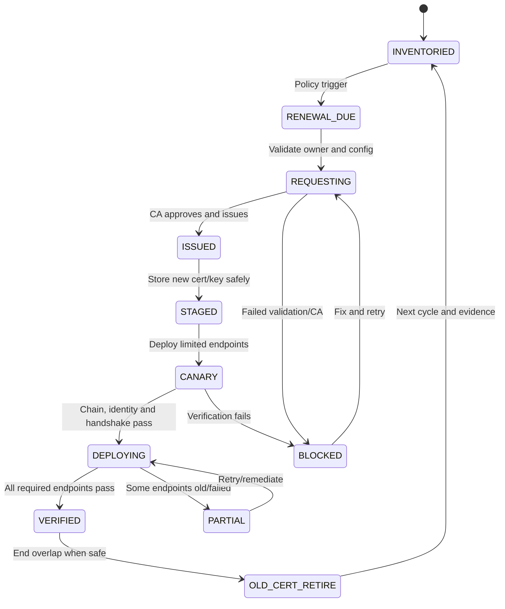
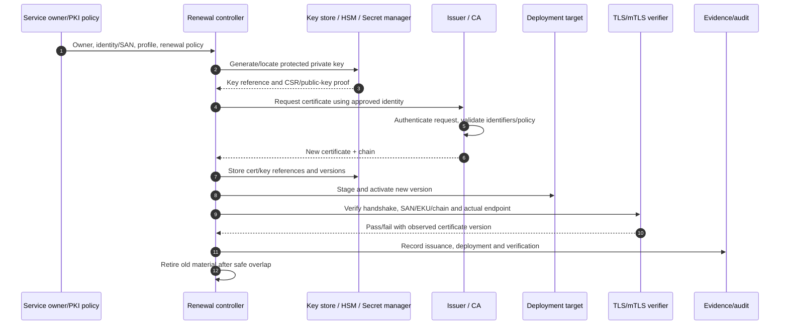

# Certificate renewal trong Machine Identity và quản lý vòng đời danh tính IAM

## 1. Certificate renewal là gì?

**Certificate renewal** là quá trình **cấp và triển khai chứng thư số mới** trước khi chứng thư đang sử dụng hết hiệu lực hoặc cần thay thế theo chính sách. Trong quản lý **machine identity**, chứng thư số — thường là **X.509 certificate** — giúp một máy chủ, API, ứng dụng, thiết bị, service hoặc workload chứng minh một định danh và thiết lập kết nối tin cậy. Việc gia hạn phải bảo đảm **không gián đoạn kết nối, không làm suy yếu xác thực và không để credential cũ tồn dư ngoài kiểm soát**.

Ví dụ: API `invoice-api.billing.svc.cluster.local` sử dụng TLS certificate do CA nội bộ phát hành. Chứng thư sắp hết hạn. Nếu đội vận hành chỉ tải certificate mới lên kho bí mật nhưng load balancer hoặc Pod vẫn phục vụ certificate cũ, hệ thống có thể tiếp tục lỗi TLS khi certificate cũ hết hạn. Một lần “renew thành công” ở CA **không đồng nghĩa dịch vụ đã sử dụng chứng thư mới thành công**.

Trong module **SECURITY_IDENTITY_ACCESS_MANAGEMENT_IDENTITY_LIFECYCLE**, Certificate renewal thuộc chương **Machine identity** và liên kết với quản lý vòng đời danh tính theo **Joiner–Mover–Leaver (JML)**. Danh tính người có thể được xác minh, tạo tài khoản, cấp quyền, rà soát và thu hồi qua **IdP/SSO, SCIM, RBAC/ABAC**; tương tự, danh tính máy cần **đăng ký owner, cấp certificate/credential, duy trì và luân chuyển, thay trust/role khi đổi nhiệm vụ, rồi thu hồi khi workload ngừng**. Machine certificate còn liên quan đến service accounts, workload federation, PAM, kiểm toán và việc giảm quyền truy cập tồn dư.

**Kết quả học tập:** sau bài này, người đọc có thể phân biệt gia hạn với tạo lại khóa, đổi CA và thu hồi; thiết kế pipeline cấp–triển khai–xác minh chứng thư; tự động hóa với ACME hoặc certificate controller khi phù hợp; thực hiện rollover không downtime; kiểm chứng TLS/mTLS và role authorization; tổ chức alert, audit và xử lý sự cố.

> **Nguyên tắc:** gia hạn chứng thư chỉ hoàn thành khi **mọi điểm sử dụng đã nhận credential mới, chứng minh được handshake/định danh hợp lệ, không mất chức năng được phép, không mở rộng quyền ngoài ý muốn**, và certificate/khóa cũ được xử lý theo chính sách.

## 2. Những khái niệm cần phân biệt

| Thuật ngữ | Ý nghĩa | Không nên nhầm |
| --- | --- | --- |
| **Certificate** | Chứng thư ràng buộc public key với tên/định danh và thông tin do issuer ký | Không chứa private key dùng để chứng minh sở hữu khóa |
| **Private key** | Khóa bí mật tương ứng public key, dùng trong handshake/ký theo thuật toán | Không chia sẻ qua ticket, chat hoặc log |
| **Public key** | Khóa công khai trong chứng thư | Không thay cho kiểm tra issuer, SAN, thời hạn, trust |
| **CSR** (*Certificate Signing Request*) | Yêu cầu ký chứa public key và thông tin xin chứng thư, được chứng minh bằng khóa phù hợp | CSR không tự là chứng thư được tin cậy |
| **CA** (*Certificate Authority*) | Tổ chức/dịch vụ có thẩm quyền phát hành chứng thư theo profile/policy | Chữ ký CA không tự cấp mọi quyền ứng dụng |
| **Certificate chain** | Chuỗi leaf → intermediate CA → trust anchor | Leaf hợp lệ không đủ nếu chain hoặc trust sai |
| **Trust store** | Tập CA/khóa được bên kiểm tra tin theo chính sách | Không phải nơi cất private key |
| **Renewal** | Lấy certificate mới thay certificate cũ theo vòng đời | Có thể dùng khóa mới hoặc khóa hiện có tùy policy |
| **Rekey / key rotation** | Tạo khóa mới và chuyển sang sử dụng | Khác với chỉ đổi `notAfter`/serial certificate |
| **Reissuance** | Phát hành lại certificate, có thể đổi SAN/issuer/profile | Không đồng nghĩa thu hồi certificate cũ |
| **Revocation** | CA/PKI đánh dấu chứng thư không còn được tin dùng trước hạn | Hiệu lực phụ thuộc cách bên kiểm tra xử lý revocation |
| **Rollover** | Giai đoạn chuyển tiếp giữa certificate/key/CA cũ và mới | Không nên bật hai trust roots rộng hơn cần thiết vô hạn |
| **Expiry** | Vượt qua thời điểm `notAfter` của chứng thư | Không nên đợi hết hạn mới bắt đầu cấp lại |

“Renew” trong giao diện sản phẩm có thể triển khai bằng **phát hành mới, cùng khóa hoặc khóa mới**, hoặc dùng workflow riêng cho `replace/reissue`. Hệ thống phải ghi rõ **ngữ nghĩa thực sự của sản phẩm, chính sách khóa và nguồn cấp**, tránh giả định một lệnh “renew” đồng thời xoay khóa, thu hồi certificate cũ và reload mọi ứng dụng.

## 3. Machine identity sử dụng certificate ở những đâu?

Certificate có thể xuất hiện trong nhiều luồng **xác thực máy–máy** nhưng **không phải tất cả machine identities đều dùng X.509**.

| Phạm vi | Bên trình certificate | Bên kiểm tra | Ý nghĩa |
| --- | --- | --- | --- |
| **HTTPS/TLS server** | Website, API, reverse proxy, load balancer | Client/browser/service | Xác thực tên máy chủ và bảo mật kênh |
| **Mutual TLS (mTLS)** | Cả server và client workload | Mỗi phía theo chính sách trust | Xác thực hai chiều giữa các service |
| **Service mesh** | Sidecar/proxy hoặc workload proxy | Mesh trust domain và peer proxy | Xác thực workload trong mesh |
| **Database TLS** | DB server, có thể cả DB client | Ứng dụng và DB | Bảo mật truy cập và xác thực đầu cuối |
| **Device identity** | Gateway, IoT device, edge agent | Thiết bị/management plane | Chứng minh thiết bị thuộc hệ thống |
| **Code/artifact signing** | Signing identity dùng certificate hoặc khóa | Artifact verifier | Xác minh nguồn và tính toàn vẹn phần mềm |
| **Kubernetes webhook** | Webhook endpoint | Kubernetes API server | Kết nối TLS tới webhook được tin cậy |
| **Internal PKI** | Service account/machine khác nhau | API gateway/CA verifier | Định danh theo CA nội bộ |
| **Cloud federation** | Có thể dùng signed OIDC token thay certificate | STS/cloud IAM | Không nhất thiết có bước renewal X.509 |

**Certificate phục vụ TLS server khác certificate ký mã hoặc mã hóa dữ liệu** ở mục đích, **Key Usage (KU), Extended Key Usage (EKU)** và cơ chế kiểm tra. Không nên lấy một certificate đang dùng cho TLS server để ký artifact hoặc client-auth nếu profile không cho phép.

## 4. Những trường X.509 quyết định việc gia hạn an toàn

Một chứng thư X.509 thường có các thuộc tính cần kiểm tra:

| Trường/extension | Ý nghĩa | Tác động đến renewal |
| --- | --- | --- |
| `Subject` | Thông tin tên/định danh của subject | Không được dựa duy nhất vào Common Name để match hostname hiện đại |
| **Subject Alternative Name (SAN)** | DNS, IP, URI hoặc loại định danh được chứng nhận | Phải chứa các tên/định danh workload thực sự được bên kiểm tra sử dụng |
| `Issuer` | CA đã ký certificate | Renewal sang issuer khác có thể cần trust rollout |
| `Serial Number` | Số sê-ri của certificate do issuer cấp | Certificate mới thường có serial khác |
| `notBefore` / `notAfter` | Cửa sổ hiệu lực | Đầu vào lập lịch, alert và kiểm tra clock |
| `Subject Public Key Info` | Public key và thuật toán | Liên kết đến private key cần được bảo vệ |
| **Key Usage / EKU** | Công dụng như `serverAuth`, `clientAuth` | Sai profile có thể khiến handshake bị từ chối |
| **Basic Constraints** | Certificate là CA hay leaf, giới hạn liên quan | Không chấp nhận leaf được cấu hình sai thành CA |
| **Authority/Subject Key Identifiers** | Hỗ trợ xây dựng chain | Hữu ích khi CA/key rollover |
| **Policy/OID/extensions** | Thuộc tính/profile khác tùy PKI | Có thể ảnh hưởng client policy |
| **Signature Algorithm** | Thuật toán ký certificate | Phải đáp ứng chính sách mật mã/compatibility hiện hành |

**SAN là trọng tâm đối với TLS server name validation.** Ví dụ certificate chỉ có `DNS:api-a.internal.example.test` không nên được dùng cho `api-b.internal.example.test` nếu hostname B không nằm trong SAN. Đổi tên host hoặc workload identity có thể cần **reissue với SAN mới**, không chỉ kéo dài ngày hết hạn của certificate cũ.

Một certificate vẫn trong hạn nhưng có issuer không được tin, EKU sai, private key không khớp hoặc bị mất hiệu lực theo chính sách **vẫn có thể không dùng được**. Monitoring chỉ dựa vào `notAfter` là không đủ.

## 5. Inventory: tìm mọi certificate và điểm sử dụng

Không thể renew an toàn nếu tổ chức không biết certificate ở đâu hoặc ai chịu trách nhiệm. **Certificate inventory** cần thu cả **credential object** lẫn **địa điểm deploy**.

| Dữ liệu | Ví dụ | Mục đích |
| --- | --- | --- |
| `certificateId` | ID trong PKI/certificate manager | Theo dõi vòng đời |
| `serial` + `issuerId` | Serial và CA có thẩm quyền | Phân biệt certificate cùng subject |
| `fingerprintSha256` | SHA-256 fingerprint | Nhận diện certificate bytes cụ thể |
| `subject` / `san` | DNS/URI/IP được ký | Kiểm tên và workload identity |
| `notBefore` / `notAfter` | ISO timestamp UTC | Tính khoảng còn lại |
| `keyAlgorithm` / `keyRef` | RSA/ECDSA hoặc HSM/KMS key ref | Đảm bảo chính sách khóa |
| `issuerProfile` / `eku` | Internal TLS client hoặc server | Đảm bảo công dụng |
| `serviceId` / `ownerTeam` | Service registry và backup owner | Chịu trách nhiệm renew |
| `deploymentTargets` | LB, gateway, Pod, VM, DB, webhook | Xác minh đã thay trên mọi node |
| `trustConsumers` | Client/mesh/partner nào tin chain | Chuẩn bị CA rollover |
| `automationPolicy` | ACME, cert-manager, internal CA API | Biết ai điều phối |
| `lastRenewedAt`, `lastVerifiedAt` | Mốc thay credential và test | Audit và cảnh báo |
| `environment` / `tenant` | Prod/staging và tài nguyên | Tránh dùng chung cert sai scope |

**Một DNS name có thể xuất hiện ở nhiều điểm chấm dứt TLS**: CDN, edge load balancer, ingress controller, API gateway và backend. Renew ở ingress không tự đổi certificate ở CDN hoặc một region khác.

### Nguồn inventory

Có thể kết hợp **CA issuance records**, certificate manager, Kubernetes Secrets/Certificate resources, ingress config, load balancer API, service mesh control plane, CMDB/service registry và **active TLS endpoint observation** được cho phép. Không nên mở quét ngoài phạm vi được cấp quyền; kết quả discovery cũng cần ghi **thời điểm quan sát và giới hạn phạm vi**.

**Không dùng fingerprint làm identity ổn định của service**: fingerprint đổi sau renew. Dùng `serviceId`/workload identity ổn định để liên kết nhiều certificates và key versions, còn fingerprint để xác định **phiên bản credential**.

## 6. Chính sách thời hạn và thời điểm bắt đầu renewal

Certificate có **thời điểm hết hạn cố định** theo `notAfter`. Hệ thống nên lập lịch dựa trên **thời gian thực còn lại, thời gian cấp lại, thời gian rollout và khoảng dự phòng sự cố**.

Một cách tư duy:

```text
Time remaining = notAfter - now

Renewal lead time cần bao phủ:
  validation + CA issuance
  distribution và activation
  canary + full rollout
  verification từ nhiều điểm
  retry/backoff và cửa sổ sự cố
  mức dự phòng theo rủi ro
```

Các mốc nhắc như **30/14/7 ngày** có thể hữu ích cho chứng thư có vòng đời dài; nhưng **không phải tiêu chuẩn chung**, và không phù hợp nếu chứng thư chỉ có hiệu lực vài giờ hoặc vài ngày. Với short-lived workload certificates, việc gia hạn có thể xảy ra nhiều lần trong một ngày và cần controller tự động.

### Trường hợp cần renew/reissue trước lịch

- Sắp đến `notAfter` hoặc CA yêu cầu chuyển profile.
- Thay đổi SAN/hostname, service identity hoặc loại môi trường.
- Chuyển PKI, intermediate CA hoặc thuật toán.
- Private key sắp phải rotate theo policy.
- Thay owner, thay vùng triển khai hoặc đổi cơ chế trust.
- Phát hiện cấu hình sai EKU, chain hoặc certificate deployment.
- Nghi ngờ credential bị lộ (**incident**, có thể cần revoke và thay khóa ngay, không phải renewal thường).

**Không đợi một calendar cron chạy đúng ngày cuối**. Nếu CA không khả dụng, domain validation lỗi, firewall thay đổi hoặc sản phẩm không reload certificate, có thể hết hạn trước khi khắc phục.

## 7. State machine cho vòng đời certificate renewal

Nên tách **trạng thái cấp chứng thư** khỏi **trạng thái triển khai và xác minh tại runtime**. CA trả “Issued” chưa phải đích cuối.



Đây là **mô hình workflow minh họa**. Một CA tự động có thể cấp lại và rotate nhiều lần, còn certificate bị nghi lộ sẽ đi theo nhánh **incident containment/compromise** riêng.

### Các trạng thái nên độc lập

```text
issuanceState   = ISSUED
deploymentState = PARTIAL
runtimeState    = SOME_ENDPOINTS_SERVE_OLD_CERT
oldKeyState     = STILL_PRESENT
overallState    = RENEWAL_INCOMPLETE
```

Nếu dashboard chỉ hiển thị `ISSUED`, người vận hành dễ bỏ sót certificate đã có trong vault nhưng **một node vẫn phục vụ chain cũ**. Để đánh giá completion, phải so **observed endpoint fingerprints và chain** với credential dự kiến.

## 8. Luồng end-to-end: từ CA tới handshake được kiểm chứng



Các bước có thể khác nhau theo CA, ACME, cloud certificate manager hoặc service mesh. **Không nhất thiết private key đi qua renewal controller**: tốt hơn nếu khóa được tạo và giữ trong HSM/KMS/keystore hoặc tại workload, chỉ xuất **CSR** hoặc bằng chứng public key theo capability.

### Không làm rò private key qua quy trình gia hạn

CSR **không chứa private key**. Renewal API/CI job chỉ nên có quyền cần thiết để yêu cầu ký và phân phối tới endpoint được phép. Khi provider yêu cầu upload private key, cần đánh giá đường truyền, secret store, logging, quyền người vận hành và khả năng thay bằng cơ chế giữ khóa tại chỗ.

## 9. CSR và xác minh danh tính trước khi phát hành

**Certificate Signing Request (CSR)** thường được tạo từ một cặp khóa và chứa public key cùng các thuộc tính xin cấp. CA không nên ký mọi SAN hoặc URI mà client tự đề xuất; cần xác minh **bên yêu cầu có thẩm quyền với identity/tên đó** theo CA policy.

Một quy trình có kiểm soát:

1. Xác định `serviceId`/workload và owner hợp lệ trong registry.
2. Chọn **certificate profile**: TLS server, TLS client, signing hoặc mục đích khác.
3. Xác minh yêu cầu về SAN, tenant, namespace, DNS và trust domain.
4. Tạo cặp khóa theo chính sách; bảo vệ private key.
5. Tạo CSR, xác minh public key và subject/SAN liên quan.
6. CA thực hiện xác thực quyền yêu cầu ký và policy checks.
7. Nhận leaf certificate và intermediate chain phù hợp; kiểm `notBefore/notAfter`, SAN, EKU, key algorithm.
8. Lưu certificate ID/serial/fingerprint, khóa tham chiếu và source/approval.
9. Chỉ triển khai nếu profile và mapping tới service identity khớp.

**Không dùng CN đơn lẻ làm cơ chế xác thực hostname hiện đại.** Khi server yêu cầu hostname `api.billing.internal.example.test`, certificate phải có DNS SAN thích hợp. Với mTLS client, mapping identity có thể dùng URI SAN (ví dụ mô hình SPIFFE) hoặc định danh khác theo chính sách; **tên nào được tin phải được xác định bởi verifier và CA issuer policy**, không chỉ vì chuỗi chữ xuất hiện trong SAN.

## 10. Key rotation: khi nào phải thay khóa?

“Gia hạn certificate” có thể **sử dụng lại khóa hiện có** hoặc **phát hành cùng một dịch vụ với cặp khóa mới**. Chính sách cần trả lời rõ yêu cầu theo thuật toán, mức rủi ro, môi trường và năng lực nền tảng.

| Lựa chọn | Thuận lợi | Rủi ro / lưu ý |
| --- | --- | --- |
| **Renew với cùng khóa** | Ít thay đổi ở một số hệ thống legacy | Nếu khóa từng lộ thì certificate mới cũng bị đe dọa; không đạt mục tiêu key rotation |
| **Renew và tạo khóa mới** | Giảm thời gian sử dụng cùng khóa và cải thiện kiểm soát | Cần phân phối/khớp khóa đúng endpoint, quản lý version và reload |
| **Thay thuật toán/key size** | Đáp ứng policy bảo mật hoặc compatibility mới | Cần kiểm tra các client cũ có hỗ trợ không |
| **Khóa giữ trong HSM/TPM** | Hạn chế xuất private key khỏi phần cứng/kho an toàn | Cần hỗ trợ CSR, phục hồi, HA, lifecycle riêng |
| **Workload-generated ephemeral key** | Tự động hóa và giảm secret lâu dài | Cần controller tin cậy, bảo vệ quá trình đăng ký workload |

**Nếu nghi ngờ private key bị lộ, không nên tái sử dụng khóa khi renew.** Tình huống đó cần **incident response, tạo khóa mới, cấp chứng thư mới, thay credential ở mọi đích, đánh giá revocation và tác động tới phiên hiện hữu**.

### Cần kiểm tra key–certificate matching

Leaf certificate phải chứa public key khớp private key thực tế ở endpoint. Kiểm tra này nên là một bước của deployment/canary; nếu mismatch, TLS server thường không khởi động hoặc handshake thất bại. Với HSM, dùng **public-key/key-reference verification** thay vì xuất private key.

## 11. ACME: tự động yêu cầu và gia hạn certificate

**Automatic Certificate Management Environment (ACME)** là một giao thức tự động hóa việc quản lý certificate theo chính sách của CA. Nó phù hợp đặc biệt với TLS server certificate khi **CA và môi trường hỗ trợ**.

Quy trình khái niệm:

1. ACME client có một account/key được đăng ký với CA.
2. Client yêu cầu certificate cho các identifiers (thường DNS names).
3. CA đưa ra challenge để chứng minh quyền kiểm soát tên theo cơ chế được hỗ trợ.
4. Client hoàn tất challenge và CA xác minh.
5. CA phát certificate; client triển khai và lưu metadata.
6. Controller lặp lại theo lịch renewal, quan sát expiry và xác minh endpoint.

### Những challenge thường gặp

| Cơ chế | Bằng chứng kiểm soát | Lưu ý |
| --- | --- | --- |
| **HTTP-01** | Tài nguyên xác minh qua HTTP cho DNS name | Cần route/port và môi trường phù hợp; không dùng được cho mọi hostname |
| **DNS-01** | Bản ghi TXT phù hợp tại DNS | Hữu ích cho wildcard/kiến trúc không mở HTTP trực tiếp; credential DNS cần giới hạn |
| **TLS-ALPN-01** | Challenge qua TLS với ALPN thích hợp | Cần xử lý kết nối/port và cấu hình proxy phù hợp |

Không có cơ chế nào **phù hợp với mọi private/internal name**. **CA công khai không nhất thiết cấp certificate cho tên nội bộ tùy ý**; internal PKI hoặc CA private có thể cần được sử dụng theo trust policy riêng.

**Bảo mật DNS automation:** không gắn một API token có thể sửa mọi zone vào bất kỳ Pod nào chỉ vì cần DNS-01. Dùng credential scope tối thiểu, secret manager và phân quyền theo zone/record khi provider hỗ trợ.

### Lỗi ACME điển hình

Domain validation sai, DNS propagation chậm, HTTP route bị proxy chặn, ACME account key mất, CA rate limit, tài khoản không đủ quyền hoặc thay đổi ingress. Automation cần **backoff, cảnh báo, retry có giới hạn** và tính toán còn đủ thời gian trước `notAfter`.

## 12. Tự động hóa renewal: scheduler, controller và policy

Gia hạn thủ công có thể phù hợp với một số certificate đặc thù nhưng khó mở rộng. Với machine identity số lượng lớn, nên tự động hóa **inventory → renew → deploy → verify → evidence**.

Một controller nên có các khả năng:

- Đọc **certificate inventory** từ nguồn quản lý và phát hiện certificates mới ngoài quy trình.
- Tính trigger theo `notAfter`, lead time, risk tier và profile; không hardcode một ngưỡng cho mọi workload.
- Xác thực **service owner và lifecycle status** trước khi cấp mới.
- Kiểm tra identity/SAN/EKU/algorithm/CA policy, chống request thay hostname không có thẩm quyền.
- Sinh CSR hoặc gọi API cấp chứng thư qua credential có quyền tối thiểu.
- Ghi version/fingerprint mới, bảo vệ private key và chain.
- Deploy theo từng môi trường/region/replica với canary khi cần.
- Kiểm tra trust, hostname/client identity, handshake và ứng dụng.
- Retire certificate/key cũ khi mọi consumer đã chuyển phù hợp.
- Tạo audit trail, metrics, alert và trạng thái `PARTIAL/UNKNOWN` nếu lỗi.

### Không cho phép automation tự mở quyền

Một renewal worker được phép cấp lại certificate cho `invoice-api.billing.svc.cluster.local` **không nên tự tạo certificate cho `global-admin.internal.example.test`** chỉ vì workload sửa một YAML manifest. CA/issuer phải kiểm tra **requested identity và owner/namespace permission**, ngay cả khi CSR hợp lệ về mặt cú pháp.

### Idempotency và lỗi mạng

Nếu CA đã phát certificate nhưng client timeout, retry mù quáng có thể tạo nhiều certificate và phức tạp hóa rotation. Nên lưu **request/operation ID**, tra cứu kết quả trước retry nếu CA hỗ trợ, và đối soát certificate đang tồn tại. Với hệ thống eventual consistency, trạng thái **ISSUED nhưng chưa deployed** cần được giữ riêng.

## 13. Triển khai không downtime: chồng lấp có kiểm soát

**Zero-downtime renewal** nghĩa là dịch vụ tiếp tục phục vụ những request hợp lệ trong khi các endpoint chuyển sang credential mới. Không thể đạt điều đó chỉ bằng một thao tác thay file và restart đồng loạt.

Một quy trình rollout có kiểm soát:

1. **Stage:** tải certificate/chain/key mới vào kho an toàn, không kích hoạt ngay tất cả nơi.
2. **Validate offline:** kiểm metadata, thuật toán, SAN, EKU, key match và trust chain.
3. **Canary:** thay ở một endpoint/Pod/region có khả năng phục hồi, chạy TLS/mTLS handshake và chức năng mẫu.
4. **Progressive rollout:** cập nhật các replicas/regions còn lại; bảo vệ lượng capacity cần thiết.
5. **Reload/restart đúng cách:** biết ứng dụng có hot reload certificate hay phải restart/rolling update.
6. **Observe:** kiểm certificate **thực sự được endpoint trình** bằng fingerprint/serial và hostname, không chỉ file trên đĩa.
7. **Verify clients:** đặc biệt client mTLS/partner có trust store/CA phù hợp.
8. **Close overlap:** loại bỏ key/certificate cũ, trust cũ sau thời hạn chuyển tiếp, ghi readback và audit.

### Đừng tắt credential cũ quá sớm

Nếu backend vẫn chấp nhận một vài client chưa chuyển sang issuer mới, việc xóa CA/trust cũ ngay có thể gây outage. Ngược lại, duy trì **hai trust domains** quá lâu làm tăng bề mặt giả mạo. Overlap phải có **mốc kết thúc, tiêu chí thành công và owner**.

### Phát hiện endpoint bỏ sót

Một load balancer có thể được renew nhưng Pod backend vẫn dùng certificate cũ. Một cụm nhiều region có thể có các certificate khác nhau. Monitoring cần đo **observed certificate per endpoint/region/instance**, bao gồm đường gọi nội bộ đáng tin, thay vì lấy certificate của **một DNS lookup** rồi kết luận toàn hệ thống đã chuyển.

## 14. Ví dụ Kubernetes cert-manager: Certificate và Secret

Trong Kubernetes, **cert-manager** là một controller thường được sử dụng để quản lý certificate lifecycle thông qua các resource như `Certificate`, `Issuer` hoặc `ClusterIssuer`. Đây là **một giải pháp bổ sung**, không phải thành phần có sẵn bắt buộc của Kubernetes.

Ví dụ certificate TLS server **minh họa**, giả định cert-manager đã được cài và `Issuer` có tên `workload-ca` được quản trị an toàn trong namespace `billing`:

```yaml
apiVersion: cert-manager.io/v1
kind: Certificate
metadata:
  name: invoice-api-tls
  namespace: billing
spec:
  secretName: invoice-api-tls
  duration: 2160h
  renewBefore: 360h
  privateKey:
    rotationPolicy: Always
  dnsNames:
    - invoice-api.billing.svc.cluster.local
  usages:
    - server auth
  issuerRef:
    name: workload-ca
    kind: Issuer
```

**Lưu ý quan trọng:**

- `duration: 2160h` và `renewBefore: 360h` chỉ là **giá trị ví dụ**; CA có thể áp hạn riêng hoặc yêu cầu thời hạn khác. Đừng coi đây là giới hạn chuẩn của certificate nói chung.
- `privateKey.rotationPolicy: Always` yêu cầu cấp key mới theo cấu hình controller/version hỗ trợ; vẫn cần xác minh behavior thực tế và cách workload dùng Secret.
- `secretName` là nơi cert-manager lưu certificate/key; **Kubernetes Secret chỉ được mã hóa base64 ở định dạng biểu diễn**, không tự là giải pháp mã hóa dữ liệu khi lưu trữ. Bảo vệ bằng RBAC, encryption-at-rest/KMS theo hạ tầng và giới hạn quyền đọc.
- `issuerRef` chỉ là tham chiếu; **Issuer phải được tạo/cấu hình riêng** và phải có thẩm quyền với SAN/profile đang yêu cầu.
- Service/Ingress phải **tham chiếu đúng Secret** và reload certificate khi thay đổi. Secret được cập nhật không bảo đảm tiến trình đang phục vụ tự tải lại.
- Nếu cần client authentication, **EKU, issuer, SAN và trust policy phải được cấu hình phù hợp**, không dùng certificate serverAuth như một identity client mặc định.

### Kiểm tra cấu hình và kết quả

Ví dụ lệnh **đọc trạng thái**, chỉ chạy tại cluster được ủy quyền:

```bash
kubectl -n billing get certificate invoice-api-tls
kubectl -n billing describe certificate invoice-api-tls
kubectl -n billing get secret invoice-api-tls
```

Lệnh `get secret` dạng trên chỉ hiển thị metadata mặc định; **không export `tls.key` vào log/ticket**. `Certificate` có thể ở trạng thái Ready nhưng **service vẫn dùng credential cũ** nếu không reload. Vì vậy cần kiểm tra TLS handshake ở endpoint thực tế, không chỉ nhìn điều kiện của controller.

## 15. Ví dụ OpenSSL: kiểm chứng certificate và endpoint

Có thể dùng OpenSSL để **kiểm tra thông tin certificate** trong một môi trường đã được cấp quyền. Các lệnh dưới đây là **read-only**, không tạo hay in private key:

```bash
# Certificate file đã được cung cấp an toàn
openssl x509 -in cert.pem -noout -subject -issuer -serial -dates -fingerprint -sha256

# Thử xem certificate còn hiệu lực qua 7 ngày tới hay không
openssl x509 -in cert.pem -noout -checkend 604800

# Quan sát certificate/chain được endpoint TLS trình ra
openssl s_client -connect api.example.test:443 -servername api.example.test -showcerts
```

**Giải thích:**

- `-checkend 604800` kiểm tra certificate **có hết hạn trong 604.800 giây (7 ngày)** tính từ thời điểm chạy lệnh hay không; đây không phải phép kiểm chain, hostname, revocation hay key match.
- `s_client -showcerts` giúp quan sát chain do server gửi. **Chỉ nhìn thấy chain hoặc có kết nối TCP/TLS không chứng minh hostname/CA verification đã PASS.** Phải đánh giá kết quả xác minh bằng trust bundle, hostname và policy phù hợp.
- `-servername` dùng **SNI** để yêu cầu virtual host đúng; thiếu SNI có thể khiến load balancer trình certificate mặc định.
- Không đưa private key vào shell history, CI logs hay artifact khi thực hiện kiểm tra.
- Với mTLS, phép thử cần có client identity được ủy quyền, trust store và kiểm tra **server thực sự map client principal đúng scope**. Không coi một TLS handshake đơn thuần là bằng chứng authorization.

Một bản kiểm tra renewal đủ tốt nên so **`serial/fingerprint, SAN, issuer/chain, notAfter`** của certificate **trong kho** với **certificate quan sát ở endpoint**.

## 16. mTLS: gia hạn certificate client và server

Trong **mutual TLS (mTLS)**, cả hai phía có thể trình certificate. Renewal lỗi ở một phía khiến kết nối bị từ chối dù phía còn lại vẫn trong hạn.

Một số tình huống:

| Tình huống | Rủi ro | Kiểm soát |
| --- | --- | --- |
| Server cert mới, client chưa tin CA | TLS handshake thất bại | Phân phối trust bundle/rollover CA trước khi chuyển issuer |
| Client cert mới, server mapping chỉ nhận subject cũ | Client bị từ chối | Cập nhật identity mapping theo issuer/SAN/trust policy đã duyệt |
| Client cert hết hạn, server cert còn hạn | M2M outage | Monitor cả client cert ở workload và server cert |
| Client cert có `serverAuth` nhưng thiếu `clientAuth` | Không phù hợp policy client-auth | Phát hành đúng EKU/profile |
| Client certificate hợp lệ nhưng role đã thu hồi | TLS handshake có thể PASS | API/PEP vẫn phải kiểm entitlement và service lifecycle |
| Khóa client bị lộ | Kẻ xấu có thể mạo danh trong cửa sổ trust | Incident containment, key replacement, revocation theo PKI |

### Mapping danh tính từ certificate

Một backend mTLS có thể dựa vào SAN/URI, issuer và trust domain để ánh xạ certificate sang **service identity**. **Không tự tin vào một header `X-Client-Cert` do client Internet gửi**, trừ khi proxy tin cậy xác minh mTLS, xóa header không tin cậy và truyền identity qua kênh được bảo vệ theo hợp đồng.

Nếu certificate mới có serial khác nhưng **cùng workload identity hợp lệ**, authorization không nên phụ thuộc cứng vào serial của certificate cũ, trừ khi **certificate pinning/allowlisting có quản trị** được thiết kế và đồng bộ. Nếu trust policy yêu cầu fingerprint pinning, cần rollover danh sách pin có hạn và kiểm thử trước khi certificate đổi.

## 17. CA rollover khác certificate renewal thông thường

Đổi **leaf certificate** trong cùng chain khác với đổi **intermediate/root CA**. CA rollover có thể ảnh hưởng hàng trăm client và workload cùng lúc.

Một kế hoạch chuyển CA thường gồm:

1. Inventory **những client/partner/mesh/database** đang tin root/intermediate cũ.
2. Định nghĩa CA/trust domain mới và profile, kiểm soát enrollment/issuance.
3. Phân phối trust anchor mới tới những client cần thiết trước khi leaf certificates chuyển.
4. Cho phép **dual trust có kiểm soát** trong giai đoạn phù hợp, nếu chính sách cho phép.
5. Phát certificate mới, triển khai canary rồi mở rộng.
6. Kiểm tra chain validation, SAN, EKU và handshake từ các client/region.
7. Theo dõi các client chưa chuyển; xử lý thiết bị offline/legacy theo kế hoạch.
8. Gỡ CA cũ khỏi trust store sau khi đạt tiêu chí, xử lý cert/key cũ và evidence.

**Không chỉ thay file `fullchain.pem` ở server** nếu client chưa tin root mới. **Không để CA cũ trong trust store vô thời hạn** vì “sợ outage”; việc kéo dài trust cần được xem như một exception có hạn và được rà soát.

### Pinning và external consumers

Một số mobile/embedded clients hoặc partner integrations có thể pin **certificate, public key hoặc CA**. Dù không khuyến nghị pinning quá cứng cho mọi hệ thống, nếu đang triển khai, phải biết **đối tượng nào đang pin cái gì** trước khi key rotation. Nếu không, certificate mới đúng chuẩn vẫn bị client từ chối.

## 18. Public CA, internal CA và service mesh PKI

**Publicly trusted certificate** và **private certificate** có trust domains, danh sách tên được cấp, profile và policies khác nhau.

- **Public CA** thích hợp cho endpoint công khai và client tin hệ thống public trust store; issuance/validation/validity chịu chính sách CA và yêu cầu áp dụng tại thời điểm cấp.
- **Internal CA** phù hợp hostname/mTLS/private trust domain; tổ chức phải quản trị root distribution, enrollment, audit, khóa CA và revocation.
- **Service mesh PKI** có thể cấp certificate ngắn hạn tự động cho workload; mesh chịu trách nhiệm rotation và peer identity theo trust domain.
- **Device CA** có thể dùng enrollment gắn với thiết bị và phần cứng; yêu cầu khác server certificate thông thường.

**Không có một thời hạn certificate chung** áp dụng cho mọi loại chứng thư, CA và hệ thống. Các giới hạn cho chứng thư TLS công khai có thể thay đổi theo chính sách hệ sinh thái, nên phải kiểm tra policy của CA/provider tại thời điểm triển khai; không lấy độ dài certificate máy nội bộ làm mặc định cho certificate Internet hoặc ngược lại.

### Quản lý ranh giới tin cậy

Chỉ một `CA-issued` không đủ: **CA nào, trust domain nào, profile nào, identity nào và scope nào**? Nếu một root CA nội bộ được tin cho quá nhiều mục đích, một certificate phát hành sai profile có thể bị chấp nhận ở nơi không mong muốn. Cần tách issuer/profile/trust domain theo rủi ro khi phù hợp.

## 19. SPIFFE/SPIRE và certificate ngắn hạn

Trong một số hạ tầng hiện đại, workload có thể nhận **SPIFFE Verifiable Identity Document (SVID)** dưới dạng **X.509-SVID**. Định danh SPIFFE thường nằm trong **URI SAN** theo trust domain, ví dụ `spiffe://example.org/ns/billing/sa/invoice-api` — chỉ là giá trị minh họa.

**SPIRE** là một hệ thống có thể xác thực workload và cấp SVID dựa trên registration/attestation và policy. Với cơ chế này, “certificate renewal” có thể xảy ra **rất thường xuyên** thông qua workload API/agent; ứng dụng hoặc proxy phải hỗ trợ **hot reload/rotation**.

### Cần tách ba trách nhiệm

1. **Workload attestation:** nền tảng chứng minh Pod/process/node đáp ứng registration policy.
2. **Issuance/renewal:** issuer cấp SVID chứa identity phù hợp với trust domain.
3. **Authorization:** service nhận request kiểm tra peer SPIFFE ID có được gọi action/resource cụ thể không.

**SPIFFE ID hợp lệ không tự cấp quyền truy cập mọi API**. Một workload từ trust domain được chấp nhận vẫn phải bị giới hạn bởi RBAC/ABAC/PBAC ở nơi xử lý.

### Mover trong SPIFFE

Nếu workload chuyển namespace hoặc service account, identity mapping có thể đổi. Cần cập nhật registration policy và peer authorization; không mở wildcard `spiffe://example.org/*` chỉ để hai môi trường chạy được. Khi service retired, gỡ registration/attestation binding và chặn credentials mới theo thiết kế, kiểm tra thời gian sống của SVID đã phát.

## 20. Certificate renewal và quyền truy cập: không đồng nghĩa nhau

Certificate phục vụ **chứng minh danh tính và tạo kênh tin cậy**, còn **entitlement và policy** quyết định tác vụ được phép.

| Biến cố | Tác động tới certificate | Tác động tới authorization |
| --- | --- | --- |
| Renew thành công | Identity tiếp tục có credential hợp lệ | **Không tự cấp thêm role** |
| Certificate sắp hết hạn | Cần gia hạn để tránh outage | Quyền không tự mất trước khi có kiểm soát tương ứng |
| CA đổi trust | Client phải chấp nhận chain mới | RBAC/ABAC policy vẫn cần kiểm scope |
| Service Mover | Có thể đổi SAN/trust/credential | Cần tính `toGrant/toRevoke/toKeep` |
| Service Retired | Chặn phát mới, thu hồi/retire key/cert | Gỡ role/direct grants/resource policy |
| Private key bị lộ | Replace key/cert; cân nhắc revoke khẩn | Có thể cần tạm chặn principal ở API/PEP |
| Human owner Leaver | Chuyển quản trị và kiểm tra credential | Workload vẫn có thể ACTIVE nếu được phê duyệt |
| Access review phát hiện role thừa | Certificate có thể vẫn phù hợp | Phải thu hồi role dù cert chưa hết hạn |

**Không dùng renewal để mở rộng scope**. Nếu một certificate mới thay SAN từ `invoice-api` thành `admin-api` mà không có approval, đó là **thay đổi identity** cần policy và ownership check, không phải thao tác kỹ thuật vô hại.

## 21. Joiner: đăng ký machine identity và cấp chứng thư đầu tiên

Quy trình **Joiner cho workload** nên bắt đầu từ nguồn có thẩm quyền như service registry, onboarding ứng dụng hoặc thiết bị. Các cổng kiểm soát:

1. Ghi `serviceId`/workload ID, application owner và backup owner.
2. Xác định environment, tenant, namespace, hostname/URI identity và mục đích.
3. Xác minh quyền sở hữu DNS hoặc workload attestation phù hợp.
4. Phê duyệt certificate profile, issuer, SAN/EKU và chính sách khóa.
5. Tạo khóa an toàn, CSR hoặc enrollment request.
6. CA phát certificate đúng identity và thời hạn.
7. Triển khai credential qua secret manager/controller/PKI path được bảo vệ.
8. Kiểm tra server/client TLS/mTLS, trust chain và endpoint identity thực tế.
9. Cấp **role/entitlement riêng** theo least privilege, không vì có cert mà cấp admin.
10. Lưu inventory, owner, certificate ID/serial/fingerprint, ngày hết hạn và trigger renewal.

**Không chấp nhận CSR cho tên máy bất kỳ** chỉ vì người yêu cầu có account trong CI/CD. Issuer policy phải ràng buộc service với SAN/domain/trust domain được phép.

## 22. Mover: thay hostname, owner, môi trường hoặc trust

Một **Mover của machine identity** có thể là đổi namespace, endpoint, đội owner, CA, môi trường hoặc chức năng ứng dụng. Mỗi loại tác động khác nhau đến certificate.

| Biến cố | Cần xem với certificate | Cần xem với entitlement |
| --- | --- | --- |
| Đổi hostname | Reissue với SAN mới, kiểm tên cũ cần overlap | API/tenant mapping có đổi không? |
| Đổi namespace/service account | URI/workload identity mới, attestation rule | RBAC/ABAC binding sang principal mới |
| Chuyển dev → prod | Dùng issuer/trust/profile phù hợp prod | Không mang role dev sang prod tùy ý |
| Đổi CA | Trust bundle và client compatibility | Policy issuer/trust domain được chấp nhận |
| Thay owner team | Chuyển trách nhiệm renew, alert và key custody | Rà quyền service theo nhiệm vụ mới |
| Đổi thuật toán/key | Test client compatibility và key match | Không mặc định thay quyền |
| Chuyển data tenant | SAN có thể không đổi | Phải giới hạn tenant/resource ở PEP |

**Không renew certificate cũ rồi coi Mover đã hoàn tất** nếu workload vẫn được authorize theo role và tenant cũ. Mover đòi tính **desired entitlements mới**, xử lý trust/routing và quyền tồn dư.

### Phê duyệt thay SAN

Khi một application xin thêm wildcard DNS hoặc URI SAN rộng, cần review **blast radius**: certificate mới có thể được dùng để xác thực nhiều hostname hoặc danh tính hơn. CA/policy nên giới hạn yêu cầu theo domain, namespace, service owner và trust boundary.

## 23. Leaver/retirement: chấm dứt certificate và quyền tồn dư

**Service retirement** không phải chỉ để certificate tự hết hạn. Workload có thể còn token, private key, service account, role hoặc một instance chưa tắt.

Quy trình theo lớp:

1. Service registry xác nhận `RETIRED`/`DISABLED` với version và effective time.
2. Dừng pipeline cấp mới/renewal cho identity đã retired.
3. Gỡ deployment jobs, scheduled restarts hoặc controllers có thể tái tạo credential cũ.
4. Thu hồi/thay thế certificate và khóa theo PKI policy; xử lý revocation nếu cần.
5. Gỡ trust/binding/registration của workload tại CA, mesh, federation và API gateways.
6. Thu hồi role, RBAC/ABAC binding, direct grants, secrets access và service account khi phù hợp.
7. Xử lý session/token/temporary credentials còn tồn dư theo khả năng nền tảng.
8. Kiểm endpoint không còn nhận client identity đã retired và tài nguyên không Permit các action cũ.
9. Lưu audit, owner, lý do, observed state và tình trạng `PARTIAL/VERIFIED`.
10. Xử lý dữ liệu/backup/log theo retention; không tự xóa chứng cứ sự cố.

### Human owner Leaver khác service Leaver

Nếu người tạo certificate hoặc admin PKI nghỉ việc nhưng service vẫn cần chạy, phải **chuyển ownership**, rà quyền PKI/secret manager của cá nhân, thay credential bị người đó nắm giữ theo rủi ro và bảo đảm alert tới owner mới. **Không vô hiệu certificate production một cách mù quáng** chỉ vì người chủ cũ đã Leaver.

Ngược lại, khi workload **đã thực sự ngừng**, không để certificate được controller tự renew vô thời hạn chỉ vì CA thấy yêu cầu hợp lệ về cú pháp.

## 24. Certificate revocation: xử lý khi certificate không còn được tin

**Revocation** là cơ chế đánh dấu certificate mất hiệu lực **trước `notAfter`**. Các phương pháp và mức hỗ trợ khác nhau:

- **CRL** (*Certificate Revocation List*): danh sách chứng thư bị thu hồi do CA phát hành.
- **OCSP** (*Online Certificate Status Protocol*): giao thức kiểm tra trạng thái chứng thư theo cơ chế được hỗ trợ.
- **Short-lived certificates:** giảm cửa sổ sử dụng một certificate, đôi khi kết hợp hạn chế hoặc không phụ thuộc revocation lookup.
- **Trust/policy deny:** hệ thống có thể chặn cụ thể issuer/subject/serial/principal hoặc gỡ role/credential binding ở ứng dụng theo khả năng.

**Không khẳng định “CA revoke ⇒ mọi client từ chối ngay lập tức”**. Một số client không kiểm revocation, có cache trạng thái, mất kết nối OCSP hoặc có chính sách fail-open/fail-closed khác nhau. Với mTLS nội bộ, cần biết **verifier thực tế** có kiểm CRL/OCSP hoặc deny policy không.

### Khi private key bị nghi lộ

1. Kích hoạt quy trình **incident** và phân loại phạm vi credential.
2. Chặn quyền nguy hiểm hoặc cô lập workload nếu cần để giảm tác động.
3. Tạo **cặp khóa mới**, không tái sử dụng khóa bị nghi lộ.
4. Phát certificate mới theo ownership/identity policy.
5. Chuyển các endpoint/clients và kiểm thử.
6. Revoke certificate cũ và xử lý trust/role/session theo năng lực hệ thống.
7. Điều tra lịch sử sử dụng, kiểm toán truy cập secret, log và dữ liệu có thể bị ảnh hưởng.
8. Đóng khi có evidence từ CA, deployment, runtime và các quyền còn tồn dư được xử lý.

**Renewal định kỳ không phải quy trình xử lý compromise đầy đủ.** Nó không tự điều tra việc giả mạo đã diễn ra, token khác bị phát hoặc dữ liệu đã lộ.

## 25. Bảo vệ private key và bí mật vận hành

Private key là thành phần nhạy cảm nhất của machine certificate. Các biện pháp kiểm soát:

| Khu vực | Rủi ro | Bảo vệ |
| --- | --- | --- |
| **Key generation** | Tạo khóa yếu hoặc không có entropy phù hợp | Dùng thuật toán/độ mạnh được policy phê duyệt và thư viện tin cậy |
| **Storage** | File key world-readable, Secret không mã hóa phù hợp | HSM/KMS/TPM khi hỗ trợ, RBAC và encryption-at-rest |
| **Distribution** | Key đi qua email, artifact CI, log hoặc tickets | Kênh bảo vệ, secret references, không in nội dung |
| **Runtime** | Container khác đọc volume secret | Mount tối thiểu, process isolation, filesystem permissions |
| **Backup** | Bản sao private key sống quá lâu | Backup được mã hóa, giới hạn người đọc và retention |
| **Rotation** | Key cũ giữ lại không có hạn | Retire/zeroize theo khả năng, kiểm soát bản sao |
| **PKI operator** | Account quản trị có thể cấp giả certificate | PAM/MFA/SoD, signing CA key bảo vệ, audit issuance |
| **Automated DNS validation** | DNS credentials có quyền toàn zone | Scope tối thiểu và bảo vệ token |
| **Logs/tracing** | CSR/response chứa thông tin nhạy cảm; key bị log nhầm | Redaction và kiểm soát export |

**Không bao giờ dùng private key trong ví dụ kiểm thử hoặc báo cáo audit.** Nếu cần chứng minh certificate khớp key, dùng phép thử public-key matching hoặc handshake, không xuất nội dung khóa vào file evidence chung.

Khi dùng Kubernetes Secret, **base64 không phải mã hóa bảo mật**. Phải xem xét etcd encryption-at-rest/KMS, RBAC, service account quyền đọc Secret, CSI/secret manager và kiểm soát truy cập cluster.

## 26. Kiểm thử trước, trong và sau renewal

Một kế hoạch kiểm thử hiệu quả cần bao phủ cả **certificate correctness**, **deployment correctness** và **authorization correctness**.

### Trước triển khai

- Certificate mới có SAN/URI đúng identity và đúng môi trường.
- `notBefore/notAfter` phù hợp thời gian hiện tại, clock và policy.
- Issuer/chain được các consumer cần thiết tin cậy.
- KU/EKU/profile đúng serverAuth/clientAuth hoặc mục đích khác.
- Public key khớp private key tại endpoint.
- Key algorithm, key size và TLS configuration được clients hỗ trợ.
- CA policy không mở rộng SAN/trust ngoài phê duyệt.

### Trong canary

- TLS/mTLS handshake thành công từ client/mesh đại diện.
- SNI/hostname validation đúng; lỗi phải được xem trước khi rollout.
- Ứng dụng thực sự phục vụ certificate mới (fingerprint/serial).
- Request **được phép** tiếp tục Permit trong scope.
- Request **không được phép** vẫn Deny, nhất là tenant/role khác.
- Quan sát handshake failures, latency, error rate và tự động rollback nếu policy cho phép.

### Sau toàn bộ rollout

- Tất cả replicas/regions/LB/backend đã chuyển sang certificate dự kiến.
- Trust rollover được kiểm chứng trên client/partner cần thiết.
- Certificate/key cũ không còn nằm ở đường phục vụ ngoài cửa sổ overlap.
- Expiry monitoring trỏ đúng certificate mới ở endpoint.
- Inventory/CMDB/secret metadata và audit được cập nhật.
- Không tạo quyền truy cập mới hoặc mất authorization theo JML/policy.

**Một test `openssl x509 -in cert.pem` chỉ kiểm file**, không chứng minh reverse proxy đang phục vụ file đó. **Một handshake thành công** cũng không chứng minh API authorization hoặc dữ liệu tenant được bảo vệ.

## 27. Ma trận kiểm thử Certificate renewal

| ID | Tình huống | Kết quả kỳ vọng |
| --- | --- | --- |
| CR-01 | Certificate còn hạn, chưa tới mốc renew | Không rotate ngoài policy, vẫn monitor |
| CR-02 | Certificate đi vào cửa sổ renew | Pipeline tạo request đúng identity |
| CR-03 | CA cấp cert với SAN sai | Chặn deploy, báo lỗi |
| CR-04 | Leaf đúng SAN nhưng issuer không tin | Canary fail |
| CR-05 | Leaf/chain thiếu intermediate cần thiết | Phát hiện và sửa chain |
| CR-06 | Server cert thiếu serverAuth theo verifier policy | Không triển khai |
| CR-07 | Client cert thiếu clientAuth theo verifier policy | mTLS bị từ chối |
| CR-08 | Public key không khớp private key | Không activate |
| CR-09 | Clock lệch hoặc `notBefore` chưa tới | Phát hiện handshake lỗi |
| CR-10 | Một region còn phục vụ cert cũ | Đánh dấu PARTIAL |
| CR-11 | Secret mới nhưng process chưa reload | Runtime fingerprint không khớp, không VERIFIED |
| CR-12 | ACME DNS-01 challenge chưa propagation | Retry/backoff và cảnh báo |
| CR-13 | ACME rate limit/CA timeout | Không loop vô hạn; còn đủ renewal window |
| CR-14 | Client pin public key cũ, key rotation | Canary/client compatibility phát hiện |
| CR-15 | Đổi intermediate/root CA | Trust mới được rollout trước |
| CR-16 | Client không tin root mới | Không xem rollout thành công |
| CR-17 | mTLS server mới nhận client cert nhưng map identity sai | Từ chối và báo policy issue |
| CR-18 | Cert hợp lệ nhưng service không có entitlement | PEP Deny đúng |
| CR-19 | Mover đổi hostname/namespace | SAN/identity và role mapping cập nhật |
| CR-20 | Human owner Leaver, service vẫn active | Chuyển owner và alert, không xóa nhầm workload |
| CR-21 | Service Retired nhưng controller cố renew | Policy chặn issuance |
| CR-22 | Service Retired còn access token/role | Deprovision/deny và ghi residual risk |
| CR-23 | Private key bị lộ | Rekey, replace, incident và revoke theo chính sách |
| CR-24 | CA revoke nhưng client không check revocation | Báo rủi ro; áp runtime deny/TTL controls |
| CR-25 | Certificate mới được cấp hai lần do retry | Idempotency/ledger và inventory phát hiện |
| CR-26 | Rollout thất bại giữa chừng | Giữ dịch vụ và trạng thái PARTIAL, rollback an toàn |
| CR-27 | Canary PASS nhưng node backend vẫn TLS cũ | Endpoint coverage test phát hiện |
| CR-28 | Dev workload xin cert hostname production | Issuer authorization từ chối |
| CR-29 | Role/tenant bị mở rộng đồng thời renewal | SoD/ABAC/approval chặn sai scope |
| CR-30 | Một credential cũ tồn tại trong backup/log | Secret inventory và retention tìm ra |
| CR-31 | Readback từ replica chưa đồng bộ | Chờ/đối soát theo consistency policy |
| CR-32 | Audit thiếu CA serial/deploy target | Evidence validation không đạt |
| CR-33 | Certificate phục vụ webhook có client khác policy | Test từ control plane thực tế |
| CR-34 | Automation thiếu quyền secret DNS, challenge fail | Cảnh báo rõ nguyên nhân và không mở wildcard admin |
| CR-35 | Đến hạn nhưng chưa có service owner | Escalate, không cấp cho identity mơ hồ |
| CR-36 | Service rejoin dùng tên cũ | Không tự phục hồi trust/role từ lifecycle trước |

**Tách kết quả kiểm thử:** certificate issuer/policy test, deployment/TLS handshake test và **effective authorization/JML test**. Nếu không thể thử một client legacy hoặc chứng thư đang dùng trong thiết bị offline, ghi `SKIPPED_UNSUPPORTED`/`EVIDENCE_GAP`, không quy đổi thành PASS.

## 28. Giả mã workflow renewal và readback

Giả mã dưới đây mô tả **chuỗi kiểm soát**, không phải API thực của một sản phẩm PKI.

```text
renewMachineCertificate(certRecord, sourceEvent):
    require trustedServiceRegistryEvent(sourceEvent)
    require currentLifecycleVersion(sourceEvent)
    service = serviceRegistry.resolveStableId(certRecord.serviceId)

    if service == MISSING_OR_AMBIGUOUS:
        return BLOCKED_IDENTITY_CORRELATION
    if service.status in [RETIRED, DISABLED]:
        return BLOCKED_SERVICE_NOT_ACTIVE

    policy = pkiPolicy.loadApprovedVersion(service.environment)
    require policy.authorizesCertificateProfile(service, certRecord)
    require policy.authorizesIdentifiers(service, certRecord.requestedSANs)
    require ownerAndApprovalRequirementsSatisfied(service, policy)

    current = certificateInventory.read(certRecord.certificateId)
    if not policy.shouldRenewNow(current) and not sourceEvent.requiresReissue:
        return NOT_DUE

    op = renewalLedger.createOrFindIdempotentOperation(
        serviceId=service.id, certId=current.id,
        policyVersion=policy.version, lifecycleVersion=service.version
    )

    keyRef, csr = protectedKeyProvider.prepareKeyAndCSR(
        service, policy, rotationRequired=policy.requiresRekey(current)
    )
    issued = ca.issueUnderApprovedIdentity(csr, policy.profile, op.id)
    require validateIssuedCertAgainstRequest(issued, csr, service, policy)
    renewalLedger.recordIssuedCertificate(op, issued, keyRef)

    for target in current.deploymentTargets:
        if serviceRegistry.currentVersion(service.id) != op.lifecycleVersion:
            return REEVALUATE_CURRENT_LIFECYCLE
        deploymentController.stageAndActivate(target, issued, keyRef)
        observed = tlsVerifier.observeServingIdentity(target)
        renewalLedger.recordTargetReadback(target, observed)

    results = verificationSuite.checkAllRequiredConsumers(
        service, issued, current.deploymentTargets
    )
    if results.allRequiredCertificateAndAccessChecksPass():
        inventory.recordNewActiveVersion(service, issued, results)
        retireOldMaterialWhenTrustOverlapAllows(current, policy)
        audit.recordVerifiedRenewal(op, results)
        return VERIFIED

    escalation.openPartialWithOwnerAndDeadline(op, results)
    return PARTIAL
```

Một hệ thống phân tán có thể bị **race giữa phiên bản service registry và việc CA ký hoặc target deploy**, nên cần thêm **fencing/version checks, cancel/reconcile và quarantine credential cấp nhầm**. Không giả định tất cả targets được cập nhật bằng một transaction nguyên tử.

### Idempotency và audit

Mỗi operation có `renewalOperationId`, `certificateId`, CA request/serial, source version, target deployment status và observed fingerprint. Nếu một attempt timeout, controller phải đọc lại trạng thái issuance/target trước khi khởi tạo một yêu cầu mới khi có thể.

## 29. Giám sát, cảnh báo và KPI

Với hàng ngàn machine certificates, giám sát phải tập trung **nguy cơ hết hạn tại endpoint** và **chênh lệch giữa certificate đã cấp và đang phục vụ**.

| KPI / alert | Mục tiêu |
| --- | --- |
| **Certificates expiring within policy window** | Danh sách certificate cần xử lý theo risk tier |
| **Unowned certificate count** | Chứng thư chưa có owner/backup owner |
| **Renewal issuance success rate** | CA/validation/CSR thành công hay thất bại |
| **Deployment verification success rate** | Certificate mới đã được mọi target kích hoạt chưa |
| **Observed vs expected fingerprint drift** | Node/region tiếp tục dùng certificate cũ |
| **TLS/mTLS handshake failure rate** | Phát hiện chain, SAN, EKU, trust hoặc clock lỗi |
| **Remaining validity at deployment completion** | Có đủ dư địa trước expiry thực tế không |
| **Private key rotation compliance** | Những certificate yêu cầu rekey có được thay khóa không |
| **CA chain transition progress** | Client/partner đã tin issuer/root mới đến đâu |
| **Revoked/retired identity residual access** | Service ngừng nhưng còn certificate/role/credential dùng được không |
| **Exception and PARTIAL backlog** | Các trường hợp chưa hoàn tất có owner và hạn |
| **Manual emergency renewal count** | Bao nhiêu lần automation không đủ tin cậy |
| **Certificate inventory coverage** | Bao nhiêu endpoint được quan sát so với population dự kiến |
| **Workload identity ownership freshness** | Owner và source version có còn phù hợp không |

### Cảnh báo phải có người nhận thật

Một certificate không owner hoặc owner đã Leaver là một **rủi ro vận hành**. Alert nên đi tới service owner, backup owner, platform/PKI on-call hoặc escalation board phù hợp. Không gắn cứng email của người đã rời tổ chức; lấy owner từ nguồn có thẩm quyền.

**Không chỉ gửi email khi certificate đã hết hạn**. Cần alert sớm, retry budget và năng lực can thiệp khẩn cấp. Với chứng thư rất ngắn hạn, dùng metrics và failure thresholds thích hợp thay vì email mỗi lần rotate.

## 30. Audit trail và bằng chứng hoàn thành renewal

Một bằng chứng renewal tốt phải cho phép truy nguyên **từ service được duyệt đến certificate đang phục vụ**.

| Nhóm bằng chứng | Trường cần lưu |
| --- | --- |
| **Ownership** | Service ID, owner/team, backup, lifecycle status/version |
| **Approval/policy** | Profile, SAN/subject được phép, role liên quan, policy version |
| **Key lifecycle** | KeyRef, algorithm, rotation event, không lưu private key |
| **Issuance** | CA/issuer, CSR request reference, serial, fingerprint, notBefore/notAfter |
| **Deployment** | Target/region/replica IDs, secret/config version, activation time |
| **Handshake** | Test time, hostname/URI, expected peer, chain validation, result |
| **Authorization** | Client identity, action/resource test trong scope, Permit/Deny |
| **Rollover** | Old/new certificate mapping, overlap interval, trust-store transition |
| **Decommission** | Old certificate/key retirement/revocation và readback |
| **Exception** | Target còn certificate cũ, owner, hạn và mitigation |
| **Integrity** | Evidence artifact references, access controls và hash khi áp dụng |

**Không xuất private key, CSR kèm thông tin nhạy cảm không cần thiết, bearer token hoặc toàn bộ Secret YAML** vào evidence package. Fingerprint/serial có giá trị kiểm chứng, nhưng cần xem mức phân loại dữ liệu và hệ thống được phép truy cập.

### Đừng đồng nhất ba cấp thành công

1. **Issuance completed:** CA đã phát certificate mới.
2. **Deployment completed:** endpoint được cấu hình/reload và đang trình certificate mới.
3. **Security verification completed:** client trust, hostname/workload mapping, action-level authorization và credential cũ được xử lý theo policy.

Chỉ có cấp 1 **không chứng minh dịch vụ tránh được sự cố khi certificate cũ hết hạn**. Với một vài thiết bị không có kết nối để kiểm tra, phải ghi rõ giới hạn và kế hoạch xử lý, không tạo một dấu `VERIFIED` giả.

## 31. Tình huống end-to-end: API hóa đơn renew certificate trước hạn

Một doanh nghiệp triển khai `invoice-api` trên Kubernetes namespace `billing`. Ingress phục vụ HTTPS và mesh dùng mTLS nội bộ. Owner là đội Billing Platform, CA nội bộ cấp chứng thư TLS, cert-manager quản lý một phần certificate lifecycle; quyền dữ liệu của service nằm ở RBAC/ABAC trong API và database.

### Giai đoạn A — Joiner

Service registry ghi `serviceId=svc-invoice-api`, environment production, owner và endpoint DNS. Platform tạo Kubernetes ServiceAccount cùng role cần thiết; PKI cấp certificate serverAuth có SAN đúng. Đội vận hành kiểm tra chain, SNI, handshake và PEP chỉ Permit những action mà workload được gán.

### Giai đoạn B — Đến lịch renew

Certificate ingress sắp vào cửa sổ renewal. Controller xác minh service vẫn ACTIVE, SAN vẫn thuộc billing, profile và issuer còn hợp lệ. Certificate mới được phát với key mới theo policy, có serial/fingerprint mới và `notAfter` muộn hơn.

**Ở mốc này mới chỉ `ISSUED`**: các Pod vẫn có thể sử dụng certificate cũ.

### Giai đoạn C — Canary gặp lỗi reload

Controller cập nhật Secret ở một môi trường thử nghiệm, nhưng một Pod dùng volume copy từ lúc startup, không reload. Test trên file Secret cho thấy certificate mới; `s_client` tại endpoint của Pod vẫn thấy serial cũ. Hệ thống ghi `DEPLOYMENT_PARTIAL`, thực hiện rolling restart có kiểm soát rồi kiểm tra lại ở từng replica.

**Bài học:** phải kiểm tra **certificate được trình trên wire**, không chỉ resource đã cập nhật.

### Giai đoạn D — mTLS client chưa tin CA mới

Cùng thời điểm, tổ chức chuyển intermediate CA. Một batch client chưa cập nhật trust bundle nên từ chối kết nối dù certificate mới đúng SAN và thời hạn. Đội PKI rollout trust mới tới batch client, kiểm tra handshake canary, sau đó mới mở rộng deploy. CA cũ được giữ trong overlap có hạn và gỡ theo kế hoạch.

### Giai đoạn E — Owner Mover và Leaver

Một kỹ sư phụ trách trước đây chuyển sang đội khác rồi nghỉ việc. HRIS event cập nhật **human identity**, còn service registry chuyển ownership của `invoice-api` sang team/backup owner đang hoạt động. Certificate vẫn phải được renew vì service production còn dùng. Tuy nhiên, quyền cá nhân vào CA, DNS automation và Kubernetes Secrets phải được rà soát/thu hồi.

### Giai đoạn F — Chứng minh hoàn tất

PKI lưu issued certificate serial/fingerprint, CA/profile/version; platform ghi deploy target list, secret version, handshake SAN/chain và runtime check. Hệ thống kiểm tra mọi region/Pod đã trình certificate mới, old key bị retire theo policy, khách hàng nội bộ vẫn gọi được API; các request không có role/tenant phù hợp vẫn bị Deny.

### Giai đoạn G — Service retirement về sau

Khi `invoice-api` được thay thế, service registry phát retirement. IAM ngừng gia hạn certificate, gỡ trust/bindings và service account quyền liên quan, xử lý token/session/credential, kiểm tra runtime không còn chấp nhận principal đã retired. Không cho GitOps controller tự tạo lại Secret/role đã thu hồi.

**Kết luận tình huống:** Certificate renewal là một **quy trình xác thực, triển khai và quản trị vòng đời workload**, chứ không phải thao tác kéo dài ngày hết hạn trong PKI portal.

## 32. Những sai lầm thường gặp

**1. “CA báo Issued là xong.”** Còn phải deploy, reload và kiểm endpoint thực tế.

**2. “Certificate mới tự làm private key cũ vô hiệu.”** Tái sử dụng khóa hoặc không retire bản sao có thể để lại rủi ro.

**3. “Renewal luôn tạo key mới.”** Tùy sản phẩm/policy; phải kiểm việc rekey có thực sự xảy ra.

**4. “Certificate chưa hết hạn chắc chắn dùng được.”** SAN, issuer, chain, EKU, trust, hostname và revocation có thể sai.

**5. “Chỉ cần kiểm file `tls.crt` trong Secret.”** Pod/proxy có thể vẫn phục vụ certificate cũ.

**6. “Kiểm một hostname đại diện đủ cho mọi region.”** Nhiều endpoints/replicas có thể cấu hình khác nhau.

**7. “Renew leaf rồi đổi CA ngay.”** Client cần tin chain/trust domain mới theo kế hoạch.

**8. “mTLS handshake PASS chứng minh mọi quyền API hợp lệ.”** Authentication không thay thế RBAC/ABAC/PBAC authorization.

**9. “Service owner nghỉ việc thì xóa certificate production.”** Chuyển owner và đánh giá credential trước; service có thể vẫn ACTIVE.

**10. “Service retired cứ để certificate tự hết hạn.”** Cần ngăn issuance mới, thu hồi trust/role/token và kiểm residual access.

**11. “Một certificate X.509 dùng được cho mọi mục đích.”** KU/EKU và identity policy phải phù hợp.

**12. “Có fingerprint mới nghĩa mọi client tin CA mới.”** Phải kiểm trust-store/chain từ consumer thực tế.

**13. “CRL/OCSP revoke có hiệu lực tức thì trên mọi client.”** Hành vi phụ thuộc verifier và cache/policy.

**14. “Chọn DNS-01 có thể cho token DNS toàn quyền.”** Credential validation phải giới hạn scope và bảo vệ chặt.

**15. “Certificate issuance log đủ cho audit.”** Cần đối soát target, handshake và trạng thái old key/trust.

**16. “Không có certificate nghĩa workload không có machine identity.”** Nhiều workload dùng managed identity, OIDC federation hoặc credential khác; quản trị mọi đường xác thực có liên quan.

## 33. Checklist triển khai Certificate renewal trong Machine Identity

1. **Inventory:** mọi certificate có service ID, issuer/serial, SAN/EKU, `notAfter`, fingerprint, target list và owner không?
2. **Nguồn thẩm quyền:** CA/issuer chỉ cấp cho identity và SAN được service registry/policy cho phép chưa?
3. **Profile:** certificate được phát đúng mục đích TLS server, mTLS client, device hoặc signing, không lạm dụng credential?
4. **Lịch renew:** lead time đủ CA validation, deploy, retry, full verification và dự phòng sự cố chưa?
5. **Tự động hóa:** controller có idempotency, operation ledger, backoff và cảnh báo chứ không retry vô hạn?
6. **Private key:** có rekey theo policy, key protection/HSM/TPM/secret manager và không log material bí mật?
7. **CSR:** public key, SAN/URI, DNS và quyền enrollment được xác minh bởi issuer tin cậy?
8. **Trust chain:** root/intermediate và client trust stores đúng, chain được kiểm tra từ bên tiêu thụ?
9. **ACME:** challenge HTTP/DNS/ALPN phù hợp hạ tầng; DNS/API credential giới hạn quyền?
10. **SAN/EKU:** verifier thực sự kiểm hostname/workload identity và EKU/profile đúng mục đích?
11. **Deployment:** mọi ingress, LB, gateway, backend, VM, Pod, region và partner endpoint trong scope được cập nhật?
12. **Reload:** ứng dụng có hot reload hay cần rolling restart, đã kiểm on-wire fingerprint/serial chưa?
13. **Canary:** có handshake/functional checks và rollback khi lỗi mà không mở fail-open?
14. **CA rollover:** trust mới được chuẩn bị trước, overlap cũ/mới có thời hạn và kế hoạch gỡ?
15. **mTLS:** đã kiểm cả certificate client/server, issuer/SAN mapping và authorization sau handshake?
16. **Service mesh/SPIFFE:** workload identity, trust domain, SVID rotation và peer policy được liên kết đúng?
17. **IdP/SSO:** phân biệt user authentication với machine certificate lifecycle, không suy browser logout làm mất cert?
18. **SCIM/Service account:** account/group deprovisioning và certificate/key/trust revocation được theo dõi độc lập?
19. **RBAC/ABAC:** không mở role/tenant/action chỉ vì certificate đã gia hạn, có PEP kiểm runtime?
20. **Joiner:** service mới đã được đăng ký, xác minh owner và cấp certificate đúng ngày/đối tượng?
21. **Mover:** đổi tên/môi trường/owner/issuer có kiểm SAN, trust, role và key lifecycle?
22. **Human owner Leaver:** có chuyển owner, gỡ quyền PKI/secret access của người nghỉ mà không làm hỏng service?
23. **Service Leaver:** có dừng renewal, revoke certificate/trust/credential/roles và chặn access tồn dư?
24. **Compromise:** có playbook rekey, revoke, isolation, audit và notification thay vì chỉ renew lại?
25. **Monitoring:** có expiry alerts, observed-vs-expected drift, handshake failure, unowned certificates và PARTIAL?
26. **Consistency:** certificate và target readback có ghi observation time, xử lý replica lag/timeout?
27. **Evidence:** có CA serial/fingerprint, policy/CSR reference, deploy version, handshake và retirement proof?
28. **Privacy:** logs/evidence không có private key, access token, DNS credential hoặc dữ liệu cá nhân không cần thiết?
29. **Testing:** có test SAN/chain/EKU, sai tenant, client cũ, region cũ, owner Leaver và service retirement?
30. **Hoàn tất:** chỉ đánh dấu `VERIFIED` khi cấp–triển khai–trust/authorization–retire credential cũ đạt tiêu chí đã định?

**Certificate renewal là một vòng đời liên tục của machine credential.** Thiết kế an toàn phải đồng bộ **identity/SAN, CA policy, private key, tự động cấp mới, rollout đến mọi điểm sử dụng, trust-chain validation và chứng cứ runtime**. Khi kết nối với **Joiner–Mover–Leaver, service ownership, IdP/SSO, SCIM, RBAC/ABAC, PAM, kiểm toán và deprovisioning**, tổ chức không chỉ tránh TLS outage do hết hạn mà còn giảm khả năng **chứng thư, khóa hoặc quyền của workload đã ngừng vẫn còn được sử dụng**.
