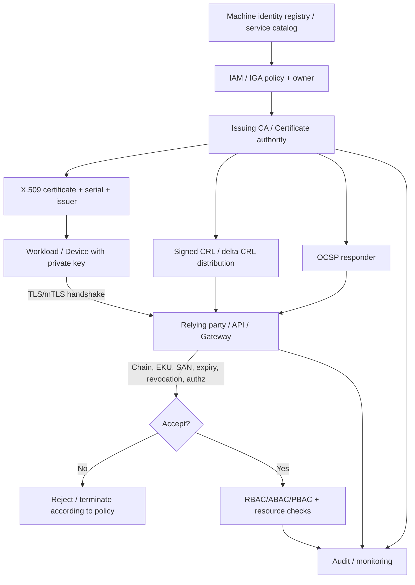
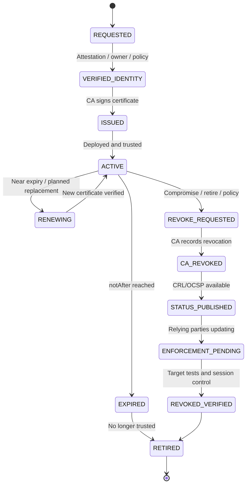
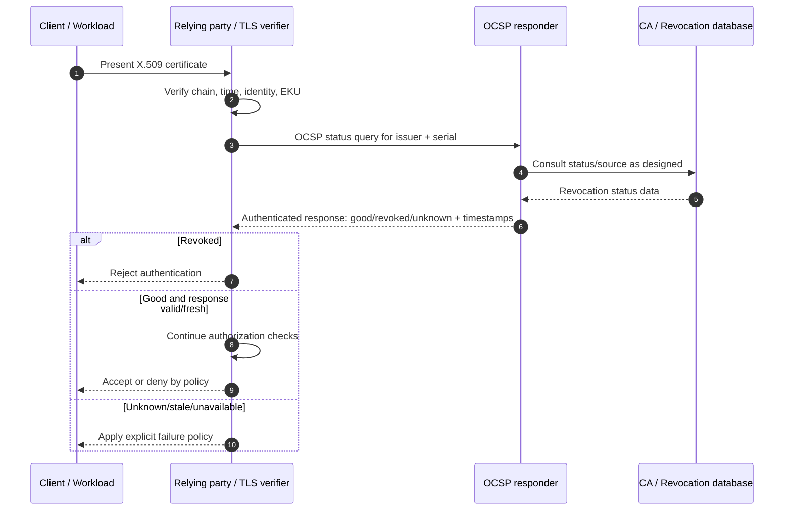

# Certificate revocation trong quản lý vòng đời machine identity và IAM

## 1. Certificate revocation là gì?

**Certificate revocation (thu hồi chứng thư số)** là hành động tuyên bố một chứng thư số **không còn được tin cậy trước thời điểm hết hạn ghi trên chứng thư**, thường do khóa riêng bị lộ, danh tính hoặc quan hệ không còn hợp lệ, workload bị ngừng vận hành hay một sự cố hạ tầng khóa công khai (PKI).

Trong quản lý **Machine Identity**, chứng thư X.509 thường được dùng để xác thực **máy chủ, ứng dụng, service, workload, thiết bị, kết nối mTLS** và đôi khi làm cơ sở cho nhận dạng máy khi gọi API. Thu hồi giúp bên kiểm tra chứng thư (*relying party*) biết rằng một chứng thư vốn còn trong khoảng `notBefore–notAfter` **không nên tiếp tục được chấp nhận**.

Ví dụ: service `payment-worker` dùng một chứng thư client mTLS còn hạn hai tháng để gọi API thanh toán. Khi private key bị lộ trong log, đội bảo mật yêu cầu CA thu hồi chứng thư. Nhưng công việc chưa hoàn thành nếu API đích **không kiểm tra CRL/OCSP**, đang cache trạng thái cũ hoặc giữ kết nối TLS đã xác thực trước lúc thu hồi.

**Điểm cốt lõi:**

- **Certificate issued:** CA đã ký chứng thư.
- **Certificate valid by time:** chứng thư đang ở trong khoảng thời gian hiệu lực.
- **Certificate revoked:** CA hoặc cơ chế tin cậy liên quan đã ghi nhận quyết định thu hồi.
- **Revocation published:** thông tin đã có thể được relying party truy xuất.
- **Revocation enforced:** hệ thống đích thực sự từ chối chứng thư đã bị thu hồi.
- **Access terminated:** các phiên, token và quyền có liên quan đã được xử lý theo phạm vi.

Không được đồng nhất các trạng thái trên thành một nút `REVOKED` duy nhất.

### 1.1. Vì sao chủ đề gắn với IAM lifecycle?

Với mô hình **Joiner–Mover–Leaver (JML)**, một chứng thư có thể thuộc workload do nhân viên quản trị, thiết bị do người dùng sở hữu hoặc service account do nhóm kỹ thuật vận hành. Khi chủ thể, owner, nhiệm vụ hoặc mức tin cậy thay đổi, quyền sử dụng chứng thư và **quyền truy cập hiệu lực ở đích** phải được đánh giá lại.

Đây là phần kết nối **PKI, machine identity, IdP, IAM/IGA, PAM, RBAC/ABAC, tài khoản dịch vụ, kiểm toán và giảm quyền truy cập tồn dư**.

## 2. Chứng thư số, khóa riêng và danh tính máy

Một chứng thư X.509 thường chứa:

| Thành phần | Vai trò | Ý nghĩa với revocation |
|---|---|---|
| **Subject/SAN** | Thông tin định danh được CA xác nhận theo policy | Chứng thư có thể không còn đại diện cho workload hợp lệ |
| **Public key** | Khóa công khai gắn với chứng thư | Nếu private key tương ứng bị lộ, phải xử lý |
| **Issuer** | CA đã ký chứng thư | Xác định authority và phạm vi serial |
| **Serial number** | Số sê-ri duy nhất trong phạm vi issuer | Khóa định vị chứng thư khi thu hồi |
| **notBefore/notAfter** | Khoảng thời gian hiệu lực | Thu hồi xảy ra trước hết hạn |
| **Key Usage/EKU** | Mục đích sử dụng khóa/chứng thư | Relying party phải kiểm tra đúng mục đích |
| **Authority Key Identifier** | Hỗ trợ xác định khóa của issuer | Tránh nhầm issuer khi chain phức tạp |
| **CRL Distribution Points** | Vị trí phân phối CRL nếu có | Nguồn tìm danh sách thu hồi |
| **Authority Information Access (AIA)** | Có thể mô tả OCSP/CA issuer access | Hỗ trợ truy vấn trạng thái |
| **Signature** | Chữ ký issuer bảo vệ dữ liệu chứng thư | Không tự chứng minh chứng thư chưa bị thu hồi |

**Private key không nằm bên trong chứng thư công khai.** Nó được tạo và bảo vệ ở nơi quản lý khóa: ứng dụng, secret manager, KMS/HSM, TPM hoặc cơ chế khác.

### 2.1. Danh tính máy không phải một file PEM

Một machine identity có thể là:

- Workload `svc-payment-worker`.
- Certificate subject/SAN có chứa định danh service.
- SPIFFE ID gắn với workload.
- Thiết bị có hardware-bound identity.
- Service account trong cloud hoặc cluster.
- Thông tin đăng ký ở service catalog/CMDB.

Một danh tính có thể trải qua **nhiều phiên bản chứng thư**. Đổi certificate không đồng nghĩa phải đổi identity ID hoặc quyền nghiệp vụ; ngược lại, **thu hồi một certificate** không tự xóa tất cả credential khác của cùng identity.

## 3. Thu hồi khác hết hạn, thay khóa và xóa chứng thư

| Khái niệm | Hành động | Relying party biết bằng cách nào? |
|---|---|---|
| **Expiration** | Chứng thư qua `notAfter` | Kiểm tra thời gian hiệu lực |
| **Revocation** | Hủy tin cậy trước `notAfter` | CRL/OCSP hoặc cơ chế tương đương được cấu hình |
| **Certificate renewal** | Cấp chứng thư mới, có thể dùng cùng hay khóa mới tùy policy | Bên đích kiểm tra cert mới; cert cũ vẫn có trạng thái riêng |
| **Key rotation/rekey** | Thay private/public key | Cấp chứng thư mới gắn khóa mới |
| **Service disable** | Ngừng workload/identity ở control plane | Policy/issuer/target phải thực thi |
| **Trust-store change** | Thay các CA/trust anchor được tin | Relying party cập nhật trust config |
| **File deletion** | Xóa file cert/private key trên một máy | Không chứng minh bản sao khác đã mất |
| **Session termination** | Đóng kết nối đã xác thực | Endpoint, gateway, broker cần thực hiện |
| **Permission revoke** | Gỡ RBAC/ABAC/entitlement | Backend kiểm tra quyền; cert có thể vẫn hợp lệ cho mục đích khác |

**Cấp cert mới không tự thu hồi cert cũ.** Nếu cert cũ bị lộ, phải phát hành và **thực thi thu hồi** theo cơ chế được hỗ trợ. Nếu cần làm mất hiệu lực khẩn cấp ngay mà relying party không kiểm tra revocation, phải có **lớp chặn bổ sung** tại gateway/API/mesh hoặc chính sách trust phù hợp.

## 4. Những trường hợp phải cân nhắc revocation

Các lý do thường gặp:

1. **Private key compromise:** khóa riêng bị lộ/đánh cắp.
2. **Machine or workload compromise:** host, container, runner hoặc thiết bị bị chiếm quyền.
3. **Service decommission:** workload ngừng hoạt động vĩnh viễn.
4. **Ownership/affiliation change:** chủ thể hoặc tổ chức được chứng nhận thay đổi, không còn căn cứ.
5. **Incorrect issuance:** cấp sai subject, SAN, EKU hoặc đối tượng.
6. **Certificate superseded:** chứng thư cũ được thay bằng chứng thư khác theo policy.
7. **CA compromise:** khóa CA hoặc quy trình phát hành của CA có vấn đề.
8. **Violation of trust policy:** chứng thư được cấp hoặc sử dụng trái quy định.
9. **Emergency containment:** cần ngăn một đường xác thực máy đang bị khai thác.
10. **Device retirement/loss:** thiết bị có chứng thư bị thất lạc hoặc loại bỏ.

### 4.1. Không dùng revocation làm công cụ duy nhất

Khi workload bị xâm nhập, việc revoke certificate chỉ xử lý **một credential**. Attacker có thể còn **API key, OAuth token, PAT, SSH key, session, role hoặc credential ở vault**. Incident response phải kiểm kê mọi đường truy cập liên quan.

### 4.2. Phân loại nguyên nhân giúp lựa chọn biện pháp

- Khóa riêng **có thể đã lộ**: coi key cũ là không đáng tin, phát key mới và không tái sử dụng.
- Service **chuyển owner** nhưng workload vẫn hợp lệ: có thể cần **bàn giao owner và review quyền**, không nhất thiết revoke tất cả cert đang chạy.
- Service **decommission**: revoke cert và gỡ role/trust/credential khác, xác minh quyền ở target.
- **CA bị chiếm**: thu hồi riêng leaf cert có thể chưa đủ; cần chiến lược thay trust anchor/issuing CA.

## 5. Kiến trúc PKI và luồng tin cậy



### 5.1. Ai quyết định thu hồi, ai thực thi?

- **CA/PKI operator:** ghi nhận trạng thái certificate, ký/phân phối CRL hoặc trả OCSP theo policy.
- **Certificate owner/service owner:** phát hiện lý do và yêu cầu thu hồi hợp lệ.
- **IAM/IGA:** kiểm tra quan hệ, quyền và nhiệm vụ JML.
- **Relying party:** **thực hiện** kiểm tra certificate status và từ chối khi phù hợp.
- **Gateway/mesh/API:** có thể bổ sung denylist, chặn principal hoặc kết thúc phiên.
- **Reconciliation/Audit:** chứng minh trạng thái ở CA **và** đích đã hội tụ.

**CA ký CRL không tự “đẩy lệnh ngắt” tới mọi client/server trên mạng.** Relying party cần cơ chế cập nhật và kiểm tra.

## 6. Mô hình trạng thái vòng đời certificate



**Đây là mô hình quản trị**, không phải trạng thái chuẩn của mọi CA. Một số PKI có thể công bố trạng thái ngay; có nơi dùng chứng thư ngắn hạn không phát CRL cho từng leaf.

### 6.1. Không được nhảy trạng thái thiếu bằng chứng

- `REVOKE_REQUESTED`: chỉ có ticket/API call.
- `CA_REVOKED`: CA xác nhận cert bị thu hồi theo record.
- `STATUS_PUBLISHED`: revocation data được phát hành và kiểm tra integrity/freshness.
- `ENFORCEMENT_PENDING`: một số relying party chưa cập nhật.
- `REVOKED_VERIFIED`: target đã từ chối cert cũ theo phạm vi kiểm thử, các phiên cần xử lý được xét riêng.

Một sự cố có thể vẫn **UNVERIFIED** nếu thiết bị ngoại tuyến hoặc một API legacy không hỗ trợ kiểm tra revocation.

## 7. Certificate Revocation List (CRL) là gì?

**Certificate Revocation List (CRL)** là danh sách do CA phát hành và ký, chứa các serial của chứng thư đã bị thu hồi trong phạm vi issuer cùng thông tin thời điểm/lý do theo định dạng được hỗ trợ.

Một relying party khi xác minh chứng thư có thể:

1. Xây dựng và kiểm tra chain tới trust anchor.
2. Xác định CA/issuer của cert.
3. Tìm nguồn CRL được cấu hình/được công bố.
4. **Xác minh chữ ký CRL**, issuer, scope và tính mới của CRL.
5. Kiểm tra serial của cert cần xác minh.
6. Kết hợp trạng thái thu hồi với các kiểm tra SAN/EKU/time/policy.
7. Trả kết quả cho thành phần thực thi.

### 7.1. Thành phần CRL quan trọng

| Trường/khái niệm | Ý nghĩa |
|---|---|
| **CRL issuer** | Chủ thể phát hành danh sách |
| **thisUpdate** | Thời điểm thông tin CRL có hiệu lực/được tạo |
| **nextUpdate** | Thời điểm dự kiến cần cập nhật theo CRL |
| **Revoked certificate serials** | Các chứng thư bị liệt kê |
| **revocationDate** | Thời điểm revocation được ghi nhận |
| **reasonCode** | Lý do thu hồi nếu có |
| **CRL signature** | Bảo vệ integrity của danh sách |
| **CRL Number** | Hỗ trợ phiên bản hóa danh sách |
| **Issuing Distribution Point** | Có thể giới hạn phạm vi CRL |
| **Delta CRL indicator** | Dấu hiệu CRL delta nếu dùng |

### 7.2. Những hạn chế

- CRL có thể lớn nếu CA phát nhiều cert.
- CRL cần được **tải và cập nhật** theo chính sách.
- Một node dùng CRL cũ có thể tiếp tục chấp nhận cert vừa bị revoke.
- Nếu không xác minh signature/scope, CRL bị giả hoặc sai CA có thể gây quyết định sai.
- CRL không đóng các kết nối đã xác thực trước đó.

**CRL không phải danh sách serial toàn cục**: serial phải được xét với issuer/authority tương ứng.

## 8. Base CRL, delta CRL và phân phối

Một số PKI dùng:

- **Base CRL:** danh sách nền có hiệu lực theo policy phát hành.
- **Delta CRL:** các thay đổi kể từ base CRL được tham chiếu để giảm lượng dữ liệu truyền.
- **CRL Distribution Point (CDP):** điểm phân phối CRL có thể được chỉ ra trong certificate hoặc được cấu hình.
- **CRL cache:** bản đã được kiểm tra integrity/freshness phục vụ các quyết định sau.

### 8.1. Delta CRL không tự đủ

Khi sử dụng delta CRL, relying party phải kết hợp **base + delta đúng phạm vi và version**, không chỉ nhìn delta rồi kết luận một serial vắng mặt nghĩa là tốt.

### 8.2. Tính sẵn sàng của điểm phân phối

- Endpoint CRL phải khả dụng từ những môi trường cần kiểm tra, kể cả mạng cô lập nếu có yêu cầu.
- Cần giám sát thời gian phát hành và phân phối.
- Có kế hoạch cache/offline phù hợp độ mới được duyệt.
- Không chấp nhận CRL quá cũ chỉ vì download endpoint lỗi nếu policy yêu cầu trạng thái mới.
- Không bỏ kiểm tra CRL khi endpoint bị chặn bởi firewall; phải thiết kế đường tin cậy đúng.

### 8.3. CRL trong mạng nội bộ

Đối với mTLS private PKI, CRL có thể được phân phối trong mạng nội bộ. Chỉ có CDP URL trong cert **không bảo đảm** mọi service có thể truy cập hoặc đã bật revocation checking.

## 9. OCSP là gì?

**Online Certificate Status Protocol (OCSP)** cho phép client hỏi **trạng thái thu hồi của một certificate cụ thể** từ OCSP responder đã được tin cậy theo quy tắc xác thực phản hồi.

Kết quả mức chứng thư thường gồm:

- `good`: responder không biết cert đó đang bị thu hồi theo ngữ nghĩa dịch vụ; **không tự chứng minh cert được cấp hợp lệ** trong mọi trường hợp.
- `revoked`: cert bị ghi là revoked theo phản hồi.
- `unknown`: responder không biết trạng thái cert này.

### 9.1. Luồng OCSP khái niệm



### 9.2. Trường cần xác minh

- Responder/signature authorization và chain.
- Certificate identifier tương ứng issuer/serial.
- `producedAt`, `thisUpdate`, `nextUpdate` khi có.
- Phạm vi response, nonce khi được dùng và hỗ trợ.
- Trạng thái `good/revoked/unknown`.
- Các lỗi transport/timeout và cơ chế fallback.
- Cache TTL theo policy và tính mới của dữ liệu.

Không mặc định OCSP responder luôn có trạng thái real-time tức thì; cần hiểu **độ trễ cập nhật từ CA và chính sách cache**.

## 10. OCSP stapling và giới hạn trong machine identity

**OCSP stapling** là cơ chế server gửi kèm phản hồi OCSP trong quá trình TLS handshake, nhằm giảm nhu cầu từng client trực tiếp truy vấn responder trong những triển khai hỗ trợ.

### 10.1. Lợi ích

- Giảm lưu lượng truy vấn OCSP từ client tới responder.
- Có thể cải thiện privacy khi client không phải công bố website đang truy cập cho responder.
- Giảm latency và phụ thuộc mạng của client.
- Cho phép server chủ động cập nhật trạng thái cần “staple”.

### 10.2. Giới hạn cần phân biệt

- Không phải mọi TLS stack, client, server, **mTLS client-certificate verifier** hoặc service mesh đều hỗ trợ stapling giống nhau.
- Một phản hồi được staple vẫn cần được xác minh integrity, trạng thái và tính mới.
- Không được dùng một OCSP response cũ vô hạn.
- **TLS Feature / OCSP Must-Staple** chỉ có nghĩa trong ngữ cảnh và phần mềm thực thi tương thích; không thể suy mọi mTLS deployment đều bắt buộc.
- Stapling không tự thu hồi/đóng các session đã xác thực.

**Không coi OCSP stapling là phương án mặc định áp dụng cho tất cả machine identity**, đặc biệt khi cert được dùng để xác thực client mTLS chứ không chỉ TLS server.

## 11. CRL và OCSP: chọn và phối hợp thế nào?

| Tiêu chí | CRL | OCSP |
|---|---|---|
| Mô hình | Danh sách nhiều serial bị thu hồi | Hỏi trạng thái một cert |
| Dữ liệu truyền | Có thể lớn, cache lâu theo policy | Phản hồi nhỏ hơn cho từng cert |
| Phụ thuộc mạng | Tải bản danh sách định kỳ | Có thể cần query online/stapled response |
| Độ mới | Phụ thuộc lịch phát CRL và cache | Phụ thuộc responder, cache, cập nhật nguồn |
| Khả năng offline | Có thể dùng CRL đã ký còn mới | Khó nếu không có response cache hoặc stapling |
| Privacy | Không tiết lộ cert cụ thể mỗi lần kiểm tra nếu tải theo CRL | Query trực tiếp có thể tiết lộ cert đang kiểm tra |
| Scale | CRL lớn với CA phát nhiều cert | OCSP responder cần năng lực chịu tải |
| Failure mode | CRL hết mới/không tải được | OCSP timeout, unknown hoặc response stale |

Không có lựa chọn phù hợp tuyệt đối. Một hệ thống có thể dùng **CRL, OCSP, kết hợp, chứng thư ngắn hạn, trust-store updates hoặc deny control bổ sung** theo mô hình rủi ro và khả năng kỹ thuật.

### 11.1. “Không thấy trong CRL” chưa đủ nếu CRL lỗi thời

Cần xác minh CRL đúng issuer, đúng phạm vi, signature hợp lệ và còn mới trước khi kết luận không bị thu hồi.

### 11.2. “OCSP good” không thay chain validation

Ngay cả khi OCSP trả `good`, relying party vẫn phải kiểm tra **certificate chain, mục đích sử dụng, identity binding và authorization**. OCSP không xác nhận service được phép gọi `payment:approve`.

## 12. Fail-open, fail-closed và soft-fail

Khi không thể truy xuất trạng thái thu hồi, hệ thống phải biết **nên từ chối hay có cơ chế tiếp tục an toàn**.

| Chính sách | Hành vi khi check không khả dụng | Rủi ro |
|---|---|---|
| **Hard-fail / fail-closed** | Không chấp nhận cert khi thiếu bằng chứng bắt buộc | Giảm lạm dụng cert revoked, nhưng có thể gây outage |
| **Soft-fail** | Có thể tiếp tục với một số lỗi truy xuất theo policy | Cert vừa revoke có thể vẫn được tin |
| **Grace period có kiểm soát** | Dùng dữ liệu đã ký còn trong cửa sổ chấp thuận | Tăng revocation latency |
| **Alternate check** | Dùng CRL/OCSP hoặc policy nguồn khác đã được duyệt | Cần đảm bảo tính tương đương và freshness |
| **Local emergency deny** | Chặn ngay serial/identity ở gateway khi nguồn PKI chưa hội tụ | Cần đảm bảo phân phối và quyền cập nhật |

### 12.1. Không dùng soft-fail để vô hiệu hóa bảo mật

Với quyền cao như **production admin, payment service hoặc IAM policy deployment**, chế độ fail-open khi revocation check lỗi có thể tạo lỗ hổng nghiêm trọng. Cần phê duyệt risk policy phù hợp độ nhạy.

### 12.2. Hard-fail có thể làm mất sẵn sàng

Nếu OCSP endpoint sập, hàng nghìn service có thể không lập được phiên mới nếu đều hard-fail. Giải pháp là **high availability, cache có kiểm soát, responder dự phòng, readiness, monitoring và runbook**; không phải tắt check vô thời hạn.

### 12.3. Không đồng nhất HTTP timeout với trạng thái “good”

Phân biệt:

- `GOOD`: phản hồi hợp lệ và còn mới cho cert.
- `REVOKED`: có bằng chứng cert bị thu hồi.
- `UNKNOWN`: không thể xác định trạng thái.
- `UNREACHABLE`: không kết nối được.
- `INVALID_RESPONSE`: chữ ký/issuer/time không hợp lệ.

Các trạng thái lỗi **không tự được chuyển thành `GOOD`**.

## 13. Revocation checking trong TLS/mTLS

Khi dùng chứng thư cho TLS hoặc **mutual TLS (mTLS)**, bên xác thực chứng thư cần kết hợp nhiều kiểm tra.

### 13.1. Thứ tự logic

```text
1. Nhận certificate chain từ peer.
2. Xây dựng đường tin cậy tới trust anchor được phép.
3. Kiểm tra chữ ký, hiệu lực thời gian và Basic Constraints.
4. Kiểm tra Key Usage/EKU cho server/client auth.
5. Kiểm tra hostname/SAN hoặc workload identity binding.
6. Kiểm tra trạng thái thu hồi theo policy.
7. Từ chối nếu revoked hoặc verification requirement thất bại.
8. Nếu hợp lệ, ánh xạ principal và kiểm tra RBAC/ABAC/PBAC.
9. Ghi audit tối thiểu, không log private key/token.
```

### 13.2. mTLS authentication không tự cấp quyền API

Một service có cert hợp lệ cho `svc-report-reader` không được gọi `report:delete` chỉ vì mTLS handshake thành công. **Resource API/PEP** phải kiểm tra action, tenant, resource và role phù hợp.

### 13.3. Không phải TLS stack nào cũng bật revocation mặc định

Cần xác minh **cấu hình thực tế của runtime, gateway, service mesh và client/server TLS libraries**. Một checkbox “verify certificate” đôi khi chỉ kiểm tra chain/time mà không tự fetch CRL/OCSP.

## 14. Java: những điểm cần kiểm tra khi dùng JSSE/PKIX

Trong ứng dụng Java, việc kiểm tra thu hồi có thể liên quan **JSSE, PKIX CertPathValidator, PKIXParameters và PKIXRevocationChecker**, nhưng hành vi cụ thể còn phụ thuộc **JDK, provider, trust manager và cấu hình runtime**.

### 14.1. Mã giả thiết kế verifier

```java
// MÃ GIẢ: minh họa luồng, không phải API Java có thể biên dịch nguyên xi.
CertificateDecision verifyPeerCertificate(
        X509Certificate[] peerChain,
        TrustPolicy policy,
        PeerIdentity expectedIdentity) {

    PkixResult chain = pkixValidator.validate(
        peerChain,
        policy.allowedTrustAnchors(),
        policy.requiredKeyUsage()
    );

    if (!chain.valid()) {
        return CertificateDecision.DENY;
    }

    if (!identityMatcher.matches(peerChain[0], expectedIdentity)) {
        return CertificateDecision.DENY;
    }

    RevocationResult status = revocationChecker.check(
        peerChain,
        policy.crlOrOcspSources(),
        policy.freshnessRequirements()
    );

    if (status == RevocationResult.REVOKED) {
        return CertificateDecision.DENY;
    }
    if (status != RevocationResult.GOOD && policy.mustHaveFreshStatus()) {
        return CertificateDecision.DENY;
    }

    return policy.authorizationEngine().evaluate(expectedIdentity);
}
```

Mục đích là **phân tách xác thực chứng thư, kiểm tra revocation và authorization**. Trong code thật phải tích hợp đúng thư viện/cấu hình được kiểm thử, không tự xây trình xác minh PKIX từ đầu nếu đã có stack đáng tin.

### 14.2. Những câu hỏi cho đội Java

1. JVM/JDK version, security provider và truststore nào được dùng?
2. Client hay server đang kiểm tra **certificate của phía nào**?
3. Có thực sự bật cơ chế revocation không, dùng CRL/OCSP nào?
4. Có kiểm tra revocation cho **intermediate CA** theo policy không?
5. Cache OCSP/CRL nằm ở đâu và có TTL thế nào?
6. `SOFT_FAIL` hoặc tương đương có được bật không? Trong trường hợp nào?
7. Hostname/SAN/EKU được kiểm tra đủ chưa?
8. Connection pool có giữ kết nối sau khi cert bị thu hồi không?
9. Có negative test với cert revoked thật trong môi trường test không?
10. Có audit policy version, issuer/serial và lý do từ chối không?

### 14.3. Tránh tắt xác minh trong Java

Các phương án như **TrustManager chấp nhận mọi chứng thư** hoặc bỏ kiểm tra hostname để “sửa lỗi OCSP” là nguy hiểm. Cần sửa trust chain, endpoint availability và policy thay vì biến TLS thành lớp bảo vệ giả.

## 15. Certificate revocation trong Kubernetes và service mesh

Máy–máy trong Kubernetes hoặc service mesh có thể sử dụng **mTLS tự động**, chứng thư thời hạn ngắn và CA nội bộ.

### 15.1. Các thành phần cần quản trị

| Thành phần | Rủi ro cần quan tâm |
|---|---|
| Workload identity | Mã service/namespace/cluster bị ánh xạ sai |
| Issuing CA | Cấp cert sai hoặc private key bị lộ |
| Workload certificate | Bị copy hoặc tiếp tục dùng sau decommission |
| Mesh sidecar/proxy | Có thực thi trust, revocation và authz theo policy không |
| Certificate rotation agent | Có phát cert mới và thu hồi cert cũ đúng không |
| Service discovery | Endpoint cũ có tiếp tục nhận traffic không |
| Network policy | Có đường bypass mesh hoặc gateway không |
| Long-lived connections | Có giữ phiên cũ sau khi trust đổi không |

### 15.2. Không mặc định mesh hỗ trợ CRL/OCSP đầy đủ

Nhiều cơ chế mTLS nội bộ dựa mạnh vào **short-lived certificates và rotation** thay vì mỗi request tra CRL/OCSP. Do đó, cần biết thiết kế thật:

- Cert TTL là bao lâu?
- CA có phát revocation status cho leaf cert không?
- Proxy có kiểm tra không?
- Có cơ chế **đẩy deny policy/trust bundle** khi một workload bị compromised không?
- Có đóng phiên hiện hữu được không?

Nếu không có kiểm tra revocation, **thời gian cert còn hiệu lực** là một phần rủi ro phải chấp nhận và bù trừ.

## 16. SPIFFE/SPIRE và chứng thư SVID

Trong mô hình **SPIFFE**, một workload có thể có danh tính như:

```text
spiffe://example.org/ns/payments/sa/payment-worker
```

**X.509-SVID** gắn danh tính workload với chứng thư thời hạn ngắn theo quy định phát hành; **SPIRE** là một ví dụ hệ thống có thể cấp phát và luân chuyển.

### 16.1. Đặc điểm cần hiểu

- SPIFFE ID là **định danh**, không phải permission.
- Attestation và trust domain cần kiểm soát.
- SVID có thời hạn và được rotate khi workload hoạt động.
- Nhiều triển khai không dựa vào **CRL/OCSP per-SVID** để vô hiệu từng chứng thư.
- Dừng issuance hoặc xóa registration không tự làm **SVID hiện có** hết hiệu lực trước `notAfter`.
- Relying party cần kiểm tra trust bundle và authorization đúng phạm vi.

### 16.2. Khi cần chặn ngay một SVID

Các biện pháp phụ thuộc nền tảng có thể bao gồm:

- Chặn service identity ở policy của mesh/API.
- Thu hồi trust ở cấp issuer/trust domain nếu cần và được đánh giá tác động.
- Dừng/quarantine workload hoặc node bị compromise.
- Rotate keys/certs và ngắt connections hiện hữu.
- Giảm TTL cho những workload có rủi ro.
- Bảo đảm relying parties đã cập nhật chính sách.

**Không hứa “revoke SPIFFE certificate ngay lập tức” nếu kiến trúc không có cơ chế kiểm tra trạng thái thu hồi tương ứng**.

## 17. Cloud PKI, private CA và thiết bị ngoài mạng

Một tổ chức có thể phát chứng thư từ:

- Public CA cho TLS server.
- Enterprise/private CA cho mTLS nội bộ.
- Cloud private CA/managed certificate service.
- PKI dành cho endpoint/device.
- CA/issuer của service mesh hoặc platform.
- CA đặc thù IoT/OT.

### 17.1. Khác biệt quan trọng

Một public TLS certificate và một cert client nội bộ có thể có **quy tắc phát hành, thời hạn, endpoint CRL/OCSP và client behavior** khác nhau. Không suy ra chính sách của public CA áp dụng y nguyên cho private PKI.

### 17.2. Thiết bị thường xuyên offline

Thiết bị IoT/OT có thể không truy cập OCSP responder khi cần. Phải thiết kế **phân phối trạng thái thu hồi, cache có thời hạn, gateway kiểm tra hoặc quarantine** theo yêu cầu an toàn và availability. Với hệ thống điều khiển quan trọng, fail mode phải được đánh giá trước, không tự chấp nhận mọi chứng thư khi mất mạng.

### 17.3. Certificate pinning không thay revocation

Pinning có thể ràng buộc khóa/cert nhưng nếu **private key của certificate bị pin đã lộ**, hệ thống vẫn cần thay pin/trust và ngăn chứng thư cũ được chấp nhận. Pinning sai có thể gây outage khi rotation.

## 18. CA compromise và thay đổi trust anchor

**CA private key compromise** là sự cố khác căn bản với leaf certificate compromise.

### 18.1. Vì sao revoke một leaf cert có thể chưa đủ?

Nếu attacker kiểm soát issuing CA, họ có thể cấp các chứng thư khác từ CA ấy. Dù một serial cụ thể đã revoke, relying party vẫn có thể tin **chứng thư giả khác** do CA bị chiếm phát hành.

### 18.2. Hành động có thể cần

1. Xác định CA/trust domain và tập cert bị ảnh hưởng.
2. Ngừng issuing và bảo vệ hạ tầng CA.
3. Quản lý trạng thái CA theo cơ chế PKI phù hợp.
4. Phát hành/rekey bằng CA tin cậy mới.
5. Phân phối trust-store/trust-bundle mới.
6. Loại bỏ trust vào CA bị chiếm ở relying parties.
7. Reissue cert workload và chuyển đổi traffic có kiểm soát.
8. Kiểm tra paths còn tin CA cũ, nested/intermediate trust và cached sessions.
9. Audit, incident response và recovery governance.

### 18.3. Root CA không bị “thu hồi” giống leaf ở mọi hệ thống

Trust anchor là cấu hình tin cậy cục bộ; nhiều verifier **không kiểm tra thu hồi root theo cùng cách kiểm tra leaf**. Khi root không còn đáng tin, phải **cập nhật trust store/anchor**, không chỉ phát CRL kỳ vọng mọi client tự bỏ tin root.

### 18.4. Blast radius cần đánh giá

Thay CA có thể ảnh hưởng hàng nghìn service. Cần phân kỳ, hỗ trợ hai trust chain khi an toàn và phù hợp, kiểm thử compatibility, nhưng không duy trì trust vào CA bị chiếm lâu hơn khả năng chấp nhận rủi ro.

## 19. Revocation latency: từ quyết định tới thực thi

**Revocation latency** là khoảng thời gian từ khi nguồn có thẩm quyền xác định cert phải mất hiệu lực đến lúc các điểm thực thi liên quan thực sự từ chối nó.

Các mốc cần phân biệt:

| Mốc | Ví dụ | Chưa bảo đảm |
|---|---|---|
| `t0_detected` | Phát hiện key lộ | CA đã biết |
| `t1_requested` | Yêu cầu revoke được ghi | CA đã xử lý |
| `t2_ca_revoked` | CA đã đánh dấu revoked | Dữ liệu đã phân phối |
| `t3_published` | CRL/OCSP mới công bố | Các node đã cập nhật |
| `t4_relying_party_updated` | Gateway/mesh lấy trạng thái mới | Kết nối cũ đã đóng |
| `t5_enforcement_verified` | Negative test và readback đạt | Những đích chưa quan sát cũng an toàn |
| `t6_sessions_terminated` | Các phiên cần chặn đã đóng | Credential ngoài chứng thư cũng đã thu hồi |

### 19.1. Công thức ý niệm

```text
end_to_end_revocation_latency =
    detection_to_request
  + CA_processing_delay
  + status_publication_delay
  + relying_party_cache_and_refresh_delay
  + enforcement_and_session_termination_delay
```

Đây là mô hình để **phân tích nguyên nhân**, không phải công thức tổng chính xác khi nhiều công việc diễn ra song song.

### 19.2. Không lấy “CA revoke API 200” làm SLA cuối

Đối với service thanh toán, một phút để CA trả `SUCCESS` có thể ít ý nghĩa nếu proxy cache CRL 24 giờ và giữ session cũ. SLA phải dựa trên **quyền truy cập thực tế**, không chỉ tốc độ API CA.

## 20. Cache, nextUpdate và tính mới của dữ liệu thu hồi

CRL/OCSP được cache nhằm cải thiện hiệu năng và giảm phụ thuộc availability. Nhưng cache tạo **cửa sổ còn tin cert đã bị thu hồi**.

### 20.1. Các lớp cache có thể tồn tại

- CRL cache ở JVM/proxy/gateway.
- OCSP response cache ở client, reverse proxy hoặc stapling server.
- Trust bundle cache trong mesh.
- Authorization decision cache theo service identity.
- Connection pooling/resumed TLS sessions.
- Token issuer/resource server cache.

### 20.2. Yêu cầu thiết kế

- Xác định freshness phù hợp rủi ro.
- Không dùng response hết hạn lâu hơn policy cho phép.
- Giám sát chậm cập nhật cache ở từng node.
- Có cơ chế invalidation hoặc restart/rotation nếu cần.
- Với sự cố nặng, áp **deny control** bổ sung trong khi cache hội tụ.
- Ghi `status_source_version`, `thisUpdate/nextUpdate` và policy khi cần điều tra.

**CRL/OCSP có thời điểm hiệu lực không đồng nghĩa lúc đó mọi relying party đã cập nhật**.

## 21. Long-lived TLS connections, session resumption và TOCTOU

Certificate thường được kiểm tra khi **thiết lập handshake**. Một kết nối mTLS đã được xác thực có thể tiếp tục truyền request sau khi certificate bị revoke nếu endpoint không đánh giá lại danh tính/authorization hoặc không đóng kết nối.

### 21.1. Vấn đề time-of-check vs time-of-use

```text
09:00 - Workload opens mTLS connection using cert A
09:05 - Private key A is exposed
09:06 - CA revokes cert A
09:07 - Gateway updated CRL and rejects NEW handshakes
09:08 - Old pooled connection may still be active
```

Đây là ví dụ cho thấy **chặn handshake mới chưa đủ** với kết nối cũ.

### 21.2. Các biện pháp bổ sung

- Giảm tuổi tối đa của connection/session ở tác vụ nhạy cảm.
- Chủ động drain/terminate connections khi key compromise.
- Tại API, thực thi **authorization hiện hành theo từng request** ở mức phù hợp.
- Giới hạn session resumption/ticket lifetime theo rủi ro.
- Cập nhật policy deny cho compromised identity/serial nếu kiến trúc hỗ trợ.
- Kiểm tra cả đường truy cập không đi qua gateway/mesh.

### 21.3. Không tuyên bố đã chặn hết chỉ bằng negative handshake test

Một test mở **kết nối mới** bằng cert revoked bị từ chối là bằng chứng quan trọng, nhưng **không chứng minh tất cả kết nối đang sống đã mất hiệu lực**. Phải kiểm tra phạm vi phiên riêng.

## 22. Certificate revocation và RBAC/ABAC/PBAC

Certificate trả lời chủ yếu câu hỏi **authentication của máy**. Quyền nghiệp vụ do **authorization policy** quyết định.

| Lớp | Ví dụ | Vai trò |
|---|---|---|
| **mTLS/PKI** | `svc-orders` được xác thực theo cert | Xác minh workload/peer |
| **CRL/OCSP** | Cert A không bị revoke theo trạng thái có thể kiểm tra | Đánh giá tính tin cậy credential |
| **RBAC** | Service có role `order_reader` | Xác định nhóm action |
| **ABAC** | Chỉ tenant A và order thuộc project P1 | Giới hạn theo thuộc tính |
| **PBAC** | Policy `order:read` + risk conditions | Quyết định có quản trị |
| **PEP** | API/gateway thực thi DENY/PERMIT | Chặn hành động tại đích |
| **Reconciliation** | So sánh desired vs observed | Phát hiện quyền tồn dư |

### 22.1. Cert revoked nhưng role vẫn tồn tại

Nếu CA revoke cert A nhưng `svc-orders` có một token OAuth khác chưa thu hồi, workload hoặc attacker vẫn có thể gọi API qua đường token đó. Cần kiểm kê và xử lý **tất cả credential/role liên quan**.

### 22.2. Role revoked nhưng cert vẫn hợp lệ

Trong một số hệ thống, giữ cert để workload xác thực một mục đích khác có thể hợp lệ nếu role nhạy cảm đã gỡ. Không nhất thiết revoke mọi cert khi chỉ cần hạn chế một permission, nhưng cần chắc chắn API **thực thi authorization đúng**.

## 23. Joiner: cấp machine certificate đúng lúc và đúng danh tính

Dù “Joiner” thường nói về nhân viên, lifecycle IAM cũng liên quan thời điểm **thiết lập owner và cấp quyền quản trị machine identity**.

### 23.1. Quy trình service onboarding

1. Service owner đăng ký workload với ID, purpose, tenant và environment.
2. Security/Platform duyệt source of trust, CA/profile và access policy.
3. Kiểm tra machine/workload attestation.
4. Tạo khóa ở nơi được bảo vệ theo thiết kế.
5. CA cấp chứng thư có SAN/EKU phù hợp.
6. Workload nhận cert qua kênh bảo vệ và không lộ private key.
7. Relying parties tin CA phù hợp và thực thi authz tối thiểu.
8. Audit issuer, serial, expiry, owner và target.
9. Kiểm tra trường hợp cert sai SAN/expired/revoked bị từ chối.

### 23.2. Người mới không tự được quyền xem private key

Một nhân viên Joiner được cấp role vận hành service không mặc nhiên có quyền **export private key** hoặc phê duyệt mọi chứng thư. Tách **service owner/credential operator/CA administrator** và kiểm tra SoD.

### 23.3. Không cấp chứng thư khi workload chưa đáng tin

Nếu pod/job/host chưa có bằng chứng attestation phù hợp, issuer không nên phát cert chỉ vì client khai báo `service_name=payment-service`.

## 24. Mover: đổi owner hoặc chức năng service

Khi nhân viên quản trị dịch vụ đổi nhiệm vụ, tổ chức cần quản trị **quyền của người và vòng đời cert của máy** một cách độc lập.

Ví dụ kỹ sư An chuyển từ nhóm thanh toán sang nhóm báo cáo:

- IAM thu hồi quyền An sửa PKI policy hoặc xin cert cho service payment.
- Service catalog cập nhật owner/backup owner.
- Xem private key/keystore/CI token An từng có thể truy cập.
- Nếu có nguy cơ lộ hoặc shared key bị biết, **rekey/reissue/revoke** theo rủi ro.
- Quyền API của service payment được rà soát theo purpose hiện hành.
- Nếu service vẫn hoạt động đúng, không cần phá hủy mọi cert chỉ vì owner Mover.
- Kiểm tra các job rotation/approval đã giao cho người cũ có owner mới.

### 24.1. Mover của chính service

Khi workload chuyển từ project P1 sang P2, certificate SAN/identity, tenant binding hoặc role có thể không còn đúng. Cần xác định:

1. Service identity có giữ nguyên không?
2. Trust domain/namespace/issuer có thay đổi không?
3. Có cần cert mới với SAN hoặc policy khác?
4. Có nên revoke cert cũ không?
5. Đường access P1 đã bị thu hồi chưa?
6. Session và credential khác có còn scope P1 không?

**Không chỉ thêm cert mới rồi bỏ cert cũ vẫn còn quyền**.

## 25. Leaver: thu hồi quyền người sở hữu và giảm certificate risk

Khi một nhân viên Leaver, các thành phần liên quan cần được xử lý:

1. Disable IdP và thu hồi quyền quản trị CA, vault, CI/CD và service deployment của người đó.
2. Thu hồi PAT, API key, SSH key và các credential cá nhân.
3. Xác định private key, certificate hoặc keystore mà người đó **có thể đã sao chép**.
4. Rekey/reissue/revoke chứng thư có nguy cơ theo chính sách.
5. Bàn giao owner của service identity đang hoạt động.
6. Không tự tắt service sản xuất nếu nó vẫn có purpose và owner mới hợp lệ.
7. Rà soát group/role của service và direct grant tại target.
8. Xác minh cert cũ không còn được chấp nhận ở đường cần chặn.
9. Đối soát session/token độc lập.
10. Lưu bằng chứng offboarding và ngoại lệ chưa hoàn tất.

### 25.1. Không nhầm Leaver con người với decommission máy

Service `invoice-batch` có thể cần tiếp tục xử lý hóa đơn sau khi kỹ sư quản lý nó nghỉ. Việc đúng là **chuyển ownership và thu hồi quyền cá nhân**, đồng thời rotate/revoke credential có nguy cơ.

### 25.2. Leaver có nhiều quan hệ hợp lệ

Một nhà thầu kết thúc hợp đồng A nhưng vẫn còn hợp đồng B; phải xác định **scope quyền liên quan A**. Không tự revoke cert của service dùng chung hợp lệ với B nếu không có căn cứ; nhưng mọi đường truy cập trái policy A phải được chặn.

## 26. Service decommission và thu hồi toàn bộ certificate liên quan

Khi workload không còn được sử dụng, quy trình cần xét:

| Đối tượng | Hành động | Bằng chứng |
|---|---|---|
| Service catalog | Chuyển identity sang retired | Owner/approval |
| Deployment | Ngừng workload, job hoặc endpoint | Deployment/readiness |
| Certificate inventory | Liệt kê issuer+serial của cert còn hiệu lực | Inventory snapshot |
| CA | Revoke leaf cert theo policy | CA record/CRL/OCSP |
| Trust policy | Ngăn identity xin cert mới | Issuer registration/policy |
| API/mesh | Gỡ role và chặn kết nối | Authorization/readback |
| Secret store | Thu hồi key/lease liên quan | Vault metadata và target |
| Session | Terminate connections cần thiết | Session tracking |
| Tokens/API keys | Revoke theo issuer/target | Target readback |
| Audit | Lưu source event và verification scope | Evidence correlation |

### 26.1. Chống tái cấp sau decommission

Một workload đã `RETIRED` có thể bị job cũ retry xin cert. Issuer phải đối chiếu **source of truth và policy hiện hành**, không dựa vào approval cấp cert từ tháng trước.

### 26.2. Xóa file chứng thư chưa phải offboarding

Một bản cert/key có thể còn trong image, backup, secret store hoặc pod khác. Thu hồi tại CA và chặn identity/permission ở relying party mới giảm khả năng sử dụng các bản sao đó.

## 27. Sự cố: private key bị lộ trong pipeline

Giả sử service `payment-worker` dùng mTLS cert A, còn hạn 60 ngày. Một build log vô tình in private key hoặc artifact chứa keystore không được bảo vệ.

### 27.1. Tình huống thời gian

```text
09:00 - Security finds leaked key for certificate A
09:02 - Credential owner + incident commander notified
09:03 - Gateway temporary deny for affected machine identity
09:05 - CA revocation requested for issuer + serial A
09:07 - CA records revoked, publishes updated status
09:09 - New key pair B issued through trusted channel
09:11 - Authorized workloads switch to B
09:13 - Critical relying parties reject A on new handshakes
09:15 - Existing A sessions drained/terminated
09:18 - Target policy and token paths reconciled
09:20 - Incident status VERIFIED within declared coverage
```

**Tất cả mốc là giả định.** Thời gian và thứ tự thực tế phụ thuộc hệ thống; có thể cần chuyển sang cert B sớm hoặc quarantine ngay để giảm rủi ro.

### 27.2. Quy trình ứng phó

1. Xác nhận issuer, serial, subject/SAN, key version và phạm vi lộ.
2. Hạn chế ngay đường dùng credential bị lộ theo phương án kiểm soát đã có.
3. Yêu cầu CA revoke cert; lưu `revocation reason` phù hợp.
4. Tạo **private key mới**, không chỉ ký cert mới với key đã lộ.
5. Phân phối chứng thư mới cho workload hợp lệ.
6. Xác minh mTLS và authorization với B.
7. Kiểm tra CRL/OCSP/trust/deny controls tại relying parties.
8. Terminate các kết nối sử dụng A khi cần.
9. Rà soát token, role và credential khác trên máy bị ảnh hưởng.
10. Dọn logs/artifacts/backup theo retention/incident policy; không ngộ nhận việc xóa log khiến khóa cũ an toàn.
11. Ghi audit và tìm nguyên nhân leak: logging, CI runner, file permission, secret handling.
12. Chỉ kết luận khi có **negative test A bị từ chối** tại các target trong scope và các ngoại lệ còn mở đã có owner.

### 27.3. Rollback không được khôi phục khóa đã lộ

Nếu deployment B gặp lỗi, **không bật lại private key A đã lộ** để “cứu dịch vụ”. Cần khắc phục trust/consumer hoặc cấp key C mới theo runbook đã duyệt.

## 28. Phân loại chứng cứ kiểm chứng thu hồi

Để tránh báo cáo sai, chia bằng chứng thành nhiều cấp:

| Cấp | Bằng chứng | Điều được chứng minh |
|---|---|---|
| **1. Requested** | Ticket, API request to CA | Có yêu cầu thu hồi |
| **2. CA recorded** | CA database/status response | CA đã ghi revoked |
| **3. Published** | CRL/OCSP cập nhật, signed/fresh | Dữ liệu thu hồi có thể truy xuất |
| **4. Distributed** | Target đã tải/nhận version mới | Dữ liệu đến hệ thống đích |
| **5. Enforced** | TLS handshake với A bị từ chối | Đường mới bị chặn tại target được kiểm tra |
| **6. Session handled** | Connection drain/terminate/readback | Các phiên nằm trong phạm vi đã xử lý |
| **7. Effective access verified** | Target action/permission checks | Quyền sử dụng mục tiêu đã mất theo phạm vi |
| **8. Residual risk tracked** | Exception list với owner/deadline | Đường chưa kiểm tra không bị che giấu |

### 28.1. Negative tests phải an toàn

Không thử certificate revoked bằng cách **thực hiện giao dịch thanh toán thật, xóa dữ liệu hoặc sửa production policy**. Dùng handshake test, endpoint kiểm tra quyền không có side effect hoặc môi trường kiểm thử tương ứng.

### 28.2. Bằng chứng không bao phủ mọi hệ thống

Một gateway đã chặn A không chứng minh một API nội bộ đi vòng gateway cũng chặn. Cần **kiểm kê relying parties** và ghi verification scope rõ.

## 29. Certificate inventory: điều kiện tiên quyết để revoke đúng

Để thu hồi chứng thư, cần biết **chứng thư nào đang tồn tại, ai sử dụng, được cấp bởi CA nào và ở đâu**.

### 29.1. Các trường cần lưu

| Trường | Mục đích |
|---|---|
| `machine_identity_id` | Identity logic ổn định |
| `service_id` / `workload_id` | Workload sử dụng |
| `owner_team` / `business_owner` | Người chịu trách nhiệm |
| `issuer_id` / `authority_key_id` | CA và khóa phát hành |
| `certificate_serial` | Định danh cert trong issuer |
| `certificate_fingerprint` | Tham chiếu cert cụ thể |
| `subject_san` | Danh tính được xác nhận |
| `key_usage` / `extended_key_usage` | Mục đích sử dụng |
| `issued_at`, `not_before`, `not_after` | Thời hạn |
| `deployment_targets` | Các nơi cert/key được cài |
| `status_source` | CA CRL/OCSP hay mô hình khác |
| `revocation_policy` | Check mode, freshness/fail behavior |
| `last_status_check_at` | Lần kiểm tra gần nhất |
| `last_rotation_at` | Lần thay gần nhất |
| `revoked_at` / `reason` | Nguyên nhân và mốc thu hồi |
| `verification_scope` | Những relying party đã xác minh |

**Không lưu private key trong certificate inventory.** Chỉ lưu tham chiếu tới nơi quản lý khóa nếu cần.

### 29.2. Phát hiện certificate ngoài quản lý

Có thể thu thập từ CA issuance logs, service mesh inventory, TLS scan được cho phép, cloud certificate stores, Kubernetes resources, IoT management và cấu hình ứng dụng. Phải đánh dấu **unknown owner** hoặc **unobserved target** thay vì mặc định an toàn.

## 30. Audit log cho certificate revocation

Một sự kiện audit thu hồi nên kết nối:

- Lý do nghiệp vụ/sự cố.
- Identity và owner.
- Issuer + serial/fingerprint.
- Người hoặc hệ thống yêu cầu.
- Quyết định/phê duyệt theo policy.
- Mốc CA xử lý và xuất bản.
- Trạng thái relying parties.
- Negative verification và session handling.
- Ngoại lệ/điểm còn chưa xác minh.

### 30.1. Ví dụ audit JSON

```json
{
  "event_id": "cert-revoke-2026-0117",
  "machine_identity_id": "svc-payment-worker",
  "certificate": {
    "issuer_ref": "internal-issuing-ca-02",
    "serial_ref": "7B3A1F",
    "fingerprint_ref": "sha256:<redacted-fingerprint>"
  },
  "reason": "keyCompromise",
  "source_event": "INC-2026-0281",
  "requested_at": "2026-11-23T09:05:00Z",
  "ca_revoked_at": "2026-11-23T09:07:00Z",
  "status_published_at": "2026-11-23T09:08:00Z",
  "relying_party_checks": [
    {
      "target": "payment-api-gateway",
      "verification": "OLD_CERT_REJECTED",
      "verified_at": "2026-11-23T09:13:00Z"
    },
    {
      "target": "legacy-payment-node",
      "verification": "UNVERIFIED",
      "owner": "legacy-platform"
    }
  ],
  "overall_status": "PARTIALLY_VERIFIED"
}
```

Đây là **dữ liệu giả định**, không phải record chuẩn. Không đưa **private key, bearer token, session cookie hoặc password** vào audit.

### 30.2. Bảo vệ audit

- Giới hạn người xem/sửa event.
- Ghi reason code và source event hợp lệ.
- Có integrity control, retention và timestamp đáng tin.
- Không viết lại lịch sử theo kết quả cuối.
- Theo dõi mọi thao tác cấp lại cert hoặc thay policy trust.

## 31. Certificate reason codes và cách sử dụng

Trong các cơ chế CRL/PKI liên quan X.509, một số **reason code** có thể gặp:

| Reason code | Ý nghĩa thông thường | Lưu ý |
|---|---|---|
| `unspecified` | Không xác định lý do chi tiết | Cần lưu context ở hệ thống quản trị |
| `keyCompromise` | Khóa của entity bị compromise | Cần rekey, không tái sử dụng private key cũ |
| `cACompromise` | Khóa CA bị compromise | Rủi ro toàn bộ các cert do CA đó ký |
| `affiliationChanged` | Mối liên kết tổ chức/danh tính thay đổi | Đánh giá owner/service scope |
| `superseded` | Cert đã được thay bằng cert khác | Không tự chứng minh cert cũ mất hiệu lực ở đích |
| `cessationOfOperation` | Chủ thể ngừng hoạt động | Liên quan service decommission |
| `certificateHold` | Tạm giữ/đình chỉ theo cơ chế CA hỗ trợ | Không coi như quy trình revoke vĩnh viễn mặc định |
| `removeFromCRL` | Mã dùng trong ngữ cảnh delta CRL để xử lý thay đổi trạng thái thích hợp | Không phải cơ chế tùy ý bỏ thu hồi cert bị lộ |
| `privilegeWithdrawn` | Đặc quyền đã bị thu hồi | Không đồng nhất với revoke RBAC ở mọi target |
| `aACompromise` | Attribute authority compromise | Áp dụng ngữ cảnh PKI tương ứng |

### 31.1. Không tùy tiện khôi phục certificate bị compromise

Nếu private key đã lộ, nên **cấp khóa và chứng thư mới**. Những cơ chế tạm giữ và remove-from-CRL có quy tắc riêng; không diễn giải như nút `Undo Revoke` cho mọi trường hợp.

### 31.2. Không nhầm reason code với kết quả của endpoint

Một cert có reason `cessationOfOperation` được ghi tại CA nhưng không có nghĩa workload bị dừng hoặc API role đã gỡ. Cần **verification riêng**.

## 32. Certificate revocation trong OAuth/SSO và IdP

Chứng thư có thể tham gia nhiều luồng khác nhau:

- TLS server certificate để bảo vệ HTTPS.
- mTLS client certificate để xác thực service với API/authorization server.
- Public key/certificate dùng xác minh chữ ký assertion hoặc token.
- Certificate ràng buộc với OAuth client hoặc proof-of-possession.
- Certificate của thiết bị/nhân viên để xác thực với IdP.
- Private PKI dùng cho service mesh.

### 32.1. Những cơ chế không đồng nhất

| Cơ chế | Điều cần xử lý | Không tự làm gì |
|---|---|---|
| **Revoke TLS client cert** | Chặn mTLS principal tại relying party | Không tự revoke access token đã phát |
| **Revoke OAuth access token** | Resource server nhận biết token mất hiệu lực | Không tự revoke cert mTLS |
| **Remove JWK signing key** | Thay khả năng xác minh signature theo trust config | Không giống CRL/OCSP của X.509 |
| **Disable IdP account** | Chặn đăng nhập/issuance theo policy | Không đóng mọi SaaS local session |
| **SCIM deprovision** | Disable/remove user/group ở đích | Không phải chuẩn thu hồi certificate |
| **Rotate SAML signing cert** | Đổi trust ký assertion | Không tự xóa session SP đang hoạt động |
| **Role revoke RBAC/ABAC** | Giảm quyền nghiệp vụ | Không tự làm cert không thể dùng cho purpose khác |

### 32.2. Machine-to-machine không nhất thiết qua SSO người dùng

OAuth client credentials và mTLS service-to-service thường xác thực **service principal**, không thay mặt một người dùng đã SSO. Không dùng ID token của người vận hành làm credential lâu dài cho service.

### 32.3. IdP sử dụng client cert

Nếu một IdP hỗ trợ xác thực thiết bị/người dùng bằng cert, vòng đời Leaver cần phối hợp **certificate revocation, trạng thái account và session**. Revoke cert đơn thuần không đảm bảo mọi access token hoặc SaaS session đang có bị hủy.

## 33. Reconciliation và kiểm tra quyền tồn dư

**Desired state** là trạng thái được phép theo service catalog/IAM và policy. **Observed state** là trạng thái cert, trust, phiên và permission thực tế.

Ví dụ:

```text
Desired after service decommission:
  svc-payment-worker = RETIRED
  certificate A = REVOKED
  new certificate issuance = DISABLED
  active mTLS sessions = NONE
  API permissions = NONE

Observed:
  CA certificate A = REVOKED
  OCSP response = revoked
  payment-gateway = rejects A
  legacy-payment-node = has not refreshed CRL
  old mTLS connection = still active

Result:
  PARTIALLY_VERIFIED
  REMEDIATION REQUIRED for legacy node and session
```

### 33.1. Thứ tự kiểm tra

1. Identity/owner/service lifecycle còn hợp lệ không?
2. CA/issuer đã ghi trạng thái chứng thư gì?
3. Revocation status được phát hành đúng và còn mới không?
4. Những relying party quan trọng có kiểm tra trạng thái không?
5. Cert cũ có bị từ chối khi mở kết nối mới không?
6. Connection/session cũ đã xử lý chưa?
7. Quyền API/DB/cloud có còn đường độc lập khác không?
8. Có job cũ có thể cấp lại cert/role không?

### 33.2. Không xóa quyền còn căn cứ khác

Nếu một API dùng chung nhiều service, decommission service A cần revoke **identity/cert/role của A**, không xóa CA trust của cả tổ chức hoặc role của service B nếu không cần. Riêng CA compromise phải đánh giá phạm vi rộng hơn và quản lý thay trust.

## 34. Idempotency và stale event khi revoke/reissue

Một hệ thống phân tán có queue điều phối PKI/credential thường gặp **duplicate event, timeout và job đến sai thứ tự**.

### 34.1. Ví dụ nguy hiểm

1. Service A yêu cầu cấp cert mới trước rotation.
2. Hệ thống enqueue tác vụ `ISSUE_CERT`.
3. Service A bị phát hiện compromised và chuyển `SUSPENDED`.
4. CA revoke cert cũ.
5. Job cấp mới chạy lại và phát chứng thư cho identity đã bị suspend.

**Không được thực thi issuance chỉ vì request/approval cũ còn trong queue.**

### 34.2. Kiểm soát

- Gắn `source_event_id`, `service_version`, `policy_version`, `request_id` và `idempotency_key`.
- Trước issuance/renewal, đọc trạng thái **machine identity hiện hành**.
- Với service `SUSPENDED/RETIRED`, deny issuance và đánh dấu job `SUPERSEDED`.
- Với revocation timeout, kiểm tra CA/readback trước retry.
- Không xóa nhầm cert cùng serial nhưng issuer khác.
- Dùng optimistic concurrency và audit event transitions.
- Revoke phải ưu tiên với identity không còn hợp lệ.
- Không hứa exactly-once end-to-end chỉ dựa trên queue idempotency.

### 34.3. Mã giả orchestration

```text
function revokeCertificate(certRef, sourceEvent):
    identity = loadAuthoritativeMachineIdentity(certRef.identityId)
    cert = loadCertificateByIssuerAndSerial(certRef.issuer, certRef.serial)

    if not sourceEvent.isAuthorizedFor(cert, identity):
        return DENY

    if cert.caStatus == REVOKED:
        continueToEnforcementVerification(cert)
        return

    result = ca.requestRevocation(cert.issuer, cert.serial, sourceEvent.reason)

    if result == TIMEOUT_OR_UNKNOWN:
        scheduleCaStatusReadback(cert)
        return PENDING

    publishRevocationStatusAndNotifyRelyingParties(cert)
    verifyOldCertificateRejectedAtCriticalTargets(cert)
    verifyRequiredSessionsTerminated(cert)
    recordEvidenceOrOpenExceptions(cert)
```

Đây là **mã giả minh họa**, không xử lý đầy đủ workflow/transaction của mọi CA. Mỗi thao tác phải có quyền thích hợp và không được tự revoke certificate ngoài phạm vi được ủy quyền.

## 35. Giám sát SLA/KPI cho revocation

| KPI | Câu hỏi |
|---|---|
| **Certificate inventory coverage** | Có biết cert nào đang dùng và owner là ai không? |
| **Revocation request-to-CA time** | Từ quyết định tới CA ghi revoked mất bao lâu? |
| **CA-to-publication latency** | CRL/OCSP cập nhật trong bao lâu? |
| **Publication-to-enforcement latency** | Relying party nhận và thực thi sau bao lâu? |
| **Revoked-cert acceptance rate** | Có target nào vẫn chấp nhận cert bị revoke không? |
| **CRL/OCSP freshness compliance** | Bao nhiêu node có dữ liệu status còn mới? |
| **OCSP/CRL error and timeout rate** | Hệ thống kiểm tra trạng thái có ổn định không? |
| **Revocation verification coverage** | Bao nhiêu target đã negative-test thành công? |
| **Long-lived session cleanup time** | Cần bao lâu để ngắt phiên cũ? |
| **Private key exposure response time** | Từ phát hiện key lộ tới chặn effective access? |
| **Unowned certificate count** | Có bao nhiêu cert thiếu owner? |
| **Orphan certificate after decommission** | Workload đã retired vẫn còn cert/quyền? |
| **CA/trust bundle version skew** | Node nào còn tin issuer không còn hợp lệ? |
| **Expiry-related outage count** | Chứng thư hết hạn gây gián đoạn bao nhiêu? |
| **Failed reissuance after revoke** | Có nguy cơ rotation/deployment không hoàn tất? |
| **Stale issuance task count** | Job cũ có thể cấp lại credential sau decommission? |

### 35.1. Không dùng chỉ một chỉ số `revoked_at`

`revoked_at` của CA có thể nhanh nhưng **effective access** vẫn kéo dài do cache/connection. Đo cả **relying party convergence và session cleanup**.

### 35.2. Ngưỡng theo rủi ro

Không áp một TTL, freshness hoặc SLA thu hồi cố định cho mọi hệ thống. API thanh toán production, service logging nội bộ và thiết bị offline có mức rủi ro/availability khác nhau; cần quyết định theo chính sách và bằng chứng.

## 36. High availability và disaster recovery cho revocation

Revocation checking là thành phần bảo mật nhưng cũng có ảnh hưởng lớn đến **availability**.

### 36.1. Những thiết kế cần chuẩn bị

- CRL/OCSP endpoints có dự phòng và giám sát.
- Phân phối CRL mới đúng hạn.
- Cache signed status với TTL/chính sách rõ.
- Dự phòng DNS/TLS/network cho OCSP/CRL.
- Tự động cảnh báo khi `nextUpdate` sắp qua.
- Recovery của CA signing key và revocation database được kiểm soát.
- Backup/trust-store protection, tránh restore trạng thái quá cũ.
- Runbook khi issuer bị compromise.
- Khả năng quarantine/revoke khẩn không phụ thuộc đường đang lỗi.
- Diễn tập negative test với revoked cert trong môi trường phù hợp.

### 36.2. Restore có thể tạo revocation rollback ngoài ý muốn

Khôi phục CA database từ backup cũ có nguy cơ **mất record revoke gần đây**. Khi DR, cần đối soát revocation history, CRL number và trạng thái đã phát hành; không phát CRL “quên” những serial đã bị revoke.

### 36.3. Bảo vệ management plane

Quyền phát cert, revoke, thay trust bundle hoặc cập nhật OCSP responder rất nhạy cảm. Áp **least privilege, SoD, approval, MFA cho quản trị viên và audit** theo policy.

## 37. Ma trận kiểm thử certificate revocation

| Tình huống | Kỳ vọng |
|---|---|
| Cert hợp lệ đúng chain/SAN/EKU, chưa revoked | Được xét tiếp theo authorization policy |
| Cert đã hết hạn nhưng OCSP trả good | Bị từ chối do time validity |
| Cert revoked, chain vẫn hợp lệ | Bị từ chối khi revocation check bắt buộc |
| CRL có chữ ký sai | Không tin CRL, áp failure policy |
| CRL của issuer khác | Không dùng để xác minh cert |
| Serial giống nhau nhưng issuer khác | Không nhầm trạng thái |
| CRL đã quá hạn freshness | Không coi là status hiện hành |
| Delta CRL thiếu base CRL | Không kết luận good |
| OCSP response revoked | Từ chối |
| OCSP response unknown | Không đồng nhất good |
| OCSP responder timeout | Áp hard/soft-fail đúng policy |
| OCSP signature không hợp lệ | Không chấp nhận response |
| Stapled OCSP quá cũ | Không chấp nhận như chứng cứ mới |
| Client không hỗ trợ stapling | Không giả định đã check |
| mTLS cert sai clientAuth EKU | Từ chối theo mục đích sử dụng |
| TLS server cert hostname không khớp | Từ chối |
| Cert được CA tin cậy nhưng service không có RBAC role | API DENY |
| Cert service tenant A gọi resource tenant B | ABAC DENY |
| Gateway chặn handshake mới nhưng kết nối cũ còn | Không báo fully verified |
| Session resumption sau revocation | Kiểm thử theo TLS stack/policy |
| CA revocation API 200 nhưng proxy còn cache cũ | Trạng thái ENFORCEMENT_PENDING |
| CA private key compromise | Trust-anchor/issuer remediation, không chỉ revoke một leaf |
| Root CA bị loại khỏi truststore | New connections không tin chain theo policy |
| Service mesh dùng short-lived cert không CRL | Ghi rõ limitations và biện pháp bù |
| SPIFFE ID từ header chưa xác thực | Không tin |
| Workload decommission nhưng có job cấp cert mới pending | Job SUPERSEDED, không reissue |
| Owner Leaver nhưng service vẫn hợp lệ | Bàn giao owner, review secret, không xóa tùy tiện |
| Owner đã sao chép key trước khi nghỉ | Rekey/revoke theo rủi ro |
| Service Mover sang tenant khác | Review SAN/trust/role, revoke phạm vi cũ |
| Cert trong backup bị copy sau revoke | Relying party vẫn từ chối |
| Legacy target không có revocation checking | UNVERIFIED/risk exception + compensating controls |
| CRL endpoint bị mạng nội bộ chặn | Không tự tắt check |
| Java TrustManager chấp nhận mọi cert | Bị phát hiện là cấu hình nguy hiểm |
| Negative test thực hiện giao dịch thật | Không được phép, dùng non-destructive verification |
| Token OAuth độc lập còn sống sau cert revoke | Được phát hiện, xử lý token riêng |
| SCIM disable User nhưng cert device còn tin | Không coi tất cả quyền đã revoke |
| DR restore revocation database cũ | Kiểm tra không hồi sinh serial revoked |
| Audit log chứa private key | Bị coi là rò secret và phải xử lý |
| Cert bị revoke nhưng issuing CA vẫn tiếp tục cấp sai | Kiểm tra issuer registration/attestation |
| Emergency deny chỉ nằm một vùng | Đo version skew và coverage |
| Relying party không biết cert issuer/serial | Không kết luận trạng thái, điều tra mapping |

## 38. Các sai lầm thường gặp

| Sai lầm | Hậu quả | Hướng sửa |
|---|---|---|
| Cho rằng cert còn hạn nghĩa vẫn an toàn | Khóa bị lộ vẫn được dùng | Revocation checking + incident response |
| Cho rằng CA revoked là mọi client đã chặn | Cache/trust/connection cũ | Enforcement verification |
| Chỉ đổi cert mới, để cert cũ còn hiệu lực | Attacker dùng khóa cũ | Revoke/rekey và negative tests |
| Chỉ xóa PEM trên một host | Bản sao key khác vẫn hợp lệ | CA/target-side revoke |
| OCSP good được coi là AuthZ permit | Service leo thang quyền | Backend RBAC/ABAC/PBAC |
| Không kiểm tra issuer khi đọc serial CRL | Nhầm cert | Issuer+serial mapping |
| Dùng CRL hết hạn vô thời hạn | Chấp nhận cert mới revoked | Freshness policy |
| Soft-fail mọi API đặc quyền | Lỗ hổng khi OCSP lỗi | Risk-based fail mode |
| Hard-fail không thiết kế HA | Sự cố OCSP gây outage | Redundant status services |
| Tắt SSL verification trong Java | MITM và giả danh | Sửa chain/cấu hình đúng |
| Nhầm stapling với universal client cert revocation | mTLS vẫn chấp nhận cert cũ | Kiểm thử stack thực tế |
| Chỉ test new handshake, bỏ active sessions | Quyền tồn dư qua connection pool | Terminate/drain và API authz |
| Nghĩ SPIFFE short-lived cert có revoke tức thì | Cửa sổ cert còn sống | TTL + deny/trust/quarantine |
| Revoke leaf khi CA bị compromise | Attacker vẫn có thể phát cert giả | Trust-store/issuer recovery |
| Chỉ dựa vào HRIS cho machine identities | Bot không có owner | Service catalog/CMDB |
| Xóa service khi owner nghỉ việc | Đứt hệ thống hợp lệ | Owner handoff |
| Không inventory mọi issuer/serial | Bỏ sót certificate | PKI/fleet inventory |
| Retry issuance từ stale task | Cấp lại cert cho service retired | Source/version recheck |
| Dùng `HTTP 200` làm bằng chứng verified | Không biết đích đã chặn | Readback/negative tests |
| Reuse compromised private key khi cấp cert mới | Attacker dùng key mới vẫn có thể giả danh | Rekey mới |
| Không audit trust bundle changes | Khó điều tra CA compromise | Versioned governance |
| Không xét token/PAT ngoài certificate | Attacker vẫn có đường truy cập | Credential inventory rộng hơn |

## 39. Checklist thiết kế revocation cho machine identity

Trước khi phát hành hoặc dùng chứng thư máy trong production, kiểm tra:

- **Inventory:** có issuer, serial, fingerprint, SAN, owner và target rõ không?
- **Issuance:** CA có kiểm tra attestation/workload identity và scope không?
- **Private key:** được tạo/lưu ở nơi được bảo vệ, không log/export tùy tiện?
- **Trust:** relying party chỉ tin CA/trust domain được duyệt?
- **Identity mapping:** SAN/SPIFFE ID hoặc principal gắn đúng workload/tenant?
- **EKU/Key Usage:** certificate đúng mục đích mTLS/server/client?
- **Revocation method:** CRL, OCSP, short-lived cert hay deny control nào đang hoạt động?
- **Freshness:** `thisUpdate/nextUpdate`, cache TTL và HA được đo?
- **Failure mode:** timeout/unknown xử lý theo policy đã duyệt?
- **Enforcement:** gateway/mesh/Java/client thực sự bật check và negative test đạt?
- **Sessions:** có cơ chế đóng connection cũ khi cert bị thu hồi?
- **Authorization:** RBAC/ABAC/PBAC được kiểm tra riêng?
- **JML:** owner Joiner/Mover/Leaver có workflow bàn giao và rủi ro key đã biết?
- **Decommission:** có chặn issuance mới, revoke cert cũ và gỡ role/credential khác?
- **CA compromise:** có phương án cập nhật trust anchor và reissue hàng loạt?
- **DR:** có chống restore mất revocation records?
- **Audit:** có source event, actor, issuer/serial và verification scope?
- **Reconciliation:** có đọc được status CA và target ở những đường cần bảo vệ?
- **Stale jobs:** issuance/renewal cũ có bị chặn sau suspension/retirement?
- **Metrics:** có đo end-to-end revocation latency và node chưa hội tụ?

## 40. Nguyên tắc cần ghi nhớ

**Certificate revocation là một phần của vòng đời machine identity, nhưng không phải một lệnh đơn có thể ngay lập tức xóa mọi quyền truy cập.** Một chứng thư chỉ bị chặn hiệu quả khi **thông tin thu hồi được phát hành, relying party kiểm tra và thực thi**, đồng thời xử lý các phiên/credential độc lập có nguy cơ.

Các nguyên tắc chính:

1. **Phân biệt identity, certificate và private key:** một service có thể có nhiều chứng thư/credential theo thời gian.
2. **Revocation khác expiry/rotation:** cert mới không tự làm cert cũ mất hiệu lực.
3. **Kiểm tra đúng issuer + serial và chain:** không coi serial là định danh toàn cục.
4. **CRL/OCSP có điều kiện và độ mới:** signature, status, cache và freshness đều quan trọng.
5. **OCSP stapling không phổ quát:** đặc biệt với client certificate trong mTLS và các proxy khác nhau.
6. **Fail behavior phải dựa rủi ro:** không tự cho phép khi mất trạng thái trên hành động đặc quyền.
7. **Relying party phải thực thi:** CA revoke chỉ là một phần bằng chứng.
8. **Chặn cả kết nối cũ:** TLS handshake mới bị từ chối chưa chứng minh session không còn.
9. **CA compromise cần thay trust:** xử lý cả issuer/trust anchor, không chỉ một cert leaf.
10. **Chứng thư ngắn hạn giảm exposure nhưng không tự revoke tức thì:** cần hiểu TTL và mô hình platform.
11. **Tách authentication và authorization:** cert hợp lệ không tự cho quyền nghiệp vụ.
12. **Kết nối JML:** owner thay đổi khác service decommission; kiểm soát credential đã từng lộ.
13. **Thu hồi đa credential:** OAuth token, PAT, API key, vault lease, SSH key và role có vòng đời riêng.
14. **Ngăn stale issuance:** không cấp lại cert cho workload đã suspended/retired.
15. **Kiểm toán và đối soát theo phạm vi:** từ yêu cầu CA đến negative test, session handling và quyền thực tế.

**Kết luận:** thu hồi chứng thư số có ý nghĩa bảo mật khi một machine identity không còn đáng tin **thực sự không thể dùng chứng thư cũ để xác thực và thực hiện hành động trái phép**. Kết hợp **PKI, CRL/OCSP, mTLS, workload identity, IdP, IAM/IGA, RBAC/ABAC/PBAC, quản trị tài khoản dịch vụ, audit và Joiner–Mover–Leaver** giúp thu hồi kịp thời, duy trì hoạt động hợp lệ và giảm **quyền truy cập tồn dư**.
