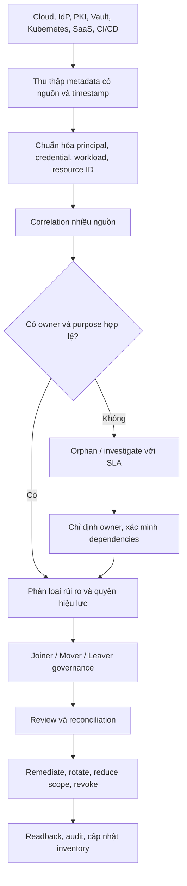

# Kiểm kê machine identity trong quản lý vòng đời danh tính IAM

**Kiểm kê machine identity (machine identity inventory)** là hoạt động **phát hiện, định danh, chuẩn hóa, liên kết và duy trì hồ sơ** về các danh tính mà máy, ứng dụng, dịch vụ và workload sử dụng để xác thực hoặc truy cập tài nguyên. Danh mục tốt không chỉ trả lời “có bao nhiêu service account”, mà còn xác định **identity đó đại diện cho workload nào, ai chịu trách nhiệm, có credential gì, được phép làm gì, chạy ở đâu, còn cần hay đã tồn dư**.

Ví dụ, một hệ thống đặt hàng có ba microservice dùng workload identity federation, một database service account cũ và hai API key của đối tác. Nếu doanh nghiệp chỉ xuất danh sách người dùng từ Identity Provider (IdP), những principal và khóa nằm ngoài IdP có thể bị bỏ sót. Khi kỹ sư nghỉ việc hoặc tích hợp ngừng hoạt động, các credential đó tiếp tục tồn tại mà không ai rà soát.

Trong module **Identity and Access Management (IAM)**, việc kiểm kê gắn với mô hình **Joiner–Mover–Leaver (JML)**, từ khởi tạo danh tính, cấp quyền theo nhiệm vụ, thay đổi chủ sở hữu/phạm vi đến thu hồi và đối soát. Nội dung liên kết **IdP/SSO, SCIM, RBAC/ABAC, quản lý tài khoản dịch vụ, kiểm toán và giảm quyền truy cập tồn dư**. Machine identity có vòng đời riêng, vì vậy không nên sao chép máy móc mọi giả định của vòng đời nhân viên.

## 1. Machine identity là gì?

**Machine identity** là danh tính được hệ thống dùng để xác thực một thực thể kỹ thuật hoặc đại diện cho workload. Tùy kiến trúc, thực thể này có thể là máy chủ, container, ứng dụng, thiết bị, job tự động, robot phần mềm hoặc một principal được gán cho môi trường thực thi.

| Loại | Ví dụ | Dấu vết cần kiểm kê |
| --- | --- | --- |
| **Service account** | Account chạy tác vụ ETL | Principal ID, owner, quyền database |
| **OAuth client/service principal** | Client dùng `client_credentials` | Client ID, issuer, audience, scope |
| **Managed identity** | Identity do cloud gắn với VM/app | Resource association, role assignment |
| **Workload identity federation** | CI job đổi assertion lấy token | Issuer, subject, audience, trust binding |
| **Kubernetes ServiceAccount** | Pod gọi API nội bộ | Cluster, namespace, bindings, projected token |
| **TLS/mTLS identity** | Service có certificate X.509 | Subject/SAN, issuer, serial, expiry |
| **SSH identity** | Key chạy automation | Public-key fingerprint, nơi được chấp nhận |
| **API key** | Tích hợp của đối tác | Key ID, resource scope, owner, expiry |
| **Database technical account** | User dùng trong job báo cáo | Database, grants, consumer |
| **Device identity** | Thiết bị mạng hoặc IoT | Device ID, certificate/attestation, owner |

**Service identity** và **machine identity** có vùng giao nhau lớn nhưng không hoàn toàn đồng nghĩa. Machine identity có thể đại diện cả **thiết bị, workload và giao thức xác thực máy–máy**; service account chỉ là một hình thức biểu diễn.

## 2. Vì sao cần inventory thay vì chỉ lưu danh sách tài khoản?

Một inventory có giá trị phải nối nhiều mảnh thông tin mà từng hệ thống riêng lẻ không nhìn thấy:

- **Identity:** principal là ai, do hệ thống nào phát hành?
- **Workload:** tiến trình, job, deployment hoặc thiết bị nào sử dụng?
- **Credential:** secret, key, certificate hoặc federation trust nào cho phép xác thực?
- **Authorization:** role, group, ACL, policy và API scope nào có hiệu lực?
- **Owner:** ai chịu trách nhiệm về nhu cầu, thay đổi và sự cố?
- **Lifecycle:** active, migrating, suspended, retiring, revoked hay orphan?
- **Dependencies:** service nào sẽ bị ảnh hưởng nếu credential hết hạn hoặc bị thu hồi?
- **Evidence:** log hoạt động, approval, thời điểm review và kết quả reconciliation.

Không kiểm kê đầy đủ khiến tổ chức khó **xoay vòng credential**, ứng cứu key bị lộ, phát hiện đặc quyền thừa và tránh gián đoạn khi xóa account kỹ thuật.

## 3. Phân biệt identity, workload, credential và entitlement

Bốn khái niệm thường bị nhầm lẫn:

| Khái niệm | Đại diện cho | Quan hệ có thể có |
| --- | --- | --- |
| **Machine identity/principal** | Chủ thể kỹ thuật được xác thực | Một identity có nhiều credential |
| **Workload/resource** | Dịch vụ hoặc tiến trình đang chạy | Một workload dùng nhiều identity |
| **Credential** | Bằng chứng hoặc cơ chế để xác thực | Một secret có thể bị sao chép tới nhiều nơi |
| **Entitlement** | Quyền trên tài nguyên đích | Một identity có nhiều grant trực tiếp/kế thừa |

Ví dụ một ứng dụng có principal `orders-sync-prod`, hai certificate còn active khi đang rotation và các quyền `orders.read`, `queue.publish`. **Đếm certificate thành hai identity sẽ sai**; chỉ đếm principal mà không kiểm tra certificate cũng bỏ sót rủi ro khi một khóa cũ chưa được thu hồi.

Ngược lại, một workload có thể dùng **managed identity khi chạy trên cloud**, nhưng còn **API key cũ trong pipeline**. Cả hai đường cần được liên kết để tránh hiểu lầm rằng workload đã hoàn toàn bỏ static secret.

## 4. Schema kiểm kê tối thiểu

Một bản ghi inventory nên có **ID ổn định**, mối liên hệ với nguồn thẩm quyền và các thuộc tính có thể kiểm chứng:

| Trường | Vai trò | Giá trị ví dụ |
| --- | --- | --- |
| `machineIdentityId` | Khóa chuẩn hóa nội bộ | `mid-orders-prod-07` |
| `principalId` | Định danh ở issuer/cloud/app | `spn-1984` |
| `identityType` | Service account, client, certificate… | `workload-federation` |
| `issuerOrAuthority` | Hệ thống chứng thực | `cloud-iam-prod` |
| `workloadId` | Liên kết service/job/device | `orders-worker` |
| `ownerTeamId` | Đội chịu trách nhiệm | `team-commerce` |
| `technicalContact` | Đầu mối vận hành | `sre-oncall` |
| `businessPurpose` | Lý do tồn tại | Đồng bộ trạng thái đơn hàng |
| `environment` | Production, staging… | `production` |
| `tenantId` | Ranh giới khách hàng/tổ chức | `tenant-a` |
| `resourceScopes` | Tài nguyên có thể truy cập | `orders-api`, `queue-a` |
| `credentialReferences` | Tham chiếu vault/issuer, không lưu secret | `vault://ref-123` |
| `entitlementRefs` | Role, group, ACL và policy binding | `orders-reader` |
| `lifecycleStatus` | Trạng thái vòng đời | `active` |
| `createdAt`, `lastReviewedAt` | Bằng chứng về tuổi và review | Timestamp |
| `lastObservedUse` | Tín hiệu hoạt động có nguồn và độ mới | Timestamp |
| `sourceOfTruth` | Nguồn sở hữu bản ghi | `workload-registry` |

Đây là **schema khái niệm minh họa**, không phải cấu trúc bắt buộc của SCIM hoặc một nhà cung cấp. Có thể cần thêm metadata về vùng, classification, SLA, incident, credential expiry và đối tác.

**Không lưu password, private key, access token, refresh token, OTP hoặc plaintext API key trong inventory.** Chỉ giữ ID, fingerprint/metadata không nhạy cảm và tham chiếu được phân quyền tới nơi lưu secret.

## 5. Khóa định danh ổn định và tương quan nhiều nguồn

Tên như `prod-service`, email account hay CN certificate có thể trùng hoặc đổi. Cần phân biệt:

1. **Inventory ID:** khóa bền vững để nối các bản ghi nội bộ.
2. **Provider principal ID:** ID do issuer hoặc tài nguyên đích cấp.
3. **Credential ID/fingerprint:** định danh riêng của từng khóa/certificate.
4. **Workload ID:** định danh ổn định của ứng dụng, job, thiết bị hoặc deployment.
5. **Resource/tenant/environment ID:** phạm vi định danh và quyền thực tế.

Ví dụ cùng tên `payment-bot` ở staging và production **không phải một danh tính**. Không hợp nhất chỉ vì tên giống nhau; phải xác nhận issuer, tenant, principal ID, owner và workload liên kết.

Đặc biệt khi **certificate được gia hạn**, cùng service có thể dùng certificate serial mới. Inventory cần biết certificate nào **thay thế** certificate nào, không coi việc đổi serial là sự ra đời của một ứng dụng hoàn toàn mới.

## 6. Các nguồn phát hiện machine identity

| Nguồn | Thường phát hiện được | Giới hạn |
| --- | --- | --- |
| **Cloud IAM** | Principal, managed identity, role binding | Có thể không thấy secret nằm ở ứng dụng khác |
| **IdP/Active Directory** | Service account, group, SPN | Không thấy mọi workload cloud-native |
| **Authorization server** | OAuth client, credential, grant metadata | Có thể thiếu workload owner |
| **Kubernetes** | ServiceAccount, RBAC binding, namespace | Không thấy credential bên ngoài cluster |
| **Certificate authority/PKI** | Certificate issue/revoke/expiry | Certificate không luôn gắn được với workload |
| **Secret manager/vault** | Secret reference, version, access metadata | Bản sao đã xuất ra ngoài có thể không quan sát được |
| **CI/CD và IaC** | Runner identities, trust, declared role/policy | Khai báo không chắc đúng trạng thái runtime |
| **Application/database** | Local technical account, ACL, grants | Thiếu liên kết với identity trung tâm |
| **API gateway/resource server** | Key ID, token subject, API usage | Thường thấy sự kiện dùng, không phải toàn bộ identity |
| **CMDB/workload registry** | Business purpose, owner, phụ thuộc | Có thể lỗi thời nếu thiếu đồng bộ |
| **Partner register** | Hợp đồng, sponsor, integration account | Không tự thể hiện mọi credential đang hoạt động |

**Không coi một nguồn là toàn diện.** Cần kết hợp phát hiện từ cả nơi cấp identity và **hệ thống đích thực sự đang cấp/quyết định quyền**.

## 7. Quy trình discovery → correlation → governance



Một quy trình inventory không nên dừng ở giai đoạn **export CSV**. Hồ sơ phải được cập nhật khi tạo, đổi credential, di chuyển workload, thay owner hoặc ngừng dịch vụ, đồng thời phát hiện sai lệch do hành động cấp quyền ngoài luồng.

## 8. Discovery theo agent và agentless

Có thể dùng nhiều phương án khám phá:

- **API-first/agentless:** đọc metadata từ cloud IAM, vault, directory, certificate manager và application API.
- **Agent-based:** phần mềm có quyền phù hợp tại host để quan sát service identity và credential reference.
- **Configuration/IaC analysis:** phân tích manifest, policy-as-code, deployment và pipeline.
- **Log analytics:** liên kết token subject, certificate fingerprint hoặc API key ID từ sự kiện xác thực.
- **Attestation/owner survey:** yêu cầu đội vận hành xác nhận danh tính chưa tương quan được.

Không công cụ nào bảo đảm phát hiện tất cả identity; một số secret cục bộ, thiết bị offline hoặc third-party SaaS có thể cần owner khai báo và kiểm tra thủ công.

**Discovery không được biến thành thu thập hàng loạt bí mật rõ.** Chỉ dùng quyền đọc metadata cần thiết và bảo vệ thông tin có tính nhạy cảm như tên hệ thống, cấu trúc mạng, subject và policy.

## 9. Kiểm kê quyền hiệu lực, không chỉ entitlement khai báo

Một machine identity có thể nhận quyền qua **RBAC**, **ABAC**, resource ACL hoặc các quan hệ kế thừa. Inventory cần xác định **đường cấp quyền**:

```text
Machine identity
   -> direct cloud role
   -> group membership
   -> inherited project/organization policy
   -> resource ACL
   -> conditional ABAC rule
   -> API token scope/audience
   -> effective access at target resource
```

Ví dụ service `invoice-exporter` chỉ cần đọc một view nhưng có role `database-owner` qua project cha. Nếu inventory chỉ liệt kê role trực tiếp `report-reader`, nó bỏ sót quyền quản trị kế thừa.

Với ABAC, quyền còn phụ thuộc **thời gian, môi trường, tenant, resource attribute và ngữ cảnh runtime**. Không luôn biểu diễn được bằng một tập role tĩnh. Inventory nên lưu **policy reference, điều kiện áp dụng và bằng chứng kiểm thử authorization** khi cần.

## 10. Phân loại theo rủi ro

| Tiêu chí | Dấu hiệu rủi ro cao |
| --- | --- |
| **Privilege** | Có thể cấp quyền, sửa IAM policy, xóa log |
| **Data sensitivity** | Đọc/ghi dữ liệu cá nhân, tài chính hoặc secret |
| **Credential type** | Secret lâu dài, chia sẻ hoặc không rotation |
| **Environment** | Production, hệ thống quan trọng hoặc cross-tenant |
| **Trust boundary** | External partner, federation issuer ngoài tổ chức |
| **Owner/purpose** | Không có owner hoặc mục đích không rõ |
| **Exposure** | Secret trong source, pipeline, image hoặc log |
| **Reachability** | Token được chấp nhận tại nhiều API/resource |
| **Lifecycle** | Quá hạn, retired, chưa review hoặc không có expiry |
| **Detection** | Không có audit hoặc không phát hiện truy cập bất thường |

Không nên đánh đồng **identity ít dùng** với **identity không cần**. Ví dụ một workload phục hồi thảm họa có thể chỉ chạy khi sự cố; cần xác minh purpose và runbook thay vì xóa vì `lastUsed` thấp.

## 11. Machine identity và vòng đời Joiner

Machine Joiner là lúc một workload mới hoặc một trust path được tạo:

1. **Workload owner đăng ký purpose**, environment và resource cần truy cập.
2. Hệ thống gán **machine identity ID** và owner rõ ràng.
3. Kiểm tra entitlement theo **least privilege/Just Enough Access**.
4. Chọn phương thức chứng thực: managed identity, federation hoặc credential do nền tảng quản lý khi phù hợp.
5. Thiết lập role, resource scope, audience và ngày hiệu lực.
6. Lưu metadata credential/reference và cơ chế rotation/revoke.
7. Provision qua API/cloud IAM/connector tương ứng.
8. **Readback và positive/negative authorization test**.
9. Cập nhật inventory và đặt lịch review theo rủi ro.

**IdP/SSO cho người dùng không nhất thiết là nơi cấp machine identity.** Một workload có thể nhận token qua federation mà không tồn tại như user SCIM trong SaaS.

## 12. Machine identity và vòng đời Mover

Machine Mover có thể xảy ra khi:

- Service chuyển từ staging sang production.
- Một job chuyển từ dự án A sang B.
- Workload được đưa sang cloud account hoặc tenant khác.
- API scope hoặc tài nguyên đích thay đổi.
- Owner team thay đổi sau tái tổ chức.
- Static secret được thay bằng workload federation.
- Role thay đổi quyền hoặc một service chia tách thành nhiều component.

Quy trình an toàn phải **tính lại quyền mong muốn, cấp đúng scope mới và thu hồi scope cũ**. Inventory cần liên kết predecessor/successor identity để phát hiện credential cũ chưa xử lý.

Ví dụ service `analytics-batch` chuyển khỏi project A nhưng vẫn giữ service principal có quyền trên A. Đây là **Mover residual access**, cần review và deprovision, không chỉ cập nhật tài liệu kiến trúc.

## 13. Machine identity và vòng đời Leaver

Khi workload bị ngừng, hợp đồng đối tác kết thúc hoặc thiết bị bị loại khỏi vận hành:

1. Xác định toàn bộ consumer và dependency của identity.
2. Phân loại retirement có kế hoạch hay credential compromise cần chặn tức thời.
3. Ngừng nguồn tạo tác vụ hoặc cutover sang identity thay thế khi phù hợp.
4. Revoke credential, OAuth client secret/certificate hoặc federation trust không còn cần.
5. Gỡ role, group, ACL và policy binding trực tiếp/kế thừa.
6. Kiểm tra access token/session còn hoạt động và phương thức xử lý.
7. Disable/delete principal theo khả năng và chính sách lưu chứng cứ.
8. Đọc lại quyền tại issuer và resource server, thực hiện deny test.
9. Cập nhật trạng thái `revoked/retired`, owner và thời điểm hoàn tất.
10. Theo dõi khả năng re-provision ngoài ý muốn bởi IaC/GitOps hoặc connector retry.

**Xóa secret trong vault không chứng minh credential đã bị chặn tại issuer.** **SCIM `active=false` không phải chuẩn thu hồi mọi OAuth client, token hoặc cloud role**. Trạng thái phải được kiểm chứng tại nơi thật sự thực thi truy cập.

## 14. Phân biệt Leaver của workload và Leaver của owner nhân sự

Một lỗi thường gặp: kỹ sư tạo service account nghỉ việc, nên tổ chức xóa account kỹ thuật ngay. Điều đó có thể gây outage nếu workload vẫn chạy.

| Sự kiện | Hành động cần ưu tiên |
| --- | --- |
| **Human Joiner** vào đội vận hành | Cấp quyền cá nhân vào công cụ quản trị workload theo policy |
| **Human Mover** đổi team | Gỡ quyền vault/CI/CD cũ, chuyển phê duyệt |
| **Human Leaver** nghỉ việc | Thu hồi human credential và quyền sửa/lấy secret |
| **Machine Joiner** tạo service mới | Tạo principal, scope, owner và lifecycle record |
| **Machine Mover** đổi purpose/scope | Chuyển quyền, rotate/cutover nếu cần |
| **Machine Leaver** ngừng workload | Chặn đường truy cập và decommission |

**Owner đổi không đồng nghĩa workload ngừng**. Inventory phải hỗ trợ chuyển ownership có kiểm soát và phát hiện workload không còn người chịu trách nhiệm.

## 15. Credential inventory và rotation readiness

Một principal có thể có nhiều khóa, cert hoặc secret đồng thời để rotation không gián đoạn. Cần ghi:

- Credential ID hoặc fingerprint **không thể dùng làm secret**.
- Loại credential và issuer/CA.
- Thời điểm cấp, thời hạn, thuật toán/độ mạnh khi thích hợp.
- Trạng thái active, expiring, revoked, expired.
- Workload/consumer đang tham chiếu.
- Secret manager hoặc nơi quản lý credential.
- Chính sách rotation và owner.
- Sự kiện sử dụng gần nhất, với nguồn dữ liệu và độ tin cậy.
- Kết quả kiểm thử sau rotation hoặc revoke.

Đối với certificate, cần hiểu **thời hạn certificate và trạng thái thu hồi** không luôn được kiểm tra giống nhau bởi mọi relying party; OCSP/CRL hoặc cơ chế trust khác phụ thuộc ứng dụng. Không tuyên bố chỉ cần đánh dấu cert revoked ở CA là mọi kết nối hiện hữu tự chấm dứt ngay.

## 16. OAuth, token và workload federation trong inventory

Với machine-to-machine OAuth, danh mục nên phân biệt:

| Thành phần | Thuộc tính quan trọng |
| --- | --- |
| **OAuth client** | Client ID, authorization server, owner |
| **Client authentication** | Secret, certificate, private-key JWT hoặc cơ chế khác |
| **Access token** | Issuer, audience, scope, TTL; **không lưu giá trị token** |
| **Resource server** | API nào chấp nhận token, chính sách kiểm tra |
| **Federated subject** | Issuer, subject, audience và trust rule |
| **Principal mapping** | Workload assertion ánh xạ đến principal nào |
| **Revocation design** | Chặn token mới và xử lý token cũ ra sao |

**ID token OIDC không phải access token dùng gọi API**. Inventory nên biết đường cấp access token và quyền hiệu lực ở resource server. Khi thu hồi trust binding, có thể chặn việc nhận token mới nhưng token cũ tiếp tục có hiệu lực trong cửa sổ TTL; đây là rủi ro cần ghi nhận.

## 17. SCIM, IdP, SSO và machine identity

| Thành phần | Đóng góp cho inventory | Không nên giả định |
| --- | --- | --- |
| **IdP/Directory** | Account, group, owner hoặc metadata của service principal được hỗ trợ | Chứa mọi machine identity |
| **SSO/OIDC/SAML** | Thông tin trust/federation và phiên tương ứng | SSO đồng bộ mọi credential máy–máy |
| **SCIM** | User/Group provisioning ở hệ thống hỗ trợ | Là giao thức chung để quản lý certificate/OAuth client |
| **Cloud IAM** | Principal, role assignment, managed identity | Tự ghi nhận business purpose/owner đầy đủ |
| **PKI** | Certificate, issuer, expiration, revocation metadata | Biết service nào đang dùng mọi cert |
| **RBAC/ABAC/PBAC** | Mô hình quyền, điều kiện và effective policy | Tên role đủ nói lên phạm vi thực tế |
| **PAM/Secrets manager** | Credential reference, access/rotation metadata | Xóa secret record là revoke issuer |
| **Audit/reconciliation** | Xác định quyền quan sát và sai lệch | Thay thế authorization runtime |

Inventory cần **đi ngang nhiều công nghệ**; không chỉ dựa trên một giao thức provisioning dành cho người dùng.

## 18. Machine identity của đối tác và cross-tenant

Một tích hợp B2B có thể dùng service principal, API key hoặc certificate để đọc dữ liệu theo hợp đồng. Inventory phải xác định:

- **Partner ID, sponsor, contract ID và ngày kết thúc**.
- **Tenant/resource scope** được phép và dữ liệu classification.
- Workload của đối tác nào đang sử dụng principal/credential.
- Ai có quyền rotate/revoke và liên hệ khẩn cấp.
- Federation issuer hoặc OAuth client nào được tin cậy.
- Mọi token, role và ACL cục bộ thuộc phạm vi hợp đồng.
- Kiểm thử **cross-tenant deny** và kế hoạch thu hồi khi hết hợp đồng.

**Đối tác vẫn có thể xác thực người dùng qua partner IdP không đồng nghĩa service integration tiếp tục có authorization**. Quyền máy–máy phải được thu hồi độc lập khi căn cứ hợp đồng không còn.

## 19. Service account đặc quyền và SoD

Machine identity đôi khi nắm quyền quản trị cao do automation triển khai, rotation hoặc phục hồi. Inventory cần phát hiện:

- Principal có `owner` ở cấp cloud organization, tenant hoặc cluster.
- Identity có thể cấp role, thay policy, xóa log hoặc đọc secret.
- Cùng workload vừa **tạo** vừa **tự phê duyệt** giao dịch nghiệp vụ.
- CI/CD pipeline có khả năng sửa code, duyệt change và deploy mà không có chốt kiểm soát.
- Credential dùng chung giữa production và staging.
- Quyền break-glass bị nhúng vào tác vụ chạy thường xuyên.

**Separation of Duties (SoD)** không chỉ áp dụng cho human identity. Nếu một workload có thể thực hiện toàn bộ chuỗi hành động rủi ro, cần đánh giá việc tách identity, approval và enforcement theo giao dịch.

## 20. Kiểm kê quyền truy cập tồn dư và orphan identity

**Orphan machine identity** là identity không tìm thấy owner hoặc mục đích hợp lệ, hoặc không còn workload có thể xác minh. Nhưng không phải identity ít được dùng tự động là orphan.

Các dấu hiệu cần điều tra:

| Dấu hiệu | Cần xác minh |
| --- | --- |
| Principal không có owner | Workload còn chạy không? Ai chịu trách nhiệm? |
| API key không có nơi sử dụng rõ | Có consumer định kỳ/offline không? |
| Service account thuộc dự án đã đóng | Có job được di chuyển chưa cập nhật? |
| Certificate đã hết hạn nhưng vẫn gắn vào thiết bị | Thiết bị có còn tin cậy/hoạt động? |
| Hai identity cùng workload | Đang rotation/cutover hay quyền trùng? |
| Credential lâu dài không rotation | Có phương thức quản lý phù hợp hơn? |
| Role admin rộng trên account ít dùng | Có phục vụ disaster recovery không? |
| IdP account disabled nhưng API vẫn hoạt động | Có local key, session/token hoặc direct ACL không? |

Đối với identity khả nghi, không tự động xóa khi chưa đánh giá phụ thuộc nếu nguy cơ outage cao. Tuy nhiên, nếu credential có dấu hiệu bị chiếm, cần **phản ứng bảo mật ưu tiên chặn quyền** theo runbook và xử lý liên tục dịch vụ bằng cơ chế an toàn.

## 21. Reconciliation desired state và observed state

```text
desired = identities_and_permissions(
    active_workloads, approved_purpose, JML_state, policy
)
observed = discover(
    issuers, directories, cloud_iam, apps, groups, ACLs, trust_paths
)

unmanaged = observed.identity_ids - desired.identity_ids
excess_access = observed.effective_permissions - desired.permissions
missing_access = desired.permissions - observed.effective_permissions
```

Đây là mô hình logic. Phép trừ tập hợp đơn giản không thể hiện đầy đủ ABAC context, role kế thừa, token cache hoặc policy deny. Trong thực tế, cần giải thích **nguồn cấp quyền và điều kiện runtime**.

Quy trình khép kín:

1. Đọc identity và entitlement từ nguồn phát hành lẫn hệ thống đích.
2. Correlate ID ổn định, tránh ghép sai theo tên.
3. Liên kết owner, workload, environment và trạng thái quan hệ.
4. Tính effective quyền và những trust/credential path còn hoạt động.
5. Phân loại quyền dư, orphan, thiếu quyền và ngoại lệ.
6. Phân công owner và quyết định Keep/Reduce/Revoke theo rủi ro.
7. Thực hiện qua cloud API, issuer, directory hoặc connector phù hợp.
8. **Readback** và negative authorization test khi mức rủi ro yêu cầu.
9. Theo dõi sai lệch chưa giải quyết và cập nhật inventory liên tục.

**HTTP 200/204 từ provisioning connector không đủ chứng minh entitlement đã mất hiệu lực.** Phải xác minh ở hệ thống thực thi hoặc nêu rõ giới hạn kiểm chứng.

## 22. Tự động hóa cập nhật inventory

Một inventory sống nên được cập nhật theo **event-driven changes** kết hợp định kỳ:

- Tạo/xóa principal tại cloud IAM.
- Cấp/thu hồi certificate ở PKI.
- Tạo/rotate/revoke secret và OAuth credential.
- Triển khai/ngừng workload trong CI/CD hoặc Kubernetes.
- Thay role/group, ABAC policy hoặc trust binding.
- Chuyển owner/team và thay hợp đồng đối tác.
- Sự kiện Mover/Leaver của người có quyền quản lý secret.
- Alert credential exposure, token abuse hoặc quyền mới ngoài luồng.
- Kết quả access review, recertification và reconciliation.

Cần xử lý **duplicate event, out-of-order delivery, eventual consistency và retry**. Một event `delete` đến trước event `create` do queue trễ không nên tạo bản ghi sai; dùng version/generation và authoritative readback.

Một record có thể chứa **observed timestamp** khác **last confirmed timestamp** để phân biệt dữ liệu có độ mới cao và dữ liệu đã được chủ sở hữu chứng nhận.

## 23. Audit và bảo vệ chính inventory

Machine inventory có thể tiết lộ cấu trúc hạ tầng, danh sách API, trust boundary và vị trí lưu secret; do đó phải **giới hạn quyền xem/sửa**.

Một bản ghi thay đổi nên lưu:

- Người hoặc automation tạo/sửa bản ghi inventory.
- Nguồn dữ liệu, resource/principal ID và timestamp.
- Thay đổi owner, purpose, environment, scope và lifecycle.
- Policy version và approval cho quyền nhạy cảm.
- Credential metadata/fingerprint, **không lưu secret**.
- Kết quả discovery, exception, reconciliation và readback.
- Correlation ID giữa inventory, change request, incident và provisioning.
- Bằng chứng người review và ngày hết hạn ngoại lệ.

Không nên cho cùng một workload tùy ý thay cả **role của chính nó và log chứng minh nó có role ấy**. Audit cần có tính toàn vẹn và quyền quản trị độc lập phù hợp.

## 24. Chỉ số chất lượng kiểm kê

| Chỉ số | Ý nghĩa |
| --- | --- |
| **Identity discovery coverage** | Tỷ lệ hệ thống/loại identity trong phạm vi đã được thu thập |
| **Owner coverage** | Tỷ lệ identity có owner còn hợp lệ |
| **Workload correlation rate** | Tỷ lệ principal liên kết với workload cụ thể |
| **Orphan identities** | Số principal thiếu owner/purpose/workload |
| **Stale inventory records** | Bản ghi lâu không được xác minh |
| **Credential expiry risk** | Credential sắp hết hạn chưa có kế hoạch rotation |
| **Long-lived secret count** | Số static secret có tuổi/rủi ro cao |
| **Excess privileged identities** | Principal có quyền ngoài nhiệm vụ |
| **Reconciliation coverage** | Tỷ lệ identity/entitlement được đọc lại tại đích |
| **Verified revoke rate** | Tỷ lệ quyết định thu hồi đã có bằng chứng deny |
| **Mover residual access** | Quyền resource/tenant cũ còn sau thay đổi |
| **Leaver owner drift** | Quyền quản lý secret của nhân viên đã nghỉ |
| **Cross-tenant trust exposure** | Trust binding ngoài phạm vi tenant/hợp đồng |

**Tăng số lượng machine identity tìm thấy không hẳn là an ninh kém đi**: có thể là inventory ngày càng đầy đủ. Cần kết hợp coverage, độ chính xác, rủi ro và tốc độ remediation.

## 25. Ví dụ thực hành: kiểm kê một pipeline CI/CD

Giả sử pipeline triển khai một ứng dụng lên cloud production. Inventory thu thập được:

| Đối tượng | Phát hiện | Đánh giá |
| --- | --- | --- |
| CI runner | Workload `deploy-orders` | Cần owner và project |
| Federated subject | Repo và branch cụ thể | Kiểm tra issuer/audience/subject binding |
| Cloud principal | `orders-deployer` | Xác định tenant/environment |
| Role grant | Quyền deploy và đọc secret | Có vượt scope namespace? |
| Secret cũ | API key vẫn còn trong vault | Có consumer nào đang dùng? |
| Owner | Kỹ sư đã Mover | Chuyển owner và gỡ quyền cá nhân |
| Deployment IaC | Role binding trong code | Kiểm tra drift so với cloud IAM |
| Audit | Token requests và deployments | Bằng chứng sử dụng hợp lệ |

Nếu đã dùng federation nhưng API key cũ vẫn active, inventory cần ghi **hai credential path** tới cùng workload, không kết luận “đã loại secret” chỉ vì CI config mới không tham chiếu key.

## 26. Các lỗi triển khai thường gặp

| Sai lầm | Hệ quả | Khắc phục |
| --- | --- | --- |
| Chỉ export service account từ AD | Bỏ sót cloud/PKI/API key | Discovery đa nguồn |
| Dùng display name để hợp nhất | Trộn staging/production hoặc tenant | Principal ID và issuer |
| Không lưu owner/purpose | Không biết cần giữ hay thu hồi | Ownership attestation |
| Lưu plaintext key trong catalog | Rò credential qua công cụ inventory | Chỉ reference/fingerprint |
| Đếm mỗi certificate thành workload | Số liệu sai khi rotation | Quan hệ identity–credential |
| Không ghi quyền kế thừa | Bỏ sót đặc quyền admin | Effective entitlement mapping |
| Chỉ dựa vào last-used | Xóa nhầm disaster-recovery identity | Owner và business purpose |
| Gỡ key khỏi vault, không revoke issuer | Key sao chép còn hoạt động | Revoke tại nguồn xác thực |
| SCIM trả success rồi đánh dấu closed | Role ở ứng dụng còn hiệu lực | Readback và deny test |
| Không đồng bộ IaC/GitOps | Identity/role bị tái tạo | Sửa desired state và reconcile |
| Không cập nhật sau Human Leaver | Người cũ còn quyền lấy secret | JML và credential custody |
| Catalog tự được workload sửa | Che giấu quyền dư | Tách quyền quản trị và audit |

## 27. Checklist áp dụng

- [ ] Có phạm vi hệ thống và loại machine identity cần phát hiện.
- [ ] Mọi principal có ID ổn định, issuer, tenant và environment.
- [ ] Identity liên kết được với workload hoặc thiết bị cụ thể.
- [ ] Có owner hiện hành và người liên hệ khẩn cấp.
- [ ] Mục đích nghiệp vụ, resource scope và quyền hiệu lực được mô tả.
- [ ] Credential chỉ lưu metadata và tham chiếu, không lưu secret.
- [ ] Có kế hoạch rotation, expiry, revoke và cutover.
- [ ] Đã nhận diện nested groups, inherited roles và direct grants.
- [ ] Federation trust ghi rõ issuer, subject và audience.
- [ ] Partner integration có sponsor/hợp đồng và ngày kết thúc.
- [ ] Human Mover/Leaver kích hoạt rà soát quyền quản lý secret.
- [ ] Machine Mover/Leaver có quy trình giảm quyền hoặc retirement.
- [ ] Có discovery định kỳ, event-driven update và reconciliation.
- [ ] Bằng chứng deprovision bao gồm readback và kiểm tra deny khi cần.
- [ ] Inventory có RBAC cho người xem/sửa, audit và chính sách retention.
- [ ] Orphan identity và exception đều có owner, thời hạn xử lý.

## 28. Câu hỏi tự kiểm tra

**Tình huống A:** Cloud có một principal và ba key trong giai đoạn rotation. Nên đếm bao nhiêu machine identity? **Một principal** nếu cả ba key cùng thuộc principal đó; inventory giữ quan hệ riêng cho từng credential.

**Tình huống B:** Account kỹ thuật đã không hoạt động nhiều tháng. Có thể xóa tự động không? **Không chỉ dựa vào last-used**; phải xem owner, mục đích và consumer, đặc biệt workload dự phòng.

**Tình huống C:** Nhân viên tạo pipeline nghỉ việc nhưng deployment vẫn chạy. Có nên xóa service principal ngay? **Không mặc nhiên**; thu hồi quyền cá nhân, chuyển owner và đánh giá workload.

**Tình huống D:** Một role trực tiếp đã gỡ nhưng workload vẫn có quyền qua policy kế thừa. Inventory có đủ nếu chỉ ghi role trực tiếp không? **Không.** Cần tính quyền hiệu lực và đường kế thừa.

**Tình huống E:** Cấu hình CI không còn API key nhưng key vẫn active tại issuer. Inventory nên xử lý thế nào? **Ghi nhận đường credential tồn dư**, xác minh consumer và thu hồi có kiểm chứng.

**Tình huống F:** Partner có federated subject cho nhiều tenant dù hợp đồng chỉ với tenant A. Rủi ro gì? **Trust quá rộng**, cần giới hạn subject/audience/tenant và quyền tài nguyên.

**Tình huống G:** Connector báo deprovision thành công nhưng API vẫn nhận token cũ. Có thể đánh dấu revoke verified không? **Chưa.** Phải kiểm tra giới hạn kỹ thuật của token và kết quả authorization tại đích.

## Ghi nhớ

**Kiểm kê machine identity** là quản lý **bản đồ giữa principal, workload, credential, quyền truy cập, owner và vòng đời** chứ không chỉ đếm tài khoản. Một inventory đáng tin phải **phát hiện từ nhiều nguồn, dùng ID ổn định, tương quan các đường xác thực, hiểu effective entitlement, cập nhật theo sự kiện và đối soát quyền thực tế**. Kết hợp **Joiner–Mover–Leaver cho cả workload và người quản lý, IdP/SSO, SCIM, RBAC/ABAC, service account governance, kiểm toán và reconciliation** để vừa giữ được khả năng vận hành vừa **phát hiện, thu hồi machine credential và đặc quyền tồn dư**.
