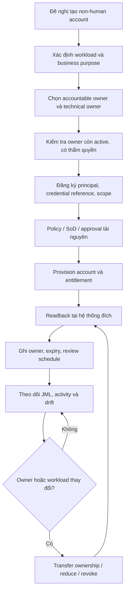

# Owner của account trong Non-human account và quản lý vòng đời IAM

**Owner của non-human account** là cá nhân hoặc nhóm có thẩm quyền và trách nhiệm giải trình đối với **mục đích tồn tại, quyền truy cập, credential, thay đổi và thời điểm chấm dứt** một tài khoản phi con người. Account này có thể phục vụ ứng dụng, bot, dịch vụ nền, thiết bị, pipeline CI/CD, tích hợp đối tác hoặc quy trình tự động. Dù không có nhân viên trực tiếp đăng nhập như tài khoản cá nhân, nó vẫn cần **người chịu trách nhiệm rõ ràng và có thể liên hệ**.

Ví dụ, account `svc-invoice-export` dùng để đọc dữ liệu hóa đơn rồi gửi báo cáo tới kho lưu trữ. Người đã tạo account có thể nghỉ việc, nhưng job vẫn tiếp tục chạy. Nếu không có owner hiện hành, không ai có thẩm quyền xác nhận quyền `invoice.read` còn cần, xử lý key hết hạn hay quyết định lúc nào thu hồi account. **Tài khoản kỹ thuật có thể hoạt động nhiều năm nhưng không được phép trở thành tài khoản vô chủ.**

Trong **Identity and Access Management (IAM)** theo vòng đời **Joiner–Mover–Leaver (JML)**, ownership cần được quản trị xuyên suốt từ lúc tạo account, cấp role, đổi ứng dụng hoặc nhóm phụ trách đến lúc ngừng workload. Việc này liên kết **IdP, SSO, SCIM, RBAC/ABAC, service identity, machine identity, access review, kiểm toán và account reconciliation** để ngăn quyền truy cập tồn dư.

## 1. Non-human account và owner là gì?

**Non-human account (NHA)** là tài khoản dùng bởi thực thể phi con người hoặc cơ chế tự động hóa. Nó có thể hiện diện dưới dạng service account, service principal, API client, database account, bot account hoặc device identity, tùy hệ thống.

**Owner** là đầu mối được chỉ định có trách nhiệm bảo đảm account phục vụ một mục đích hợp lệ, đáp ứng chính sách và được quản lý đến khi thu hồi. Chủ sở hữu **không nhất thiết là người tạo account, người nắm mật khẩu hoặc người có quyền tự cấp mọi đặc quyền**.

| Khái niệm | Ví dụ | Cần phân biệt |
| --- | --- | --- |
| **Account** | `svc-orders-sync` | Đối tượng xác thực/quyền trong hệ thống |
| **Workload** | Job đồng bộ đơn hàng | Tiến trình hoặc dịch vụ sử dụng account |
| **Business owner** | Trưởng bộ phận sở hữu tích hợp đơn hàng | Chịu trách nhiệm nhu cầu nghiệp vụ |
| **Technical owner** | Nhóm Platform Engineering | Chịu trách nhiệm vận hành và cấu hình |
| **Credential custodian** | Nhóm hoặc dịch vụ quản lý vault | Quản trị bí mật, không tự quyết quyền nghiệp vụ |
| **Resource owner** | Data owner của database đơn hàng | Quyết định quyền truy cập tài nguyên |
| **Approver** | Người được chính sách giao xét quyền | Có thẩm quyền cho yêu cầu cụ thể |
| **Requester/creator** | Kỹ sư gửi ticket tạo account | Không mặc nhiên là owner lâu dài |

Có thể một người đồng thời đảm nhận một số vai trò, nhưng với quyền nhạy cảm cần đánh giá **Separation of Duties (SoD)** và tránh tự tạo, tự duyệt, tự nâng quyền không có kiểm soát.

## 2. Vì sao owner là thuộc tính an ninh bắt buộc?

Một NHA thiếu owner làm gián đoạn chuỗi quyết định:

1. **Không biết lý do tồn tại:** account có thể thuộc hệ thống đã ngừng.
2. **Không ai xác nhận quyền tối thiểu:** role ban đầu có thể bị giữ dù chức năng thay đổi.
3. **Credential không được quản trị:** không ai lên kế hoạch rotation hoặc xử lý lộ key.
4. **Access review hình thức:** reviewer không hiểu workload nên có thể bấm Keep tùy tiện.
5. **Leaver bị bỏ sót:** kỹ sư rời tổ chức nhưng secret vẫn nằm ở hệ thống cũ.
6. **Không biết tác động khi revoke:** xóa nhầm account có thể gây gián đoạn production.
7. **Tích hợp đối tác tồn dư:** hợp đồng hết hạn nhưng OAuth client/API key còn hoạt động.
8. **Kiểm toán không có người giải trình:** khó truy nguồn tạo quyền và khắc phục sai lệch.

**Account vẫn đăng nhập hoặc gọi API thành công không chứng minh nó còn hợp lệ.** Tính hợp lệ phải dựa vào workload hiện tại, phạm vi nhiệm vụ, owner và quyết định chính sách.

## 3. Mô hình trách nhiệm: ai làm gì?

Một tổ chức có thể sử dụng mô hình **accountable owner** và các nhóm **responsible operators**.

| Hoạt động | Business owner | Technical owner | IAM/Security | Resource owner |
| --- | --- | --- | --- | --- |
| Xác định lý do tạo NHA | Chịu trách nhiệm | Tư vấn | Đặt chính sách | Xác nhận phạm vi dữ liệu |
| Đăng ký account và metadata | Xác nhận | Thực hiện | Kiểm tra hợp lệ | — |
| Chọn cơ chế credential | Nắm yêu cầu nghiệp vụ | Thiết kế/vận hành | Đặt tiêu chuẩn | — |
| Xin role/permission | Giải thích nhu cầu | Lập yêu cầu kỹ thuật | SoD, policy check | Phê duyệt quyền tài nguyên |
| Xoay credential | Theo dõi tác động | Triển khai | Giám sát kiểm soát | — |
| Review định kỳ | Xác nhận tiếp tục cần | Cung cấp bằng chứng | Điều phối audit | Xác nhận quyền còn hợp lệ |
| Xử lý sự cố/lộ key | Quyết định ưu tiên nghiệp vụ | Khoanh vùng và khôi phục | Incident response | Thu hẹp quyền tài nguyên |
| Ngừng account | Xác nhận hết nhu cầu | Cutover/decommission | Revoke và reconciliation | Xác nhận mất quyền |

Dấu **—** biểu thị không phải vai trò chính ở ví dụ này, không có nghĩa hoàn toàn không tham gia. Cách phân công cụ thể là chính sách của tổ chức.

**Trách nhiệm giải trình phải có điểm cuối rõ ràng**: nếu owner chính vắng mặt, phải có tuyến ủy quyền hoặc người thay thế; nếu không, ticket thu hồi có thể bị treo vô thời hạn.

## 4. Metadata tối thiểu để xác định owner

Bản ghi ownership cần dùng **ID ổn định**, tránh phụ thuộc mỗi tên hiển thị:

| Trường | Công dụng | Ví dụ minh họa |
| --- | --- | --- |
| `accountId` | Định danh kỹ thuật tại hệ thống cấp | `svc-erp-042` |
| `identityType` | Service, workload, bot, device | `service-account` |
| `workloadId` | Liên kết với ứng dụng/job | `invoice-exporter` |
| `businessOwnerId` | Người chịu trách nhiệm nhu cầu | `EMP-182` |
| `technicalOwnerGroupId` | Nhóm vận hành hiện hành | `platform-data` |
| `backupOwnerId` | Người thay thế khi owner vắng | `EMP-196` |
| `purpose` | Mô tả tác vụ | Xuất báo cáo cuối ngày |
| `environment` | Ranh giới vận hành | `production` |
| `tenantId` | Ranh giới khách hàng/tổ chức | `tenant-a` |
| `resourceScope` | Dữ liệu/API được truy cập | `invoices.read` |
| `credentialReference` | Tham chiếu vault, không phải mật khẩu | `vault://invoice-exporter` |
| `lifecycleStatus` | Trạng thái account | `active` |
| `lastOwnershipVerifiedAt` | Lần xác nhận owner gần nhất | Timestamp |
| `nextReviewAt` | Lần review dự kiến | Timestamp |
| `contractOrProjectRef` | Căn cứ đối tác/dự án nếu có | `PROJECT-72` |

Schema trên là **ví dụ minh họa**, không phải schema bắt buộc của SCIM. Không ghi secret, private key, access token hoặc mật khẩu thô vào inventory.

Một `ownerId` có thể liên kết tài khoản nhân viên trong HRIS, nhưng **owner nhóm** cần có cả mã nhóm và cơ chế tìm người đủ thẩm quyền tại thời điểm phê duyệt. Một mailbox chung không đủ nếu không xác định được trách nhiệm.

## 5. Nguyên tắc chọn owner đúng

Owner tốt cần đáp ứng:

- **Hiểu mục đích:** biết account hỗ trợ dịch vụ/giao dịch nào.
- **Có thẩm quyền:** có thể xác nhận tiếp tục dùng hoặc ngừng account.
- **Được liên hệ được:** tổ chức biết cách tìm khi xảy ra sự cố.
- **Có tính liên tục:** có nhóm hoặc người thay thế khi nhân sự đổi.
- **Không xung đột SoD:** không tự duyệt đặc quyền nhạy cảm ngoài chính sách.
- **Có quyền xem bằng chứng phù hợp:** owner có thể đánh giá role, log sử dụng và tác động.
- **Chịu trách nhiệm đến khi đóng vòng:** không chỉ nhận email tạo account rồi bỏ mặc.

**Không mặc định gán người tạo account làm owner mãi mãi.** Người tạo có thể là consultant, administrator triển khai hoặc nhân viên đã Mover/Leaver, trong khi quyền quyết định thuộc nhóm vận hành nghiệp vụ.

## 6. Luồng xác lập owner khi tạo account



Nếu chưa xác định được owner, **không nên cấp quyền sản xuất nhạy cảm một cách tự động**. Cần chuyển xử lý hoặc quyết định ngoại lệ có thời hạn. Tuy nhiên, với account phát hiện tồn tại sẵn, không tự xóa mù khi chưa biết phụ thuộc; phải phân loại rủi ro và kiểm soát tạm.

## 7. Phân biệt account owner với resource owner

Ví dụ job đồng bộ đơn hàng dùng NHA để đọc bảng dữ liệu của nhóm Finance. **Account owner** xác nhận job còn cần chạy, còn **data/resource owner** quyết định có cho phép đọc bảng nhạy cảm không.

Một owner có thể yêu cầu `database-owner` vì “tiện bảo trì”, nhưng resource owner và IAM cần kiểm tra **least privilege** rồi chỉ cấp `orders.read` trên tài nguyên phù hợp.

**Approval không đồng nghĩa provisioning thành công.** Sau khi quyền được duyệt, connector/cloud IAM/API phải cấp đúng scope rồi readback; account owner cần được thông báo nếu quyền thiếu hoặc lệch. IdP/SSO xác thực chủ thể không thay thế quyết định authorization ở database hoặc resource server.

## 8. Owner của service account có cần biết credential không?

**Không nhất thiết.** Người chịu trách nhiệm account cần bảo đảm credential được quản trị, nhưng **không nên biết hoặc giữ plaintext secret** nếu nền tảng có cơ chế vault, managed identity hoặc workload federation phù hợp.

| Vai trò | Cần biết gì? | Không mặc nhiên cần |
| --- | --- | --- |
| Business owner | Mục đích, rủi ro, SLA, scope | Giá trị private key |
| Technical owner | Cấu hình workload, secret reference, rotation plan | Quyền đọc mọi bí mật tổ chức |
| Vault custodian | Trạng thái secret và chính sách truy xuất | Quyền tự duyệt role tài nguyên |
| Security/IAM | Credential policy, sự kiện, metadata | Plaintext token trong audit |
| Workload runtime | Credential hoặc assertion đúng phương thức | Quyền người dùng tương tác khác |

**Managed identity/workload federation** có thể giảm nhu cầu phân phối secret lâu dài. Tuy nhiên account owner vẫn chịu trách nhiệm về trust policy, subject/audience, quyền đích và ngừng sử dụng khi workload retired.

## 9. Owner và mô hình quyền RBAC/ABAC

Owner cần hiểu quyền trên account dưới dạng **business intent**, không chỉ danh sách role kỹ thuật.

Ví dụ service `invoice-reader` có:
- Role `report-reader` trực tiếp.
- Group `finance-integration` ở IdP.
- Policy kế thừa `storage.writer` ở project.
- OAuth scope `invoice.read`.
- Điều kiện ABAC giới hạn tenant A.

Nếu chỉ xem role trực tiếp, owner có thể chứng nhận sai vì bỏ sót quyền `storage.writer` kế thừa. Access review nên cung cấp **effective entitlement và đường cấp quyền**.

```text
ALLOW service_request IF
    workload.status == "active"
    AND workload.owner_status == "valid"
    AND subject.tenant_id == resource.tenant_id
    AND action IN workload.approved_actions
    AND resource.id IN workload.approved_resource_scope
ELSE DENY
```

Đây là **giả mã**. Trạng thái owner không phải lúc nào cũng được API kiểm tra runtime; tổ chức cần thiết kế nguồn thuộc tính tin cậy và phương án fail-safe phù hợp để tránh tự gây outage. Các kiểm soát ownership không thay thế cơ chế xác thực và authorization từng request.

## 10. Human Joiner ảnh hưởng ownership thế nào?

Khi người mới gia nhập đội vận hành:

1. HRIS xác nhận identity, quan hệ và ngày hiệu lực.
2. Manager giao trách nhiệm kỹ thuật nếu có căn cứ.
3. IAM cấp quyền truy cập inventory, vault hoặc hệ thống quản lý workload theo scope.
4. Người mới được đào tạo runbook, rotation và incident response.
5. Ownership được cập nhật khi họ thực sự nhận bàn giao.
6. Các quyền nhạy cảm phải qua approval và SoD thích hợp.
7. Đọc lại việc cấp quyền và ghi bằng chứng.

**Nhân viên mới được cấp quyền sửa pipeline không tự động là business owner của tất cả service account mà pipeline sử dụng.** Ownership là quyết định quản trị có thẩm quyền, không suy ra đơn giản từ quyền truy cập công cụ.

## 11. Human Mover: chuyển owner đúng cách

**Mover** của nhân viên thường xảy ra trước khi NHA kết thúc vòng đời. Nếu owner chuyển từ team Platform sang team Data, các bước gồm:

| Bước | Hành động | Bằng chứng |
| --- | --- | --- |
| 1 | Xác định tất cả NHA do người đó phụ trách | Inventory theo owner ID |
| 2 | Xác nhận workload còn hoạt động và nhóm tiếp nhận | Owner acceptance |
| 3 | Bổ nhiệm business/technical owner mới theo chính sách | Approval hoặc handover record |
| 4 | Chuyển quyền quản trị vault, CI/CD, cloud principal | Readback ACL/role |
| 5 | Thu hồi quyền quản trị không còn cần của owner cũ | Negative access test |
| 6 | Đánh giá secret người cũ có thể đã biết | Rotation plan |
| 7 | Cập nhật liên hệ sự cố, runbook và review schedule | Metadata/version |
| 8 | Kiểm tra job không gián đoạn ngoài dự kiến | Operational verification |

**Chỉ sửa ô `ownerName` không hoàn thành bàn giao.** Nếu người cũ vẫn có SSH key, vault access hoặc quyền sửa cloud policy, họ có thể điều khiển workload dù bản ghi owner đã đổi.

## 12. Human Leaver: thu hồi người quản lý, không xóa mù service

Khi nhân viên chủ sở hữu rời tổ chức, IAM cần phân biệt hai vấn đề:

**A. Quyền cá nhân của Leaver**

- Disable account IdP/SSO và các account đặc quyền liên quan.
- Thu hồi quyền vào secret vault, repository, CI/CD, cloud IAM.
- Gỡ quyền approval/delegation và channel phục hồi.
- Đánh giá credential từng được xem, sao chép hoặc lưu cục bộ.
- Thu hồi session/token theo khả năng nền tảng.

**B. Trách nhiệm và tính liên tục của NHA**

- Chuyển owner theo nhóm tiếp quản được phê duyệt.
- Rà soát mục đích, quyền và phụ thuộc của workload.
- Kiểm tra rotation hoặc thay credential theo rủi ro.
- Lên lịch recertification cho NHA đã chuyển giao.
- Nếu không còn nhu cầu, lập kế hoạch retire có kiểm soát.
- Nếu thiếu người tiếp nhận, tạo **ownership exception** có thời hạn, owner xử lý và escalation.

**Leaver của người tạo service account không đồng nghĩa Leaver của workload**. Xóa principal đang chạy có thể gây downtime; ngược lại, giữ nguyên credential người cũ biết có thể khiến account trở thành backdoor.

## 13. Machine Mover và Machine Leaver

Một NHA cũng có vòng đời riêng.

### Khi workload thay đổi (Machine Mover)

- Chuyển từ staging sang production.
- Chuyển dự án hoặc tenant.
- Chuyển API endpoint hoặc scope dữ liệu.
- Thay static credential bằng workload identity federation.
- Chia một service thành nhiều component.
- Đổi nhà cung cấp dịch vụ hoặc nhóm sở hữu.

Owner cần xác nhận **quyền mới đúng, quyền cũ được gỡ và cả hai đường credential trong quá trình cutover được kiểm soát**. Việc thay workload owner phải được ghi lại trong inventory và liên kết với quyền tại hệ thống đích.

### Khi workload ngừng hoạt động (Machine Leaver)

- Owner xác nhận job/service không còn nhu cầu hợp lệ.
- Technical owner xác định consumer, phụ thuộc và kế hoạch cutover.
- IAM/Security thu hồi principal, role, group, ACL, trust và credential.
- Resource server/API được kiểm tra không còn chấp nhận quyền cũ.
- Account được đánh dấu retired/revoked kèm bằng chứng.
- Event retry hoặc IaC/GitOps không được tái cấp quyền đã thu hồi.

**Xóa secret khỏi vault không đồng nghĩa API key đã bị vô hiệu tại issuer**; **SCIM `active=false` không mặc nhiên chấm dứt mọi token và tài khoản kỹ thuật cục bộ**.

## 14. Orphan account: khi không tìm được owner

Một **orphan non-human account** là tài khoản không xác định được owner hoặc không chứng minh được mục đích và mối liên hệ workload hiện hành. Không đồng nghĩa tài khoản ít hoạt động.

Dấu hiệu:

- Owner ID trỏ đến nhân viên đã Leaver hoặc nhóm đã giải thể.
- Account tồn tại nhưng không còn bản ghi ứng dụng/contract tương ứng.
- API key có hiệu lực không tìm thấy consumer hợp lệ.
- Service principal còn role production sau khi project đóng.
- Certificate hoặc SSH key được cài trên hệ thống không có maintainer.
- Account dùng chung bởi nhiều nhóm mà không ai nhận trách nhiệm.
- Đã quá hạn review và không có người đủ thẩm quyền xác nhận.

Quy trình xử lý:

1. Đánh dấu `ownership_unverified` và phân loại rủi ro.
2. Tìm owner qua CMDB, source repo, deployment, secret metadata và log **theo quyền truy cập hợp lệ**.
3. Kiểm tra nguồn cấp quyền và effective permissions.
4. Xác định workload hoặc phụ thuộc có thể bị ảnh hưởng.
5. Chuyển đến manager/resource owner/security có thẩm quyền.
6. Nếu có owner hợp lệ, ghi nhận và đặt lịch review.
7. Nếu không còn nhu cầu, revoke theo kế hoạch hoặc khẩn cấp tùy rủi ro.
8. Readback và lưu bằng chứng remediation.

**Không tự đánh dấu Keep chỉ vì account vẫn gọi API**. Nhưng với hệ thống trọng yếu, cũng không xóa tức thì chỉ vì thiếu người trả lời mà chưa có đánh giá tác động và kế hoạch ứng cứu.

## 15. Ownership đối với tài khoản dùng chung

Tài khoản phi con người đôi khi bị dùng bởi nhiều workload hoặc đội. Mô hình **shared account** làm khó attribution và quản trị vòng đời.

Ví dụ một account database `integration-user` được dùng bởi ba ứng dụng. Nhóm A muốn retire nhưng B và C còn phụ thuộc. Nếu một owner đơn lẻ quyết định xóa, hệ thống khác có thể hỏng.

Cách xử lý ưu tiên:

- Tìm mọi consumer và mục đích.
- Gán **một accountable owner rõ ràng**, cộng các consumer owner được liệt kê.
- Tách identity riêng cho từng workload khi khả thi.
- Giới hạn scope và credential theo môi trường.
- Quản lý rotation theo kế hoạch phối hợp.
- Thu hồi quyền từng consumer thay vì phá hỏng toàn bộ tích hợp.
- Tăng cường audit khi không thể tách ngay.

**Một shared password không cung cấp attribution tốt**. Cần cân nhắc chuyển sang managed identity, workload federation, credential riêng hoặc cơ chế ghi nhận tại proxy/gateway để biết workload nào thực sự hành động.

## 16. Owner của partner/bot account

Tài khoản bot hoặc machine-to-machine do đối tác sử dụng cần **hai góc nhìn trách nhiệm**:

- **External technical contact:** đầu mối vận hành phía đối tác.
- **Internal accountable sponsor/owner:** người của tổ chức sở hữu dữ liệu hoặc quan hệ hợp đồng, chịu trách nhiệm quyết định quyền.

Inventory nên gắn **partner ID, contract ID, tenant, scope, sponsor, ngày hết hạn và quyền đích**. Không coi email hỗ trợ của đối tác là sự thay thế hoàn toàn cho owner nội bộ.

Khi hợp đồng kết thúc, nội bộ phải chủ động thu hồi API key, OAuth client, trust federation hoặc quyền ứng dụng theo phạm vi thỏa thuận, kể cả khi partner IdP vẫn xác thực nhân viên của họ. **SSO chỉ chứng minh phiên xác thực; authorization cần căn cứ hiện hành ở bên sở hữu resource**.

## 17. Approval và SoD đối với owner

Một owner có thể quyết định mục đích tài khoản, nhưng **không có quyền tự phê duyệt mọi entitlement**.

| Tình huống | Kiểm soát cần có |
| --- | --- |
| Owner xin role đọc dữ liệu thường | Resource owner xác nhận theo policy |
| Owner xin quyền admin production cho chính workload mình quản lý | IAM/Security và owner tài nguyên xét rủi ro |
| Owner tự mở rộng trust từ một repo sang toàn tổ chức | Policy kiểm soát federation subject/audience |
| Owner muốn bỏ cảnh báo vì job gây nhiều log | Security/monitoring owner phê duyệt nếu hợp lệ |
| Owner yêu cầu emergency break-glass | Quy trình khẩn cấp riêng, có audit/hậu kiểm |
| Owner đề nghị xóa account | Kiểm tra phụ thuộc và owner ứng dụng liên quan |

**Separation of Duties (SoD)** không chỉ dành cho con người: workload có khả năng tự tạo và tự phê duyệt giao dịch cũng có thể gây xung đột nghiệp vụ.

## 18. Owner trong Access review và recertification

Một đợt **access review** của NHA cần đủ dữ liệu để người review có thể trả lời:

1. Account đang phục vụ service nào và có còn active không?
2. Ai là accountable owner và technical owner hiện hành?
3. Quyền nào đến từ role trực tiếp, group, inherited policy hoặc API scope?
4. Account đang truy cập tenant/environment nào?
5. Credential có phù hợp quy chuẩn và còn cần không?
6. Có event Mover/Leaver của owner hoặc workload chưa xử lý?
7. Có cần giảm quyền, rotation, chuyển owner hoặc retire?
8. Lần dùng gần nhất có đáng tin và phản ánh đúng kỳ vận hành?
9. Có ngoại lệ thời hạn hoặc quyền đặc biệt nào cần phê duyệt lại?
10. Remediation đã thực hiện và **đọc lại trạng thái đích** chưa?

Các quyết định có thể là **Keep**, **Reduce**, **Transfer ownership**, **Rotate**, **Revoke** hoặc **Investigate**. Một quyết định Keep cần căn cứ về mục đích và quyền, không chỉ cái tên account quen thuộc.

## 19. IdP, SSO, SCIM và giới hạn của đồng bộ owner

| Thành phần | Liên quan đến owner NHA | Giới hạn |
| --- | --- | --- |
| **HRIS** | Trạng thái human owner, manager, phòng ban | Không tự biết workload nào do nhân viên phụ trách |
| **Workload/CMDB registry** | Service, team, phụ thuộc và purpose | Có thể thiếu credential/role thực tế |
| **IdP/AD** | Principal, group, account kỹ thuật nếu hỗ trợ | Không chứa mọi bot/cloud identity |
| **SSO/OIDC/SAML** | Xác thực một số account/tích hợp | Không quyết định ownership nghiệp vụ |
| **SCIM/connector** | Provision/deprovision User/Group theo hỗ trợ | Không phải chuẩn chung quản lý mọi API key/client |
| **RBAC/ABAC/PBAC** | Role, resource scope và policy | Owner metadata không thay thế enforcement |
| **Secrets manager/PAM** | Custody, rotation và người truy xuất | Vault owner có thể khác business owner |
| **Audit/reconciliation** | Bằng chứng quyền và thay đổi thực tế | Không thay thế xác minh workload còn cần |

Đặc biệt, **ID token OIDC không phải access token để gọi API**. Việc đổi owner trong inventory không tự thay token hoặc revoke credential; đó là các hoạt động kỹ thuật riêng cần xác minh.

## 20. Owner và credential exposure incident

Giả sử một private key của NHA bị lộ trong CI log. Quy trình không nên đợi đến kỳ review tiếp theo:

1. Phát hiện incident, xác định account, issuer, resource, owner và các consumer.
2. Security/incident commander quyết định mức ưu tiên chặn truy cập.
3. Technical owner xác định cơ chế cutover hoặc cô lập workload.
4. Thu hồi credential tại **issuer/resource**, không chỉ xóa dòng log.
5. Kiểm tra access token còn hiệu lực và role/ACL bị lạm dụng.
6. Cấp credential/identity thay thế có scope phù hợp nếu cần hoạt động liên tục.
7. Tìm các bản sao key ở secret store, runner, image và artifact.
8. Xác minh API từ chối credential cũ và workload hợp lệ hoạt động.
9. Ghi audit, thời điểm, owner và bằng chứng.
10. Review lại quá trình bảo quản secret và trách nhiệm phòng ngừa.

**Không nhầm rotation với revoke tức thì của mọi token.** JWT tự chứa có thể được resource server chấp nhận tới khi hết hạn nếu nền tảng không hỗ trợ cơ chế kiểm tra trạng thái hoặc thu hồi bổ sung.

## 21. Chuyển ownership an toàn: một ví dụ

Service `orders-batch` được bàn giao từ nhóm Data A sang Platform B. Một quy trình tốt:

| Mốc | Điều kiện xác nhận |
| --- | --- |
| **Initiate** | A khai báo workload, principal, credential và dependencies |
| **Review** | B xác nhận tiếp nhận, purpose và rủi ro |
| **Approve** | Manager/service owner hợp lệ ghi nhận thay đổi |
| **Transfer** | Cập nhật inventory, vault access, repository/CI-CD grants |
| **Revoke old custody** | A mất quyền không còn cần, xử lý bản sao secret |
| **Verify** | B thao tác được; A không còn sửa/lấy credential ngoài scope |
| **Recertify** | Role/ACL theo team mới được đánh giá |
| **Close** | Audit có owner, thời gian, readback và ngoại lệ |

Nếu chỉ thay địa chỉ email thông báo mà quyền ở vault và cloud IAM không đổi, **bàn giao chưa hoàn tất**.

## 22. Reconciliation owner và quyền truy cập

```text
desired_owner = owner_from_approved_workload_registry(account_id)
observed_owner = owner_metadata_from_connected_systems(account_id)

desired_access = approved_workload_permissions(account_id, purpose)
observed_access = effective_target_permissions(account_id)

owner_drift = desired_owner != observed_owner
access_drift = observed_access differs_from desired_access
```

Đây là giả mã để giải thích, không phải phép so sánh đủ cho mọi hệ thống. Với account có nhiều owner vai trò khác nhau, cần đối chiếu theo **loại ownership**; với ABAC cần xét ngữ cảnh.

Khi phát hiện drift:

- **Ownership drift:** account trỏ tới người đã Mover/Leaver hoặc team không tồn tại.
- **Permission drift:** quyền thực tế cao hơn quyền đã được duyệt.
- **Credential drift:** secret không có owner/expiry hoặc bản sao ngoài vault.
- **Workload drift:** principal không còn gắn với deployment hiện hành.
- **Provisioning drift:** IaC/connector tái tạo quyền đã thu hồi.

Mỗi sai lệch cần owner xử lý, mức rủi ro, deadline và kết quả readback. **Không chỉ sửa trường owner ở catalog rồi tuyên bố đã loại bỏ quyền truy cập tồn dư**.

## 23. Chỉ số về chất lượng ownership

| Chỉ số | Ý nghĩa |
| --- | --- |
| **Owner coverage** | Tỷ lệ non-human account có accountable owner hợp lệ |
| **Technical owner coverage** | Tỷ lệ account có nhóm vận hành được xác định |
| **Orphan account count** | Số NHA không tìm ra owner/purpose |
| **Owner transfer lead time** | Thời gian từ event Mover/Leaver đến bàn giao hoàn tất |
| **Stale owner references** | Tham chiếu owner đã nghỉ, chuyển nhóm hoặc giải thể |
| **Unreviewed privileged NHA** | Account đặc quyền chưa được chứng nhận |
| **Credential custody drift** | Người không còn nhiệm vụ vẫn có quyền lấy bí mật |
| **Retired workload residual accounts** | Account còn quyền dù workload đã ngừng |
| **Verified revoke rate** | Quyền được yêu cầu thu hồi đã thực sự mất hiệu lực |
| **Cross-team shared accounts** | Account dùng chung nhiều nhóm cần tách hoặc kiểm soát |
| **Unowned partner integrations** | Tích hợp B2B không có sponsor nội bộ |
| **Ownership exception overdue** | Ngoại lệ không có owner chính thức quá hạn |

**Tỷ lệ owner coverage cao không có nghĩa quản trị tốt nếu owner chỉ được điền theo hình thức.** Cần chứng minh họ hiểu purpose, có quyền quyết định và tiếp nhận thông báo/rủi ro thực tế.

## 24. Checklist quản trị Owner của account

- [ ] Mỗi non-human account có ID ổn định và liên kết workload.
- [ ] Có business/accountable owner hiện hành.
- [ ] Có technical owner hoặc nhóm vận hành rõ ràng.
- [ ] Có người thay thế hoặc escalation khi owner vắng mặt.
- [ ] Owner xác nhận mục đích và phạm vi quyền của account.
- [ ] Resource owner phê duyệt entitlement nhạy cảm theo policy.
- [ ] Credential được lưu an toàn, chỉ giữ tham chiếu trong inventory.
- [ ] Có kế hoạch rotation/revoke và người chịu trách nhiệm.
- [ ] Joiner/Mover/Leaver của người quản lý kích hoạt cập nhật ownership.
- [ ] Mover của workload làm thay đổi desired permissions và owner nếu cần.
- [ ] Leaver của workload dẫn đến deprovision và readback.
- [ ] Partner integration có sponsor nội bộ và ngày hợp đồng.
- [ ] Account dùng chung có danh sách consumers và lộ trình tách khi thích hợp.
- [ ] Orphan accounts có owner xử lý, mức rủi ro và deadline.
- [ ] Quyền kế thừa, API scope và credential path được rà soát.
- [ ] Có audit, review định kỳ và negative authorization test cho revoke rủi ro cao.

## 25. Câu hỏi tự kiểm tra

**Tình huống A:** Người tạo service account đã nghỉ việc, nhưng workload vẫn chạy. Có nên xóa account ngay không? **Không mặc nhiên.** Phải thu hồi quyền cá nhân của Leaver, chỉ định owner mới và đánh giá phụ thuộc workload.

**Tình huống B:** Một account có `ownerEmail` là hộp thư chung nhưng không có nhóm chịu trách nhiệm hay người đại diện. Có đủ chưa? **Chưa.** Cần accountability và tuyến liên hệ/ủy quyền rõ.

**Tình huống C:** Technical owner biết mật khẩu và tự phê duyệt quyền admin cho account của mình. Kiểm soát còn thiếu? **SoD, approval độc lập và least privilege**.

**Tình huống D:** Chuyển owner trong CMDB nhưng quyền vault của owner cũ vẫn active. Bàn giao đã hoàn tất chưa? **Chưa.** Phải thu hồi credential custody và readback.

**Tình huống E:** Một bot của partner có external contact nhưng không có internal sponsor. Ai chịu trách nhiệm quyền dữ liệu? **Cần owner/sponsor nội bộ** theo quan hệ hợp đồng và chính sách tài nguyên.

**Tình huống F:** NHA không có hoạt động suốt quý. Có tự động đánh dấu orphan và xóa không? **Không.** Last-used là tín hiệu, phải xác minh purpose và phụ thuộc.

**Tình huống G:** Owner chứng nhận Keep nhưng account vẫn có role admin kế thừa không được khai báo. Kết quả review có đáng tin chưa? **Chưa.** Cần effective entitlement và reconciliation.

## Ghi nhớ

**Owner của non-human account** là người hoặc nhóm **chịu trách nhiệm giải trình** về **mục đích, phạm vi quyền, credential, vận hành, review và thu hồi** của danh tính kỹ thuật. Owner khác requester, người tạo, người giữ secret và resource approver; cần phân công rõ ràng và kiểm soát SoD. Trong **Joiner–Mover–Leaver**, phải chuyển owner khi nhân sự đổi vai trò, thu hồi quyền cá nhân của người cũ và xử lý vòng đời workload riêng. Phối hợp **IdP/SSO, SCIM, RBAC/ABAC, service/machine identity, kiểm toán và reconciliation** để account không vô chủ, không bị cấp quyền vượt nhu cầu và **không để lại quyền truy cập tồn dư khi chức năng kết thúc**.
