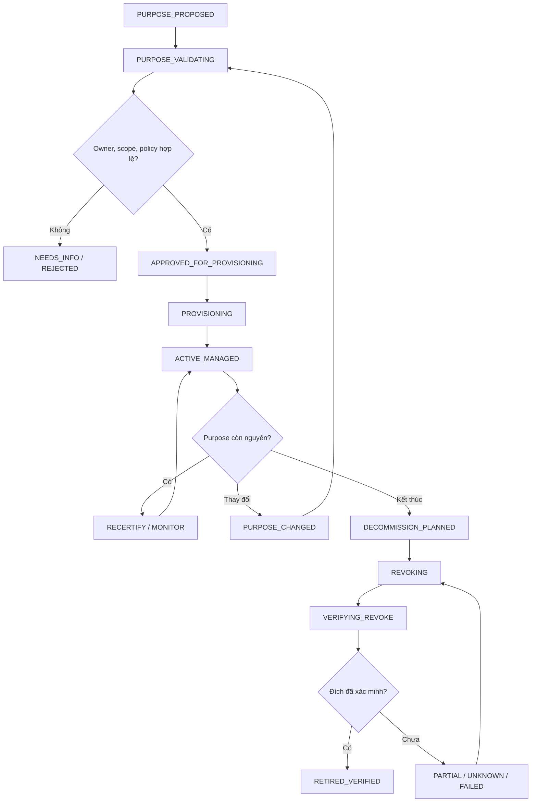
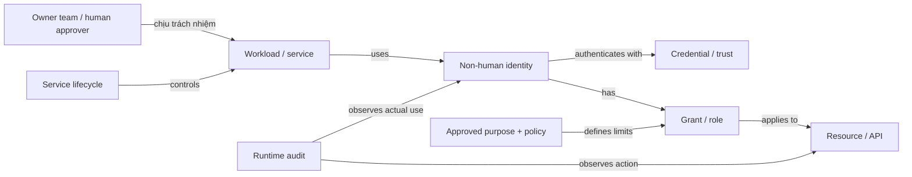

# Mục đích sử dụng Non-human account: Vì sao tài khoản máy tồn tại và phải được giới hạn như thế nào?

**Mục đích sử dụng** (*purpose of use*) của **non-human account** là **nhiệm vụ kỹ thuật hoặc nghiệp vụ cụ thể mà một tài khoản/danh tính không phải con người được tạo để thực hiện**, kèm **workload sử dụng, hệ thống đích, hành động được phép, phạm vi tài nguyên, chủ sở hữu, điều kiện kích hoạt và điểm kết thúc**. Đây là căn cứ để tổ chức quyết định **có cần tạo tài khoản không, nên dùng loại danh tính nào, cấp quyền nào, giám sát ra sao và khi nào phải thu hồi**.

Ví dụ, hệ thống `report-sync` phải ghi báo cáo tổng hợp vào API của một đơn vị mỗi đêm. Một non-human account hợp lệ có thể được dùng để nhận **credential ngắn hạn** và thực hiện đúng thao tác `reports.write` trên `org-17`. Mục đích đó **không** tự biện minh cho quyền `tenant.admin`, xuất toàn bộ dữ liệu khách hàng hoặc dùng cùng credential cho môi trường development và production.

Một ví dụ khác: pipeline CI/CD cần triển khai phiên bản mới lên namespace `orders`. Mục đích phù hợp là **deploy ứng dụng đã qua bước phê duyệt vào phạm vi định trước**, chứ không phải “quản trị toàn bộ cluster khi cần”. Nếu mục đích không đủ rõ, tổ chức rất khó nhận diện quyền thừa, tài khoản dùng chung, credential tồn dư và hành vi vượt phạm vi sau một lần thay đổi nhân sự hoặc kiến trúc.

Bài thuộc chương **Non-human account** của module `SECURITY_IDENTITY_ACCESS_MANAGEMENT_IDENTITY_LIFECYCLE`. Module tìm hiểu quản lý vòng đời danh tính **Joiner–Mover–Leaver (JML)**, từ xác minh, tạo tài khoản và cấp quyền đến rà soát và thu hồi khi thay đổi vai trò; kết nối **IdP, SSO, SCIM, RBAC/ABAC, tài khoản dịch vụ, kiểm toán và giảm quyền truy cập tồn dư**. Với tài khoản máy, vòng đời ứng dụng/dịch vụ là trục chính; JML của con người vẫn ảnh hưởng qua **người sở hữu, người phê duyệt và quyền quản trị credential**.

Sau khi học, bạn có thể phân loại mục đích dùng non-human account; viết một *purpose statement* có thể kiểm chứng; ánh xạ mục đích sang quyền tối thiểu và phương thức xác thực; nhận diện các cách dùng sai như automation bằng tài khoản nhân viên, dùng chung key và admin vĩnh viễn; đồng thời thiết kế quy trình kiểm tra, giám sát, đổi mục đích, chuyển ownership và decommission.

> **Nguyên tắc cốt lõi:** Một non-human account nên có **mục đích xác định, workload được phép sử dụng, chủ sở hữu chịu trách nhiệm, phạm vi quyền tối thiểu và vòng đời kiểm soát được**. “Chạy cho tiện” hoặc “để dùng khi cần” không phải mô tả mục đích đủ để cấp đặc quyền rộng.

## 1. Non-human account là gì?

**Non-human account (NHA)** là tài khoản kỹ thuật không đại diện trực tiếp cho một nhân viên đang đăng nhập tương tác để làm việc thường ngày. Nó thường được **dịch vụ, ứng dụng, job, robot, agent, pipeline hoặc hệ thống** sử dụng để xác thực và thực hiện thao tác tự động.

Một số hình thức:

| Hình thức | Ví dụ | Đặc điểm |
| --- | --- | --- |
| **OS service account** | Account chạy daemon/scheduled task | Gắn với tiến trình trên máy hoặc domain |
| **Database service user** | `order_ingest` | Đăng nhập database để đọc/ghi schema |
| **Application/service principal** | Principal tại cloud/IdP | Có thể gọi API theo quyền ứng dụng |
| **OAuth client** | `billing-batch-client` | Được authorization server nhận diện bằng `client_id` và cơ chế xác thực phù hợp |
| **Cloud managed/workload identity** | Identity gắn với resource/runtime | Workload nhận credential qua nền tảng |
| **Kubernetes ServiceAccount** | `orders/order-worker` | Danh tính pod/workload trong Kubernetes |
| **CI/CD deployment identity** | `deploy-orders-prod` | Tự động build, phát hành hoặc triển khai |
| **SaaS integration/robot account** | Robot đồng bộ CRM | Tích hợp khi ứng dụng chưa có principal máy riêng |
| **Monitoring/backup identity** | `metrics-collector`, `backup-reader` | Thu thập tín hiệu, sao lưu, khôi phục |

**Không có một công nghệ đồng nhất tên “non-human account”** áp dụng cho mọi nền tảng. Có nơi là account, nơi là principal, nơi là service identity hoặc trust giữa workload và token issuer.

### 1.1. Phân biệt năm đối tượng thường bị trộn lẫn

| Đối tượng | Câu hỏi trả lời | Ví dụ |
| --- | --- | --- |
| **Workload** | Phần mềm/job nào cần thực thi? | `report-sync` |
| **Identity/principal** | Hệ thống xác định “ai” gọi API? | `spn-report-sync-prod` |
| **Account** | Đối tượng đăng nhập hoặc đại diện tại target? | `reporting-db-svc` |
| **Credential/trust** | Workload chứng minh danh tính bằng gì? | Managed identity, cert, secret, workload federation |
| **Grant/entitlement** | Principal được phép làm gì? | `reports.write` trên `org-17` |

Một workload có thể dùng nhiều principal: Kubernetes ServiceAccount để gọi API cluster, cloud principal để đọc object storage và DB account để ghi dữ liệu. Một principal cũng có thể có nhiều credential đang tồn tại trong giai đoạn rotation.

**Mục đích sử dụng gắn trước tiên với workload và nhiệm vụ**, sau đó mới ánh xạ sang principal, credential, quyền và tài nguyên. Chỉ nhìn vào tên `svc-prod` không nói được mục đích thực tế.

### 1.2. Khác với tài khoản người dùng

Người dùng có quan hệ HR, chức danh và quyền theo công việc. Workload có **service catalog, owner, environment, lịch triển khai, dependency và vòng đời ứng dụng**.

Non-human account không được phép trở thành cách **né MFA, bỏ qua SoD hoặc giấu ai đã khởi tạo thao tác**. Một người dùng script đăng nhập bằng account máy để duyệt giao dịch thay mình vẫn phải chịu những kiểm tra authorization nghiệp vụ cần thiết.

## 2. Mục đích sử dụng là ranh giới bảo mật, không chỉ một trường mô tả

Một mục đích đầy đủ phải giúp trả lời:

1. **Workload nào** sử dụng danh tính và được triển khai ở đâu?
2. **Nhiệm vụ nào** được ủy quyền: đọc dữ liệu, ghi báo cáo, gửi sự kiện, backup hay deploy?
3. **Tài nguyên nào** là đích: API, bucket, tenant, namespace, database, secret path?
4. **Những hành động nào** được phép; hành động nào phải bị chặn?
5. **Khi nào** được sử dụng: liên tục, theo lịch, trong một change window, hay chỉ khi incident?
6. **Ai chịu trách nhiệm** cho hoạt động và quyền của workload?
7. **Dùng phương thức xác thực nào**, với credential/trust scope và thời hạn gì?
8. **Làm sao xác minh** hoạt động đúng, phát hiện lệch phạm vi và thu hồi khi không còn cần?

Ví dụ so sánh:

| Mô tả mơ hồ | Mô tả mục đích có thể quản trị |
| --- | --- |
| “Account cho automation” | “Worker `invoice-export-prod` chỉ đọc hóa đơn đã chốt thuộc `org-17` mỗi ngày lúc 01:00 và ghi output vào bucket định danh” |
| “Robot CRM” | “Đồng bộ contact đã được phê duyệt từ CRM tenant A sang helpdesk tenant A; không xóa contact và không export tenant khác” |
| “Admin để deploy” | “Pipeline deploy artifact đã được duyệt vào namespace `orders` trong production; không sửa IAM, cluster-wide RBAC hoặc secrets ngoài namespace” |
| “Account sao lưu” | “Backup agent chỉ đọc dữ liệu nguồn, ghi vào repository sao lưu được kiểm soát; không được xóa bản backup” |
| “Tài khoản khẩn cấp” | “Recovery identity dùng để khôi phục IdP khi SSO không sẵn sàng, qua runbook, dual control và hậu kiểm” |

**Mục đích mơ hồ dẫn tới quyền mơ hồ.** Khi principal được cấp admin vì “có thể cần”, doanh nghiệp khó xác định quyền nào thực sự là thừa.

## 3. Những mục đích hợp lệ thường gặp

Một non-human account có thể phục vụ nhiều nhóm nhu cầu, nhưng **mỗi nhóm cần cách cấp quyền và giám sát khác nhau**.

| Nhóm mục đích | Workload điển hình | Quyền cần thiết thường gặp | Sai lầm cần tránh |
| --- | --- | --- | --- |
| **Service-to-service API** | Backend gọi backend | Scope/API permission cụ thể | Dùng admin token cho mọi endpoint |
| **Batch/data processing** | ETL, nightly job | Đọc nguồn, ghi đích theo dataset | Đọc toàn bộ database vì tiện |
| **Tích hợp SaaS** | CRM → ticketing | Quyền đồng bộ đúng object/tenant | Dùng account nhân viên có MFA |
| **CI/CD và deployment** | Build/release runner | Push artifact, deploy environment cụ thể | Một key quyền global admin cho dev và prod |
| **Monitoring/observability** | Metrics/log collector | Đọc metrics/log theo scope | Gán quyền sửa cấu hình production |
| **Backup/restore** | Backup agent, restore worker | Đọc dữ liệu/ghi backup; restore theo workflow riêng | Backup account có quyền xóa mọi bản sao |
| **Infrastructure automation** | IaC provisioning, config agent | Tạo/sửa các resource được duyệt | Admin không giới hạn và không review |
| **Scheduled maintenance** | Cleanup/rotation job | Thao tác cụ thể theo thời gian | Quét/xóa toàn tenant không guardrail |
| **Event/message processing** | Consumer/producer | Publish/consume topic định danh | Quyền quản trị mọi topic |
| **Security automation** | Key rotation, responder | Chặn/rotate đúng target, có audit | Tự phê duyệt và che giấu log |
| **Emergency/recovery** | Break-glass automation | Quyền cao có hạn, kiểm soát bù trừ | Biến quyền khẩn thành standing access |
| **Robot giao diện (RPA)** | Bot thao tác ứng dụng cũ | Quyền quy trình hẹp và attribution | Account dùng chung không owner |

Không phải tất cả mục đích trên đều cần **một loại account mới**. Ví dụ cloud managed identity có thể thay thế một mật khẩu dịch vụ; workload federation có thể giảm phụ thuộc vào client secret tĩnh.

### 3.1. Mục đích có thể hợp lệ nhưng phương án kỹ thuật không phù hợp

Một job có nhiệm vụ đồng bộ dữ liệu hợp lệ, nhưng chạy bằng **username/password của nhân viên** lại có rủi ro:
- Phụ thuộc vào người và việc reset mật khẩu/MFA.
- Khó xác định account đang chạy tự động hay được người dùng.
- Leaver làm job ngừng hoặc để lại credential từng được biết.
- Có thể mang quyền rộng hơn nhu cầu của job.

Phương án tốt hơn thường là **service/workload principal riêng**, owner rõ, credential hoặc federation phù hợp và entitlement được giới hạn.

## 4. Mục đích 1 — Giao tiếp giữa các dịch vụ

Trong hệ thống microservices, dịch vụ A cần gọi API của dịch vụ B để đọc hoặc ghi dữ liệu.

Ví dụ:

```text
order-api
    |
    |  POST /inventory/reservations
    |  principal: order-reservation-prod
    |  action: inventory.reserve
    |  scope: region-vn
    v
inventory-api
```

Một purpose statement hợp lệ:

> Workload `order-api` được phép gọi `inventory.reserve` trên Inventory API trong production, với order ID và tenant do backend xác minh; không được sửa giá tồn kho hoặc quyền quản trị Inventory.

**Điểm bảo mật:**
- Xác thực **đúng workload**, không dùng một shared API key cho mọi service.
- Giới hạn `audience`, `issuer`, resource và action của token.
- Nếu dùng mTLS, vẫn cần **authorization** cho action/resource; certificate hợp lệ không có nghĩa được gọi mọi endpoint.
- Dùng short-lived credentials hoặc managed/federated identity khi nền tảng hỗ trợ.
- Nếu API phục vụ yêu cầu của người dùng, kiểm tra **quyền người dùng** ở nghiệp vụ, không chỉ quyền của backend.

### 4.1. Dịch vụ thay người dùng: *Confused deputy*

Giả sử `report-api` có app-only permission đọc mọi báo cáo vì backend cần tổng hợp. Người dùng Bình chỉ được xem `org-17`, nhưng gọi endpoint:

```text
GET /reports?tenant=org-99
```

Nếu backend chỉ kiểm tra token của **service principal** mà không xác nhận Bình có quyền với `org-99`, ứng dụng có thể thành *confused deputy*: dùng quyền máy rộng để thực hiện hành động mà người dùng không được phép.

Cần phân biệt:
- **Client/workload authorization:** backend nào được gọi service?
- **End-user authorization:** người khởi tạo được làm gì với resource?
- **Business policy/SoD:** giao dịch có được phép trong ngữ cảnh hiện tại không?

**Account máy không thay thế quyết định ủy quyền của người dùng.** Khi sử dụng delegation hoặc on-behalf-of flow, phải kiểm tra đúng ngữ nghĩa và ràng buộc của từng nền tảng; không tự suy rằng mọi app-only token đều đại diện cho người dùng.

## 5. Mục đích 2 — Batch, ETL và scheduled jobs

Batch/ETL thường cần đọc dữ liệu, biến đổi và ghi kết quả mà không có người đăng nhập mỗi lần chạy.

Ví dụ job `monthly-finance-aggregation`:
- Đọc giao dịch đã chốt từ database `finance-read-replica`.
- Tổng hợp theo chính sách dữ liệu.
- Ghi bảng kết quả vào kho báo cáo `finance-mart`.
- Chạy theo lịch mỗi đêm hoặc cuối tháng.
- Có owner Finance Data Engineering.

| Quyền | Có cần cho mục đích trên? | Lý do |
| --- | --- | --- |
| `SELECT` trên view giao dịch đã phê duyệt | Có | Cần đọc input |
| `INSERT/UPDATE` vào bảng tổng hợp | Có, giới hạn đích | Cần ghi output |
| `DROP DATABASE` | Không | Không phục vụ tổng hợp |
| `ALTER USER` | Không | Không liên quan nhiệm vụ |
| `EXPORT ALL TENANTS` | Không nếu job chỉ làm một đơn vị | Phạm vi quá rộng |
| `READ SECRET VAULT ALL` | Không | Chỉ cần secret path tương ứng |

### 5.1. Quyền và độ tin cậy dữ liệu

Với job nhạy cảm, nên quản lý:
- Data classification và phạm vi nguồn.
- Quyền đọc/ghi **từng schema, table, bucket hoặc view**.
- Chống sử dụng output chưa được phê duyệt.
- Log các run với `jobRunId`, source/destination và outcome.
- Idempotency và kiểm soát retry để không ghi trùng hay xử lý sai.
- Kế hoạch rotate credential không phá scheduled job.

**Job chạy ban đêm không phải lý do cấp quyền không giới hạn thời gian.** Quyền có thể thường trực nếu cần cho vận hành và đã được đánh giá; nhưng nên xem xét credential ngắn hạn, scope hẹp và review khi job thay đổi.

## 6. Mục đích 3 — Tích hợp SaaS và đồng bộ hệ thống

Một integration service có thể đồng bộ dữ liệu giữa CRM, HRIS, hệ thống ticketing hoặc reporting.

Ví dụ:

```text
HRIS --approved worker event--> integration-worker
integration-worker --SCIM/API--> collaboration-saas
```

**Mục đích:** Tạo/cập nhật/vô hiệu tài khoản SaaS theo sự kiện từ nguồn nhân sự có thẩm quyền, trong tenant được quản trị.

Những vấn đề phải quyết định:
- Integration principal có được **create, update, disable** user hay chỉ đọc?
- Nó được thao tác **mọi user** hay chỉ tổ chức/nhóm được quản trị?
- Có cần quyền cấp role admin không?
- Nguồn dữ liệu nào có thẩm quyền khi HR và SaaS mâu thuẫn?
- Làm sao đối soát khi connector lỗi, trả 202 hoặc một phần?
- Có thể rollback hoặc xử lý sai mapping mà không cấp nhầm quyền?

### 6.1. SCIM hỗ trợ provisioning, không tự giải thích mục đích

**SCIM** có mô hình và giao thức hỗ trợ quản lý user/group ở những hệ thống triển khai nó. Nó **không tự quyết định** non-human account của connector nên được cấp quyền nào; cũng không bảo đảm mọi SaaS hỗ trợ cùng permission model.

Một integration credential có quyền **disable nhân viên** là quyền rất nhạy cảm. Phải lưu purpose, owner, approval, audit, limit scope và kiểm thử hành động chéo tenant.

### 6.2. Không dùng credential cá nhân cho connector

Nếu một connector SaaS chỉ hỗ trợ robot account mang định dạng user, vẫn cần:
- Định danh như **non-human account** trong inventory.
- Tên và email/alias không gây nhầm với nhân viên thật.
- Owner team, credential vault và rotation.
- Hạn chế interactive login nếu ứng dụng hỗ trợ.
- MFA/SSO và các chính sách xác thực theo khả năng hệ thống; không xây bot tự vượt MFA.
- Kế hoạch thay bằng application principal khi sản phẩm hỗ trợ.

## 7. Mục đích 4 — CI/CD, build và triển khai

Một pipeline có thể cần đọc source, build artifact, đẩy lên registry và deploy. Những bước này **không nhất thiết dùng cùng một identity**.

| Bước | Mục đích | Quyền hợp lý |
| --- | --- | --- |
| Build | Lấy dependency, tạo artifact | Read source/registry phù hợp |
| Artifact publish | Đẩy artifact đã được kiểm tra | Push một registry/repository |
| Staging deploy | Cập nhật môi trường staging | Deploy staging scope |
| Production deploy | Áp release đã được duyệt | Deploy production target có điều kiện |
| Infra provisioning | Tạo tài nguyên IaC theo kế hoạch | Resource-specific create/update |
| Security scan | Đọc config/artifact để kiểm tra | Read-only theo phạm vi |

### 7.1. Vì sao tách danh tính theo environment?

Nếu cùng một secret cho phép build từ pull request ở môi trường dev và deploy production, mã chưa đáng tin có thể tiếp cận quyền rất cao. Nên tách:
- `build-principal`.
- `deploy-staging`.
- `deploy-prod`.

Quyền production cần ràng buộc theo **trusted branch/repository/environment**, protected approvals và artifact provenance phù hợp.

### 7.2. Workload federation trong CI/CD

Thay cho static cloud key, một CI job có thể trao đổi OIDC token được phát cho job hợp lệ lấy credential ngắn hạn. Trust policy phải giới hạn:
- Issuer được tin cậy.
- Audience phù hợp.
- Subject/job/repository/branch/environment đáp ứng điều kiện.
- Thời hạn token và resource role tối thiểu.

**Dùng federation không tự an toàn** nếu trust rule chấp nhận quá rộng, chẳng hạn mọi job từ repository không được bảo vệ đều có thể assume production role.

### 7.3. Mục đích deploy không phải quản trị danh tính

Trừ khi đang triển khai hạ tầng IAM với approval riêng, pipeline deploy ứng dụng không cần mặc định quyền:
- Tạo global admin.
- Thay policy security toàn organization.
- Đọc mọi secrets.
- Xóa audit logs.
- Cấp quyền cho chính nó.

Nếu deployment cần những thao tác nhạy cảm này, nên **tách workflow và approvals**, không mở rộng vĩnh viễn purpose “deploy”.

## 8. Mục đích 5 — Monitoring, logging và observability

Monitoring agents thu thập:
- Metrics hệ thống và ứng dụng.
- Logs theo scope.
- Health checks.
- Traces và events.
- Trạng thái service phục vụ cảnh báo.

Thông thường, account monitoring nên ưu tiên **read-only** theo target cụ thể. Nhưng thực tế có một số agent cần ghi logs/metrics vào nền tảng quan sát; cần phân biệt:

| Đường truy cập | Hành động | Rủi ro |
| --- | --- | --- |
| Agent → monitored service | Đọc health/metrics | Có thể lộ thông tin nội bộ nếu quá rộng |
| Agent → observability backend | Ghi telemetry | Có thể ghi dữ liệu giả nếu bị chiếm |
| Dashboard user → observability | Đọc logs/traces | Có thể chứa PII/secret nếu không redaction |
| Automation responder → target | Restart hoặc block | **Không còn là monitoring read-only** |

**Điểm quan trọng:** một bot có quyền **thực thi phản ứng** (restart, quarantine, revoke key) thuộc lớp automation/remediation; nó cần purpose và kiểm soát chặt hơn collector chỉ đọc.

### 8.1. Không để log reader có quyền sửa log

Một principal vừa có thể thực hiện thay đổi production vừa xóa/sửa log về thay đổi đó tạo rủi ro SoD. Phân tách **operator identity** và **audit/log administration identity** nếu chính sách yêu cầu.

## 9. Mục đích 6 — Sao lưu và khôi phục

Backup workload cần đặc quyền đủ để truy xuất dữ liệu, tạo bản sao và kiểm tra tính toàn vẹn. Restore có thể cần **quyền ghi/ghi đè nhạy cảm hơn**.

| Tác vụ | Quyền hợp lý | Kiểm soát bổ sung |
| --- | --- | --- |
| Backup | Read dữ liệu, write backup destination | Bảo vệ backup khỏi sửa/xóa tùy tiện |
| Verify backup | Read metadata/bản sao để kiểm tra | Log kết quả integrity |
| Restore test | Read backup, write môi trường thử nghiệm | Không dùng tài nguyên production nếu không cần |
| Production restore | Đọc backup và ghi đè target được chọn | Change approval, phạm vi/time window, hậu kiểm |
| Retention cleanup | Xóa bản sao quá hạn theo policy | Tách khỏi identity backup khi phù hợp |

### 9.1. Backup không nhất thiết cần quyền xóa bản sao

Nếu backup principal bị chiếm đoạt mà có quyền xóa cả backup repository, khả năng phục hồi của tổ chức giảm nghiêm trọng. Nên giới hạn quyền ghi, thiết kế retention/immutability theo khả năng sản phẩm và tách quyền quản trị/xóa.

### 9.2. Recovery identity

Một số tổ chức cần principal khẩn để restore khi IdP hoặc control plane gặp sự cố. Đó là **mục đích khẩn có điều kiện**, không nên dùng recovery account cho batch hàng ngày.

Phải xác định:
- Khi nào được kích hoạt.
- Ai có thẩm quyền và cơ chế dual control.
- Scope/resource nào có thể khôi phục.
- Secret được bảo vệ và kiểm thử như thế nào.
- Hết incident, thu hồi/rotate/verify ra sao.
- Cách giữ lại **đường cứu hộ được bảo vệ** cho sự cố sau.

## 10. Mục đích 7 — Infrastructure as Code và configuration management

IaC automation có thể tạo tài nguyên, sửa cấu hình hạ tầng và quản lý role. Đây là nhóm rất mạnh vì **một sai sót policy hoặc pipeline** có thể ảnh hưởng nhiều service.

Mục đích cần nêu:
- Hạ tầng nào được quản lý?
- Những module/project và môi trường nào?
- Workflow thay đổi có approval và plan review không?
- Principal có thể thay đổi IAM roles/policies nào?
- Có quyền destroy hay chỉ update trong phạm vi?
- Có được đọc secrets plaintext không?
- Làm sao audit ai phê duyệt thay đổi và pipeline run nào thực thi?

Một account `terraform-global-admin` dùng chung cho dev, staging và prod thường có **blast radius lớn**. Nên tách principal theo environment và resource domain khi có thể, giới hạn trust/credential lifetime và dùng phê duyệt phù hợp.

### 10.1. Tránh tự tăng quyền

Nếu pipeline có thể sửa policy cấp quyền cho **chính principal của nó**, một lỗi hoặc kẻ tấn công có thể tăng đặc quyền. Cần các ràng buộc độc lập: separation of duties, permission boundaries, policy checks, protected change approvals hoặc control plane guardrails theo nền tảng.

## 11. Mục đích 8 — Security automation và phản ứng sự cố

Security automation có thể:
- Khóa một account bị nghi compromise.
- Thu hồi token hoặc API key.
- Quarantine một workload.
- Rotate credential.
- Thay firewall rule theo playbook.
- Thu thập bằng chứng audit.

Khác với monitoring, đây là **quyền thay đổi trạng thái bảo mật** và cần:
1. Trigger tin cậy, rule version và phạm vi incident.
2. Kiểm tra độ tin cậy của tín hiệu trước hành động có tác động lớn.
3. Giới hạn đối tượng và quyền có thể thay đổi.
4. Approval/dual control cho action nguy hiểm khi policy yêu cầu.
5. Idempotency, rollback và runbook xử lý false positive.
6. Audit độc lập, không cho automation tự xóa dấu vết.
7. Hạn chế time window hoặc JIT nếu phù hợp.

**Không nên cấp account bảo mật quyền toàn hệ thống chỉ vì “phản ứng sự cố có thể cần mọi thứ”**. Có thể tách những playbook cụ thể, role đặc quyền và đường emergency có kiểm soát.

## 12. Mục đích 9 — Non-human account cho truy cập khẩn cấp

Không phải mọi account máy chạy liên tục. Một số **emergency/break-glass accounts** chỉ dùng khi quy trình bình thường không sẵn sàng.

Phân biệt:
- **Emergency human operator account:** có thể là account kỹ thuật đặc biệt được người có trách nhiệm sử dụng, cần attribution.
- **Recovery workload principal:** automation thực thi khôi phục theo runbook.
- **Vault-controlled credential:** credential tạm được tiết lộ cho thao tác khẩn.
- **JIT privileged role:** quyền có thể chỉ active trong cửa sổ được duyệt.

Một purpose statement tốt có thể là:

> Recovery identity `idp-recovery-01` chỉ dùng để khôi phục IdP khi phương thức đăng nhập quản trị tiêu chuẩn không hoạt động; mọi lần sử dụng phải có incident reference, người giám sát độc lập, ghi audit theo khả năng và thu hồi/rotate credential sau sử dụng.

### 12.1. “Khẩn cấp” không phải mục đích thường trực

Nếu một account break-glass được dùng mỗi tuần để triển khai do quy trình bình thường bất tiện, đây là tín hiệu **misuse**. Hệ thống cần giải quyết nguồn gốc: quy trình provisioning thiếu quyền đúng, automation chưa đủ, hoặc policy không phù hợp; không hợp thức hóa bằng KEEP vô thời hạn.

## 13. Những mục đích **không** nên dùng để biện minh cho non-human account

Một số mô tả che giấu rủi ro:

| Lý do được đưa ra | Vì sao không đủ | Cách xử lý phù hợp |
| --- | --- | --- |
| “Để khỏi phải dùng MFA” | Tránh kiểm soát người dùng | Thiết kế machine authentication phù hợp, không bypass người |
| “Dùng chung cho cả nhóm” | Không quy được ai thao tác | Danh tính cá nhân hoặc workload riêng, attribution |
| “Tài khoản admin dự phòng hằng ngày” | Đặc quyền thường trực ngoài quy trình | Tách nhiệm vụ thường ngày và break-glass |
| “Cần để chạy script” | Chưa nói script làm gì, ở đâu | Mô tả workflow, target, action và scope |
| “Cho tất cả ứng dụng nội bộ” | Không có ranh giới resource | Principal/credential theo app và trust domain |
| “Để khỏi làm hỏng job khi nhân viên nghỉ” | Đúng vấn đề nhưng sai phương án nếu dùng secret cá nhân | Workload identity có owner team và rotation |
| “Tự cấp quyền khi cần” | Có nguy cơ privilege escalation | Approval policy và permission boundary |
| “Tự duyệt để pipeline nhanh hơn” | Rủi ro SoD | Separate request/approve/execute |
| “Dùng secret không hết hạn cho ổn định” | Tăng hậu quả khi key bị lộ | Rotation, federation hoặc short-lived credentials |
| “Không ai nhớ account để làm gì” | Không có căn cứ quản trị | Quarantine/triage owner và dependency trước quyết định |

**Tài khoản máy hợp lệ phải có nhiệm vụ độc lập với nhu cầu tiện lợi của một cá nhân**. Đặc quyền không thể được giữ chỉ vì thiếu documentation.

## 14. Viết purpose statement có thể thực thi bằng policy

Một **purpose statement** nên là bản cam kết giữa business/service owner, IAM và API/resource owner. Tối thiểu có:

| Trường | Ý nghĩa |
| --- | --- |
| `workloadId` | Workload thực dùng account |
| `businessPurpose` | Giá trị nghiệp vụ/nhiệm vụ |
| `technicalOperation` | API/action cụ thể |
| `principalType` | Service account, managed identity, OAuth client… |
| `targetResources` | API, database, bucket, tenant, namespace |
| `environment` | Dev/staging/prod và trust domain |
| `allowedActions` | Quyền tối thiểu được phép |
| `explicitlyDisallowedActions` | Các thao tác nguy hiểm cần chặn |
| `triggerAndSchedule` | Job, event, on-demand, incident |
| `identityOwner/backupOwner` | Người/đội quản trị và dự phòng |
| `resourceOwner` | Bên quyết định permission |
| `authMethod` | Federation, mTLS, vault-backed secret… |
| `grantSource/approvalRef` | Vì sao được cấp quyền |
| `validity/reviewSchedule` | Mốc đánh giá, TTL grant/credential nếu có |
| `auditRequirements` | Event, run ID, initiator, outcome |
| `decommissionCondition` | Khi nào purpose không còn hiệu lực |

### 14.1. Mẫu cấu hình minh họa

Đây là **ví dụ schema nội bộ**, không phải chuẩn SCIM/OAuth hay policy engine cụ thể:

```yaml
purposeId: purpose-report-sync-v3
workloadId: report-sync
principalId: spn-report-sync-prod
category: DATA_SYNCHRONIZATION
businessPurpose: Publish approved reporting aggregates
technicalOperation:
  - method: POST
    endpointRef: reporting-api/reports
    action: reports.write
targetResources:
  - reporting-api/org-17
environment: production
schedule: daily-01-00-utc
owner:
  teamId: analytics-platform
  technicalOwnerIdentityId: iam-user-1042
  backupOwnerIdentityId: iam-user-1180
approval:
  resourceOwnerTeamId: reporting-api
  requestRef: AR-2059
authentication:
  method: WORKLOAD_FEDERATION
  trustRef: trust-report-sync-prod
  credentialLifetimePolicyRef: short-lived-prod
authorization:
  allowedActions:
    - reports.write
  deniedActions:
    - tenant.admin
    - reports.delete
    - users.manage
  resourceScope:
    tenantId: org-17
lifecycle:
  registrationStatus: APPROVED
  reviewDueAt: "2027-02-01T00:00:00Z"
  retireWhen: workload-decommissioned
observability:
  auditCorrelationField: jobRunId
  expectedUsageProfile: scheduled-batch
```

**Tên quyền, endpoint và thời hạn đều là minh họa.** Schema thật phải phù hợp API/target và phân biệt những **explicit deny thực sự được enforce** với những mong muốn chỉ viết trong tài liệu.

### 14.2. Purpose statement không phải bí mật

Không lưu password, private key hoặc token trong tài liệu mô tả mục đích. Chỉ lưu **credential reference/trust policy ID** và phân quyền xem metadata theo mức nhạy cảm.

## 15. Từ mục đích sang entitlement: Quy trình ánh xạ least privilege

Không nên cấp permission theo tên account hoặc team chung. Quy trình:

1. **Xác định hành động cần có** từ nghiệp vụ, ví dụ `reports.write`.
2. **Xác định tài nguyên** và scope, ví dụ `reporting-api/org-17`.
3. **Xác định thời điểm sử dụng**, lịch chạy, môi trường và điều kiện kích hoạt.
4. **Chọn role/entitlement nhỏ nhất** có thể đáp ứng.
5. **Kiểm tra role inheritance**, direct grants và resource policies có tạo quyền thừa không.
6. **Kiểm tra SoD** nếu workload có thể tạo, duyệt và thực thi một quy trình nhạy cảm.
7. **Phê duyệt** bởi owner có thẩm quyền.
8. **Provision** qua API/IaC/connector phù hợp.
9. **Readback** quyền được cấp và kiểm tra những action trọng yếu.
10. **Lên lịch review và revoke** khi purpose đổi hoặc hết.

### 15.1. Ví dụ quyền cần và không cần

Một job cần **đọc log của dịch vụ orders**:

| Permission | Đánh giá |
| --- | --- |
| `logs.read` trên `orders-prod` | Cần |
| `metrics.read` trên `orders-prod` | Có thể cần nếu mục đích bao gồm metrics |
| `logs.delete` | Không cần |
| `iam.policy.write` | Không cần |
| `secrets.readAll` | Không cần |
| `cluster.admin` | Không cần |
| `logs.read` toàn tổ chức | Quá rộng nếu chỉ giám sát một service |

**Không nên dựa vào “role viewer” chung mà bỏ qua khả năng viewer xem dữ liệu nhạy cảm ở tenant khác**. Least privilege có cả chiều action và resource scope.

### 15.2. Role không đủ biểu diễn mục đích

RBAC cung cấp role; ABAC/PBAC có thể thêm điều kiện:
- `subject.workloadId == report-sync`.
- `resource.tenantId == org-17`.
- `environment == production`.
- Token có issuer/audience tin cậy.
- Job chạy theo cửa sổ được phê duyệt nếu policy yêu cầu.
- Không có deny hoặc incident restriction hiện hành.

**Một annotation “purpose=reporting” không tự trở thành kiểm soát bảo mật** nếu PDP/PEP/target không thực sự dùng nó.

## 16. Lựa chọn phương thức xác thực theo mục đích

Không có một phương thức phù hợp cho mọi tài khoản máy. Mục đích và môi trường quyết định yêu cầu.

| Cơ chế | Phù hợp khi | Điểm cần quản trị |
| --- | --- | --- |
| **Managed identity** | Workload chạy trên nền tảng hỗ trợ identity gắn resource | Native principal, role scope, runtime binding |
| **Workload federation** | CI/CD/Kubernetes/ứng dụng có issuer tin cậy | Issuer, subject/audience restrictions, trust expiry |
| **mTLS/certificate** | Service-to-service có PKI và runtime phù hợp | Cert issuer, trust domain, private key lifecycle |
| **OAuth client credentials** | Workload gọi API với application permissions | Client authentication, scopes/roles, token audience/expiry |
| **Vault dynamic credentials** | DB/service hỗ trợ cấp credential tạm | Lease, TTL, revoke, target scope |
| **Static secret/password** | Hệ thống cũ hoặc nơi chưa hỗ trợ phương án tốt hơn | Vault, rotation, hạn quyền, tránh hardcode |
| **SSH key/service account** | Automation vào host có kiểm soát | Host scope, key rotation, chặn interactive misuse |
| **Short-lived signed token** | Runtime có issuer/verification phù hợp | Claims, time, audience, replay controls |

**Ưu tiên giảm credential tĩnh khi khả thi**, nhưng một token ngắn hạn với role global admin vẫn là quyền rất mạnh. Authentication tốt không thay thế authorization.

### 16.1. OAuth Client Credentials không phải quyền của người dùng

Trong OAuth 2.0 Client Credentials, client xin access token dựa trên danh tính của chính nó cho các tài nguyên được ủy quyền. Không có user tương tác làm nguồn phê duyệt trong từng token request.

Vì vậy:
- Application permissions phải được API/resource owner cho phép.
- API phải kiểm `issuer`, `audience`, `scope/roles` và policy.
- Token không được chuyển cho API không thuộc audience.
- Service nên giữ token/secret an toàn; không log.
- Không dùng app-only token để vượt các kiểm soát “người nào được sửa dữ liệu này”.

### 16.2. mTLS xác thực kênh hoặc workload, nhưng không tự cấp quyền nghiệp vụ

Một client có certificate hợp lệ có thể được xác thực, nhưng server vẫn phải quyết định nó có được **xóa dữ liệu, duyệt thanh toán hoặc đổi policy** không. Không đồng nhất “mutual TLS thành công” với “mọi API call được phép”.

### 16.3. Tài khoản OS/DB cũ

Nếu ứng dụng chỉ hỗ trợ password của service user:
- Giới hạn quyền đăng nhập tương tác khi có thể.
- Dùng vault/secret manager, không hardcode trong repo.
- Tránh dùng cùng password cho dev/prod.
- Tạo rotation plan có dependency inventory.
- Phân tách app service accounts theo chức năng/tài nguyên.
- Theo dõi việc dùng account qua service/job.

## 17. Scope và môi trường: Mục đích phải có ranh giới

Một principal chỉ được cấp `reports.write` nhưng trên **mọi tenant** vẫn có thể quá rộng. Ranh giới cần xem:
- Tenant hoặc legal entity.
- Project/subscription/account.
- Region.
- Namespace/cluster.
- Database/schema/table.
- Bucket/prefix.
- API route/action/resource ID.
- Environment dev/staging/prod.
- Định danh deployment, repository, branch hoặc job được phép sử dụng credential.

### 17.1. Dev và production

Không nên để code thử nghiệm tùy ý dùng credential production. Ví dụ:
- `report-sync-dev` chỉ vào test data.
- `report-sync-prod` chỉ vào production API có quyền được duyệt.
- Trust conditions của production giới hạn nguồn token, protected environment và owner.
- Secret vault paths được phân tách; log dev không chứa prod credential.

### 17.2. Scope rộng tạo blast radius

Khi account bị lộ:
- Một principal chỉ đọc một bucket có tác động khác principal có thể sửa mọi IAM policies.
- Một key dùng chung trên 50 services làm khó phân tích sự cố và rotate.
- Một principal xuyên tenant có thể chuyển rủi ro giữa môi trường.

Mục đích sử dụng là căn cứ đầu tiên để **chặn scope không cần thiết ngay từ lúc yêu cầu**, trước khi IAM provision.

## 18. Ownership: Ai chịu trách nhiệm khi “người dùng” là máy?

Dù account không phải con người, **trách nhiệm quản trị phải thuộc về người/đội cụ thể**.

| Vai trò | Trách nhiệm |
| --- | --- |
| **Workload/service owner** | Xác nhận nghiệp vụ còn cần và workload còn sống |
| **Technical owner** | Vận hành, rotate credential, xử lý lỗi |
| **Backup owner/team** | Tiếp quản khi owner vắng mặt hoặc Leaver |
| **API/resource owner** | Phê duyệt action, data classification, tenant scope |
| **IAM/Security** | Chính sách, SoD, review và giám sát ngoại lệ |
| **Target/platform owner** | Provision/revoke/readback đúng hệ thống |
| **Incident/Change owner** | Quyết định dùng quyền khẩn/production changes khi có |

**Người tạo account không mặc nhiên là owner lâu dài**. Một kỹ sư có thể tạo principal theo ticket cho đội khác; ownership phải có bằng chứng bàn giao.

### 18.1. Không dùng email làm nguồn duy nhất

Owner email có thể đổi hoặc account bị disable khi Leaver. Nên gắn **team ID và identity ID**, có backup, thay vì lưu một địa chỉ tự do mà không ai chịu trách nhiệm.

### 18.2. Không thể có mục đích “không ai sở hữu”

Nếu principal không có workload/owner được xác minh, tổ chức không thể đánh giá nó còn cần hay không. Đây là finding như `OWNER_UNVERIFIED` hoặc `ORPHAN_SUSPECTED`. Cần điều tra dependencies trước khi retire, không tự đánh dấu KEEP vô hạn hoặc xóa ngay production principal.

## 19. Quan hệ mục đích với vòng đời non-human account

Một mục đích sử dụng có **điểm bắt đầu, thay đổi và kết thúc**. Vòng đời tham khảo:

| Trạng thái | Ý nghĩa |
| --- | --- |
| `PURPOSE_PROPOSED` | Có nhu cầu nhưng chưa phê duyệt |
| `PURPOSE_VALIDATING` | Kiểm tra workload, owner, scope và risk |
| `APPROVED_FOR_PROVISIONING` | Quyền được duyệt theo mục đích xác định |
| `PROVISIONING` | Tạo principal/credential/grants |
| `ACTIVE_MANAGED` | Workload đang dùng quyền đúng purpose |
| `PURPOSE_CHANGED` | Nhiệm vụ, environment hoặc tài nguyên đã đổi |
| `REVIEW_REQUIRED` | Cần tái xác nhận owner/quyền/credential |
| `DECOMMISSION_PLANNED` | Workload sắp ngừng hoặc principal sắp thay |
| `REVOKING` | Đang thu hồi quyền/trust/credential |
| `VERIFYING_REVOKE` | Đang đọc lại trạng thái đích |
| `RETIRED_VERIFIED` | Không còn những đường truy cập cần thu hồi, có evidence |
| `UNKNOWN/EXCEPTION` | Thiếu dữ liệu hoặc lệch chuẩn được quản trị riêng |

**Các trạng thái mang tính thiết kế**, không phải giá trị chuẩn của SCIM/IdP. Cần theo dõi status của từng target/credential riêng, tránh đánh dấu tổng thành công khi còn một token hoặc direct grant hoạt động.

### 19.1. State machine minh họa



Không cho một callback `APPROVED_FOR_PROVISIONING` cũ tự **tái cấp quyền** sau `RETIRED_VERIFIED` hoặc khi có incident/Leaver thay đổi eligibility.

## 20. Mục đích và Joiner–Mover–Leaver của con người

**Service identity có lifecycle riêng**, nhưng JML của con người liên quan rất chặt qua quyền tạo, dùng, quản lý và phê duyệt non-human account.

| Sự kiện | Tác động đúng đối với NHA |
| --- | --- |
| **Joiner vào đội vận hành** | Cấp quyền quản trị workload/vault theo nhiệm vụ mới; không tự biết mọi secret |
| **Mover đổi đội** | Gỡ quyền quản trị account máy/CI/CD cũ, chuyển owner hoặc reviewer |
| **Leaver** | Vô hiệu quyền cá nhân; kiểm tra secret họ từng biết, rotate khi cần; chuyển owner |
| **Rehire** | Không tự phục hồi quyền admin hoặc credential cũ |
| **Nhà thầu hết hợp đồng** | Gỡ quyền cá nhân, đánh giá việc họ đã giữ key/approval |
| **Owner team tái tổ chức** | Xác nhận owner kế nhiệm và review access purpose |

### 20.1. Không xóa service account chỉ vì người tạo đã Leaver

Giả sử An tạo `billing-batch-prod` hai năm trước, hiện đã nghỉ việc. Job vẫn phục vụ thanh toán hợp lệ. Hành động đúng:
1. Xác minh workload còn cần.
2. Chuyển ownership sang team và owner mới.
3. Gỡ quyền quản trị của An tại IdP, CI/CD, vault, target.
4. Rotate/revoke credential An có thể đã biết hoặc xuất được.
5. Review permission/SoD của principal.
6. Giữ account nếu purpose vẫn hợp lệ; lên kế hoạch thay nếu cần.

**Một service account có mục đích tồn tại độc lập với người tạo**, nhưng không được tiếp tục mà thiếu owner.

### 20.2. Không tự giữ quyền khi purpose của workload mất

Nếu dự án đã ngừng, principal không được giữ role chỉ vì owner vẫn là nhân viên ACTIVE. Đây là **Service Leaver** theo vòng đời workload: decommission và thu hồi quyền đã hết căn cứ.

## 21. Purpose change: Khi workload thay đổi chức năng

Mục đích sử dụng có thể đổi khi:
- ETL chuyển sang dữ liệu nhạy cảm hơn.
- Job chỉ đọc bắt đầu sửa/xóa.
- Integration thêm tenant mới.
- Pipeline staging cần production deploy.
- Backup job thêm khả năng restore.
- Monitoring agent được giao auto-remediation.
- API client chuyển từ user-delegated sang application permission.
- Một workload được tách thành hai service.

Không nên sửa một chuỗi `purpose` rồi coi grant cũ tự hợp lệ. Cần **thẩm định lại**:

| Thay đổi | Tác động cần review |
| --- | --- |
| Action mới | Permission, SoD và risk tier |
| Resource/tenant mới | Data owner và phạm vi pháp lý |
| Environment mới | Trust, credential, phê duyệt production |
| Auth method mới | Rotation, issuer/audience và trust policy |
| Workload owner đổi | Thẩm quyền review/credential |
| Tần suất chạy đổi | Usage monitoring và rate limits |
| Thay business process | Need-to-know và entitlement còn hợp lệ |
| Workload ngừng | Decommission không chờ kỳ review |

### 21.1. Phân biệt “mục đích đổi” và “triển khai version mới”

Một bản vá không đổi chức năng/scope có thể không cần access review đầy đủ. Nhưng nếu bản mới thêm permission, data category hoặc đường API nhạy cảm, cần **reapproval theo mức thay đổi thực tế**.

### 21.2. Không mở rộng trust ngầm

Nếu CI/CD đổi repository, branch hoặc environment, workload federation trust phải được cập nhật **theo điều kiện mới đã duyệt**, không tạm mở cho mọi repository để job chạy rồi quên thu hẹp.

## 22. Kiểm kê mục đích và dấu vết sử dụng thực tế

Một purpose statement tự khai báo chỉ có giá trị khi đối soát với thực tế.

### 22.1. Tín hiệu cần thu thập

- Principal native ID, canonical identity ID.
- Workload/runtime/deployment reference.
- API/resource, action, tenant và environment đã dùng.
- Auth method, credential ID/trust ref (không lưu secret).
- Issuer/audience/subject constraints khi có.
- Job run ID, CI commit/release hoặc incident/change ID.
- Observed time, source system, policy version.
- Result: Permit/Deny, request accepted, transaction committed khi có.
- Owner và approved purpose version.

### 22.2. Mẫu event minh họa

```json
{
  "eventId": "nha-usage-8821",
  "serviceIdentityId": "spn-report-sync-prod",
  "workloadId": "report-sync",
  "purposeVersion": "purpose-report-sync-v3",
  "jobRunId": "run-20261123-0100",
  "target": "reporting-api",
  "action": "reports.write",
  "resourceScope": "org-17",
  "decision": "PERMIT",
  "requestOutcome": "COMMITTED",
  "observedAt": "2026-11-23T01:01:28Z",
  "policyVersion": "reporting-authz-v8"
}
```

Chỉ dùng fields cần thiết. **Không log access token, cookie, password, private key, session secret hoặc payload chứa dữ liệu nhạy cảm không cần thiết**.

### 22.3. So sánh declared purpose với observed usage

| Approved purpose | Usage thực tế | Đánh giá |
| --- | --- | --- |
| `reports.write` ở `org-17` | Ghi báo cáo `org-17` | Phù hợp trong phạm vi quan sát |
| Chỉ read metrics | Gọi API `alerts.delete` | Usage ngoài purpose |
| Chỉ production deploy `orders` | Deploy namespace `payments` | Cross-resource anomaly |
| Chỉ nightly batch | Đăng nhập tương tác từ máy cá nhân | Cần điều tra loại credential và actor |
| Chỉ client credentials | Password sign-in vào admin UI | Dấu hiệu account misuse |
| Chỉ staging | Token production được cấp | Trust/permission drift |
| Chỉ backup | Xóa backup repository | Rủi ro cao |
| Chỉ recovery khi incident | Hoạt động thường ngày | Break-glass misuse |

**Một sự kiện bất thường là tín hiệu điều tra, không tự chứng minh có gian lận**. Cần kiểm tra sự kiện khẩn hợp lệ, lỗi mapping, test được duyệt, độ tin cậy log và thời gian policy hiệu lực.

### 22.4. Không có log chưa chắc không được sử dụng

Hệ thống có thể thiếu telemetry, job chạy cuối quý, hoặc identity chỉ phục vụ DR. Trước khi thu hồi vì “dormant”, cần xác định log coverage, lịch job và owner.

## 23. Kiểm soát hành vi vượt mục đích

Có thể triển khai kết hợp:

| Kiểm soát | Mục tiêu |
| --- | --- |
| **Permission/role boundaries** | Không cho principal thực hiện action ngoài phạm vi |
| **ABAC/PBAC** | Kiểm tra tenant, environment, resource và context |
| **Token audience/scope** | Không sử dụng token ở dịch vụ không phù hợp |
| **Workload federation conditions** | Chỉ job/issuer/branch được duyệt được lấy token |
| **Network/service identity policies** | Giới hạn đường kết nối và caller/callee |
| **Credential vault/rotation** | Bảo vệ phương tiện xác thực, giảm lifetime |
| **Usage monitoring** | Phát hiện action/target/giờ sử dụng khác purpose |
| **Pre-grant SoD/policy check** | Ngăn tổ hợp quyền xung đột |
| **Reconciliation** | Phát hiện quyền trực tiếp, grant ngoài catalog |
| **Recertification** | Owner xác nhận purpose và grants còn hợp lệ |
| **Incident response** | Containment, credential revoke và điều tra misuse |

**Mục đích nằm trong metadata không đủ làm security control** nếu hệ thống đích không thực thi các giới hạn tương ứng.

### 23.1. Account máy có thể bị dùng để login tương tác

Tùy nền tảng, một service account có thể có password và quyền đăng nhập console. Nếu purpose chỉ là chạy daemon, nên:
- Hạn chế interactive login khi khả thi.
- Dùng account quản trị cá nhân + PAM/JIT cho thao tác con người.
- Ghi audit về người khởi tạo.
- Cảnh báo login bất thường.
- Không dùng cùng account máy để “hỗ trợ production cho nhanh”.

## 24. SoD với non-human account

**Separation of Duties** không biến mất khi một tác vụ được tự động hóa. Một pipeline có thể trở thành “người tạo, người duyệt và người thực thi” trong cùng một luồng.

Ví dụ rủi ro:

| Nhiệm vụ 1 | Nhiệm vụ 2 | Vì sao nguy hiểm |
| --- | --- | --- |
| Tạo yêu cầu thanh toán | Tự duyệt thanh toán | Không có bên độc lập |
| Tạo thay đổi production | Tự approve và deploy | Bypass change control |
| Cấp quyền IAM | Tự phê duyệt quyền của principal | Privilege escalation |
| Sửa cấu hình bảo mật | Xóa/sửa audit | Che giấu thay đổi |
| Tạo backup | Xóa mọi bản sao | Phá khả năng phục hồi |

### 24.1. Tách identity và approval khi phù hợp

Một thiết kế hợp lý có thể là:
- Pipeline build chỉ xuất artifact và bằng chứng kiểm thử.
- Change approval do người/bên độc lập có thẩm quyền.
- Deployment principal chỉ deploy artifact đã duyệt.
- Audit sink không cho deployment principal xóa logs.

**Hai service principals không tự chứng minh có hai bên độc lập** nếu cùng pipeline có thể điều khiển cả hai và tự thông qua phê duyệt. Cần kiểm tra thực chất quan hệ thẩm quyền và policy enforcement.

### 24.2. Workload thực thi thay người khác

Nếu người dùng kích hoạt một backend có quyền rộng, SoD phải xét **human initiator, business object và approval actor** đáng tin. Không được coi “actor kỹ thuật là service principal” là lý do bỏ kiểm tra người tạo/người duyệt giao dịch.

## 25. Non-human account và IdP, SSO, SCIM

| Thành phần | Liên quan tới NHA | Giới hạn cần nhớ |
| --- | --- | --- |
| **IdP** | Có thể quản lý app registrations, service principals, trust | Không nhất thiết quản lý mọi local/DB/cloud account |
| **SSO** | Thường phục vụ phiên đăng nhập của con người | Không phải mọi workload đều cần browser SSO |
| **OAuth/OIDC** | Cung cấp các cách xác thực/ủy quyền client và token | Token hợp lệ chưa đủ nếu app bỏ qua resource authorization |
| **SCIM** | Đồng bộ user/group ở những target hỗ trợ | Không tự định nghĩa purpose hay mọi quyền máy |
| **RBAC** | Ánh xạ principal tới role/permission | Không đủ để biểu diễn mọi ABAC/SoD/object check |
| **ABAC/PBAC** | Ràng buộc action, tenant, environment | Chỉ hiệu quả khi PDP/PEP được thực thi đúng |
| **PAM/JIT** | Cấp quyền đặc biệt tạm và quản lý phiên | Không tự thu hồi mọi direct grants/token ngoài PAM |
| **Audit/reconciliation** | So purpose, policy, desired–observed–effective | Không thay thế preventive controls |

### 25.1. Không tái sử dụng onboarding người cho bot

Một bot không cần hồ sơ nhân viên giả để được tạo trong HRIS. Cần **service/workload registry và ownership** phù hợp. Nếu hệ thống legacy buộc dùng “user object” cho robot, vẫn phải phân loại NHA, điều chỉnh quy trình review và không giả tạo danh tính nhân viên.

### 25.2. SCIM có thể cập nhật account, nhưng không suy ra token bị thu hồi ngay

Khi một integration account bị disabled qua API/SCIM theo khả năng target, token/session đã cấp có thể còn hạn. Quá trình decommission phải xét **effective access** và cơ chế revoke tại target.

## 26. Mục đích và tài khoản máy có quyền cao

Một số workload thật sự cần đặc quyền để:
- Rotate keys.
- Provision hạ tầng.
- Quản lý database schema.
- Restore production.
- Apply security containment.

Điều đó không biện minh cho một admin account dùng chung tất cả công việc. Cần cân nhắc:
- Principal tách theo task hoặc trust domain.
- Quyền cấp theo thời hạn JIT khi hỗ trợ.
- Approval nâng mức cho resource nhạy cảm.
- Permission boundary và scope.
- Recording/audit các action quan trọng.
- Kế hoạch thu hồi ngay khi hết nhiệm vụ.
- Credential ngắn hạn, không lưu secret tĩnh trong code.
- Review SoD và những con đường tự tăng quyền.

### 26.1. Mức quyền và thời điểm sử dụng là hai chiều khác nhau

Một task có thể cần quyền mạnh **trong 15 phút**, nhưng không cần role active 24/7. Purpose statement phải ghi **trigger, time window hoặc TTL**, không chỉ permission.

### 26.2. Đặc quyền tạm không đồng nghĩa quyền được thu hồi hoàn toàn khi session đóng

Token, key, direct role và session đích có vòng đời khác nhau. Phải kiểm tra việc revoke ở các đích bắt buộc, không suy từ một cờ `PAM_SESSION_ENDED`.

## 27. Duy trì kiểm kê purpose, owner và dependency

Mục đích sử dụng không nên nằm ở một ticket đã đóng rồi mất dấu. Cần có một **service identity inventory/registry** nối các thực thể:



Bản ghi phải có:
- Workload/service catalog ID.
- Principal/native ID trong security boundary.
- Credential/trust refs, không lưu giá trị.
- Purpose version, source/approval.
- Grants, roles, target scopes.
- Owner/team, backup và resource owner.
- Runtime consumers/dependencies.
- CreatedAt/lastReviewedAt/expiry.
- DiscoveredAt, data completeness và confidence.
- Last observed use/source.
- Decommission plan và evidence.

**Một tài khoản máy có thể xuất hiện trong nhiều nguồn** (cloud, vault, CI/CD, database). Cần canonical ID/mapping đáng tin, không gộp theo displayName.

## 28. Desired, Observed và Effective Access

Một tài khoản máy có mục đích hợp lệ nhưng quyền thực tế có thể bị drift.

| Lớp | Câu hỏi | Ví dụ |
| --- | --- | --- |
| **Desired** | Theo purpose và policy, phải có quyền gì? | `reports.write` trên `org-17` |
| **Observed** | Tại target, principal hiện đang có quyền gì? | Role `reports.admin` trên toàn tenant |
| **Effective** | API/PEP thực sự cho phép action nào? | Token cũ vẫn gọi được `reports.delete` |

**Desired không chứng minh đã provision đúng, Observed không chứng minh mọi access path, và Effective phụ thuộc ngữ cảnh** như resource, session, policy version.

### 28.1. Drift điển hình

| Declared purpose | Observed signal | Finding |
| --- | --- | --- |
| Job read-only | Direct write grant tại SaaS | Excess privilege |
| Chỉ staging | Production role assignment | Cross-environment drift |
| Account đã retired | Principal vẫn enabled | Residual access |
| Credential rotated | Secret cũ còn active | Rotation incomplete |
| Chỉ một workload | Key được dùng bởi nhiều jobs | Shared credential misuse |
| Workload owner Leaver | Không có owner mới | Orphan ownership |
| Chỉ được dùng khi incident | Login hằng ngày | Purpose misuse |
| Role bị thu hồi | API vẫn Permit vì cache/token | Effective residual privilege |

### 28.2. UNKNOWN không phải ABSENT

Nếu connector timeout hoặc không đọc đủ scopes, phải ghi `UNKNOWN/INCOMPLETE`. Không xóa grant, bật lại account hay đánh dấu “không có quyền” chỉ dựa trên thiếu dữ liệu.

## 29. Khi nào nên sửa mục đích, và khi nào nên tạo identity mới?

Không phải mọi thay đổi đều cần identity mới, nhưng không nên cố dùng một principal cho mọi nhiệm vụ.

| Tình huống | Hướng xử lý có cơ sở |
| --- | --- |
| Bugfix không đổi scope | Giữ principal; review thay đổi nếu policy yêu cầu |
| Thêm endpoint read-only cùng service/resource | Cập nhật purpose/approval nếu có tác động quyền |
| Thêm quyền admin | Reapproval, scope hạn chế; cân nhắc principal/JIT riêng |
| Dev job bắt đầu deploy production | Nên tách principal/environment và trust |
| Hai workload hiện dùng chung key | Lập kế hoạch split identities và rotate |
| Di chuyển cloud provider | Mapping native IDs mới, trust và decommission cũ |
| Chuyển từ password sang federation | Giữ/đổi principal theo nền tảng, revoke credential cũ |
| Workload bị retire | Thu hồi/decommission, không chỉ đổi mô tả |
| Service đổi owner nhưng vẫn cùng chức năng | Chuyển ownership, review credential và quyền |
| Một principal vừa monitoring vừa remediation | Cân nhắc tách để tránh quyền collector quá mạnh |

**Tạo identity mới hay sửa identity cũ cần xét capability của target, dependency, downtime và SoD**. Nhưng mục tiêu vẫn là cho mỗi principal một trách nhiệm dễ giải thích và thu hồi.

## 30. Tình huống 1 — Robot CRM dùng tài khoản nhân viên

Một job đồng bộ contact sang helpdesk chạy bằng username/password của nhân viên Bình. Bình nghỉ việc nên mật khẩu bị reset, job ngừng. Đội vận hành đề xuất vô hiệu MFA vĩnh viễn để automation tiếp tục.

### 30.1. Phân tích mục đích

Mục đích thật: **đồng bộ các contact đã được phép giữa CRM và helpdesk**, không phải “đăng nhập như Bình”. Human identity là phương án triển khai sai.

| Thành phần | Hiện trạng | Trạng thái mong đợi |
| --- | --- | --- |
| Workload | `crm-helpdesk-sync` | Có owner và purpose rõ |
| Principal | Personal user của Bình | Service/application principal phù hợp |
| Auth | Password nhân viên | Workload auth/federation/credential bảo vệ |
| Permission | Toàn bộ quyền của Bình | Chỉ đọc/ghi các API cần cho sync |
| Ownership | Phụ thuộc Bình | Team tích hợp, backup owner |
| JML | Leaver làm job hỏng | Owner transfer độc lập với workload |
| Audit | Khó biết bot hay Bình gọi API | Service principal + job correlation |

### 30.2. Cách xử lý

1. Xác định API/permission thực sự cần.
2. Xin tạo service principal hoặc robot account chuyên biệt nếu target chưa hỗ trợ.
3. Gắn owner team, approval và scope.
4. Chuyển credential sang vault hoặc federation phù hợp.
5. Kiểm thử sync và negative authorization.
6. Thu hồi credential cá nhân khỏi job.
7. Đối soát việc không còn quyền của Bình sau Leaver.

**Không giải quyết bằng cách tắt MFA cho người dùng hoặc giữ tài khoản nhân viên đã nghỉ để chạy bot.**

## 31. Tình huống 2 — Pipeline deployment dùng key global admin

Một pipeline `release-orders` dùng một cloud access key có quyền toàn account để deploy app `orders`. Key được chia sẻ giữa dev, staging và prod.

### 31.1. Phân tích

Mục đích được duyệt chỉ là:
- Pull artifact đã ký/được duyệt.
- Cập nhật deployment trong namespace `orders`.
- Kiểm tra rollout.
- Không sửa tài khoản người dùng, IAM policies hoặc logging.

Nhưng key hiện tại có thể:
- Thay mọi resource.
- Đọc secrets unrelated.
- Cấp quyền cho itself.
- Dùng trong mọi môi trường.

**Đây là lệch mục đích nghiêm trọng**, ngay cả khi pipeline chưa từng lạm dụng key.

### 31.2. Thiết kế phù hợp hơn

- Tách build và deploy principals.
- Tách staging/prod trust và permissions.
- Dùng protected release approval cho production.
- Ưu tiên short-lived federation nếu nền tảng hỗ trợ.
- Giới hạn namespace/service actions.
- Rotate/revoke global admin key cũ.
- Readback IAM bindings và kiểm thử không thể sửa resource ngoài scope.

### 31.3. Bằng chứng hoàn tất

Không chỉ “pipeline chạy thành công”. Phải chứng minh:
- Pipeline deploy đúng ứng dụng.
- Permission cũ rộng đã bị gỡ.
- Key cũ không còn dùng được.
- Token/trust mới chỉ cấp trong điều kiện hợp lệ.
- Audit liên kết được deploy với run ID và approver.

## 32. Tình huống 3 — Backup agent có quyền xóa toàn bộ bản sao

Backup agent `db-backup-prod` phải đọc database và tạo bản backup. Vì cấp role `storage-admin`, nó cũng có quyền xóa mọi backup object.

### Đánh giá quyền theo mục đích

| Capability | Cần thiết? |
| --- | --- |
| Đọc nguồn database | Có, theo phạm vi backup |
| Ghi bản backup | Có |
| Verify backup checksum | Có nếu theo thiết kế |
| Xóa backup ngoài retention policy | Không nên có |
| Thay chính sách backup repository | Không nên mặc định |
| Restore production | Cần workflow riêng có approval |

Nếu agent bị chiếm, kẻ tấn công có thể xóa backup và dữ liệu nguồn nếu account quá rộng. Nên phân tách **backup writer** khỏi **retention/delete admin**; kiểm soát object lock/immutability theo nền tảng, audit và thử restore theo quy trình.

**Một hoạt động hợp lệ (backup) không hợp thức hóa mọi quyền kỹ thuật liên quan đến storage.**

## 33. Tình huống 4 — Owner Leaver, workload vẫn hoạt động

An từng tạo `payment-notification-bot`. Sau Mover rồi Leaver, principal vẫn chạy notification và dùng API key cũ. Inventory ghi owner là An, không có backup.

Giải pháp không phải xóa principal ngay mà là:
1. Tìm workload/dependencies còn hoạt động.
2. Xác nhận team hiện chịu trách nhiệm.
3. Chuyển owner và approval routing.
4. Đánh giá access của An tại vault, CI/CD và target.
5. Rotate key vì có thể đã được biết.
6. Giảm quyền xuống thao tác `notifications.send` và resource scope phù hợp.
7. Kiểm thử job, revoke credential cũ và ghi evidence.
8. Đặt reviewDueAt và decommission trigger.

**JML của owner phải tạo sự kiện review/tách quyền cá nhân**, còn bản thân service account tiếp tục hay retire tùy mục đích workload.

## 34. Tình huống 5 — Service gọi API thay người dùng vượt SoD

Ứng dụng tài chính có service principal `payment-worker` với quyền `payment.execute`. Nhân viên Bình có quyền tạo payment nhưng không được tự duyệt. UI gửi job thẳng tới worker mà không yêu cầu checker độc lập.

| Lớp | Rủi ro |
| --- | --- |
| User role | Bình có quyền tạo payment |
| Service role | `payment-worker` có quyền execute |
| Workflow | Không có approval record từ người độc lập |
| Result | Một người có thể kích hoạt cả chuỗi tạo và chi |
| IAM role scan | Có thể không thấy cặp quyền xung đột ở một identity |

**SoD không được xử lý bằng cách xem worker là một “người duyệt” độc lập**. Backend cần:
- Xác thực trusted human initiator.
- Liên kết transaction, creator và approver.
- Kiểm tra approval hợp lệ trước execute.
- Chặn self-approval trên business object.
- Ghi actor chain và execution result.
- Giới hạn service permission, resource và run context.

## 35. Pseudocode: Thẩm định yêu cầu tạo NHA theo mục đích

Giả mã sau diễn đạt quy tắc; không phải code production:

```text
validateNonHumanAccountRequest(request):
    workload = loadTrustedWorkload(request.workloadId)
    owner = loadCurrentOwner(request.ownerTeamId)

    require(workload.existsAndApproved)
    require(owner.isActiveAndAuthorized)
    require(request.purpose.isSpecificAndTestable)
    require(request.environment in workload.allowedEnvironments)

    actions = deriveMinimalActions(request.technicalOperations)
    resources = resolveApprovedResources(request.targetResources)

    require(request.requestedPermissions subsetOf actions)
    require(request.requestedScopes subsetOf resources)
    require(not forbiddenSoDCombination(request, workload))
    require(noSelfEscalationOrUnauthorizedTrust(request))

    authMethod = selectSupportedWorkloadAuthentication(
        workload.environment, workload.platform
    )
    require(authMethodMeetsPolicy(authMethod, request.risk))

    approvals = resolveRequiredOwners(resources, request.risk)
    require(allApprovalsForExactScopeAreValid(approvals))

    identity = provisionPrincipalWithManagedMetadata(request)
    grants = provisionMinimalGrants(identity, actions, resources)
    evidence = readBackTargetAssignments(identity)

    if evidence.incomplete:
        markProvisioning(PENDING_VERIFICATION)
        openFindingWithOwner()
        return

    registerIdentityPurposeVersion(
        identity, workload, owner, authMethod, grants, evidence
    )
    scheduleReviewAndDecommissionTriggers()
```

**Điểm quan trọng:** `deriveMinimalActions` cần mapping dựa trên permission thực của hệ thống. Không thể biến mô tả tự do như “sync report” thành quyền đúng bằng cách khớp vài từ rồi tự cấp admin.

### 35.1. Quyết định thay đổi purpose

```text
onPurposeChange(serviceIdentityId, newPurpose):
    current = loadRegisteredPurpose(serviceIdentityId)
    diff = comparePurposeScopeAndRisk(current, newPurpose)

    if diff.addsActions or diff.expandsResources
       or diff.changesEnvironment or diff.raisesPrivilege:
        requireRevalidationAndApprovals(newPurpose)

    if diff.removesNeedForAccess:
        planRevocationOfNoLongerNeededGrants()

    enforceCurrentSecurityRestrictions()
    doNotRegrantFromStaleApproval()
    applyVersionedChangesAndReadBack()
```

## 36. Audit và KPI cho mục đích sử dụng

Một hệ thống có thể theo dõi:

| Chỉ số | Điều cần hiểu |
| --- | --- |
| **Purpose coverage** | Bao nhiêu non-human accounts có purpose rõ và đã duyệt |
| **Owner coverage** | Principal nào có owner/team/backup hợp lệ |
| **Permission-to-purpose mismatch** | Bao nhiêu account có quyền vượt hành động/phạm vi |
| **Cross-environment reuse** | Principal/credential nào dùng dev và prod |
| **Shared credential count** | Khả năng quy trách nhiệm và blast radius |
| **Long-lived credential exposure** | Static secret/key có rủi ro cao |
| **Unapproved purpose changes** | Quyền tăng mà không có review/approval |
| **Dormant purpose verification backlog** | Account có usage ít nhưng chưa được owner xác minh |
| **Interactive login by machine account** | Dấu hiệu misuse nếu purpose không cho |
| **Privilege escalation paths** | Workload có thể sửa role/policy của chính mình |
| **Post-Mover/Leaver owner transfer overdue** | Owner cũ không còn hợp lệ |
| **Retired workload with active grants** | Quyền tồn dư sau decommission |
| **Recertification completion** | Purpose và grant được tái xác nhận đúng kỳ |
| **Credential rotation verification** | Credential cũ đã thực sự bị chặn |
| **Effective access policy coverage** | API có thực thi quyền/action/resource không |
| **High-risk usage outside purpose** | Tín hiệu phải điều tra |
| **Time to verified revoke** | Thời gian từ mất căn cứ đến xác minh chặn quyền |

**Không tối ưu bằng cách làm số tài khoản máy càng ít càng tốt.** Một shared admin account có thể nguy hiểm hơn nhiều principals độc lập có permission hẹp, owner rõ và credential ngắn hạn.

### 36.1. Audit trail

Cần ghi:
- Workload và service identity native/canonical ID.
- Purpose version và thời điểm duyệt.
- Actor tạo/chỉnh quyền, resource owner approval.
- Role/grant source và scope.
- Auth method/trust policy version.
- Credential issuance/rotation/revoke **metadata**, không lưu secret.
- Những lần action quan trọng với workload run ID/human initiator khi có.
- Thay đổi owner, Mover/Leaver liên quan.
- Decommission reason, target readback và verifiedAt.
- Findings, exception, owner, SLA.

## 37. Ma trận kiểm thử mục đích sử dụng NHA

| Tình huống | Kết quả mong đợi |
| --- | --- |
| Yêu cầu tạo account chỉ ghi “automation” | NEEDS_INFO, chưa cấp quyền |
| Workload xác định, owner không còn ACTIVE | Chặn/điều tra ownership |
| Purpose read-only nhưng xin admin | REJECT/MODIFY, không cấp thừa |
| Job chỉ tenant A nhưng xin quyền toàn tenant | Giảm scope theo phê duyệt |
| CI job từ nhánh không tin cậy xin prod token | Trust policy từ chối |
| Client credentials dùng API sai audience | API từ chối token |
| mTLS hợp lệ nhưng action không được cấp | PEP từ chối theo authorization |
| Bot dùng tài khoản nhân viên đã Leaver | Phát hiện misuse và chuyển sang service identity |
| Principal dùng chung dev/prod | Finding và kế hoạch tách khi cần |
| Integration thêm tenant mới | Reapproval scope và readback |
| Monitoring principal gọi `logs.delete` | Cảnh báo/deny theo policy |
| Backup agent có quyền xóa bản sao | Review SoD/least privilege |
| Restore production ngoài change window | Kiểm tra approval/time constraints |
| Client secret rotate nhưng secret cũ còn được dùng | Chưa VERIFIED_ROTATED |
| Principal có hai credentials active trong rotation | Theo dõi cả hai, không nhân đôi identity |
| IaC desired read-only, target direct admin | Drift finding |
| Connector không đọc được target | UNKNOWN, không báo quyền ABSENT |
| Personal access token trong CI | Phát hiện và chuyển sang workload auth |
| Workload có owner chuyển nhóm | Cập nhật owner và quyền người quản trị |
| Owner Leaver nhưng job còn chạy | Chuyển giao, rotate, không xóa mù quáng |
| Workload decommission nhưng principal active | Revoke/decommission và verify |
| Callback approval cũ sau Leaver/incident | Không tái cấp quyền |
| Service principal tự sửa IAM policy để tăng quyền | Permission boundary/SoD chặn |
| Worker app-only thực thi payment không có checker | API/business SoD Deny |
| Account được gán role read nhưng resource policy mở write | Effective access được phát hiện |
| Emergency account dùng mỗi ngày | Alert purpose misuse, review quy trình |
| Robot SaaS không hỗ trợ service principal | Robot account có owner, vault, scope và audit |
| Một workload có K8s + cloud + DB principals | Ba principal được liên kết đúng |
| Một principal có nhiều workload consumers | Không revoke khi còn workload hợp lệ; cảnh báo reuse |
| Reviewer KEEP quyền đã revoke bởi Mover | Không tự cấp lại bằng decision cũ |
| Không có usage log vì telemetry lỗi | Không tự kết luận dormant/unused |
| Purpose version tăng nhưng role mapping đổi | Revalidate permission impact |
| Account disabled do incident nhưng catalog ghi ACTIVE | Không tự bật lại khi reconcile |
| Quyền máy đã revoke nhưng token cũ vẫn Permit | Chưa fully verified |
| Secret lộ trong audit log | Redaction/incident workflow, không sao chép vào inventory |

**Bộ kiểm thử phải xác minh cả mục đích đã khai báo, quyền quan sát được, policy tại API và vòng đời thực thi.** Một unit test kiểm tra chỉ tên role không đủ để chứng minh principal không thể làm hành động ngoài phạm vi.

## 38. Checklist trước khi duyệt và khi tái xác nhận

1. Có **workload/service catalog ID** và môi trường rõ ràng không?
2. Business purpose có mô tả **kết quả phải đạt** không?
3. Technical purpose có liệt kê **action, API, resource, tenant và schedule** không?
4. Mục đích có đủ cụ thể để kiểm thử Permit/Deny không?
5. Có phân biệt **workload, principal, account, credential và grant** không?
6. Principal có native/canonical ID ổn định trong security boundary phù hợp không?
7. Có owner/team, backup và resource owner được xác minh không?
8. Có biết **ai thực sự khởi tạo action** nếu backend chạy thay người dùng không?
9. Authentication method có phù hợp môi trường và risk tier không?
10. Có thể dùng **managed identity/federation/short-lived credential** thay static secret không?
11. Trust issuer/subject/audience có hạn chế đúng deployment/repo/branch không?
12. Quyền có theo **least privilege action + resource scope** không?
13. Group/role inheritance, resource policy và direct grants có tạo quyền thừa không?
14. Có giới hạn dev/staging/prod và cross-tenant reuse không?
15. SoD có ngăn một pipeline tự yêu cầu, duyệt, thực thi và xóa audit không?
16. Có chặn **interactive misuse** của non-human account nếu không thuộc purpose không?
17. Credential nằm trong vault/PKI hoặc trust registry, **không lưu secret thô** trong metadata không?
18. Có rotation/expiry, revoke plan và dependency inventory không?
19. Mọi grant có nguồn/approvalRef và owner hợp lệ không?
20. Usage monitoring có thể phát hiện hành động ngoài purpose không?
21. Có phân biệt desired/observed/effective access và xử lý UNKNOWN không?
22. Có review trigger khi purpose, quyền, environment hoặc owner thay đổi không?
23. JML của người quản trị có kích hoạt chuyển ownership và xét credential từng được biết không?
24. Workload retire có kế hoạch chặn token/session, gỡ grants và readback không?
25. Có audit actor, run ID, policy version, target outcome và evidence không?
26. Các exception quyền đặc biệt có owner, expiry và compensating controls không?
27. Có kiểm thử kết nối trong scope **và** từ chối ngoài scope không?
28. Có thể giải thích bằng một câu rõ ràng **vì sao account còn tồn tại hôm nay** không?

## 39. Câu hỏi tự kiểm tra

**Câu 1.** “Account để chạy script tự động” có phải mục đích đủ để cấp quyền không?

**Trả lời:** Chưa. Phải xác định script phục vụ workload nào, action và target gì, phạm vi và thời gian, owner và phương thức xác thực. Nếu không, không thể đánh giá quyền tối thiểu.

**Câu 2.** Một non-human account có thể được một nhân viên “sở hữu” không?

**Trả lời:** Có thể có **human technical owner** và team owner chịu trách nhiệm, nhưng account vẫn phục vụ **workload**. Quyền của principal không nên tự phụ thuộc vào việc người tạo còn làm việc.

**Câu 3.** OAuth Client Credentials có thay được kiểm tra quyền của người dùng gọi backend không?

**Trả lời:** Không. Nó chứng minh quyền của **client/workload**. Nếu backend hành động theo yêu cầu của người dùng, phải kiểm tra authorization và SoD nghiệp vụ của người khởi tạo.

**Câu 4.** Một monitoring agent có role `cluster.admin` để đọc metrics. Có hợp lệ vì nó phục vụ monitoring không?

**Trả lời:** Không mặc định. Cần so với action thực sự; thông thường nên dùng quyền đọc metrics hẹp và không cấp quyền thay đổi cấu hình nếu không có nhu cầu.

**Câu 5.** Dùng workload federation có còn cần kiểm kê và review không?

**Trả lời:** Có. Cần theo dõi issuer, audience/subject conditions, workload owner, trust/grant scope và vòng đời. Không có static secret không đồng nghĩa không có quyền rủi ro.

**Câu 6.** Pipeline CI/CD có cần dùng cùng principal ở dev và prod để đơn giản hóa vận hành không?

**Trả lời:** Không nên mặc định. Việc tách principal/trust theo environment giảm blast radius, giúp giới hạn quyền và kiểm tra phê duyệt production.

**Câu 7.** Tại sao một backup agent không nên được cấp quyền xóa toàn bộ backup chỉ vì nó “quản lý backup”?

**Trả lời:** Mục đích backup thường là đọc nguồn và ghi bản sao. Quyền xóa/đổi retention tạo rủi ro mất khả năng phục hồi và nên được kiểm soát riêng.

**Câu 8.** Owner Leaver nhưng service vẫn cần cho production. Có nên xóa principal ngay không?

**Trả lời:** Không. Xác minh workload còn cần, chuyển owner, gỡ quyền người cũ, đánh giá/rotate credential và review quyền máy. Chỉ retire khi mục đích workload đã chấm dứt.

**Câu 9.** Job đã chuyển từ đọc dữ liệu sang xóa dữ liệu. Có thể chỉ sửa description của account không?

**Trả lời:** Không. Đây là **mở rộng action/risk**, cần đánh giá lại scope, SoD, approval, permission và kiểm thử trước khi provision.

**Câu 10.** Một principal đã bị gỡ role khỏi IdP nhưng API vẫn chấp nhận access token cũ. Nó đã được thu hồi hoàn toàn chưa?

**Trả lời:** Chưa. Desired/observed và **effective access** còn lệch; cần cơ chế revoke/chặn token hoặc policy tại API theo khả năng nền tảng và xác minh kết quả.

**Câu 11.** NHA có tên `service-payment-checker` và pipeline do cùng người điều khiển tạo thanh toán. Tên account có chứng minh SoD không?

**Trả lời:** Không. Cần xét **tác nhân thực, người phê duyệt độc lập và object-level policy**. Tách username mà không tách thẩm quyền có thể chỉ là SoD hình thức.

**Câu 12.** Không thấy principal được dùng trong sáu tháng. Có thể kết luận purpose đã chấm dứt không?

**Trả lời:** Không tự động. Cần kiểm tra telemetry, owner, job hiếm, DR runbook và dependency. Usage vắng mặt là tín hiệu điều tra, không phải bằng chứng duy nhất để retire.

**Câu 13.** Một API client chỉ có `client_id`. Có thể kết luận nó có password cần rotate không?

**Trả lời:** Không. Phương thức xác thực có thể là federation, mTLS, private-key JWT, secret hoặc cơ chế khác; phải kiểm kê auth method/credential thực tế.

**Câu 14.** Mục đích hợp lệ và permission hợp lệ trong catalog đã đủ để kết luận non-human account an toàn chưa?

**Trả lời:** Chưa. Phải kiểm tra principal/credential/trust, grants tại target, resource policy, permission inheritance, effective access, owner, audit và vòng đời thu hồi.

## Kết luận

**Mục đích sử dụng là nền tảng để quản trị non-human account một cách có lý do và có giới hạn.** Một account máy chỉ nên tồn tại khi có **workload và nhiệm vụ đã xác định**, scope action/resource phù hợp, owner chịu trách nhiệm, phương thức xác thực an toàn và kế hoạch kết thúc. Những mục đích như tích hợp API, batch/ETL, CI/CD, monitoring, backup, infrastructure automation hay emergency recovery **khác nhau về rủi ro**, nên không thể dùng chung một cấu hình admin/secret cho tất cả. Purpose statement phải được biến thành **least privilege, trust restrictions, RBAC/ABAC/PBAC, SoD, giám sát hành vi và readback/effective authorization**, thay vì chỉ là trường mô tả. Khi workload thay đổi hoặc người sở hữu **Joiner–Mover–Leaver**, cần xem lại purpose, quyền cá nhân trên principal, credential và ownership; khi workload nghỉ, phải decommission và xác minh không còn đường truy cập tồn dư. Kết nối **IdP/SSO, SCIM theo khả năng, service registry, PAM/JIT, vault và kiểm toán** giúp tổ chức biết **vì sao mỗi danh tính máy tồn tại hôm nay, nó được làm gì và điều kiện nào khiến quyền phải biến mất**.
