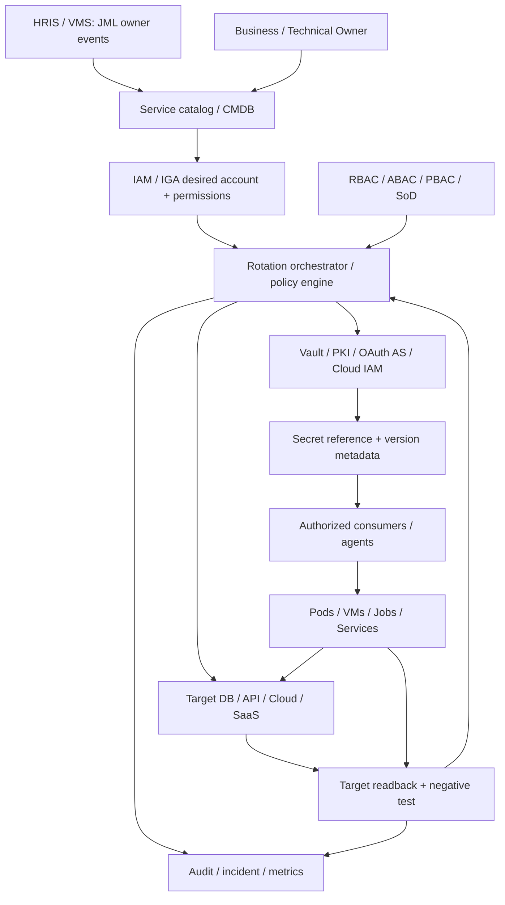
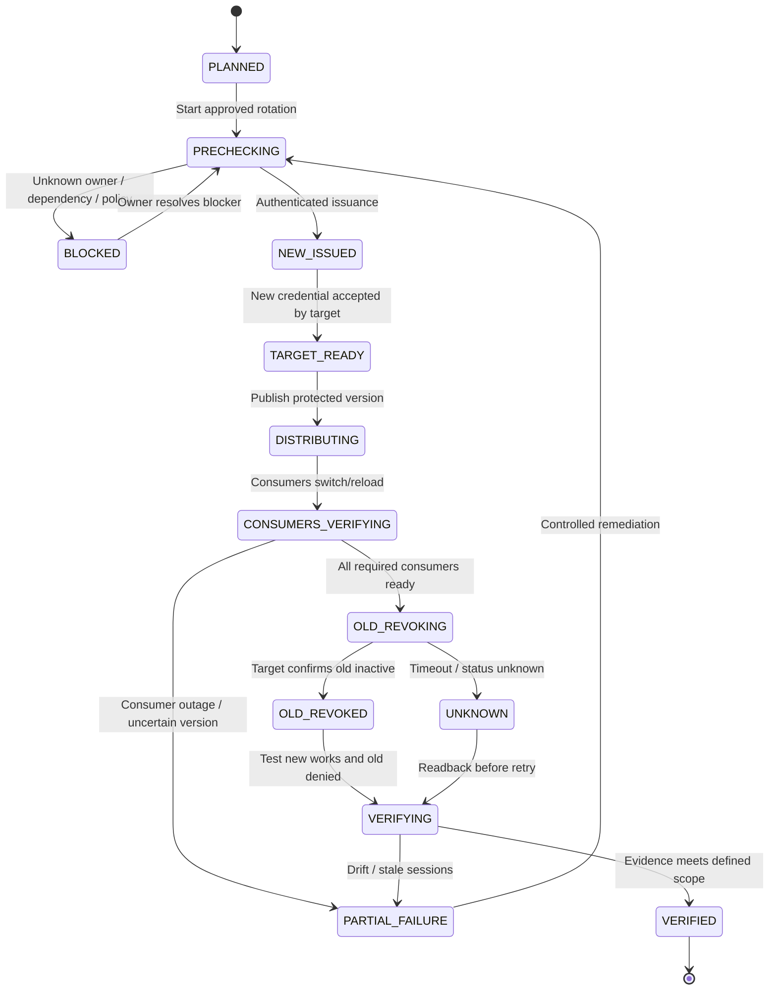
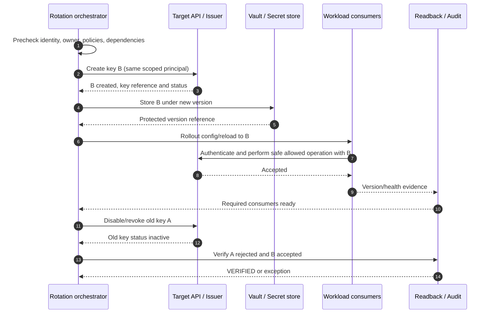

# Credential rotation cho Non-human account trong vòng đời danh tính IAM

## 1. Credential rotation là gì?

**Credential rotation** là quá trình **thay thế có kiểm soát vật liệu xác thực đang được một non-human account sử dụng** bằng vật liệu xác thực mới, phân phối cho đúng workload/consumer, xác minh khả năng hoạt động với giá trị mới, rồi **vô hiệu hóa giá trị cũ tại nơi xác thực**.

**Non-human account (NHA)** là tài khoản hoặc principal đại diện cho máy, ứng dụng, service, bot, scheduled job, CI/CD pipeline, integration, workload hoặc thiết bị thay vì người dùng đăng nhập tương tác. NHA có thể xác thực bằng mật khẩu, API key, OAuth client secret, private key, certificate, token ngắn hạn hoặc các cơ chế workload identity.

Ví dụ: job `invoice-sync` dùng API key A để kết nối hệ thống hóa đơn. Khi rotation an toàn, tổ chức không chỉ tạo key B. Cần xác nhận:

1. Key B đã được **tạo đúng NHA, environment, tenant và scope**.
2. Hệ thống đích **chấp nhận B**.
3. Tất cả instance của job đã **chuyển sang B**.
4. Các consumer không còn phụ thuộc A.
5. Key A đã **bị vô hiệu hóa tại đích**.
6. Trạng thái A bị từ chối và B hoạt động được **xác minh**.
7. Audit và inventory phản ánh credential version hiện hành.

**Điểm cốt lõi:** `NEW_CREDENTIAL_CREATED` khác `CONSUMERS_UPDATED`, khác `OLD_CREDENTIAL_REVOKED`, và khác `ROTATION_VERIFIED`.

### 1.1. Vị trí trong IAM Identity Lifecycle

Credential rotation là một phần của quản lý vòng đời danh tính và quyền truy cập:

- **Joiner:** nhân viên mới có thể được phân quyền quản trị NHA, nhưng không nhận quyền xem secret mặc định.
- **Mover:** người sở hữu chuyển nhóm, cần bàn giao và đánh giá secret từng được tiếp cận.
- **Leaver:** thu hồi quyền cá nhân, chuyển owner của workload và rotate/revoke credential có nguy cơ.
- **Service onboarding:** đăng ký service identity, owner, target, permission và hình thức xác thực.
- **Service operation:** quản lý TTL, expiry, renewal, rotation, audit và độ tin cậy.
- **Service decommission:** thu hồi credential, role, session và ngăn credential được cấp lại.

Rotation giúp giảm thời gian một secret bị lộ có thể tiếp tục bị khai thác, nhưng **không thay thế least privilege, bảo vệ secret hoặc khả năng revoke thực tế**.

## 2. Vì sao non-human credential thường khó quản trị hơn mật khẩu cá nhân?

Một NHA có thể chạy liên tục trên nhiều replica, không có người dùng trực tiếp đăng nhập để thay mật khẩu và phụ thuộc nhiều hệ thống khác nhau.

| Đặc điểm | Tác động khi rotation |
|---|---|
| Chạy tự động 24/7 | Thay secret sai có thể gây outage hàng loạt |
| Nhiều instance/replica | Một số pod dùng A, số khác đã dùng B |
| Dependency phân tán | Phải biết tất cả ứng dụng, batch job, connector sử dụng |
| Không có MFA tương tác | Cần workload identity/credential máy phù hợp |
| Secret được copy nhiều nơi | Khó chứng minh bản A đã biến mất khỏi tất cả bản sao |
| Quyền cao | Lộ một key có thể gây lateral movement hoặc chiếm tenant |
| Owner không rõ | Không có người phối hợp và phê duyệt thay đổi |
| Credential có thể không hết hạn | Secret cũ tiếp tục dùng nếu không revoke |
| Một account dùng nhiều consumer | Rotation ảnh hưởng cả những consumer ít được biết |
| API của target không đồng nhất | Cách tạo, kích hoạt, overlap và revoke khác nhau |

Một phương án tốt phải cân bằng **confidentiality, least privilege, availability, auditability và revocability**. “Rotate càng thường xuyên càng tốt” không phải tiêu chí duy nhất nếu cách thay làm lộ credential hoặc tạo outage liên tục.

## 3. Phân biệt account, identity, credential, secret và role

| Khái niệm | Định nghĩa | Ví dụ |
|---|---|---|
| **Non-human identity** | Danh tính logic được quản trị cho workload | `svc-invoice-sync` |
| **Service account** | Account dùng để xác thực/ủy quyền trong nền tảng | DB user `svc_invoice` |
| **Credential** | Bằng chứng chứng minh danh tính | Client secret, key pair, token |
| **Secret** | Giá trị cần giữ bí mật | Password, private key, API key |
| **Credential version** | Một phiên bản vật liệu xác thực | `invoice-key-v7` |
| **Role/entitlement** | Quyền được cấp cho identity hoặc account | `invoice:read` |
| **Authorization policy** | Điều kiện xác định PERMIT/DENY | Chỉ tenant A, chỉ read |
| **Lease/TTL** | Thời hạn một credential/quyền được phát hành | DB user tạm 15 phút |
| **Secret reference** | Đường dẫn hoặc định danh tới secret trong vault | `vault://prod/invoice/reader` |
| **Owner** | Cá nhân/nhóm chịu trách nhiệm nghiệp vụ/kỹ thuật | Finance Platform |

**Rotation thay credential**, không nhất thiết thay service identity, account hoặc quyền. Đổi API key A thành B nhưng B vẫn có quyền `tenant:admin_all` thì **rủi ro overprivilege vẫn tồn tại**.

### 3.1. Access token không phải password dài hạn

Access token thường tự hết hạn và được lấy lại qua issuer. Đối với credential ngắn hạn, trọng tâm vận hành có thể là **issuance, renewal, expiry và revocation** thay vì chạy quy trình thay shared password cố định. Cần nêu rõ **đang rotate thành phần nào**: client authentication key, access token, certificate, cloud role session hay secret database.

## 4. Những credential của NHA cần quản lý rotation

| Loại | Hệ thống sử dụng | Cơ chế thay thế điển hình |
|---|---|---|
| Static service password | DB, LDAP bind, legacy ERP | Đổi password tại target, cập nhật consumer |
| API key | SaaS, payment, observability API | Tạo key mới, chuyển traffic, revoke key cũ |
| OAuth client secret | Authorization server | Đăng ký secret mới, chuyển client, vô hiệu secret cũ |
| Private key cho client assertion | OAuth confidential client | Tạo key pair mới, cập nhật JWK/cert registration |
| mTLS certificate/private key | Service mesh, API gateway | Rekey/renew, cập nhật trust, retire cert cũ |
| SSH private key | SFTP, automated host access | Cài public key mới, chuyển client, gỡ key cũ |
| Cloud access key | Legacy cloud integrations | Tạo key mới có scope, disable/delete key cũ |
| Database dynamic credential | Vault/secret engine | Issue role/account tạm, TTL/revoke |
| CI/CD token hoặc PAT | Pipeline, repository, deployment | Tạo scoped token mới, cập nhật secret store, revoke cũ |
| Signing key | JWT/service assertions | Quản lý key IDs/JWKS, chuyển signer/verifier theo protocol |
| Encryption key | KMS/application data | **Key rotation và re-encryption** là bài toán khác, không luôn là authentication credential rotation |

### 4.1. Không mặc định mọi API hỗ trợ hai credential cùng lúc

Một số dịch vụ cho phép **multiple active keys**, một số chỉ cho **một password active**, có nơi hỗ trợ **dual-password**, và có nơi đổi key sẽ vô hiệu key cũ ngay. Phải đọc hợp đồng target và kiểm thử trước khi chọn trình tự rotation.

## 5. Mục tiêu bảo mật và mục tiêu vận hành

Một thiết kế rotation tốt nên đạt các điều kiện:

1. **Đúng principal:** key mới thuộc đúng service account/tenant/target.
2. **Least privilege:** key mới không được tự tăng quyền so với policy.
3. **Secret confidentiality:** không lộ A hoặc B trong log, Git, ticket hay artifact.
4. **Controlled distribution:** chỉ consumer được duyệt nhận B.
5. **Application continuity:** tác vụ hợp lệ tiếp tục chạy trong ngưỡng availability.
6. **Old credential retirement:** A mất hiệu lực tại hệ thống đích.
7. **Verifiability:** có bằng chứng B hoạt động và A bị từ chối.
8. **Auditability:** theo dõi actor, owner, key version, task và policy.
9. **Failure containment:** timeout/partial failure không làm phát key tràn lan.
10. **Lifecycle governance:** owner thay đổi, workload decommission và JML đều có tác động được xử lý.

### 5.1. Thất bại ở một điều kiện có thể làm rotation chưa hoàn tất

Ví dụ B hoạt động nhưng A vẫn active là **dual-credential exposure**, không phải `ROTATION_VERIFIED`. Ngược lại, A đã revoke nhưng nửa số replica chưa nhận B là **availability incident**, dù góc độ chặn key cũ đã đạt.

## 6. Kiến trúc tham chiếu cho credential rotation



Sơ đồ là **kiến trúc logic**. Một sản phẩm vault có thể kiêm rotation engine; một cloud provider có thể phát credential ngắn hạn trực tiếp, không cần một secret store thứ hai.

### 6.1. Ba ranh giới quan trọng

- **Issuer/target:** nơi tạo hoặc chấp nhận credential, cũng là nơi cần disable A.
- **Distribution:** nơi consumer đọc hoặc nạp B (vault path, sidecar, agent, SDK).
- **Authorization:** backend/API/DB kiểm tra service principal, action, tenant và resource.

Không nên coi thành công ở một ranh giới là đã hoàn tất cả ba.

## 7. Inventory trước khi rotation

Không thể rotate an toàn một credential nếu **không biết nó thuộc về ai và được sử dụng ở đâu**.

Một inventory tối thiểu cần có:

| Trường | Vai trò |
|---|---|
| `service_identity_id` | Principal logic ổn định |
| `account_id`, `target_system` | Account được xác thực ở đích |
| `credential_ref` | Định danh secret/credential, không phải plaintext |
| `credential_type` | Password, API key, certificate, OAuth client secret |
| `issuer` và `key_id/version` | Nơi phát và version liên quan |
| `owner_team` / `business_owner` | Người chịu trách nhiệm |
| `purpose` | Nhiệm vụ nghiệp vụ thực sự |
| `environment` / `tenant` | Production/staging, phạm vi tổ chức |
| `granted_actions` | Quyền hiệu lực theo policy |
| `consumer_refs` | Deployment/job/host sử dụng |
| `issued_at` / `expires_at` | Mốc vòng đời |
| `last_rotated_at` | Lần rotation gần nhất |
| `rotation_strategy` | Dual-key, single-secret, dynamic lease |
| `rotation_connector` | Cơ chế API/agent thực thi |
| `verification_capability` | Có thể đọc status key và test an toàn không |
| `decommission_event` | Điều kiện kết thúc NHA |

**Không lưu secret plaintext trong inventory**. Dùng version ID, fingerprint hoặc tham chiếu có quyền đọc phù hợp.

### 7.1. Mối liên hệ owner–credential

Một service account có thể có nhiều owner về vận hành, bảo mật và nghiệp vụ. Cần xác định rõ ai được **phê duyệt tạo key**, ai được **cập nhật secret** và ai được **revoke key cũ**. Không để một cá nhân vừa sửa policy, phát key admin và tự phê duyệt ngoại lệ nếu SoD không cho phép.

## 8. Lập bản đồ dependency và consumer

Một secret có thể được đọc bởi nhiều consumer:

```text
credential: invoice-api-key-v7
  target: invoice SaaS, tenant-company
  owner: Finance Platform
  consumers:
    - invoice-sync (production, 6 replicas)
    - nightly-invoice-export (production, scheduled)
    - invoice-reconciliation (production, every weekend)
    - legacy-batch-bridge (unknown owner -> blocker)
```

Khi thay A bằng B lúc 10:00, các pod chạy liên tục có thể cập nhật ngay, nhưng batch job chỉ chạy cuối tuần **chưa chắc đã nạp B**.

### 8.1. Các câu hỏi cần trả lời

- Ai dùng secret trực tiếp?
- Secret được tải **mỗi request**, lúc **khởi động**, hay **cache trong process**?
- Consumer có reload configuration mà không restart được không?
- Có connection pool hoặc session sống lâu?
- Có deployment ở vùng mạng ngoại tuyến?
- Có replica chưa được quản lý hoặc cron job ít chạy?
- Có third-party connector dùng credential mà ta không kiểm soát thời điểm refresh?
- Có cần bảo đảm backward compatibility trong khoảng overlap?
- Consumer nào chấp nhận key version và báo readiness?

### 8.2. Unknown consumer không phải chi tiết có thể bỏ qua

Nếu chưa biết owner của `legacy-batch-bridge`, rotation có thể gây outage. Cần **điều tra, test và xác định phương án thay/khóa** trước khi kết luận readiness, trừ khi phải thu hồi khẩn do compromise.

## 9. Chọn chiến lược rotation theo khả năng target

| Chiến lược | Khi phù hợp | Rủi ro chính |
|---|---|---|
| **Dual active credentials** | API cho phép A và B cùng hiệu lực tạm | Quên revoke A |
| **Single active credential** | Target chỉ một password/key hoạt động | Consumers cần chuyển đồng bộ, có thể gián đoạn |
| **Two service accounts** | Có thể thay account xanh/lục cùng quyền theo kiểm soát | Account creep, sai SoD và duplicate permissions |
| **Dynamic short-lived credential** | Vault/target hỗ trợ issuance/lease | Quản trị TTL, renewal, target revoke |
| **Certificate overlap/rekey** | mTLS/SSH/PKI | Trust update, CA chain, session tồn dư |
| **Signing key rollover** | JWT assertions/token signing | KID/JWKS propagation, verifier cache |
| **Managed workload identity** | Cloud/Kubernetes/CI federation | Trust policy, issuer/key rotation, session TTL |
| **Emergency immediate revoke** | Secret/host bị compromise | Có thể mất availability, cần containment trước |

Không áp một “rotate all credentials” job bằng cùng thuật toán. Cần **strategy registry** theo credential type và target semantics.

## 10. State machine cho một rotation run



### 10.1. Một số trạng thái cần giữ riêng

- `NEW_ISSUED`: key B tồn tại, chưa chứng minh target nhận.
- `TARGET_READY`: B được chấp nhận, chưa chứng minh consumer đã chuyển.
- `CONSUMERS_VERIFYING`: kiểm tra tất cả consumer trong scope.
- `OLD_REVOKING`: lệnh thu hồi đang xử lý.
- `OLD_REVOKED`: target xác nhận A inactive.
- `VERIFIED`: B thực hiện action hợp lệ, A bị từ chối và các yêu cầu khác đạt theo phạm vi.
- `PARTIAL_FAILURE`: một phần còn lỗi hoặc chưa xác minh.

**Không đánh dấu `VERIFIED` chỉ vì vault đã lưu B**.

## 11. Preflight checklist cho rotation

Trước rotation theo lịch:

1. Service identity còn active và purpose hợp lệ.
2. Owner/backup owner được xác nhận, ticket/chính sách thay đổi hợp lệ.
3. Target account và tenant map chính xác; không dùng email làm khóa duy nhất.
4. Credential type và target connector được nhận diện.
5. Permission hiện hành phù hợp least privilege; không nâng role khi tạo B.
6. Consumer inventory và dependency đã có owner.
7. Cơ chế overlap/single-active và thời hạn switch đã rõ.
8. Alert, health checks và cách rollback an toàn được chuẩn bị.
9. Có chứng cứ version A hiện tại, nhưng **không log giá trị A**.
10. Kiểm thử issuer/target API permission để rotate, không cấp quyền admin rộng cho worker.
11. Có kế hoạch xử lý mất kết nối, rate limit, timeout và partial failure.
12. Có negative test an toàn cho A và positive test cho B.
13. Có cơ chế ngăn stale rotation job sau decommission.
14. Có giới hạn thời gian hoạt động đồng thời của A và B.
15. Có audit/correlation ID và người chịu trách nhiệm kết thúc.

### 11.1. Preflight không được trở thành cửa ngăn thu hồi khẩn

Trong tình huống **key compromise**, có thể phải **disable A hoặc chặn tại gateway ngay**, dù dependency inventory chưa hoàn chỉnh. Runbook emergency cần phân loại rủi ro và ưu tiên containment; không trì hoãn vô thời hạn để đạt preflight hoàn hảo.

## 12. Luồng dual-key rotation để giảm gián đoạn

Giả sử target cho phép hai API key hoạt động đồng thời.



### 12.1. Thời điểm có hai key phải giới hạn

Overlap là **cơ chế chuyển đổi**, không phải trạng thái vĩnh viễn. Nếu B đã phân phối thành công nhưng A vẫn active sau deadline, phải mở cảnh báo `STALE_CREDENTIAL` với owner.

### 12.2. Key B cần có quyền gì?

Một rotation không phải cơ hội tạo key có `admin_all` chỉ vì key A thỉnh thoảng bị lỗi. Nên bảo toàn hoặc **thu hẹp** quyền theo desired access, review role nếu scope hiện hành quá rộng.

### 12.3. Consumer health phải có ý nghĩa

Readiness không chỉ là pod `Running`. Nên test **kết nối/operation hợp lệ** bằng B mà không tạo tác động nghiệp vụ không mong muốn; đồng thời xác nhận tỉ lệ lỗi auth không tăng.

## 13. Single-active password: rotation phải có kế hoạch chuyển đổi

Một số database, LDAP bind account hoặc phần mềm legacy chỉ hỗ trợ **một password đang active**.

### 13.1. Các phương án có thể cân nhắc

- Thay password khi consumer hỗ trợ **refresh/reconnect nhanh**.
- Có **maintenance window** với thời gian gián đoạn được phê duyệt.
- Dùng **một service account thứ hai** cùng phạm vi quyền, chuyển consumer rồi retire account cũ nếu policy/target cho phép.
- Chuyển dần sang dynamic credentials hoặc workload identity thay cho shared password.
- Dùng broker/agent có thể phối hợp cập nhật secret và kết nối.

Không hứa zero downtime nếu target **không có cách hoạt động đồng thời của A và B**.

### 13.2. Quy trình cho một password active

1. Kiểm kê mọi workload và kết nối đang dùng account.
2. Kiểm tra target support, replication, connection pooling.
3. Chọn thời điểm và người chịu trách nhiệm.
4. Tạo B bằng nguồn entropy phù hợp; bảo vệ secret ngay khi phát sinh.
5. Đổi password ở target theo API/connector có quyền thích hợp.
6. Cập nhật secret reference và thúc đẩy consumers nạp B.
7. Xác minh kết nối/application action với B.
8. Kiểm tra A không thể **xác thực kết nối mới**.
9. Xử lý connection/session đã mở bằng A nếu cần.
10. Ghi kết quả, độ trễ, exception và kế hoạch tránh outage kỳ sau.

### 13.3. Khi rotation thất bại giữa chừng

Nếu target đã thay sang B nhưng vault vẫn giữ A, job có thể ngừng. Cần phân biệt `TARGET_UPDATED` với `VAULT_UPDATED`, dùng **idempotent recovery/readback** khi có thể. Không liên tục random hóa password sau timeout.

## 14. Chiến lược hai account luân phiên (blue/green)

Nếu target cho phép hai account độc lập `svc-invoice-blue` và `svc-invoice-green`, có thể tránh single-secret downtime bằng cách:

1. Bảo đảm cả hai account có owner, chính sách và permission tương đương **trong phạm vi được duyệt**.
2. Tạo/đổi credential của account Green, kiểm tra authorization.
3. Chuyển consumer sang Green và giám sát.
4. Disable/retire Blue theo lịch.
5. Kỳ sau lặp lại chiều ngược lại hoặc tái tạo account theo policy.

### 14.1. Rủi ro của hai account

- Hai principal tồn tại đồng thời có thể **tăng blast radius**.
- Quyền role có thể lệch giữa Blue và Green.
- Audit cần chỉ rõ consumer đang gọi bằng account nào.
- Một số ứng dụng ràng buộc dữ liệu/ownership với account ID; thay account có thể phá logic.
- SoD và chính sách license có thể giới hạn account phụ.
- Không để Blue tồn tại vô hạn sau switch.

**Blue/green là thiết kế có điều kiện**, không phải thủ thuật có thể áp dụng cho bất kỳ hệ thống nào.

## 15. OAuth client secret rotation

Trong OAuth 2.0, một confidential client có thể dùng **client secret** để xác thực với authorization server. Đổi secret phải được thực hiện tại **client registration/authorization server** rồi cập nhật mọi token-requesting workloads.

### 15.1. Các bước logic

1. Xác định `client_id`, issuer, tenant, auth method và các consumer.
2. Phát secret B qua API quản trị được phép.
3. Lưu B trong secret manager, không gửi qua email/chat.
4. Chuyển token client sang B.
5. Test client authentication tới token endpoint và token nhận được có audience/scope đúng.
6. Vô hiệu secret A tại authorization server.
7. Kiểm tra A không thể lấy **token mới**.
8. Kiểm tra các **access token đã cấp trước đó** theo expiry/revocation policy.
9. Kiểm toán trạng thái và đóng rotation.

### 15.2. Token đã phát không nhất thiết bị vô hiệu

**Revoke client secret A không mặc nhiên revoke access token cấp trước lúc A bị disable**. Access token có thể còn hợp lệ đến hết TTL hoặc tới khi resource server/issuer áp cơ chế thu hồi cụ thể.

### 15.3. ID token và client credential

**OIDC ID token** phục vụ xác thực trong luồng OIDC theo audience client; nó **không thay access token** để gọi resource API. Rotation secret của client cũng không đồng nghĩa thay signing key của issuer hay tất cả token validation keys.

## 16. Private key JWT và key-pair rotation

Thay shared secret, một client có thể dùng **private_key_jwt** hoặc cơ chế chứng minh sở hữu private key.

Các thành phần cần quản trị:

- Private key ở nơi được bảo vệ.
- Public JWK/certificate đã đăng ký với issuer.
- `kid`/key identifier và key version.
- JWT client assertion có `iss`, `sub`, `aud`, `exp`, `jti` phù hợp cơ chế.
- Validation thuật toán ký được phép, issuer/audience và replay protection.

### 16.1. Luồng rollover

```text
Generate key pair B securely
  -> Register public key B with issuer
  -> Verify issuer accepts assertion signed by B
  -> Switch workloads to private key B
  -> Stop using A
  -> Deregister/revoke public key A (when safe)
  -> Verify assertion signed by A rejected
```

Nếu service có nhiều instance và issuer hỗ trợ hai key trong giai đoạn chuyển, cho phép overlap ngắn. Nếu không, lên lịch chuyển đổi và kiểm soát availability.

### 16.2. Khóa ký JWT và khóa xác thực client khác nhau

Nếu service **phát token cho bên khác**, việc thay signing key ảnh hưởng cả **verifier cache/JWKS**. Nếu service **xác thực chính nó** bằng private_key_jwt, thay public key registration tại authorization server. Không gộp hai use case vào cùng runbook.

## 17. mTLS certificate và private key rotation

Với mTLS, service chứng minh sở hữu **private key** tương ứng chứng thư X.509 được CA/trust chain chấp nhận.

### 17.1. Quy trình

1. Xác định service identity, SAN/SPIFFE ID, issuer, EKU, target trust domain.
2. Tạo key pair B an toàn; nếu A có thể lộ, **không tái dùng private key A**.
3. Issuer phát cert B theo identity đã xác minh.
4. Cập nhật workload và trust nếu thay CA/issuer.
5. Chuyển các connection mới sang B.
6. Xác minh certificate chain, SAN, EKU, expiry và authorization.
7. Thu hồi/retire cert A theo cơ chế PKI/mesh đang dùng.
8. Kiểm tra các bên tin cậy đã **ngừng chấp nhận A** theo phạm vi.
9. Xử lý long-lived TLS sessions/connection pooling khi rủi ro yêu cầu.

### 17.2. Certificate renewal không tự revoke chứng thư cũ

CA có thể cấp B mới nhưng A vẫn còn hạn. Với **key compromise**, cần certificate revocation/deny policy phù hợp; với renewal thông thường, cần có thời hạn kết thúc tin A.

### 17.3. Không mặc định CRL/OCSP mọi nơi

Một số workload PKI/mesh ưu tiên **short-lived certificates** và không triển khai kiểm tra thu hồi leaf cert qua CRL/OCSP. Nếu cần chặn tức thì, cần cơ chế **deny principal, thay trust, quarantine và kết thúc phiên** theo khả năng thực tế.

## 18. SSH key rotation của automation

SFTP/batch jobs có thể dùng SSH private key dài hạn. Rotation nên theo thứ tự:

1. Tạo key pair B bằng thuật toán/key size được policy chấp nhận.
2. Phân phối **public key B** cho đúng account/host, không gửi private key.
3. Cập nhật secret manager cho private key B.
4. Test SSH/SFTP bằng B với host key verification đúng.
5. Chuyển mọi job sang B, kể cả cron job chạy hiếm.
6. Gỡ **public key A** khỏi authorized keys hoặc hệ thống cấp quyền tương ứng.
7. Kiểm tra login bằng A bị từ chối, B được phép đúng scope.
8. Rà soát session cũ và access độc lập khi cần.

### 18.1. Đừng tắt host key verification

Lỗi SSH lúc rotation có thể do host key hoặc CA phía máy chủ. Không sửa bằng `StrictHostKeyChecking=no` một cách bừa bãi trên production; cần quản trị trust và xác minh host đúng.

### 18.2. Một khóa dùng cho nhiều host

Nếu private key A có trong nhiều hệ thống, phải phát hiện **tất cả nơi chấp nhận public key A**. Gỡ A ở một máy chủ không khiến A mất hiệu lực trên các máy khác.

## 19. Database password và credential động

Với service account database, target có thể hỗ trợ:

- Static username/password được vault quản lý và đổi định kỳ.
- Hai account luân phiên.
- Dynamic DB user/role cấp theo lease.
- Cloud/identity-based database authentication.
- Certificate-based auth theo năng lực DB.

### 19.1. Quy trình dynamic credential

```text
Workload identity -> Vault/DB credential issuer
  -> Issue short-lived DB principal with read-only role
  -> Service opens connection with TTL-bound credential
  -> Lease expires or explicit revoke
  -> Target account/role revoked or expired as supported
  -> Reconciliation verifies expected state
```

**TTL trong vault không tự đảm bảo DB connection đã mở bị đóng**. Có thể cần session termination hoặc role checks khi xử lý quyền nhạy cảm.

### 19.2. Connection pooling

Một pool có thể duy trì connection được tạo khi A còn hợp lệ, dù password A đã đổi. Thiết kế cần:

- Độ tuổi tối đa connection.
- Refresh credential khi tạo connection mới.
- Health checks cho cả auth failures và query permissions.
- Drain/restart pool theo kế hoạch.
- Phân biệt xác thực kết nối mới với quyền của phiên đã mở.

### 19.3. Password rotation khác schema migration

Đổi password DB không nên gắn với việc cấp quyền DDL/admin mới. Credential B chỉ nên có quyền cần thiết của service ở phiên bản triển khai tương ứng.

## 20. Workload identity và giảm nhu cầu secret tĩnh

Một hướng cải tiến là dùng **managed identity hoặc workload identity federation**, giảm việc app tự giữ API key dài hạn.

Ví dụ:

- Kubernetes projected service account token với audience phù hợp.
- CI/CD OIDC assertion có ràng buộc repository/workflow/environment.
- Cloud managed identity nhận role session/token ngắn hạn.
- SPIFFE/SPIRE X.509-SVID hoặc JWT-SVID được cấp/rotate tự động.

### 20.1. Credential nào được rotation trong mô hình này?

- Token/credential ngắn hạn được **renew/reissue** khi hết hạn.
- Chứng thư SVID được rotate theo runtime.
- Issuer **signing keys**, CA/trust bundle và trust policy có vòng đời riêng.
- Quyền cloud/service role cần recertification và revocation theo lifecycle.
- Không còn cần rotate một shared password mà service chưa từng lưu.

### 20.2. Tránh “secret zero”

Nếu một app cần vault root token được hardcode để lấy key khác, tổ chức **chưa loại bỏ secret bootstrap**. Ưu tiên xác thực runtime bằng workload identity, attestation hoặc cơ chế bootstrap có hạn và scope phù hợp.

### 20.3. Federation không tự giải quyết authorization

Issuer có thể xác thực workload đúng nhưng trust policy cho phép **mọi pipeline cùng tổ chức** đổi token thành production admin. Cần ràng buộc issuer, subject, audience, environment, tenant và role theo nguyên tắc least privilege.

## 21. Vault/secret manager: lưu version, bảo vệ secret và kiểm toán

Secret manager/vault có thể hỗ trợ:

- Mã hóa secret khi lưu và truyền qua TLS.
- Versioning, alias và metadata.
- Policy đọc/ghi theo workload/namespace/tenant.
- Dynamic credential issuance hoặc rotation plugin.
- Audit access/rotate/revoke.
- TTL/lease và khả năng refresh có kiểm soát.

### 21.1. Secret reference và secret value

Ứng dụng nên nhận **reference hoặc identity-bound access**; không commit giá trị mật khẩu vào YAML. Một cấu hình minh họa:

```yaml
service:
  name: invoice-sync
  environment: production
  identity: workload/invoice-sync

credentials:
  provider: secret-broker
  reference: prod/invoice-api/client
  refresh_mode: reload_on_version_change

target:
  endpoint: https://invoice-api.example.org
  tenant: tenant-a
  required_scope: invoice.read
```

Đây là **mô hình cấu hình giả định**, không phải file cấu hình chuẩn của một vault hoặc framework cụ thể.

### 21.2. Rotation vault encryption key không thay target credential

Đổi KEK/DEK dùng để mã hóa bí mật trong vault không làm **password/API key A đã bị lộ** mất hiệu lực ở DB/SaaS. Phải phân biệt **key management for encrypted storage** với **credential rotation of external authentication material**.

### 21.3. Vault policy không thay target policy

Gỡ quyền đọc secret A từ vault chỉ chặn **lấy A lần sau**. Nếu attacker đã sao chép A, vẫn cần **revoke A tại issuer/target** và xử lý token/phiên liên quan.

## 22. Phân phối secret mới tới Kubernetes, VM và batch jobs

Mỗi môi trường có cơ chế cập nhật khác nhau.

| Môi trường | Cách nhận secret | Vấn đề khi rotation |
|---|---|---|
| Kubernetes mounted Secret volume | File trong container | Giá trị có thể cập nhật bất đồng bộ; app phải reload |
| Kubernetes env vars | Giá trị lúc container khởi tạo | Thường phải restart/rollout pod để đọc giá trị mới |
| Secret CSI/sidecar/provider | File, socket hoặc SDK | Phụ thuộc driver, sync và retry |
| VM agent | File được cập nhật qua agent | Quyền file, owner, reload signal |
| Java/Spring process | Credential provider/cache | Refresh token/DB pool không phụ thuộc env cũ |
| Batch/cron | Đọc khi job bắt đầu | Job hiếm chạy có thể chưa được test với B |
| CI/CD pipeline | Federated identity hoặc secret store | Jobs in-flight có thể còn dùng version A |
| Third-party connector | Credential lưu trong SaaS/plugin | Cần API cập nhật và xác minh vendor |

### 22.1. Kubernetes không tự bảo đảm ứng dụng nạp secret mới

Nếu file đã được cập nhật nhưng Java process chỉ đọc lúc startup, consumer vẫn dùng A. Với **environment variables**, giá trị trong process hiện có thường không tự đổi khi Kubernetes Secret được cập nhật.

### 22.2. Rollout có kiểm soát

- Thay secret reference hoặc version theo cách deployment hỗ trợ.
- Thực hiện rolling restart/reload theo availability requirements.
- Bảo đảm từng instance đọc B.
- Xem authentication failures và health checks.
- Không tự revoke A khi còn consumer hợp lệ chưa chuyển nếu không phải sự cố compromise.
- Đặt deadline overlap để tránh A tồn tại vô thời hạn.

## 23. Java service: credential provider và refresh

Với Java service, nên dùng **SDK/provider đáng tin** để lấy credential theo workload identity hoặc reference. Tránh để mỗi class tự đọc file mật khẩu rồi cache mãi mãi.

### 23.1. Mã giả Java

```java
// MÃ GIẢ — các interface được đặt tên minh họa, không phải Java SDK chuẩn.
public final class InvoiceApiClient {
    private final WorkloadAuthenticator authenticator;
    private final ScopedCredentialProvider credentials;
    private final HttpTransport transport;

    public InvoiceResponse fetchInvoice(String invoiceId) {
        WorkloadAssertion identity =
            authenticator.attest("invoice-api");

        ScopedCredential credential =
            credentials.obtain(identity, "invoice.read", "tenant-a");

        try {
            return transport.getInvoice(
                credential.protectedHandle(),
                invoiceId,
                "tenant-a"
            );
        } finally {
            // SDK quản lý TTL/release theo giao thức, không in token.
            credential.closeIfSupported();
        }
    }
}
```

### 23.2. Những đặc tính cần thiết

- Token cache theo đúng **audience, scope, tenant và principal**.
- Không dùng token sau `expires_at`.
- Refresh trước expiry với jitter để tránh toàn bộ replica cùng refresh.
- Xử lý `401`/`403` theo nguyên nhân; không retry vô hạn với secret cũ.
- Không log `Authorization` header, private key hoặc token.
- Có thể đo credential version **mà không lộ secret**.
- DB connection pool có cơ chế tạo connection mới bằng credential mới.
- Credential revocation phải được thực thi tại target, không chỉ xóa object cache.

### 23.3. Không viết credential B vào log để debug

Sai:

```text
logger.info("Rotated API key={}", apiKeyB)
```

Đúng hướng:

```text
logger.info(
    "Credential version changed: serviceId={}, credentialRef={}, version={}",
    serviceId, credentialRef, versionId
)
```

Log chỉ nên ghi tham chiếu/version được phép và không kèm secret.

## 24. Rotation scheduling: khi nào nên thay credential?

Trigger có thể gồm:

1. Hết kỳ rotation theo policy.
2. Credential sắp hết hạn.
3. Key/secret có khả năng bị lộ.
4. Hệ thống phát hiện secret trong Git/log/artifact.
5. Mover/Leaver của người biết secret hoặc có quyền quản trị.
6. Service chuyển tenant/environment hoặc owner.
7. Account/role được giảm quyền và cần key mới có scope đúng.
8. Phát hiện credential dùng chung quá nhiều consumer.
9. Thay CA/issuer/trust policy hoặc nâng cấp authentication method.
10. Decommission workload.
11. Phát hiện unknown issuer, stale key hoặc missing owner khi access review.
12. Compliance/internal control yêu cầu tái phát hành.

### 24.1. Đừng áp lịch của mật khẩu người dùng cho mọi workload

Credential ngắn hạn có auto-issuance và secret tĩnh legacy cần chính sách khác nhau. Lịch phải dựa trên **khả năng revoke, risk, operational impact và hợp đồng target**, không đưa ra con số 30/90 ngày như quy chuẩn chung cho mọi NHA.

### 24.2. Khi nào ưu tiên rotate trước kỳ?

Nếu có bằng chứng key bị lộ, **emergency revoke/rekey** cần ưu tiên hơn maintenance schedule. Phải đánh giá rủi ro hoạt động liên tục so với rủi ro attacker đang sử dụng secret.

## 25. Phê duyệt, SoD và quyền quản trị rotation

Rotation engine thường cần quyền cao để **tạo, thay và thu hồi** secret. Đó là một thành phần có nguy cơ leo thang quyền nếu bị chiếm.

| Quyền | Mục đích | Rủi ro |
|---|---|---|
| `credential:issue` | Tạo credential version mới | Tạo đường giả danh service |
| `credential:read` | Đọc secret plaintext | Rò credential |
| `credential:rotate` | Thay credential ở issuer/target | Outage hoặc đổi sang key attacker biết |
| `credential:revoke` | Vô hiệu hóa credential | Gián đoạn service |
| `policy:update` | Đổi ai được quyền dùng credential | Mở rộng đặc quyền |
| `owner:change` | Chuyển người chịu trách nhiệm | Có thể chiếm quyền quản trị |
| `audit:read` | Xem evidence | Có thể lộ cấu trúc hệ thống |
| `breakglass:activate` | Khôi phục khẩn | Bypass quy trình thông thường nếu không giám sát |

### 25.1. Least privilege ở rotation automation

Một job rotate key `invoice-sync` không cần quyền xem toàn bộ vault hoặc sửa IAM role production. Giới hạn **service identity, target, namespace, operation và thời gian**.

### 25.2. SoD trong rotation

Với credential đặc quyền, có thể tách:

- Người yêu cầu/đề xuất rotation.
- Owner duyệt thay đổi.
- Orchestrator/connector thực thi.
- Reconciliation độc lập xác minh.
- Security kiểm tra incident/ngoại lệ.

Automation có thể thực hiện rotation theo policy được phê duyệt trước, nhưng không cho một actor tự nâng quyền hoặc đổi owner tùy ý.

## 26. Joiner: ai được phép quản trị credential của NHA?

Khi nhân viên mới gia nhập đội kỹ thuật:

1. HRIS xác nhận identity, assignment và effective date.
2. IAM/IdP cấp tài khoản, MFA và nhóm vận hành theo policy.
3. IGA tính vai trò quản trị service phù hợp.
4. Service owner duyệt quyền chỉnh cấu hình/rotation trong phạm vi.
5. PAM/Vault cấp quyền thao tác **có giới hạn**, ưu tiên JIT khi cần.
6. Người mới không tự được quyền xuất plaintext secret hoặc tạo root key.
7. Audit mọi thao tác quản trị NHA.
8. Đối soát nhóm/role thực tế ở issuer và target.

### 26.1. Cấp quyền quản trị không đồng nghĩa chia sẻ credential

Một người có thể vận hành job rotation qua PAM mà **không biết** API key. Việc không hiển thị plaintext giảm số người phải được coi là có khả năng tiếp cận secret khi Mover/Leaver.

## 27. Mover: owner hoặc nhiệm vụ thay đổi

Mover của người vận hành NHA có thể làm tăng rủi ro nếu người đó giữ quyền quản lý credential cũ.

Ví dụ An chuyển từ team Finance Platform sang Data Platform:

| Đối tượng | Trước Mover | Sau Mover cần đạt |
|---|---|---|
| Quyền cá nhân của An | Có thể rotate key của Finance | Gỡ nếu hết nhiệm vụ, cấp quyền mới theo duyệt |
| Owner NHA | An/Finance team | Bàn giao cho owner được duyệt |
| Secret từng thấy | API key A đã bị xuất cho An | Đánh giá rotate/revoke A |
| Workload `invoice-sync` | Đang hoạt động | Vẫn chạy nếu purpose hợp lệ |
| CI/CD deploy permission | An có thể sửa pipeline Finance | Gỡ hoặc giới hạn theo assignment mới |
| Target entitlement | `invoice.read` | Review scope theo chức năng service |
| Audit | Ownership/approval cũ | Lưu sự kiện và readback |

### 27.1. Đừng phá workload chỉ vì owner đổi

Nếu service vẫn cần cho production, phải **bàn giao và giảm quyền cá nhân** thay vì xóa account máy. Tuy nhiên, nếu credential tĩnh đã từng bị người rời team xem hoặc sao chép, cần xử lý exposure/rotation theo rủi ro.

### 27.2. Mover của chính service

Khi một workload chuyển từ tenant A sang tenant B, credential mới phải ràng buộc đúng **tenant B, environment và role**. Credential A cần được revoke nếu hết căn cứ; không để service tiếp tục có cả scope A và B ngoài chính sách.

## 28. Leaver: thu hồi quyền con người và bảo vệ service còn hợp lệ

Khi một nhân viên Leaver:

1. Thu hồi IdP/SSO account và PAM/Vault roles cá nhân theo policy.
2. Thu hồi personal access token, SSH key, CI/CD credentials của người đó.
3. Liệt kê service credentials mà người đó có quyền **đọc, xuất, tạo hoặc thay**.
4. Xác định key đã biết hoặc có nguy cơ lộ cần rotation khẩn hay theo lịch.
5. Bàn giao business/technical owner cho NHA hợp lệ.
6. Đánh giá privileged roles của NHA và pipeline quản trị.
7. Theo dõi job rotation đang chạy để không bị mất owner/phê duyệt.
8. Cập nhật reviewer/approval chain.
9. Đối soát quyền cá nhân đã gỡ và trạng thái credential NHA ở target.
10. Giữ service chạy nếu vẫn có mục đích hợp lệ; chỉ decommission theo nguồn có thẩm quyền.

### 28.1. Leaver không có nghĩa mọi key người đó từng tạo đều phải xóa lập tức

Nếu An tạo khóa cho một service bằng issuer với **non-exportable key**, An có thể chưa từng biết private key. Rủi ro khác với API key plaintext đã được hiển thị. Cần đánh giá **khả năng tiếp cận, role quản trị, exposure và yêu cầu security**, không áp một kết luận mù cho mọi credential.

### 28.2. Nhiều hợp đồng/assignment

Nếu một contractor kết thúc P1 nhưng vẫn có assignment P2 hợp lệ, IAM phải gỡ quyền P1 và đánh giá credential liên quan P1, **không khóa nhầm toàn bộ workload/identity P2**.

## 29. Decommission: kết thúc vòng đời NHA và credential

Khi service `invoice-sync` ngừng sử dụng:

1. Service owner phê duyệt ngày và phạm vi decommission.
2. Kiểm kê toàn bộ deployment, key, client secret, certificate, DB user, role và token.
3. Dừng job/traffic theo kế hoạch.
4. Chặn issuance/renewal mới cho identity retired.
5. Revoke API keys, OAuth client secrets/certificates, cloud access keys.
6. Disable/delete DB/service account theo chính sách target.
7. Gỡ RBAC/ABAC/PBAC role và direct grants.
8. Thu hồi vault leases, xử lý session hoặc connection còn sống.
9. Kiểm tra target không còn chấp nhận credential cũ.
10. Lưu audit/metadata cần retention rồi retire catalog record.

### 29.1. Ngăn job cũ cấp lại key

Một rotation job có thể đã được queue từ trước khi service bị retired. **Trước issue/renew**, worker phải đọc status/policy/source version hiện hành và đánh dấu job cũ `SUPERSEDED`.

### 29.2. Xóa secret store entry chưa đủ

Một bản API key đã nằm trong container, backup hoặc laptop vẫn có thể gọi API cho tới khi target chặn. **Revocation phải được thực hiện tại issuer/target và xác minh**.

## 30. Retry, idempotency và xử lý timeout

Rotation gồm nhiều API và hệ thống mạng, không thể giả định mọi request trả kết quả ngay.

### 30.1. Tình huống partial failure

```text
10:00  Rotation orchestrator requests new key B
10:01  Target creates B
10:01  HTTP response is lost (timeout)
10:02  Worker sees UNKNOWN
10:03  Blind retry creates key C
10:04  Another retry creates key D
10:05  Inventory only knows A, C, D, while B remains active
```

Đây là nguy cơ **credential sprawl** do retry mù.

### 30.2. Chiến lược xử lý

- Dùng **idempotency key** nếu target API hỗ trợ.
- Gắn `rotation_run_id`, `credential_ref`, `target_account_id`, `target_tenant` và version.
- Khi timeout, **đọc lại status/version/key list** theo khả năng trước retry.
- Dùng backoff với jitter và retry budget.
- Giới hạn số key active, tránh tạo key không owner.
- Chỉ revoke A khi biết B đã được phân phối/hoặc emergency policy yêu cầu.
- Lưu trạng thái `UNKNOWN` khi không thể xác minh.
- Có owner và deadline cho exception.
- Nếu API không idempotent, thiết kế reconciliation thay vì assume exactly-once.

### 30.3. Idempotency không thay đánh giá policy hiện hành

Một request `ISSUE_KEY` có thể là duplicate hợp lệ về kỹ thuật nhưng **không còn được phép** sau khi service bị suspend/retired hoặc owner mất quyền. Mọi grant/issuance phải kiểm tra desired state mới nhất.

## 31. Concurrency và thứ tự sự kiện rotation

Các xung đột điển hình:

- Hai rotation job chạy cùng lúc.
- Owner Mover thay policy trong khi job tạo key.
- Leaver làm mất quyền approver khi job đang chờ duyệt.
- Incident yêu cầu revoke A đúng lúc scheduled rotation đang chuyển sang B.
- Một instance đọc secret version mới còn instance khác rollback.
- Service decommission nhưng queue vẫn phát token mới.

### 31.1. Quy tắc an toàn

1. Lock hoặc optimistic concurrency trên **credential/account/target scope**.
2. Rotation run phải có **version/epoch**.
3. Một secret chỉ có rotation leader hoặc hành vi hợp lệ khi chạy song song.
4. Incident revoke có ưu tiên theo policy.
5. Không cho job rotation cũ **khôi phục** A đã bị revoke.
6. Mọi state transition có actor, timestamp và source event.
7. Khi version thay, worker phải reload và đánh giá lại.
8. Tránh publish secret metadata trước khi target thực sự chấp nhận.
9. Kiểm tra current state trước từng thao tác có thể **tạo hoặc cấp quyền**.
10. Đối soát sau race, không chỉ tin cache orchestrator.

### 31.2. Mã giả điều phối an toàn

```text
function rotateCredential(credentialRef, expectedVersion):
    record = loadCredentialRecord(credentialRef)
    identity = loadCurrentServiceIdentity(record.serviceId)

    if record.version != expectedVersion:
        return CONFLICT_RETRY_WITH_FRESH_STATE

    if identity.status in {SUSPENDED, RETIRED}:
        markRotation(SUPERSEDED)
        return DENY_ISSUANCE

    assertAuthorizedOwnerAndPolicy(identity, record)
    assertKnownTargetAndConsumerInventory(record)
    acquireScopedRotationLease(record.issuer, record.accountId)

    state = readTargetCredentialState(record)
    if state == UNKNOWN:
        markRotation(NEEDS_RECONCILIATION)
        return

    candidate = issueNewCredentialIdempotently(record)
    publishProtectedVersion(candidate)
    verifyRequiredConsumers(candidate)

    revokeOldAtTarget(record.currentVersion)
    verifyOldRejectedAndNewAccepted(candidate, record)
    markRotation(VERIFIED)
```

Đây là **mã giả nguyên tắc**, không phải code hoàn chỉnh: production cần xử lý transaction/outbox, failure compensation, source version checks ở mỗi bước và semantics riêng của target.

## 32. Khi rotation thất bại: rollback và forward recovery

Không phải lúc nào có thể “rollback” bằng cách bật lại key A.

| Tình huống | Hướng xử lý phù hợp |
|---|---|
| B tạo thất bại, A còn an toàn | Giữ A trong thời hạn đã duyệt, sửa lỗi rồi retry |
| B đã active, consumer chưa cập nhật | Chuyển consumer/rollback deployment an toàn nếu A chưa compromised |
| A đã revoke, B lỗi | **Forward recovery**: sửa consumer hoặc phát key C, không giả định có thể bật A |
| A đã bị lộ | **Không khôi phục A** để xử lý outage |
| Không biết target nhận B chưa | Readback, không rotate thêm vô hạn |
| Single-active password thay rồi app lỗi | Dùng phương án phục hồi an toàn theo runbook, đánh giá exposure |
| Thay CA/trust mTLS lỗi | Sửa trust bundle/certificate chain, không tắt TLS verification |
| Một replica vẫn dùng A | Khoanh vùng/restart hợp lệ, không báo VERIFIED |
| Không có owner legacy consumer | Mở incident/exception có deadline và giải pháp giảm rủi ro |

### 32.1. Phân biệt rollback code với rollback credential

Có thể rollback phiên bản ứng dụng, nhưng **không nhất thiết rollback secret về A**. Khi deploy lại build cũ, cần bảo đảm build ấy có thể lấy **credential hiện hành B** chứ không hardcode A.

### 32.2. Không để khắc phục outage thành mở quyền

Không tạm cấp `vault:admin` hoặc `target:all_access` cho mọi pod chỉ để job chạy. Nếu có break-glass, dùng quy trình phê duyệt/giám sát có hạn, hậu kiểm và thu hồi.

## 33. Sự cố secret bị lộ: emergency rotation

Giả sử pipeline bị xâm nhập và API key A của `invoice-sync` lộ trong build log.

### 33.1. Luồng xử lý

1. **Triage:** xác định key ID, target, scope, consumer và khoảng thời gian lộ.
2. **Contain:** chặn key/identity ở target/gateway nếu có cơ chế; có thể chấp nhận gián đoạn để giảm rủi ro.
3. **Revoke A:** vô hiệu ở issuer/target, không chỉ xóa vault reference.
4. **Issue B:** chỉ cho workload có identity còn tin cậy, permission tối thiểu.
5. **Distribute:** cập nhật secret manager/consumers qua đường bảo vệ.
6. **Verify:** test A bị từ chối, B dùng được trong scope.
7. **Investigate:** tìm dấu hiệu sử dụng A trái phép, token/role liên quan.
8. **Clean up:** xử lý Git/log/artifact/backup theo incident policy.
9. **Root cause:** sửa cách pipeline in secret, quyền runner và DLP/secret scanning.
10. **Post-incident:** đo thời gian từ phát hiện đến effective revocation, lưu audit.

### 33.2. Khi private key bị lộ

Phải **tạo key pair mới**. Việc xin certificate mới ký trên chính private key A đã bị lộ không giải quyết nguy cơ attacker giả danh workload.

### 33.3. Khi issuer bị chiếm

Nếu CA, token issuer hoặc vault control plane bị compromise, cần đánh giá **toàn bộ credentials/trust roots** liên quan, không chỉ một key của service. Có thể phải đổi CA/keys, chặn issuance, cập nhật trust bundle và điều tra các credential được phát trái phép.

## 34. Audit và bằng chứng rotation

Audit phải trả lời: **ai/điều gì kích hoạt rotation, credential nào bị thay, target nào, consumer nào, key cũ đã hết hiệu lực ở đâu và khi nào**.

### 34.1. Trường metadata hữu ích

| Trường | Mục đích |
|---|---|
| `rotation_run_id` | Định danh một lần rotation |
| `service_identity_id` | Workload principal |
| `credential_ref` | Tham chiếu secret, không chứa giá trị |
| `issuer_id` / `target_system` | Nơi phát và nơi xác thực |
| `target_account_id` / `tenant` | Account và phạm vi |
| `old_version_id` / `new_version_id` | Theo dõi A → B |
| `rotation_reason` | Scheduled, key compromise, owner Leaver |
| `initiated_by` / `approved_by` | Actor, owner, approval |
| `policy_version` / `source_event_id` | Căn cứ hiện hành |
| `issued_at` / `distributed_at` | Mốc phát và phân phối |
| `consumer_check_refs` | Evidence từng consumer |
| `old_revoked_at` | Target báo A inactive |
| `verified_at` / `verification_scope` | Bằng chứng target chấp nhận B, từ chối A |
| `result` / `error_code` | Status, lỗi đã redacted |

### 34.2. Ví dụ JSON audit

```json
{
  "event_id": "rotation-evt-2026-0181",
  "rotation_run_id": "ROT-2026-0192",
  "service_identity_id": "svc-invoice-sync",
  "credential_ref": "prod/invoice-api/client",
  "target_system": "invoice-saas",
  "target_account_id": "client-invoice-sync",
  "tenant": "tenant-a",
  "old_version_ref": "key-v7",
  "new_version_ref": "key-v8",
  "reason_code": "SCHEDULED_ROTATION",
  "policy_version": "NHA-CRED-V4",
  "issued_at": "2026-11-23T09:00:00Z",
  "consumers_verified": 6,
  "consumers_expected": 6,
  "old_revoked_at": "2026-11-23T09:15:00Z",
  "verification": {
    "new_credential": "ACCEPTED_WITH_EXPECTED_SCOPE",
    "old_credential": "REJECTED",
    "target_sessions": "ASSESSED"
  },
  "verified_at": "2026-11-23T09:17:00Z",
  "result": "VERIFIED"
}
```

Các ID và mốc thời gian là **giả định**. **Không ghi giá trị API key, password, OAuth access token, client secret, private key, JWT assertion hoặc session cookie** vào audit.

## 35. Reconciliation: kiểm tra credential cũ thực sự mất hiệu lực

Một lệnh `deleteSecretVersion(A)` trong vault có thể thành công nhưng API target vẫn chấp nhận A. Vì vậy cần đối chiếu:

- **Desired state:** theo service catalog, policy và rotation plan.
- **Issuer/target credential state:** các key active, disabled, revoked.
- **Consumer state:** workload đang dùng version nào.
- **Effective access:** target còn cho A thực hiện action không.
- **Session/token state:** các phiên/token đã cấp có thể còn hiệu lực không.

### 35.1. Ví dụ sai lệch

```text
Desired:
  svc-invoice-sync uses key B only
  key A revoked
  all production replicas ready with B
  no production_admin entitlement

Observed:
  Vault current version = B
  5/6 replicas use B
  1 replica still uses A
  Target API key A = ACTIVE
  Target role production_admin = PRESENT

Result:
  ROTATION_PARTIAL_FAILURE
  UNEXPECTED_PRIVILEGE
  Remediation owner + deadline required
```

### 35.2. Không thử API nhạy cảm bằng giao dịch thật

Negative test A nên dùng **authentication test endpoint, non-destructive API hoặc test environment** phù hợp. Không thử khả năng key bị revoke bằng cách thanh toán thật, xóa dữ liệu hay chạy lệnh phá hủy.

### 35.3. Multiple grants

Một principal có thể có credential A/B và **một key khác C độc lập**. Revoke A không tự revoke C. Khi decommission hoặc key compromise, kiểm kê mọi credential và đường access liên quan.

## 36. Availability, HA/DR và break-glass

Rotation có thể làm sự cố lan rộng nếu issuer/vault/target bị lỗi.

### 36.1. Failure modes cần chuẩn bị

| Sự cố | Rủi ro | Phương án |
|---|---|---|
| Vault unavailable | Workload không tải B | HA, cache giới hạn và fail-safe |
| Target API rate limit | Không tạo/disable key kịp | Backoff, retry budget và SLA |
| Credential issuer outage | Không issue token/cert | Redundant issuer theo khả năng, runbook |
| Cluster rollout lỗi | Pod cũ còn A | Staged rollout, health/readiness |
| Secret store replication chậm | Một vùng chưa thấy B | Version skew monitoring |
| Recovery restore bản secret cũ | A có thể được nạp lại | Reconcile target state và restore controls |
| Mất owner rotation | Task không có người xử lý | Backup owner/escalation |
| KMS key unavailable | Không giải mã secret B | DR/key governance |
| CA trust rollover lỗi | mTLS handshake fail | Test trust bundle và overlap có kiểm soát |
| Emergency disable gây outage | Consumer hợp lệ ngừng hoạt động | Incident commander, forward recovery và kiểm soát bù |

### 36.2. Break-glass không phải root token thường trực

Nếu cần khôi phục khi vault/issuer hỏng, tài khoản khẩn cấp phải có **số lượng giới hạn, bảo vệ riêng, audit, alert, kiểm thử và rotation sau khi sử dụng**. Không lưu một root token vĩnh viễn trong repo như “dự phòng”.

### 36.3. DR có thể hồi sinh secret cũ

Backup restored chứa secret A không đồng nghĩa A lại được phép sử dụng. Trước khi cho workload chạy sau DR, kiểm tra **current key version, issuer/target revocation state và policy**.

## 37. KPI/SLO cho chương trình credential rotation

| KPI | Mục đích |
|---|---|
| **Inventory coverage** | % NHA credential có owner, target, expiry và consumer map |
| **Rotation due compliance** | % credential được xử lý trong hạn policy |
| **Verified rotation rate** | % run có bằng chứng A denied/B accepted |
| **Overlap duration** | Thời gian key A/B cùng active |
| **Stale credential count** | Số key cũ còn active ngoài plan |
| **Unverified revocation age** | Độ trễ các task revoke thiếu bằng chứng |
| **Consumer convergence latency** | Bao lâu tất cả instance chuyển sang B |
| **Rotation-induced outage count** | Số sự cố availability do rotation |
| **Emergency response latency** | Thời gian từ phát hiện lộ đến effective revoke |
| **Orphan credential count** | Số secret/key không còn owner/purpose |
| **Static credential exposure** | Số/tỷ lệ service còn dùng shared long-lived secret |
| **Short-lived identity coverage** | Tỷ lệ workload dùng federation/managed identity |
| **Cross-environment key reuse** | Secret dùng chung prod/staging |
| **Failed rotation retries** | Tần suất lỗi và xử lý không rõ trạng thái |
| **Repeat findings after Mover/Leaver** | NHA credential vẫn còn đường quản trị cũ |
| **Unverified decommission access** | Quyền còn tồn dư sau service retirement |

### 37.1. Đừng đo chỉ số số lần rotate

Nhiều rotation không đồng nghĩa an toàn hơn nếu thường xuyên bỏ quên key cũ. Ưu tiên **verified outcome, least privilege, ít secret tĩnh và giảm exposure window**.

### 37.2. SLO phải gắn risk tier

Credential admin toàn cloud và DB reader một schema có blast radius khác nhau. Không dùng cùng ngưỡng thời gian/ngoại lệ mà không xem risk policy và target capabilities.

## 38. Ví dụ xuyên suốt: invoice-sync chuyển từ API key sang workload identity

Giả sử doanh nghiệp có `svc-invoice-sync` đang dùng API key A tĩnh cho SaaS hóa đơn, triển khai trên Kubernetes và được vận hành bởi Finance Platform.

### 38.1. Hiện trạng

- Service chạy 6 replicas cùng một scheduled job.
- Key A có quyền `invoice.read` cho tenant A.
- Key A được lưu trong vault và một số container đọc lúc start.
- Owner có lịch rotation nhưng chưa có readback.
- SaaS hỗ trợ 2 active keys đồng thời.
- Ứng dụng mới dự kiến hỗ trợ federated workload identity.

### 38.2. Rotation ngắn hạn

1. Owner xác định 7 consumers và phiên bản app đang chạy.
2. Orchestrator tạo key B cùng scope `invoice.read`.
3. Vault lưu B theo version; không ghi giá trị ra logs.
4. Kubernetes rolling rollout cho 6 replicas; cron job được test riêng.
5. Service health checks gọi endpoint đọc không gây side effect.
6. Target API key A được disable, rồi negative test A bị từ chối.
7. Audit có version refs, consumer evidence và `VERIFIED`.

### 38.3. Mover của owner

Nhân viên An chuyển nhóm. IAM gỡ quyền cá nhân của An vào vault/CI, bổ nhiệm owner mới và kiểm tra An có từng đọc plaintext A/B. Nếu có rủi ro, lập rotation sớm với kiểm soát tương ứng, **không xóa service vẫn cần chạy**.

### 38.4. Chuyển dài hạn sang workload federation

Thay vì liên tục lưu API key tĩnh, service dùng workload assertion để xin token ngắn hạn khi SaaS/identity broker hỗ trợ. Trust policy ràng buộc **issuer, subject, namespace, environment và audience**. Sau chuyển đổi, revoke các API key cũ, đối soát role và audit token issuance.

### 38.5. Leaver và decommission

Khi owner trở thành Leaver, workload vẫn hoạt động với owner mới, các quyền cá nhân bị gỡ. Khi service chính thức ngừng, IAM/Platform chặn issuance mới, gỡ role và revoke credential còn lại, xác minh target không còn chấp nhận NHA cũ.

**Bài học:** rotation ngắn hạn giảm exposure của secret đang dùng; **chuyển sang workload identity** có thể giảm nhu cầu giữ secret tĩnh lâu dài, nhưng vẫn cần lifecycle, policy và audit.

## 39. Ma trận kiểm thử credential rotation

| Tình huống | Kết quả kỳ vọng |
|---|---|
| NHA chưa đăng ký owner | BLOCKED/NEEDS_INVESTIGATION |
| Target account không map đúng tenant | Không issue hoặc revoke nhầm |
| Key B được cấp quyền rộng hơn A trái policy | Từ chối |
| Issuer trả key B nhưng vault write lỗi | Giữ trạng thái partial và reconciliation |
| Vault có B nhưng target không accept | Không báo TARGET_READY |
| 5/6 replicas chuyển B, một replica dùng A | Không revoke theo plan bình thường khi consumer còn phụ thuộc, trừ emergency policy |
| Cron job chưa chạy từ lúc switch | Cần kiểm thử/bằng chứng riêng |
| A và B cùng active quá overlap deadline | Cảnh báo stale key |
| Target đã disable A nhưng session cũ còn | Kiểm tra session/token theo rủi ro |
| API key A bị lộ | Emergency revoke/rotate và incident response |
| Private key A bị lộ | Rekey mới, không tái dùng A |
| OAuth client secret A revoked nhưng token cũ còn | Xử lý token lifetime/revocation riêng |
| Resource API nhận token sai audience | DENY |
| Token đúng scope nhưng sai tenant | DENY bằng ABAC/resource checks |
| Stage workload xin credential production | DENY |
| CI pipeline PR xin role deploy prod | DENY |
| Kubernetes Secret volume cập nhật nhưng app không reload | Detect via version/health check |
| Kubernetes env vẫn có A sau Secret update | Restart/rollout hợp lệ, không giả định auto-update |
| Java connection pool dùng A sau rotation | Drain/recreate connections theo policy |
| Single-password target không hỗ trợ overlap | Maintenance/recovery plan, không hứa zero downtime |
| Blue/green account mapping sai role | Chặn switch, đánh giá SoD/permission |
| Vault root token hardcoded trong app | Security check fail |
| Log chứa key B | Incident và rotation lại nếu lộ |
| Target Create Key timeout sau khi đã tạo | Readback/idempotency tránh tạo C/D |
| Hai worker rotate cùng account | Concurrency guard chặn conflict |
| Scheduled rotation đến sau decommission | SUPERSEDED, không issue |
| Owner Mover nhưng service vẫn active | Handoff, gỡ quyền cá nhân |
| Owner Leaver đã xem secret tĩnh | Đánh giá/rotate theo rủi ro |
| Multiple valid assignments | Không thu hồi sai quyền còn căn cứ |
| Hết TTL DB lease nhưng DB user vẫn active | UNVERIFIED và revoke target |
| Target từ chối A nhưng B chưa dùng được | Partial failure, không complete |
| Target không có readback | UNVERIFIED + owner, không suy đoán |
| Rollback ứng dụng cũ chứa A | Không bật lại credential đã revoke/lộ |
| Service credential bị backup restore | Không hồi sinh A, đối soát issuer |
| Certificate B hợp lệ nhưng SAN sai | mTLS DENY |
| Cert A đã revoke nhưng mesh không check | Ghi limitation, deny/trust/session controls |
| Bot có quyền vault:read_all | SoD/least privilege failure |
| Cross-env secret reuse | Tách credential theo môi trường |
| JWT signing rollover, JWKS cache cũ | Kiểm tra verifier convergence |
| Audit record chứa plaintext secret | Test thất bại, redaction/incident |
| Rotation run báo VERIFIED khi key A active | Validation failure |
| Service account không còn purpose | Decommission và target revocation |
| Issuer outage | Fail-safe, không cấp quyền mặc định |

## 40. Những sai lầm phổ biến

| Sai lầm | Hậu quả | Cách sửa |
|---|---|---|
| Nghĩ cập nhật secret trong vault là rotate xong | Target vẫn nhận A | Revoke A ở issuer và negative test |
| Chỉ tạo B mà không revoke A | Credential sprawl | Overlap deadline và reconciliation |
| Revoke A trước khi consumer chuẩn bị | Outage | Dependency map và staged rollout |
| Dùng một key cho toàn hệ thống | Blast radius lớn | Mỗi service/target/env credential riêng |
| Không biết cron job hiếm chạy | Job thất bại sau overlap | Consumer inventory và test |
| Dùng email/tên job làm ID duy nhất | Nhầm principal | Stable service ID, target account ID, tenant |
| Không kiểm tra least privilege khi issue B | Overprivileged credential | Current policy check |
| Hardcode secret hoặc token root | Secret-zero và Git leak | Workload identity / scoped vault auth |
| Auto-retry sau timeout không readback | Tạo nhiều key ngoài quản trị | Idempotency và reconciliation |
| Nghĩ TTL vault đồng nghĩa DB session kết thúc | Quyền tồn dư | Target/session verification |
| Nghĩ OAuth secret revoke vô hiệu mọi access token | Token còn hạn | Token lifecycle riêng |
| Nghĩ cert mới làm cert cũ mất hiệu lực | Cert/key cũ vẫn dùng | Revocation và target enforcement |
| Chạy rotation với owner đã nghỉ | Không có thẩm quyền | Owner handoff và approval guards |
| Xóa bot khi owner Leaver | Làm ngừng service hợp lệ | Tách owner JML và NHA lifecycle |
| Không tách prod/staging | Attacker staging tới prod | Environment isolation |
| Gỡ key trong secret manager nhưng không ở SaaS | Attacker còn A đã copy | Target-side revoke |
| Đo rotation success từ HTTP 200 | Không biết B hoạt động/A bị từ chối | Verified state + audit |
| Không quản lý backup/rollback | Hồi sinh secret cũ | Restore reconciliation |
| Để service account không owner | Không thể xử lý incident | Service catalog/CMDB |
| Bỏ qua PAT/SSH key bên ngoài vault | NHA còn đường truy cập | Full credential inventory |
| Tắt TLS/host verification để job chạy | MITM/impersonation | Sửa trust/PKI đúng cách |

## 41. Checklist triển khai rotation cho NHA

Trước khi đưa rotation vào production:

- **Inventory:** service ID, account ID, credential ref, owner, issuer, tenant, environment có đầy đủ?
- **Purpose:** service còn nhiệm vụ hợp lệ? Role có vượt nhu cầu không?
- **Strategy:** target hỗ trợ hai key, một password hay dynamic issuance?
- **Dependency:** tất cả pod, VM, cron, third-party consumer đã được xác định?
- **Trigger:** theo lịch, expiry, Mover/Leaver, compromise hay decommission?
- **Security:** chính sách phát key mới và revoke key cũ có SoD/approval phù hợp?
- **Secret zero:** worker/CI có dùng workload identity hoặc bootstrap được bảo vệ?
- **Distribution:** ứng dụng reload secret thế nào? Có instance dùng env cũ?
- **Positive test:** B có dùng được đúng action/resource không?
- **Negative test:** A có bị từ chối ở đích? B có bị từ chối ngoài scope/tenant?
- **Session control:** connection pool, token, TLS session và lease còn hiệu lực được xử lý?
- **Timeout handling:** có idempotency, readback và retry budget?
- **Concurrency:** có ngăn hai rotation jobs hoặc stale issuance sau retirement?
- **Rollback:** nếu key A bị lộ, có phương án forward recovery an toàn?
- **Monitoring:** có alert key cũ active, consumer auth failures, deadline, SLO?
- **Audit:** log version refs, actor, reason, approval và verification nhưng không lộ secret?
- **JML:** owner thay đổi được bàn giao mà không phá service hợp lệ?
- **Decommission:** có chặn issuance, revoke keys/roles và kiểm tra ở target?
- **DR:** restore không khiến key cũ được dùng lại?
- **Closure:** chỉ đánh dấu VERIFIED khi đủ evidence hoặc ghi exception có owner.

## 42. Nguyên tắc cần ghi nhớ

**Credential rotation cho non-human account là một quy trình chuyển đổi danh tính xác thực đang dùng từ phiên bản cũ sang phiên bản mới, đi kèm quản lý consumer và thu hồi có xác minh ở hệ thống đích.** Nó không chỉ là thao tác tạo một giá trị secret mới.

Những nguyên tắc quan trọng:

1. **Phân biệt danh tính và credential:** một NHA có thể có nhiều key/token/cert theo thời gian.
2. **Kiểm kê trước khi thay:** biết owner, issuer, consumer, target và quyền thực tế.
3. **Chọn chiến lược theo đích:** dual-key, single-secret, blue/green, dynamic credential và federation khác nhau.
4. **Không vượt quyền khi cấp B:** rotate không đồng nghĩa được mở rộng RBAC/ABAC/PBAC.
5. **Bảo vệ A và B trong toàn quy trình:** không commit vào Git, log, ticket hay artifact.
6. **Chuyển consumer có bằng chứng:** Kubernetes env, config reload, cron, DB pool và third-party connector cần cách xử lý riêng.
7. **Giới hạn overlap:** key cũ không được tồn tại mãi sau khi workload đã chuyển.
8. **Thực thi revoke ở issuer/target:** xóa secret trong vault không làm bản sao A hết hiệu lực.
9. **Xác minh cả hai chiều:** B chấp nhận đúng scope, A bị từ chối tại target; session/token được xét riêng.
10. **Thận trọng với timeout/retry:** idempotency, readback và concurrency guard tránh key sprawl.
11. **Không khôi phục key đã lộ:** ưu tiên forward recovery và incident containment.
12. **Ưu tiên workload identity:** giảm nhu cầu secret dài hạn nhưng vẫn quản lý issuer/trust/TTL.
13. **Kết nối JML của owner:** Joiner cấp quyền quản trị phù hợp, Mover bàn giao, Leaver thu hồi quyền cá nhân và đánh giá secret đã biết.
14. **Quản lý vòng đời service độc lập:** không xóa workload đang hợp lệ chỉ vì owner nghỉ việc; decommission phải có quyết định riêng.
15. **Đo verified outcomes:** số key cũ còn active, latency revoke, coverage, sự cố rotation và quyền tồn dư quan trọng hơn số lần thay secret.
16. **Ghi rõ giới hạn kiểm chứng:** đích không readback được phải là UNVERIFIED/exception chứ không tự suy là an toàn.

**Kết luận:** một lần credential rotation chỉ thực sự thành công khi **workload hợp lệ tiếp tục xác thực bằng credential mới đúng quyền, còn credential cũ không thể tiếp tục mở quyền truy cập trái chính sách**. Phối hợp **IAM/IGA, IdP/SSO, SCIM, RBAC/ABAC/PBAC, Vault/PKI, PAM, service catalog, kiểm toán và Joiner–Mover–Leaver** giúp doanh nghiệp vừa duy trì dịch vụ tự động vừa giảm nguy cơ **credential tồn dư và quyền truy cập tồn dư**.
