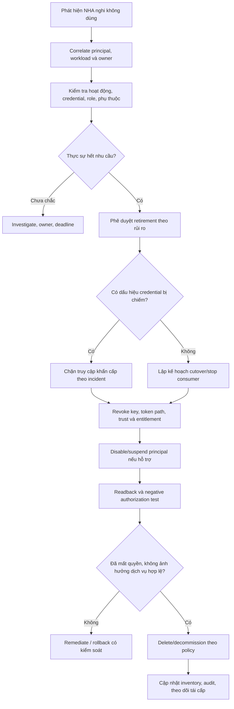

# Xóa account không dùng trong quản trị Non-human account và IAM Identity Lifecycle

**Xóa account không dùng** là hoạt động nhận diện, kiểm chứng, ngừng cấp quyền và loại bỏ có kiểm soát những **non-human account (NHA)** không còn mục đích hợp lệ. Các account này thường phục vụ service, automation, tích hợp hệ thống, bot, job batch, CI/CD hoặc thiết bị. Mục tiêu an ninh là **chấm dứt khả năng truy cập không còn cần thiết**, trong khi bảo đảm không vô tình làm ngừng một workload còn hoạt động.

Ví dụ: một pipeline triển khai cũ đã được thay bằng GitOps, nhưng service account `legacy-deployer` vẫn có quyền deploy production và một API key chưa hết hạn. Nếu chỉ xóa pipeline, account và key có thể tiếp tục bị sử dụng. Nếu chỉ xóa account ngay mà không kiểm tra consumer, một job dự phòng hiếm chạy có thể lỗi khi cần khôi phục. Do đó, “không dùng” phải được **chứng minh bằng nhiều nguồn**, và “xóa” phải là **bước cuối của một quá trình deprovisioning có kiểm chứng**, không phải thao tác dọn danh sách đơn giản.

Trong **Identity and Access Management (IAM)** theo vòng đời **Joiner–Mover–Leaver (JML)**, non-human account có vòng đời tương tự: tạo khi workload xuất hiện, điều chỉnh khi nhiệm vụ/owner thay đổi, và thu hồi khi workload kết thúc. Bài học kết nối **IdP, SSO, SCIM, RBAC/ABAC, quản lý service/machine identity, credential, audit và account reconciliation** để giảm quyền truy cập tồn dư.

## 1. Non-human account nào có thể cần xóa?

Non-human account không chỉ là username có tiền tố `svc-`. Các đối tượng có thể nằm trong nhiều hệ thống:

| Dạng account | Ví dụ | Quyền hoặc đường truy cập tồn dư |
| --- | --- | --- |
| **Directory service account** | Account chạy scheduled task | Password, SPN, group membership |
| **Cloud service principal** | Identity của ứng dụng đám mây | Role assignment và client credential |
| **OAuth client** | Client dùng `client_credentials` | Secret, certificate, scope, token |
| **Managed identity** | Identity gắn với VM/app | Resource role và policy binding |
| **Workload federation** | CI job đổi assertion lấy cloud token | Issuer/subject/audience trust |
| **Kubernetes ServiceAccount** | Pod gọi API | RBAC binding và token |
| **Database technical user** | Tài khoản ETL | Database grant và session |
| **API key identity** | Tích hợp đối tác cũ | Key còn được gateway chấp nhận |
| **Bot/automation account** | RPA xử lý ticket | Application role và credential |
| **Device/machine identity** | Thiết bị có certificate | Cert, trust và quyền hệ thống |

Một account có thể dùng nhiều credential và một workload có thể dùng nhiều account. **Chỉ xóa một username trong IdP không đồng nghĩa mọi đường machine-to-machine đã mất hiệu lực**.

## 2. “Không dùng” khác “không có đăng nhập gần đây”

Các trạng thái dễ bị nhầm lẫn:

| Trạng thái | Ý nghĩa | Cách xử lý phù hợp |
| --- | --- | --- |
| **Unused** | Có căn cứ xác nhận không còn consumer hoặc nhiệm vụ | Đưa vào retirement có kiểm soát |
| **Inactive** | Không thấy sử dụng trong một khoảng quan sát | Điều tra; chưa đủ để xóa |
| **Orphan** | Không xác định được owner/mục đích | Điều tra ưu tiên và đặt deadline |
| **Dormant** | Ít kích hoạt theo thiết kế | Xác minh runbook và lịch sử nhiệm vụ |
| **Disabled** | Account bị chặn ở một nơi quản trị | Kiểm tra các đường khác còn hoạt động |
| **Deprecated** | Đã có phương án thay thế | Xác nhận cutover và loại credential cũ |
| **Compromised** | Bị nghi chiếm credential | Thu hồi khẩn cấp theo incident |
| **Retired** | Vòng đời ngừng sử dụng đã hoàn tất | Lưu metadata và bằng chứng theo policy |

Ví dụ một **break-glass account** có thể không đăng nhập suốt nhiều tháng nhưng vẫn cần để khôi phục IdP. Tương tự, job xuất báo cáo cuối năm có thể không chạy hàng tuần. **Không tự động xóa account chỉ vì `lastLogin` hoặc `lastUsed` cũ**.

## 3. Vì sao xóa account không dùng lại quan trọng?

Những NHA tồn dư có thể trở thành mục tiêu bị chiếm đoạt:

1. **Credential tồn tại lâu:** secret khó xoay hoặc bị sao chép ngoài vault.
2. **Quyền quá rộng:** account cũ giữ role admin dù nhiệm vụ đã kết thúc.
3. **Không có owner:** không ai nhận cảnh báo hoặc phê duyệt thu hồi.
4. **Ít được giám sát:** hoạt động bất thường có thể không bị điều tra.
5. **Tích hợp đã hết hợp đồng:** API key vẫn truy cập dữ liệu của tổ chức.
6. **Rủi ro cross-tenant:** client cũ còn trust binding hoặc quyền dự án khác.
7. **Vi phạm SoD:** bot có thể tạo và duyệt cùng giao dịch nếu role chồng lấn.
8. **Phục hồi quyền không mong muốn:** IaC/connector tái tạo role đã xóa.
9. **Gây rối khi audit:** rất khó chứng minh ai quản lý quyền đã không còn cần.

Tuy nhiên, **xóa thiếu kiểm tra cũng gây rủi ro availability**: database job, backup, disaster recovery hoặc một consumer không được ghi nhận có thể dừng hoạt động. Vì vậy mục tiêu là **giảm rủi ro truy cập mà không phá hủy phụ thuộc hợp lệ**.

## 4. Xây dựng tiêu chí nhận diện account có thể retire

Một bộ tiêu chí kết hợp nhiều tín hiệu:

- **Business purpose:** workload/dự án/hợp đồng đã kết thúc hay chưa?
- **Owner attestation:** owner hiện hành xác nhận không còn nhu cầu?
- **Deployment inventory:** còn VM, pod, job, cron, runner hoặc service liên quan không?
- **Observed activity:** issuer, resource server, gateway và database còn thấy sử dụng?
- **Credential usage:** có key/certificate nào đang được dùng, kể cả credential phụ?
- **Dependencies:** ứng dụng khác có tiêu thụ account hoặc secret chung không?
- **Change history:** đã chuyển sang identity mới, managed identity hay federation chưa?
- **Data retention/compliance:** có ràng buộc giữ bằng chứng, tài khoản hoặc cấu hình không?
- **Recovery requirements:** account có vai trò khôi phục khẩn cấp hoặc batch theo chu kỳ dài không?
- **Risk indicators:** role privileged, external trust hoặc secret nghi bị lộ?

Không nên dùng một quy tắc như “không login 90 ngày thì xóa” cho tất cả. Khoảng thời gian quan sát cần được quyết định theo **chu kỳ chạy của workload, mức rủi ro và chính sách tổ chức**.

## 5. Inventory và owner: điều kiện tiên quyết

Trước khi delete, cần có record đủ để liên kết tài khoản với mục đích và quyền thực tế:

| Trường | Ví dụ | Tại sao cần? |
| --- | --- | --- |
| `nonHumanAccountId` | `nha-legacy-deployer-01` | Khóa ổn định |
| `principalId` | `spn-74` | Định danh tại issuer |
| `issuer` | `cloud-iam-prod` | Nơi vô hiệu credential |
| `workloadId` | `legacy-ci-deploy` | Consumer chính |
| `businessOwnerId` | `EMP-110` | Quyết định nhu cầu |
| `technicalOwnerTeam` | `platform-ci` | Thực hiện cutover |
| `environment/tenant` | `production/tenant-a` | Tránh xóa nhầm |
| `credentialRefs` | `vault://refs/key-74` | Liệt kê đường xác thực |
| `entitlements` | `deploy.production` | Kiểm tra quyền còn tồn dư |
| `dependencies` | `release-runner` | Đánh giá blast radius |
| `lastObservedUse` | Timestamp có nguồn | Tín hiệu hỗ trợ |
| `retirementDecision` | `approved-for-retire` | Bằng chứng thẩm quyền |

Các trường là **schema minh họa**, không phải chuẩn SCIM bắt buộc. Chỉ lưu **credential reference hoặc fingerprint không nhạy cảm**, tuyệt đối không đưa plaintext password, token, private key hoặc API key vào catalog.

Nếu owner đã **Mover/Leaver**, phải tìm owner mới hoặc người chịu trách nhiệm theo quy trình thay thế. Không đồng nhất **người tạo account** với **người có thẩm quyền xác nhận xóa account**.

## 6. Sơ đồ luồng xóa account không dùng



Trong sự cố bảo mật, thứ tự có thể thay đổi để **chặn credential trước khi phân tích đầy đủ phụ thuộc**. Nhưng với kế hoạch dọn account thông thường, cần hạn chế nguy cơ gián đoạn bằng kiểm tra và cutover.

## 7. Disable, revoke, delete: ba việc không giống nhau

| Hoạt động | Đối tượng | Giá trị bảo mật | Điểm cần kiểm chứng |
| --- | --- | --- | --- |
| **Disable** | Account/principal | Có thể ngăn phiên hoặc xác thực mới | Token/key cũ còn được chấp nhận không? |
| **Revoke credential** | API key, secret, certificate, trust | Chặn đường chứng thực hoặc xin token mới | Có credential phụ/bản sao khác không? |
| **Revoke entitlement** | Role, group, ACL, policy binding | Mất quyền trên tài nguyên | Quyền kế thừa/cache còn không? |
| **Revoke session/token** | Phiên hoặc token đã phát | Hạn chế quyền sử dụng tiếp | Nền tảng có hỗ trợ vô hiệu tức thời không? |
| **Delete** | Bản ghi identity/principal | Kết thúc quản lý đối tượng | Có side effect, khóa tham chiếu hoặc tái tạo không? |
| **Archive metadata** | Inventory/audit | Giữ bằng chứng sau retirement | Không chứa secret hoặc dữ liệu không cần |

**Xóa record trong secret manager chưa chắc vô hiệu credential đã sao chép**; cần thực hiện revoke tại **issuer hoặc hệ thống đích**. Tương tự, xóa user/group qua SCIM không bảo đảm mọi phiên ứng dụng và khóa cục bộ biến mất.

## 8. Khảo sát phụ thuộc trước khi delete

Một NHA có thể được chia sẻ bởi nhiều consumer. Để không gây outage, hãy rà soát:

- **Ứng dụng:** microservice, job, batch, RPA và scheduled task.
- **Hạ tầng:** VM, container, pod, cluster, namespace, thiết bị.
- **CI/CD:** runner, deployment pipeline, environment secret và IaC.
- **Dữ liệu:** database user, storage bucket, queue, report API.
- **Đối tác:** contract và integration client sử dụng key.
- **Dự phòng:** job phục hồi, backup, disaster recovery, break-glass.
- **Khóa và chứng chỉ:** key versions, certificates, trust chains.
- **Người vận hành:** vault custodian, owner, nhóm phê duyệt hoặc on-call.

Ví dụ tài khoản `db-automation` được tạo cho job A nhưng nhiều năm sau job B cũng dùng chung. Chỉ thấy job A retired không đủ để delete account; cần xác định các consumer còn hoạt động rồi **tách identity hoặc chuyển dần sang cơ chế mới**.

## 9. Quy trình Planned retirement chi tiết

Khi xác nhận account không còn cần và không có sự cố chiếm quyền:

1. **Mở yêu cầu retirement:** ghi account ID, tenant, mục đích, owner và lý do.
2. **Xác minh owner:** người duyệt đang active, đủ thẩm quyền, không xung đột SoD.
3. **Phân tích effective permission:** role trực tiếp/kế thừa, group, ACL, trust và credential.
4. **Tìm consumer:** từ deployment, config, gateway, secret manager và log.
5. **Xác nhận lịch workload:** không nhầm job hiếm chạy với account bỏ.
6. **Lập cutover:** chuyển consumer hợp lệ sang identity/credential khác nếu cần.
7. **Đặt giai đoạn quan sát:** theo chính sách và tần suất sử dụng thực tế.
8. **Ngừng nguồn phát sinh truy cập:** tắt job cũ hoặc cập nhật cấu hình.
9. **Revoke credential và entitlement:** thực hiện ở issuer/nguồn quyền đúng.
10. **Disable principal:** dùng khi nền tảng hỗ trợ, quan sát lỗi phụ thuộc.
11. **Xác minh không còn truy cập:** issuer, API, ứng dụng, token/session và database.
12. **Delete principal khi phù hợp:** tránh giữ account hoạt động không có nhiệm vụ.
13. **Sửa IaC/GitOps:** ngăn tạo lại account hoặc role.
14. **Lưu audit:** quyết định, bằng chứng, sai lệch và kết quả.
15. **Theo dõi sau delete:** alert nếu principal/key cũ được dùng hoặc tài nguyên tái xuất hiện.

Với nền tảng không cho disable trước delete, cần dùng phương án phù hợp và kiểm tra kỹ kế hoạch thay đổi. **Không coi trạng thái Deleted trong một dashboard là bằng chứng duy nhất của việc thu hồi quyền thực tế**.

## 10. Thu hồi khẩn cấp khi account nghi bị lộ

Nếu NHA có credential bị lộ hoặc hành vi đáng ngờ, không nên trì hoãn chặn quyền để chờ kết thúc kỳ quan sát thông thường.

Một quy trình ứng cứu nên:

- Kích hoạt incident với **owner, phạm vi tài nguyên và mức nghiêm trọng**.
- Xác định credential có thể bị lộ, token path và quyền của principal.
- Chặn phát token mới hoặc revoke credential tại issuer theo khả năng nền tảng.
- Xử lý access token/session còn hạn và quyền tại resource server.
- Cô lập workload hoặc giảm role khi cần để hạn chế thiệt hại.
- Cung cấp identity/credential thay thế theo chính sách nếu dịch vụ cần duy trì.
- Kiểm tra log cho hoạt động bất thường và dấu hiệu nâng quyền.
- Tìm secret trong image, repo, runner, log hoặc bản sao cấu hình.
- Ghi rõ khoảng thời gian token cũ có thể còn hiệu lực.
- Thực hiện hậu kiểm, rotation và reconciliation sau sự cố.

**Xóa secret khỏi repository không thu hồi bản secret đã bị sao chép**, còn đổi client secret không nhất thiết vô hiệu mọi access token đã cấp. Đây là lý do cần quản lý theo cả credential và authorization runtime.

## 11. OAuth client, API key và service principal

Một OAuth client dùng `client_credentials` có thể sở hữu nhiều client secret hoặc certificate. Khi retire cần:

| Đối tượng | Hành động | Bằng chứng |
| --- | --- | --- |
| OAuth client registration | Disable/delete theo khả năng nhà cung cấp | Issuer không còn chấp nhận client |
| Client secret/certificate | Revoke tất cả credential không còn cần | Không cấp token mới |
| Access token cũ | Revoke/introspect hoặc quản lý TTL và policy đích | API từ chối khi quyền mất hiệu lực |
| Role/scopes | Gỡ grants ở authorization server và tài nguyên | Effective access giảm đúng |
| Federated trust | Xóa subject/audience/issuer binding | Không exchange assertion lấy token |
| Vault/CI secret | Gỡ reference sau khi key bị chặn tại nguồn | Không còn deployment dùng secret |
| Audit | Gắn incident/change ID | Dấu vết truy xuất, revoke và validation |

**Không nhầm ID token OIDC với access token cho API.** OAuth client máy–máy thường dùng access token có audience/scope phù hợp; cần xác minh resource server có ngừng chấp nhận hành động cũ hay chưa.

## 12. Managed identity và workload federation

Với **managed identity**, không nhất thiết tồn tại static secret để xóa. Các việc cần kiểm tra gồm:

- Identity association còn gắn với resource/runtime nào?
- Role assignment ở cloud/resource còn hiệu lực không?
- Có policy inherited từ account/subscription/project không?
- Có cache token hoặc session ứng dụng còn dùng identity?
- Deletion của workload có tự xóa principal/role không, hay phải thu hồi riêng?

Với **workload identity federation**, việc bỏ secret lâu dài là cải tiến, nhưng có thể vẫn tồn tại **trust binding** cho issuer/subject/audience cũ. Nếu repo, cluster hoặc môi trường đã retired mà trust vẫn cho exchange token mới, đó là đường truy cập tồn dư.

**Thu hồi workload federation không chỉ xóa file cấu hình CI**: phải kiểm chứng quyền cấp token tại authorization server và role của principal đích.

## 13. Kubernetes và database account không dùng

### Kubernetes ServiceAccount

Một ServiceAccount có thể còn tồn tại dù Deployment đã xóa. Cần kiểm tra namespace, pod/job sử dụng, RoleBinding/ClusterRoleBinding, token và quyền API. Nếu gỡ một account gắn với nhiều workload, phải phân tích tác động.

**ServiceAccount token với thời hạn/cơ chế phát khác nhau có hành vi revoke khác nhau**. Không suy rằng xóa ServiceAccount hoặc pod luôn lập tức vô hiệu mọi token đã phát trong mọi cấu hình. Dùng khả năng nền tảng và readback/test phù hợp.

### Database technical account

Database user có thể giữ grant `SELECT`, `INSERT` hoặc `ADMIN`, và có session/connection pool còn hoạt động. Trước khi drop user cần xác định consumer, scheduler, stored procedure hoặc credential được nhúng. Khi revoke, kiểm tra **session hiện hữu, quyền kế thừa qua role và kết nối mới**, theo database cụ thể.

Việc thay tài khoản database có thể ảnh hưởng job báo cáo hiếm chạy. Đừng đồng nhất **không thấy query gần đây** với **không còn consumer**.

## 14. RBAC, ABAC và quyền truy cập hiệu lực

Một NHA có thể nhận quyền từ nhiều nơi:

```text
Observed effective access
  <- Direct role grants
  <- Group membership / nested groups
  <- Resource ACL
  <- Inherited cloud project/organization policy
  <- Workload federation / trust paths
  <- ABAC/PBAC runtime conditions
  <- Access token scope and cached session context
```

Ví dụ account cũ mất role `bucket-writer` trực tiếp nhưng còn `storage-admin` cấp ở project cha. Chỉ xem role trực tiếp sẽ báo sai rằng quyền đã thu hồi.

Để đánh giá đúng, cần đọc **effective permission theo resource và ngữ cảnh**, không coi phép trừ hai danh sách tên role luôn phản ánh authorization thực tế. Với ABAC, policy có thể dựa trên tenant, môi trường, workload subject hoặc classification của dữ liệu.

## 15. IdP, SSO, SCIM và giới hạn của deprovisioning

| Thành phần | Có thể hỗ trợ | Không thể giả định |
| --- | --- | --- |
| **IdP/Active Directory** | Disable account kỹ thuật, gỡ group/SPN | Chứa mọi OAuth client hoặc cloud principal |
| **SSO/OIDC/SAML** | Liên kết xác thực ở ứng dụng hỗ trợ | Chấm dứt tất cả RP session khi account bị xóa |
| **SCIM** | Deprovision User/Group khi target hỗ trợ | Revoke mọi token, cert, secret và role local |
| **Cloud IAM** | Xóa principal và role binding | Credential đã phát đều mất hiệu lực tức thời |
| **Secrets manager** | Quản lý key version, secret và truy xuất | Xóa bản lưu cũng vô hiệu bản sao ngoài vault |
| **Application/database** | Drop account, revoke grant, đóng session | Quyền chỉ tồn tại ở IdP |
| **IGA/JML** | Tính desired state, approval, review | Không cần readback từ đích |
| **Audit/reconciliation** | So sánh và phát hiện quyền tồn dư | Thay thế authorization runtime |

**SCIM `active=false` là một thao tác quản lý account theo hỗ trợ của hệ thống đích, không phải cam kết mọi API key và JWT tự chứa bị thu hồi.**

## 16. Human JML và Machine JML

### Joiner

Khi một workload mới được triển khai, account phải được đăng ký với **owner, purpose, tài nguyên, môi trường, scope, credential lifecycle và điều kiện retire**. Quyết định cấp quyền ban đầu nên hạn chế theo least privilege và có readback.

### Mover

Machine Mover là đổi chức năng, dự án, tenant, môi trường hoặc owner. IAM cần tính lại quyền và ngăn việc **chỉ thêm role mới, để nguyên role cũ**. Human Mover của người từng giữ secret cũng cần gỡ quyền cá nhân vào vault, CI/CD và credential.

### Leaver

Machine Leaver là ngừng workload hoặc kết thúc quan hệ tích hợp. Thực hiện revoke và delete có kiểm chứng. Human Leaver của kỹ sư tạo account **không mặc nhiên đồng nghĩa workload đã ngừng**: cần chuyển owner và đánh giá secret họ từng biết, thay vì xóa mù account sản xuất.

## 17. Partner account không dùng và hợp đồng đã kết thúc

Một integration của đối tác thường có API key/OAuth client/cert riêng, không phụ thuộc hoàn toàn vào nhân viên đăng nhập SSO. Khi hợp đồng hết hạn:

1. Kiểm tra partner ID, contract ID, sponsor và tenant/resource được cấp.
2. Xác định mọi client, credential, principal và quyền liên quan.
3. Xác nhận dữ liệu/consumer nào còn nằm trong nghĩa vụ chuyển tiếp hợp lệ.
4. Chặn token mới, thu hồi key và trust không còn căn cứ.
5. Gỡ role/ACL, kiểm chứng API từ chối truy cập ngoài thỏa thuận.
6. Retire account và cập nhật inventory, lưu evidence phù hợp.

**Partner IdP vẫn xác thực nhân viên của họ không đồng nghĩa integration của họ vẫn được quyền truy cập tài nguyên doanh nghiệp**. Phải quản lý authorization theo hợp đồng và vòng đời machine identity độc lập.

## 18. IaC/GitOps và nguy cơ account tự xuất hiện lại

Một lỗi phổ biến là xóa service principal thủ công nhưng **Terraform, GitOps hoặc automation quản lý trạng thái** vẫn khai báo principal/role đó. Khi chạy lại pipeline, quyền có thể được tái cấp.

Quy trình cần:

- Xác định account thuộc tài nguyên **declaratively managed** hay không.
- Sửa manifest/state cấu hình theo change approval.
- Bảo đảm không có job bootstrap hoặc connector retry tái tạo credential.
- Dùng version/generation và idempotency để tránh thực thi grant cũ.
- Kiểm tra drift sau mỗi đợt deploy hoặc reconciliation.
- Tạo cảnh báo nếu account/key đã retired được sử dụng hoặc xuất hiện lại.

**Delete ở target mà không sửa authoritative desired state không phải xóa bền vững.** Cần chặn quyền được cấp lại từ nguồn cấu hình.

## 19. Race condition giữa revoke và provisioning

Xét tình huống:

- Lúc T0, chủ ứng dụng xác nhận một account không còn dùng.
- T1, IAM đưa lệnh revoke vào queue.
- T2, pipeline triển khai phiên bản cũ thực hiện grant lại.
- T3, connector trả “success” cho lệnh revoke nhưng resource server vẫn nhận token hợp lệ.

Để giải quyết:

1. **Gắn quyết định với account/resource ID và version**.
2. Kiểm tra lifecycle state trước khi chấp nhận grant mới.
3. Ngăn các event cũ đảo ngược quyết định retirement.
4. Xử lý duplicate event và retry idempotent.
5. Sửa nguồn IAM/IaC trước hoặc đồng thời với lệnh tại target.
6. Đọc lại trạng thái đích và kiểm tra API deny thực tế.
7. Giữ alert theo dõi đường credential cũ trong khoảng rủi ro còn lại.

**Không đóng ticket chỉ dựa vào HTTP 200/204 từ connector** nếu vẫn còn đường thực thi quyền.

## 20. Readback và negative authorization test

Một mô hình logic:

```text
desired_account_state = RETIRED
desired_entitlements = NONE

observed_principal = read_issuer(account_id)
observed_access = read_effective_permissions(account_id, resource_scope)
runtime_result = try_denied_operation_using_controlled_test()

if observed_access != desired_entitlements OR runtime_result == PERMIT:
    mark_remediation_incomplete()
else:
    record_verified_revoke()
```

Đây là **giả mã**, không phải chương trình có thể dùng nguyên trạng. Một số hệ thống vẫn lưu identity metadata sau khi revoke; do đó trạng thái principal tồn tại không tự đồng nghĩa account còn có quyền. Cần kiểm tra **khả năng xác thực và authorization thực tế**, theo phạm vi mà tổ chức yêu cầu.

| Bài kiểm thử | Kết quả mong muốn |
| --- | --- |
| Key cũ yêu cầu token mới | Không được chấp nhận |
| Federated subject cũ đổi assertion lấy token | Bị từ chối sau revoke trust |
| Access token cũ gọi API | Bị từ chối theo thời gian và cơ chế thu hồi thiết kế |
| Role grant trực tiếp đã gỡ | Không còn thao tác trong phạm vi quyền đó |
| Role kế thừa từ group/project | Phát hiện nếu vẫn cho truy cập |
| Database technical user cố kết nối mới | Không còn được phép |
| Pipeline cũ tái chạy | Không khôi phục account/credential trái policy |
| Workload mới sau cutover | Vẫn thực hiện đúng tác vụ được duyệt |
| Owner Leaver thử lấy secret | Không còn quyền truy xuất |
| Cross-tenant request bằng identity cũ | Không vượt phạm vi tenant |
| SaaS local role còn sau SCIM delete | Reconciliation phát hiện |
| JWT tự chứa còn hạn | Theo dõi giới hạn kỹ thuật/TTL, không báo revoke tức thời sai |

Nếu không thể vô hiệu token đã phát ngay, phải ghi rõ **cửa sổ tồn dư** và biện pháp giảm rủi ro, thay vì ghi “mọi quyền đã thu hồi ngay lập tức”.

## 21. Quyết định Keep, Migrate, Disable hay Delete

| Quyết định | Điều kiện | Công việc |
| --- | --- | --- |
| **Keep** | Account còn purpose hợp lệ | Owner xác nhận, giới hạn scope và đặt review |
| **Reduce** | Account còn dùng nhưng quyền quá rộng | Revoke entitlement thừa, readback |
| **Migrate** | Có identity/credential mới tốt hơn | Cutover, giảm overlap, revoke đường cũ |
| **Disable** | Tạm đình chỉ hoặc kiểm tra phụ thuộc | Chặn quyền phù hợp, giám sát |
| **Revoke** | Quyền/credential không còn căn cứ | Chặn issuer, token path và ACL |
| **Delete** | Đã dừng phụ thuộc và hoàn tất revoke | Xóa principal, lưu metadata kiểm toán |
| **Investigate** | Chưa xác định owner/consumer | Phân công owner, SLA, kiểm soát tạm |
| **Emergency block** | Nghi ngờ credential bị chiếm | Chặn ngay theo incident runbook |

**Không phải mọi account không hoạt động đều phải xóa ngay**. Tài khoản recovery, batch hiếm chạy hoặc tài khoản giữ theo yêu cầu đặc biệt cần có căn cứ rõ ràng, owner và kiểm soát bổ sung.

## 22. Kiểm toán và bảo quản bằng chứng

Bản ghi retirement nên thể hiện:

- Account ID, principal ID, issuer, tenant, resource và môi trường.
- Owner, technical contact và người phê duyệt.
- Business justification và lý do không còn nhu cầu.
- Timestamp discovery, decision, disable, revoke và delete.
- Danh sách credential/reference đã xử lý, **không lưu bí mật thô**.
- Role, group, ACL, trust và API scope thay đổi.
- Kết quả connector/issuer và readback tại đích.
- Kiểm thử authorization bị từ chối, bao gồm giới hạn token TTL.
- Tác động tới workload còn chạy và xác nhận cutover.
- IaC/GitOps đã cập nhật và không tái cấp.
- Incident/exception còn mở, owner và deadline khắc phục.

Audit phải được bảo vệ tính toàn vẹn, quyền truy cập và thời hạn lưu theo chính sách. Không xóa bằng chứng cần cho điều tra chỉ vì principal đã bị delete.

## 23. Chỉ số chất lượng dọn tài khoản phi con người

| Chỉ số | Ý nghĩa |
| --- | --- |
| **Dormant account count** | Số NHA không có hoạt động quan sát trong ngưỡng đã định |
| **Ownerless NHA count** | Tài khoản chưa xác định được owner hợp lệ |
| **Confirmed unused count** | Tài khoản được owner/dependency review xác nhận không còn dùng |
| **Deprovision completion rate** | Tỷ lệ yêu cầu có thao tác revoke/delete hoàn thành |
| **Verified revoke rate** | Tỷ lệ thực sự mất quyền tại đích |
| **Time to deny** | Độ trễ từ quyết định thu hồi đến API từ chối |
| **Credential residue** | Key/secret/cert còn hiệu lực sau retirement |
| **Re-provision incidents** | Identity/role bị tái tạo bởi automation |
| **Retirement outage incidents** | Gián đoạn do xóa khi còn consumer hợp lệ |
| **Partner integration leftovers** | Credential tồn tại sau kết thúc hợp đồng |
| **Mover/Leaver access drift** | Quyền cũ của workload/owner còn tồn dư |
| **Exception overdue** | Account nghi không dùng nhưng chưa có quyết định đúng hạn |

Một đợt dọn xóa được nhiều account không nhất thiết thành công nếu làm hỏng production hoặc vẫn để lại token và role hiệu lực. **Cần cân bằng verified revocation, rủi ro và tác động vận hành**.

## 24. Checklist trước khi xóa

- [ ] Account có ID đúng, issuer, tenant và environment.
- [ ] Đã xác định owner hoặc người được giao xử lý thay thế.
- [ ] Có bằng chứng workload/purpose không còn hợp lệ.
- [ ] Không dựa duy nhất vào `lastLogin` hoặc `lastUsed`.
- [ ] Đã rà soát các job, consumer và phụ thuộc dự phòng.
- [ ] Đã xác định tất cả key, certificate, token path và trust binding.
- [ ] Đã xem role/group/ACL trực tiếp, kế thừa và ABAC policy.
- [ ] Có approval hoặc thẩm quyền incident phù hợp.
- [ ] Đã chuẩn bị cutover hoặc dừng nguồn sử dụng một cách có kiểm soát.
- [ ] Credential cũ đã bị chặn tại issuer, không chỉ xóa ở vault.
- [ ] Quyền tại ứng dụng/database/API đã bị gỡ và readback.
- [ ] Session/access token cũ đã được xử lý theo nền tảng.
- [ ] Đã sửa IaC/GitOps/connector để tránh tái tạo account.
- [ ] Đã xác minh các workload hợp lệ khác vẫn hoạt động.
- [ ] Đã thực hiện negative authorization test khi cần.
- [ ] Có audit, exception, deadline và người chịu trách nhiệm còn tồn.
- [ ] Đã cập nhật inventory sang retired/deleted mà vẫn giữ metadata cần thiết.

## 25. Câu hỏi tự kiểm tra

**Tình huống A:** Account chạy job cuối năm không đăng nhập suốt 10 tháng. Có thể xóa ngay vì không dùng? **Không.** Cần xem lịch tác vụ, owner và nhu cầu khôi phục.

**Tình huống B:** Service account cũ bị xóa khỏi IdP nhưng một API key ở gateway còn hiệu lực. Đã thu hồi thành công chưa? **Chưa.** Cần chặn đường credential tại nơi chấp nhận key và kiểm chứng.

**Tình huống C:** Nhân viên tạo NHA đã nghỉ việc nhưng dịch vụ vẫn chạy. Có nên xóa NHA ngay? **Không mặc nhiên.** Chuyển owner, thu hồi quyền cá nhân và đánh giá workload riêng.

**Tình huống D:** Terraform định nghĩa một service principal; kỹ sư xóa principal trực tiếp trên cloud. Có thể xảy ra gì? **IaC tái tạo principal/role** ở lần apply sau; cần sửa desired state.

**Tình huống E:** Đã gỡ direct role nhưng NHA vẫn hưởng admin qua project cha. Điều gì còn thiếu? **Đối soát effective entitlement** và gỡ đường cấp quyền kế thừa.

**Tình huống F:** OAuth client secret đã revoke, nhưng JWT cũ vẫn được API chấp nhận. Có thể đóng verified revoke không? **Chưa đủ**, cần kiểm tra token TTL, resource-side authorization và cửa sổ tồn dư.

**Tình huống G:** Một account được nhiều ứng dụng chia sẻ. Owner của ứng dụng A xác nhận không dùng nữa. Có thể delete ngay? **Không.** Phải xác nhận các consumer còn lại và xây dựng cutover phù hợp.

## Ghi nhớ

**Xóa non-human account không dùng** không phải thao tác xóa tên tài khoản, mà là **chấm dứt toàn bộ đường xác thực và quyền truy cập không còn căn cứ** sau khi đã xác định owner, workload, credential và phụ thuộc vận hành. Cần phân biệt **inactive, orphan, disabled, revoked và retired**; thực hiện **inventory → owner attestation → dependency review → cutover/disable → revoke → readback/deny test → delete → audit**, với thứ tự linh hoạt khi có incident. Trong **Joiner–Mover–Leaver**, phải quản lý riêng vòng đời workload và người sở hữu, phối hợp **IdP/SSO, SCIM, RBAC/ABAC, service/machine identity, credential governance và reconciliation** để **xóa được quyền truy cập tồn dư mà không làm gián đoạn dịch vụ vẫn hợp lệ**.
