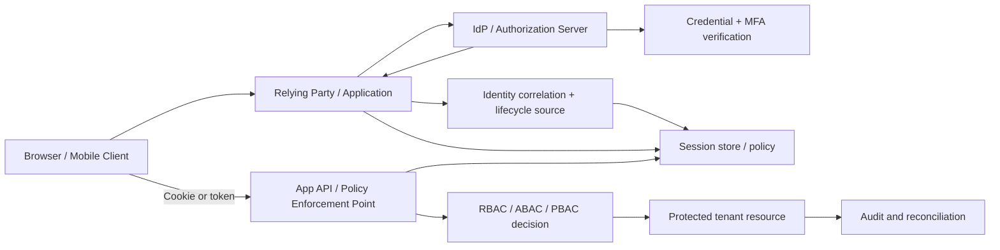
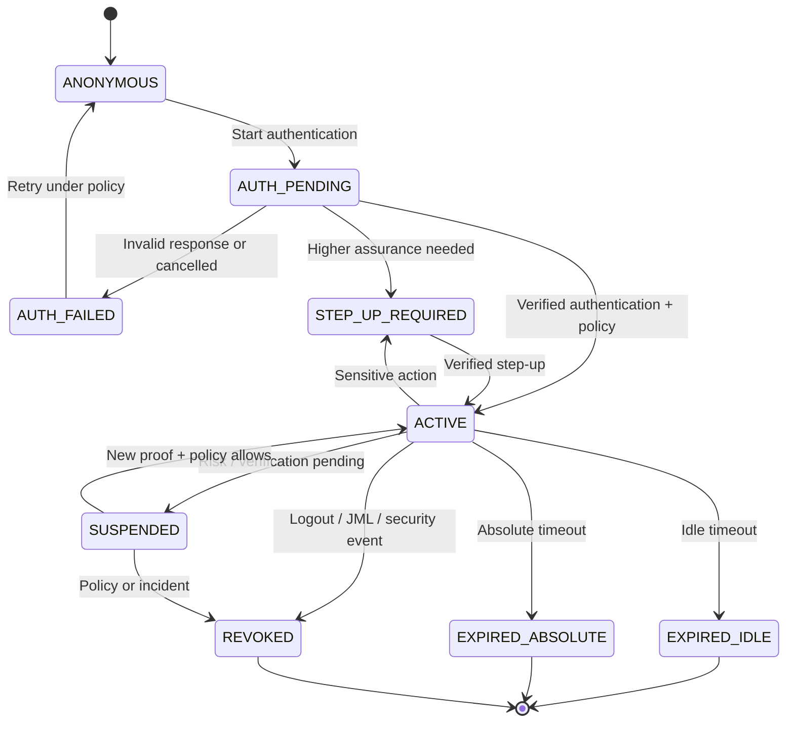
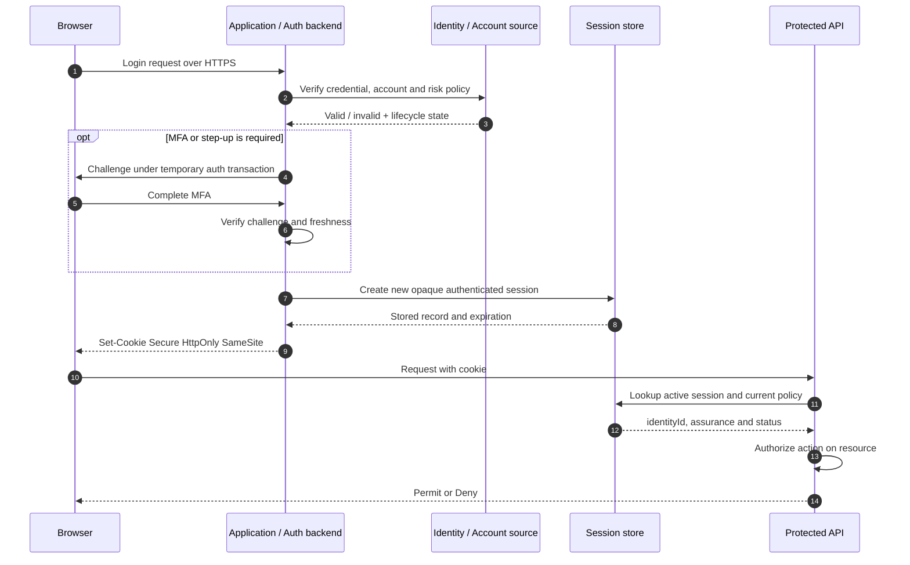
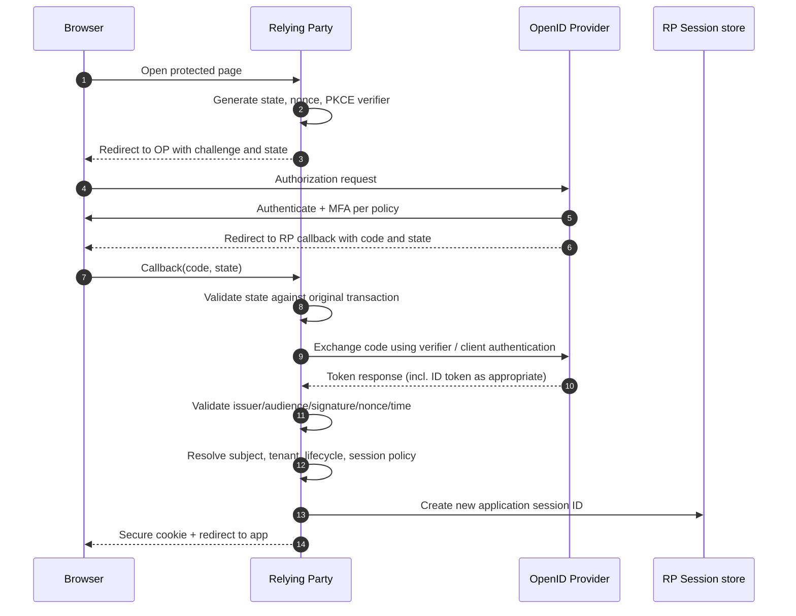

# Session creation trong quản lý phiên và vòng đời danh tính IAM

## 1. Session creation là gì?

**Session creation** là quá trình thiết lập **một ngữ cảnh phiên có thể kiểm chứng** sau khi hệ thống xác thực chủ thể và áp dụng chính sách cho phép bắt đầu phiên. Với người dùng, phiên thường giúp ứng dụng nhận ra họ qua nhiều HTTP request mà không yêu cầu nhập mật khẩu ở từng lần tải trang. Với máy và workload, một phiên có thể là kết nối mTLS hoặc một ngữ cảnh truy cập có giới hạn riêng; không phải mọi máy đều dùng browser cookie.

Ví dụ, nhân viên Lan mở cổng quản trị nhân sự. Ứng dụng chuyển Lan đến **Identity Provider (IdP)** đăng nhập bằng passkey/MFA; sau khi nhận và xác minh phản hồi OIDC, **Relying Party (RP)** tạo **phiên ứng dụng** với session identifier ngẫu nhiên, gắn bản ghi phiên với `identityId` của Lan và gửi cookie an toàn về trình duyệt. Ở các request tiếp theo, ứng dụng dùng cookie để tìm phiên, **đánh giá trạng thái còn hiệu lực và quyền của Lan**, rồi mới quyết định hành động có được phép.

Trong module **SECURITY_IDENTITY_ACCESS_MANAGEMENT_IDENTITY_LIFECYCLE**, bài học nằm ở chương **Session management** và gắn với vòng đời **Joiner–Mover–Leaver (JML)**: xác minh danh tính, tạo account, cấp quyền qua **IdP/SSO, SCIM, RBAC/ABAC**, cập nhật vai trò khi Mover và chặn phiên khi Leaver hoặc rủi ro bảo mật. Session creation là điểm nối giữa **authentication** và **authorization runtime**; nếu xử lý sai, tài khoản đã bị disable hoặc đã thu hồi role vẫn có thể sử dụng một phiên cũ.

Sau bài học, bạn có thể:
- Phân biệt **session, authentication transaction, access token, ID token, refresh token và credential**.
- Thiết kế luồng tạo phiên ở ứng dụng local, OIDC hoặc SAML SSO có kiểm tra ranh giới tin cậy.
- Chọn session identifier, cookie, lưu trữ, thời hạn và rotation an toàn.
- Phòng chống **session fixation, hijacking, replay, CSRF, XSS và cross-tenant authorization bypass**.
- Kết nối phiên với **MFA/step-up, trạng thái JML, deprovisioning, service identity, audit và reconciliation**.
- Kiểm thử cả **tạo phiên hợp lệ** lẫn **ngăn phiên và hành động không hợp lệ**.

> **Nguyên tắc:** xác thực thành công là một điều kiện quan trọng để tạo phiên, nhưng **không có nghĩa mọi quyền đã được cấp**; còn việc tạo phiên thành công **không đảm bảo phiên sẽ tự mất ngay khi role, account hoặc phiên IdP thay đổi** nếu hệ thống không có cơ chế kiểm tra và thu hồi phù hợp.

## 2. Session, authentication và authorization là những lớp khác nhau

| Khái niệm | Câu hỏi | Ví dụ | Lỗi suy luận phổ biến |
| --- | --- | --- | --- |
| **Identity** | Chủ thể nào đang được nói tới? | `identityId=id-1042` | Email là khóa định danh bất biến |
| **Account** | Danh tính có tài khoản ở hệ thống nào? | IdP user, SaaS local user | Một người chỉ có một account |
| **Credential** | Chủ thể chứng minh mình bằng gì? | Passkey, mật khẩu, certificate, signed token | Có credential là có quyền |
| **Authentication event** | Việc xác thực xảy ra khi nào và đạt mức nào? | WebAuthn + MFA tại 09:00 | Login một lần thì tin cậy mãi |
| **Authentication transaction** | Luồng xác thực đang chờ gì? | OIDC state/nonce/PKCE verifier | Transaction cookie chính là session đã login |
| **Application session** | Ứng dụng duy trì ngữ cảnh đã xác thực ra sao? | Server-side session + cookie | Session của IdP và RP luôn giống nhau |
| **Access token** | Resource server nhận ủy quyền như thế nào? | OAuth token cho API cụ thể | ID token là access token dùng cho API |
| **Refresh token** | Client có thể nhận token mới theo điều kiện nào? | Refresh token được cấp cho client phù hợp | Xóa cookie RP tự vô hiệu refresh token ở IdP |
| **Authorization** | Actor được làm action nào trên resource nào? | `user:read` trong tenant VN | Login SSO thành công là admin |
| **Provisioning/SCIM** | User/Group/entitlement được cấp hoặc gỡ thế nào? | SCIM disable account/gỡ Group | SCIM PATCH tự đóng mọi session đã có |

**Authentication** chứng minh danh tính; **session creation** lưu một ngữ cảnh để nhận diện request sau; **authorization** xác định quyền tại một tài nguyên cụ thể. Về mặt kiểm soát IAM, ba hoạt động này phải có ranh giới rõ ràng.

Một phiên có thể tồn tại mà **không có quyền nghiệp vụ nào** trên ứng dụng. Ngược lại, một service principal có quyền nhưng **chưa có credential/token hợp lệ** không được phép gọi API. Mỗi request quan trọng phải kiểm tra cả **ngữ cảnh phiên hoặc token hợp lệ** và **chính sách quyền tương ứng**.

## 3. Các kiểu phiên và ngữ cảnh đăng nhập thường gặp

| Mô hình | Client dùng gì để duy trì phiên? | Hệ thống kiểm tra | Lưu ý |
| --- | --- | --- | --- |
| **Web server-side session** | Cookie chứa session ID ngẫu nhiên | Backend tra session store | Dễ revoke tập trung khi có store đáng tin |
| **BFF (Backend for Frontend)** | Browser cookie tới BFF | BFF giữ token phía server, gọi API | Hạn chế token OAuth lộ ra JavaScript trình duyệt |
| **Stateless signed session token** | Cookie/token được ký, có claim và expiry | Verifier kiểm chữ ký, claim, chính sách | Revocation tức thời khó nếu chỉ xác minh chữ ký |
| **OIDC RP session** | Cookie/session do ứng dụng RP phát | RP sau khi xác minh phản hồi IdP | Khác với browser SSO session tại IdP |
| **SAML SP session** | Cookie/session do Service Provider phát | SP sau khi xác minh assertion SAML | SAML assertion không phải session cookie |
| **Mobile application session** | Token/session qua app và API | Backend/authorization server | Secure storage, refresh và device lifecycle riêng |
| **Machine-to-machine access** | mTLS, OAuth token hoặc workload credential | API gateway/resource server | Không nên mô phỏng user browser session nếu không cần |
| **Long-lived WebSocket** | Handshake được xác thực + connection context | Server và policy trong vòng đời kết nối | Revoke có thể cần chấm dứt connection đang mở |

**Không mặc định tất cả mô hình phải lưu một bảng `sessions` giống nhau.** Đối với ứng dụng web có cookie, server-side session thường giúp revoke tập trung. Với OAuth API, access token có thể mang authorization context. Với dịch vụ dùng mTLS, “phiên” có thể là một kết nối bảo mật và cần kiểm tra identity/permissions khi kết nối hoặc thao tác.

**Không coi “stateless” đồng nghĩa “không cần state bảo mật”**: các quyết định thu hồi, role thay đổi, refresh token rotation hoặc phát hiện replay vẫn có thể cần state tại server.

## 4. Ranh giới tin cậy trong quy trình tạo phiên

Một luồng SSO có nhiều thành phần độc lập; không thành phần nào được tin một kết luận chỉ do trình duyệt tự khai.



Các ranh giới:

1. **Client → RP:** browser, cookie hoặc HTTP header từ client là dữ liệu không tin cậy cho đến khi được xác minh.
2. **RP → IdP:** RP chỉ tin kết quả xác thực từ **issuer và client registration được cấu hình**, không tin URL callback hoặc token ngẫu nhiên.
3. **IdP → identity registry:** cặp `(issuer, subject)` phải được liên kết đúng với identity/account; không chỉ so email hoặc display name.
4. **Identity → session store:** tạo phiên sau kiểm tra lifecycle, risk và login policy.
5. **Session → API/PEP:** session chỉ chứng minh actor; từng action/resource vẫn cần authorization.
6. **JML/IGA → RP/API:** thay đổi trạng thái account và quyền phải được **đưa vào quyết định runtime/revocation**, không chỉ cập nhật DB quản trị.

### Session tại IdP khác session tại ứng dụng

Một IdP có thể giữ phiên SSO cho Lan; ứng dụng A và B tự tạo **hai RP sessions** riêng. Lan logout ứng dụng A không nhất thiết logout IdP hay ứng dụng B. Ngược lại, khi IdP session bị kết thúc, RP session **không mặc nhiên bị thu hồi tức thì** nếu không có logout propagation, back-channel, session check hoặc điều kiện hiệu lực tương ứng.

## 5. Điều kiện trước khi cấp một phiên đã xác thực

Trước khi phát phiên ứng dụng có quyền nhận diện người dùng, backend cần kiểm soát các điều kiện thích hợp với chính sách:

- **Đã hoàn tất authentication thật:** không tạo `AUTHENTICATED` session chỉ vì người dùng mở trang login hoặc đi tới callback URL.
- **Issuer/protocol hợp lệ:** local authenticator, OIDC hoặc SAML response phải được kiểm tra đúng chuẩn và cấu hình.
- **Correlation identity rõ:** ánh xạ principal được chứng minh vào `identityId`/`accountId` đúng tenant; không gộp nhầm người trùng email.
- **Lifecycle hợp lệ:** account chưa bị disable/Leaver, contract/guest chưa hết hiệu lực theo nguồn có thẩm quyền.
- **Policy/risk đáp ứng:** MFA, device posture, step-up hoặc anti-bot theo mức rủi ro và tính năng nền tảng.
- **Không bị khóa hoặc yêu cầu reset:** account đang bị chặn, credential bị nghi lộ hoặc policy bắt re-enrollment không được nhận phiên full-authentication như bình thường.
- **Phiên có scope rõ:** tenant, ứng dụng, authentication method/assurance, thời điểm tạo và thời hạn.
- **Session fixation được ngăn:** sau login phải cấp **session identifier mới**, không tái dùng ID từ phiên anonymous.
- **Audit có thể truy nguyên:** ghi event nhận dạng và kết quả tạo phiên mà **không lưu session secret**.

Một số ứng dụng cho phép **anonymous session** trước login để giữ giỏ hàng, locale hoặc CSRF token. Khi user đăng nhập, cần **nâng trạng thái và phát ID mới một cách an toàn**, tránh giữ nguyên identifier đã có trước authentication.

## 6. State machine cho session creation và lifecycle

Session creation không phải một thao tác đơn lẻ với hai giá trị `true/false`. Có các trạng thái đang chờ, xác thực bổ sung, active, locked, expired và revoked.



**Mô hình trên là minh họa**, không phải enum chuẩn mà mọi framework phải dùng. Một hệ thống thực có thể chỉ lưu `ACTIVE/REVOKED` và tính expiry từ timestamp; vẫn phải bảo đảm các chuyển trạng thái có ý nghĩa bảo mật.

### Không có “login một phần” như login đầy đủ

Nếu người dùng mới nhập đúng mật khẩu nhưng MFA chưa hoàn tất, backend có thể giữ một **authentication transaction tạm thời**. Transaction này **không được sử dụng để gọi API nghiệp vụ như phiên đã xác thực đầy đủ**. Tương tự, một OIDC state cookie hoặc password-reset ticket không được coi là session truy cập.

### Session state vs authorization state

Session `ACTIVE` chỉ có nghĩa đã đáp ứng kiểm tra phiên; nếu nhân viên Mover mất role `finance-admin`, API phải Deny hành động quản trị dù session vẫn `ACTIVE`, hoặc revoke session theo chính sách rủi ro. **Đừng lưu quyết định Permit vĩnh viễn trong session object**.

## 7. Session identifier: entropy, bí mật và khả năng đoán

Trong mô hình **server-side session**, browser thường giữ một **opaque session ID** có tính chất bearer secret. Kẻ có ID hợp lệ có thể dùng để đại diện cho phiên nếu không có cơ chế bảo vệ bổ sung.

Yêu cầu thiết kế:

1. **Không thể đoán thực tế:** sinh bằng **CSPRNG**; không dựa vào thời gian, username, IP, bộ đếm hoặc UUID có cấu trúc dự đoán được.
2. **Đủ độ ngẫu nhiên:** ví dụ sinh **32 bytes ngẫu nhiên (256 bit)** rồi mã hóa base64url; đây là lựa chọn triển khai mạnh, **không phải chuẩn bắt buộc cho mọi framework**.
3. **Không chứa PII hoặc role:** session ID không phải nơi encode email, tenant hoặc quyền.
4. **Quản lý bí mật:** chỉ truyền qua kênh TLS, cookie bảo mật hoặc cơ chế client hợp lệ, không đưa vào URL/query string.
5. **Đổi sau authentication/privilege boundary:** không giữ ID anonymous khi user hoàn tất login; cân nhắc rotate khi reauthentication/step-up quan trọng.
6. **Thu hồi được:** session lookup cần hỗ trợ invalidation; với token tự chứa cần chiến lược hạn và revocation riêng.
7. **Không log giá trị thô:** có thể ghi session record ID nội bộ hoặc digest/reference phù hợp để tương quan audit.

### Phân biệt session ID và record ID

Một thiết kế có thể lưu **session token thô chỉ ở cookie**, còn DB tra theo **HMAC/digest bảo vệ của token** và giữ một `sessionRecordId` không phải secret cho audit. Khi key HMAC hoặc session store thay đổi, phải có kế hoạch rotate/migrate; không đánh đồng sessionRecordId công khai với bearer token.

**Đừng dùng session ID bằng hash của email hoặc password.** Hash của dữ liệu dễ đoán không tạo ra một bearer secret đủ an toàn.

## 8. Session fixation: vì sao cần tạo ID mới sau login?

**Session fixation** xảy ra khi attacker biết hoặc kiểm soát một session ID trước khi nạn nhân xác thực, rồi hệ thống giữ nguyên ID đó sau khi login. Attacker có thể dùng ID đã biết để truy cập phiên đã nâng cấp.

Một luồng sai:

```text
1. Client nhận anonymousSessionId = known-to-attacker
2. User xác thực thành công
3. Backend giữ nguyên anonymousSessionId và gắn identityId
4. Attacker dùng anonymousSessionId cũ để truy cập
```

Thiết kế đúng:

```text
1. Anonymous state có ID riêng và quyền hạn tối thiểu
2. Authentication/MFA hoàn tất
3. Backend phát authenticatedSessionId mới bằng CSPRNG
4. Liên kết dữ liệu anonymous được phép chuyển một cách an toàn
5. Vô hiệu ID cũ, lưu session mới với policy/thời hạn
6. Gửi cookie mới; các request dùng ID cũ không nhận quyền login
```

Việc rotate ID cần được triển khai **nhất quán và an toàn khi request đồng thời**. Nếu giữ grace period để tránh mất request, **ID cũ không được tiếp tục có quyền authentication mới** hoặc mở cửa cho fixation/hijack. Với bước nâng quyền đặc biệt, ưu tiên kiểm soát chặt hơn tính tiện lợi.

## 9. Schema lưu phiên: trường nào nên có?

Một session record hữu ích cần đủ dữ liệu phục vụ kiểm tra **chủ thể, lifecycle, thời hạn, mức xác thực và revocation**. Đây là schema ứng dụng **minh họa**, không phải chuẩn OIDC/SCIM.

```json
{
  "sessionRecordId": "sessrec-8c71",
  "sessionTokenLookupKey": "HMAC_LOOKUP_VALUE_NOT_RAW_TOKEN",
  "identityId": "id-1042",
  "accountId": "idp-account-1042",
  "issuer": "https://idp.example.test",
  "subject": "idp-subject-1042",
  "tenantId": "tenant-vn",
  "clientId": "hr-portal",
  "createdAt": "2026-11-23T02:00:00Z",
  "authenticatedAt": "2026-11-23T02:00:00Z",
  "lastActivityAt": "2026-11-23T02:12:00Z",
  "idleExpiresAt": "2026-11-23T02:42:00Z",
  "absoluteExpiresAt": "2026-11-23T10:00:00Z",
  "authentication": {
    "assurance": "MFA_VERIFIED",
    "methods": ["passkey"],
    "sourceEventRef": "auth-event-442"
  },
  "sourceState": {
    "lifecycleGeneration": 17,
    "identityStatusVersion": 42
  },
  "status": "ACTIVE",
  "revokedAt": null,
  "revocationReason": null
}
```

**Lưu ý:** mốc 30 phút idle/8 giờ absolute trong ví dụ chỉ là giá trị minh họa để giải thích hai kiểu timeout, **không phải khuyến nghị thời hạn áp dụng toàn tổ chức**. Tùy mức rủi ro, đặc biệt với admin session, yêu cầu có thể chặt hơn.

Không nhúng **raw password, MFA OTP, private key, raw access token, refresh token hoặc session cookie secret** vào bản ghi audit/JSON xuất cho reviewer. Nếu RP giữ refresh token phía server, phải bảo vệ bằng secret storage/encryption, quyền hạn tối thiểu và chính sách rotation riêng.

## 10. Cookie bảo mật cho browser session

Browser thường gửi cookie tự động tới origin/path phù hợp. Vì cookie có thể là **bearer credential**, các thuộc tính cookie và HTTPS cực kỳ quan trọng.

Ví dụ response tạo phiên ứng dụng:

```http
HTTP/1.1 303 See Other
Location: /dashboard
Set-Cookie: __Host-app_session=<OPAQUE_RANDOM_VALUE>; Path=/; Secure; HttpOnly; SameSite=Lax
Cache-Control: no-store
```

**Ý nghĩa của thuộc tính:**

| Thuộc tính | Vai trò | Lưu ý |
| --- | --- | --- |
| `Secure` | Cookie chỉ được gửi qua HTTPS trong ngữ cảnh tiêu chuẩn phù hợp | Dùng TLS end-to-end; bảo vệ cả reverse proxy |
| `HttpOnly` | JavaScript không thể đọc giá trị cookie qua `document.cookie` | Không tự ngăn XSS thực hiện request trong origin |
| `SameSite=Lax` | Hạn chế một số hành vi gửi cookie cross-site | Không thay thế CSRF token/origin check |
| `SameSite=Strict` | Hạn chế cross-site mạnh hơn | Có thể ảnh hưởng hành trình SSO/deep links |
| `SameSite=None; Secure` | Cần trong một số kịch bản cross-site hợp lệ | Làm tăng yêu cầu chống CSRF và quản lý third-party cookie |
| `Path=/` | Phạm vi path cookie | Cookie prefix `__Host-` đòi Path=/ |
| **Không có Domain** | Cookie host-only | Bắt buộc nếu dùng prefix `__Host-` |
| `Max-Age`/`Expires` | Thời gian lưu ở client | Không thay thời hạn và revocation phía server |

**Prefix `__Host-`** giúp chống một số tình huống cookie scope/overwrite khi có `Secure`, `Path=/` và **không có `Domain`**. Nếu dùng prefix khác như `__Secure-`, các điều kiện có thể khác. Không tạo cookie bearer cho toàn parent domain khi không cần, vì subdomain ít tin cậy có thể tăng rủi ro.

### Cookie có persist qua restart hay không?

Không khai báo `Max-Age/Expires` thường tạo **session cookie của browser**, nhưng browser có thể phục hồi phiên sau restart tùy cơ chế. **Không suy rằng đóng tab/trình duyệt đã revoke login**. Absolute/idle expiration và invalidation phải được thực thi phía server.

## 11. CSRF, XSS, HTTPS và các lớp phòng vệ bổ sung

**Cross-Site Request Forgery (CSRF)** khai thác việc browser tự đính cookie vào request. **Cross-Site Scripting (XSS)** có thể thực thi mã không tin cậy trong origin và thực hiện hành động với quyền người dùng.

| Rủi ro | Ví dụ | Phòng vệ |
| --- | --- | --- |
| **CSRF** | Trang ngoài kích hoạt thay email khi browser còn session | CSRF token ràng buộc phiên, Origin/Referer checks, SameSite và endpoint design |
| **XSS** | Mã injected gọi API thay user | Output encoding, sanitization, CSP phù hợp; HttpOnly giảm khả năng đọc cookie |
| **Cookie theft** | Cookie lộ qua network hoặc log | TLS, Secure, no URL session IDs, redaction |
| **Session fixation** | ID anonymous bị nâng cấp | Regenerate ID sau login/step-up |
| **Subdomain cookie injection** | Subdomain không tin cậy đặt cookie phạm vi rộng | Host-only cookie, `__Host-`, domain segmentation |
| **Mixed content** | App HTTPS gọi tài nguyên không an toàn | HTTPS mọi điểm liên quan, HSTS khi phù hợp |
| **Clickjacking** | UI thao tác nguy hiểm bị frame | CSP `frame-ancestors`/X-Frame-Options phù hợp |
| **Login CSRF / account confusion** | Browser bị gắn phiên của người khác | OIDC state binding, transaction correlation, session handling |
| **Open redirect** | `returnUrl` dẫn ra domain attacker | Allowlist/internal paths, không redirect tùy ý |

**SameSite không phải cơ chế chống CSRF duy nhất** và một số request/same-site subdomain có thể vẫn nguy hiểm. Với ứng dụng cookie-based, cần token hoặc kiểm tra origin theo risk và framework contract. `HttpOnly` cũng **không ngăn mã XSS cùng origin gọi API**, vì browser vẫn gửi cookie.

### Không gửi session token qua URL

URL dễ bị lưu trong history, analytics, referrer, proxy logs và screenshot. Không dùng `?sessionId=...` làm cách chia sẻ phiên. Các token một lần cho reset/invite cần **scope, TTL và replay control riêng**, không phải session cookie trực tiếp.

## 12. Luồng tạo phiên với đăng nhập local

Khi ứng dụng tự xác thực người dùng (không có IdP bên ngoài), cần tách bước **xác minh credential** và bước **tạo session**. Không sao chép raw credential vào session store.



### Thứ tự không nên đảo

- **Không** cấp authenticated session ngay khi password đúng nếu chính sách yêu cầu MFA.
- **Không** cấp session `ACTIVE` cho account disabled/Leaver chỉ vì password hash còn đúng.
- **Không** copy password hay OTP vào session record hoặc log.
- **Không** cấp role admin từ body login request; quyền phải lấy từ policy/entitlement có thẩm quyền.
- **Không** giữ session ID pre-login sau khi xác thực thành công.
- **Không** dựa vào một câu trả lời cũ từ account source khi trạng thái có thể đã thay đổi trong cửa sổ rủi ro lớn; áp version/freshness policy.

## 13. OIDC Authorization Code Flow: tạo RP session sau SSO

**OpenID Connect (OIDC)** cho phép Relying Party xác thực danh tính thông qua OpenID Provider (OP). Với ứng dụng web hiện đại, **Authorization Code Flow** kết hợp **PKCE** và các biện pháp bảo vệ transaction là mô hình phổ biến.



### Những bước kiểm tra quan trọng

1. **`state`**: tạo ngẫu nhiên, gắn với transaction/session của browser đã khởi tạo, dùng một lần, ngăn CSRF/account confusion trong luồng callback.
2. **PKCE `code_verifier`/`code_challenge`**: RP giữ verifier theo transaction và dùng khi đổi code; tránh code bị người khác sử dụng.
3. **Issuer/endpoint binding**: OP trả lời phải khớp issuer và cấu hình client; tránh mix-up giữa nhiều IdP.
4. **ID token validation**: kiểm chữ ký/key tin cậy, `iss`, `aud`, thời hạn `exp` và các claim bắt buộc theo flow; `azp` khi điều kiện áp dụng.
5. **`nonce`**: khi đã dùng nonce trong authorization request, xác minh nonce tương ứng trong ID token; giảm replay/mix-up của chứng cứ xác thực.
6. **Subject mapping**: dùng `(iss, sub)` ổn định; email chỉ là thuộc tính có thể đổi hoặc chưa được xác minh theo policy.
7. **Authentication assurance**: xét `auth_time`, `acr`, `amr` theo contract nếu ứng dụng yêu cầu reauthentication/step-up.
8. **Account/lifecycle**: dù OP xác thực thành công, RP vẫn có thể từ chối tạo phiên nếu user không đủ điều kiện truy cập ứng dụng.
9. **New RP session**: sau khi token được xác minh, tạo cookie/session riêng; không dùng `id_token` làm cookie session một cách tùy tiện.

**Không dùng OAuth access token như bằng chứng login chỉ vì token decode được một tên người.** OIDC sử dụng ID token và ràng buộc xác thực theo client; access token có audience/resource riêng, phục vụ resource server.

### Transaction data phải được bảo vệ

`state`, `nonce`, PKCE verifier và redirect URI cần được liên kết với **một login attempt cụ thể** và có TTL ngắn, dùng một lần. Tránh để các giá trị có khả năng hoàn tất login bị đưa vào application logs hoặc URL ngoài ý muốn. Callback phải ngăn việc dùng lại code hoặc liên kết response với transaction đã hoàn tất.

## 14. SAML SSO: từ assertion tới phiên Service Provider

Với **SAML 2.0**, Service Provider (SP) nhận **SAML Response/Assertion** sau khi IdP xác thực user. SP phải xác minh assertion và chỉ tạo phiên ứng dụng khi các điều kiện tin cậy được đáp ứng.

Các kiểm tra quan trọng theo profile/flow:

- **Issuer và metadata trust:** IdP phát hành phải là đối tác đã cấu hình, khóa ký/certificate tin cậy đúng mục đích.
- **Signature validation:** xác minh chữ ký trên đối tượng được yêu cầu theo profile, chống **XML Signature Wrapping**; ứng dụng phải sử dụng đúng assertion đã được xác minh.
- **Destination/Recipient/ACS:** response đến đúng Assertion Consumer Service của SP.
- **AudienceRestriction:** assertion chỉ dành cho SP/đối tượng nhận được phép.
- **SubjectConfirmationData:** `Recipient`, `InResponseTo` và giới hạn thời gian theo flow.
- **Conditions:** `NotBefore`, `NotOnOrAfter` và các hạn liên quan được kiểm với clock skew hợp lý.
- **Replay prevention:** theo dõi assertion/response ID đã sử dụng trong cửa sổ hiệu lực.
- **Identity mapping:** Subject/NameID format phù hợp, mapping ổn định, không tự cho rằng một email là ID bất biến.
- **JML/authorization:** account vẫn được phép dùng ứng dụng không, entitlement còn phù hợp không.
- **New SP session:** sau validate, SP cấp session ID mới cho ứng dụng; SAML assertion không phải cookie dùng ở mọi request.

### Không nhầm session IdP và SP

Một phản hồi SAML có thể làm SP login mà không cần thêm nhập mật khẩu nếu user đã có IdP session. **SP session có TTL/revocation riêng**. SAML Single Logout (SLO) chỉ nên được xem là một luồng tích hợp cần kiểm thử theo capability của hai bên, **không được giả định triển khai SAML là mọi SP tự đồng bộ logout**.

## 15. IdP SSO session, RP session và logout propagation

Trong môi trường nhiều ứng dụng, mỗi nơi có thể quản lý phiên khác nhau:

| Lớp | Ai phát hành/quản lý? | Dùng để | Không được suy luận |
| --- | --- | --- | --- |
| **IdP session** | IdP | Cho phép SSO/reauth ở IdP | Logout RP tự logout IdP |
| **RP/SP application session** | Từng ứng dụng | Duy trì ngữ cảnh login của ứng dụng | Logout IdP tự revoke mọi RP session tức thì |
| **OAuth access token** | Authorization Server | Truy cập API có audience/scopes thích hợp | Xóa cookie RP tự vô hiệu token đã phát |
| **Refresh token** | Authorization Server | Xin token mới theo điều kiện | Logout UI luôn revoke mọi refresh token |
| **Privileged session** | PAM/PIM hoặc ứng dụng quản trị | Kiểm soát hoạt động đặc quyền | Người dùng logout web là PAM session kết thúc |
| **Machine session/connection** | API gateway/mesh/DB | Xác thực workload | Browser SSO có tác dụng trên mTLS client |

Một hệ thống có thể hỗ trợ **OIDC RP-Initiated Logout**, **Front-Channel/Back-Channel Logout** hoặc cơ chế riêng để truyền sự kiện logout. Mức bảo đảm phụ thuộc **integration thực tế, event delivery, session identifiers được ánh xạ và cách SP/RP xử lý**.

### Back-channel logout cần correlate chính xác

Nếu RP nhận logout token/event từ OP, phải xác minh issuer, audience, chữ ký, event type/claim và liên kết `sid` hoặc subject theo contract; chỉ thu hồi các RP sessions thuộc đúng đối tượng. **Không chấp nhận một HTTP request ẩn danh nói “logout user X”** vì đó có thể biến thành công cụ ngắt phiên người khác.

## 16. MFA, passkey, assurance và step-up trong session creation

**Multi-Factor Authentication (MFA)** và passkey/WebAuthn thường giúp tăng mức bảo đảm của authentication. Nhưng các ứng dụng cần phân biệt **bằng chứng mức xác thực** với **quyền**.

Một session có thể lưu `authenticatedAt`, các chỉ dấu phương thức xác thực và assurance theo nguồn đáng tin. Với OIDC, RP có thể sử dụng `auth_time`, `acr` hoặc `amr` nếu OP hỗ trợ đúng contract. **Không tự bịa `acr=MFA`** dựa vào việc người dùng thấy một trang đăng nhập.

### Step-up cho thao tác nhạy cảm

Ví dụ người dùng đã đăng nhập cổng nhân sự được 3 giờ; khi muốn xem dữ liệu lương hàng loạt hoặc cấp quyền admin, chính sách có thể yêu cầu **reauthentication gần đây** hoặc bước xác minh mạnh hơn. Quy trình:

1. API xác định action/resource có rủi ro cao.
2. Kiểm mức assurance và độ mới của authentication hiện tại.
3. Nếu không đạt, yêu cầu step-up ở IdP hoặc auth backend.
4. Xác minh kết quả step-up **gắn đúng identity, session và transaction**.
5. Cập nhật assurance/`auth_time` hoặc phát phiên mới theo policy.
6. Chỉ cho phép thao tác sau khi authorization bổ sung cũng Permit.

**Không mở toàn bộ quyền admin chỉ vì user vừa hoàn thành MFA.** Step-up đáp ứng điều kiện xác thực, còn entitlement RBAC/ABAC/PBAC mới quyết định thao tác có hợp lệ.

## 17. Thời hạn phiên: idle, absolute và reauthentication

**Session expiration** có nhiều lớp và không nên đánh đồng:

| Cơ chế | Ý nghĩa | Điều phải kiểm tra |
| --- | --- | --- |
| **Idle timeout** | Hết hạn sau khoảng không hoạt động theo định nghĩa backend | Hoạt động nào làm reset idle clock? |
| **Absolute timeout** | Hết hạn kể từ thời điểm bắt đầu hoặc authentication | Không kéo dài vô hạn bằng activity |
| **Authentication freshness** | Mức độ mới của bước xác minh danh tính | Step-up khi thao tác nhạy cảm |
| **Cookie expiration** | Client còn giữ cookie bao lâu | Không thay server-side expiration |
| **Access-token expiry** | Token còn hợp lệ đến lúc nào | Không tự đồng nhất với RP session lifetime |
| **Refresh token lifetime** | Khả năng tiếp tục xin token | Rotation/revocation và client storage |
| **PAM activation TTL** | Đặc quyền đang active bao lâu | Role/session riêng với web session |
| **Workload credential TTL** | M2M token/certificate còn hiệu lực | Khác browser idle timeout |

Ví dụ **minh họa**: một portal có idle timeout 30 phút, absolute timeout 8 giờ và yêu cầu xác thực mới trong 5 phút trước khi cấp role admin. Các con số này **không phải policy mặc định**; mức rủi ro, nghĩa vụ tuân thủ và trải nghiệm ứng dụng có thể dẫn đến thời hạn khác.

### Sliding expiration và long-running request

Nếu dùng sliding idle expiration, chỉ những **request có authentication hợp lệ và được xác định là hoạt động thực** mới nên gia hạn. Không để background polling hoặc request từ bot giữ phiên admin sống mãi ngoài mục tiêu. Với một request xử lý lâu, cần biết **kiểm phiên/quyền trước khi bắt đầu, giữa các bước nhạy cảm và tại commit** theo policy.

## 18. Session creation và RBAC/ABAC/PBAC authorization

Khi ứng dụng tạo session, nó có thể ghi một snapshot quyền để tối ưu, nhưng **không được coi snapshot ấy bất biến**. Quyền có thể thay đổi khi Mover, Leaver, SoD review, role edit hoặc resource chuyển tenant.

```text
authenticated session:
  identityId = id-1042
  tenantId = tenant-vn
  authnAssurance = MFA_VERIFIED
  createdAt = ...
  state = ACTIVE

request to API:
  action = payroll:export
  resource = payroll-report-2026-11
  resourceTenant = tenant-vn

PDP/PEP:
  validate session + lifecycle state
  evaluate role/ABAC policy for action/resource/tenant
  Permit or Deny
```

**RBAC** quản lý tập permission qua role; **ABAC** xét thuộc tính chủ thể, tài nguyên và môi trường; **PBAC** tổ chức các quy tắc đó thành chính sách có thể thực thi. Hệ thống có thể kết hợp các mô hình.

### Tenant isolation

Session gắn `tenant-vn` không được tự cho phép tải `/tenants/tenant-sg/reports/42`. **Resource server phải lấy tenant thật của resource từ nguồn đáng tin**, so với tenant mà subject được ủy quyền, không chỉ tin `tenantId` trong URL/query hoặc role claim do client gửi.

### Quyền có thể thay đổi giữa phiên

Một người giữ role `FINANCE_APPROVER` từ lúc login nhưng bị thu hồi lúc 10:00. Nếu server cache role đến khi session hết hạn sau 8 giờ, thao tác nhạy cảm có thể tiếp tục Permit sai. Cần chọn **authorization freshness**, entitlement version/refresh, runtime policy evaluation, revocation event hoặc session invalidation tùy risk và khả năng nền tảng.

## 19. Joiner: phiên đầu tiên gắn với account và quyền hợp lệ

Với **Joiner**, chuỗi nghiệp vụ thường là xác minh quan hệ nhân sự/hợp đồng, identity proofing/enrollment, tạo account, cấp quyền và cho phép login đúng thời điểm.

Trước khi tạo session đầu tiên, ứng dụng/IdP cần xác định:

- Identity đã qua quy trình xác minh phù hợp, account được active theo ngày bắt đầu?
- Credential/MFA/passkey enrollment đã hoàn tất và recovery methods có được bảo vệ?
- Account tại RP đã được provision hoặc JIT account creation được chính sách cho phép?
- User đã được gán tenant, role và application access theo nguồn IGA/SCIM hay chưa?
- Có tránh việc self-signup hoặc account mapping từ email tạo nhầm người?
- Trạng thái `PENDING_START` có bị chặn full access cho đến `effectiveAt` không?

**JIT provisioning khi login** có thể tạo local user record nếu RP hỗ trợ, nhưng đó là **account provisioning** và cần authorization/approval riêng. **Không cấp role cao chỉ vì OIDC claim `email_verified=true`**; xác minh email không tương đương chứng minh công việc, entitlement hoặc quan hệ với tenant.

### Joiner bị hủy

Nếu HRIS hủy onboarding trước ngày đi làm, các scheduled account grants, pending invitations và login transactions phải bị vô hiệu theo nguồn có thẩm quyền. Không cấp session chỉ vì một invitation/reset link vẫn còn trong email.

## 20. Mover: phiên cũ và privilege creep

**Mover** gồm đổi vai trò, team, dự án, tenant hoặc pháp nhân. Session có thể đã tồn tại từ trước thay đổi; các quyền cũ không được phép tiếp tục chỉ vì người dùng chưa logout.

Ví dụ:

```text
08:50  User login với role SALES_EXPORTER
09:00  HRIS Mover sang Finance có hiệu lực
09:02  IGA thu hồi SALES_EXPORTER, cấp FINANCE_READER
09:05  Browser vẫn giữ RP session tạo lúc 08:50
09:06  User thử API /sales/export
Expected: Deny dù session còn ACTIVE
```

Các cơ chế cần phối hợp:

1. Đồng bộ HRIS/identity lifecycle event có `sourceVersion` và `effectiveAt`.
2. Tính desired entitlements `toGrant/toRevoke/toKeep` theo role mới và SoD.
3. Gỡ SCIM Group/direct grant/PAM eligibility ở các target tương ứng.
4. Cập nhật hoặc invalidate authorization caches, session role snapshots, JWT claims theo khả năng nền tảng.
5. Reevaluate các phiên còn sống; có thể **revoke toàn phiên** nếu quyền rất nhạy cảm hoặc mapping tenant đổi.
6. Thực hiện negative tests trên API cũ và readback quyền thực tế.

**Đổi phòng ban trong HRIS không tự đóng mọi RP sessions.** Cũng không phải luôn cần logout tất cả nếu application authorization kiểm trạng thái quyền hiện hành đúng; policy phải chọn mức phản ứng theo risk.

## 21. Leaver: tạo phiên mới phải bị chặn, phiên cũ phải được xử lý

Khi một người **Leaver**, mục tiêu là **ngăn authentication mới và chặn quyền sử dụng phiên/credential còn tồn tại** trong thời hạn xử lý được chính sách chấp nhận.

| Lớp | Hành động cần cân nhắc | Giới hạn |
| --- | --- | --- |
| **HRIS/contract** | Phát event Leaver có identity ID, version và effectiveAt | Không tự cập nhật mọi app ngay lập tức |
| **IdP account** | Disable account, chặn login mới, revoke IdP session/refresh token khi hỗ trợ | RP sessions có thể còn |
| **RP application** | Revoke local session IDs, login transactions và refresh token RP đang giữ | Cần locate theo identity/account ID |
| **SCIM/Directory** | Disable User, gỡ Groups và entitlements theo provider | Không tự làm invalid mọi self-contained token |
| **PAM** | Terminate privileged sessions, remove eligible/active assignments | Có thể có direct cloud grants khác |
| **API/Resource server** | Kiểm lifecycle/deny, token revocation hoặc TTL strategy | Phụ thuộc semantics token và PEP |
| **Service/account ownership** | Chuyển owner service identities do người tạo | Không xóa nhầm workload production vẫn hợp lệ |
| **Audit/reconciliation** | Xác minh không còn unauthorized active access | Không được báo hoàn tất chỉ vì connector HTTP 200 |

**Không chờ chiến dịch access review phê duyệt Leaver mới chặn phiên.** HRIS/contract source đã xác nhận sự kiện có thẩm quyền thì workflow deprovision phải chạy theo SLA.

### JML event cũ và rehire

Một Mover/Joiner event cũ đến muộn **không được tạo lại session hoặc quyền** sau khi Leaver có version mới. Rehire cần lifecycle generation/quan hệ mới, policy mới, credential enrollment phù hợp; một session record thuộc thế hệ cũ không được “hồi sinh” chỉ vì email trùng.

## 22. Concurrent sessions, thiết bị và quản lý phiên

Một user có thể đăng nhập đồng thời trên laptop, điện thoại và thiết bị quản trị. Session creation policy cần biết **có cho nhiều phiên không**, giới hạn số lượng nếu cần, cách hiển thị các phiên và cách revoke từng hoặc tất cả.

| Tính năng | Lợi ích | Cần bảo vệ |
| --- | --- | --- |
| **Session inventory** | User/security xem các phiên đang active | Không lộ raw session secret hoặc fingerprint quá nhạy cảm |
| **Revoke one session** | Đăng xuất thiết bị thất lạc | Xác minh user sở hữu phiên hoặc operator có quyền |
| **Revoke all sessions** | Đổi credential/Leaver/sự cố | Không chỉ xoá browser cookie hiện tại |
| **Concurrent session limits** | Giảm bề mặt sử dụng tài khoản | Tránh race và phá phiên hợp lệ vô cớ |
| **Device metadata** | Nhận diện phiên khả nghi | User-agent/IP chỉ là tín hiệu, không phải định danh tuyệt đối |
| **Risk-based challenge** | Step-up khi device/location/risk thay đổi | Không đưa quyết định dựa vào IP đơn lẻ |
| **Idle/absolute expiration** | Giới hạn cửa sổ phiên | Đồng bộ giữa nodes và cleanup |
| **Session anomaly alert** | Phát hiện replay hoặc hành vi lạ | Tôn trọng privacy và false positives |

**Gắn cứng session với IP** có thể gây logout bất thường khi user đổi mạng di động, NAT hay proxy; nếu dùng IP/device signal, nên xét **risk-based policy** thay vì coi đó là bằng chứng identity tuyệt đối.

### Không lộ bearer token khi hiển thị danh sách phiên

Một API quản lý phiên nên trả metadata `sessionRecordId`, thời điểm tạo, activity, trạng thái và thiết bị ở mức phù hợp; **không trả raw cookie value**. Một người biết session record ID không được mặc định có quyền hành động thay user hoặc revoke phiên người khác.

## 23. Logout, revoke và expire: ba việc khác nhau

**Logout** là hành động kết thúc phiên theo thao tác của chủ thể/ứng dụng. **Revoke** là làm một session/credential không còn được chấp nhận theo quyết định có thẩm quyền. **Expire** là phiên hoặc token hết thời hạn theo policy.

```http
POST /api/session/logout HTTP/1.1
Cookie: __Host-app_session=<OPAQUE_RANDOM_VALUE>
X-CSRF-Token: <SESSION_BOUND_CSRF_TOKEN>
Content-Type: application/json

{}
```

Ví dụ là **API ứng dụng giả định**, không phải endpoint chuẩn OIDC/SAML. Trong ứng dụng dùng cookie, logout thay đổi state nên cần phòng CSRF theo cơ chế của hệ thống. Backend phải **revoke server-side session**, rồi gửi cookie hết hạn đúng name/path:

```http
HTTP/1.1 204 No Content
Set-Cookie: __Host-app_session=; Path=/; Max-Age=0; Secure; HttpOnly; SameSite=Lax
Cache-Control: no-store
```

**Xóa cookie trên browser không tương đương revoke session ở server**; kẻ đã đánh cắp cookie có thể vẫn còn secret. Ngược lại, revoke server session là kiểm soát mạnh hơn nhưng các access token đã phát độc lập hoặc phiên IdP/PAM có thể vẫn tồn tại.

### Chống logout nhầm phiên

API `DELETE /sessions/{id}` hoặc `revokeAll` phải kiểm quyền **actor–session object** và tránh BOLA. Nếu hỗ trợ logout mọi thiết bị sau password change hoặc sự cố, cần biết phạm vi những RP/IdP/refresh tokens mà thao tác thực sự chạm tới, ghi limitation và kết quả.

## 24. JWT session và server-side session: chọn đúng ngữ nghĩa

Một số hệ thống đưa claim vào **signed JWT** rồi dùng nó như session token tự chứa. Cách này không cần truy vấn session store ở mọi request, nhưng có đánh đổi.

| Tiêu chí | Server-side opaque session | Self-contained signed session |
| --- | --- | --- |
| **Client giữ** | Opaque random bearer ID | Token chứa claims/chữ ký |
| **Kiểm tra** | Lookup session store | Verify signature/issuer/audience/expiry |
| **Thu hồi từng phiên** | Có thể thay state store và deny ở lookup | Cần denylist/version/introspection hoặc chờ expiry |
| **Role/lifecycle freshness** | Có thể đọc policy mới theo request | Claims có thể stale đến khi token expire |
| **State/scale** | Store HA, cleanup, caching cần quản trị | Key management, size, replay/revocation cần quản trị |
| **Rủi ro lộ client** | Opaque ID vẫn là bearer secret | JWT cũng là bearer secret, payload thường đọc được |
| **Đổi khóa** | Rotation session secret/store riêng | Signing key rollover/JWKS/certificate trust |
| **Khả năng debug** | Có metadata server-side | Claims tiện quan sát nhưng dễ lộ PII nếu nhúng quá nhiều |

**JWT payload thường chỉ được mã hóa kiểu base64url chứ không được bảo mật bằng mã hóa nội dung** nếu là JWS thông thường; không đưa mật khẩu, token khác, secrets hoặc PII không cần vào JWT. Ký token không chặn sử dụng lại khi bị đánh cắp.

Nếu app cần **Leaver revocation gần tức thời**, chỉ dựa vào JWT `exp` dài là không đủ. Có thể dùng token ngắn hạn kết hợp refresh có kiểm soát, entitlement/session version checks, denylist hoặc session lookup theo risk. Quyết định phải phản ánh giới hạn thực tế, không hứa “revoke tất cả token ngay” khi verifier vẫn chấp nhận chữ ký đến `exp`.

## 25. Browser SPA, BFF và ứng dụng mobile

### Browser Single-Page Application (SPA)

SPA có thể được xem là **public OAuth client** và dùng Authorization Code + PKCE theo cấu hình. Nếu access token nằm trong JavaScript runtime, **XSS có thể đánh cắp hoặc lạm dụng token**; localStorage/sessionStorage không có bảo vệ HttpOnly. Các kiến trúc như **BFF giữ token phía server và cung cấp cookie session bảo mật** có thể giảm việc phơi bearer token trong JavaScript.

**Không có kiến trúc nào tự chống toàn bộ XSS/CSRF.** BFF phải bảo vệ cookie và CSRF, xử lý token server-side; SPA trực tiếp dùng token cần threat model, storage và token lifetime phù hợp. Tránh token trong URL trừ các giá trị protocol cần thiết trong callback, được xử lý theo best practices.

### Mobile/native application

Native app thường lưu token hoặc credential bằng **OS secure storage** thích hợp (Keychain/Keystore tùy nền tảng), dùng authorization code + PKCE và redirect URI/binding đúng security contract. Không nhúng client secret cố định trong app phân phối công khai rồi xem đó là bí mật đáng tin.

Khi người dùng logout/revoke trên mobile, có thể cần dọn token local và thu hồi server/refresh token; thiết bị offline có thể chỉ nhận thay đổi khi kết nối lại. **Không coi xóa storage app là bảo đảm token đã phát bị invalid tại API**.

## 26. Distributed session store, HA và nhất quán

Khi RP chạy nhiều instances, session creation và lookup phải hoạt động nhất quán qua **load balancer, regions và failover**.

Các lựa chọn phổ biến:

- **Centralized shared session store** (ví dụ cache/DB phân tán) với HA, TTL và quyền truy cập giới hạn.
- **Sticky sessions** với state cục bộ: đơn giản nhưng dễ mất phiên khi instance restart và khó revoke toàn cụm.
- **Replicated session store**: cần hiểu độ trễ replication và khả năng đọc session vừa bị revoke.
- **Signed/encrypted cookie sessions**: giảm server state nhưng cần key rotation và revocation design.
- **Hybrid**: signed token + central session generation/status hoặc policy service.

### Những race cần xét

1. User login tại node A; request ngay sau đến node B **trước khi session record replicate**.
2. Logout/revoke tại region A nhưng region B vẫn đọc cache cũ.
3. Hai request refresh idle expiry cùng lúc ghi đè trạng thái mới.
4. Reauthentication phát ID mới nhưng request với ID cũ vẫn đang xử lý.
5. Leaver event tới IGA trước nhưng RP chưa nhận revocation notification.
6. Cleanup job xóa session record mới do đồng hồ hoặc version không đồng bộ.
7. Deployment cũ dùng signing key/cookie encryption key cũ không còn được chấp nhận.

Với thao tác nhạy cảm, cần **điểm kiểm tra trạng thái đủ mới** hoặc revocation fence, không chỉ cache thời gian dài. Những giới hạn eventual consistency phải được đo bằng SLA và kiểm thử, không che bằng một cờ `loggedOut=true` ở UI.

### Session store availability

Nếu backend không truy vấn được session store, **không cho phép request nhạy cảm dựa trên “last known good session” vô hạn**. Fail-closed hoặc giải pháp dự phòng phải được thiết kế và phê duyệt; người dùng có thể cần đăng nhập lại khi store hồi phục.

## 27. Service identity, mTLS và workload session

**Tài khoản dịch vụ/machine identity** không nhất thiết có browser session hoặc `Set-Cookie`. Một service có thể dùng:

- OAuth 2.0 **client credentials** để nhận access token scoped cho API.
- **mTLS client certificate** để chứng minh workload qua TLS handshake.
- **Workload identity federation** để đổi signed assertion lấy credential/token ngắn hạn.
- **Managed identity** do nền tảng cung cấp.
- Database credentials/connection contexts được kiểm soát riêng theo khả năng target.

Với các trường hợp này, “session creation” có thể nghĩa là **thiết lập connection context** hoặc **cấp token** sau khi xác thực service principal, không phải tạo phiên người dùng. Cần quản trị **issuer, audience, subject/SAN, tenant, environment, role, token TTL và revocation** đúng protocol.

### Human owner Leaver khác workload Leaver

Một kỹ sư sở hữu service account nghỉ việc **không tự làm workload phải ngừng ngay** nếu service còn nhiệm vụ hợp lệ; cần chuyển owner, rà credential và quyền vận hành. Khi **service Retired**, phải gỡ trust, role, token/credential và chặn phiên/connection mới, kể cả khi controller vẫn đang tự rotate credentials.

### Tránh dùng user session cho backend automation

Không lấy cookie/refresh token của nhân viên để chạy batch job dài hạn. Khi nhân viên Leaver hoặc đổi vai trò, job có thể hỏng hoặc tạo lỗ hổng attribution. Dùng **service principal riêng, scope tối thiểu, owner và lifecycle độc lập**.

## 28. Delegation và confused deputy: user session không đủ cho API downstream

Một backend đôi khi gọi API khác **thay mặt người dùng**, ví dụ portal bán hàng gọi service xuất báo cáo. Nếu backend có quyền ứng dụng mạnh mà chỉ kiểm tra **quyền của chính backend**, nó có thể trở thành **confused deputy**: người không có quyền yêu cầu backend thực hiện hành động vượt quyền.

Phải phân biệt:

| Kiểu gọi | Identity được tin | Kiểm soát cần có |
| --- | --- | --- |
| **User session → RP** | Identity của user đã login | Session valid + user action/resource authorization |
| **RP → downstream on behalf of user** | User/actor context + client/service identity | Delegation/token exchange đúng audience/scope và user authorization |
| **Service-to-service application permission** | Service principal | Policy service/resource, tenant và action |
| **Impersonation privileged** | Service được cho phép đóng vai principal khác | Approval/SoD, target principal scope, audit và hạn |

**Không chuyển raw browser session cookie sang downstream API** như một “access token chung”. Mỗi lớp nên có credential và trust boundary thích hợp; downstream cần biết actor và scope đã được xác minh theo contract.

Một phiên hợp lệ của nhân viên ở tenant A không được khiến backend có quyền cloud rộng xuất dữ liệu của tenant B. PEP phải kiểm object-level authorization và nguồn resource ownership đáng tin.

## 29. Pseudocode: tạo server-side session sau khi authentication hoàn tất

Giả mã sau nhấn mạnh **session ID mới, policy lifecycle, TTL và audit**; không phải code của framework cụ thể.

```text
createAuthenticatedSession(authResult, clientContext):
    require authResult.verifiedByTrustedAuthenticator()
    require authResult.isFinalNotPartial()
    require authResult.identityAndTransactionAreBound()
    require authResult.notExpiredAndNotReplayed()

    identity = identityRegistry.resolveStableIdentity(
        authResult.issuer, authResult.subject
    )
    if identity == MISSING_OR_AMBIGUOUS:
        return DENY_IDENTITY_MAPPING

    current = authoritativeAccountState.read(identity.id)
    if current.lifecycleStatus in [LEAVER, DISABLED, BLOCKED]:
        return DENY_INELIGIBLE_IDENTITY
    if not sessionPolicy.allowsLogin(current, clientContext, authResult):
        return DENY_POLICY

    if sessionPolicy.requiresAdditionalMFA(authResult, clientContext):
        return STEP_UP_REQUIRED_WITH_TEMP_TRANSACTION

    newSecret = cryptoSecureRandomBytes(32)
    lookupKey = hmacProtectedLookup(newSecret)
    record = newSessionRecord(
        identityId=identity.id,
        accountId=current.accountId,
        tenantId=sessionPolicy.authorizedTenant(current),
        status=ACTIVE,
        authenticatedAt=authResult.authenticatedAt,
        createdAt=serverNow(),
        idleExpiresAt=sessionPolicy.initialIdleExpiry(),
        absoluteExpiresAt=sessionPolicy.absoluteExpiry(),
        assurance=authResult.verifiedAssurance,
        lifecycleGeneration=current.lifecycleGeneration
    )

    transaction:
        sessionStore.insertUnique(lookupKey, record)
        authenticationTransaction.markConsumed(authResult.transactionId)
        priorAnonymousSession.invalidateAuthenticationCapability()
        audit.appendWithoutSecrets("SESSION_CREATED", record.id, identity.id)

    return setSecureHostOnlyHttpOnlyCookie(
        name="__Host-app_session",
        value=base64Url(newSecret),
        path="/",
        secure=true,
        httpOnly=true,
        sameSite="Lax"
    )
```

### Những chi tiết triển khai cần giải quyết

- **Atomic consumption:** login transaction phải không thể dùng lại; concurrent callbacks phải xử lý idempotent/replay đúng.
- **Session ID handling:** cookie chứa secret; store có thể giữ digest/HMAC và bảo vệ key; không log secret.
- **Trust mapping:** không tự tạo local admin role từ email/cookie body.
- **Time source:** dùng server time đáng tin, clock policy nhất quán.
- **CSRF token:** phải gắn với phiên/cơ chế CSRF đáng tin, đặc biệt khi state-changing APIs dùng cookie.
- **Concurrent login:** hạn chế số phiên và quản lý session inventory nếu policy yêu cầu.
- **Failure cleanup:** nếu DB/audit transaction lỗi, không gửi cookie “đã login” khi session chưa được lưu hợp lệ.

**Đây là pseudocode**: một ứng dụng không nhất thiết có giao dịch DB chung giữa audit log và session store. Trong triển khai thực, có thể dùng transactional outbox và trạng thái lỗi để không phát thành công khi chưa đạt điều kiện bắt buộc.

## 30. Pseudocode: kiểm tra một request sau tạo phiên

Việc session creation đúng không bảo đảm mọi API dùng phiên đúng. Mỗi request cần đi qua **session validation** và **authorization phù hợp**.

```text
authorizeRequest(rawCookie, action, resourceId, requestContext):
    sessionSecret = parseExpectedCookie(rawCookie)
    if not sessionSecret.hasValidEncodingAndLength():
        return UNAUTHENTICATED

    lookupKey = hmacProtectedLookup(sessionSecret)
    session = sessionStore.load(lookupKey)
    if session == NOT_FOUND or session.status != ACTIVE:
        return UNAUTHENTICATED

    now = serverNow()
    if now >= session.absoluteExpiresAt or now >= session.idleExpiresAt:
        sessionStore.revokeOrExpire(session.id)
        return UNAUTHENTICATED

    identity = identityRegistry.loadCurrent(session.identityId)
    if identity.lifecycleGeneration != session.lifecycleGeneration:
        return UNAUTHENTICATED_OR_REAUTH_REQUIRED
    if identity.status in [LEAVER, DISABLED, BLOCKED]:
        sessionStore.revoke(session.id)
        return UNAUTHENTICATED

    resource = trustedResourceStore.load(resourceId)
    if resource == NOT_FOUND:
        return NOT_FOUND

    if actionIsStateChanging(action):
        require verifiedCSRFProtection(requestContext, session)

    decision = authorizationEngine.evaluate(
        subject=identity.id,
        action=action,
        resource=resource,
        tenantScope=identity.currentEntitlements,
        authenticationAssurance=session.assurance,
        policyVersion=authorizationEngine.currentVersion()
    )
    if decision.effect != PERMIT:
        return FORBIDDEN
    if not canEnforceRequiredObligations(decision):
        return FORBIDDEN
    if not applyRequiredPreActionControls(decision, requestContext):
        return FORBIDDEN

    outcome = executeAuthorizedActionWithRequiredControls(resource, decision)
    if outcome.failedOrRequiresCompensation():
        audit.recordFailureAndEscalateSafely(outcome)
        return ERROR_AND_REMEDIATION_REQUIRED

    sessionStore.updateActivitySafely(session.id, now, session.absoluteExpiresAt)
    return outcome.response
```

**Lưu ý:** với các hành động có side effect, authorization và nghĩa vụ bắt buộc phải được kiểm tra, thực thi **trước hoặc trong giao dịch thực hiện action**. Nếu một nghĩa vụ sau thao tác không thực hiện được, backend phải ghi nhận lỗi và điều phối **compensation hoặc xử lý sự cố**, không thể “hoàn tác” thay đổi bên ngoài chỉ bằng cách trả `FORBIDDEN`. Giả mã biểu diễn logic tổng quát; triển khai thật cần thiết kế thứ tự thực thi và tính nguyên tử phù hợp.

**Không dùng chỉ một lần kiểm role tại login** nếu cần chặn privilege creep hoặc Leaver trong phiên dài. Kiểm action–resource–tenant phải diễn ra ở backend hoặc control plane đáng tin.

## 31. Threat model và lỗi Session creation thường gặp

| Lỗi/rủi ro | Ví dụ | Kiểm soát |
| --- | --- | --- |
| **Session fixation** | ID pre-login vẫn dùng sau login | Regenerate authenticated session ID |
| **Predictable session ID** | ID tạo bằng timestamp + username | CSPRNG và secret đủ entropy |
| **Session hijacking** | Cookie bị lộ qua XSS/proxy/log | TLS, HttpOnly, Secure, redaction, anomaly detection |
| **Login CSRF** | Callback SSO gắn browser nạn nhân với account khác | OIDC state binding, nonce/PKCE và transaction checks |
| **SAML replay/wrapping** | Dùng assertion cũ hoặc unsigned assertion | Signature/profile/ID/replay validation |
| **OIDC token confusion** | Dùng ID token làm API access token | Token purpose, issuer/audience validation |
| **Cross-tenant session** | Tenant A đọc resource tenant B | Object-level authorization và resource owner check |
| **MFA bypass** | Password-only transaction nhận session full | Separate partial auth và verified step-up |
| **Stale role cache** | Role admin bị gỡ nhưng session vẫn Permit | Entitlement version/cache invalidation/runtime policy |
| **Leaver residual session** | HR disable IdP nhưng app session còn | RP revocation và deny tại PEP |
| **CSRF** | Browser tự gửi cookie làm thay đổi dữ liệu | CSRF token, Origin/SameSite và safe endpoints |
| **XSS** | Script cùng origin thực hiện action | Output encoding/CSP, HttpOnly giảm lộ cookie |
| **JWT replay** | Token bị đánh cắp dùng tới khi `exp` | Short TTL, revocation strategy, replay/anomaly controls |
| **Weak cookie scope** | Cookie Domain rộng bị subdomain khác ảnh hưởng | `__Host-`/host-only, Secure, Path=/ |
| **Session store fail-open** | Cache lỗi vẫn cho quyền admin | Fail-closed với protected operations |
| **Stale logout message** | Event từ IdP sai subject logout nhầm user | Verify logout event/`sid` binding |
| **Unbounded sessions** | Một account tạo hàng nghìn phiên | Rate limit, inventory, concurrency/risk policy |
| **Credential logging** | Raw cookie/session ID nằm trong audit | Secret redaction, restricted logs và retention |
| **Shared machine/user session** | Batch dùng cookie nhân viên lâu dài | Service principal riêng, credential lifecycle |
| **Clock/version race** | Mover cũ tái cấp quyền sau Leaver | Source version, lifecycle generation, idempotency |

### Session security không chỉ nằm ở login form

Một hệ thống có thể tạo phiên an toàn nhưng vẫn có lỗi ở **session lookup, API authorization, logout, refresh token storage, back-channel event, multi-region cache hoặc PAM session**. Threat model phải bao trùm toàn bộ vòng đời, đặc biệt khi danh tính thay đổi trạng thái.

## 32. Ma trận kiểm thử Session creation

Nên sử dụng danh tính/tenant tổng hợp trong sandbox và kiểm thử negative paths, không thử lấy phiên người dùng thật.

| ID | Kịch bản | Kết quả mong đợi |
| --- | --- | --- |
| SC-01 | User ACTIVE xác thực hợp lệ, policy đạt | Tạo session ID mới và cookie an toàn |
| SC-02 | Password sai | Không tạo authenticated session |
| SC-03 | Password đúng nhưng MFA chưa hoàn tất | Chỉ có auth transaction hạn chế, không gọi API nghiệp vụ |
| SC-04 | User Leaver/disabled nhưng credential còn đúng | Từ chối tạo session |
| SC-05 | Account trước ngày Joiner hiệu lực | Không mở quyền trước `effectiveAt` |
| SC-06 | Pre-login cookie đã có | Rotate ID sau login, ID cũ không có quyền |
| SC-07 | Session ID được tạo theo dữ liệu dễ đoán | Kiểm thử/lint không chấp nhận |
| SC-08 | Cookie thiếu Secure/HttpOnly khi bắt buộc | Test cấu hình fail |
| SC-09 | Cookie `__Host-` có Domain hoặc thiếu Path=/ | Cấu hình không đạt điều kiện prefix |
| SC-10 | Cookie SameSite không phù hợp callback SSO | Test flow thực tế và CSRF controls |
| SC-11 | CSRF request đổi email | Từ chối |
| SC-12 | OIDC callback sai `state` | Không tạo session |
| SC-13 | OIDC callback dùng lại code/transaction | Không tạo phiên mới từ replay |
| SC-14 | ID token sai issuer/audience/signature | Không tạo session |
| SC-15 | ID token nonce không khớp | Không tạo session |
| SC-16 | Token đã hết hạn hoặc claim bắt buộc thiếu | Không tạo session |
| SC-17 | Email trùng nhưng `(iss,sub)` khác | Không gộp identity/tenant |
| SC-18 | SAML assertion sai Audience/Recipient | Không tạo session |
| SC-19 | SAML assertion ký sai hoặc replay | Bị từ chối |
| SC-20 | Session từ IdP khác không được đăng ký | Bị từ chối theo issuer policy |
| SC-21 | User đăng nhập thường rồi gọi API admin | Deny nếu không đủ role/assurance |
| SC-22 | Step-up hợp lệ, đúng actor/session | Cập nhật assurance trong scope; không cấp role ngoài policy |
| SC-23 | Session idle timeout đã qua | Không còn chấp nhận |
| SC-24 | Session absolute timeout đã qua dù còn activity | Không còn chấp nhận |
| SC-25 | Browser cookie còn nhưng backend revoked | Không còn chấp nhận |
| SC-26 | Logout request thiếu CSRF protection | Không thay đổi state khi policy yêu cầu |
| SC-27 | User tenant A thử item tenant B | Deny không lộ dữ liệu |
| SC-28 | Mover thu hồi quyền export, session cũ vẫn sống | Export Deny |
| SC-29 | Leaver trong khi RP session còn active | Chặn API theo SLA và revoke |
| SC-30 | Rehire cùng email với generation mới | Không phục hồi session/role lịch sử |
| SC-31 | IdP logout nhưng RP không hỗ trợ propagation | Ghi giới hạn; không tuyên bố logout toàn bộ |
| SC-32 | Back-channel logout giả mạo hoặc sai `sid` | Không revoke nhầm hoặc chấp nhận giả mạo |
| SC-33 | Node A create session, node B lookup | Thành công theo consistency design |
| SC-34 | Multi-region revoke có cache chậm | Phát hiện và giới hạn residual access |
| SC-35 | Session store unavailable | Protected action không fail-open |
| SC-36 | JWT role claim stale sau revoke | Áp runtime strategy; không coi `exp` dài là revoke tức thì |
| SC-37 | Mobile app xóa token local nhưng backend chưa revoke | Test phát hiện residual token |
| SC-38 | Service mTLS cert hợp lệ nhưng role không có | API Deny |
| SC-39 | Concurrent login/logout/renew | Không tạo session mồ côi hoặc resurrect revoked session |
| SC-40 | Raw session secret bị ghi log | Security log test FAIL và redaction |
| SC-41 | Admin session step-up hết freshness | Yêu cầu xác minh bổ sung |
| SC-42 | Reviewer/IdP group thay đổi khi user đang login | Role entitlement hiện hành được kiểm đúng |

**Kết quả test cần tách:** **authentication/transaction**, **session creation/cookie/store**, **authorization/JML revocation**. Một test login trả `200` không thể chứng minh Session management an toàn. Những trường hợp target không hỗ trợ revocation tức thời cần được đánh dấu **UNVERIFIED/RESIDUAL_RISK**, không tự gắn `PASS`.

## 33. Tình huống thực tế: Mover và Leaver trong hệ thống SSO nhiều ứng dụng

Giả sử Công ty B vận hành IdP OIDC, cổng nhân sự `HR Portal`, ứng dụng tài chính `Finance SaaS`, IGA/SCIM và PAM. Nhân viên **Lan** có `identityId=id-1042`, `iss=https://idp.example.test` và `sub=idp-subject-1042`; hệ thống dùng opaque RP session trong cookie.

### Giai đoạn A — Joiner và login đầu tiên

HRIS xác nhận Lan gia nhập Finance và đã đến ngày hiệu lực. SCIM/IGA tạo account và nhóm đúng policy. Lan truy cập HR Portal, được chuyển tới IdP, xác thực bằng passkey và hoàn tất các điều kiện MFA yêu cầu. RP kiểm OIDC `state`, PKCE, ID token (`iss`, `aud`, chữ ký, expiry, nonce theo flow), rồi map `(iss,sub)` về `id-1042`.

HR Portal tạo session ID ngẫu nhiên mới, lưu trong session store có idle/absolute expiry và gửi cookie `__Host-app_session` với `Secure; HttpOnly; SameSite=Lax; Path=/`. Lan truy cập bảng điều khiển; PEP kiểm session và action/resource trước khi trả dữ liệu. **Phiên SSO tại IdP và phiên HR Portal là hai trạng thái riêng**.

### Giai đoạn B — Đăng nhập thêm ứng dụng

Lan mở Finance SaaS. Vì đã có IdP SSO session, IdP có thể xác thực Lan mà không cần nhập lại credential, theo chính sách assurance/freshness. Finance SaaS tạo **phiên riêng** sau khi kiểm phản hồi SSO. Logout HR Portal không tự bảo đảm Finance SaaS logout.

### Giai đoạn C — Mover sang nhóm báo cáo

HRIS phát Mover có `sourceVersion=42`: Lan chuyển từ xử lý thanh toán sang chỉ đọc báo cáo. IGA tính desired roles và gỡ `payment-approver`. Lan vẫn còn session HR Portal tạo từ trước. Khi API `payment:approve` được gọi, resource server kiểm entitlement hiện hành và **Deny**, dù session còn `ACTIVE`. Với quyền rủi ro cao, chính sách còn có thể revoke những privileged sessions trong PAM/Finance SaaS và bắt xác thực lại.

Nếu ứng dụng chỉ giữ role cũ trong JWT kéo dài 8 giờ mà không có cơ chế kiểm tra trạng thái, đó là **cửa sổ quyền tồn dư** phải được xác định và giảm bằng token TTL, revocation hoặc PEP policy.

### Giai đoạn D — Leaver

Lan nghỉ việc. HRIS phát Leaver version mới; IdP disable account/chặn login mới, còn các RP/SSO/PAM sessions và refresh tokens phải được xử lý theo integration. HR Portal thu hồi server-side sessions liên kết `identityId=id-1042`. Finance SaaS nhận provisioning/notification để gỡ role và xử lý phiên theo khả năng provider.

**Không chờ Lan bấm Logout ở tất cả ứng dụng**. Reconciliation kiểm chứng API cũ không còn Permit; các token không thể revoke tức thời được ghi **residual risk** và SLA rõ.

### Giai đoạn E — Rehire và kiểm toán

Nếu Lan được tuyển lại, identity registry có thể liên kết người cũ nhưng tăng `lifecycleGeneration`, yêu cầu policy/role mới. RP không phục hồi session record của generation trước; JML event cũ không tái cấp quyền. Audit ghi **authentication event → RP session → authorization events → Mover/Leaver → revoke/readback → runtime denial**, không lưu raw cookie.

**Kết luận:** tạo phiên đúng không chỉ là đăng nhập thành công; phải kiểm **nguồn xác thực, ranh giới IdP/RP, trạng thái account và quyền hiện hành**, đồng thời có cách kết thúc hiệu lực phiên khi JML thay đổi.

## 34. Những sai lầm phổ biến khi thiết kế Session creation

**1. “Có SSO thì ứng dụng không cần quản lý session.”** RP/SP vẫn thường có phiên và timeout/revocation riêng.

**2. “OIDC ID token có thể gọi bất kỳ API nào.”** ID token dùng để xác thực tại client theo OIDC, không tự là access token dành cho resource server.

**3. “Password đúng thì có thể cấp full session trước MFA.”** Phải giữ transaction giới hạn đến khi policy authentication hoàn tất.

**4. “Session ID dựa vào user ID là tiện và đủ an toàn.”** Cần CSPRNG và bearer secret không thể đoán.

**5. “Giữ nguyên anonymous session ID sau login không sao.”** Dễ tạo session fixation.

**6. “HttpOnly ngăn mọi XSS.”** HttpOnly ngăn đọc cookie trực tiếp qua JavaScript, không ngăn XSS gọi API cùng origin.

**7. “SameSite đủ để bỏ CSRF protection.”** SameSite chỉ là một lớp, phụ thuộc ngữ cảnh cross-site và browser.

**8. “Cookie hết hạn là backend tự revoke mọi token.”** Phải quản lý server-side session, access/refresh tokens và IdP/PAM riêng.

**9. “SSO logout nghĩa mọi ứng dụng logout lập tức.”** Cần back/front-channel/session integration và kiểm thử.

**10. “JWT ký đúng thì role luôn đúng.”** Claim có thể stale sau Mover/Leaver.

**11. “Login là admin vì IdP gửi group admin.”** Phải map claim có thẩm quyền và kiểm action/resource, SoD, tenant.

**12. “Tài khoản Leaver disable ở IdP là xong.”** RP sessions, SaaS local sessions, API keys và token có thể còn.

**13. “Một ID session chung cho tất cả tenant tiện quản trị.”** Cần ngăn cross-tenant access và kiểm resource owner.

**14. “Chỉ cần test login thành công.”** Cần negative tests: token sai, fixation, replay, CSRF, revocation và runtime denial.

**15. “Cookie xóa trên trình duyệt thì cookie bị lộ cũng mất hiệu lực.”** Phải revoke phía server hoặc có chiến lược hạn/deny thích hợp.

**16. “Service account nên giữ browser cookie để gọi API.”** Dùng workload identity/M2M token hoặc mTLS scoped và owner riêng.

## 35. Checklist triển khai Session creation trong IAM lifecycle

1. **Phạm vi:** đã xác định login user, RP/IdP sessions, browser/mobile/API/M2M và ranh giới tin cậy chưa?
2. **Authentication:** chỉ tạo authenticated session sau khi hoàn tất credential/MFA/SSO validation theo policy chưa?
3. **Partial state:** pending login/step-up có tách biệt với full session và không gọi được API nghiệp vụ chưa?
4. **Identity mapping:** có dùng `(issuer,sub)`/stable ID và tenant binding, tránh dựa email làm khóa duy nhất không?
5. **JML gate:** Joiner effective date, account disabled/Leaver, contract expiry và lifecycle generation được kiểm trước login chưa?
6. **OIDC:** state, PKCE, nonce, ID-token signature/issuer/audience/expiry và transaction binding đúng theo flow chưa?
7. **SAML:** signature, Destination/Recipient/Audience, time conditions, InResponseTo và replay protection đã được kiểm chưa?
8. **Session secret:** ID được sinh bằng CSPRNG, đủ entropy, không chứa PII và không nằm trong URL/log?
9. **Fixation:** session ID anonymous cũ có bị vô hiệu và phát ID mới sau authentication không?
10. **Cookies:** dùng TLS, Secure, HttpOnly, SameSite thích hợp, host-only/`__Host-` nếu phù hợp không?
11. **CSRF/XSS:** có CSRF token/origin checks, output encoding, CSP và kiểm soát request thay đổi trạng thái không?
12. **Session store:** có record ID, identity, thời gian, assurance, status, revocation và HA/TTL đúng không?
13. **Thời hạn:** idle, absolute, auth freshness và token/refresh TTL có được phân biệt, enforce ở server không?
14. **Step-up:** hành động admin/nhạy cảm có kiểm authentication assurance mới và role còn hợp lệ không?
15. **Authorization:** mọi API có kiểm subject/action/resource/tenant ở PEP, không chỉ dựa session `ACTIVE`?
16. **Role freshness:** Mover/role revoke có invalidate entitlement cache/role snapshot hoặc session theo risk?
17. **Leaver:** có chặn session creation mới, revoke RP/IdP/PAM sessions và access tokens theo capability/SLA?
18. **SSO logout:** đã biết front/back-channel integration nào đang có, không hứa logout toàn bộ nếu thiếu?
19. **Multiple sessions:** có inventory, quản lý phiên từng thiết bị và revoke all đúng thẩm quyền không?
20. **Session management API:** có object-level authorization chống BOLA cho view/revoke phiên?
21. **JWT:** có chữ ký/issuer/audience/exp, key rotation và revocation strategy cho self-contained session?
22. **Browser SPA/BFF:** token không bị lộ không cần thiết cho JavaScript; CSRF/XSS được xử lý theo kiến trúc?
23. **Mobile:** token ở OS secure storage, PKCE và backend revocation có kiểm không?
24. **Distributed state:** có xử lý race, cache freshness, multi-region revoke và fail-closed khi session store lỗi?
25. **Machine identity:** dùng M2M OAuth/mTLS/federation, tránh dùng session cookie nhân viên cho workload?
26. **Delegation:** backend gọi thay user có kiểm actor và service permissions, tránh confused deputy không?
27. **Audit:** ghi session record ID và sự kiện thay đổi, không log raw cookie, token hoặc credential?
28. **Monitoring:** có rate limit login, cảnh báo session anomaly, stale access và Leaver active sessions?
29. **Testing:** có test fixation, CSRF, replay, SSO token confusion, cross-tenant, Mover/Leaver và token residual?
30. **Completion:** session creation, session use, logout/revocation và JML end-to-end đều có evidence riêng không?

**Session creation là bước thiết lập một ngữ cảnh xác thực có thể kiểm soát, không phải quyết định cấp mọi quyền.** Khi kết hợp **session ID an toàn, OIDC/SAML/IdP SSO đúng trust boundary, cookie/CSRF/XSS protections, giới hạn thời gian, MFA/step-up và authorization theo action–resource**, ứng dụng có thể phục vụ các request hợp lệ mà không đánh đổi khả năng thu hồi. Liên kết với **Joiner–Mover–Leaver, SCIM, RBAC/ABAC, PAM, service identities, audit và reconciliation** giúp bảo đảm phiên được **tạo đúng chủ thể, duy trì đúng điều kiện và không tiếp tục mở quyền khi căn cứ truy cập đã thay đổi**.
