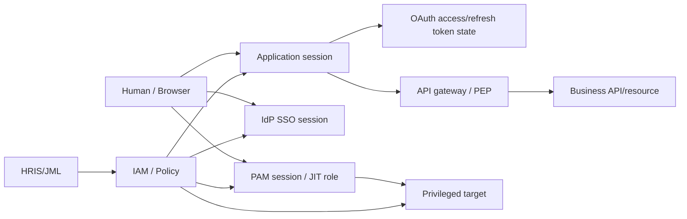
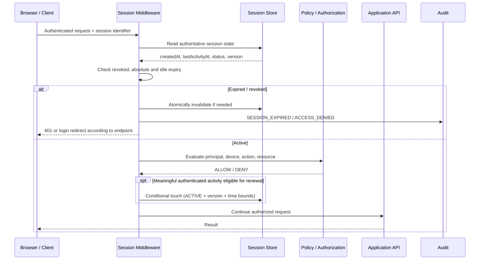

# Idle timeout trong Session Management: Kiểm soát phiên không hoạt động trong vòng đời danh tính IAM

Một nhân viên Finance đăng nhập cổng báo cáo qua **Single Sign-On (SSO)** lúc 09:00, đọc báo cáo trong vài phút rồi rời máy mà quên khóa màn hình. Đến 10:30, người khác mở lại tab trình duyệt và thử xuất dữ liệu. Ở một hệ thống được cấu hình đúng, **phiên ứng dụng không hoạt động đủ lâu phải hết hiệu lực ở phía server**, bất kể giao diện còn hiển thị trang cũ hay cookie vẫn còn trong trình duyệt. Tuy nhiên, nếu trình duyệt liên tục gọi API làm mới thông báo mỗi 30 giây và mọi request đều bị tính là “hoạt động”, phiên có thể **không bao giờ tự hết hạn**.

Một vấn đề khác xuất hiện khi nhân viên **Mover** hoặc **Leaver**: quyền đã bị thay đổi trong IAM, nhưng token, phiên tại ứng dụng hoặc session của PAM vẫn còn sử dụng được. Hệ thống có thể đã thiết lập idle timeout 15 phút mà vẫn để lại **quyền truy cập tồn dư** nếu chỉ đợi phiên hết hạn tự nhiên, không thu hồi theo sự kiện vòng đời.

**Idle timeout (thời hạn không hoạt động)** là cơ chế đặt giới hạn thời gian một **phiên truy cập tương tác** được giữ hợp lệ kể từ **hoạt động cuối cùng được hệ thống chấp nhận là có ý nghĩa**. Khi khoảng không hoạt động đạt ngưỡng theo chính sách, hệ thống phải **từ chối việc tiếp tục dùng phiên**, đồng thời quyết định có cần đăng nhập lại, xác thực lại hoặc thực hiện step-up hay không.

Bài thuộc chương **Session management** của mô-đun **Identity Lifecycle** trong **Identity and Access Management (IAM)**. Nội dung gắn idle timeout với quản lý danh tính **Joiner–Mover–Leaver**, IdP/SSO, SCIM, RBAC/ABAC, tài khoản dịch vụ, PAM/PIM, kiểm toán và mục tiêu giảm **quyền truy cập tồn dư**.

> **Nguyên tắc quan trọng:** Idle timeout phải được **thực thi ở phía có thẩm quyền xác thực/ủy quyền phiên**, không chỉ bằng một bộ đếm JavaScript hoặc việc ẩn trang. Phiên đã hết hiệu lực không được sống lại bởi request đến muộn, background polling, refresh token hoặc sự kiện JML cũ.

## 1. Idle timeout là gì?

Một **session** thường là tập trạng thái liên kết những request khác nhau với một **principal đã được xác thực** và một **ngữ cảnh truy cập**. Đối với web application, session có thể được nhận dạng bằng cookie chứa **session ID opaque**; trong các kiến trúc khác, hệ thống có thể dùng token hoặc một tổ hợp token và server-side state.

**Idle timeout** giới hạn **khoảng không hoạt động** giữa các sự kiện đủ điều kiện gia hạn hiệu lực phiên. Ví dụ:

- Chính sách: `idleTimeout = 15 phút`.
- Hoạt động hợp lệ cuối: 09:10.
- Không có hoạt động đủ điều kiện cho tới 09:25.
- Tại thời điểm hết hạn theo quy tắc biên, phiên không còn được chấp nhận.

Nhưng cần đặt câu hỏi: **“hoạt động” là thao tác nào?** Một nút bấm của người dùng, một API request từ ứng dụng, một WebSocket heartbeat hay quá trình tự refresh OAuth token? Nếu không định nghĩa, chính sách idle timeout có thể không đạt mục đích.

### 1.1. Mục tiêu bảo mật

- Giảm thời gian một **máy bỏ quên** vẫn cung cấp quyền truy cập.
- Thu hẹp thời gian sử dụng session cookie/token bị lấy cắp trong những mô hình có thể thu hồi hoặc thời gian sống giới hạn.
- Hạn chế phiên admin còn hoạt động khi người dùng đã rời công việc.
- Buộc xác thực lại theo policy khi cần assurance mới.
- Phối hợp JML để quyền không tồn tại vô hạn do phiên cũ.
- Cung cấp bằng chứng kiểm toán: lúc nào phiên bắt đầu, khi nào được gia hạn, vì sao kết thúc.

### 1.2. Idle timeout không bảo đảm điều gì?

Idle timeout **không tự**:

- Thu hồi access token dạng bearer đã phát hành nếu resource server vẫn tin token.
- Đăng xuất khỏi IdP SSO trên mọi ứng dụng.
- Chặn một attacker đang liên tục gửi request đủ điều kiện.
- Phát hiện user đã rời khỏi bàn chỉ bằng việc trang vẫn mở.
- Thay cơ chế khóa màn hình, kiểm soát thiết bị hoặc MFA.
- Gỡ entitlement sau Mover/Leaver nếu target không nhận sự kiện.
- Kết thúc mọi WebSocket/TCP connection nếu server không thực thi.
- Xác nhận thao tác được thực hiện bởi người thật khi client có thể bị tự động hóa.

Do đó idle timeout là **một lớp phòng vệ**, phối hợp với absolute lifetime, revocation, reauthentication, device posture và authorization.

## 2. Phân biệt các loại thời hạn

Nhiều cấu hình đều sử dụng từ “timeout” nhưng mang ý nghĩa khác nhau.

| Khái niệm | Đồng hồ bắt đầu từ đâu? | Khi hết hạn |
|---|---|---|
| **Idle timeout / inactivity timeout** | Hoạt động có ý nghĩa gần nhất của phiên. | Phiên bị từ chối vì không hoạt động đủ lâu. |
| **Absolute session lifetime** | Thời điểm tạo phiên/đăng nhập theo policy. | Phiên hết hạn dù liên tục hoạt động. |
| **Authentication freshness** | Thời điểm xác thực thực sự với IdP/ứng dụng. | Yêu cầu reauthentication hoặc step-up cho thao tác cần độ mới. |
| **Access token expiration** | `exp` của token hoặc thời điểm issuer quy định. | Resource server từ chối token đã hết hạn. |
| **Refresh token inactivity/expiry** | Tùy chính sách issuer/token family. | Không còn đổi token mới được. |
| **Cookie Max-Age/Expires** | Do browser xử lý cookie. | Browser có thể ngừng gửi cookie. |
| **Remember-me lifetime** | Thời điểm cơ chế remember-me được thiết lập. | Không còn tự tái lập authentication theo cơ chế đó. |
| **PAM/JIT activation TTL** | Thời điểm kích hoạt đặc quyền. | Quyền đặc biệt phải hết hiệu lực theo policy. |
| **WebSocket idle/heartbeat timeout** | Giao thức/connection activity. | Connection có thể bị ngắt, không nhất thiết application session hết hạn. |
| **Screen lock / device inactivity** | Hoạt động nhập liệu tại thiết bị. | Khóa thiết bị, không mặc nhiên revoke backend session. |
| **API request timeout** | Thời điểm bắt đầu request. | Request bị dừng/chờ quá lâu; không phải logout. |

### 2.1. Ví dụ nhiều đồng hồ cùng tồn tại

```text
09:00  User xác thực tại IdP.
09:01  Ứng dụng tạo local session.
09:05  User mở báo cáo (meaningful activity).

Local session idle timeout:      15 phút
Local session absolute lifetime:  8 giờ
IdP SSO session lifetime:        theo chính sách IdP
Access token lifetime:           5 phút
PAM privileged activation:       30 phút
```

Nếu không có hoạt động sau 09:05, local session có thể hết hạn lúc 09:20. **IdP vẫn có SSO session** và có thể giúp lập local session mới nếu ứng dụng chuyển sang đăng nhập lại. Nếu policy yêu cầu người dùng **phải nhập yếu tố xác thực mới**, cần quy tắc reauthentication phù hợp, không chỉ hủy local session.

### 2.2. Đừng biến idle timeout thành “sliding forever”

Nếu mỗi request kéo dài idle deadline thêm 15 phút, user hoặc script có thể giữ session mãi mãi. **Absolute lifetime** là trần độc lập, bảo đảm phiên phải kết thúc/re-auth sau một thời hạn tối đa dù luôn hoạt động.

Ví dụ:

```text
sessionCreatedAt = 09:00
absoluteExpiresAt = 17:00

lastMeaningfulActivityAt = 16:55
idleTimeout = 15 phút

effectiveExpiresAt = min(17:10, 17:00) = 17:00
```

### 2.3. Chú ý chính sách theo rủi ro

Một session xem thông tin nội bộ có thể có timeout khác với session quản trị vault, thanh toán hoặc sản xuất. Các con số trong bài **chỉ minh họa**, không phải SLA chuẩn hay khẳng định quy định bắt buộc cho mọi tổ chức.

## 3. Mô hình thời gian chính xác

Định nghĩa:

- \(t_0\): thời điểm tạo phiên hợp lệ.
- \(t_a\): thời điểm **hoạt động có ý nghĩa cuối cùng** đã được backend chấp nhận.
- \(T_i\): thời hạn idle.
- \(T_{\mathrm{abs}}\): absolute lifetime.
- \(t_{\mathrm{revoked}}\): thời điểm thu hồi sớm do logout, security hoặc JML nếu có.
- \(t\): thời điểm server kiểm request.

Một công thức thường gặp:

\[
t_{\mathrm{idle-expire}} = t_a + T_i
\]

\[
t_{\mathrm{effective-expire}} = \min(t_a + T_i,\; t_0 + T_{\mathrm{abs}})
\]

Một phiên chỉ còn hợp lệ nếu chưa bị revoke, các điều kiện identity/policy vẫn thỏa và:

\[
t < t_{\mathrm{effective-expire}}
\]

Trong ví dụ này, **tại đúng thời điểm hết hạn** (`t == expiresAt`), phiên **không còn hợp lệ**. Tổ chức phải chọn và kiểm thử nhất quán phép so sánh biên; không để frontend và backend có quy tắc khác nhau.

### 3.1. Bảng tính minh họa

Giả sử phiên được tạo 09:00, idle timeout 15 phút, absolute lifetime 8 giờ:

| Thời điểm | Sự kiện | `lastMeaningfulActivityAt` | Deadline idle |
|---|---|---|---|
| 09:00 | Đăng nhập, tạo phiên. | 09:00 | 09:15 |
| 09:08 | User xem chi tiết hóa đơn. | 09:08 | 09:23 |
| 09:10 | Poll notification tự động. | 09:08 | 09:23 |
| 09:17 | User thực hiện tìm kiếm. | 09:17 | 09:32 |
| 09:25 | Silent token refresh. | 09:17 | 09:32 |
| 09:32 | Không có hoạt động mới. | 09:17 | **EXPIRED** |
| 09:33 | Tab cũ gọi API export. | 09:17 | **DENY** |

Nếu app coi poll/refresh là hoạt động, deadline liên tục đổi và thiết kế không đạt chính sách.

### 3.2. Thời gian phải được xác minh ở phía server

- Server dùng clock đáng tin và được đồng bộ phù hợp.
- Browser countdown dùng để **hiển thị**, không làm nguồn quyết định.
- Trạng thái phiên trong kho dữ liệu có thể dùng timestamp UTC hoặc instant tương đương.
- Nếu nhiều node có clock skew, chính sách cần giới hạn độ lệch và phương pháp tính nhất quán.
- Khi dùng TTL của Redis/cache, TTL phải tương ứng với cả idle và absolute rules; không để cache tự kéo dài quá trần.
- `lastActivityAt` không được lấy trực tiếp từ đồng hồ client như sự thật đã được xác minh.

## 4. “Hoạt động của người dùng” là gì?

Đây là quyết định quan trọng nhất của idle timeout.

### 4.1. Hoạt động có ý nghĩa thường gồm

- Người dùng mở một trang hoặc resource có xác thực bằng thao tác có chủ ý.
- Người dùng tìm kiếm, điều hướng trong ứng dụng hoặc chỉnh sửa một record.
- Người dùng gửi form/duyệt một quyết định hợp lệ.
- Người dùng thực hiện một action nghiệp vụ được ứng dụng cho phép.
- Một tương tác UI được policy chấp nhận làm bằng chứng user đang sử dụng phiên, với cơ chế chống lạm dụng phù hợp.

### 4.2. Không nên tự động gia hạn vì các request này

- Poll notification/metrics theo lịch.
- Heartbeat WebSocket hoặc ping/pong transport.
- Auto-save không có tương tác mới, chạy vô hạn.
- Background refresh OAuth access token.
- Health check, monitoring probe hoặc prefetch.
- Service worker sync, push notification hoặc telemetry.
- Một trang khác phát request ngầm trong khi user đã rời máy.
- Request đã bị từ chối do session hết hạn.
- Request không liên quan đến chủ thể hiện tại hoặc không được xác thực.

Một quy tắc kiểu `everyAuthenticatedRequestExtendsSession=true` dễ làm mất ý nghĩa idle timeout trong SPA hiện đại.

### 4.3. Có nên dùng mouse movement và keyboard events?

Có thể dùng sự kiện giao diện để **cập nhật màn hình đếm ngược**, hỗ trợ warning hoặc gửi tín hiệu có giới hạn. Nhưng:

- JavaScript event có thể bị automation tạo.
- Sự kiện nhập liệu không chứng minh user thật.
- Trang bị che/đang background có thể vẫn tạo event.
- XSS hoặc client bị chiếm có thể giả thao tác.
- Client event không tự chứng minh session vẫn hợp lệ.

Với quyền nhạy cảm, backend nên ưu tiên **hoạt động nghiệp vụ có xác thực hoặc reauthentication**; nếu có endpoint “keep alive” từ UI, nó phải có chính sách, authorization, rate limits và giới hạn nghiêm ngặt.

### 4.4. Tranh luận: User đang đọc tài liệu lâu có phải idle?

Một người có thể đọc tài liệu 20 phút mà không chạm bàn phím. Theo định nghĩa tương tác, phiên có thể hết hạn dù **người vẫn đang làm việc**. Điều này là trade-off giữa bảo mật và trải nghiệm:

- Hiển thị warning trước khi hết hạn.
- Có thể cho user gia hạn bằng hành động có chủ ý, nếu policy cho phép.
- Lưu nội dung chưa nộp cục bộ an toàn, không lưu secret hoặc dữ liệu nhạy cảm không kiểm soát.
- Với vai trò high-risk, chấp nhận reauthentication khi quay lại.
- Không tự tăng timeout vô hạn chỉ vì trang đang mở.

## 5. Idle timeout và các lớp session khác nhau

Một hành trình SSO thường có nhiều phiên **độc lập**:

1. **IdP session:** trạng thái đăng nhập tại nhà cung cấp danh tính.
2. **Service Provider / Relying Party session:** phiên của ứng dụng sau SAML/OIDC.
3. **OAuth token session:** access/refresh tokens do Authorization Server phát hành.
4. **Browser cookie state:** cơ chế browser lưu và gửi cookie.
5. **API gateway session/context:** nếu gateway duy trì policy/session.
6. **PAM broker session/JIT activation:** trạng thái đặc quyền riêng.
7. **Resource/application session:** trạng thái tại ứng dụng đích.
8. **Device/network session:** VPN, NAC, Wi-Fi hoặc desktop lock.

### 5.1. Sơ đồ đa lớp



Các mũi tên tới IdP/target là quan hệ quản trị logic, **không hàm ý mọi ứng dụng nhận sự kiện JML đồng bộ ngay**. Đó chính là lý do cần cơ chế revoke và reconciliation.

### 5.2. Hết local session không tự xóa IdP session

Một ứng dụng hết idle 15 phút có thể:

- Xóa local session.
- Redirect user đến OIDC Authorization Endpoint.
- IdP vẫn có session SSO.
- IdP trả về authorization result mà không cần user nhập password.
- Ứng dụng tạo local session mới.

Nếu yêu cầu bảo mật là **thật sự phải xác thực lại sau 15 phút idle**, hành vi trên có thể không đạt mục tiêu. Ứng dụng cần quy tắc **fresh authentication** phù hợp với IdP và kiểm `auth_time`/authentication context khi giao thức và nhà cung cấp hỗ trợ.

### 5.3. Hết IdP session không tự hết app session

Ngược lại, IdP logout hoặc IdP idle timeout có thể không chủ động hủy phiên đã tồn tại ở mọi ứng dụng nếu chưa có logout/session revocation integration. Ứng dụng cần có **chính sách session riêng và lắng nghe logout events** khi có cơ chế được hỗ trợ.

## 6. Sliding expiration và absolute expiration

### 6.1. Sliding idle expiration

Khi hoạt động hợp lệ xảy ra, server cập nhật thời điểm cuối và đẩy idle deadline về sau:

```text
createdAt = 09:00
idleTimeout = 15m
absoluteExpiresAt = 17:00

09:00 -> idleExpiresAt 09:15
09:12 meaningful action -> idleExpiresAt 09:27
09:20 meaningful action -> idleExpiresAt 09:35
09:31 meaningful action -> idleExpiresAt 09:46
...
16:55 meaningful action -> idleExpiresAt 17:00 (absolute cap)
```

### 6.2. Fixed timeout không dựa activity

Một chính sách có thể không gia hạn phiên bằng activity mà dùng fixed lifetime. Khi đó nó là **absolute/fixed expiration**, không phải idle theo nghĩa truyền thống. Trong hệ thống có rủi ro cao, có thể áp cả sliding idle và fixed absolute.

### 6.3. Refresh không được tạo phiên “bất tử”

Một lỗi triển khai phổ biến:

```text
every API request:
    session.lastActivity = now
    session.expiresAt = now + 15 minutes
```

Nếu background job cứ gọi API, session không bao giờ idle. Một lỗi khác là login refresh/remember-me **tạo session mới sau mỗi lần expiry mà không yêu cầu kiểm tra chính sách**. Cần xác định thế nào là **user presence/meaningful activity** và áp absolute/session family limits.

### 6.4. Chặn session resurrection

Sau logout hoặc security revoke, một request đến chậm không được cập nhật `lastActivityAt` và chuyển phiên sang ACTIVE.

Ví dụ:

```text
Request A: bắt đầu lúc 09:14:59
Request B: Logout hoàn tất lúc 09:15:00
Request A: kết thúc lúc 09:15:01, thử update lastActivity
```

Nếu ghi đè trạng thái session không có transaction/version check, request A có thể “hồi sinh” phiên. Cần update có điều kiện: **session ACTIVE, chưa hết hạn, chưa revoke, đúng version**.

## 7. Kiến trúc thực thi idle timeout

### 7.1. Các thành phần có trách nhiệm

- **Authentication component:** xác thực người dùng, tạo session và session identifier.
- **Session registry/store:** lưu createdAt, lastActivityAt, expiry, status, security context.
- **Session enforcement middleware/PEP:** kiểm thời hạn trước khi cho request tới resource.
- **Activity classifier:** xác định request/event nào được gia hạn.
- **Policy engine:** chọn thời hạn theo risk, role, resource hoặc session assurance.
- **IdP/SSO integration:** tạo/hủy local session và reauthentication.
- **Token service:** phát/revoke token đúng chính sách.
- **IAM/JML event consumer:** xử lý Mover/Leaver/revoke.
- **PAM/PIM:** quản lý phiên và quyền đặc biệt riêng.
- **Audit/SIEM:** lưu sự kiện expire, logout, revoke, retry và mismatch.
- **Reconciliation:** xác minh quyền không còn hiệu lực khi cần.

### 7.2. Thứ tự kiểm tra trong request

Một luồng backend an toàn:

1. Lấy session reference từ cookie/token được bảo vệ.
2. Xác minh session identifier và authentication binding.
3. Đọc trạng thái session từ nguồn có thẩm quyền.
4. Kiểm **REVOKED**, invalidated hoặc lifecycle policy trước.
5. Kiểm absolute expiry.
6. Kiểm idle expiry **trước khi cập nhật activity**.
7. Kiểm role/ABAC/resource authorization cho action.
8. Xác định request có phải meaningful activity được phép update không.
9. Cập nhật activity một cách nguyên tử có điều kiện.
10. Thực thi action hoặc gửi DENY/reauth response phù hợp.
11. Ghi audit theo mức độ cần thiết.

Nếu hệ thống cập nhật activity trước bước kiểm expiry, một phiên vừa quá hạn có thể được hồi sinh.

### 7.3. Sequence diagram



Một middleware không nên gia hạn session **mặc định** khi API trả DENY hoặc khi policy từ chối request; lựa chọn gia hạn những request nào cần được thiết kế và kiểm thử theo ngữ cảnh.

## 8. Cookie session trong trình duyệt

### 8.1. Cookie nên mang session ID opaque

Một ví dụ header mang tính minh họa:

```http
Set-Cookie: __Host-session=OPAQUE_RANDOM_ID; Path=/; Secure; HttpOnly; SameSite=Lax
```

Trong đó:

- `Secure`: chỉ gửi cookie qua kết nối được browser coi là secure (thông thường HTTPS).
- `HttpOnly`: JavaScript trên trang không đọc cookie; không ngăn request dùng cookie khi có XSS.
- `SameSite`: hạn chế một số trường hợp gửi cookie cross-site; không thay hoàn toàn CSRF defense.
- Prefix `__Host-`: áp ràng buộc cookie được browser hỗ trợ, gồm không có Domain, Path=/ và Secure.
- Giá trị cookie phải đủ entropy, không dự đoán được và không chứa thông tin nhạy cảm dạng plaintext.
- Cookie có `Max-Age` hoặc `Expires` khi chiến lược cần; có thể dùng session cookie, nhưng server vẫn thực thi thời hạn.

**Không dùng localStorage chứa bearer token như lựa chọn mặc định nếu mô hình cookie/Backend-for-Frontend phù hợp**, vì token do JavaScript truy cập có rủi ro trước XSS. Chọn storage dựa trên threat model và ứng dụng cụ thể.

### 8.2. Cookie expiry khác server idle timeout

Giả sử cookie còn trong trình duyệt một ngày nhưng server idle timeout 15 phút. Sau 15 phút, browser vẫn gửi cookie — **server phải từ chối**. Nếu server chỉ tin việc browser không gửi cookie khi hết hạn, attacker hoặc client tùy chỉnh có thể tiếp tục gửi giá trị cũ.

Ngược lại, cookie có thể bị xóa trước server expiry; khi đó user phải tạo phiên mới. Chính sách phải tránh giả định hai đồng hồ luôn đồng bộ.

### 8.3. Session fixation và session rotation

Khi user vừa login hoặc nâng mức assurance/privilege, hệ thống nên **regenerate session identifier** theo chính sách để giảm session fixation. Idle timeout không thay thế điều này.

Một session ID bị lộ nên được revoke; chỉ giảm idle duration không đảm bảo attacker bị chặn nếu họ vẫn hoạt động. Cần có khả năng revoke session và quản lý concurrent sessions khi phù hợp.

### 8.4. CSRF

Với browser cookie tự gửi, endpoint thay đổi trạng thái như `/logout`, `/session/extend` hoặc giao dịch nghiệp vụ cần **CSRF controls** phù hợp (token, origin checks, SameSite và các lớp bổ sung). Không để một website khác gia hạn phiên hoặc tạo nghiệp vụ bằng request cross-site thiếu kiểm soát.

## 9. UI cảnh báo trước khi timeout

### 9.1. Mẫu trải nghiệm tốt

Một ứng dụng có thể:

- Hiển thị countdown dựa vào **deadline do server công bố**.
- Cảnh báo khi còn một khoảng thời gian được cấu hình (ví dụ 60 giây).
- Nêu rõ “Phiên sẽ hết hạn nếu không tiếp tục”.
- Cho **Continue session** bằng thao tác có chủ ý nếu policy cho phép.
- Lưu bản nháp an toàn hoặc cảnh báo mất nội dung.
- Khi server trả expired, xóa dữ liệu nhạy cảm khỏi UI theo policy và chuyển sang đăng nhập.
- Không tiết lộ tài liệu còn cache cho người không xác thực mới.

### 9.2. Frontend không được nắm quyền quyết định

Một đoạn JavaScript như:

```javascript
let secondsRemaining = 900;
setInterval(() => {
  secondsRemaining--;
  if (secondsRemaining === 0) {
    showLoginScreen();
  }
}, 1000);
```

**Không phải security control đầy đủ.** Browser có thể sleep, tab bị throttle, clock bị thay, người dùng vô hiệu hóa script, hoặc attacker gọi API trực tiếp. Bắt buộc có kiểm soát server-side tương ứng.

### 9.3. Warning và extension phải an toàn

Nếu app có nút gia hạn phiên:

1. Người dùng thật sự chủ động bấm.
2. Endpoint dùng session đang ACTIVE, chưa hết hạn.
3. CSRF/authorization/rate limit được áp.
4. Backend áp idle/absolute expiry.
5. Nếu policy yêu cầu, trigger reauthentication hoặc step-up.
6. Server trả lại expiry timestamp đã chấp nhận.
7. UI cập nhật countdown theo phản hồi server.

Không cho client tự gửi `extendUntil=2099-01-01` để quyết định thời hạn.

### 9.4. Trường hợp user điền form lâu

Người dùng có thể đang soạn một form lớn mà chưa gửi. Các lựa chọn:

- Auto-save bản nháp vào **kênh được phép** và không coi auto-save vô điều kiện là hoạt động gia hạn.
- Có thông báo hết phiên trước khi mất dữ liệu.
- Lưu tạm cục bộ theo policy về dữ liệu nhạy cảm.
- Khi nộp form sau hết hạn, yêu cầu xác thực lại rồi khôi phục bản nháp an toàn.
- Không tự gửi dữ liệu nhạy cảm khi session đã hết hạn chỉ vì UI từng mở.

## 10. SPA và background requests

**Single-Page Application (SPA)** thường gửi API ngầm ngay cả khi user không tương tác. Các request có thể gồm notification polling, telemetry, preload, permission refresh và silent token renewal.

### 10.1. Sai lầm phổ biến

```text
SPA polling notification mỗi 30 giây
  -> GET /notifications
  -> session.lastActivityAt = now
  -> idle timeout 15 phút bị đẩy liên tục
  -> phiên còn vô hạn khi browser không đóng
```

Đây là lỗi **định nghĩa activity**, không phải lỗi cấu hình 15 phút.

### 10.2. Activity classification

Một chính sách minh họa:

| Request | Có gia hạn idle? | Ghi chú |
|---|---|---|
| User mở invoice theo click có chủ ý. | Có, nếu đã auth và policy cho phép. | Backend không nên chỉ tin client flag. |
| User submit form. | Có nếu request hợp lệ và phiên còn active. | Authorization vẫn độc lập. |
| User click “Tiếp tục phiên”. | Có thể có. | CSRF, rate limit, absolute cap. |
| Poll notification tự động. | Không. | Không chứng minh presence. |
| Health/metrics. | Không. | Không gắn user activity. |
| OAuth refresh tự động. | Không mặc định. | Token lifecycle khác app idle. |
| WebSocket ping/pong. | Không. | Heartbeat transport. |
| Background prefetch. | Không. | Không có tương tác. |
| Request nhận 401 vì phiên expired. | Không. | Không hồi sinh phiên. |
| API bị DENY policy. | Tùy chính sách, thường không. | Tránh attacker tự giữ session bằng request trái phép. |

### 10.3. Không dựa duy nhất vào tên endpoint

Một endpoint `GET /reports` có thể được gọi bởi click của user **hoặc prefetch**. Backend có thể cần phân biệt luồng/loại hành động một cách có kiểm soát, kết hợp ngữ nghĩa request và activity token/channel có ràng buộc. Không có cách nào chỉ từ HTTP method biết chắc người thật đang hiện diện; với thao tác rủi ro cao, **fresh authentication và kiểm quyền tại action** quan trọng hơn một cờ activity do client tự khai.

## 11. WebSocket, SSE và kết nối lâu dài

### 11.1. Transport heartbeat không phải user activity

WebSocket thường gửi ping/pong hoặc ứng dụng có heartbeat để duy trì kết nối. Nếu heartbeat kéo dài session xác thực vô hạn, idle policy có thể bị bypass.

Nên phân biệt:

- **Connection idle timeout:** mạng/cổng ngắt kết nối không truyền dữ liệu.
- **Application session idle timeout:** user không thực hiện hoạt động đủ điều kiện.
- **Access token lifetime:** credential có thể hết hạn trong khi socket còn mở.
- **PAM session TTL:** quyền đặc biệt hết hạn độc lập với heartbeat.

### 11.2. Revalidate kết nối lâu sống

Với WebSocket/SSE hoặc streaming API, cần policy cho:

- Authentication lúc handshake và khi nào phải revalidate.
- Session revocation/JML event có chấm dứt connection không.
- Idle/absolute deadline có scheduler đóng kênh hay kiểm mỗi message.
- Resource permission có thể đổi trong lúc socket mở.
- Long-running operations có được hoàn tất sau expiry không theo risk policy.
- Audit lúc connection được mở/đóng và nguyên nhân.

Một WebSocket đã mở trước khi user Leaver **không nên mặc nhiên giữ quyền nhận dữ liệu nhạy cảm cho tới khi socket tự rớt**.

### 11.3. Ví dụ kiểm messages

```text
onWebSocketMessage(connection, message):
    session = loadAuthoritativeSession(connection.sessionId)

    if session.revoked or session.expiredAt <= now:
        closeConnectionWithPolicyCode()
        return

    if !canAccess(session.principal, message.action, message.resource):
        denyMessage()
        return

    if message.isMeaningfulAuthorizedInteraction:
        touchSessionConditionally()
    performAction()
```

Đây là pseudocode. Khi ứng dụng cần chặn **ngay** lúc phiên hết hạn dù không có message, phải có **scheduler/timer server-side** hoặc cơ chế proactive close phù hợp, không chờ message kế tiếp.

## 12. IdP/SSO: session application và session IdP

### 12.1. Trong SAML SSO

Một Service Provider (SP) có thể tạo local session sau khi xác minh SAML Response/Assertion. IdP có thể duy trì SSO session riêng. Khi SP idle timeout:

- SP chấm dứt local session.
- SAML Single Logout (SLO), nếu có, có những hạn chế về triển khai, reachability và coverage.
- IdP session có thể vẫn còn; điều đó không chứng minh SP session đã bị revoke hay ngược lại.
- Khi user quay lại, IdP có thể thực hiện SSO mà không nhập password lại.

**Không mặc định rằng SP idle timeout sẽ đóng mọi ứng dụng liên kết qua SAML.**

### 12.2. Trong OIDC

Relying Party (RP) có thể:

- Duy trì local web session sau OIDC login.
- Dùng `id_token` để xác minh identity khi login theo đúng quy trình.
- Dùng access token để gọi API/resource server nếu phù hợp.
- Dùng refresh token theo policy để duy trì OAuth authorization.
- Thực thi idle timeout cho local session độc lập.

Nếu muốn yêu cầu xác thực gần đây, có thể sử dụng **OIDC `max_age`** hoặc các cơ chế login/step-up được IdP hỗ trợ, sau đó kiểm `auth_time` và yêu cầu assurance thích hợp. `prompt=login` là một tham số có thể yêu cầu reauthentication, nhưng hành vi thực tế còn phụ thuộc IdP; không được suy rằng mọi issuer bảo đảm cùng semantics khi thiếu kiểm chứng.

### 12.3. Session SSO bị tái lập âm thầm

Một vấn đề trải nghiệm/bảo mật:

```text
10:00  Local session đã IDLE_EXPIRED.
10:01  Browser redirect tới IdP.
10:01  IdP còn SSO session -> trả authorization response.
10:02  App tạo local session mới, người dùng không nhập thông tin.
```

Điều này **không nhất thiết là lỗi giao thức**. Nhưng nếu policy yêu cầu **người dùng phải xác thực lại sau thời gian idle**, app cần đánh giá/đặt yêu cầu IdP tương ứng và không chỉ dựa vào việc local cookie được tạo lại.

### 12.4. Logout toàn cục là bài toán tích hợp

Các phương thức như OIDC back-channel logout/front-channel logout hoặc SAML SLO tùy sản phẩm và cấu hình. Cần xác định:

- Ứng dụng nào được thông báo logout.
- Back-channel event có xác minh chữ ký/issuer/audience và replay không.
- App session mapping từ IdP subject/session ID.
- Nếu logout event thất lạc, idle/absolute timeout có giới hạn tồn dư nào.
- Token đã phát hành có được revoke không.
- Khi JML Leaver, có đường thu hồi chủ động ngoài SSO không.

## 13. OAuth access token, refresh token và idle timeout

### 13.1. Access token không phải application session cookie

OAuth access token được resource server dùng để quyết định khả năng thực hiện hành động theo claims/scopes và policy. Nếu token dạng JWT tự chứa được resource server xác minh offline, **xóa local web session không tự làm JWT mất hiệu lực** trước `exp`.

Cần lựa chọn theo threat model:

- Access token TTL ngắn.
- Refresh token rotation/revocation.
- Token introspection hoặc authorization check online khi cần.
- Dữ liệu phiên/token family trong store có thể revoke.
- Sender-constrained tokens (ví dụ mTLS-bound hoặc DPoP khi được hỗ trợ) để giảm replay.
- Resource server kiểm authorization/lifecycle current state đối với hành động nhạy cảm.

### 13.2. Refresh token rotation và inactivity

Một refresh token có thể được issuer quản lý theo:

- Absolute expiry.
- Inactivity window.
- Rotation và reuse detection.
- Client/device/session binding.
- Revocation trên logout hoặc security event.
- Token family invalidation.

**Refresh thành công không nên mặc định chứng minh người dùng đang hoạt động**; một SPA tự động refresh mỗi vài phút có thể kéo dài token family dù người rời máy nếu issuer policy không phân biệt inactivity phù hợp.

### 13.3. Ví dụ chuỗi thời gian

```text
Local app idle timeout:       15 phút
Access token expiration:       5 phút
Refresh token inactivity:     60 phút (nếu issuer hỗ trợ)
Refresh token absolute limit:  8 giờ (ví dụ)

User rời máy lúc 09:10.

09:15: Access token hết hạn.
09:15: Background refresh thử xin token mới.
09:25: Local app session phải hết hạn (15 phút sau 09:10).
```

Nếu refresh token còn usable, có thể phát sinh access token mới sau app idle expiry trừ khi kiến trúc ràng buộc việc refresh với **active session** hoặc revoke token family khi hết idle. Thiết kế phải định nghĩa và kiểm rõ điều này.

### 13.4. Không nhầm ID Token với access token

Trong OIDC, **ID Token** là assertion xác thực gửi cho RP theo giao thức; nó **không phải token để sử dụng mặc định làm bearer credential gọi API**. Resource server phải kiểm access token phù hợp về issuer, audience, expiry, scope và các thuộc tính cần thiết. Idle timeout là quy tắc riêng cho session; không thể suy từ `id_token.exp` rằng local session phải hết hạn đúng thời điểm ấy.

## 14. API, mobile app và trạng thái offline

### 14.1. Browser vs native/mobile client

Mobile app có thể:

- Duy trì token trong secure storage theo nền tảng.
- Chuyển background/foreground thường xuyên.
- Không có cookie session giống web.
- Đồng bộ khi online và gửi request nền.
- Hoạt động offline trong một khoảng thời gian.
- Cần mở khóa app/biometric hoặc step-up khi trở lại.

Chính sách idle timeout có thể kết hợp **app lock locally** với **server authorization session/token TTL**, nhưng không được coi local screen lock là server revoke.

### 14.2. Offline không thể lấy server time mới

Một ứng dụng offline không thể chứng minh hiệu lực token/state tại backend sau Leaver. Khi đồng bộ trở lại, server phải:

- Xác minh token/session còn hợp lệ theo thời điểm hiện hành.
- Áp JML và policy mới.
- Không chấp nhận dữ liệu/command offline trái quyền chỉ vì được tạo lúc trước.
- Có conflict resolution cho dữ liệu hợp lệ và dữ liệu bị từ chối.
- Giảm cache dữ liệu nhạy cảm theo chính sách.

Nếu ứng dụng cho phép đọc dữ liệu offline, cần đánh giá riêng **data-at-rest, app lock và remote wipe**; idle timeout backend không tự xóa dữ liệu đã cache.

### 14.3. Non-interactive API clients

Một backend gọi API bằng client credentials **không có human presence**. Khái niệm “người dùng không thao tác” không áp dụng trực tiếp. Thay vào đó cần:

- Token TTL.
- Key/certificate rotation.
- Workload lease/heartbeat theo mục đích.
- Owner/lifecycle của service principal.
- Authorization scope/audience.
- Revoke khi workload decommission hoặc credential compromise.

Không gán một human idle timeout 15 phút cho mọi machine-to-machine call mà không hiểu workload pattern.

## 15. Distributed session stores và tính nhất quán

### 15.1. Vì sao nhiều node tạo lỗi?

Giả sử một ứng dụng có ba backend nodes dùng chung Redis hoặc database session store. Những request đồng thời có thể:

- Đọc `lastActivityAt` cũ.
- Cùng cố refresh TTL.
- Một node xử lý logout, node khác cập nhật activity.
- Một node chưa thấy Leaver event.
- Redis replica đọc stale.
- Bản ghi đã expired nhưng được ghi lại không có check.

### 15.2. Quy tắc nguyên tử

Khi gia hạn activity:

1. Đọc trạng thái phiên từ nguồn đủ nhất quán.
2. Kiểm chưa revoked và chưa expired theo trusted time.
3. Kiểm request đủ điều kiện gia hạn.
4. Thực hiện update có điều kiện/transaction hoặc script atomic phù hợp.
5. Không tăng absolute lifetime.
6. Không phục hồi record đã bị xóa hoặc tombstone.
7. Nếu update fail do version/state thay đổi, xử lý lại từ authoritative state.

### 15.3. Từ chối update bị trễ

Ví dụ:

```text
09:00:00  Node A đọc ACTIVE(version=10).
09:00:01  Node B revoke session -> REVOKED(version=11).
09:00:02  Node A cố touch với expectedVersion=10.
09:00:02  Store từ chối: version mismatch / no longer ACTIVE.
```

Không dùng thao tác `SET session = {oldState + updatedTimestamp}` mà bỏ qua trạng thái mới. Nếu session được lưu cache phân tán, việc hết hạn phải có **quy tắc nhất quán đủ mạnh cho mức rủi ro**.

### 15.4. TTL của Redis và absolute cap

Nếu lưu record với TTL dựa idle deadline, mỗi activity có thể refresh TTL. Nhưng vẫn cần:

```text
newIdleExpiresAt = min(now + idleTimeout, absoluteExpiresAt)
```

Lưu ý một key có thể bị evicted hoặc mất do failover, dẫn tới logout sớm; đó là vấn đề availability. **Không được tạo session mới từ cookie cũ khi store không tìm thấy record** chỉ để khắc phục lỗi cache.

### 15.5. Revocation propagation

Với hệ thống đa vùng:

- Session revoke phải được phát đến vùng đang dùng session.
- Cần đo propagation latency.
- Resource đặc quyền có thể yêu cầu online verification thay vì cache dài.
- Nếu data store partition, quyết định fail-open/fail-closed phải theo policy risk.
- Khi chưa đủ bằng chứng trạng thái, không báo `REVOKED_EVERYWHERE`.

## 16. Bảo vệ logout, idle-expiry và session security

### 16.1. Logout chủ động

Khi user bấm logout:

- Invalidate application session server-side.
- Xử lý cookie theo cơ chế/browser policy.
- Revoke/clear refresh token hoặc token family khi thiết kế yêu cầu.
- Đóng WebSocket/streaming channels hoặc ngăn action tiếp theo.
- Nếu dùng logout IdP, thực hiện theo giao thức được hỗ trợ.
- Audit event và lý do.
- Không mặc định đã đăng xuất mọi SaaS chỉ vì một app hoàn tất logout.

### 16.2. Logout do idle

Một backend có thể:

1. Nhận request sau idle deadline và từ chối.
2. Đánh dấu session expired/invalidate record/tombstone.
3. Revoke token family liên quan nếu app kiểm soát được và policy yêu cầu.
4. Gửi response thể hiện cần reauthentication.
5. Không trả dữ liệu resource nhạy cảm.
6. Xóa hoặc giảm cookie tại browser phù hợp.
7. Ghi `SESSION_IDLE_EXPIRED` với timestamp và correlation.

Việc xóa cookie không phải điều kiện duy nhất; **server state phải không thể dùng lại**.

### 16.3. Ngăn session hijacking

Idle timeout phối hợp với:

- HTTPS, Secure cookie, HttpOnly và CSRF defenses.
- Rotate session ID sau login/privilege transition.
- MFA/step-up cho high-risk action.
- Device/context checks phù hợp.
- Concurrent session visibility và selective revoke nếu yêu cầu.
- Audit session anomaly theo risk.
- Access token TTL và secure storage.
- Absolute lifetime.

Nếu attacker **liên tục sử dụng stolen session**, idle timeout có thể không tự phát hiện. Cần anomaly detection, revocation và hành động bảo mật khác.

## 17. Risk-based idle timeout, step-up và PAM

### 17.1. Ví dụ phân tầng chính sách

| Loại phiên | Idle timeout minh họa | Kiểm soát bổ sung |
|---|---|---|
| Dashboard thông thường | 30 phút | Absolute cap, cookie security. |
| Tài chính/PII nhạy cảm | 15 phút | MFA/fresh auth cho export nhạy cảm. |
| Portal IAM administrator | 10 phút | Step-up, device policy, audit. |
| PAM privileged session | 5–10 phút tùy hành động | PAM active TTL, session recording, revoke. |
| Kiosk/shared workstation | 2–5 phút | Screen lock/clear UI, strong reauth. |
| Long-running operational task | Theo threat model | Kiểm từng action, không giữ privileged session bằng heartbeat. |

**Đây chỉ là ví dụ thiết kế**, không phải số liệu tiêu chuẩn bắt buộc. Đối với người khuyết tật, nghiệp vụ cần tập trung lâu hoặc thiết bị ngoại tuyến, phải cân bằng accessibility/availability nhưng vẫn kiểm soát rủi ro.

### 17.2. Dynamic policy

Thời hạn có thể thay theo:

- Resource sensitivity.
- Role/privilege level.
- Device posture.
- Authentication assurance/freshness.
- Network context.
- Người dùng thuộc human/contractor/admin.
- Session được mở từ managed/unmanaged device.
- Incident/risk state.
- Policy của tenant/project.
- Có JIT privileged activation hay không.

Khi policy thay trong lúc phiên đang active, cần xác định **áp lại thời hạn ngay**, sau một grace period được duyệt, hoặc yêu cầu reauthentication theo rủi ro. Không mặc định giữ policy cũ nếu privilege tăng cao.

### 17.3. Step-up không có nghĩa tạo phiên mới vô hạn

Một người có web session hợp lệ nhưng phải xác thực thêm khi chuyển khoản lớn. Step-up thành công có thể cập nhật **authentication freshness** hoặc tạo privileged sub-session. Nó **không bắt buộc** làm lại absolute lifetime của phiên gốc; cần quy tắc rõ để tránh session sống vĩnh viễn.

### 17.4. PAM/PIM và privilege activation

Idle timeout ở PAM broker có thể ngắt một **privileged interactive session** vì không hoạt động. Đồng thời:

- JIT activation có absolute TTL riêng.
- Role eligible có thể tồn tại nhưng không active.
- Target có thể còn direct grant/session nếu revoke lỗi.
- Session recording/alert có phạm vi độc lập.
- Break-glass có policy khẩn cấp, không phải miễn mọi timeout.

Ví dụ PAM hiển thị `SESSION_CLOSED` nhưng SSH session tại target vẫn active; đó là **finding** cho effective access, không phải bằng chứng hoàn tất.

### 17.5. SoD khi quản trị phiên

Không nên để một admin tự:

- Nâng idle timeout tài khoản mình lên vô hạn.
- Tắt audit/revocation.
- Phê duyệt PAM activation của chính mình khi policy cấm.
- Xóa finding session tồn dư.

Policy administration, operations, audit và exceptions nên được phân quyền theo **Segregation of Duties (SoD)**.

## 18. Idle timeout trong Joiner–Mover–Leaver (JML)

Một session không tồn tại độc lập với danh tính. Trong mô hình **Joiner–Mover–Leaver**, trạng thái chủ thể có thể thay đổi **trong khi session còn active**. Vì thế chính sách IAM cần ưu tiên dữ liệu vòng đời có thẩm quyền thay vì chỉ nhìn idle clock.

### 18.1. Joiner — đăng nhập lần đầu và phiên chưa đủ điều kiện

Khi nhân viên mới được tuyển:

1. HRIS tạo identity có start date và manager được xác minh.
2. IAM/IdP tạo account hoặc chuẩn bị provisioning.
3. RBAC/ABAC tính quyền phù hợp role và ngày hiệu lực.
4. Ứng dụng có thể được tạo account trước, nhưng không nhất thiết được mở quyền trước start date.
5. Sau khi Joiner đủ điều kiện, ứng dụng tạo session theo authentication policy.
6. Session idle và absolute deadlines bắt đầu theo quy tắc được định nghĩa.
7. Đăng nhập từ thiết bị không đạt posture hoặc account chưa ACTIVE phải bị chặn nếu policy yêu cầu.
8. Audit lưu identity mapping và thời điểm phiên được cấp.

Một session mới được tạo **không thể bỏ qua ngày bắt đầu làm việc** chỉ vì có SSO token hợp lệ.

### 18.2. Mover — thay role ngay trong phiên

Giả sử nhân viên chuyển từ Support sang Finance. Phiên ứng dụng được tạo ở Support trước đó có thể chứa:

- Group Support đã cache.
- Authorization decision từ ABAC/PDP trước Mover.
- Access token có Support scope.
- Role trong SaaS chưa được cập nhật.
- Quyền export từ một phiên đang mở.
- PAM/JIT role cũ.

Khi Mover có hiệu lực, cần:

1. Nhận authoritative event và version/effectiveAt.
2. Tính lại desired entitlements.
3. Gỡ group/role không còn hợp lệ theo lifecycle policy.
4. Revoke hoặc refresh authorization context của session chịu ảnh hưởng.
5. Xử lý access token/session đã cấp cho quyền cũ.
6. Xem xét yêu cầu reauthentication/step-up cho role mới.
7. Đồng bộ target qua connector hỗ trợ và kiểm thực tế.
8. Không đợi idle timeout 15/30 phút để xem quyền cũ còn bị sử dụng hay không.

Nếu role cũ có rủi ro cao, policy có thể yêu cầu **invalidate session lập tức** hoặc chặn tại PEP trước khi connector hoàn tất.

### 18.3. Leaver — không chờ idle timeout

Khi HRIS xác nhận Leaver có hiệu lực:

- Account người dùng bị vô hiệu theo policy.
- IdP chặn authentication mới và xử lý các session/token có thể revoke.
- Ứng dụng nội bộ revoke local sessions liên quan.
- API/resource server từ chối các quyền không còn hợp lệ.
- SCIM/connector deprovision account/group tại target khi được hỗ trợ.
- PAM/PIM thu hồi eligible và active privileged roles cá nhân.
- WebSocket/live connections bị đóng hoặc mất quyền truy cập.
- Refresh tokens, API keys và sessions còn hoạt động được xử lý riêng.
- Audit/reconciliation kiểm đường quyền thực tế.

**Một session Leaver còn 12 phút idle không có nghĩa nhân viên được phép dùng 12 phút ấy**. Idle timeout chỉ là giới hạn **bổ sung** khi session-revocation event thất lạc hoặc chưa đồng bộ, không thay quy trình Leaver.

### 18.4. Rehire — không tự hồi sinh phiên lịch sử

Nếu người cũ trở lại doanh nghiệp với cùng email, hệ thống cần:

- Liên kết identity theo nguồn authoritative; không chỉ dựa vào email.
- Tính quyền mới theo công việc và hợp đồng hiện tại.
- Không khôi phục session IDs/tokens từ giai đoạn trước.
- Không tái sử dụng approvals/role history ngoài policy.
- Tạo authentication session mới sau proofing và enrollment cần thiết.
- Xem xét account phụ và service credentials từng do người đó quản trị.

### 18.5. Ma trận JML và session

| Sự kiện | Session đang mở | Hành động mong đợi |
|---|---|---|
| Joiner chưa ACTIVE | Có authentication attempt | DENY theo lifecycle policy. |
| Joiner ACTIVE | Chưa có session | Tạo phiên mới nếu authentication/authorization đạt. |
| Mover đổi department | Phiên mang role cũ | Revalidate/invalidate quyền cũ theo risk. |
| Mover thêm đặc quyền | Phiên thường còn active | Step-up/PAM activation riêng nếu policy yêu cầu. |
| Leaver effective | Web/API/SSO sessions tồn tại | Revoke/chặn theo policy ngay, không chờ idle. |
| Contractor hết hạn | Session có thể chưa idle | Chặn khi contract expiry có hiệu lực. |
| Device LOST | User vẫn ACTIVE | Revoke/restrict sessions buộc device trust. |
| Rehire | Session/tokens lịch sử còn trong cache | Không chấp nhận lại, tạo ngữ cảnh mới. |
| PAM activation bị revoke | Tab/PAM session đang mở | Chặn privileged action, xác minh target. |

### 18.6. Event version và xử lý message đến sai thứ tự

```text
Version 73: ACTIVE, team=SUPPORT
Version 74: ACTIVE, team=FINANCE
Version 75: TERMINATED

Processor đã áp version 75:
  -> sessions revoked
  -> principal not eligible

Message version 74 đến sau:
  -> KHÔNG tạo session/refresh quyền Finance
  -> KHÔNG mở lại role đã gỡ
```

Cần source version, effectiveAt, idempotency và current-state validation. **Session store không được lấy event Mover cũ làm cơ sở tự xóa trạng thái revoked**.

## 19. Revocation chủ động và hậu quả của quyền truy cập tồn dư

### 19.1. Idle expiration khác security revocation

| Sự kiện | Nguyên nhân | Kỳ vọng |
|---|---|---|
| **IDLE_EXPIRED** | Không có meaningful activity trong thời hạn. | Session không còn truy cập được. |
| **ABSOLUTE_EXPIRED** | Vượt trần session lifetime. | Reauthentication theo policy. |
| **USER_LOGOUT** | User chủ động kết thúc. | Local session revoked; token xử lý nếu được quản lý. |
| **ADMIN_REVOKE** | Security/IAM chấm dứt phiên. | Chặn session sớm theo authority. |
| **LEAVER_REVOKE** | Lifecycle thay đổi. | Thu hồi mọi đường quyền người dùng không còn hợp lệ. |
| **DEVICE_RISK_REVOKE** | Device LOST/compromised. | Chặn session gắn device/context. |
| **PAM_EXPIRED** | Hết JIT activation TTL. | Chặn quyền đặc biệt, không chỉ tab UI. |
| **TOKEN_COMPROMISE** | Nghi rò rỉ credential. | Revoke token family/sessions theo phạm vi. |

### 19.2. Khó khăn với stateless JWT

Nếu một JWT bearer đã phát hành và resource server chỉ kiểm chữ ký/`exp` offline, thì:

```text
IAM: user TERMINATED
Application: local cookie session REVOKED
Resource Server: JWT còn 5 phút, offline signature check PASS
```

Resource server **có thể vẫn cho truy cập nếu không kiểm policy/lifecycle hiện hành**. Giải pháp tùy kiến trúc:

- JWT TTL ngắn để giới hạn khoảng tồn dư.
- Token introspection/online authorization cho tác vụ nhạy cảm.
- Revocation list hoặc token/session version tại resource.
- Authz quyết định theo HRIS/IAM state hoặc PEP policy có dữ liệu mới phù hợp.
- Chặn refresh tokens và quay vòng token families.
- Sender-constrained tokens giảm khả năng bearer replay.

Không khẳng định “JWT không thể revoke”: có thể dùng state/blacklist/introspection; nhưng **JWT tự chứa đã phát và được xác minh hoàn toàn offline sẽ không tự mất hiệu lực trước expiry**.

### 19.3. Session invalidation chưa chắc dừng thao tác đã bắt đầu

Một request export dài có thể bắt đầu trước logout/expiry và tiếp tục xử lý:

- Bước authentication ban đầu có thể đã qua.
- Session bị revoke khi job đang thực thi.
- Worker nền có thể sử dụng credential riêng hoặc snapshot authorization.

Cần xác định **điểm kiểm authorization**:

- Lúc tạo job.
- Trước hành động nhạy cảm/commit.
- Khi chuyển giai đoạn hoặc xuất dữ liệu.
- Khi gửi kết quả/download.
- Khi Leaver/security revoke yêu cầu hủy tác vụ.

Không có một chính sách “hủy mọi long-running job khi logout” phù hợp mọi giao dịch; nhưng phải tránh **tiếp tục truy cập dữ liệu không còn quyền**.

### 19.4. Các trạng thái nên phân biệt

```text
ACTIVE
  -> IDLE_EXPIRED
  -> ABSOLUTE_EXPIRED
  -> REVOKED_BY_USER
  -> REVOKED_BY_SECURITY
  -> REVOKED_BY_LIFECYCLE

Kết quả reconciliation:
  EFFECTIVE_ACCESS_DENIED
  EFFECTIVE_ACCESS_STILL_ALLOWED
  UNKNOWN_COVERAGE
```

Đây là hai trục khác nhau: session lifecycle và **bằng chứng target có chặn quyền thật hay chưa**. Một session `REVOKED` trong IAM portal không tự là bằng chứng mọi resource server đã DENY.

## 20. IdP/SSO, SCIM và quyền hiệu lực ở target

### 20.1. SCIM không phải giao thức quản lý session toàn cục

**System for Cross-domain Identity Management (SCIM)** thường dùng đồng bộ User/Group và thuộc tính ở những ứng dụng hỗ trợ. Khi Leaver:

```text
HRIS TERMINATED
  -> IAM desired access = revoke
  -> IdP disable / groups updated
  -> SCIM PATCH active=false or group changes if supported
  -> SaaS account/role state changes
  -> SaaS sessions/tokens handled by its capabilities/policy
  -> target readback + access verification
```

SCIM `active=false` **không bảo đảm mọi SaaS lập tức chấm dứt session hoặc revoke OAuth token**. Tùy target, cần admin API, logout protocol, token revocation hoặc chờ thời hạn. Mọi giới hạn phải được kiểm chứng.

### 20.2. RBAC, ABAC và session context

**RBAC** quyết định quyền theo role; **ABAC** kết hợp thuộc tính subject/resource/action/environment. Một session có thể cache:

- Role ID.
- Department.
- Manager/tenant.
- Device posture.
- Authorization decision.
- MFA assurance.
- Risk level.

Khi thuộc tính thay đổi, quyết định cũ có thể stale. Policy cần cho biết:

- Refresh thuộc tính mỗi request hay có cache TTL?
- Khi nào làm mới authorization context?
- Event nào invalidate session?
- Khi nào cần reauthentication hoặc step-up?
- Cách chặn privileges cũ khi policy source lỗi?

### 20.3. Ví dụ ABAC kết hợp idle

```text
PERMIT finance.report.export nếu:
  session.status == ACTIVE
  AND now < session.idleExpiresAt
  AND now < session.absoluteExpiresAt
  AND subject.lifecycleState == ACTIVE
  AND subject.tenant == report.tenant
  AND subject.role contains report-exporter
  AND session.authenticationFreshness satisfies policy
  AND deviceRisk is acceptable
```

**Idle còn hợp lệ chỉ là một điều kiện**, không thay policy về owner, role, tenant hoặc dữ liệu.

### 20.4. Quyền trực tiếp và cached sessions

Một target có thể giữ quyền:

- Local role không đồng bộ từ IdP.
- Nested group membership.
- Session cache.
- API key trực tiếp.
- Refresh/access token còn hạn.
- PAM privileged grant.
- Resource-specific ACL.

Reconciliation cần **đường quyền thực tế**, không chỉ xác nhận user bị khóa ở IdP hoặc cookie local session hết hạn.

## 21. Tài khoản dịch vụ, workload identity và machine sessions

### 21.1. Không áp human idle timeout máy móc

Một service account chạy tác vụ đồng bộ mỗi hai giờ có thể không có “người dùng ngồi trước máy”. Nếu áp 15 phút inactivity như browser session, service sẽ liên tục mất quyền hoặc phải dùng cơ chế keep-alive bất an.

Kiểm soát phù hợp hơn thường gồm:

- Machine identity độc lập với human identity.
- Client credential hoặc workload federation theo cơ chế hỗ trợ.
- Access token/certificate TTL phù hợp.
- Audience/scope giới hạn.
- Secret/key rotation.
- Service owner và purpose.
- Workload lifecycle và decommission.
- Authorization resource theo principle of least privilege.
- Connection/session timeout dành cho giao thức nếu cần.
- Audit jobs/runs, last-used và anomalous activity.

### 21.2. Connection idle khác entitlement expiry

Một gRPC/TCP connection của workload có thể bị đóng khi không truyền dữ liệu 10 phút để tiết kiệm tài nguyên, nhưng **service account vẫn hợp lệ** để tạo kết nối mới theo policy.

Ngược lại, một mTLS connection còn mở có thể cần chấm dứt khi workload identity bị revoked, dù connection vẫn đang gửi heartbeat. Cần tách **transport idle**, **credential lifetime**, **authorization policy** và **workload ownership**.

### 21.3. Service owner Leaver

Nếu người tạo automation rời công ty:

1. Thu hồi quyền cá nhân, admin sessions và API credentials do người đó sở hữu.
2. Xác định service principal thuộc workload nào và owner team nào.
3. Kiểm người Leaver có thể đọc secret/token của workload không.
4. Chuyển ownership sang team/maintainer có thẩm quyền.
5. Rotate credential khi risk assessment yêu cầu.
6. Không xóa service account hợp lệ chỉ vì creator Leaver.
7. Kiểm workloads và target vẫn tuân least privilege/SoD.
8. Gỡ principal khi workload hết vòng đời.

### 21.4. Session của robot/agent tương tác thay con người

Một agent có thể thay mặt người dùng thực hiện thao tác (delegated access). Khi đó phải xác định:

- Acting workload identity.
- Human delegator/beneficiary.
- Scope delegation và consent/authorization.
- Idle/absolute expiry của phiên người dùng nếu có.
- Delegated token expiry và khả năng revoke.
- Liên hệ tới JML của human owner.
- Audit rõ ai cấp quyền, agent thực hiện gì.

Không nên cho agent tự giữ phiên human vô hạn chỉ nhờ background requests.

## 22. Chính sách timeout và cấu hình có phiên bản

### 22.1. Mẫu YAML mang tính thiết kế

```yaml
policyId: web-session-risk-v5
version: 5
time:
  idleTimeoutMinutes: 15
  absoluteLifetimeHours: 8
  warningBeforeExpirySeconds: 60
activity:
  touchOn:
    - USER_INITIATED_BUSINESS_ACTION
    - AUTHORIZED_EXPLICIT_KEEP_ALIVE
  ignore:
    - BACKGROUND_POLL
    - TOKEN_REFRESH
    - WEBSOCKET_PING
  maxKeepAliveRequestsPerMinute: 2
reauthentication:
  onIdleExpiry: REQUIRED_FOR_HIGH_RISK
  onPrivilegeElevation: STEP_UP_REQUIRED
jml:
  revokeOnLeaver: true
  revalidateAfterMover: true
security:
  serverSideEnforcement: true
  absoluteCapCannotBeExtendedByTouch: true
  requireCsrfForCookieStateChange: true
audit:
  recordExpiryReason: true
  correlateTokenAndSession: true
```

Đây là **pseudoconfig**, không phải YAML schema của Spring Security, một IdP hay một IAM vendor. Những giá trị 15 phút/8 giờ/60 giây chỉ để học. Hệ thống thực phải xác định semantics cho **AUTHENTICATED_EXPLICIT_KEEP_ALIVE** và ai có quyền sửa chính sách.

### 22.2. Chính sách session cần owner

Một record nên ghi:

- Policy ID và version.
- Application/resource/tenant scope.
- Risk tier.
- Idle/absolute durations.
- Hoạt động gia hạn được phép.
- Quy tắc reauthentication/step-up.
- Cách xử lý SSO session còn hoạt động.
- Logout/session revocation propagation.
- JML triggers.
- Business owner, Security approval.
- Exception và expiry.
- Monitoring/verification requirements.

Nếu policy thay từ 30 phút xuống 10 phút, hệ thống cần quyết định áp cho **session đang tồn tại** thế nào; không để behavior phụ thuộc node mới/nhánh code khác nhau mà không có audit.

### 22.3. Exceptions có thời hạn

Có thể cần exception cho:

- Accessibility hoặc nghiệp vụ nhập liệu dài.
- Vận hành trong môi trường offline.
- Sự cố hệ thống IdP/session store.
- Nhu cầu hội nghị/kiosk theo chính sách riêng.
- Background automation đã được tách thành machine identity.

Exception cần **scope, risk owner, TTL, compensating controls và lịch review**. Không cấp `idleTimeout=INFINITE` cho tài khoản admin chỉ vì tính tiện lợi.

## 23. Mô hình dữ liệu SessionRecord

### 23.1. Những thuộc tính tối thiểu

```json
{
  "sessionIdHash": "opaque-session-lookup-reference",
  "subjectId": "person-1045",
  "idpIssuer": "https://idp.example.invalid",
  "idpSubjectRef": "stable-subject-reference",
  "applicationId": "finance-portal",
  "tenantId": "tenant-a",
  "createdAt": "2026-12-01T09:00:00+07:00",
  "lastMeaningfulActivityAt": "2026-12-01T09:10:00+07:00",
  "idleTimeoutSeconds": 900,
  "absoluteExpiresAt": "2026-12-01T17:00:00+07:00",
  "state": "ACTIVE",
  "revision": 6,
  "authenticationAt": "2026-12-01T09:00:00+07:00",
  "policyId": "web-session-risk-v5",
  "policyVersion": 5,
  "deviceReference": "managed-device-01"
}
```

Đây là schema minh họa. `sessionIdHash` chỉ là tham chiếu biểu diễn, **không gợi ý lưu mọi token thực bằng một hash không có kiểm soát**. Session IDs thật phải được sinh ngẫu nhiên đủ mạnh; kho lưu/lookup/revocation thiết kế theo kiến trúc.

### 23.2. Tại sao cần revision?

Revision giúp:

- Chặn stale activity update sau logout.
- Cùng lúc nhiều node đụng session.
- Ghi dấu việc session policy đổi.
- Phân biệt một session ID cũ với phiên mới.
- Liên kết audit một cách nhất quán.

Một session ID nên được thay hoặc regenerate khi policy/session fixation defense yêu cầu; **revision không thay session ID rotation**.

### 23.3. Không lưu mọi thứ vào cookie

Đưa `lastActivityAt` vào cookie và cho client tự tăng thời gian là không an toàn nếu server tin dữ liệu không được bảo vệ. Dù cookie được ký, **mô hình token stateless** vẫn cần cách chặn ngay logout/Leaver và tránh refresh không kiểm soát. Có thể thiết kế signed tokens với TTL, session identifiers và server state, nhưng phải định nghĩa đầy đủ revocation semantics.

## 24. Java: triển khai policy idle timeout rõ ngữ nghĩa

Các ví dụ sau dùng Java hiện đại với `Instant`, `Duration` và `Clock`. Chúng là **mẫu logic**, không phải framework security hoàn chỉnh và **không được đưa thẳng vào production nếu thiếu persistent store, transaction, authz, CSRF và integration tests**.

### 24.1. Policy và dữ liệu phiên

```java
import java.time.Clock;
import java.time.Duration;
import java.time.Instant;

record SessionPolicy(
    Duration idleTimeout,
    Duration absoluteLifetime
) {
    SessionPolicy {
        if (idleTimeout.isZero() || idleTimeout.isNegative()) {
            throw new IllegalArgumentException("idleTimeout must be positive");
        }
        if (absoluteLifetime.isZero() || absoluteLifetime.isNegative()) {
            throw new IllegalArgumentException("absoluteLifetime must be positive");
        }
    }
}

record SessionSnapshot(
    String sessionId,
    String subjectId,
    Instant createdAt,
    Instant lastMeaningfulActivityAt,
    boolean revoked,
    long revision
) {}
```

Trong production, `sessionId` không nên xuất hiện ở log hoặc kết quả API; lớp lưu trữ chỉ dùng định danh cần thiết đã được bảo vệ.

### 24.2. Tính deadline và kiểm hiệu lực

```java
import java.time.Clock;
import java.time.Duration;
import java.time.Instant;

final class IdleTimeoutPolicy {
    private final Clock clock;
    private final SessionPolicy policy;

    IdleTimeoutPolicy(Clock clock, SessionPolicy policy) {
        this.clock = clock;
        this.policy = policy;
    }

    Instant idleDeadline(SessionSnapshot session) {
        return session.lastMeaningfulActivityAt()
            .plus(policy.idleTimeout());
    }

    Instant absoluteDeadline(SessionSnapshot session) {
        return session.createdAt()
            .plus(policy.absoluteLifetime());
    }

    Instant effectiveDeadline(SessionSnapshot session) {
        Instant idle = idleDeadline(session);
        Instant absolute = absoluteDeadline(session);
        return idle.isBefore(absolute) ? idle : absolute;
    }

    boolean isActive(SessionSnapshot session) {
        if (session.revoked()) {
            return false;
        }
        Instant now = clock.instant();
        return now.isBefore(effectiveDeadline(session));
    }

    boolean canExtend(SessionSnapshot session) {
        return isActive(session);
    }
}
```

Ở đây `now == deadline` bị coi là hết hạn, vì `Instant.isBefore` trả false. Code không bao gồm lifecycle state, policy-version revalidation hoặc token revoke; các điều kiện đó cần được enforce bổ sung.

### 24.3. Test dùng Clock cố định

```java
import java.time.Clock;
import java.time.Duration;
import java.time.Instant;
import java.time.ZoneOffset;

public class IdleExample {
    public static void main(String[] args) {
        Instant created = Instant.parse("2026-12-01T02:00:00Z");
        Instant lastActivity = Instant.parse("2026-12-01T02:10:00Z");
        SessionPolicy policy = new SessionPolicy(
            Duration.ofMinutes(15),
            Duration.ofHours(8)
        );
        SessionSnapshot session = new SessionSnapshot(
            "synthetic-test-session",
            "person-1045",
            created,
            lastActivity,
            false,
            7L
        );

        Clock beforeExpiry = Clock.fixed(
            Instant.parse("2026-12-01T02:24:59Z"),
            ZoneOffset.UTC
        );
        Clock exactlyExpired = Clock.fixed(
            Instant.parse("2026-12-01T02:25:00Z"),
            ZoneOffset.UTC
        );

        assert new IdleTimeoutPolicy(beforeExpiry, policy)
            .isActive(session);

        assert !new IdleTimeoutPolicy(exactlyExpired, policy)
            .isActive(session);
    }
}
```

Lưu ý Java `assert` chỉ chạy khi bật assertions (`-ea`); trong unit tests nên dùng JUnit/assertion library của project. **Không dùng actual session ID hay credential trong fixture/log**.

### 24.4. Atomic touch pseudocode

```text
touchSession(sessionId, expectedRevision, activityClass):
    now = trustedClock.now()
    require(activityClass in policy.meaningfulActivityTypes)

    atomic transaction:
        session = readForUpdate(sessionId)

        if session missing or session.state != ACTIVE:
            return SESSION_NOT_ACTIVE

        if session.revision != expectedRevision:
            return RETRY_WITH_CURRENT_STATE

        if now >= session.createdAt + absoluteLifetime:
            mark ABSOLUTE_EXPIRED
            return SESSION_EXPIRED

        if now >= session.lastMeaningfulActivityAt + idleTimeout:
            mark IDLE_EXPIRED
            return SESSION_EXPIRED

        if currentLifecycleState(session.subjectId) not eligible:
            mark REVOKED_BY_LIFECYCLE
            return SESSION_REVOKED

        if !currentPolicyAllowsSession(session):
            return DENY_OR_REAUTH

        session.lastMeaningfulActivityAt = max(
            session.lastMeaningfulActivityAt, now
        )
        session.revision += 1
        session.effectiveExpiresAt = min(
            session.lastMeaningfulActivityAt + idleTimeout,
            session.createdAt + absoluteLifetime
        )
        persist(session)
        return UPDATED
```

Đây là **pseudocode**. Trong hệ thống phân tán, lookup `currentLifecycleState` có thể cần cache đã kiểm soát hoặc authorization dependency; transaction phải tránh các race với revoke ở hệ thống khác. Không đặt RPC HRIS bên trong DB transaction kéo dài một cách ngây thơ; cần thiết kế freshness và consistency phù hợp.

### 24.5. Cách đánh giá một request API

```text
handleBusinessRequest(httpRequest):
    principal = authenticateRequest(httpRequest)
    session = loadSession(principal.sessionReference)

    if !sessionIsActiveUnderCurrentPolicy(session):
        invalidateIfNeeded(session)
        return 401_AUTHENTICATION_REQUIRED

    if !authorize(principal, httpRequest.action, httpRequest.resource):
        return 403_FORBIDDEN

    if isAllowedMeaningfulActivity(httpRequest, principal):
        conditionalTouchSession(session)

    return executeAuthorizedBusinessAction()
```

Cần để `conditionalTouchSession` phát hiện state đã đổi trước khi thực thi; với tác vụ nhạy cảm, phải tái kiểm hoặc giữ transaction/authorization consistency tương ứng. `401` thường dùng khi yêu cầu authentication mới; `403` là không đủ quyền dù authentication hợp lệ. Browser HTML có thể redirect login, còn API nên tránh redirect HTML không phù hợp khi client mong JSON.

### 24.6. Spring Boot / Spring Session: chú ý framework behavior

Có thể cấu hình session timeout ở **Servlet container** hoặc **Spring Session** tùy stack, nhưng:

- Nhiều session frameworks cập nhật **last accessed** cho request mà chúng nhận.
- Một cấu hình idle timeout mặc định có thể không phân biệt **meaningful user activity** với polling.
- Nếu yêu cầu phân biệt activity, phải thiết kế filter/route/state logic phù hợp và kiểm thật hành vi framework/version cụ thể.
- Đặt `server.servlet.session.timeout` không tự kiểm token OAuth hoặc session ở IdP.
- Không tự tin Spring Security `SecurityContext` stale role đã thay sau Mover; policy/reauth cần phù hợp.

Vì thế hãy **test thực tế** thay vì coi một property “15m” là bằng chứng mọi luồng đã bảo vệ.

## 25. API response và hành vi client sau idle expiry

### 25.1. Mẫu response cho API

```http
HTTP/1.1 401 Unauthorized
Content-Type: application/problem+json
Cache-Control: no-store

{
  "type": "https://example.invalid/problems/session-expired",
  "title": "Session expired",
  "status": 401,
  "detail": "Reauthentication is required."
}
```

Đây là **ví dụ biểu diễn**; URL `example.invalid` không phải endpoint triển khai. Không đưa token hay dữ liệu session nhạy cảm vào response. App có thể dùng mã lỗi nội bộ để phân biệt IDLE_EXPIRED với ABSOLUTE_EXPIRED mà không lộ chi tiết cho attacker.

### 25.2. Frontend xử lý expired

Khi nhận 401/session-expired:

1. Ngừng gửi request mới chứa ngữ cảnh đã hết hạn.
2. Không tự retry vô hạn theo cùng cookie/token.
3. Xóa trạng thái UI nhạy cảm khi chính sách yêu cầu.
4. Giữ bản nháp nếu có cơ chế an toàn được thiết kế.
5. Chuyển người dùng sang login/reauth phù hợp.
6. Khi lập phiên mới, lấy quyền và dữ liệu theo policy hiện hành.
7. Không phát lại lệnh chuyển khoản, xóa dữ liệu hay admin command một cách tự động không có xác nhận/idempotency.

### 25.3. Phân biệt 401 và 403

- **401:** Request không có authentication hợp lệ hoặc cần authentication lại, chẳng hạn session expired.
- **403:** Principal được xác thực nhưng không được phép thực hiện action/resource theo policy.
- **429:** Rate limit có thể áp với endpoint extension, không phải tình trạng session expiry.
- **5xx:** Lỗi server/session store; không nên tự coi là đã login thành công.

Một số sản phẩm có mã `440 Login Timeout` không chuẩn; nếu dùng cần định nghĩa rõ cho client. Không giả định 440 là mã HTTP chuẩn được mọi hệ thống hiểu.

## 26. Kiểm thử idle timeout: unit và integration

Một chương trình kiểm thử tốt phải kiểm **time boundaries, request semantics, distributed races, SSO và target authorization**, không chỉ xem UI có hiện hộp thoại sau 15 phút hay không.

### 26.1. Time boundary matrix

| Test ID | Tình huống | Expected |
|---|---|---|
| `IDLE-01` | Trước idle deadline 1 ms. | Session còn hợp lệ nếu không có điều kiện DENY khác. |
| `IDLE-02` | Tại đúng idle deadline. | EXPIRED theo biên đã định. |
| `IDLE-03` | Sau idle deadline 1 ms. | 401/reauth, không tự gia hạn. |
| `IDLE-04` | Meaningful action khi session còn active. | Gia hạn idle deadline theo policy. |
| `IDLE-05` | Meaningful action sau expiry. | DENY, không hồi sinh. |
| `IDLE-06` | Activity gần absolute deadline. | Không vượt absolute cap. |
| `IDLE-07` | Tại absolute deadline. | Expired dù user vừa tương tác. |
| `IDLE-08` | Browser clock bị sửa. | Không thay kết luận server. |
| `IDLE-09` | App hiển thị timezone khác. | Deadline server không đổi. |
| `IDLE-10` | Session policy thay giữa phiên. | Hành vi đúng version/risk policy. |
| `IDLE-11` | Clock skew giữa nodes. | Không có session sống vượt giới hạn thiết kế. |
| `IDLE-12` | Session key bị evict. | Không tự tạo phiên mới từ cookie cũ. |

### 26.2. Meaningful activity matrix

| Test ID | Tình huống | Expected |
|---|---|---|
| `IDLE-13` | User mở record có xác thực. | Có thể touch theo policy. |
| `IDLE-14` | Poll notification mỗi 30 giây. | Không kéo dài session. |
| `IDLE-15` | Silent refresh token mỗi 5 phút. | Không tự kéo dài local idle. |
| `IDLE-16` | WebSocket heartbeat. | Không tự kéo dài human session. |
| `IDLE-17` | Server-sent event hoặc long polling. | Không tự xem là user presence. |
| `IDLE-18` | User chủ động bấm “Tiếp tục” trước hạn. | Extend nếu policy/absolute cap/CSRF đạt. |
| `IDLE-19` | Client giả `isActive=true`. | Server không tin cờ tự khai như bằng chứng đủ. |
| `IDLE-20` | Request 401/403 lặp lại. | Không giữ phiên sống trái policy. |
| `IDLE-21` | Tab background tự prefetch. | Không bị tính meaningful activity. |
| `IDLE-22` | Auto-save kéo dài nhiều giờ không có tương tác. | Không bypass absolute/idle policy. |
| `IDLE-23` | Form có bản nháp khi expiry. | Không nộp hành động sau expiry, xử lý UX an toàn. |
| `IDLE-24` | Keep-alive endpoint bị CSRF/replay. | DENY/không gia hạn trái ý muốn. |

### 26.3. Session security matrix

| Test ID | Tình huống | Expected |
|---|---|---|
| `IDLE-25` | Cookie còn hạn ở browser, server session expired. | API từ chối. |
| `IDLE-26` | Cookie bị sửa/ID giả. | Authentication fail, không tạo session. |
| `IDLE-27` | Session ID trước login dùng sau login. | Session fixation control theo policy. |
| `IDLE-28` | Logout xảy ra khi request khác đang touch. | Không hồi sinh session. |
| `IDLE-29` | Hai nodes touch session đồng thời. | Atomic consistent result. |
| `IDLE-30` | Redis/cache partition. | Hành vi fail policy, không fail-open vô điều kiện. |
| `IDLE-31` | Token JWT còn `exp` nhưng session revoked. | Resource nhạy cảm chặn theo kiến trúc revoke đã cam kết. |
| `IDLE-32` | Refresh token dùng sau local logout. | Bị revoke/chặn nếu policy yêu cầu. |
| `IDLE-33` | Một session được revoke từ security console. | Target/app chặn theo SLA. |
| `IDLE-34` | Remember-me token lập lại session không cần reauth. | Kiểm authentication freshness policy. |

### 26.4. IdP/JML/privileged matrix

| Test ID | Tình huống | Expected |
|---|---|---|
| `IDLE-35` | App idle expired nhưng IdP còn SSO. | Có thể SSO lại; fresh-auth rule được kiểm đúng. |
| `IDLE-36` | IdP session hết nhưng app local vẫn active. | Local policy còn được thực thi độc lập. |
| `IDLE-37` | Logout event tới trễ/lặp. | Idempotent invalidation. |
| `IDLE-38` | Joiner trước start date tạo session. | Không mở quyền nghiệp vụ trái policy. |
| `IDLE-39` | Mover đổi department khi session còn role cũ. | Revalidate/invalidate quyền cũ. |
| `IDLE-40` | Leaver khi local session còn 10 phút. | Revoke sớm, không chờ timeout. |
| `IDLE-41` | Mover event cũ đến sau Leaver. | Không restore active session/role. |
| `IDLE-42` | Contractor hết hạn hợp đồng. | Session/resource access bị chặn theo policy. |
| `IDLE-43` | PAM broker idle expires nhưng target SSH còn. | Finding, không tuyên bố revoke verified. |
| `IDLE-44` | JIT role hết TTL trong khi browser active. | Privileged action bị từ chối. |
| `IDLE-45` | User nhấn Extend sau khi mất quyền admin. | Không hồi phục privilege. |
| `IDLE-46` | WebSocket mở trước Leaver. | Connection/action phải bị chặn theo risk policy. |
| `IDLE-47` | SCIM disable account nhưng SaaS API token còn. | Residual access được phát hiện/khắc phục. |
| `IDLE-48` | Service account job chạy mỗi 2 giờ. | Kiểm bằng M2M token/owner policy, không áp human UI idle sai. |

### 26.5. Một E2E test minh họa

```yaml
testId: IDLE-E2E-LEAVER-040
subjectId: person-test-1045
application: finance-reporting-test
session:
  idleTimeoutMinutes: 15
  absoluteLifetimeHours: 8
  createdAt: "2026-12-01T09:00:00+07:00"
  lastMeaningfulActivityAt: "2026-12-01T09:10:00+07:00"
event:
  type: LEAVER
  effectiveAt: "2026-12-01T09:12:00+07:00"
  sourceVersion: 75
actions:
  - at: "2026-12-01T09:11:00+07:00"
    request: REPORT_READ
    expected: ALLOW_IF_AUTHORIZED
  - at: "2026-12-01T09:12:01+07:00"
    request: REPORT_READ
    expected: DENY_BY_LIFECYCLE
  - at: "2026-12-01T09:13:00+07:00"
    request: SILENT_REFRESH
    expected: CANNOT_REESTABLISH_ACCESS
expected:
  applicationSessionRevoked: true
  targetReadbackVerified: true
  auditContainsCorrelationId: true
```

Đây là **test fixture giả lập**, không phải giao diện thực của IdP/SaaS. `DENY_BY_LIFECYCLE` giả định event đã được nhận và policy yêu cầu cắt ngay; production phải đo **propagation latency và giới hạn hệ thống**.

## 27. Tình huống thực tế: Finance SPA và phiên không bao giờ hết hạn

### 27.1. Bối cảnh

Một ứng dụng Finance dùng:

- IdP/OIDC cho đăng nhập.
- Backend-for-Frontend giữ session cookie.
- API trả dữ liệu nhạy cảm.
- SPA poll notification mỗi 30 giây.
- Silent token refresh định kỳ.
- Idle timeout dự kiến 15 phút, absolute lifetime 8 giờ.

Người dùng đăng nhập lúc 09:00, tương tác cuối 09:10 và rời máy.

### 27.2. Kết quả sai trong phiên bản đầu

```text
09:10  User mở invoice (meaningful).
09:10:30  Notification poll -> middleware updates lastActivity.
09:11:00  Notification poll -> updates again.
...
10:30  API export vẫn trả dữ liệu.
```

Nguyên nhân: middleware coi **mọi authenticated request** là hoạt động của user.

### 27.3. Thiết kế sửa

1. Định nghĩa activity classifier theo route/ngữ nghĩa.
2. Không touch ở background polling/refresh.
3. Touch ở action nghiệp vụ hợp lệ và nút Extend có kiểm soát.
4. Dùng server-side idle deadline.
5. Hiển thị warning trước hạn.
6. Khi expired, API 401 và không trả dữ liệu.
7. Không dùng silent SSO để tự động bỏ yêu cầu fresh reauthentication khi policy đòi.
8. Giữ absolute lifetime và credential/token controls riêng.
9. Test với browser ở tab background và nhiều tab.

### 27.4. Sau sửa

```text
09:10  Last meaningful activity.
09:20  Warning còn 5 phút, nếu UX policy chọn.
09:25  Idle deadline reached.
09:25  Local session invalidated.
09:26  API export -> 401, no data.
09:26  Silent refresh -> không được tự phục hồi local session.
```

Không nhất thiết phải gửi warning chính xác lúc 09:20; đây là ví dụ thời gian. Điều quan trọng là **API enforcement**, không chỉ giao diện.

### 27.5. Những câu hỏi hậu kiểm

- Polling có dừng khi session hết hạn?
- Server có xử lý cached sessions đa node đúng không?
- SSO có tái lập phiên mà thiếu reauthentication trái policy không?
- Access token dùng trực tiếp ngoài BFF còn hiệu lực bao lâu?
- WebSocket/SSE còn phát dữ liệu không?
- Có audit/timestamp cho idle expiry không?

## 28. Tình huống thực tế: Mover → Finance rồi Leaver

### 28.1. Bối cảnh

Nhân viên **Lan** đang thuộc Support, có quyền đọc ticket và một phiên mở trong trình duyệt. Lan chuyển Finance lúc 09:00, sau đó kết thúc hợp đồng vào một thời điểm khác. Các hệ thống gồm HRIS, IAM, IdP, SaaS CRM, Finance ERP và PAM.

### 28.2. Mover

```text
08:50  Lan mở phiên CRM với Support role.
09:00  HRIS Mover event có hiệu lực.
09:01  IAM tính quyền mới; cần gỡ Support role.
09:02  CRM group sync đã cập nhật.
09:03  Local CRM session còn cache Support permissions.
09:04  Lan thử đọc ticket ngoài phạm vi Finance.
```

Nếu CRM chỉ đọc role từ phiên lúc 08:50 và không cập nhật, Lan vẫn có thể truy cập dữ liệu Support đến hết idle/absolute window. Đó là **authorization stale** chứ không chỉ vấn đề idle timeout.

Phương án:

- Invalidate/reload role claim khi Mover.
- Kiểm authorization trực tiếp ở PEP/resource.
- Revoke session nhạy cảm hoặc yêu cầu reauthentication.
- Readback target groups/roles.
- Kiểm token/session cũ trên đường API.
- Chặn stale event tái cấp quyền.

### 28.3. Leaver

```text
Ngày Leaver:
  IAM subject = TERMINATED
  IdP disables login
  Application sessions are revoked
  PAM eligible/active privileges removed
  SaaS connector applies disable/group revoke
  Target readback and API authorization verified
```

Nếu một SaaS không hỗ trợ session revoke API và token có thể còn hiệu lực, phải ghi **residual risk, expiry bound và compensating controls**. Không được báo “Leaver deprovisioned fully” nếu chỉ có IdP disable.

### 28.4. Điều gì phải đo?

| Chỉ số | Ý nghĩa |
|---|---|
| Time to detect lifecycle event | Từ HRIS effectiveAt tới IAM nhận. |
| Session revocation propagation | Từ IAM revoke tới app/PEP thực thi. |
| Stale authorization duration | Khoảng một action còn ALLOW bằng role cũ. |
| Access token residual lifetime | Token ngoài session có thể dùng đến khi nào. |
| Session idle/absolute policy compliance | Các session không hoạt động hết hạn đúng. |
| Target verification coverage | Bao nhiêu target đã kiểm actual/effective access. |

## 29. Tình huống đặc quyền: PAM session idle nhưng target chưa đóng

### 29.1. Bối cảnh

Một administrator dùng PAM để mở phiên SSH quản trị server. PAM cấu hình idle timeout 10 phút, activation TTL 30 phút. Người dùng rời máy sau 5 phút.

### 29.2. Các trạng thái khác nhau

```text
PAM web portal session:        ACTIVE / IDLE_EXPIRED
PAM broker interactive session: ACTIVE / TERMINATED
JIT role activation:            ACTIVE / EXPIRED
Target SSH session:             ACTIVE / CLOSED
Target privilege:               ALLOW / DENY
```

Một session ở portal hết idle không đảm bảo broker kết thúc terminal. Ngược lại, broker đóng được SSH nhưng JIT role vẫn active ở cloud API có thể tạo đường đặc quyền khác.

### 29.3. Kiểm end-to-end

1. Tạo phiên test qua PAM trong môi trường cho phép.
2. Xác nhận role activation và scope.
3. Không tương tác đủ thời gian idle; tránh heartbeat giả.
4. Xác minh broker ngắt session theo policy.
5. Kiểm role active/eligible theo TTL độc lập.
6. Thử action không còn quyền qua đường test được phê duyệt.
7. Revoke credentials/session còn tồn dư.
8. Xem target audit và PAM session recording.
9. Đóng finding sau khi target readback đạt.

**Không test bằng cách khóa tài khoản production quan trọng hoặc cố tình xóa dữ liệu.** Dùng target/scope test, stop conditions và observer thích hợp.

## 30. Audit, telemetry và reconciliation của session

### 30.1. Những sự kiện cần lưu

- `SESSION_CREATED`.
- `SESSION_MEANINGFUL_ACTIVITY` khi cần và không lạm log.
- `SESSION_IDLE_WARNING` nếu theo dõi UX.
- `SESSION_IDLE_EXPIRED`.
- `SESSION_ABSOLUTE_EXPIRED`.
- `SESSION_REAUTH_REQUIRED`.
- `SESSION_REVOKED_BY_USER/SECURITY/LIFECYCLE`.
- `SESSION_EXTENSION_DENIED`.
- `TOKEN_REFRESH_DENIED` hoặc reuse detection.
- `SESSION_ACTIVITY_RACE_REJECTED`.
- `PAM_SESSION_TERMINATED`.
- `TARGET_ACCESS_DENIED_AFTER_REVOKE`.
- `TARGET_ACCESS_STILL_ALLOWED`.
- `SESSION_COVERAGE_UNKNOWN`.

### 30.2. Ví dụ audit record

```json
{
  "eventType": "SESSION_IDLE_EXPIRED",
  "eventId": "sess-audit-00981",
  "subjectId": "person-1045",
  "applicationId": "finance-portal",
  "tenantId": "tenant-a",
  "sessionRef": "nonsecret-session-audit-reference",
  "policyId": "web-session-risk-v5",
  "policyVersion": 5,
  "createdAt": "2026-12-01T09:00:00+07:00",
  "lastMeaningfulActivityAt": "2026-12-01T09:10:00+07:00",
  "expiredAt": "2026-12-01T09:25:00+07:00",
  "observedAt": "2026-12-01T09:25:01+07:00",
  "reason": "INACTIVITY_THRESHOLD_REACHED",
  "correlationId": "iam-session-corr-2210"
}
```

Đây là dữ liệu giả lập. **Không log raw session IDs, cookies, access/refresh tokens, password hoặc private keys**. Nếu cần correlation với token family, dùng tham chiếu được bảo vệ và giới hạn người được xem.

### 30.3. Event “expired” và effective deny

Một event session hết hạn trong application store chứng minh **control-plane state**. Để chứng minh ngăn quyền:

- Gửi request test phù hợp tới API/resource sau expiry nếu test policy cho phép.
- Kiểm role/session ở SaaS target.
- Kiểm WebSocket/SSH/PAM pathways.
- Xác minh refresh token không tạo lại quyền trái policy.
- Ghi rõ các target không thể quan sát.
- Đối chiếu JML current state với authorization outcome.

Chỉ sau khi đủ dữ liệu mới kết luận **EFFECTIVE_ACCESS_DENIED** trong phạm vi đã kiểm.

### 30.4. Chỉ số vận hành

| KPI | Diễn giải | Lưu ý |
|---|---|---|
| **Idle expiration compliance** | Phiên hết hạn trong giới hạn đã cấu hình. | Phân tách các nhóm rủi ro. |
| **Background-activity extension rate** | Các session bị kéo dài bởi polling/refresh. | Kỳ vọng không bypass idle. |
| **Absolute-lifetime compliance** | Phiên không tồn tại quá trần. | Đo cả auto reauth/session regeneration. |
| **Session revoke propagation latency** | IAM revoke đến target DENY mất bao lâu. | Quan trọng cho Leaver/PAM. |
| **Stale authorization after Mover** | Bao nhiêu request dùng quyền cũ sau transition. | Phân loại resource nhạy cảm. |
| **401 due to idle / user friction** | Số lần user bị ngắt do inactivity. | Cân bằng usability và bảo mật. |
| **Token residual access window** | Token còn usable sau session/subject revoke. | Đo theo từng resource server. |
| **Unknown session coverage** | Ứng dụng thiếu session-revocation/observability. | Không báo 100% tuân thủ khi thiếu dữ liệu. |
| **Session fixation/hijack findings** | Các lỗ hổng liên quan session ID. | Không thay phương án revoke. |
| **High-risk session exceptions** | Phiên đặc biệt được kéo dài ngoài policy chuẩn. | Cần owner, expiry, audit. |

### 30.5. Tỷ lệ “0 session active” không đủ

Dashboard IAM có thể báo user Leaver không còn phiên trong IdP. Nhưng nếu SaaS có local sessions hoặc API token độc lập, rủi ro vẫn tồn tại. Một chương trình **reconciliation** nên công bố hệ thống nào quan sát được và hệ thống nào UNKNOWN, thay vì suy luận rằng toàn doanh nghiệp đã logout.

## 31. Những lỗi thiết kế thường gặp

| Sai lầm | Hậu quả | Cách xử lý |
|---|---|---|
| Chỉ có countdown JavaScript. | API vẫn trả dữ liệu khi browser bị tắt script. | Enforce server-side trước mỗi action. |
| Mỗi HTTP request đều touch session. | Polling giữ phiên mãi mãi. | Meaningful activity classification. |
| Chỉ có sliding idle, không absolute cap. | Phiên có thể sống vô hạn. | Absolute lifetime độc lập. |
| Cập nhật lastActivity trước khi kiểm expired. | Phiên quá hạn được hồi sinh. | Check expiry trước, atomic touch. |
| Để browser tự gửi lastActivityAt. | Client sửa giờ để tăng quyền. | Server trusted clock. |
| Coi cookie Expires là session security. | Client tùy chỉnh vẫn gửi cookie cũ. | Server invalidation. |
| Xóa cookie nhưng không revoke state. | Stolen cookie/token vẫn dùng được. | Server revoke và credential handling. |
| Coi IdP logout là logout mọi app. | Local sessions/token còn tồn tại. | Per-app session mapping/revocation. |
| App idle redirect tới SSO là đã reauthenticate. | IdP silent SSO cấp local session mới. | Fresh authentication/step-up policy. |
| Coi access token `exp` là idle timeout. | Token TTL không phản ánh user inactivity. | Separate token/app policies. |
| Tự refresh token trong background vô hạn. | Token family tồn tại sau user idle. | Refresh inactivity/revoke/session binding. |
| Không kiểm absolute TTL khi touch. | Session kéo dài vượt policy. | `min(idleDeadline, absoluteDeadline)`. |
| Session DB update thiếu version. | Request cũ hồi sinh sau logout. | CAS/transaction/tombstone. |
| Redis replica stale cho quyền admin. | Revoke chậm, ALLOW trái policy. | Consistency/risk-based checks. |
| Heartbeat WebSocket kéo dài human session. | Phiên bỏ quên không hết hạn. | Transport vs meaningful activity. |
| Không đóng WebSocket khi Leaver. | Vẫn nhận dữ liệu nhạy cảm. | Proactive close/per-message authorization. |
| Không re-evaluate role sau Mover. | Cache giữ quyền phòng ban cũ. | Invalidate/refresh authz context. |
| Chờ idle timeout để thu hồi Leaver. | Quyền tồn dư sau termination. | Event-driven revoke + readback. |
| SCIM `active=false` là đủ. | SaaS API token/session còn usable. | Target-specific mechanisms. |
| PAM portal CLOSED là chứng minh SSH đã ngắt. | Privileged target session vẫn active. | Broker/target audit + access verification. |
| Admin tự chỉnh timeout vô hạn. | Tăng standing privilege. | Policy change control + SoD. |
| Áp timeout browser cho service bot. | Workload lỗi hoặc tạo keep-alive nguy hiểm. | M2M identity/token/lease policy. |
| Không xét người dùng đang soạn form. | Mất dữ liệu/UX kém, khuyến khích unsafe workarounds. | Warning, autosave an toàn, reauth. |
| Log raw session cookie. | Credential rò rỉ qua SIEM. | Reference IDs + redaction. |
| UNKNOWN target tính là REVOKED. | Báo cáo bảo mật giả. | Reconciliation/coverage reporting. |

## 32. Bài tập tình huống

### Tình huống A — Polling giữ phiên 24 giờ

Cổng quản trị có idle timeout 10 phút nhưng SPA gọi `/notifications` mỗi 15 giây. Một nhân viên rời máy lúc 09:00, đến cuối ngày API vẫn trả dữ liệu.

**Câu hỏi:** Vì sao timeout không có tác dụng và sửa ở đâu?

**Gợi ý:** Nếu mọi request tự cập nhật `lastActivityAt`, polling đã kéo dài session. Cần phân biệt meaningful activity, enforce server-side và có absolute cap.

### Tình huống B — IdP tự SSO lại sau local timeout

Ứng dụng hết session idle nhưng redirect OIDC rồi lập ngay phiên mới vì IdP cookie còn.

**Câu hỏi:** Có phải lỗi OIDC? Nếu policy bắt buộc reauthentication mới thì xử lý gì?

**Gợi ý:** Không nhất thiết lỗi giao thức. Cần xác định yêu cầu **fresh authentication**, dùng cơ chế IdP phù hợp (`max_age/auth_time` khi hỗ trợ) và kiểm thay vì chỉ reset local session.

### Tình huống C — Người Mover còn role cũ trong JWT

Nhân viên Support chuyển Finance. JWT access token được phát trước Mover còn hạn 30 phút; API chỉ kiểm chữ ký/role claim.

**Câu hỏi:** Có thể tiếp tục đọc dữ liệu Support không? Cần đổi gì?

**Gợi ý:** Nếu resource không kiểm current policy, token có thể vẫn dùng được. Xem TTL, introspection/revocation, authz phiên bản, event invalidation và target reconciliation.

### Tình huống D — Logout và touch diễn ra đồng thời

Một request được nhận trước logout nhưng ghi `lastActivityAt` sau khi logout đã xóa session. Ứng dụng dùng upsert nên tạo lại record ACTIVE.

**Câu hỏi:** Nguyên tắc concurrency nào bị vi phạm?

**Gợi ý:** Không được hồi sinh session. Dùng conditional update/CAS, state/version/tombstone và kiểm expiry trước khi touch.

### Tình huống E — User đã Leaver nhưng còn 14 phút idle

HRIS xác nhận nhân viên chấm dứt lúc 10:00. App session last activity là 09:59, idle timeout 15 phút.

**Câu hỏi:** Có phải đợi 10:14 mới chặn?

**Gợi ý:** Không. Leaver revocation có hiệu lực độc lập. Chặn theo policy, xử lý IdP, app, tokens, PAM và target access.

### Tình huống F — PAM đã ngắt portal nhưng SSH còn chạy

PAM portal hết idle sau 5 phút. Một phiên SSH privileged mở lúc trước vẫn tiếp tục thao tác.

**Câu hỏi:** Có thể đánh dấu user đã hết mọi quyền quản trị?

**Gợi ý:** Không. Cần kiểm broker session, target SSH/session, active JIT grants, tokens và quyền trực tiếp.

### Tình huống G — Ứng dụng offline rồi gửi lại lệnh

Nhân viên đi công tác tạo yêu cầu export offline, trong thời gian ấy bị thu hồi role. Khi mạng trở lại, mobile app đồng bộ lệnh cũ.

**Câu hỏi:** Backend xử lý thế nào?

**Gợi ý:** Kiểm authentication và authorization **ở thời điểm server tiếp nhận/thực thi**, không mặc định chấp nhận chỉ vì thao tác được tạo lúc còn quyền.

### Tình huống H — Service account bị “logout” sau 15 phút

Robot chạy mỗi 2 giờ dùng service principal, bị áp human idle timeout như web browser nên thường xuyên lỗi. Nhóm vận hành thêm ping mỗi 30 giây để giữ session vô hạn.

**Câu hỏi:** Thiết kế thay thế?

**Gợi ý:** Tách machine identity và human sessions; dùng token TTL, workload owner/lease, key rotation, scope và revoke theo lifecycle, không tạo ping bypass.

### Tình huống I — Cookie hết hạn không đồng bộ backend

Browser xóa cookie sau 30 phút. Nhưng stolen session ID vẫn được API chấp nhận tới 8 giờ vì server không có idle timeout.

**Câu hỏi:** Hệ thống đã bảo vệ đúng chưa?

**Gợi ý:** Chưa. Browser cookie expiry là hỗ trợ; server phải validate idle/absolute/revoke.

### Tình huống J — Một nút Continue gia hạn quyền admin vô hạn

Cổng IAM cho phép nhấn “Tiếp tục phiên” mỗi 9 phút, luôn cấp thêm 10 phút mà không có absolute cap hoặc step-up.

**Câu hỏi:** Những giới hạn nào thiếu?

**Gợi ý:** Absolute lifetime, activity legitimacy, CSRF/rate limit, privilege-specific step-up/PAM TTL và policy change control.

## 33. Checklist triển khai Idle timeout trong IAM

1. Đã xác định **application/session type** nào cần human idle timeout?
2. Có phân biệt idle timeout với absolute lifetime, token TTL, refresh inactivity và PAM JIT TTL?
3. Mỗi session có `createdAt`, `lastMeaningfulActivityAt`, status và policy reference?
4. Có dùng trusted server time và quy tắc hết hạn tại biên rõ ràng?
5. Có áp `min(idleDeadline, absoluteDeadline)`?
6. Có chặn session nếu `REVOKED` hoặc subject lifecycle không còn eligible?
7. Backend kiểm expiry **trước** khi gia hạn activity?
8. Chỉ những sự kiện được policy coi là meaningful mới được gia hạn?
9. Poll notification, auto-refresh token và WebSocket ping có bị loại khỏi human activity?
10. Có kiểm tránh client giả activity/presence để kéo dài quyền không giới hạn?
11. Các endpoint gia hạn có authentication, authorization, CSRF/rate limit phù hợp?
12. Session ID có đủ entropy, Secure/HttpOnly cookie và fixation defense?
13. Cookie expiry có được phân biệt với server-side invalidation?
14. Có absolute lifetime độc lập dù request liên tục?
15. Có reauthentication/step-up policy cho dữ liệu nhạy cảm sau idle hoặc privilege elevation?
16. Khi local session expired nhưng IdP còn SSO, app có xử lý đúng fresh-auth requirement?
17. Có phân biệt IdP session, RP/SP session và resource-server authorization?
18. OIDC/SAML logout integration có giới hạn coverage được hiểu rõ?
19. Access token JWT còn hạn sau app idle/logout có được kiểm soát theo rủi ro?
20. Refresh token có rotation/reuse detection/inactivity/absolute rules nếu cần?
21. Có chặn silent refresh tự tạo lại phiên trái policy?
22. Browser SPA có warning và xử lý bản nháp an toàn trước timeout?
23. Sau 401, frontend không tự replay action nhạy cảm hoặc refresh loop?
24. Session store phân tán dùng atomic/CAS/version để chống resurrection?
25. Session bị revoked không thể update bởi request đến trễ?
26. Cache/session replication có độ nhất quán phù hợp risk tier?
27. WebSocket/streaming channels có revalidation và proactive close khi cần?
28. Mobile offline command được kiểm quyền tại server lúc đồng bộ?
29. Joiner chưa ACTIVE không được dùng session để vượt start date?
30. Mover có invalidate hoặc refresh roles/cached authorizations cũ?
31. Leaver có chủ động revoke sessions/tokens/privileges thay vì chờ idle?
32. Có chống stale Mover/Leaver event khôi phục session?
33. SCIM disable account có được kiểm target session/token chứ không giả định đủ?
34. PAM/JIT broker/target sessions và privilege TTL được theo dõi riêng?
35. Có SoD trong việc sửa session timeout policy và duyệt exceptions?
36. Service/workload identity có token/credential lifecycle riêng thay vì human timeout?
37. Có audit session creation, meaningful expiry, logout, security/JML revoke và failure?
38. Không log raw cookies, session IDs, access/refresh tokens hoặc private keys?
39. Có đo revoke propagation latency đến target effective deny?
40. Dashboard có ghi UNKNOWN coverage khi không đọc được SaaS/session/token?
41. Unit/integration tests có kiểm trước/đúng/sau deadline tới mili-giây?
42. Có test browser tab background, polling, refresh, SSE/WebSocket heartbeat?
43. Có test nhiều nodes, concurrent logout, stale cache và store outage?
44. Có test IdP silent SSO re-login và step-up freshness?
45. Có kiểm quyền cũ sau Mover, Leaver, device loss và privileged revoke?
46. Có test access token còn hạn nhưng session đã revoked?
47. Có kiểm session/credential của account phụ và local accounts?
48. Có risk owner, thời hạn và compensating controls cho ngoại lệ?
49. Có thể chứng minh **session expired ở control plane và hành động bị DENY ở target**?
50. Idle timeout có đạt mục tiêu giảm quyền tồn dư **mà không làm hỏng dịch vụ máy hoặc tạo UX workaround nguy hiểm**?

## Kết luận

**Idle timeout** là cơ chế giới hạn thời gian một **phiên tương tác** được sử dụng khi không còn hoạt động có ý nghĩa. Để bảo vệ thật, ứng dụng phải định nghĩa đúng **meaningful activity**, thực thi theo **server-side trusted time**, kết hợp **absolute lifetime**, từ chối phiên hết hạn trước khi touch, và xử lý concurrency/revocation sao cho request đến muộn không thể hồi sinh phiên. Cookie expiry, JavaScript countdown, OAuth token `exp` hay SSO login đều là những đồng hồ và cơ chế khác nhau, không tự thay thế idle timeout.

Trong **Identity Lifecycle**, phiên truy cập phải tuân **Joiner–Mover–Leaver**: Joiner chỉ nhận quyền khi đủ điều kiện, Mover phải đánh giá lại quyền đang cache, còn Leaver cần **revoke chủ động** trên IdP, ứng dụng, token và target theo rủi ro — không thể chỉ chờ idle deadline. **SCIM/connector** hỗ trợ provisioning ở phạm vi triển khai; **RBAC/ABAC/PAM** tiếp tục kiểm quyền và đặc quyền; **service/workload identities** phải có vòng đời token/credential phù hợp với hoạt động máy, không bị áp nhầm cơ chế human inactivity.

Một chương trình **Session Management** đáng tin phải quan sát cả **control-plane session state** lẫn **quyền hiệu lực tại tài nguyên**, đo thời gian từ revoke tới DENY, ghi nhận UNKNOWN khi thiếu bằng chứng và xử lý phiên/token tồn dư. Nhờ đó, tổ chức có thể giới hạn phiên bỏ quên, duy trì vận hành hợp lý và giảm **quyền truy cập tồn dư** khi danh tính hoặc vai trò thay đổi.


