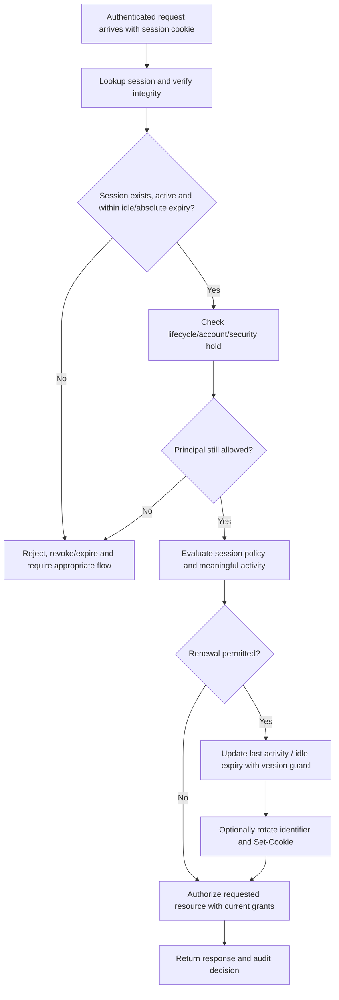
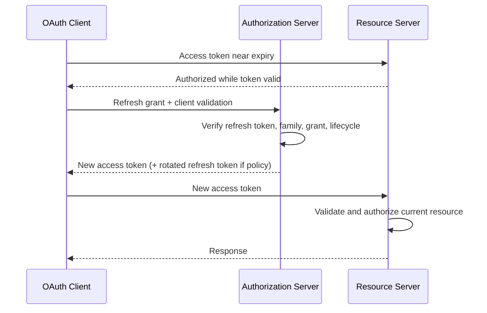

# Session renewal trong quản lý phiên và vòng đời danh tính IAM

## Mục tiêu học tập

Sau khi học bài này, người học có thể:

1. Giải thích **session renewal (gia hạn phiên)**, phân biệt với **session creation, session rotation, reauthentication, session termination, OAuth access-token refresh** và **refresh-token rotation**.
2. Xác định ranh giới giữa **phiên ứng dụng (relying party/application session)**, **phiên tại Identity Provider (IdP/SSO session)**, **cookie**, **OIDC ID token**, **OAuth access token**, **refresh token** và **phiên PAM**.
3. Thiết kế chính sách gia hạn theo **idle timeout, absolute timeout, renewal timeout, authentication freshness, risk và privilege level**, không để một thao tác vô hạn kéo dài session.
4. Hiểu vì sao renewal chỉ được phép nếu **principal còn active, account/entitlement vẫn hợp lệ, phiên không bị revoke, giới hạn thời gian chưa vượt và mức bảo đảm xác thực vẫn phù hợp**.
5. Thực hiện renewal an toàn với **server-side session, cookie attributes, CSRF, chống session fixation, session ID rotation, concurrency control và multi-tab**.
6. Phân tích renewal trong OAuth/OIDC, bao gồm **refresh token, rotation, reuse detection, sender-constrained token, auth_time/max_age, prompt=none** và ranh giới logout.
7. Tích hợp với **Joiner–Mover–Leaver, IdP/SSO, SCIM, directory, RBAC/ABAC, PAM/JIT, workload/service identity**, nhằm hạn chế quyền truy cập tồn dư.
8. Xây dựng telemetry, test, runbook và tình huống xử lý sự cố để kiểm chứng renewal không làm hồi sinh quyền đã thu hồi.

## 1. Session renewal là gì?

**Session renewal** là quá trình **tiếp tục hoặc gia hạn trạng thái phiên đã được thiết lập** khi một người dùng hay principal còn được phép duy trì hoạt động, trên cơ sở các chính sách về thời gian, xác thực, quyền, rủi ro và trạng thái vòng đời.

Ví dụ: nhân viên Lan đăng nhập hệ thống tài chính lúc 08:00. Hệ thống tạo phiên ứng dụng với **idle timeout 15 phút** và **absolute timeout 8 giờ**. Lan thao tác hợp lệ lúc 08:10; hệ thống có thể kéo dài mốc idle expiry từ 08:15 đến 08:25. Nhưng ngay cả khi Lan thao tác liên tục, phiên không được tiếp tục vô hạn sau giới hạn tuyệt đối 16:00 nếu policy quy định phải tạo phiên xác thực mới.

Gia hạn phiên là một **quyết định bảo mật**, không chỉ là kéo dài một biến `expiresAt`.

### 1.1. Một phiên phải trả lời những gì?

- Ai là subject/principal được xác thực?
- Được xác thực lúc nào, bằng IdP/credential/phương thức nào?
- Session được tạo lúc nào và trên thiết bị/kênh nào?
- Session đã hoạt động cuối cùng lúc nào?
- Mốc idle expiry, absolute expiry, renewal grace và authentication freshness là gì?
- Quyền và phạm vi nào đang được sử dụng; chúng có thể thay đổi không?
- Session có bị revoke vì logout, Leaver, security incident hay user action không?
- Có yêu cầu MFA step-up/reauthentication trước hành động nhạy cảm không?
- Session đang ở ứng dụng nào, liên quan IdP SSO/PAM/token nào?
- Làm sao chứng minh renewal thực sự tuân thủ policy?

### 1.2. Vì sao cần renewal?

Nếu mọi trang web buộc đăng nhập lại sau vài phút bất kể hoạt động, trải nghiệm và tính liên tục công việc suy giảm. Nhưng nếu renewal vô giới hạn, token/cookie bị đánh cắp có thể duy trì quyền truy cập trong thời gian quá dài.

Session renewal nhằm cân bằng:

1. **Usability:** không cắt ngang người dùng đang thao tác hợp lệ.
2. **Security:** hạn chế thời gian kẻ tấn công có thể sử dụng phiên bị chiếm.
3. **Access governance:** thay đổi quyền và trạng thái nhân sự phải có hiệu lực đúng hạn.
4. **Auditability:** biết một phiên vì sao còn hiệu lực ở thời điểm nhất định.
5. **Resilience:** tránh mất tiến trình hợp lệ do phân tán hệ thống, multi-tab hoặc mạng chập chờn.

## 2. Phân biệt những khái niệm dễ nhầm

| Khái niệm | Điều thực sự diễn ra | Không tự bảo đảm |
|---|---|---|
| **Session creation** | Tạo phiên sau xác thực ban đầu | Quyền bất biến suốt đời phiên |
| **Idle renewal** | Dời idle expiry khi có activity hợp lệ | Dời absolute expiry |
| **Absolute session expiration** | Buộc phiên không còn hợp lệ sau hạn tối đa | Tự động hủy IdP SSO session |
| **Session ID rotation** | Thay session identifier, giữ hoặc chuyển state có kiểm soát | Người dùng vừa nhập credential lại |
| **Session reauthentication** | Xác thực lại principal bằng cơ chế được yêu cầu | Mọi refresh token cũ bị revoke |
| **MFA step-up** | Tăng assurance cho một hành động hoặc khoảng thời gian | Tự gia hạn mọi session |
| **Access-token refresh** | Xin access token mới bằng grant hợp lệ, thường với refresh token | Người dùng vừa hiện diện/tái xác thực |
| **Refresh-token rotation** | Thay refresh token cũ bằng token mới theo policy | Đổi IdP/ứng dụng session ID |
| **SSO silent login** | Thiết lập phiên ứng dụng mới khi IdP session còn hợp lệ và policy cho phép | Giữ application session cũ sống nguyên |
| **Logout** | Chấm dứt một hoặc nhiều phạm vi session theo thiết kế | Mọi app/token ở mọi thiết bị bị xóa ngay |
| **Revocation** | Vô hiệu hóa session, credential hoặc grant theo target | Tất cả JWT đã phát bị verifier offline từ chối tức thì |

**Điểm mấu chốt:** mỗi hoạt động có **nguồn thẩm quyền, đối tượng và mốc thời gian khác nhau**.

### 2.1. Renewal không tự là reauthentication

Nếu browser gửi một cookie còn hợp lệ, server gia hạn mốc idle expiry thì **không có bằng chứng người dùng vừa nhập mật khẩu/MFA**. Activity đó có thể do browser tự gửi, hoặc do attacker sử dụng session bị lấy cắp.

Với quyền cao, policy có thể yêu cầu `auth_time` đủ mới hoặc step-up, bất kể session vẫn active.

### 2.2. Token refresh không phải session renewal

Một SPA/native client có thể dùng refresh token để xin access token mới sau khi token 5–15 phút hết hạn. Đây là **renewal của access credential**. Ứng dụng đồng thời có thể có session hoặc grant riêng. Không nên gọi chung cả hai là “gia hạn login” rồi bỏ qua giới hạn.

### 2.3. Session được gia hạn nhưng quyền thay đổi

Lan có thể vẫn đăng nhập và tiếp tục soạn tài liệu khi Mover từ Sales sang Finance. Phiên xác thực của Lan còn hợp lệ **không có nghĩa các quyền Sales trong token/session cache còn hợp lệ**. Authorization phải được tính lại hoặc cache invalidation theo policy.

## 3. Bản đồ các phiên trong hệ thống IdP/SSO

Một người dùng mở ba ứng dụng qua SSO có thể tồn tại nhiều phiên độc lập:

```text
Browser / Device
    |
    +-- IdP SSO session
    |      identity=Lan
    |      auth_time=08:00
    |      idp_idle_expires=...
    |      idp_absolute_expires=...
    |
    +-- App A session (cookie A)
    |      created=08:03
    |      idle_expires=08:18
    |      absolute_expires=16:03
    |
    +-- App B session (cookie B)
    |      created=09:10
    |      idle_expires=09:25
    |      absolute_expires=...
    |
    +-- OAuth tokens for API C
           access_token: exp=...
           refresh_token: state/expiry/rotation policy=...
```

Nếu App A idle expires, browser có thể chuyển tới IdP để xác thực lại. Nếu IdP session còn hiệu lực, quá trình quay về App A có thể xảy ra mà người dùng không nhập mật khẩu lần nữa, **theo giao thức và chính sách ứng dụng**.

### 3.1. Phạm vi quản lý khác nhau

| Hệ thống | Có thể kiểm soát | Thường không tự kiểm soát |
|---|---|---|
| **IdP** | Phiên đăng nhập tập trung, authentication, MFA, issuance, SSO logout theo năng lực | App-local session độc lập nếu không tích hợp |
| **Application/RP** | Session cookie/app state, idle/absolute timeouts, local logout | IdP session trên mọi RP |
| **Authorization Server** | OAuth client/grants, refresh-token family, token issuance | Mọi offline access token nếu không có kiểm soát bổ sung |
| **Resource server/API** | Access token validation, RBAC/ABAC, resource authorization | Trạng thái browser session nếu không được cung cấp |
| **Directory/SCIM target** | Account/Group/role membership được đồng bộ | Browser sessions/tokens ở mọi ứng dụng |
| **PAM** | Privileged elevation/lease/session theo platform | Các API keys/SSH sessions ngoài PAM |

### 3.2. Đăng nhập SSO không nhất thiết đồng bộ timeout

App A có idle timeout 10 phút; IdP có timeout khác và App B có policy khác. Không được giả định:

- App A logout kéo theo logout IdP.
- IdP logout bảo đảm token App B lập tức chết.
- Gia hạn IdP session tự gia hạn App A session.
- Renew App A cho phép bỏ yêu cầu MFA của App C.
- Cùng tên “session timeout” nghĩa là cùng đối tượng.

Thiết kế phải nêu rõ **authority của từng session** và chính sách đồng bộ/thu hồi.

## 4. Các mốc thời gian điều khiển renewal

### 4.1. Idle timeout

**Idle timeout** giới hạn thời gian **không có hoạt động được policy công nhận**.

```text
createdAt         = 08:00
idleTimeout       = 15 phút
lastMeaningfulUse = 08:10
idleExpiresAt     = 08:25
```

Nếu browser gửi request được xác thực vào 08:20 và policy cho tính activity đó, có thể dời idle expiry đến 08:35.

**Vấn đề:** không phải request nào cũng phản ánh người dùng đang thao tác. Polling, background sync, analytics beacon, heartbeat hoặc script do attacker kích hoạt có thể giữ phiên sống nếu renewal rule quá dễ dãi.

### 4.2. Absolute timeout

**Absolute timeout** đặt hạn tối đa cho tuổi phiên **bất kể hoạt động**, thường được tính từ mốc tạo hoặc xác thực theo policy.

```text
createdAt         = 08:00
absoluteTimeout   = 8 giờ
absoluteExpiresAt = 16:00

Một request lúc 15:59 có thể được xử lý nếu còn hợp lệ,
nhưng không được tự dời absoluteExpiresAt sang 23:59.
```

Sau absolute expiry, có thể cần reauthentication hoặc bắt đầu phiên mới theo chính sách. Nếu IdP SSO còn hợp lệ, luồng login mới có thể không yêu cầu nhập credential; chính sách về **max_age/auth_time** quyết định mức xác thực mới cần thiết.

### 4.3. Renewal timeout / session ID renewal interval

Một số thiết kế có **renewal interval**: sau một khoảng, hệ thống cấp **session ID mới** cho phiên đang active nhằm giảm thời gian sử dụng một identifier cũ, hoặc đánh giá lại authentication context.

Cần phân biệt:

- **Idle extension:** dời mốc hết hạn do không hoạt động.
- **Identifier rotation:** đổi giá trị session identifier.
- **Reauthentication interval:** yêu cầu xác thực lại định kỳ.
- **Absolute timeout:** hạn tối đa không được vượt.

Nếu chỉ đổi cookie value mà không kiểm tra principal/grants, đó **không phải reauthentication**.

### 4.4. Authentication freshness

Một hành động nhạy cảm có thể yêu cầu authentication đủ gần thời điểm sử dụng, chẳng hạn tài khoản thường vẫn xem được dashboard nhưng để đổi bank account phải thực hiện MFA step-up mới.

Thông tin thường liên quan:

- `auth_time`: thời điểm xác thực người dùng theo OIDC context khi được cung cấp và xác minh.
- `acr`/`amr`: thông tin về mức/phương thức xác thực khi issuer và ứng dụng có thỏa thuận semantics.
- `max_age`: yêu cầu tuổi xác thực tối đa trong yêu cầu OIDC thích hợp.
- Local `stepUpAt`/`assuranceExpiresAt`: metadata ứng dụng kiểm soát theo policy.

**Không dùng `iat` của access token mới như bằng chứng người dùng vừa reauthenticate.** Token có thể được phát mới từ refresh token mà không có user interaction.

### 4.5. Cửa sổ quyền

Một privileged elevation có `validUntil=10:00` không được kéo dài tới 10:30 chỉ vì phiên đăng nhập đã renewed lúc 09:55. Grant/session có những mốc thời hạn độc lập.

Ví dụ:

```text
User session:           08:00 → 16:00 (absolute)
PAM admin elevation:    09:30 → 10:00
Access token:           09:50 → 10:05
MFA assurance freshness 09:45 → 10:15 (policy window)

At 10:02:
  User may remain authenticated,
  but admin privilege must NOT be allowed to continue.
```

### 4.6. Công thức giới hạn hiệu lực

Một session renewal phải tôn trọng **mọi hạn và trạng thái bắt buộc**:

```text
candidateIdleExpiry = trustedNow + idleTimeout

newIdleExpiry = min(
    candidateIdleExpiry,
    absoluteExpiry,
    sessionGrantExpiryIfApplicable
)

PERMIT renewal only when:
    trustedNow < currentIdleExpiry
    trustedNow < absoluteExpiry
    session not revoked
    account and identity active
    policy/assurance conditions pass
```

Đây là mô hình khái niệm. Không phải mọi hệ thống lưu `idleExpiresAt` trong database, nhưng **semantics phải được enforce đúng**.

## 5. Những loại hoạt động được dùng để gia hạn phiên

### 5.1. Không nên lấy mọi HTTP request làm “user activity”

| Sự kiện | Nên tính để renew idle? | Lý do |
|---|---|---|
| Người dùng gửi form hợp lệ | Thường có thể | Activity có chủ đích, theo policy |
| Click/điều hướng trong app | Có thể | Tương tác thực |
| API request có quyền và phù hợp UI | Cân nhắc | Có thể user-driven hoặc background |
| Background polling mỗi 30 giây | Thường không tự động | Có thể giữ session sống mãi |
| Health-check/monitoring | Không | Không phải activity của user |
| CDN/asset requests | Không | Không phản ánh authenticated interaction |
| Analytics beacon | Không | Gửi tự động |
| Browser tab chạy timer “keep alive” | Không nên được tin vô điều kiện | Dễ kéo dài session không có tương tác |
| Heartbeat WebSocket | Không tự động | Có thể chạy khi người dùng rời máy |
| Admin action nhạy cảm | Có thể, kèm step-up | Activity hợp lệ nhưng đòi assurance riêng |

Mỗi sản phẩm phải quyết định **server dựa vào dấu hiệu nào**, không tin một header client tự khai `userActive=true` mà không có guard.

### 5.2. Rủi ro “keep-alive vô hạn”

Nếu ứng dụng có endpoint `/session/ping` tự gia hạn mà chỉ cần cookie, một script ngầm, browser extension hoặc attacker có cookie có thể gửi ping mãi. Khi đó idle timeout trở nên ít hiệu quả.

Giảm rủi ro bằng:

- Chỉ renew ở request có ý nghĩa do server nhận diện.
- Có absolute timeout không vượt.
- Giới hạn renewal/reauthentication interval theo risk.
- Kiểm tra session anomaly, IP/device context khi chính sách yêu cầu.
- Không dùng browser-side countdown như nguồn thời gian tin cậy.
- Cân nhắc giới hạn background activity không cần thiết.

### 5.3. Đồng hồ client chỉ phục vụ trải nghiệm

JavaScript trên browser có thể hiển thị “Phiên còn 2 phút”, cảnh báo hoặc đề nghị lưu bản nháp. Nhưng **server phải quyết định hết hạn** dựa trên thời gian đáng tin. Người dùng có thể chỉnh đồng hồ máy hoặc tab bị suspend.

Không cấp quyền vì timer trên client nói session vẫn còn.

## 6. Thiết kế session renewal cho server-side session

### 6.1. Session cookie chứa identifier, state nằm trên server

Một kiến trúc phổ biến:

```text
Browser:
  Cookie: __Host-session=<opaque random identifier>

Application:
  Session store:
    sessionIdHash
    subjectId
    createdAt
    lastMeaningfulActivityAt
    idleExpiresAt
    absoluteExpiresAt
    authenticatedAt
    assuranceContext
    sessionVersion
    revokedAt
    authorizationVersion
```

Cookie chỉ là **bearer session identifier**, cần giá trị ngẫu nhiên khó đoán và được bảo vệ. Không lưu plain password hay refresh token nhạy cảm vào cookie app session nếu không có kiến trúc bảo vệ thích hợp.

### 6.2. Luồng renewal tại backend



Một request có thể vẫn được **xử lý** dù không cần gia hạn phiên, miễn nó còn hợp lệ và có quyền. Nhưng khi session đã hết idle/absolute expiry, **không được hồi sinh nó chỉ nhờ request đến muộn**.

### 6.3. Thuật toán pseudocode

```text
function processAuthenticatedRequest(cookie, request):
    session = sessionStore.findByOpaqueCookie(cookie)
    now = trustedServerTime()

    if session is missing or session.revoked:
        return UNAUTHENTICATED

    if now >= session.absoluteExpiresAt:
        revokeSession(session, "ABSOLUTE_EXPIRED")
        return REAUTH_REQUIRED

    if now >= session.idleExpiresAt:
        revokeSession(session, "IDLE_EXPIRED")
        return REAUTH_REQUIRED

    identity = loadCurrentAuthoritativeIdentity(session.subjectId)
    if identity.disabled or identity.lifecycleState == LEAVER:
        revokeSession(session, "LIFECYCLE_REVOKED")
        return UNAUTHENTICATED

    if session.isSuspiciousOrHeld:
        revokeOrRequireStepUp(session)
        return CHALLENGE_OR_DENY

    if request.meetsMeaningfulActivityPolicy:
        candidate = now + session.policy.idleTimeout
        newIdleExpiry = min(candidate, session.absoluteExpiresAt)
        sessionStore.compareAndUpdateExpiry(
            session.id,
            expectedVersion = session.version,
            newIdleExpiry = newIdleExpiry
        )

    decision = authorizeCurrentActionAndResource(
        identity, session, request
    )

    return enforce(decision)
```

**Pseudocode, không phải chương trình chạy trực tiếp.** Triển khai thật cần chống race và session fixation, hỗ trợ timeouts, multi-node session store và chính sách reauthentication.

### 6.4. Tối ưu ghi session store

Không nhất thiết ghi `lastSeen` trên **mọi request** khi tải lớn. Có thể batch hoặc cập nhật theo ngưỡng, nhưng phải tính đúng mốc idle expiry; không để cache stale khiến session vượt hạn.

Ví dụ chọn renewal only when `idleExpiresAt - now < threshold`, nhưng threshold là **cơ chế giảm write**, không tự thay đổi policy. State giữa các node phải nhất quán đủ để enforce.

## 7. Cookie security cho session renewal

Một cookie phiên cần được cấu hình phù hợp:

```http
Set-Cookie: __Host-session=<opaque-session-value>; Path=/; Secure; HttpOnly; SameSite=Lax
Cache-Control: no-store
```

Đây là **header minh họa**, không phải khuyến nghị một cấu hình duy nhất cho mọi website. Thuộc tính `__Host-` đòi Secure, Path=/ và không có Domain theo hỗ trợ browser. `SameSite=Lax` có thể phù hợp một số web flow, còn cross-site SSO có những ràng buộc riêng cần đánh giá.

### 7.1. Vai trò cookie attributes

| Thuộc tính | Mục tiêu | Giới hạn |
|---|---|---|
| `Secure` | Chỉ gửi cookie trên kênh HTTPS theo browser | Không chống XSS trong app |
| `HttpOnly` | Ngăn JavaScript đọc cookie trực tiếp | Script độc hại có thể gửi request |
| `SameSite` | Giảm một số nguy cơ CSRF | Không thay CSRF token/origin check khi cần |
| `Path` | Phạm vi URL áp cookie | Không phải security boundary mạnh giữa app cùng origin |
| `Domain` | Phạm vi host | Có thể mở rộng tác động subdomain |
| `Max-Age` / `Expires` | Thời hạn lưu cookie ở browser | Server phải enforce session expiry độc lập |
| Cookie prefix `__Host-` | Tăng ràng buộc host/path theo browser | Phụ thuộc dùng đúng cú pháp/hỗ trợ |

Nếu một cookie có expiry ở browser tới ngày mai nhưng server session hết hạn tối nay, server phải từ chối. **Client cookie lifetime không được điều khiển security expiry thay backend**.

### 7.2. Bảo vệ trước CSRF

Một endpoint renewal hoặc logout có thể có tác động thay đổi state. Với ứng dụng cookie-authenticated, cần xem xét:

- CSRF token theo framework/policy khi cần.
- Origin/Referer validation có xử lý đúng tình huống hợp lệ.
- SameSite phù hợp luồng.
- Không thay đổi state vì một GET bị mail scanner/prefetch mở.
- CORS policy không dựa vào wildcard cùng credential.
- Chặn request từ origin không được tin.

Đối với cookie cross-site bắt buộc `SameSite=None; Secure`, phải thiết kế CSRF bảo vệ tương ứng. Không chỉ dựa vào một cookie attribute rồi tự bỏ tất cả kiểm soát khác.

### 7.3. Cookie refresh không nên lộ qua log

Không ghi header `Cookie`, `Set-Cookie`, bearer token hoặc session ID vào access logs/debug traces. Có thể ghi **session ID hash hoặc opaque correlation** đã được định nghĩa, tránh khả năng dùng log để chiếm phiên.

## 8. Session ID rotation và chống session fixation

### 8.1. Session fixation là gì?

Session fixation là nguy cơ attacker khiến nạn nhân sử dụng một session ID mà attacker biết trước; khi nạn nhân đăng nhập, server **tái sử dụng cùng session ID** và biến nó thành phiên đã xác thực. Attacker có thể dùng ID đó để chiếm phiên.

Biện pháp quan trọng: **tạo session identifier mới sau authentication thành công** và vô hiệu identifier cũ; đồng thời bảo vệ cookie và session store.

### 8.2. Khi nào cân nhắc rotate session ID?

- Ngay sau login/reauthentication theo policy.
- Sau thay đổi mức assurance hoặc security context.
- Khi chuyển sang privileged context/JIT elevation nếu mô hình yêu cầu.
- Định kỳ theo renewal interval đã thiết kế.
- Sau sự kiện security có thể làm identifier cũ không còn đáng tin.

Rotation không đồng nghĩa “refresh cookie sau mỗi request”. Quay vòng quá thường xuyên có thể tăng lỗi concurrency và làm UX kém nếu không có thiết kế rõ.

### 8.3. Quy trình rotation an toàn

```text
oldSessionId (active)
    |
    +-- verify current session and lifecycle
    +-- generate cryptographically random newSessionId
    +-- atomically bind new identifier to approved session state
    +-- invalidate old identifier (or safe bounded transition)
    +-- return Set-Cookie new identifier
    +-- record rotation event (without raw IDs)
```

Nếu cho phép một **grace window** để xử lý request in-flight, phải giới hạn, tránh attacker tiếp tục sử dụng old ID. Không tự cho phép old ID lặp vô hạn chỉ vì có nhiều tab.

### 8.4. Rotation và privilege changes

Một session sau khi người dùng được step-up có thể chuyển sang assurance cao. Session identifier cũ không nên tự được nâng assurance nếu policy yêu cầu bảo vệ trước session fixation/hijack.

Tương tự, nếu downgrade/revoke privileged context, cần xử lý cache/session state và token đang sống để không còn quyền elevated.

## 9. OAuth access-token refresh và refresh-token rotation

### 9.1. Access token và refresh token khác nhau

- **Access token:** credential được client trình tới resource server để truy cập API trong phạm vi/thời gian đã cấp.
- **Refresh token:** credential được client trình tới authorization server để xin access token mới, khi grant/client policy cho phép.
- **Session:** trạng thái ứng dụng/IdP có thể tồn tại độc lập với token.

Không phải mọi OAuth grant hoặc client đều có refresh token. Ví dụ **client credentials** thường có thể client authentication lại để lấy token mới; việc có hay không refresh token phụ thuộc authorization server và grant policy, không tự thiết kế một token dài hạn cho tất cả clients.

### 9.2. Luồng refresh token



**Refresh là một cơ chế cấp token**, không có nghĩa người dùng vừa chủ động sử dụng app hay xác thực lại bằng MFA.

### 9.3. Refresh-token rotation

**Refresh-token rotation** phát hành refresh token mới và làm refresh token cũ không còn là credential hợp lệ cho lần đổi tiếp theo, theo thiết kế. Mục tiêu là hạn chế replay và hỗ trợ phát hiện việc nhiều bên cùng dùng một refresh token đã bị sao chép.

Ví dụ:

```text
Token family F:
  RT-1 → exchange → AT-2 + RT-2
  RT-1 becomes used/invalid
  RT-2 → exchange → AT-3 + RT-3
  RT-2 becomes used/invalid
```

Nếu RT-1 lại xuất hiện sau khi đã đổi, có thể có **replay hoặc lỗi concurrency/network retry**. Cần kiểm tra nguyên nhân và áp cơ chế reuse detection/revocation theo policy; với dấu hiệu compromise có thể revoke **token family/grant** thay vì phát token tiếp.

### 9.4. Sender-constrained refresh tokens

Một hệ thống có thể dùng **sender-constrained token**, ví dụ liên kết với client key/mTLS/DPoP tùy sản phẩm và profile, để kẻ cắp chỉ lấy token khó dùng ở client khác.

Điều này không xóa nhu cầu kiểm soát:

- Thiết bị hoặc private key có thể cùng bị compromise.
- Token audience/expiry/grant vẫn cần kiểm tra.
- Client lifecycle và revocation vẫn phải hoạt động.
- Public/native clients có trust assumptions khác confidential backend.
- Token binding phải được cả AS và verifier thực thi nhất quán.

### 9.5. Refresh token không được tăng quyền

Khi client refresh:

- Scope/role mới không được mở rộng trái grant/policy.
- User/beneficiary không được đang Leaver hoặc disabled theo nguồn authoritative.
- App/client registration phải còn active.
- Consent/approval và risk policy vẫn hợp lệ theo mô hình.
- Session/refresh grant chưa hết hạn, bị revoke hay vượt absolute policy.
- Token mới phải có audience và giới hạn phù hợp.

Không copy role từ refresh token cũ thành quyền mới nếu source đã Mover/Leaver hoặc admin revoke role.

## 10. Multi-tab, mobile và concurrent renewal

### 10.1. Hai tab refresh cùng lúc

Một SPA mở hai tab. Cả hai phát hiện access token sắp hết hạn và dùng **cùng refresh token RT-1**:

```text
Tab A: POST refresh(RT-1)
Tab B: POST refresh(RT-1)

Server:
  A swaps RT-1 → RT-2
  B sees RT-1 already used
```

Nếu backend lập tức coi B là attacker, người dùng hợp lệ có thể bị logout. Nếu backend luôn chấp nhận RT-1 lại, attacker có thể replay.

Cần kết hợp:

- **Client single-flight**: chỉ một refresh đang chạy trên cùng session/client context.
- **Server atomic consumption** của refresh token.
- Reuse detection có policy xử lý race và rủi ro.
- Idempotency/correlation phù hợp trong hệ thống phân tán.
- Không lưu refresh token trong môi trường JavaScript không đáng tin khi có phương án an toàn hơn.
- Tránh retry vô điều kiện với token đã được coi là dùng.

### 10.2. Multi-tab state sync

Tab A logout, Tab B không được tiếp tục gửi requests chỉ vì local state chưa cập nhật. Các tab có thể đồng bộ sự kiện UI, nhưng **server-side revocation mới là nguồn quyết định**.

Nếu mỗi tab có session riêng, policy phải xác định logout một tab hay tất cả phiên. Không suy quyền từ việc một tab chỉ xóa biến memory.

### 10.3. Native/mobile client

Mobile app có thể có secure storage theo nền tảng và cơ chế background refresh. Cần xét:

- Device binding/refresh token protection.
- App reinstall và credential cleanup.
- Device lost hoặc remote wipe theo policy.
- Network offline, queued requests và retry.
- Sign-out làm mất token mới và xử lý phiên server.
- Reauthentication khi thiết bị không còn đáp ứng risk.
- Hạn grant/refresh token tuyệt đối nếu policy có.

Không đánh đồng “app còn chạy nền” với “người dùng còn hiện diện” để gia hạn vô hạn.

### 10.4. Distributed backend

Nếu session renewal xảy ra ở nhiều node:

- Session store/consistent cache phải có version/atomic update.
- Revocation event phải lan tới mọi node.
- Node clock phải được đồng bộ.
- Session expiry không dựa vào một replica stale vượt policy.
- Token rotation/reuse detection phải dùng transaction hoặc compare-and-swap.
- Cần xử lý failover: request đang xử lý không được hồi sinh session đã revoke.

Một local memory session map trên từng node có thể hoạt động trong demo nhưng không tự đáp ứng yêu cầu failover/audit trong hệ thống lớn.

## 11. Idle renewal và absolute cap trong trường hợp quyền thay đổi

### 11.1. Mover không nhất thiết buộc user logout khỏi mọi app

Khi người dùng chuyển bộ phận, một số phiên làm việc chung có thể tiếp tục, nhưng **quyền cũ phải bị gỡ đúng thời điểm**. Có hai loại vấn đề:

1. Authentication session đang sống có thể vẫn hợp lệ với identity active.
2. Authorization context (role/group, scope) của phiên có thể đã stale.

Policy có thể cho tiếp tục authentication session nhưng yêu cầu **refresh authorization grants và step-up khi vào role mới**.

### 11.2. Leaver chặn renewal và truy cập

Khi Leaver có hiệu lực, ít nhất phải:

- Không gia hạn các session user đã bị chấm dứt quyền truy cập.
- Disable account/IdP theo lifecycle policy.
- Chặn refresh tokens/SSO session nếu có khả năng và scope phù hợp.
- Revoke ứng dụng/PAM/direct grants.
- Xử lý access tokens còn hiệu lực ở API.
- Xác minh tại hệ thống đích, không chỉ đánh dấu HR record.

**Không chờ idle/absolute expiry tự kết thúc một quyền high-risk của Leaver** nếu policy yêu cầu thu hồi sớm hơn.

### 11.3. Hạn quyền tác động tới session renewal

Một phiên còn 6 giờ nhưng grant tài chính hết hạn lúc 12:00. Sau 12:00 server không được cho `payment.approve` chỉ vì cookie mới được gia hạn lúc 11:59. Renewal không được làm trễ việc hết hạn entitlement.

### 11.4. Khi approval hoặc SoD exception hết hiệu lực

SoD exception cho người phụ trách thanh toán có thể được phê duyệt đến hết ca trực. App session có thể kéo dài hơn ca. Backend phải đánh giá **exception status, resource scope, independent approval và expiry** khi xử lý hành động, không chỉ ở thời điểm login.

### 11.5. Workload/service identity khác gì?

Workload dùng OAuth client credentials hoặc mTLS có thể xin token mới mà không có user session; nhưng:

- Service identity phải còn ACTIVE theo service catalog.
- Credential/trust mapping không bị revoke.
- Workload owner/sponsor còn hợp lệ.
- Target permission và resource scope không bị thu hồi.
- Job đã decommission không tiếp tục nhận token mới.

**Owner con người Leaver** không tự bắt buộc xóa mọi workload còn cần; thay vào đó xử lý quyền cá nhân, secret exposure, owner transfer và workload lifecycle riêng.

## 12. OIDC SSO session renewal và authentication freshness

### 12.1. OIDC ID token và `auth_time`

Trong OIDC, ID token cho client thông tin về authentication event. `auth_time`, khi được cung cấp và xác minh, cho biết thời điểm user authentication theo semantics OIDC.

Đối với hành động cần user vừa xác thực, RP có thể dùng yêu cầu `max_age` phù hợp tới IdP và kiểm tra `auth_time` trả về; cách dùng phải tuân thủ provider/profile và validation đầy đủ.

**Không dùng `iat` của ID token mới để thay `auth_time`**, vì token phát hành mới không nhất thiết đồng nghĩa một authentication event mới.

### 12.2. Silent authentication

Một RP có thể thử OIDC authorization request với `prompt=none` để kiểm tra liệu IdP có thể hoàn tất login mà không tương tác người dùng hay không.

Giới hạn:

- IdP session có thể hết hoặc cần MFA/consent.
- Browser privacy/third-party cookie restrictions có thể làm silent flow thất bại.
- IdP có thể trả lỗi tương ứng thay vì ID token mới.
- RP không được bỏ qua error và tự tạo session khi không đủ điều kiện.
- Silent login không tự là fresh reauthentication.

### 12.3. IdP session còn sống không xóa absolute cap của RP

Nếu RP yêu cầu reauthentication đủ mới sau 8 giờ, việc redirect IdP và nhận thông báo SSO session còn hiệu lực **không đương nhiên đáp ứng** yêu cầu đó. RP phải kiểm tra policy về auth age và assurance.

Một ứng dụng có thể cho người dùng mở phiên mới sau SSO mà không nhập password, nhưng phải gọi rõ đây là **new RP session based on existing IdP authentication**, không giả là người dùng vừa MFA.

### 12.4. Session renewal và Single Logout

SAML/OIDC logout có nhiều mô hình front-channel/back-channel hoặc session management theo provider và triển khai. Tính sẵn có và hiệu lực của logout notification có thể khác nhau.

Không được giả định:

- Logout ở RP sẽ thu hồi refresh token tại AS theo mọi provider.
- IdP logout khiến mọi app-local cookie biến mất ngay.
- Một browser không nhận front-channel event là session đã revoke ở backend.
- SCIM `active=false` tự terminate mọi local session.

Ứng dụng cần cơ chế **server-side revocation** và/hoặc **runtime authorization checks** theo risk, kết hợp logout signaling khi có thể.

## 13. Risk-based renewal và step-up

### 13.1. Khi nào cần đổi mức kiểm soát?

- Người dùng truy cập từ device chưa tin cậy.
- Phiên có dấu hiệu token/cookie theft.
- Địa lý/ASN/thiết bị thay đổi đột ngột, theo policy có cân nhắc false positives.
- Thao tác export dữ liệu nhạy cảm, payment approval, key rotation.
- Role vừa được nâng cấp quyền.
- SoD exception hoặc JIT activation bắt đầu.
- Security incident yêu cầu reset session.
- Reauthentication/MFA đã quá cũ theo policy.

### 13.2. Step-up không phải kéo dài MFA vô hạn

Một hệ thống có thể giữ authentication session ở mức thông thường cho navigation và yêu cầu MFA step-up cho quyền cao. Khi step-up thành công, nên lưu event và **cửa sổ assurance** rõ ràng.

Ví dụ:

```text
App session absolute expires: 18:00
MFA step-up at:               14:20
MFA freshness window ends:    14:35
Admin elevation ends:         14:40

At 14:38:
  user session is active,
  but MFA may no longer be fresh enough for another risky action.
```

Các phút là ví dụ thiết kế, **không phải mốc chuẩn**. Policy phải nêu rõ mức assurance và điều kiện reauthentication thực sự.

### 13.3. Chống bypass step-up bằng API trực tiếp

Nếu front-end hiển thị modal “Xác thực lại” nhưng backend `POST /payments/approve` chỉ kiểm tra cookie, attacker có thể gọi API trực tiếp.

Guard phải nằm ở server/PEP:

- Principal active.
- Action permission.
- Resource scope.
- SoD/maker-checker.
- Fresh step-up event được tin cậy.
- Session không revoke.
- Grant/elevation còn hạn.
- Transaction version chưa đổi sau approval.

### 13.4. Risk change trong lúc phiên đang active

Nếu device bị đánh dấu compromised hoặc principal vào security hold, renewal engine có thể:

1. Deny renewal.
2. Revoke hoặc suspend session.
3. Yêu cầu step-up/reauthentication theo risk.
4. Chặn actions nhạy cảm ngay cả trước khi session kết thúc.
5. Ghi event reason và thông báo phù hợp.

Không cho session đã bị revoke tự hồi sinh vì browser gửi một request hợp lệ ngay sau đó.

## 14. Bảo vệ phiên trước concurrency và session replay

### 14.1. Race giữa expiry và renewal

```text
Node A reads session at 10:00:00.999 (not yet expired).
Node B revokes session at 10:00:01.000 (Leaver).
Node A writes new idleExpiresAt at 10:00:01.050.
```

Nếu update không có version/state guard, Node A có thể **ghi đè revoke**. Cần update có điều kiện, so session version và revokedAt/state, hoặc transactional mechanism phù hợp:

```text
UPDATE sessions
SET idleExpiresAt = :candidate, version = version + 1
WHERE id = :id
  AND version = :expectedVersion
  AND revokedAt IS NULL
  AND idleExpiresAt > :now
  AND absoluteExpiresAt > :now
```

Đây là SQL ý tưởng; production cần SQL dialect, transaction và cách kiểm tra IAM lifecycle/phân tán phù hợp.

### 14.2. In-flight requests sau logout

Một request chạy lâu có thể khởi đầu trước logout. Tùy thao tác và risk, cần xác định **khi nào authorization được kiểm tra lại trước commit**.

Với payment, export dữ liệu và cấp quyền IAM, chỉ kiểm tra session trước khi bắt đầu xử lý rồi commit sau khi session bị revoke có thể không đủ. Nên có **pre-commit authorization/version guard** và idempotency khi cần.

### 14.3. Concurrent session limit

Một policy có thể giới hạn số phiên active per principal hoặc per device. Khi login mới, hệ thống có thể revoke phiên cũ theo lựa chọn và policy. Renewal phải tôn trọng trạng thái đó, không làm phiên bị loại trở lại active.

Có thể lưu `sessionVersion`, `sessionFamily` hoặc `revocationEpoch` để đánh giá trạng thái được quản trị từ một nguồn tin cậy.

### 14.4. IP/device binding: ưu và nhược

Dùng IP như tín hiệu risk có thể hữu ích, nhưng **cứng nhắc buộc session chỉ một IP** dễ gây lỗi trên mobile, NAT, proxy và mạng doanh nghiệp. Device fingerprint có thể bị giả và liên quan quyền riêng tư.

Nếu áp context binding, cần đánh giá:

- Nguồn IP/header có đáng tin sau reverse proxy không?
- Khả năng thay đổi mạng hợp lệ.
- False positives và phương án reauthentication.
- Data minimization/privacy.
- Kẻ tấn công có thể hoạt động trên cùng device hay mạng không?

Không coi IP binding là giải pháp đủ để ngăn session hijacking.

## 15. Logout, revocation và vòng đời session

### 15.1. Local logout

Một thao tác logout nên:

1. Xác định session đang được yêu cầu đóng.
2. Server revoke/invalidate session state.
3. Xóa cookie ở browser với thuộc tính phù hợp.
4. Xử lý CSRF cho thao tác đổi trạng thái.
5. Ghi audit `SESSION_TERMINATED`, không lưu raw cookie.
6. Xác định có logout từ tất cả thiết bị hay chỉ hiện tại.
7. Thực hiện token revocation/SSO logout theo khả năng và policy nếu cần.

Chỉ xóa cookie ở client **không vô hiệu server-side session identifier bị attacker giữ**.

### 15.2. Global logout

“Logout everywhere” có thể bao gồm:

- Toàn bộ application sessions của principal.
- IdP SSO sessions.
- OAuth refresh-token families và grants thích hợp.
- Application-local sessions ở các RP.
- PAM privileged sessions.
- Tokens và API access khi có cơ chế runtime revocation.

Không phải platform nào cũng có khả năng chấm dứt mọi dạng offline JWT ngay. Cần **nêu rõ phạm vi thực thi, giới hạn và độ trễ**.

### 15.3. Revocation không đồng nghĩa gỡ mọi quyền

Một user logout khỏi ứng dụng vẫn có entitlement trong IAM; khi login lại họ có thể nhận quyền đó nếu còn đủ điều kiện. Ngược lại, khi Leaver, cần **gỡ entitlement và chặn login/token issuance**, không chỉ đóng một tab browser.

### 15.4. Khi server không thể xác minh trạng thái

Với thao tác high-risk, nếu session store, PDP hoặc nguồn lifecycle đáng tin không thể truy vấn, hệ thống cần hành vi **fail-safe** theo risk policy, thường không cho Permit một hành động nhạy cảm không thể xác minh.

Không tự mở rộng session chỉ vì “IdP đang chậm” hoặc “authorization service timeout”.

## 16. Session renewal trong hệ thống ứng dụng Java/Spring

### 16.1. Hai kiểu quản lý session khác nhau

Trong Java/Spring có thể gặp:

- **Web application với server-side session:** Spring Security kết hợp servlet session hoặc Spring Session theo kiến trúc; browser giữ opaque session cookie.
- **Stateless Resource Server:** API nhận OAuth 2.0 bearer access token; bản thân API thường **không gia hạn browser session**. Client làm token refresh với authorization server và resource server xác minh token mới.

Không áp cùng một cơ chế cho mọi ứng dụng. Một API `Authorization: Bearer` không nên âm thầm phát cookie session mới chỉ vì nhận token hợp lệ.

### 16.2. Thiết lập session timeout ở tầng triển khai

Spring Boot hoặc application server có thể cho cấu hình timeout của HTTP session. Nhưng giá trị cấu hình **không tự bảo đảm**:

- Absolute timeout riêng biệt.
- IdP SSO session expiry.
- Refresh-token lifetime.
- MFA reauthentication age.
- Leaver event propagation.
- Invalidation của JWT ở resource server.
- Session fixation protection ở mọi custom login flow.

Cần biết **component nào thực thi từng timeout** và kiểm thử thực tế sau deployment.

### 16.3. Ví dụ service policy thuần Java

Đoạn dưới mô tả logic **policy**, không phải Spring API hoàn chỉnh:

```java
import java.time.Duration;
import java.time.Instant;

record SessionPolicy(
        Duration idleTimeout,
        Duration absoluteTimeout,
        Duration renewalWriteThreshold) {}

record SessionSnapshot(
        String sessionId,
        String subjectId,
        Instant createdAt,
        Instant idleExpiresAt,
        Instant absoluteExpiresAt,
        Instant authenticatedAt,
        long version,
        boolean revoked) {}

final class SessionRenewalPolicy {

    boolean canUse(SessionSnapshot s, Instant now) {
        return !s.revoked()
            && now.isBefore(s.idleExpiresAt())
            && now.isBefore(s.absoluteExpiresAt());
    }

    Instant candidateIdleExpiry(
            SessionSnapshot s, SessionPolicy policy, Instant now) {

        Instant proposed = now.plus(policy.idleTimeout());
        return proposed.isBefore(s.absoluteExpiresAt())
            ? proposed
            : s.absoluteExpiresAt();
    }

    boolean shouldWriteRenewal(
            SessionSnapshot s, SessionPolicy policy, Instant now,
            boolean meaningfulActivity) {

        if (!meaningfulActivity || !canUse(s, now)) {
            return false;
        }

        Duration remaining = Duration.between(now, s.idleExpiresAt());
        return remaining.compareTo(policy.renewalWriteThreshold()) <= 0;
    }
}
```

**Giới hạn của ví dụ:** chưa kiểm tra identity active, permission, session store CAS, revocation epoch, assurance/risk, clock source hay distributed consistency. Đây là phần tư duy policy; production không được copy nguyên rồi xem là giải pháp bảo mật hoàn chỉnh.

### 16.4. Pseudocode ở Servlet Filter/Security chain

```text
OnAuthenticatedRequest:
  1. Extract secure session identifier.
  2. Lookup server-side session.
  3. Deny if revoked, idle expired or absolute expired.
  4. Load current lifecycle/account/security hold.
  5. If high risk, check fresh MFA/reauthentication.
  6. Renew idle expiry only for qualifying activity.
  7. CAS update; on conflict reload and revalidate.
  8. Optionally rotate session identifier at policy boundary.
  9. Evaluate current RBAC/ABAC for requested resource.
 10. Enforce Allow/Deny and record audit.
```

Với Java frameworks, chọn **điểm chèn chính thức** phù hợp, không tự ghi nhiều filters cùng gia hạn theo các định nghĩa hoạt động khác nhau.

### 16.5. Cookie header và reverse proxy

Nếu ứng dụng sau reverse proxy xác định scheme không chính xác, cookie có thể bị cấu hình sai Secure hoặc redirect URI không đúng. Phải kiểm tra **trusted forwarding headers**, TLS termination và host/port validation.

Không tin mọi `X-Forwarded-*` từ Internet; chỉ nhận từ proxy tin cậy và cấu hình framework tương ứng.

### 16.6. CSRF và session renewal endpoint

Một endpoint kiểu:

```http
POST /api/session/renew HTTP/1.1
Host: app.example.org
Cookie: __Host-session=<opaque>
X-CSRF-Token: <non-secret-example-placeholder>
```

Đây là ví dụ mang tính khái niệm. **Nếu renewal cho phép chỉ vì có cookie, attacker có thể cố kéo dài một session bị lấy cắp**. Endpoint cần authn đầy đủ, CSRF guard phù hợp và chính sách activity/absolute cap; thậm chí có thể không cần một endpoint riêng nếu server renew theo hoạt động nghiệp vụ hợp lệ.

## 17. Refresh-token family và concurrency ở Authorization Server

### 17.1. Vì sao phải xử lý nguyên tử?

Một refresh token có thể được dùng đồng thời do:

- Hai tab/browser contexts.
- Mobile app và background worker.
- Retry sau network timeout.
- Load balancer gửi tới nhiều AS nodes.
- Attacker dùng bản copy token.

Nếu token được chấp nhận hai lần không theo policy, AS có thể tạo nhiều nhánh token family và mất khả năng phát hiện replay.

### 17.2. Mô hình dữ liệu ý tưởng

```text
RefreshGrant:
    grantId
    clientId
    subjectId
    deviceOrSessionId
    createdAt
    absoluteExpiresAt
    revokedAt
    grantVersion
    currentRefreshTokenHash
    tokenFamilyId
    lastRotationAt
    authenticationContextRef
    authorizedScope
    securityHold
```

Lưu **hash hoặc representation phù hợp** cho refresh token tại server khi thiết kế cho phép; không in raw refresh token vào logs. AS phải bảo vệ cả dữ liệu lưu lẫn đường truyền.

### 17.3. Pseudocode atomic consume

```text
function refreshTokenGrant(clientProof, presentedToken, now):
    client = authenticateAndAuthorizeClient(clientProof)
    tokenRecord = lookupRefreshTokenHash(presentedToken)

    if tokenRecord missing:
        return INVALID_GRANT

    atomically:
        family = lockTokenFamily(tokenRecord.familyId)

        if family.revoked or family.absoluteExpiresAt <= now:
            return INVALID_GRANT

        if tokenRecord.wasConsumed:
            triggerReuseInvestigationAndPolicyResponse(family)
            return INVALID_GRANT

        if not clientMatchesBinding(client, family):
            return INVALID_GRANT

        if not subjectAndCurrentGrantStillEligible(family):
            revokeOrRestrictFamily(family)
            return INVALID_GRANT

        markPresentedTokenConsumed()
        newRefreshToken = generateSecureToken()
        saveNewRefreshTokenHashAndVersion(newRefreshToken)

        newAccessToken = issueRestrictedAccessToken(
            client, family.subjectId, currentAllowedScopes(family)
        )

        commitTransaction()

    return newAccessToken, newRefreshToken
```

Đây là **pseudocode**, không mô tả chi tiết mọi giải pháp OAuth provider. Hành vi xử lý reuse phải xác định theo security policy và khả năng phân biệt replay với race; không mặc định tự tiếp tục đổi token cũ nhiều lần.

### 17.4. Tránh tạo “infinite refresh chain”

Dù mỗi refresh token chỉ dùng một lần, family có thể được xoay mãi nếu không có giới hạn khác.

Nên xét:

- Absolute expiry của refresh grant/family theo policy.
- Idle expiry của refresh grant nếu thích hợp.
- Authentication freshness/reauthentication interval.
- Consent/access request/approval expiry.
- User lifecycle và account enabled state.
- Client app lifecycle.
- Revocation vì incident hoặc đổi credential.
- Risk-based step-up/reauthorization.

Một token có `exp` mới **không tự được quyền tạo grant vĩnh viễn**.

## 18. Gia hạn phiên và quyền thực tế RBAC/ABAC

### 18.1. Authentication hợp lệ không đồng nghĩa authorization hợp lệ

```text
09:00 Lan đăng nhập, app session active.
10:00 HR phát Mover; Lan rời dự án A.
10:05 Browser có activity, app gia hạn session idle.
10:06 Lan gọi GET /projects/A/sensitive-data.
```

Phiên có thể vẫn hợp lệ để sử dụng ứng dụng chung, nhưng quyền dự án A đã mất. Backend phải trả `DENY` cho resource A, dù session renewal thành công.

### 18.2. Token/role cache stale

Nếu application cache role `Project-A-Reader` trong session từ lúc login, thao tác Mover có thể không được phản ánh tới khi session hết hạn. Có thể dùng:

- Authorization version/revocation epoch cho mỗi principal.
- Invalidation event từ IAM/IGA/HR.
- TTL ngắn cho authorization cache.
- Read-through PDP với các action rủi ro cao.
- Token scopes hạn chế và thời hạn phù hợp.
- Runtime resource ownership/ABAC check.

Cần ghi rõ **độ trễ tối đa chấp nhận được** của việc gỡ quyền. Không mặc định “đến lần đăng nhập kế tiếp” luôn đủ.

### 18.3. ABAC theo trạng thái và resource

Một policy API có thể xét:

```text
Subject:
  identityId = IDN-2048
  lifecycle = ACTIVE
  department = FINANCE
  session.active = true
  session.authnFreshEnough = true

Action:
  invoice.approve

Resource:
  tenantId = tenant-vn
  invoice.creatorIdentityId = IDN-701
  invoice.state = PENDING

Environment:
  trustedTime
  riskClass
  SoD exception validity

Permit only if every mandatory guard is satisfied.
```

Đối với action nhạy cảm, renewal không tự chuyển `DENY` thành `PERMIT`. Chính **PDP/PEP** quyết định theo entitlement mới nhất.

### 18.4. Privilege elevation và downgrade

Khi người dùng nâng quyền từ viewer sang admin bằng JIT:

- Authentication freshness phải đáp ứng policy.
- Phạm vi elevation có expiry ngắn, owner/risk approval.
- Session token/identifier có thể cần rotate hoặc tách privileged context.
- Việc hết hạn elevation phải được enforce tại resource server.
- Nếu người dùng tiếp tục login thường, không kéo dài role admin.
- Audit quyết định session renewal và privilege use riêng.

Không đưa role admin vào một refresh-token grant dài hạn rồi để phát lại sau khi PAM lease hết hạn.

## 19. Session renewal theo trạng thái Joiner–Mover–Leaver

### 19.1. Joiner: thời điểm tài khoản bắt đầu hoạt động

Một account có thể pre-provisioned trước start date. Không nên cho session renewal/SSO silently login khi `lifecycleState` chưa eligible, dù credential được phát từ trước.

Các guard:

- Identity proofing và account activation đã đủ.
- HR/contractor source có start date.
- Entitlement grant đã được approval hoặc birthright theo policy.
- Session assurance phù hợp nhóm rủi ro.
- Không có security hold hoặc pending deactivation.

### 19.2. Mover: giảm quyền không cần cắt mọi phiên

Khi Mover:

1. Nhận authoritative HR change với source version.
2. Tính lại desired entitlements.
3. Revoke old grants/assignments.
4. Gửi invalidation tới authorization caches và token/session controls.
5. Đánh giá session renewal tiếp theo có cần step-up/reauth không.
6. Bảo đảm session còn active không dùng quyền của department cũ.
7. Đối soát target app role và runtime access.

Nếu role thay đổi khiến assurance khác, ứng dụng có thể yêu cầu **fresh authentication** khi người dùng bắt đầu thao tác trong vai trò mới.

### 19.3. Leaver: chặn renewal trước khi chờ timeout

Một Leaver có hiệu lực phải kích hoạt:

- Disable account và IdP SSO access theo policy.
- Revoke app sessions/refresh-token families khi được hỗ trợ.
- Chặn token issuance mới.
- Thu hồi role, group, API grant và PAM lease liên quan.
- Xử lý app-local sessions, cached tokens, signed JWT còn hạn.
- Kiểm tra target readback và effective authorization.
- Cảnh báo nếu session còn hoạt động sau thời điểm Leaver.

**Một session cookie còn hạn không được vượt trạng thái Leaver mới nhất.** Đối với hệ thống chỉ xác minh offline JWT, phải ghi rõ cửa sổ tồn dư và bổ sung kiểm soát tương xứng rủi ro.

### 19.4. Rehire

Identity của người tái tuyển dụng có thể vẫn dùng stable ID nhưng giai đoạn công việc, manager và roles đã khác. Không được tự khôi phục:

- Phiên ứng dụng cũ.
- Refresh-token family cũ.
- PAM elevation cũ.
- Role/group grants không còn approved.
- Session assurance của kỳ làm việc trước.

Có thể dùng `employmentEpoch` hoặc `engagementId` trong lifecycle binding, theo thiết kế, để bảo đảm token/session cũ không được nối sang kỳ mới.

### 19.5. Contractor/guest

Contractor expiry và sponsor validity có thể ngắn hơn session absolute timeout. Gia hạn phiên phải tôn trọng cả contract/guest grant expiry. Federation từ external IdP chứng minh identity theo trust agreement, **không tự chứng minh sponsor nội bộ còn cho phép truy cập**.

### 19.6. Service/workload identity

Một service sử dụng client credentials để định kỳ xin token mới sau khi owner Mover không có nghĩa nó phải ngừng nếu workload vẫn hợp lệ và được bàn giao. Nhưng khi workload được retire/decommission:

- Disable client/trust.
- Revoke machine credential và grants.
- Chặn token issuance mới.
- Xử lý tokens đã phát ở target.
- Audit credential/session access và reconciliation.

## 20. SCIM, provisioning và session revocation

### 20.1. SCIM User/Group không phải session protocol

SCIM 2.0 hỗ trợ quản lý `User` và `Group` ở các target hỗ trợ. Một hệ thống có thể đổi `User.active=false` hoặc gỡ Group membership để deprovision.

Nhưng SCIM **không quy định chung** cách mọi ứng dụng hủy cookie, OAuth refresh token, PAM session hoặc JWT. Vì vậy:

```text
SCIM disable user:
    target account disabled?        verify
    target group removed?           verify
    app-local session terminated?   check separately
    OAuth refresh grants revoked?   check separately
    cached API token still works?   check separately
```

### 20.2. Eventual consistency

Một request SCIM PATCH có thể được target xác nhận 2xx nhưng app backend/role cache chưa cập nhật. Nếu token cũ còn quyền trong cửa sổ đó, cần:

- Có SLA propagation/reconciliation.
- Quyền cao được runtime current-state check khi có thể.
- Audit các requests được cho phép sau revoke event.
- Cảnh báo residual access vượt policy.
- Không tự báo `REVOKED_VERIFIED` chỉ vì connector trả thành công.

### 20.3. Direct grants và application-local roles

Một người có thể không còn directory group nhưng vẫn có app-local admin role; renewal cookie ở app vẫn cho role đó hoạt động. Đối soát phải thu **actual roles và sessions tại target**, không chỉ IdP/SCIM desired state.

### 20.4. Failure ở connector

Nếu deprovision request timeout hoặc trả 429:

1. Không đoán lệnh đã hoặc chưa được áp dụng.
2. Đọc lại trạng thái target khi có thể.
3. Retry idempotent với backoff và giới hạn.
4. Giữ exception/incident có owner, SLA.
5. Chặn renewal/auth ở runtime qua cơ chế khác nếu phù hợp risk.
6. Chỉ đóng khi có bằng chứng đúng trạng thái hoặc ghi rõ phần không thể quan sát.

## 21. Phân tách session renewal khỏi keep-alive nghiệp vụ

### 21.1. WebSocket/streaming

Một ứng dụng dùng WebSocket có thể gửi ping để giữ kết nối sống. **Connection keep-alive không tự chứng minh user đang hoạt động** và không được mặc nhiên gia hạn authentication session tuyệt đối.

Policy cần quy định:

- Authn/authorization khi mở kết nối.
- Recheck theo interval/critical operation.
- Cách đóng stream khi session/grant revoke.
- Grace/reconnect khi mạng chập chờn.
- Giới hạn connection lifetime.
- Server-side cancellation với action nhạy cảm.

### 21.2. Job dài và background tasks

Người dùng bấm “Xuất báo cáo lớn” lúc 09:00, job chạy 40 phút. Nếu session idle expiry lúc 09:15, có thể thiết kế job tiếp tục chạy theo **job authorization đã kiểm tra và bounded scope**, nhưng không đồng nghĩa browser session phải kéo dài tới 09:40.

Với dữ liệu nhạy cảm, cần xét thời điểm recheck entitlement trước xuất/commit và cách người dùng tải kết quả khi session đã hết hạn.

### 21.3. API polling không gia hạn session

Ứng dụng dashboard gửi polling mỗi 10 giây. Nếu polling dời idle expiry, người dùng rời màn hình từ lâu nhưng session vẫn active. Nên phân loại route/activity và có absolute timeout.

### 21.4. UX: nhắc trước khi hết hạn

UI có thể:

- Hiển thị cảnh báo trước idle expiry dự kiến.
- Đề nghị lưu bản nháp.
- Cho phép người dùng chọn “Tiếp tục” khi policy cho phép.
- Yêu cầu reauthentication/step-up khi cần.
- Không tự gia hạn bằng timer vô hạn.
- Không hiển thị chi tiết security event nhạy cảm cho unauthenticated party.
- Hỗ trợ accessibility và mobile browser bị sleep.

Server vẫn phải từ chối request trễ sau mốc hết hạn, kể cả UI chưa kịp cập nhật.

## 22. Audit evidence cho session renewal

### 22.1. Những sự kiện nên được phân biệt

```text
SESSION_CREATED
SESSION_ACTIVITY_ACCEPTED
SESSION_IDLE_RENEWED
SESSION_IDENTIFIER_ROTATED
SESSION_REAUTHENTICATION_REQUIRED
SESSION_REAUTHENTICATED
MFA_STEP_UP_COMPLETED
ACCESS_TOKEN_REFRESHED
REFRESH_TOKEN_ROTATED
REFRESH_TOKEN_REUSE_DETECTED
SESSION_IDLE_EXPIRED
SESSION_ABSOLUTE_EXPIRED
SESSION_REVOKED
TOKEN_GRANT_REVOKED
SSO_LOGOUT_RECEIVED
SESSION_RENEWAL_DENIED_LIFECYCLE
SESSION_RENEWAL_DENIED_RISK
PRIVILEGED_SESSION_EXPIRED
TARGET_ACCESS_DENIED_AFTER_REVOKE
```

Không nhất thiết log mọi poll/request thành một event mức INFO gây ngập hệ thống. Cần đủ audit để giải thích renewal decisions và anomalies, với sampling/aggregation theo nhu cầu và không bỏ mất sự kiện bảo mật quan trọng.

### 22.2. Ví dụ event JSON

```json
{
  "eventType": "SESSION_IDLE_RENEWED",
  "sessionReference": "hashed-or-opaque-session-reference",
  "subjectIdentityId": "IDN-2048",
  "targetApplication": "FINANCE_PORTAL",
  "identityLifecycleVersion": 94,
  "sessionCreatedAt": "2026-12-05T01:00:00Z",
  "lastMeaningfulActivityAt": "2026-12-05T01:12:00Z",
  "previousIdleExpiresAt": "2026-12-05T01:15:00Z",
  "newIdleExpiresAt": "2026-12-05T01:27:00Z",
  "absoluteExpiresAt": "2026-12-05T09:00:00Z",
  "renewalPolicyVersion": "session-v5",
  "decision": "ALLOW",
  "correlationId": "APP-SESSION-90211",
  "eventTime": "2026-12-05T01:12:00Z"
}
```

Đây là **schema nội bộ minh họa**, không phải chuẩn OIDC, OAuth, SCIM hay sản phẩm SIEM. Không ghi session cookie, raw refresh token, access token, password, OTP hoặc private key.

### 22.3. Bằng chứng cho quyết định bị từ chối

Cần phân biệt:

- `IDLE_EXPIRED`.
- `ABSOLUTE_EXPIRED`.
- `ACCOUNT_DISABLED`.
- `LEAVER_REVOKED`.
- `AUTH_FRESHNESS_REQUIRED`.
- `RISK_HOLD`.
- `REFRESH_REUSE_DETECTED`.
- `TOKEN_BINDING_FAILED`.
- `POLICY_UNAVAILABLE`.

Ghi reason code giúp phân tích, nhưng API response tới client không nhất thiết tiết lộ chi tiết nội bộ cho attacker. Nên có mapping sang lỗi giao thức/UX phù hợp.

### 22.4. Bảo vệ audit

Audit renewal cần:

- Session references không thể dùng làm credential thật.
- Log integrity, access control, retention và owner.
- Đồng bộ thời gian và event sequence.
- Correlation IdP/RP/AS/API/HR.
- Phân quyền bảo vệ IP/device metadata nếu có.
- Alert khi một principal liên tục renew từ nhiều context bất thường.
- Khả năng truy xuất bằng chứng Leaver revoke mà không giữ raw token.

Một log ghi “session revoked” không tự chứng minh token đã mất hiệu lực ở mọi verifier.

## 23. Metrics và cảnh báo vận hành

| Chỉ số | Ý nghĩa |
|---|---|
| **Active sessions per identity** | Mức tập trung session và concurrent access |
| **Idle renewal rate** | Phiên được gia hạn theo activity |
| **Absolute expiry enforcement** | Tỷ lệ phiên không vượt absolute cap |
| **Reauthentication frequency** | Mức độ cần xác thực lại theo risk/policy |
| **Step-up completion/denial** | Người dùng có đáp ứng assurance không |
| **Refresh-token reuse detections** | Replay, concurrency issues hoặc compromise signals |
| **Refresh failure rate by reason** | Expired, revoked, client mismatch, network |
| **Mean refresh token family age** | Thời gian grant tồn tại |
| **Session revocation latency P50/P95** | Từ event revoke tới chặn thực tế |
| **Post-Leaver accepted requests** | Quyền tồn dư sau lifecycle termination |
| **Post-Mover old-role permits** | Authorization stale sau đổi vai trò |
| **Stale token/session acceptance count** | Token tiếp tục được nhận sau revoke |
| **Session store CAS conflict rate** | Concurrency/rotation issues |
| **Multi-tab duplicate refresh attempts** | Chất lượng client single-flight |
| **SSO silent auth failure rate** | Phát hiện thay đổi IdP/browser behavior |
| **Unauthorized renewal attempts** | Renew khi phiên expired/revoked |
| **Cookie security attribute compliance** | Secure/HttpOnly/SameSite/correct prefix |
| **Privileged elevation overrun** | Quyền admin còn hiệu lực sau TTL |
| **Logout scope verification** | Có thật chặn các session mục tiêu không |

Cần đo **mẫu số, phân loại lỗi và độ bao phủ nguồn**. Một tỷ lệ refresh thành công cao không chứng minh absence of session hijacking nếu không đo reuse, anomalous access và quyền còn sau Leaver.

### 23.1. Các cảnh báo ưu tiên cao

- Session idle renewed sau absolute expiry.
- Session bị revoke nhưng vẫn nhận request high-risk.
- User Leaver được SSO silently login lại ở target.
- User Mover dùng role đã bị revoke trong API.
- Refresh token bị reuse từ hai context khác nhau.
- Một refresh family tồn tại lâu hơn policy.
- PAM elevation tiếp tục được dùng sau validUntil.
- IDP logout event bị mất trong hàng đợi và app session còn active.
- Cookie bị thiếu Secure/HttpOnly trên production.
- Một endpoint background polling giữ session sống liên tục.
- Auth service/authorization cache unavailable nhưng app fail open.
- App cấp access token mới với role mạnh hơn approved grant.

Alert phải có owner, severity, response SLA, suppression có kiểm soát và runbook.

## 24. Những lỗi triển khai thường gặp

| Sai lầm | Hậu quả | Cách sửa |
|---|---|---|
| Đồng nhất `refresh token` và session cookie | Thu hồi sai đối tượng | Tách AS grants, RP sessions, API tokens |
| Dời absolute expiry theo mỗi request | Session sống vô hạn | Absolute cap bất biến theo policy |
| Polling tự renew idle | Không phát hiện người dùng rời máy | Chỉ đếm meaningful activity |
| Dùng `iat` token mới như MFA mới | Bypass reauthentication | Kiểm tra `auth_time`/step-up event |
| Không rotate session ID sau login | Session fixation | Renew identifier và invalidate ID cũ |
| Rotate ID nhưng giữ old ID mãi | Replay window rộng | Transition ngắn, bound/risk control |
| Gia hạn session đã revoke do race | Hồi sinh phiên bị thu hồi | Atomic/CAS update và state checks |
| Reuse refresh token không phát hiện | Replay/multi-branch token family | Atomic rotation/reuse policy |
| Reuse detection quá nghiêm với multi-tab | Logout giả do concurrency | Client single-flight + server controls |
| Copy roles khi refresh token | Privilege tồn dư sau Mover | Recompute current grants |
| App tin JWT offline quá lâu | Leaver vẫn có quyền | TTL/introspection/current-state guard |
| IdP logout coi như app logout | App-local session còn sống | Back-channel/server revocation khi có thể |
| SCIM 204 coi là hết session | App vẫn có token/cookie | Readback và runtime verification |
| Chỉ xóa cookie browser | Token bị attacker giữ vẫn active | Server invalidation |
| Session cookie không có HttpOnly/Secure | Dễ lộ và bị dùng sai kênh | Cookie configuration và XSS defense |
| CSRF guard chỉ ở frontend | Renewal/logout có thể bị CSRF | Server-side guard |
| Reauthentication chỉ là modal UI | API bypass | Enforce assurance ở PEP |
| Không có absolute grant/family expiry | Refresh chain quá lâu | Bound lifetime và risk review |
| Token đúng issuer nhưng sai audience | Cross-service token confusion | Validate audience và resource policy |
| Coi IP là identity | False positive/bypass | Device/IP như risk signals, không đủ một mình |
| Không kiểm tra authz trước commit | In-flight privileged action sau revoke | Revalidation và transaction guard |
| Session store lỗi thì Allow | Fail-open | Safe behavior theo risk |

## 25. Kiểm thử session renewal end-to-end

### 25.1. Test thời gian

| Test | Kết quả mong muốn |
|---|---|
| Session active, meaningful request trước idle deadline | Idle expiry được gia hạn đúng rule |
| Không có activity vượt idle timeout | Session không còn dùng được |
| Polling liên tục nhưng không có user activity | Không giữ phiên sống trái policy |
| User thao tác liên tục tới absolute expiry | Buộc reauth/new session theo policy |
| Request đến đúng boundary `now == expiresAt` | Được coi là hết hạn theo semantics |
| Clock client bị chỉnh | Không làm đổi quyết định server |
| Token mới được refresh sau auth stale | Không tự coi user vừa MFA |
| JIT elevation hết hạn trước session | Quyền admin bị từ chối |
| Refresh-token family tới absolute expiry | Không tiếp tục rotate vô hạn |
| Cookie Max-Age dài hơn server session | Server vẫn từ chối khi session hết |

### 25.2. Test bảo mật

| Test | Kết quả mong muốn |
|---|---|
| Session ID được giữ qua login | Bị rotate để chống fixation |
| Cookie thiếu/mất hoặc giá trị ngẫu nhiên | Unauthenticated |
| Cookie bị lấy cắp dùng sau revoke | Server từ chối |
| GET link từ third party tới renewal | Không bypass policy/CSRF |
| Cross-site request không có CSRF proof khi cần | Bị từ chối |
| JWT sai signature/issuer | Bị từ chối |
| JWT đúng signature nhưng sai audience | Bị từ chối |
| Refresh token đã dùng bị replay | Reuse detection hoặc reject theo policy |
| Refresh token không thuộc client đúng | Invalid grant |
| Client bị disable dùng refresh token cũ | Không cấp token mới |
| Step-up expired nhưng request admin | Reauthentication/deny |
| Same identity dùng hai tài khoản để bypass SoD | Policy áp stable identity |
| App user bị security hold | Chặn renewal và actions |
| Session identifier vào log/URL | Test phát hiện rò rỉ |
| Attacker gửi forged `userActive=true` | Server không tin |
| API chỉ có app token thay người dùng | Không tự bỏ authorization của user |

### 25.3. Test phân tán và concurrency

| Test | Kết quả mong muốn |
|---|---|
| Hai tab refresh cùng token | Atomic rotation, xử lý race có kiểm soát |
| Hai node renew đồng thời | Không ghi đè revokedAt/version |
| Leaver event giữa validate và update expiry | Không hồi sinh session |
| Mover event trước privileged action commit | Recheck entitlement và deny nếu mất quyền |
| Session store replica stale | Không cho phép vượt policy |
| Refresh request timeout sau AS đã rotate | Client recovery không tạo replay hole |
| Logout một tab khi tab khác gửi request | Server revocation vẫn enforce |
| Refresh-token family bị revoke | Mọi refresh tiếp theo bị từ chối |
| Back-channel logout đến chậm | Phát hiện và xử lý theo giới hạn/SLA |
| SCIM disable lỗi 429 | Retry/readback/exception; không báo verified |
| Cache role không cập nhật | Test phát hiện old-role permit |
| Background job còn chạy sau session hết hạn | Không tự gia hạn browser session; job guard riêng |

### 25.4. Kiểm thử JML và permission lifecycle

- [ ] Joiner chưa đến start date không có session active trái policy.
- [ ] Mover giữ authentication session nhưng mất role cũ.
- [ ] Mover tới role rủi ro cao phải đáp ứng step-up mới.
- [ ] Leaver lập tức bị chặn renewal theo policy.
- [ ] IdP disabled user không thể silent login khi không còn đủ điều kiện.
- [ ] App-local cookie không thể dùng role bị revoke.
- [ ] Offline access token còn tồn dư được ghi đúng risk window.
- [ ] Rehire không tái sử dụng session/grant của employment epoch cũ.
- [ ] Contractor hết hợp đồng không renew vượt entitlement expiry.
- [ ] Privileged grant/JIT hết hạn không được kéo dài bởi user activity.
- [ ] Workload retired không tiếp tục xin token mới.
- [ ] Owner Leaver của workload được chuyển giao/rotate credential theo risk.

### 25.5. Test observable evidence

Một test PASS nên có:

1. Session/subject ID tham chiếu an toàn.
2. Policy version và trusted timestamps.
3. Expected và actual renewal decision.
4. Source lifecycle/grant version.
5. Store/version guard result.
6. Target API status/authorization outcome.
7. Log/metric/correlation.
8. Không có raw credential trong output.
9. Exception nếu target không chứng minh được runtime denial.
10. Tài liệu rủi ro residual window khi provider không hỗ trợ immediate revocation.

**Không thực hiện replay token thật của production để “kiểm thử” ngoài quy trình kiểm thử được cấp phép.**

## 26. Tình huống thực hành: Session được renew sau khi người dùng Mover và Leaver

### 26.1. Bối cảnh

Doanh nghiệp dùng HRIS, IdP SSO, IGA, SCIM và một web portal Finance. Portal lưu session trong Redis, sử dụng OIDC login và có OAuth refresh token cho một API phụ.

Thiết kế hiện tại:

- Idle timeout: 15 phút.
- Absolute timeout: 8 giờ.
- Front-end gọi `/session/ping` mỗi phút.
- Backend gia hạn session cho **mọi** HTTP request.
- Authorization roles được lưu trong session lúc login.
- Logout chỉ xóa cookie ở browser.
- Resource server xác minh JWT offline và không đọc trạng thái grant.
- Token refresh được thực hiện từ hai tab không có single-flight.

Những giá trị thời gian trong case chỉ để học.

### 26.2. Timeline

```text
08:00  Lan đăng nhập IdP SSO và Finance Portal.
       App session được tạo; role FINANCE_EXPORT được cache.

08:05  Lan mở hai tab dashboard.
       Mỗi tab gửi /session/ping mỗi phút.

09:00  Lan rời máy nhưng không logout.
       Browser tabs tiếp tục polling.

10:00  HR phát Mover: Lan từ Finance sang Operations.
       IGA gỡ FINANCE_EXPORT ở directory.
       Portal giữ role cũ trong Redis.

10:05  Một refresh token RT-1 được Tab A sử dụng.
       AS phát RT-2. Tab B đồng thời dùng RT-1,
       bị báo "reuse detected" và logout.

10:10  IdP nhận notification Mover nhưng chưa gửi
       logout event tới Finance Portal.

11:00  API Finance vẫn cho phép invoice.export nhờ
       role cache/session và JWT có scope cũ.

12:00  HR phát Leaver: Lan nghỉ việc có hiệu lực.
       Account IdP và SCIM User bị disable.

12:01  Portal vẫn nhận /session/ping và gia hạn idle.
       Token JWT cũ vẫn chưa hết hạn.

12:05  Người điều tra có browser cookie của Lan
       thử gọi export API: request vẫn Permit.

12:15  Help desk gọi "Logout everywhere", nhưng
       browser chỉ xóa cookie; Redis session chưa revoke.

16:00  Absolute cap từ phiên 08:00 tới hạn, nhưng
       code đã vô tình dời absoluteExpiresAt theo ping.
```

### 26.3. Câu hỏi phân tích

1. Vì sao polling không nên tự duy trì session theo idle policy?
2. Mốc nào phải không thay đổi khi gia hạn idle?
3. Gia hạn cookie có chứng minh Lan vừa thực hiện MFA không?
4. Vì sao Mover không nhất thiết phải chấm dứt mọi authentication session nhưng phải làm mất quyền Finance?
5. Vì sao một JWT cấp trước Mover có thể vẫn cho phép export?
6. Sự kiện hai tab refresh RT-1 đồng thời nên được xử lý thế nào?
7. Khi Leaver có hiệu lực, những session/token/grant nào phải được đánh giá?
8. SCIM `active=false` có tự vô hiệu cookie và JWT ở Portal không?
9. Vì sao client-side logout không chặn người đang giữ cookie cũ?
10. Lỗi logic gì khiến absolute expiry bị dời sau mỗi ping?
11. Cần thay đổi PEP/PDP, Redis session store và AS như thế nào?
12. Những bằng chứng nào cần có để đóng case một cách trung thực?

### 26.4. Hướng giải từng bước

**Bước 1 — Xác định control bị bypass.** `/session/ping` là background request, không chứng minh activity có chủ đích. Kéo dài idle timeout bằng mọi request khiến session sống lâu dù người dùng đã rời máy. Cần xác định meaningful activity và absolute cap không thay đổi.

**Bước 2 — Sửa mô hình thời gian.** Lưu `createdAt`, `idleExpiresAt`, `absoluteExpiresAt` riêng. Renewal chỉ dời idle expiry tới `min(now + idleTimeout, absoluteExpiresAt)`, không sửa absolute cap. Request đến sau deadline phải bị từ chối.

**Bước 3 — Chống session fixation và race.** Rotate session identifier sau login/step-up theo policy; dùng CAS/version ở Redis hoặc session store phù hợp để không ghi đè revoke. Logout phải invalidate server-side session, không chỉ xóa cookie.

**Bước 4 — Xử lý Mover.** IGA phải truyền thay đổi role và authorization-version tới Portal/API. Portal có thể tiếp tục authentication session nhưng `invoice.export` phải bị DENY nếu Lan không còn entitlement. Không dùng role cache cũ làm nguồn quyết định vô thời hạn.

**Bước 5 — Xử lý refresh token rotation.** AS dùng atomic refresh-token family update; client phối hợp single-flight giữa tabs. RT-1 reuse phải được đánh giá theo policy, tránh cả replay hole lẫn false positive không cần thiết. Khi Leaver, revoke family và chặn token mới.

**Bước 6 — Xử lý JWT và API.** Resource server không chỉ tin scope cũ nếu risk policy đòi thu hồi nhanh. Cần current-state authorization, introspection/revocation hoặc token TTL ngắn kèm kiểm soát bổ sung phù hợp; nêu giới hạn nếu hệ thống chỉ verify JWT offline.

**Bước 7 — Leaver/SSO/SCIM.** Disable account, revoke IdP/RP sessions, refresh grants, app roles, PAM sessions; kiểm tra target readback. Không coi SCIM disable thành công là bằng chứng mọi token đã chết.

**Bước 8 — Kiểm chứng và audit.** Tái hiện timeline có trusted timestamps, HR event version, cookie/session identifiers dưới dạng tham chiếu an toàn, AS token-family events, application logout/renew decisions, resource-server authorization results và test DENY sau revoke. Ghi exception cho những target chưa thể chặn tức thì.

### 26.5. Kết quả kiến trúc mong muốn

```text
Before:
  Polling → renew endlessly
  Session cache → keep old role
  Client logout → cookie removed only
  SCIM user disable → assumed all sessions dead

After:
  Meaningful activity → bounded idle renewal
  Immutable absolute expiry → required reauth
  Current lifecycle/grants → runtime authorization
  Atomic session renewal → cannot override revoke
  Server-side logout → session invalidation
  Refresh rotation + family revoke → controlled issuance
  IdP/SCIM/PAM/API coordination → validated outcomes
  Readback + test DENY → evidence of revocation
```

### 26.6. Bài tập đúng/sai

1. “Session renewal có thể kéo dài idle expiry nhưng không nhất thiết được kéo dài absolute expiry.”
2. “Một request polling tự động là bằng chứng chắc chắn người dùng vẫn đang ngồi trước máy.”
3. “Session ID rotation và reauthentication là hai cơ chế khác nhau.”
4. “Access-token refresh qua refresh token chứng minh user vừa MFA.”
5. “Một IdP SSO session và ứng dụng RP session có thể có lifetime riêng.”
6. “App A logout tự bảo đảm App B và mọi API token đã revoke ngay.”
7. “Session cookie còn hạn có thể bị server từ chối vì session đã revoke.”
8. “Một JWT có chữ ký hợp lệ tự chứng minh user còn có entitlement hiện hành.”
9. “Leaver nên chặn renewal và kiểm tra token/session còn tồn dư.”
10. “Mover có thể yêu cầu cập nhật authorization mà không nhất thiết xóa mọi login session.”
11. “Cookie HttpOnly ngăn mọi request CSRF do malicious JS gửi.”
12. “SameSite hỗ trợ nhưng không luôn thay CSRF protection.”
13. “Một absolute timeout được dời mỗi lần có request có thể tạo phiên sống vô hạn.”
14. “`iat` của token mới luôn tương đương `auth_time` mới.”
15. “OIDC `max_age` có thể được dùng để yêu cầu authentication freshness theo semantics OIDC.”
16. “Silent login qua `prompt=none` luôn thành công nếu app còn cookie.”
17. “Refresh token rotation có thể hỗ trợ phát hiện token reuse.”
18. “Hai tab refresh cùng lúc có thể gây false-positive reuse nếu không phối hợp.”
19. “Server phải xử lý refresh token consumption nguyên tử theo thiết kế.”
20. “Một request tới sau idle expiry có thể hồi sinh session không cần reauth.”
21. “Cookie Max-Age ở browser quyết định server session còn quyền hay không.”
22. “Step-up phải được enforce tại API cho action nhạy cảm.”
23. “SCIM User.active=false quy định chung cách xóa mọi JWT ở SaaS.”
24. “PAM JIT expiry không tự kéo dài khi user session renewed.”
25. “Logout bằng xóa cookie client là đủ để invalidate cookie đã bị attacker copy.”
26. “Role cache trong session có thể stale sau Mover.”
27. “Session renewal qua nhiều node cần xử lý version, clock và revoke propagation.”
28. “IP cố định luôn là identity binding đủ mạnh cho người dùng mobile.”
29. “Refresh-token family có thể cần absolute expiry độc lập.”
30. “Gia hạn session có thể cùng tồn tại với việc từ chối một action do ABAC.”
31. “Không nên log raw session cookie hoặc refresh token.”
32. “Một HTTP 2xx của SCIM connector đủ kết luận effective API access đã mất.”
33. “Người dùng đã Leaver không nên silent login vào app cũ chỉ vì IdP cookie còn tồn.”
34. “Credential của workload cần lifecycle riêng, dù human owner chuyển vai trò.”
35. “Kết quả cuối cần readback và kiểm tra runtime deny trong phạm vi policy.”

**Đáp án:** 1 Đúng; 2 Sai; 3 Đúng; 4 Sai; 5 Đúng; 6 Sai; 7 Đúng; 8 Sai; 9 Đúng; 10 Đúng; 11 Sai; 12 Đúng; 13 Đúng; 14 Sai; 15 Đúng; 16 Sai; 17 Đúng; 18 Đúng; 19 Đúng; 20 Sai; 21 Sai; 22 Đúng; 23 Sai; 24 Đúng; 25 Sai; 26 Đúng; 27 Đúng; 28 Sai; 29 Đúng; 30 Đúng; 31 Đúng; 32 Sai; 33 Đúng; 34 Đúng; 35 Đúng.

## 27. Checklist triển khai Session renewal

### Trước khi phát hành tính năng

- [ ] Định nghĩa rõ IdP session, RP session, token/grant và PAM session.
- [ ] Chính sách idle, absolute, renewal/rotation và reauth riêng biệt.
- [ ] Absolute cap không bị renew vượt mức.
- [ ] Meaningful activity không tính mọi polling/heartbeat.
- [ ] Session identifier đủ ngẫu nhiên và rotate sau login theo policy.
- [ ] Cookie Secure, HttpOnly, SameSite, Path/Domain được kiểm tra.
- [ ] CSRF, origin checks và XSS protection phù hợp.
- [ ] API renewal/authz không chỉ dựa vào frontend.
- [ ] Session store/version guard và revocation behavior rõ.
- [ ] Token refresh client có single-flight; AS có atomic rotation.
- [ ] Refresh token/client grant có absolute expiry/revocation policy.
- [ ] Có risk-based MFA step-up cho action nhạy cảm.
- [ ] Có JML event, current entitlement và SoD checks khi cần.
- [ ] Có kế hoạch logout/revoke trên IdP, RP, AS và PAM.
- [ ] Không log raw cookie/token/credential.

### Khi đang vận hành

- [ ] Renewal không kéo dài absolute expiry.
- [ ] Node clocks và source of truth đáng tin.
- [ ] Background polling không tự renew liên tục trái policy.
- [ ] Role/entitlement caches được invalidated sau Mover/Leaver.
- [ ] Refresh family reuse/abnormal events có monitoring.
- [ ] Access-token audience, issuer, scope và current grant được kiểm tra.
- [ ] Concurrent sessions được quản lý theo risk.
- [ ] Multi-tab/mobile offline/retry paths không tạo replay hole.
- [ ] User Leaver không còn được renew ở target.
- [ ] Privileged/JIT session không sống quá lease.
- [ ] Session revocation latency và residual access được đo.
- [ ] IdP silent auth lỗi không làm hệ thống fail open.
- [ ] Unavailable lifecycle/PDP có hành vi an toàn.

### Khi logout, revoke hoặc gặp sự cố

- [ ] Server-side session bị invalidated.
- [ ] Refresh token family/grant bị revoke theo scope cần thiết.
- [ ] Cookie được xóa nhưng không chỉ dựa vào client-side cleanup.
- [ ] Access token còn hạn được xử lý theo risk và năng lực provider.
- [ ] Group/role ở app-local và directory được đối soát.
- [ ] PAM elevation và session riêng được xử lý.
- [ ] In-flight high-risk actions được kiểm tra trước commit.
- [ ] Audit cho session/actor/lifecycle/authorization đầy đủ.
- [ ] Kiểm tra negative test sau revoke.
- [ ] Mở exception minh bạch nếu target không cung cấp runtime proof.
- [ ] Không tái cấp quyền bằng queue event hoặc callback cũ.

## 28. Những nguyên tắc cần nhớ

1. **Session renewal chỉ hợp lệ khi phiên vẫn được phép tiếp tục**; nó không là quyền mặc định sau mỗi request.
2. **Idle timeout và absolute timeout là hai giới hạn độc lập**. Gia hạn idle không được tự kéo dài absolute limit.
3. **Session ID rotation, reauthentication, MFA step-up và OAuth token refresh không đồng nghĩa nhau**.
4. **IdP SSO session, ứng dụng RP session, refresh-token grant và PAM session có owner/lifetime riêng**; phải quản trị ranh giới rõ.
5. **Không tính background polling hoặc timer client là bằng chứng user activity tuyệt đối**.
6. **Cookie phải được bảo vệ, server phải enforce expiry**, và session identifier phải được rotate đúng điểm bảo mật để chống fixation.
7. **Refresh-token rotation cần chống replay và xử lý concurrency**, nhất là multi-tab/mobile/distributed AS.
8. **Token phát hành mới không chứng minh fresh user authentication**; dùng auth_time/max_age/step-up theo ngữ cảnh phù hợp.
9. **OAuth access-token refresh không được tăng quyền vượt grant**, và grant/token family phải có revocation/expiry policy.
10. **JWT offline validation có thể gây cửa sổ quyền tồn dư**; cần current-state checks hoặc kiểm soát tương xứng rủi ro.
11. **Mover cần làm mất quyền cũ dù login session còn active**, còn Leaver phải chặn renew và thu hồi access theo policy.
12. **SCIM/IdP/SSO/logout event không tự xóa mọi session hoặc token tại mọi ứng dụng**; cần readback và enforcement.
13. **RBAC/ABAC, SoD, JIT và resource scopes được đánh giá khi thực thi**, không dựa mãi vào role đã cache khi login.
14. **Session store/refresh grant updates phải chống race** để event renewal không ghi đè revoke hoặc hồi sinh phiên cũ.
15. **Audit phải phân biệt renewal, rotation, reauth, token refresh, revoke và effective denial**, không chứa raw secrets.
16. **Khi không thể xác minh đủ current state, không fail open cho thao tác nhạy cảm**.
17. **Kết quả an toàn phải được xác minh ở IdP/RP/AS/API/PAM trong phạm vi phù hợp**, không chỉ dựa vào một HTTP status hoặc browser UI.

Quản trị **Session renewal** trong chương **Session management** giúp duy trì trải nghiệm làm việc liên tục nhưng không biến một cookie, refresh token hay SSO login cũ thành quyền truy cập vô hạn. Khi kết nối session policies với **Joiner–Mover–Leaver, IdP/SSO, IAM/IGA, SCIM, RBAC/ABAC, PAM, kiểm toán và quyền của service/workload identities**, tổ chức có thể gia hạn **đúng phiên, đúng thời điểm, đúng mức xác thực, đúng quyền hiện hành**, đồng thời giảm **session hijacking, đặc quyền tích lũy và quyền truy cập tồn dư**.

