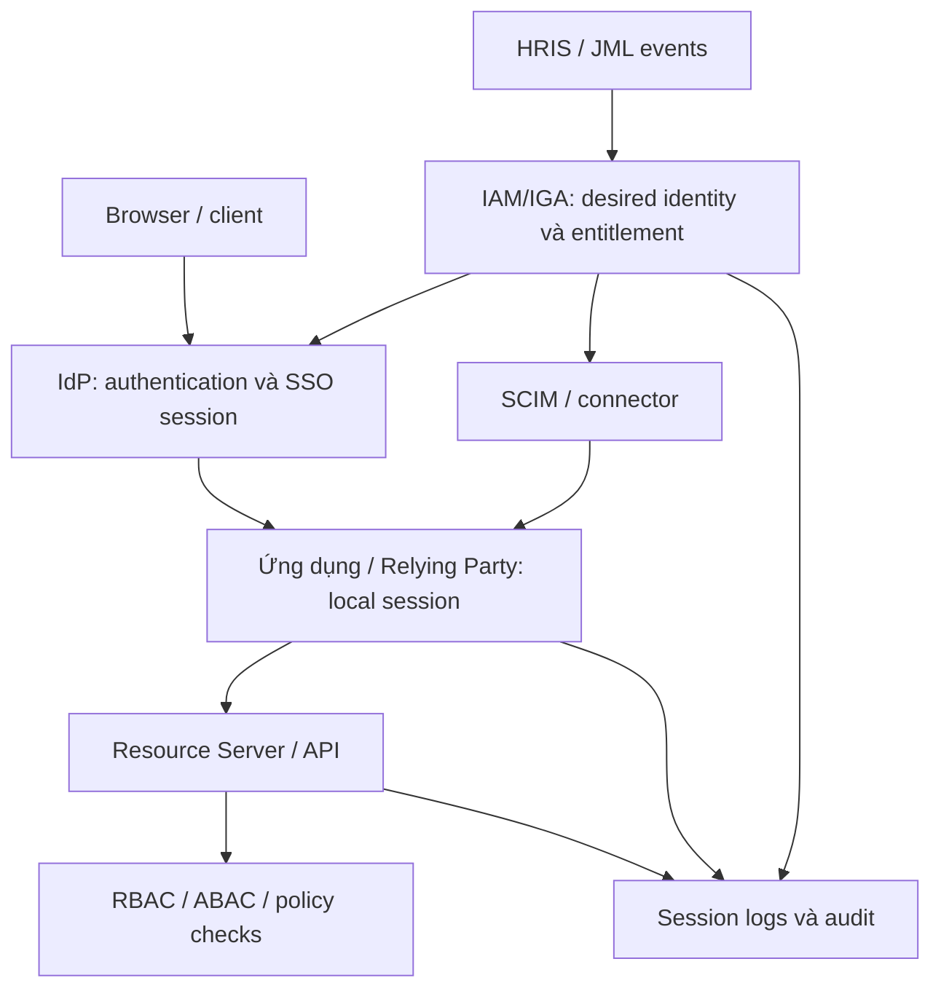
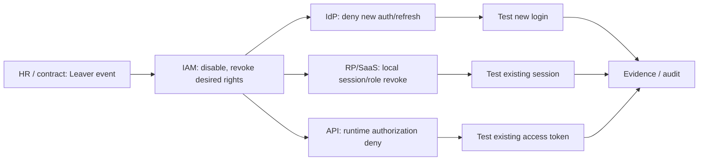

# Kiểm thử session trong IAM Identity Lifecycle

**Kiểm thử session (session testing)** là hoạt động xác minh rằng phiên đăng nhập được tạo, duy trì, giới hạn, gia hạn và chấm dứt đúng chính sách; đồng thời **không còn cho phép truy cập trái phép** khi người dùng đăng xuất, bị khóa, thay đổi quyền hoặc kết thúc quan hệ với tổ chức. Trong **Identity and Access Management (IAM)**, kiểm thử phải bao phủ cả thành phần cấp phiên, ứng dụng nhận phiên và **resource server** thực thi authorization.

Ví dụ, một nhân viên đã nghỉ việc bị vô hiệu hóa tại **Identity Provider (IdP)** nhưng browser vẫn có cookie phiên của ứng dụng ERP. Nếu ERP vẫn cho phê duyệt hóa đơn, quy trình **Leaver** chưa loại bỏ đường truy cập thực tế, dù thao tác disable account tại IdP đã thành công. Bài kiểm thử đúng phải xác minh **request tới ERP bị từ chối**, không dừng ở việc kiểm tra account hiển thị Disabled.

Trong module quản lý vòng đời danh tính theo **Joiner–Mover–Leaver (JML)**, session testing liên kết **IdP, SSO, OAuth/OIDC, SCIM, RBAC/ABAC, tài khoản dịch vụ, account deprovisioning, audit và reconciliation** để giảm quyền truy cập tồn dư.

## 1. Session là gì và kiểm thử điều gì?

**Session** biểu diễn trạng thái tương tác đã được xác thực giữa một client và một hệ thống trong khoảng thời gian nhất định. Triển khai có thể dùng **server-side session ID lưu trong cookie**, cookie chứa trạng thái được ký/mã hóa, hoặc **access token**. SSO còn có thể tạo các phiên khác nhau tại IdP và tại từng ứng dụng.

| Thành phần | Ví dụ | Câu hỏi khi kiểm thử |
| --- | --- | --- |
| **IdP session** | Phiên đăng nhập trung tâm | Đăng xuất/disable tại IdP ảnh hưởng thế nào đến ứng dụng? |
| **Application/RP session** | Cookie phiên ERP | Session bị chấm dứt đúng lúc không? |
| **Session identifier** | Giá trị cookie ngẫu nhiên | Có bảo vệ chống đoán, cố định và đánh cắp không? |
| **Access token** | OAuth bearer token | Có đúng issuer, audience, scope, thời hạn không? |
| **Refresh token** | Credential dùng lấy access token mới | Có rotation, phát hiện reuse và revoke thích hợp không? |
| **CSRF token** | Giá trị bảo vệ request thay đổi trạng thái | Có chống giả mạo request từ site khác không? |
| **Authorization state** | Role, group, ABAC attributes | Quyền mới bị gỡ có còn được chấp nhận qua session cũ không? |
| **Device/session record** | Danh sách phiên đang hoạt động | Có phát hiện và revoke đúng phiên không? |

**ID token OIDC không phải access token cho API**. ID token thường giúp client xác nhận sự kiện đăng nhập; API phải kiểm tra access token hoặc phiên được hỗ trợ cùng authorization tại tài nguyên.

## 2. Mục tiêu an ninh của session testing

Một kế hoạch kiểm thử cần chứng minh:

1. **Tạo phiên đúng:** chỉ identity đã được xác thực và đủ điều kiện mới nhận phiên.
2. **Bảo vệ bí mật phiên:** session ID/token không bị lộ qua URL, log hoặc giao thức không an toàn.
3. **Không bị session fixation:** định danh phiên thay đổi khi chuyển từ chưa xác thực sang đã xác thực hoặc tăng đặc quyền, theo thiết kế.
4. **Quản lý cookie đúng:** thuộc tính bảo vệ và phạm vi cookie phù hợp.
5. **Timeout chính xác:** idle timeout và absolute lifetime được thực thi phía server/issuer.
6. **Refresh có kiểm soát:** token rotation, revoke và reuse detection theo khả năng nền tảng.
7. **Logout có hiệu lực:** phiên mục tiêu không còn truy cập được sau khi kết thúc.
8. **Privilege change có hiệu lực:** quyền đã bị gỡ không còn được sử dụng trái chính sách.
9. **JML có hiệu lực:** Joiner, Mover, Leaver thay đổi khả năng dùng phiên đúng thời điểm.
10. **Bằng chứng kiểm chứng được:** test có request, trạng thái, trace và kết quả authorization.

**Chỉ đóng tab hoặc xóa cookie trên một trình duyệt không chứng minh server đã vô hiệu hóa session.** Cần thử lại bằng bản sao token/cookie được giữ có kiểm soát trong môi trường test.

## 3. Lập ma trận kiểm thử theo vòng đời phiên

| Giai đoạn | Kết quả mong muốn | Negative test |
| --- | --- | --- |
| **Trước đăng nhập** | Protected endpoint từ chối anonymous | Gọi trực tiếp API không cookie/token |
| **Sau xác thực** | Session được tạo cho đúng subject | Tái dùng session ID cố định trước login |
| **Đang hoạt động** | Chỉ cho hành động được cấp phép | Truy cập resource tenant khác |
| **Idle timeout** | Phiên hết hiệu lực sau thời gian không hoạt động | Gọi API bằng cookie cũ |
| **Absolute timeout** | Phiên không sống vô hạn dù có hoạt động | Gửi keepalive liên tục rồi thử sau hạn |
| **Privilege elevation** | Step-up/rotation phù hợp | Dùng phiên cũ làm hành động admin |
| **Logout** | Phiên mục tiêu bị invalidated | Replay cookie/token cũ |
| **Logout all** | Các phiên thuộc phạm vi yêu cầu đều kết thúc | Dùng phiên trên thiết bị thứ hai |
| **Disable/Leaver** | Không còn truy cập ngoài chính sách | Dùng RP session đã tồn tại |
| **Revoked entitlement** | Hành động thuộc quyền cũ bị deny | Dùng token claim role cũ |
| **Compromised session** | Có thể thu hồi và điều tra | Reuse token sau revoke |

Timeout thực tế phụ thuộc ứng dụng và chính sách. **Không áp dụng một con số timeout tùy ý cho mọi tài khoản**; phiên privileged cần kiểm soát nghiêm hơn phiên nghiệp vụ thông thường.

## 4. Các lớp phải kiểm thử end-to-end



IdP có thể tuyên bố account disabled nhưng **ứng dụng vẫn giữ phiên độc lập**, token vẫn chưa hết hạn hoặc API cache entitlement. Do đó phải thử ở ít nhất ba nơi: **đăng nhập mới**, **refresh/tái xác thực** và **hành động API qua phiên đã cấp trước đó**.

Một kết quả trả về HTTP 200 khi mở trang cache không tự chứng minh còn truy cập. Negative test phải gọi **API protected** hoặc thực hiện hành động chỉ có quyền mới cho phép, trên dữ liệu thử nghiệm an toàn.

## 5. Kiểm thử đăng nhập và tạo phiên

Các test cơ bản:

- Truy cập endpoint cần bảo vệ khi chưa đăng nhập phải bị từ chối/điều hướng đúng.
- Chỉ cấp session sau khi authentication hoàn tất, kể cả MFA nếu policy yêu cầu.
- Session mới phải gắn đúng subject/tenant, không dùng identity từ request body do client tự khai.
- Không truyền session ID qua URL, query string hoặc referrer.
- Không gửi secret hoặc token vào response cache công khai và log.
- Nếu dùng server-side session ID, giá trị phải khó dự đoán và không lộ trạng thái quyền.
- Login failure hoặc logout không để một session “nửa xác thực” có quyền đầy đủ.
- Nếu hỗ trợ `remember me`, phải kiểm thử thời hạn và cách thu hồi riêng.

**Session ID khác user ID.** User ID có thể xuất hiện trong dữ liệu nghiệp vụ; session ID/token là credential cần được bảo vệ như bí mật.

## 6. Session fixation và rotation

**Session fixation** xảy ra khi attacker có thể làm nạn nhân sử dụng một định danh phiên mà attacker biết rồi session đó được nâng thành phiên đã xác thực. Kiểm thử mẫu:

1. Khởi tạo một phiên anonymous và ghi lại **session ID A** trong môi trường test.
2. Đăng nhập thành công trong đúng browser/test client.
3. Xác nhận session ID/credential **được thay mới** khi chuyển trạng thái xác thực nếu thiết kế dùng session ID.
4. Thử dùng lại A để gọi protected API: **phải bị từ chối**.
5. Nếu có step-up MFA hoặc nâng quyền admin, kiểm tra rotation/re-authentication tương ứng.
6. Đảm bảo logout chấm dứt session mới.

Với kiến trúc token stateless, cách bảo vệ có thể khác session ID server-side. Mục tiêu vẫn là **không để credential mà người khác có thể cố định trước authentication trở thành bằng chứng truy cập sau authentication**.

Không ghi giá trị session A trong log sản xuất; test chỉ giữ mã định danh băm hoặc tham chiếu an toàn.

## 7. Kiểm thử cookie bảo mật

| Thuộc tính | Ý nghĩa | Bài test |
| --- | --- | --- |
| **Secure** | Cookie chỉ truyền qua kênh HTTPS theo browser | Kiểm tra `Set-Cookie`, thử HTTP không làm lộ credential |
| **HttpOnly** | JavaScript client không đọc được cookie | Kiểm tra thuộc tính; script không đọc được qua `document.cookie` |
| **SameSite** | Hạn chế gửi cookie trong các ngữ cảnh cross-site | Thử hành vi cross-site theo chức năng |
| **Path/Domain** | Giới hạn nơi browser gửi cookie | Xác minh không mở rộng domain/path ngoài nhu cầu |
| **Expires/Max-Age** | Thời hạn lưu phía browser | Xác minh server vẫn thực thi expiration độc lập |
| **Host-only/__Host-** | Giảm phạm vi/khả năng cookie bị ghi bởi subdomain | Kiểm tra prefix và yêu cầu hỗ trợ |

Với cookie có tiền tố `__Host-`, yêu cầu thông thường là **Secure, Path=/ và không có Domain**. Không nên đặt mặc định `Domain=.example.com` cho session nhạy cảm khi chỉ một host cần sử dụng.

**SameSite không thay thế toàn bộ CSRF protection.** Nếu ứng dụng dùng cookie authentication để thay đổi dữ liệu, vẫn cần kiểm tra CSRF token hoặc các biện pháp phòng vệ phù hợp và xác minh `Origin`/`Referer` khi áp dụng.

## 8. Kiểm thử idle timeout và absolute timeout

**Idle timeout** đo khoảng thời gian không có hoạt động hợp lệ; **absolute timeout** giới hạn tổng thời gian sống từ khi cấp hoặc tái xác thực.

```text
T0: login          -> session active
T1: last activity  -> idle timer reset nếu activity hợp lệ
T2: idle limit     -> request mới bị từ chối
T3: absolute limit -> phiên hết hiệu lực bất kể có activity
```

Các bước cần kiểm chứng:

1. Tạo session và ghi thời điểm cấp/last activity từ nguồn quan sát tin cậy.
2. Thử trước thời hạn: request hợp lệ được chấp nhận theo policy.
3. Sau idle timeout: API phải từ chối cookie/session đã quá hạn.
4. Tạo phiên khác, gửi hoạt động trong các khoảng ngắn và thử sau absolute timeout.
5. Kiểm tra các request nền, long polling, websocket heartbeat có làm reset idle timer không; phải theo quy định rõ.
6. Thử đồng hồ lệch, retry, request đồng thời ở ranh giới hết hạn.
7. Kiểm tra backend không chỉ dựa vào expiration của browser cookie.

**Thời gian hiển thị “đăng nhập hết hạn” trên UI không thay cho kiểm tra server-side.** Browser có thể giữ cookie cũ hoặc request khác có thể replay credential.

## 9. Refresh token, access token và rotation

Trong ứng dụng OAuth/OIDC, **access token** và **refresh token** có chức năng khác nhau. Bài test phải phân biệt:

| Tình huống | Kỳ vọng |
| --- | --- |
| Access token đúng issuer/audience/scope và còn hạn | API kiểm tra authorization và có thể cho phép |
| Token hết hạn | API từ chối dù browser vẫn có session tại IdP |
| Token sai audience | Resource server từ chối |
| Token sai issuer/signature | Bị từ chối |
| Token thiếu scope/role | Endpoint đặc quyền bị từ chối |
| Refresh token đã revoke | Không thể đổi lấy access token mới |
| Refresh rotation được bật | Token cũ không thể được dùng lại ngoài chính sách |
| Reuse token đã rotate | Có detection/response theo thiết kế, ví dụ thu hồi token family |
| Client hoặc account bị disable | Không tiếp tục cấp token mới ngoài chính sách |
| Token bị sao chép | Cơ chế sender-constrained token hoặc phát hiện lạm dụng nếu có |

**Rotation không tự động vô hiệu mọi access token còn hạn**. JWT tự chứa có thể được resource server xác minh offline cho tới `exp`, trừ khi có cơ chế kiểm tra trạng thái hoặc từ chối bổ sung. Test phải ghi rõ **cửa sổ rủi ro và SLA thu hồi**.

Không lưu bearer token thật trong CI log, ảnh chụp màn hình, ticket hoặc báo cáo; dùng token test và che giá trị nhạy cảm.

## 10. Logout và logout-all

### Logout một phiên

Kịch bản kiểm thử:

1. Login và lưu một session/token test hợp lệ.
2. Gọi protected API để xác nhận quyền trước logout.
3. Thực hiện logout qua phương thức ứng dụng hỗ trợ.
4. Dùng browser thường truy cập: phải yêu cầu đăng nhập lại nếu không có SSO session cho phép đăng nhập mới.
5. Dùng **bản sao session credential cũ** gọi protected API: phải bị từ chối nếu mục tiêu là invalidation server-side.
6. Nếu token cũ không thể revoke ngay, ghi rõ giới hạn và cơ chế TTL/resource-side denial.

**SSO tự động đăng nhập lại sau local logout** có thể là hành vi dự kiến. Điều phải kiểm tra là **phiên cũ đã bị vô hiệu**, còn phiên mới có thể được tạo hợp lệ từ IdP nếu IdP session vẫn sống.

### Logout tất cả thiết bị

Nếu sản phẩm cung cấp **“Đăng xuất khỏi tất cả thiết bị”**, tạo ít nhất hai phiên độc lập và kiểm tra phạm vi thu hồi của cả hai. Một số nền tảng có độ trễ đồng bộ hoặc không revoke token tự chứa tức thì; cần ghi giới hạn công bố cho người dùng.

## 11. SSO logout: IdP, RP và ứng dụng

SSO giúp người dùng đăng nhập nhiều ứng dụng nhưng tạo ra nhiều ranh giới phiên:

- **IdP session:** phiên với nhà cung cấp danh tính.
- **RP/application session:** phiên cục bộ do ứng dụng quản lý.
- **OAuth access/refresh tokens:** có vòng đời riêng và audience cụ thể.
- **Backend/API sessions:** có thể không phụ thuộc trực tiếp vào browser.

Với OIDC, **RP-Initiated Logout**, **Front-Channel Logout** hoặc **Back-Channel Logout** có thể được triển khai tùy hệ thống hỗ trợ; không mặc định một chuẩn logout được mọi RP thực thi. Với SAML, Single Logout cũng có các giới hạn theo cấu hình và nền tảng.

Một bộ test nên xác nhận **ứng dụng A và B thực sự xử lý logout theo hợp đồng tích hợp**, không giả định “logout IdP” đồng nghĩa mọi RP session đã mất ngay. Nếu back-channel event đến trễ hoặc bị bỏ qua, có thể còn phiên tồn dư; cần alert/reconciliation.

## 12. Kiểm thử Joiner: ngày hiệu lực và xác thực

Trong **Joiner**, account có thể được chuẩn bị trước ngày bắt đầu. Kiểm thử session phải bao gồm:

| Tình huống | Kỳ vọng |
| --- | --- |
| Account đã provision nhưng ngày bắt đầu chưa đến | Không được login/nhận quyền trước thời điểm policy cho phép |
| Identity proofing chưa hoàn tất | Không được cấp session có quyền đặc biệt |
| HR status active và đủ điều kiện | Có thể xác thực theo policy |
| MFA bắt buộc chưa đăng ký | Không được bỏ qua để tạo phiên đặc quyền |
| Birthright role đã gán | Đúng quyền tài nguyên, không vượt tenant |
| Role bổ sung chưa approval | Không thể dùng session để truy cập role đó |
| Account correlation sai người | Không gắn session vào identity khác |

**Provisioning account và tạo session là hai việc khác nhau.** Account đã hiện trong IdP/SCIM chưa có nghĩa phiên phải được phép truy cập ứng dụng ngay.

## 13. Kiểm thử Mover: quyền thay đổi trong phiên cũ

Một **Mover** chuyển từ Finance sang Analytics có thể còn cookie/refresh token tạo trước thay đổi. Nếu ứng dụng dùng role claim cache, session cũ có nguy cơ tiếp tục phê duyệt hóa đơn.

Quy trình test:

1. Gán user test role `invoice-approver`, login và xác minh thao tác thuộc role.
2. Gửi event Mover từ nguồn có thẩm quyền.
3. IAM/connector gỡ role Finance và cấp role Analytics theo policy.
4. **Không đăng xuất client test ngay**: giữ phiên cũ để phát hiện stale authorization.
5. Gọi API `invoice.approve`: phải bị từ chối trong giới hạn enforcement của hệ thống.
6. Kiểm tra API Analytics chỉ được phép sau khi quyền mới có hiệu lực.
7. Kiểm tra token mới không mang quyền Finance nữa.
8. Readback trạng thái role/group ở ứng dụng đích.
9. Xác nhận thời gian mất quyền đúng SLA và ghi audit.

**Mover không đơn thuần cập nhật thuộc tính HR.** Nếu role cũ còn hiệu lực qua session hoặc gán cục bộ, cần xử lý authorization và reconciliation tại ứng dụng.

## 14. Kiểm thử Leaver: chặn đường truy cập đã tồn tại

Leaver là trường hợp đặc biệt quan trọng, vì **không được đợi đến kỳ review sau** mới chặn quyền của người đã nghỉ.



Ma trận cần có:

| Đường truy cập | Sau Leaver cần kiểm chứng |
| --- | --- |
| Đăng nhập IdP mới | Không còn được phép |
| RP session được tạo trước Leaver | Không thể tiếp tục hành động trái policy |
| Refresh token | Không cấp access token mới nếu account không hợp lệ |
| Access token còn hạn | Bị xử lý theo cơ chế thu hồi và SLA đã thiết kế |
| Local role ở SaaS | Đã bị deprovision/disable hoặc runtime deny |
| Account phụ/privileged | Không còn truy cập |
| SSO session ở browser khác | Không thể dùng để khôi phục quyền trái phép |
| Mobile/offline client | Khi kết nối lại bị chặn và đồng bộ trạng thái |
| API key của cá nhân hoặc delegated grant | Được thu hồi nếu không còn căn cứ |
| Audit | Có thời điểm deny thực tế và sai lệch còn tồn |

**SCIM `active=false` không bảo đảm mọi RP session, refresh token hoặc API token mất hiệu lực ngay**. Phải kiểm chứng tại resource server và nêu rõ nơi có giới hạn kỹ thuật.

## 15. RBAC/ABAC, tenant và step-up authorization

Session hợp lệ chỉ chứng minh một lớp trạng thái xác thực; **authorization** còn phải quyết định hành động cụ thể.

Các test cần bao gồm:

- Role reader không thể gọi API writer.
- Subject ở tenant A không được dùng ID tài nguyên tenant B.
- Người có role nhưng không thuộc project không được vượt ABAC project scope.
- Quyền phê duyệt thanh toán phải tuân thủ **Separation of Duties** ở cấp giao dịch.
- Thao tác nhạy cảm yêu cầu **step-up MFA hoặc re-authentication** theo policy.
- Sau giảm role, session cũ không thể giữ quyền đã thu hồi.
- Sau chuyển resource owner, permission phải phản ánh policy hiện hành.
- Token được cấp cho service X không thể dùng với API Y chỉ vì chữ ký hợp lệ.

**Không chỉ kiểm tra UI ẩn nút**: gửi request trực tiếp tới protected backend trong môi trường test, sử dụng dữ liệu và danh tính được phép.

## 16. Kiểm thử session concurrency và quản lý thiết bị

Một số hệ thống cho phép nhiều session đồng thời; hệ thống khác giới hạn số phiên hoặc có chức năng revoke theo thiết bị. Test nên xác minh:

1. Hai browser/device đăng nhập cùng identity tạo hai session phân biệt.
2. Logout một phiên có làm mất phiên kia hay không **đúng chính sách**.
3. Logout-all có hiệu lực với tất cả phiên trong phạm vi công bố.
4. User có thể xem phiên đang active nếu sản phẩm cung cấp tính năng này.
5. Thay password hoặc reset MFA dẫn đến xử lý session theo chính sách, không phỏng đoán.
6. Concurrent login/logout có tạo race khiến phiên đã revoked sống lại không.
7. Các request chạy đồng thời trong lúc logout/revoke được xử lý nhất quán.
8. Giới hạn số phiên, device binding và session list có thực thi phía server không.

Không tự coi “một tài khoản chỉ được có một phiên” là chuẩn chung. Quy tắc phụ thuộc loại ứng dụng, rủi ro và trải nghiệm nghiệp vụ.

## 17. CSRF, XSS và rò rỉ session

### CSRF

Nếu browser tự gửi cookie trong request thay đổi trạng thái, attacker có thể tìm cách khiến nạn nhân gửi request không mong muốn. Thử:

- Request POST/PATCH/DELETE không có CSRF token hoặc không có bằng chứng nguồn hợp lệ.
- Request từ origin không được phép.
- Request dùng cookie hợp lệ nhưng token CSRF của phiên khác.
- Trường hợp SameSite/Lax và điều hướng cross-site theo đúng hành vi browser.
- Endpoint logout, đổi email, đổi MFA hoặc cấp quyền có yêu cầu bảo vệ phù hợp.

### XSS và bảo vệ token

`HttpOnly` giảm nguy cơ JavaScript đọc cookie nhưng **không ngăn mọi tác động của XSS**: script độc hại trên cùng origin có thể gửi request với cookie của browser. Kiểm thử escaping/CSP và quy tắc xử lý nội dung, song không nhầm đây là thay thế session management.

Không lưu bearer access token nhạy cảm vào nơi JavaScript không đáng tin có thể đọc nếu kiến trúc có phương án an toàn hơn.

### Rò qua log/URL

Kiểm tra URL, referrer, response headers, log reverse proxy, lỗi ứng dụng và tracing không vô tình ghi session ID, access token hoặc refresh token. Báo cáo kiểm thử phải che credential; không cần đưa secret thật vào bằng chứng.

## 18. Kiểm thử mạng, API và cache

Session testing phải đánh giá tình huống ngoài luồng browser bình thường:

| Tình huống | Điều phải kiểm tra |
| --- | --- |
| Kết nối mất khi logout | Backend vẫn ghi nhận revoke hoặc client retry an toàn |
| API cache | Dữ liệu nhạy cảm không bị trả cho subject đã mất quyền |
| CDN/reverse proxy | Response private không bị dùng chung ngoài policy |
| WebSocket | Kết nối cũ bị xử lý khi session hết hạn hoặc quyền bị thu hồi |
| Long-running request | Kiểm soát quyền đối với tác vụ dài theo policy |
| Mobile/offline | Khi online lại, trạng thái phiên/quyền được cập nhật |
| Clock skew | Token `nbf`/`exp` được đánh giá với sai số có kiểm soát |
| Multi-region replication | Revoke propagation và giới hạn độ trễ |
| Network retry | Không cấp phiên mới khi event revoke đến muộn |
| Back-channel logout | Message được xác minh, xử lý lặp lại idempotent |

**Một HTTP response 200 từ trang cache không nhất thiết là quyền còn hoạt động**, nhưng dữ liệu nhạy cảm bị phục vụ từ cache cho người không còn quyền vẫn là vấn đề cần xử lý. Test cần tách cache client, CDN và authorization ở origin.

## 19. Session management cho tài khoản dịch vụ

**Service/machine identities** thường không dùng browser session mà có OAuth access token, API key, mTLS certificate hoặc workload token. Kiểm thử vẫn theo nguyên tắc vòng đời credential và quyền:

- Credential không còn hợp lệ không được đổi lấy token mới.
- Token có issuer, audience, scope và expiry đúng.
- Principal bị deprovision không được tiếp tục thực hiện hành động trái policy.
- Rotation key không để key cũ hoạt động vô thời hạn.
- Workload federation trust bị gỡ phải chặn việc đổi assertion lấy token mới.
- Role/ACL của service account được gỡ ở API/database đích.
- Token tự chứa còn hạn phải được quản lý cửa sổ tồn dư theo cơ chế hệ thống.
- Owner nhân sự đã Mover/Leaver không còn quyền lấy secret hoặc kích hoạt job.

**Không gọi một API key tĩnh là session theo đúng nghĩa phiên browser**, nhưng kiểm thử **đường truy cập còn sống sau revoke** có cùng mục tiêu an ninh.

## 20. Mô hình kiểm thử tự động minh họa

Có thể xây test tích hợp sử dụng **test users, test clients, test resource** và clock có thể điều khiển trong môi trường kiểm thử.

```text
test "revoked user session cannot approve invoice":
    user = create_test_identity(role="invoice-approver")
    session = login(user)
    invoice = create_test_invoice(tenant=user.tenant)

    assert api.approve(invoice, session) == ALLOW

    iam.revoke_role(user, "invoice-approver")
    wait_until_authoritative_revoke_propagated()

    assert api.approve(new_test_invoice(user.tenant), session) == DENY

    evidence.record(
        identity_id=user.id,
        session_ref=masked_reference(session),
        event="role-revoked",
        observed_result="DENY"
    )
```

Đây là **giả mã**, không phải cú pháp chạy ngay. Tác vụ `wait_until_authoritative_revoke_propagated` cần có **timeout và SLA rõ**, tránh test treo vô hạn hoặc che một hệ thống quá chậm. Khi cần kiểm tra “chặn tức thời”, phải gửi request ngay sau event và đo độ trễ thực tế.

Các nguyên tắc khi tự động hóa:

1. Tạo danh tính/tài nguyên test riêng, không thao tác lên dữ liệu thật.
2. Dùng một API client không phụ thuộc UI để thử backend authorization.
3. Đặt clock/timer ổn định khi kiểm timeout.
4. Không sleep cố định nếu có thể quan sát trạng thái nguồn và propagation.
5. Che token, cookie và session ID trong assertion/report.
6. Dọn account và session test sau khi chạy.
7. Kiểm tra negative path cùng positive path.
8. Theo dõi kết quả theo application, tenant, policy version và release.

## 21. Ma trận kiểm thử JML và sự kiện đồng thời

| Trường hợp | Expected result |
| --- | --- |
| Joiner chưa đến ngày hiệu lực nhưng account đã có | Không cấp phiên có quyền trước policy |
| Joiner đủ điều kiện + MFA hợp lệ | Tạo session đúng quyền |
| Mover gỡ quyền Finance | Session cũ không tiếp tục duyệt Finance |
| Mover nhận role mới | Chỉ cho phép hành động mới khi đã đủ điều kiện |
| Leaver IdP disable | Không đăng nhập mới và không khôi phục session trái policy |
| Leaver còn RP cookie | Protected ERP operation bị deny trong SLA |
| Refresh token của Leaver | Không cấp token mới |
| Hai phiên cùng identity, revoke all | Cả hai bị xử lý theo tính năng công bố |
| Logout trùng lặp | Không tạo lại session |
| Access token tự chứa chưa hết hạn | Đo cửa sổ tồn dư và resource-side checks |
| Account service bị revoke trust | Không phát token mới theo trust cũ |
| Event Mover và Leaver đến lệch thứ tự | Leaver không bị ghi đè bởi grant cũ |
| Đồng thời cấp quyền và revoke | Không khôi phục quyền không còn căn cứ |
| Session bị đánh cắp trên thiết bị khác | Revoke và cảnh báo theo khả năng thiết kế |

Trong pipeline test, sự kiện IAM có thể bất đồng bộ; cần phân biệt **sự kiện đã nhận**, **connector đã xử lý**, **quyền quan sát đã thay đổi** và **API đã từ chối thực tế**.

## 22. Công cụ và phương pháp quan sát

Các nguồn bằng chứng có thể gồm:

- Browser developer tools để xem cookie attributes **mà không chia sẻ giá trị secret**.
- HTTP test client chạy trong môi trường được phép với test token.
- API integration tests gọi protected endpoints.
- IdP audit logs và thông báo session/logout.
- Application logs về tạo, refresh, revoke và kết thúc phiên.
- Resource server logs về authorization Permit/Deny.
- IAM/IGA provisioning records và SCIM connector results.
- Distributed traces liên kết correlation ID thay vì bearer token.
- Test clock hoặc môi trường rút ngắn TTL để kiểm logic expiration.

Không nên chỉ dựa vào screenshot UI “Bạn đã đăng xuất”. Kết quả mạnh nhất là **một request sử dụng đúng credential cũ bị backend từ chối trong điều kiện được kiểm soát**.

## 23. Audit và chỉ số chất lượng session

Bằng chứng test tối thiểu gồm: **test case ID, identity ID, session reference đã che, IdP/RP, resource/action, policy version, lifecycle event, timestamp, expected/actual outcome và trạng thái remediation**.

| Chỉ số | Cách hiểu |
| --- | --- |
| **Time to deny after Leaver** | Thời gian từ Leaver event đến request cũ bị từ chối |
| **Time to deny after role revoke** | Độ trễ mất quyền sau Mover hoặc access review |
| **Logout invalidation success rate** | Tỷ lệ phiên cũ bị chặn đúng chính sách |
| **Token replay window** | Cửa sổ token cũ còn dùng được |
| **Cross-tenant authorization failures** | Lỗ hổng vượt phạm vi tenant được kiểm thử |
| **Refresh reuse alerts** | Phát hiện refresh token dùng lại trái policy |
| **Session fixation test pass rate** | Định danh phiên được thay khi authentication chuyển trạng thái |
| **Cookie protection coverage** | Tỷ lệ ứng dụng cấu hình cookie đúng |
| **SSO logout propagation latency** | Độ trễ giữa IdP/RP/session target |
| **Residual privileged sessions** | Phiên đặc quyền còn sau revoke hoặc kết thúc incident |
| **Unverified Leaver sessions** | Phiên chưa có bằng chứng từ chối tại đích |
| **Session incident response time** | Thời gian thu hồi và kiểm chứng khi session bị lộ |

**Không ghi session ID, refresh/access token, OTP hoặc cookie thô vào audit**. Giữ tham chiếu đã che, kiểm soát tính toàn vẹn và phân quyền báo cáo.

## 24. Sai lầm phổ biến khi kiểm thử session

| Sai lầm | Vì sao nguy hiểm | Khắc phục |
| --- | --- | --- |
| Chỉ kiểm login thành công | Bỏ sót logout và phiên tồn dư | Thử toàn bộ lifecycle |
| Chỉ xóa cookie phía browser | Server session có thể vẫn active | Replay credential test cũ |
| Cho rằng IdP logout = RP logout | Ứng dụng có phiên độc lập | Test từng RP |
| Chỉ kiểm SCIM `active=false` | Token/role local vẫn có thể dùng | Negative API tests |
| Chỉ xem UI ẩn nút | API trực tiếp vẫn có thể Permit | Thử protected backend |
| Chỉ thử idle timeout | Phiên có thể được duy trì mãi | Thử absolute timeout |
| Nhầm ID token với access token | Kiểm sai lớp authorization | Phân biệt token purpose/audience |
| Không tính cache/group claim | Quyền Mover còn trong session | Test stale role/permission |
| Ghi bearer token vào CI log | Rò credential trong bằng chứng | Mask/redact và dùng test identities |
| Không thử nhiều thiết bị | Logout-all không được xác minh | Test concurrent sessions |
| Chỉ dựa HTTP 200/302 | Cache/redirect che trạng thái thực | Kiểm request protected và tác động |
| Không đo propagation | Không biết thời gian Leaver còn truy cập | Time-to-deny và SLA |
| Test trên account thật | Gây ảnh hưởng quyền và bảo mật | Môi trường test được phép |

## 25. Checklist kiểm thử trước khi release

- [ ] Anonymous không thể gọi protected API.
- [ ] Session mới gắn đúng identity, tenant và auth context.
- [ ] Session identifier được bảo vệ và rotate tại ranh giới xác thực phù hợp.
- [ ] Cookie có `Secure`, `HttpOnly`, `SameSite` và phạm vi đúng theo thiết kế.
- [ ] Không lộ session/token qua URL, log, referrer hoặc cache.
- [ ] Idle timeout được server enforce.
- [ ] Absolute timeout được server enforce.
- [ ] Access token sai issuer/audience/signature/expiry bị từ chối.
- [ ] Refresh rotation/revoke/reuse hoạt động theo policy.
- [ ] Logout vô hiệu phiên cũ theo tính năng công bố.
- [ ] Logout-all được kiểm chứng trên nhiều thiết bị.
- [ ] SSO logout propagation tới từng RP được đo.
- [ ] Request thay đổi trạng thái có bảo vệ CSRF phù hợp.
- [ ] Step-up MFA/reauth hoạt động cho hành động đặc quyền.
- [ ] Mover mất quyền cũ trong SLA, kể cả từ phiên trước sự kiện.
- [ ] Leaver không login/refresh/truy cập bằng session cũ trái chính sách.
- [ ] Service identity bị revoke không cấp token mới hoặc giữ quyền ngoài policy.
- [ ] WebSocket/API cache được kiểm tra theo mô hình quyền.
- [ ] Race condition, duplicate/out-of-order JML event được xử lý.
- [ ] Evidence được che credential và liên kết audit.
- [ ] Có test negative authorization tại resource server.

## 26. Câu hỏi tự kiểm tra

**Tình huống A:** User chọn Logout, browser xóa cookie, nhưng request bằng bản sao cookie cũ vẫn gọi API thành công. Có đạt yêu cầu session invalidation không? **Không**, nếu chức năng cam kết vô hiệu phiên; backend phải xử lý credential cũ hoặc nêu rõ giới hạn cơ chế.

**Tình huống B:** Nhân viên Leaver đã bị disable ở IdP nhưng RP session vẫn phê duyệt hóa đơn. Điều gì còn thiếu? **Thu hồi hoặc kiểm tra authorization tại RP/API**, không chỉ IdP.

**Tình huống C:** Access token có chữ ký hợp lệ nhưng `aud` dành cho API khác. Có được chấp nhận không? **Không.** Resource server phải xác minh audience.

**Tình huống D:** Người dùng Mover mất role Finance, nhưng cookie session chứa claim Finance trước đó. Test đúng là gì? **Gọi API thuộc quyền Finance bằng phiên cũ và xác nhận Deny trong SLA**.

**Tình huống E:** Logout khỏi ERP xong browser lập tức đăng nhập lại qua SSO. Có thể kết luận logout lỗi không? **Không chỉ từ hiện tượng đó.** Cần phân biệt session ERP cũ đã chết và phiên mới được tạo hợp lệ từ IdP.

**Tình huống F:** Một JWT tự chứa còn hạn 5 phút sau khi client secret bị rotate. Có thể cam kết token không dùng được ngay không? **Không nếu chưa có cơ chế revoke/resource-side check.** Phải ghi nhận cửa sổ rủi ro.

**Tình huống G:** Application chỉ ẩn nút Admin khi role bị revoke, nhưng gọi API trực tiếp vẫn thành công. Bảo mật đạt chưa? **Chưa.** Authorization phải thực thi tại backend.

## Ghi nhớ

**Kiểm thử session trong IAM** phải chứng minh phiên được **tạo đúng, bảo vệ đúng, hết hạn đúng và không tiếp tục cung cấp quyền trái chính sách sau logout, Mover, Leaver hoặc revoke**. Cần phân biệt **IdP session, RP session, access token, refresh token, cookie và quyền runtime**; đo **time-to-deny** tại API thay vì chỉ quan sát UI hoặc trạng thái provisioning. Kết hợp **IdP/SSO, OAuth/OIDC, SCIM, RBAC/ABAC, service identity, JML, audit và reconciliation** để phát hiện và loại bỏ **phiên hoặc token còn quyền truy cập tồn dư**.
