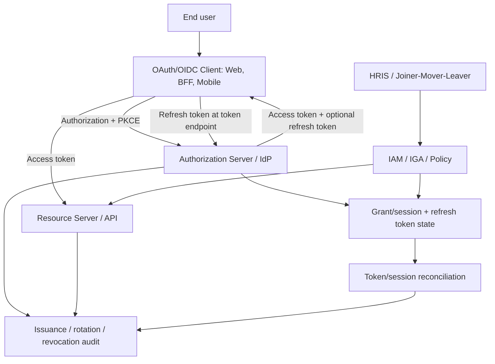
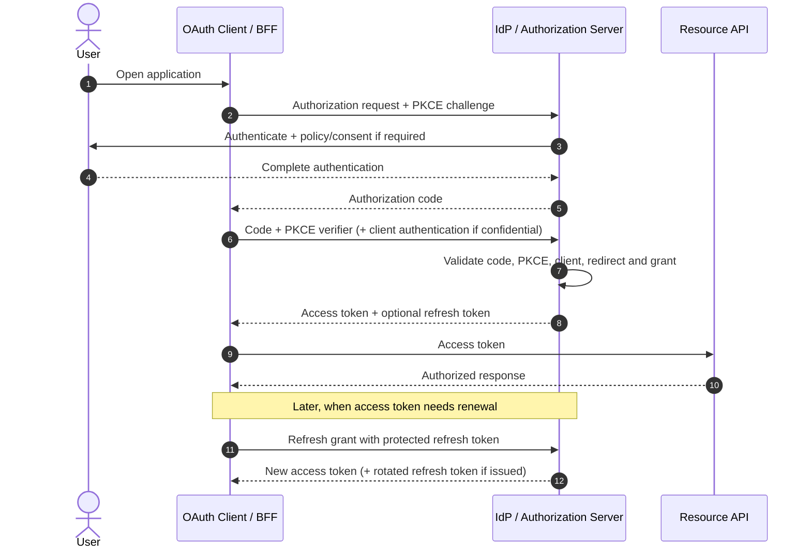
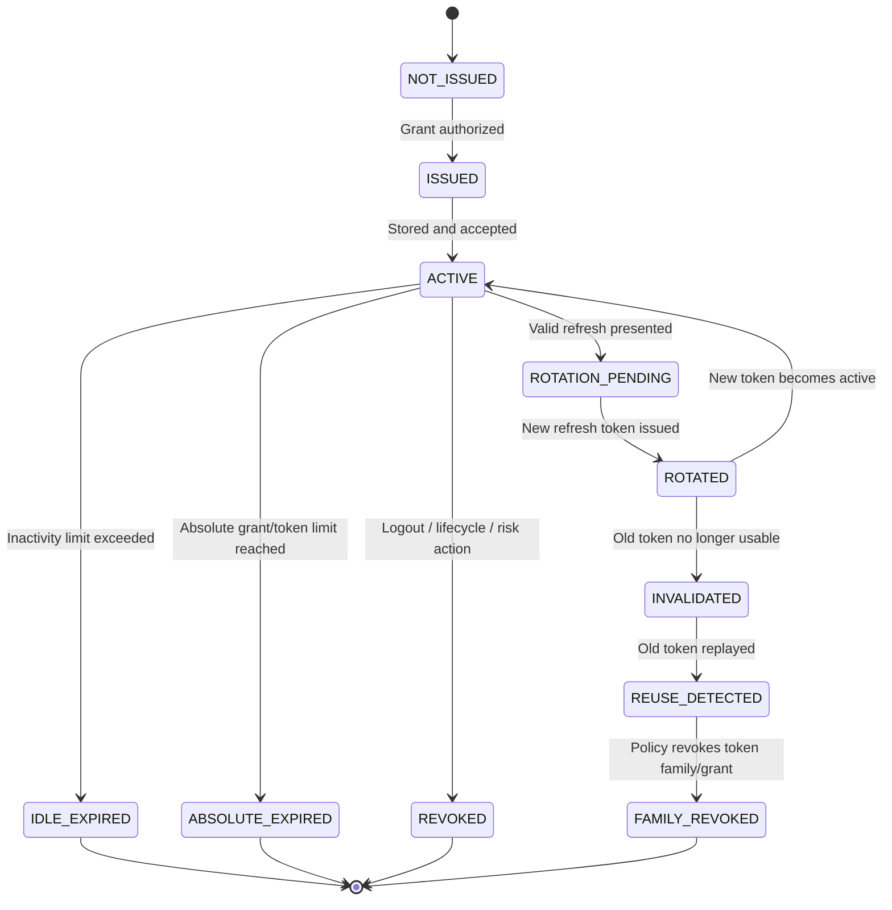
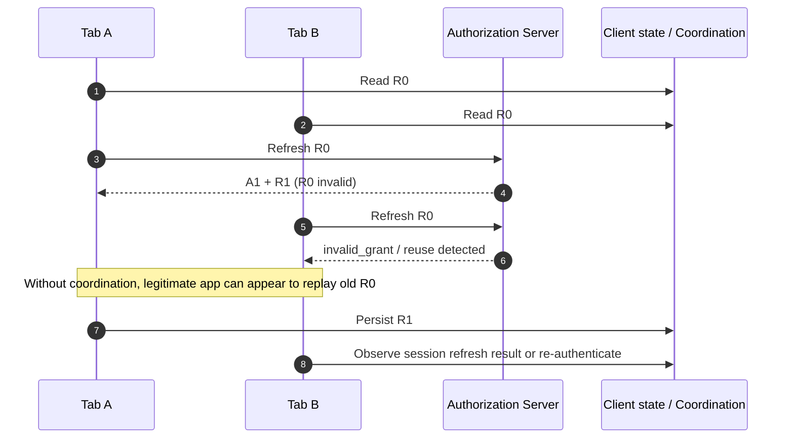

# Refresh token lifecycle trong quản lý vòng đời danh tính IAM

## 1. Refresh token lifecycle là gì?

**Refresh token lifecycle** là toàn bộ quá trình **phát hành, lưu giữ, sử dụng, xoay vòng, gia hạn phiên ủy quyền theo chính sách, hết hạn, thu hồi và kiểm chứng trạng thái** của một refresh token trong hệ sinh thái OAuth 2.0/OIDC.

**Refresh token** là credential mà OAuth **authorization server (AS)** có thể phát cho client để xin **access token mới** khi access token cũ hết hạn hoặc không còn phù hợp, **không yêu cầu người dùng trực tiếp tham gia lại vào từng lần đổi token**. Việc có phát refresh token hay không, nó tồn tại bao lâu và có được rotate hay không phụ thuộc **loại client, chính sách issuer và giao thức áp dụng**.

Ví dụ: Linh đã đăng nhập vào ứng dụng quản lý công việc và cấp quyền `tasks.read`. Ứng dụng nhận access token sống ngắn và refresh token được bảo vệ. Khi access token hết hạn, client gửi refresh token tới **token endpoint**, AS kiểm tra phiên ủy quyền cùng trạng thái hiện hành rồi có thể phát access token mới.

Một vòng đời lành mạnh cần trả lời:

- Ai đã được cấp refresh token: **subject, client, tenant, device/session hoặc grant** nào?
- Refresh token có được cấp và lưu giữ theo đúng loại client?
- Lần refresh có hợp lệ về **client binding, scope, risk, expiration và quyền hiện hành** không?
- Nếu rotate, token cũ đã bị vô hiệu và token mới được lưu thế nào?
- Có phát hiện **stolen-token replay** hay race của request hợp lệ không?
- Sau Logout, Mover, Leaver hoặc account disable, những đường dùng refresh token đã thực sự bị chặn chưa?

**Nguyên tắc trung tâm:** *Refresh thành công* không đồng nghĩa người dùng còn được phép làm mọi hành động trước đây; *revoke refresh token* không tự làm mọi access token hoặc ứng dụng đang mở phiên mất hiệu lực ngay.

## 2. Phân biệt refresh token, access token, ID token và session

| Đối tượng | Dùng ở đâu? | Mục đích | Điểm cần nhớ |
|---|---|---|---|
| **Access token** | Client gửi tới resource server/API | Chứng minh quyền truy cập được cấp cho API | API cần kiểm tra token và authorization đối với resource |
| **Refresh token** | Client gửi tới authorization server token endpoint | Xin access token mới theo grant còn hợp lệ | **Không gửi refresh token tới resource API** |
| **OIDC ID token** | OIDC client | Chuyển thông tin xác thực của end-user tới client | Không dùng làm bearer access token của API |
| **Authorization code** | Client đổi tại token endpoint | Chứng minh hoàn tất authorization flow một lần | Ngắn hạn, một lần, thường kèm PKCE |
| **IdP browser session** | Trình duyệt và IdP | Duy trì đăng nhập tại IdP/SSO | Không phải refresh token |
| **Application session** | Trình duyệt và ứng dụng | Duy trì trạng thái đăng nhập ở ứng dụng | Có thể có vòng đời riêng |
| **Device session/grant** | AS/client theo thiết kế | Gắn quyền đã cấp với thiết bị hoặc instance | Có thể sở hữu refresh token riêng |
| **Service credential** | Machine/workload | Xác thực workload với issuer/target | Không mặc định là refresh token |

### 2.1. Access token thường có tuổi thọ ngắn hơn

Access token thường được cấu hình ngắn hạn để giới hạn cửa sổ lạm dụng nếu bị lộ. Refresh token có thể sống lâu hơn để duy trì trải nghiệm, nên **độ nhạy của refresh token thường rất cao**: attacker có thể xin nhiều access token trong thời gian grant còn hợp lệ.

### 2.2. Refresh token không nhất thiết là JWT

AS có thể dùng **opaque random token**, JWT hoặc định dạng nội bộ. Client nên **coi refresh token là chuỗi opaque**, không suy ra quyền, ngày hết hạn hay subject bằng cách giải mã ở client. Hành vi chính xác do issuer và hợp đồng giao thức quy định.

## 3. Vai trò của refresh token trong IAM và JML

Trong hệ thống IAM, refresh token nằm giữa **quyết định cấp quyền ban đầu** và **quá trình tiếp tục sử dụng quyền**.

- **Joiner:** người dùng sau khi được proofing, tạo tài khoản và phê duyệt quyền có thể đăng nhập và nhận grant phù hợp.
- **Mover:** thay bộ phận, role hoặc project phải ảnh hưởng tới quyền của **access token được phát sau đó**; nếu nguồn quyền đã hết, phải chặn khả năng duy trì grant trái chính sách.
- **Leaver:** khi quan hệ kết thúc, vô hiệu hóa khả năng xin access token mới bằng refresh token là một phần của offboarding.
- **Access request/recertification:** quyết định REVOKE phải dẫn tới quyền thực tế và các token/phiên chịu ảnh hưởng được xử lý theo policy.
- **IdP/SSO:** đăng nhập tại IdP, app session, access token và refresh token có vòng đời **liên quan nhưng không đồng nhất**.
- **SCIM:** đồng bộ User/Group và trạng thái tài khoản; không phải giao thức chuẩn để revoke refresh token.
- **RBAC/ABAC/PBAC:** role và policy phải được áp lại khi cấp hoặc thực thi quyền tùy kiến trúc, tránh privilege creep.

**Không dùng việc refresh token còn tồn tại làm bằng chứng quan hệ công việc hoặc quyền nghiệp vụ vẫn hợp lệ.**

## 4. Thành phần kiến trúc của một refresh token flow



Các đối tượng có nhiệm vụ khác nhau:

| Thành phần | Trách nhiệm |
|---|---|
| **Resource owner / end-user** | Người sở hữu quyền và có thể consent theo flow/policy |
| **OAuth client** | Sử dụng access token và bảo vệ refresh token |
| **Authorization server** | Xác thực client/grant, phát và revoke token |
| **Resource server** | Xác minh access token, kiểm tra authorization ở API |
| **IAM/IGA** | Tính desired entitlements, lifecycle và policy |
| **HRIS/VMS** | Nguồn quan hệ lao động/sponsor có thẩm quyền |
| **Session/token store** | Lưu trạng thái grant, token family và expiry theo thiết kế |
| **Security/Audit** | Phát hiện rủi ro, truy vết và phản ứng sự cố |

**Không mặc định AS và API sử dụng cùng database hoặc mỗi lần API gọi đều tra refresh token store.** Resource server thường không nhìn refresh token.

## 5. Refresh token được phát ở đâu trong Authorization Code + PKCE?

Trong một luồng hiện đại cho ứng dụng có người dùng, client dùng **Authorization Code flow với PKCE** để chứng minh luồng đổi code khớp với người đã bắt đầu yêu cầu.



### 5.1. PKCE có bảo vệ refresh token sau khi cấp không?

**PKCE bảo vệ việc đổi authorization code**, đặc biệt hữu ích với public client. PKCE **không tự bảo vệ refresh token sau khi client đã nhận**. Refresh token vẫn cần lưu giữ, binding, rotation/replay detection hoặc sender-constraining theo thiết kế.

### 5.2. Không phải lần đăng nhập nào cũng có refresh token

AS có thể **không cấp refresh token** dựa trên policy, loại grant, ứng dụng, thời gian, mức rủi ro hoặc thiếu điều kiện. Client phải xử lý trường hợp không có refresh token bằng cách xin authorization lại khi cần, thay vì giả định mọi `token response` luôn có trường này.

## 6. Điều kiện phát hành và consent

Một chính sách phát refresh token cần xác định:

1. **Client registration** hợp lệ và grant type được phép.
2. Loại client: public hay confidential.
3. User/account/grant còn active và được phép truy cập.
4. Scope/resource mà chủ thể được cấp.
5. Authentication assurance và yêu cầu MFA/step-up.
6. Consent hoặc cơ sở ủy quyền theo ứng dụng và policy.
7. Trust của thiết bị, ứng dụng hoặc client instance nếu áp dụng.
8. TTL, inactivity timeout và maximum session duration.
9. Rotation, reuse-detection hoặc sender-constraining strategy.
10. Điều kiện thu hồi theo logout, risk event và lifecycle.

### 6.1. OIDC `offline_access`

Trong OIDC, scope `offline_access` có liên quan đến yêu cầu cấp khả năng truy cập khi end-user không hiện diện, nhưng **không phải một bảo đảm** mọi provider sẽ cấp refresh token. Consent và các điều kiện cụ thể phải tuân theo OIDC specification cùng chính sách của issuer.

### 6.2. Consent khác authorization hiện hành

Người dùng đã consent trong quá khứ không có nghĩa policy hôm nay phải tiếp tục cấp `admin`. AS cần áp các giới hạn current grant và quy định hiện hành; Resource API vẫn kiểm tra quyền thật.

## 7. Public client, confidential client và mô hình bảo vệ

| Loại client | Ví dụ | Đặc trưng khi giữ refresh token |
|---|---|---|
| **Confidential server-side client** | Web backend/BFF | Có thể giữ refresh token trong server-side secure store |
| **Public browser client** | SPA chạy JavaScript | Không có client secret thực sự bí mật; cần cân nhắc XSS, rotation/binding và policy browser |
| **Public native client** | Mobile/desktop app | Có thể dùng OS secure storage/key binding; không nhúng client secret cố định |
| **Device app** | Smart TV/CLI có người dùng | Cần bảo vệ credential trên thiết bị, vòng đời riêng |
| **Service-to-service client** | Daemon/workload | Thường dùng client credentials hoặc workload identity, không mặc định nhận refresh token |

### 7.1. Confidential client cần xác thực khi refresh

Authorization server phải áp cơ chế client authentication phù hợp với client đã đăng ký, ví dụ `client_secret_basic`, `private_key_jwt` hoặc mTLS. Không chấp nhận refresh token của client A bị gửi kèm credential client B.

### 7.2. Public client không thể giữ shared client secret lâu dài

Một client secret hardcoded trong SPA hoặc mobile binary **không trở thành bí mật đáng tin**. Public clients cần được thiết kế với các phương án được issuer hỗ trợ, như PKCE, refresh token rotation hoặc sender-constraining, cùng lưu trữ phù hợp.

## 8. State machine của refresh token và token family



Đây là **mô hình khái niệm**: trong triển khai có rotation, trạng thái `ACTIVE` sau đổi là **token mới** chứ không phải chính token cũ hồi sinh. Việc xử lý reuse, grace window và family revoke tùy policy/provider.

### 8.1. Ba cấp trạng thái khác nhau

- **Individual token:** một token cụ thể hợp lệ, đã dùng, revoked hoặc expired.
- **Token family/grant:** chuỗi rotation thuộc một authorization grant/client/subject.
- **User/application session:** phiên SSO hoặc app có thể tồn tại độc lập với token.

Không chỉ lưu một boolean `isLoggedIn` để suy ra cả ba.

## 9. Refresh token binding: token thuộc về ai?

Một AS nên liên kết refresh token với **grant và client mà nó được cấp cho**, cùng ngữ cảnh policy cần thiết.

| Ràng buộc | Ý nghĩa |
|---|---|
| `issuer_id` | Authorization server phát token |
| `subject_id` | Người dùng/principal được cấp quyền |
| `client_id` | Client đã nhận refresh token |
| `grant_id` | Authorization grant cụ thể |
| `tenant_id` | Phạm vi tổ chức/dữ liệu nếu có |
| `device_or_instance_id` | Ràng buộc phiên/thiết bị khi nền tảng hỗ trợ |
| `approved_scopes` | Phạm vi được consent/phê duyệt |
| `resource_indicators` | Các resource server được phép nếu áp dụng |
| `created_at` / `last_used_at` | Mốc thời gian của grant |
| `absolute_expires_at` / `idle_expires_at` | Giới hạn vòng đời |
| `family_id` / `generation` | Theo dõi rotation/reuse |
| `sender_key_binding` | DPoP/mTLS khi có sender-constraining |

### 9.1. Không dựa duy nhất vào email hoặc username

Email có thể đổi hoặc được tái sử dụng. Token phải gắn với **ID ổn định và grant cụ thể**, không chỉ tên hiển thị. Cần phân biệt tài khoản ở các tenant khác nhau.

### 9.2. Scope mới không được vượt quyền đã cấp

Refresh token không phải cơ chế tự thêm `payments.write` vào grant chỉ vì client gửi scope cao hơn. AS phải kiểm tra scope được yêu cầu là phù hợp grant và policy, thường chỉ cho scope bằng hoặc **hẹp hơn** scope được cấp ban đầu theo quy định giao thức.

## 10. Phát hành token an toàn

Một refresh token nên khó bị đoán hoặc giả mạo, với vòng đời được quản trị.

- Giá trị token có entropy đủ mạnh nếu là bearer token ngẫu nhiên.
- Chỉ cấp qua token endpoint được bảo vệ bằng TLS.
- Không đưa token vào query string, URL, redirect hoặc analytics.
- Liên kết token với client và grant.
- Dùng rotation hoặc sender-constraining phù hợp loại client và risk.
- Lưu trạng thái/token family để xử lý revocation và reuse nếu dùng rotation.
- Thiết lập inactivity và absolute lifetime theo policy.
- Không ghi token raw vào audit/log.
- Không cấp refresh token khi grant hiện hành không hợp lệ.
- Giới hạn rate/abuse tại token endpoint.

### 10.1. Lưu token ở authorization server

AS có thể lưu **hash/HMAC của token opaque** thay cho giá trị plaintext để kiểm tra khi client trình token. Thiết kế chỉ mục, bảo vệ khóa HMAC, rotation của khóa server và so sánh chống timing leak cần được triển khai đúng.

**Không coi việc dùng JWT cho refresh token là lý do bỏ toàn bộ trạng thái server-side** nếu hệ thống cần revoke một grant, phát hiện reuse hoặc disable account ngay.

## 11. Lưu refresh token ở confidential server-side client

Với web backend/BFF, phương án thường dùng là lưu refresh token trong **server-side secret/session store**, để browser không trực tiếp cầm bearer credential dài hạn.

### 11.1. Những yêu cầu quan trọng

1. Chỉ backend được tin cậy truy cập refresh token.
2. Secret store được mã hóa và phân quyền theo app/tenant/session.
3. Token không xuất hiện trong HTML, URL, log, trace hoặc exception.
4. Browser chỉ giữ session cookie được bảo vệ theo thiết kế.
5. Cookie nên có `Secure`, `HttpOnly`, `SameSite` phù hợp và cookie scope hẹp.
6. Có **CSRF protection** khi ứng dụng dựa trên cookies cho action nhạy cảm.
7. Backend serialize/synchronize refresh khi nhiều request cùng session.
8. Logout và session expiry được liên kết tới refresh-token revocation theo policy.
9. Có cơ chế detect/revoke session bị chiếm.
10. Lưu metadata token/rotation mà không hiện plaintext cho support staff.

### 11.2. HttpOnly cookie không làm XSS vô hại

`HttpOnly` ngăn JavaScript đọc trực tiếp cookie, nhưng mã độc chạy trong origin vẫn có thể **gửi request được xác thực** hoặc thực hiện tác vụ trái quyền người dùng nếu ứng dụng không phòng XSS và kiểm tra authorization. Cần CSP, output encoding, input validation, CSRF design và backend checks phù hợp.

## 12. Refresh token trong SPA/browser client

Browser-only SPA là **public client** và không thể giữ bí mật client secret dài hạn. Cách quản lý refresh token phải xét rủi ro JavaScript và hỗ trợ thực tế của authorization server.

### 12.1. Ba kiến trúc thường được cân nhắc

| Kiến trúc | Token ở đâu? | Đánh đổi |
|---|---|---|
| **Backend for Frontend (BFF)** | Refresh token tại backend | Giảm token exposure trong JS, thêm server/session/cookie security |
| **SPA trực tiếp cầm token** | Browser memory hoặc lưu trữ browser | Đơn giản triển khai, nhưng phải bảo vệ trước XSS và token theft |
| **Token-mediating backend** | Backend giữ refresh token, frontend nhận access token theo thiết kế | Cần kiểm soát frontend exposure và backend trust |

Không có lời khuyên “cứ lưu localStorage là đủ”. `localStorage` và `sessionStorage` có thể bị JavaScript cùng origin truy cập; mã độc XSS có thể đọc token ở đó.

### 12.2. Những kiểm soát khi browser nhận refresh token

- Public-client security requirements và AS policy phù hợp.
- Rotation hoặc sender-constraining theo mô hình tin cậy.
- Absolute/inactivity expiry rõ ràng.
- Hạn chế XSS qua CSP, Trusted Types khi hỗ trợ, không dùng mã không tin cậy.
- Không đưa token vào URL hay truyền qua `postMessage` không kiểm origin.
- Không log token tại analytics/error monitoring.
- Xử lý multiple tabs/concurrent refresh.
- Có cách thu hồi grant và bắt người dùng re-auth khi reuse/expiry.

**DPoP không bảo vệ hoàn toàn nếu attacker có thể thực thi JavaScript trong chính origin và dùng khóa ký trong runtime.** Nó giúp hạn chế token bị đánh cắp rồi replay bên ngoài, nhưng không thay XSS controls.

## 13. Native/mobile/desktop client

Với ứng dụng native, nên dùng flow phù hợp như **Authorization Code + PKCE** qua browser/OS authorization session, không nhúng client secret chung trong binary.

### 13.1. Lưu và gắn refresh token

- Ưu tiên secure storage của OS (Keychain/Keystore hoặc cơ chế tương đương).
- Phân biệt user profile và app installation khi có thể.
- Không đồng bộ token sang backup/cloud không được phép.
- Không lưu trong plaintext preferences, clipboard hoặc debug logs.
- Giới hạn token đối với client, audience, scopes và grant.
- Cân nhắc hardware-backed key hoặc sender-constraining khi issuer/client hỗ trợ.
- Xử lý device lost, OS reset, app uninstall và remote session revoke.
- Tránh suy app uninstall đồng nghĩa issuer đã revoke token.

### 13.2. Re-authentication cần là nhánh bình thường

Khi refresh token expired/revoked hoặc device binding không hợp lệ, client phải **xóa credential local và điều hướng sang luồng authorization hợp lệ**, không thử vô hạn với token cũ.

## 14. Refresh grant: HTTP request và response

Một refresh request OAuth 2.0 sử dụng token endpoint với `grant_type=refresh_token`, thường gửi các tham số theo `application/x-www-form-urlencoded`.

Ví dụ với confidential client dùng client authentication (credential đã che):

```http
POST /oauth2/token HTTP/1.1
Host: login.example.org
Authorization: Basic <redacted-client-authentication>
Content-Type: application/x-www-form-urlencoded
Accept: application/json
Cache-Control: no-store

grant_type=refresh_token&refresh_token=<redacted-refresh-token>
```

Phản hồi minh họa của AS có **refresh token rotation**:

```json
{
  "access_token": "<redacted-new-access-token>",
  "token_type": "Bearer",
  "expires_in": 900,
  "scope": "tasks.read",
  "refresh_token": "<redacted-new-refresh-token>"
}
```

### 14.1. Những điểm không được bỏ qua

- Refresh token chỉ gửi tới **token endpoint của đúng AS**, không gửi resource API.
- TLS và client authentication thực thi theo loại client đã đăng ký.
- Không ghi nguyên request body vì chứa refresh token.
- Response cần được kiểm tra status, token type, expiry và metadata phù hợp.
- Khi nhận refresh token mới, client phải **thay token cũ một cách bền vững**, tránh lưu song song ngoài policy.
- Một số AS phát access token mới **nhưng không phát refresh token mới**; client giữ token hiện hành theo hợp đồng, không được giả định mọi refresh đều rotate.
- Client không tự kéo dài grant nếu AS trả `invalid_grant` hoặc yêu cầu đăng nhập lại.

### 14.2. Refresh không phải authorization request

Refresh grant thường diễn ra ở token endpoint **không cần browser redirect** tại thời điểm đó. Nếu cần MFA/consent mới, AS có thể từ chối refresh hoặc yêu cầu flow khác tùy sản phẩm/policy; client cần xử lý bằng interactive authorization khi cần.

## 15. Authorization server kiểm tra gì khi refresh?

Một AS có thể xử lý logic theo thứ tự khái niệm:

1. Xác thực client nếu loại client yêu cầu.
2. Tìm và xác thực refresh token được trình.
3. Kiểm tra token thuộc **đúng client và grant**.
4. Xác minh không bị revoke, expired, reused hoặc vượt giới hạn.
5. Kiểm tra sender-binding (mTLS/DPoP) nếu được áp dụng.
6. Kiểm tra user/client/grant vẫn hợp lệ.
7. Kiểm tra lifecycle, tenant, session, policy và risk event liên quan.
8. Không cấp vượt scope/resource được phép.
9. Tạo access token mới với quyền hợp lệ theo thiết kế.
10. Nếu rotate, **atomically** thay refresh token và vô hiệu token cũ.
11. Ghi event audit metadata và trả response không cache nhạy cảm.

### 15.1. Không tái cấp role đã bị thu hồi

Nếu account của Linh từng có `finance.export` nhưng đã Mover sang team khác, AS/API không được cho refresh giữ quyền cũ trái chính sách. Đặc biệt cần thiết kế rõ **role claims** được tính lại từ nguồn hiện hành hay cache tới thời điểm nào.

### 15.2. Kiểm tra authorization không chỉ tại AS

Ngay cả khi AS phát access token có claim hợp lệ, API phải kiểm tra **resource-level authorization**. Một scope `tasks.read` chưa chắc cho đọc task của tenant hoặc project khác.

## 16. Refresh token rotation là gì?

**Refresh token rotation** là cơ chế phát **refresh token mới** khi client sử dụng refresh token hiện hành thành công, và làm **refresh token vừa dùng mất hiệu lực**.

```mermaid
sequenceDiagram
    autonumber
    participant C as Client
    participant AS as Authorization Server
    participant DB as Grant / Token-family Store
    C->>AS: Refresh using R0
    AS->>DB: Check R0 active and bound to grant/client
    DB-->>AS: Valid generation 0
    AS->>DB: Atomically invalidate R0; register R1
    DB-->>AS: Committed generation 1
    AS-->>C: Access token A1 + refresh token R1
    C->>C: Persist R1 securely, replace R0
    C->>AS: Refresh using R1 later
    AS->>DB: Invalidate R1; register R2
    AS-->>C: Access token A2 + refresh token R2
```

### 16.1. Vì sao rotation hữu ích?

Nếu R0 bị đánh cắp, **hai chủ thể sử dụng cùng R0** hoặc attacker dùng R0 sau khi client đã đổi sang R1, AS có thể nhận ra **reuse of an invalidated token**. Đây là tín hiệu nghi ngờ token theft/replay.

### 16.2. Rotation không ngăn lộ hoàn toàn

Nếu attacker lấy R1 **trước** client hoặc chiếm luôn phiên app, attacker có thể dùng R1 trước. Rotation giúp **giảm replay và phát hiện bất thường**, không đảm bảo không bao giờ bị chiếm quyền.

## 17. Token family, generation và reuse detection

Một AS có thể nhóm chuỗi refresh token thành **token family** thuộc cùng một authorization grant/device/client. Mỗi lần rotation tạo thế hệ mới.

```text
Grant G-201 / Client C-10 / Subject I-1042
    R0 --rotate--> R1 --rotate--> R2 --rotate--> R3
    X              X              X              ACTIVE

X = token đã dùng, không còn được chấp nhận
```

### 17.1. Khi R1 được trình lại sau khi R2 đã phát

AS có thể phát hiện `REUSE_DETECTED`. Theo chính sách bảo vệ, AS có thể **thu hồi cả token family hoặc grant**, buộc client/người dùng authorization lại, bởi AS thường không thể biết chắc yêu cầu nào từ client thật và yêu cầu nào từ attacker.

### 17.2. Phát hiện reuse không chứng minh chắc chắn bị tấn công

Các nguồn `reuse` khác:

- Hai browser tabs refresh đồng thời.
- Hai server instances dùng cùng session store nhưng không lock.
- Mất response sau khi AS đã rotate R0 thành R1.
- Retry HTTP tự động dùng lại R0.
- Mobile app khôi phục state cũ từ backup.

Cần **thiết kế concurrency và recovery** để giảm false positive, nhưng không làm yếu replay detection bằng cách chấp nhận token cũ vô hạn.

## 18. Race condition: hai request cùng refresh

Giả sử user mở hai tabs A/B, cả hai thấy access token sắp hết hạn và cùng đọc refresh token R0.



### 18.1. Cách giảm race ở client

- **Single-flight:** nhiều request cần token mới cùng chờ một refresh operation.
- **Per-session lock:** BFF/server cluster chỉ một refresh cho một grant tại một thời điểm.
- **Atomic compare-and-swap:** chỉ cập nhật refresh token nếu version vẫn đúng.
- **Cross-tab coordination:** browser clients cần cơ chế phối hợp an toàn giữa tabs khi áp dụng.
- **Persist new token before releasing waiters:** không công bố hoàn tất khi R1 chưa lưu an toàn.
- **No blind retry of old token:** tránh biến timeout thành reuse event.

### 18.2. Grace window: đánh đổi bảo mật

Một số provider có thể hỗ trợ **khoảng dung sai ngắn** cho trường hợp mạng/race. Nó phải có giới hạn rõ, được bảo vệ chống replay và không làm token cũ trở thành credential dùng lại lâu dài. **Không giả định mọi authorization server có grace window**.

## 19. Response mất sau khi AS đã rotate: xử lý thế nào?

Một lỗi khó là:

```text
Client sends R0 -> AS validates -> AS invalidates R0 and issues R1
                                      |
                                      +--> Network response lost
Client only has R0; AS considers R0 used
```

### 19.1. Vì sao retry mù nguy hiểm?

Nếu client gửi lại R0, AS có thể coi đó là **reuse** và revoke family. Nếu client tự retry vô hạn, vừa tăng tải vừa không khôi phục được R1.

### 19.2. Chiến lược theo khả năng hệ thống

- Dùng **idempotent refresh protocol/transaction identifier** nếu issuer hỗ trợ một cách an toàn.
- Dùng BFF/session coordinator để giảm request trùng.
- Lưu R1 ngay khi response thành công.
- Trên lỗi không rõ kết quả, kiểm tra trạng thái phiên/token theo API được issuer cung cấp, nếu có.
- Khi không thể khôi phục an toàn, **re-authenticate** thay vì dùng R0 mãi.
- Theo dõi tỷ lệ `invalid_grant` bất thường và phân biệt tấn công với network failure.

**Không tự thiết kế cơ chế trả lại refresh token mới từ một yêu cầu cũ** nếu thiếu ràng buộc client/grant và chống replay.

## 20. Absolute lifetime, idle lifetime và session lifetime

Một refresh token có thể chịu nhiều giới hạn thời gian:

| Giới hạn | Ý nghĩa |
|---|---|
| **Token expiration** | Một giá trị token cụ thể không còn hợp lệ sau hạn |
| **Absolute grant lifetime** | Một authorization grant/token family không được kéo dài quá mốc cố định |
| **Idle/inactivity timeout** | Không có refresh hợp lệ trong khoảng thời gian nhất định thì hết hạn |
| **Device/session lifetime** | Phiên gắn với một thiết bị hoặc client instance có giới hạn riêng |
| **SSO session lifetime** | Phiên đăng nhập IdP có thể kết thúc theo policy độc lập |
| **Access token lifetime** | Access token đã phát không còn được chấp nhận sau hạn |

### 20.1. Rotation có thể làm tăng tuổi đời không?

Tùy chính sách issuer. Một số hệ thống **làm mới idle expiry** khi có refresh hợp lệ nhưng giữ **absolute expiration cố định**. Nếu mỗi lần rotate đều reset absolute limit không giới hạn, user có thể giữ grant lâu vô thời hạn; cần được đánh giá rủi ro và chính sách.

### 20.2. Không lấy TTL chung cho mọi ngữ cảnh

Một ứng dụng payroll, một mobile app thông thường và một phiên admin production có rủi ro khác nhau. TTL, reauthentication, step-up và độ dài phiên cần do **IAM risk policy** định nghĩa, không khẳng định mọi refresh token “phải sống 30 ngày”.

### 20.3. Đồng hồ không đồng bộ

AS cần thời gian đáng tin, resource servers cần xử lý clock skew theo policy. Client nên dựa vào `expires_in` và metadata từ AS để chủ động refresh, không tự quyết định token còn hợp lệ mãi vì local clock sai.

## 21. SSO session, application session và refresh token không đồng nhất

Một người dùng có thể:

- Đã logout khỏi portal nhưng IdP SSO session vẫn sống.
- IdP session hết hạn nhưng app còn refresh token hợp lệ theo policy.
- Refresh token bị revoke nhưng access token hiện tại chưa hết hạn.
- App cookie session bị xóa nhưng token còn trên thiết bị khác.
- Có nhiều device sessions và nhiều token families cho cùng account.

### 21.1. Logout tại một ứng dụng

Tùy kiến trúc, logout có thể:

1. Xóa app session và cookie.
2. Revoke refresh token/grant liên quan.
3. Hủy access token hoặc rút ngắn khả năng tiếp tục dùng.
4. Gọi OIDC logout mechanism nếu được hỗ trợ và cần.
5. Chặn app session mới bằng policy.
6. Không tự logout tất cả thiết bị nếu chỉ yêu cầu logout current device.

### 21.2. Global logout và single logout

**Global sign-out** là nghiệp vụ khác **logout riêng một app/device**. IdP, OIDC front-channel/back-channel logout và SaaS local sessions có cách triển khai/giới hạn khác nhau. Cần định nghĩa **phạm vi chính xác**, không tuyên bố một thao tác đã chấm dứt mọi phiên ngoài khả năng kiểm chứng.

## 22. Những sự kiện nào cần revoke hoặc re-evaluate refresh token?

| Sự kiện | Hành động cần cân nhắc |
|---|---|
| Người dùng logout | Revoke family/current grant theo phạm vi logout |
| Người dùng chọn “logout all devices” | Revoke các grants/device sessions liên quan |
| Password reset sau sự cố | Revoke/re-auth theo security policy, không mặc định mọi issuer làm giống nhau |
| MFA reset hoặc giảm assurance | Đánh giá các grant có yêu cầu MFA/step-up |
| User account disabled | Chặn refresh mới, xử lý access/session theo rủi ro |
| HRIS Leaver | Thu hồi grants phù hợp và quyền target ngay khi hiệu lực |
| Mover thay role/project | Re-evaluate scopes/claims, revoke grant không còn căn cứ |
| Access review quyết định REVOKE | Liên kết remediation tới grants/token nếu quyền phụ thuộc |
| Thiết bị bị mất/compromised | Revoke device-bound grants, sessions và credentials |
| Refresh token reuse detected | Theo policy revoke family và cảnh báo |
| OAuth client secret compromise | Bảo vệ client auth, đánh giá grants/token đã cấp |
| Client bị disable/decommission | Chặn refresh/issuance và thu hồi grants |
| Consent withdrawn | Revoke hoặc giảm grant theo policy |
| Risk anomaly | Bắt buộc reauthentication/step-up, giới hạn token issuance |

### 22.1. Tính chọn lọc quan trọng

Nếu Linh chỉ rời dự án P1 nhưng vẫn thuộc công ty và còn quyền P2, không nhất thiết phải logout khỏi mọi ứng dụng. Tuy nhiên grant có scope P1 không được tiếp tục cấp access token có quyền P1.

### 22.2. Thu hồi phải đúng tenant và grant

Một người có thể dùng cùng client ở nhiều tenant hoặc trên nhiều thiết bị. Cần định danh chính xác **grant/device/tenant** để tránh revoke nhầm hoặc bỏ sót.

## 23. Sender-constrained refresh token: mTLS và DPoP

Refresh token theo mô hình bearer truyền thống có rủi ro: **ai có token có thể dùng** nếu không bị ràng buộc khác. Một hướng giảm replay là **sender-constraining**, yêu cầu bên trình token chứng minh sở hữu khóa/credential liên kết.

### 23.1. Hai mô hình tiêu biểu

- **mTLS sender-constrained tokens:** client chứng minh sở hữu private key của chứng thư đã ràng buộc; issuer/resource server thực thi binding theo giao thức/cấu hình.
- **DPoP (Demonstrating Proof of Possession):** client ký DPoP proof bằng khóa riêng, để AS/API kiểm tra token gắn với public-key thumbprint và request context thích hợp.

### 23.2. Các điểm phải xác minh

| Kiểm soát | Lý do |
|---|---|
| Issuer và client/grant | Token không bị dùng ở AS/client khác |
| Proof signature và public-key binding | Chứng minh possession đúng khóa |
| Method/URI binding | Giảm dùng proof cho request đích khác |
| Time/jti/nonce theo protocol | Giảm replay proof |
| Scope/audience | Không mở rộng quyền tới resource khác |
| TLS/transport trust | Không truyền token qua kênh không bảo vệ |
| Key storage/lifecycle | Attacker không được lấy cả token và private key |

### 23.3. Giới hạn

- DPoP hay mTLS **không thay authorization** ở API.
- Nếu attacker chiếm thiết bị/runtime hoặc có thể sử dụng key signer, token có thể bị lạm dụng.
- Mất/chuyển khóa DPoP có thể khiến refresh token bound cũ không sử dụng được và cần re-auth.
- Rotation của refresh token vẫn có thể hữu ích, nhưng yêu cầu cụ thể tùy security profile và provider.

## 24. Refresh token rotation và sender-constraining phối hợp ra sao?

Có hai hướng giảm replay thường gặp đối với public clients:

1. **Refresh token rotation:** token một lần/chuỗi family, phát hiện reuse.
2. **Sender-constrained refresh token:** chỉ bên có key tương ứng mới có thể trình token hợp lệ.

Theo những yêu cầu bảo mật OAuth hiện đại, **public clients cần cơ chế phát hiện refresh token replay**, sử dụng rotation hoặc sender-constraining phù hợp triển khai.

### 24.1. Không xem hai cơ chế giống nhau

- Rotation nhận ra **cùng token cũ được sử dụng lại**, nhưng không chứng minh ai là attacker.
- Sender-constraining giảm việc dùng token bị copy ở nơi không có private key.
- Có thể kết hợp khi policy/issuer hỗ trợ và lợi ích phù hợp rủi ro.
- Cả hai đều không sửa được **XSS, compromised endpoint hoặc policy cấp quyền quá rộng**.

### 24.2. Tương thích provider

Không phải issuer nào cũng hỗ trợ DPoP, mTLS hoặc rotation theo cùng semantics. Tài liệu triển khai cần xác định rõ **mã lỗi, binding data, key lifecycle và grace policy**, tránh code client dựa trên giả định sai.

## 25. Refresh token revoke khác access token revoke

Khi AS revoke refresh token:

- **Ngăn cấp access token mới** dựa trên refresh token đó theo phạm vi.
- Có thể revoke cả grant/token family theo policy.
- Không bảo đảm **mọi access token đã phát** bị API từ chối tức thời nếu API dùng JWT tự xác minh mà không kiểm tra revocation.
- Không tự đóng mọi app session hay kết nối WebSocket/long-running job.
- Không tự gỡ group/role local trong SaaS.

### 25.1. Cơ chế làm giảm quyền access token cũ

Tùy hệ thống:

- Access token TTL ngắn.
- Token introspection tại resource server (khi dùng opaque token hoặc profile tương ứng).
- Revocation/denylist/authorization version nếu được thiết kế.
- Backend kiểm tra entitlement hiện hành cho action quan trọng.
- Thông báo logout/risk events tới ứng dụng nếu có hỗ trợ.
- Đóng session/connection nhạy cảm ở target.
- SCIM/API revoke role hoặc disable account.

### 25.2. Scope verification

Không đánh dấu `OFFBOARDING_VERIFIED` chỉ vì revoke endpoint trả `200`. Cần nêu cụ thể **grant đã vô hiệu**, **API còn nhận token nào** và **session/role nào chưa kiểm tra được**.

## 26. Thu hồi qua OAuth Token Revocation endpoint

OAuth Token Revocation (RFC 7009) định nghĩa cơ chế client gửi token để yêu cầu revoke tại authorization server khi provider hỗ trợ.

Ví dụ minh họa:

```http
POST /oauth2/revoke HTTP/1.1
Host: login.example.org
Authorization: Basic <redacted-client-authentication>
Content-Type: application/x-www-form-urlencoded
Accept: application/json

token=<redacted-refresh-token>&token_type_hint=refresh_token
```

### 26.1. Những điểm quan trọng

- Sử dụng endpoint do AS công bố/cấu hình, qua TLS và xác thực client theo policy.
- `token_type_hint` là gợi ý, **không phải bảo đảm** AS chắc chắn xử lý token theo kiểu đó.
- Theo hợp đồng revocation, phản hồi thành công có thể được trả cả khi token **đã không hợp lệ**, hạn chế tiết lộ trạng thái token.
- Do đó, HTTP success **không phải bằng chứng đầy đủ về mọi phiên/API access đã chấm dứt**.
- Client phải xóa token local sau logout/revoke theo phạm vi.
- Phân biệt revocation của **refresh token** với **access token** và hiệu lực đối với grant liên quan theo issuer policy.

## 27. Refresh token lifecycle trong Joiner

Quy trình Joiner cho người dùng có thể gồm:

1. HRIS/VMS xác nhận quan hệ và ngày bắt đầu.
2. Identity proofing xác thực danh tính; IAM/IdP tạo account.
3. RBAC/ABAC tính quyền nền và các quyền đặc biệt được duyệt.
4. MFA/step-up được thiết lập tùy rủi ro.
5. Client dùng Authorization Code + PKCE, AS xác thực người dùng và consent/policy.
6. AS cấp access token và **có thể** cấp refresh token cho client hợp lệ.
7. Client lưu refresh token qua cơ chế bảo vệ tương ứng.
8. Resource API xác minh token và permission theo target.
9. IAM/audit theo dõi grant/session và hoạt động refresh.
10. Khi onboarding bị hủy, issuer/IGA phải chặn grant hoặc account phù hợp.

### 27.1. Pre-provision account khác active authorization grant

Một account được tạo trước ngày bắt đầu để chuẩn bị thiết bị/SSO **không tự được phép phát refresh token có scope dữ liệu production** nếu policy chưa cho phép. Phải kiểm tra effective date và grant policy hiện hành.

### 27.2. Login success không thay entitlement verification

Người dùng có thể xác thực thành công nhưng chưa được cấp `finance.read`. Refresh token duy trì khả năng xin access token trong **phạm vi được phép**, không biến tài khoản chưa có quyền thành có quyền.

## 28. Refresh token lifecycle khi Mover

**Mover** là sự kiện nhân viên đổi vai trò, phòng ban, manager, tenant hoặc dự án. Rủi ro là **refresh token tiếp tục xin access token mang quyền cũ** sau khi entitlement không còn căn cứ.

Ví dụ:

```text
Before Mover:
  department = SALES
  role = sales_exporter
  scope = sales.export

After Mover:
  department = FINANCE
  role = finance_reader
  desired scope = finance.read

Risk:
  Old refresh grant still able to mint access tokens
  with sales.export -> RESIDUAL ACCESS
```

### 28.1. Một số chiến lược được phép theo policy

- Revoke refresh grant cũ và yêu cầu authorization lại cho scope/tenant mới.
- Giảm/sửa scope grant theo policy và đảm bảo token mới **không mang role cũ**.
- Dùng current entitlement checks ở AS/resource server để bỏ quyền đã mất.
- Xử lý access token/session đã cấp theo mức rủi ro.
- Kiểm tra gỡ role ở ứng dụng thông qua SCIM/API và reconciliation.

### 28.2. Không xóa quyền còn căn cứ khác

Linh có thể làm song song dự án P1 và P2. Khi P1 kết thúc, policy phải xét **mọi assignment hợp lệ**, chỉ chặn scope P1 đã hết căn cứ; không tự disable toàn bộ danh tính nếu P2 còn hợp lệ.

### 28.3. Test bắt buộc

Sau Mover, token được refresh không được mang permission `sales.export` nếu policy đã thu hồi. Một API không được cho xuất Sales chỉ vì **JWT cũ hoặc role mapping cũ** vẫn tồn tại quá thời gian kiểm soát cho phép.

## 29. Refresh token lifecycle khi Leaver

**Leaver** là sự kiện rủi ro cao vì refresh token còn sống có thể tạo access token mới sau khi người dùng rời tổ chức.

### 29.1. Kịch bản offboarding

1. HRIS/VMS/sponsor phát Leaver có thẩm quyền và thời điểm hiệu lực.
2. IAM/IdP đánh dấu quan hệ/account phù hợp là disabled/suspended.
3. AS chặn khả năng dùng refresh token/grants liên quan theo policy.
4. Hủy hoặc kết thúc IdP session và app sessions khi có cơ chế.
5. Thu hồi/giới hạn access tokens còn hiệu lực tùy kiến trúc.
6. SCIM/API disable/deprovision account và gỡ nhóm/role tại target.
7. Xử lý PAT, API key, SSH key, PAM sessions, local credentials riêng.
8. Reconciliation đọc trạng thái thật ở ứng dụng và token service.
9. Ghi `REVOKED_VERIFIED` theo các đường kiểm chứng; phần không quan sát được phải là `UNVERIFIED` có owner.
10. Audit correlation từ source Leaver event đến token/grant/session/task ở từng target.

### 29.2. Chỉ disable user trong IdP có đủ không?

**Không nhất thiết**. Một AS có thể vẫn chấp nhận refresh token theo phiên cũ nếu không kiểm tra account state; một SaaS có thể duy trì session local; API có thể chấp nhận JWT chưa hết hạn. Cần test thực tế và cấu hình lifecycle hooks.

### 29.3. Không chờ chiến dịch access review

Leaver hợp lệ phải kích hoạt thu hồi theo thời điểm nghiệp vụ, **không đợi kỳ recertification** để quản lý quyết định lại quyền đã hết căn cứ.

## 30. Refresh token với Non-human accounts và service clients

Với **OAuth Client Credentials grant**, client hoạt động **nhân danh chính client**, không có end-user grant tương tác. Theo OAuth 2.0, **refresh token thông thường không nên được cấp** cho client credentials; service thường yêu cầu một access token mới khi cần bằng cách xác thực lại với AS.

### 30.1. Vì sao khác user refresh token?

- Workload có thể lấy token mới bằng **client authentication, mTLS, private_key_jwt hoặc workload identity**.
- Không cần lưu một bearer refresh token dài hạn chỉ để xin token tiếp theo.
- Quản trị **service credential/issuer trust/role** riêng theo vòng đời non-human identity.
- Nếu provider đặc thù có cấp refresh token cho service client, phải kiểm tra profile/hợp đồng riêng, không giả định nó giống end-user flow.

### 30.2. Leaver của service owner

Kỹ sư An nghỉ việc không có nghĩa xóa `svc-report-sync` còn hợp lệ. IAM cần thu hồi **quyền cá nhân của An**, chuyển owner, đánh giá rotation key mà An từng biết và đảm bảo workload identity không được dùng ngoài mục đích.

### 30.3. Service decommission

Khi workload bị retire, phải chặn **new token issuance**, revoke credentials/grants phù hợp và gỡ entitlement tại resource. Tác vụ cấp token/role cũ không được retry rồi phục hồi đường truy cập.

## 31. Java/Spring: xử lý refresh an toàn ở backend

Trong Java, ưu tiên dùng **OAuth client SDK/Spring Security integration được hỗ trợ** thay vì tự dựng OAuth protocol. Tuy vậy, một ứng dụng cần hiểu luồng điều phối để tránh concurrency và log leak.

### 31.1. Mã giả điều phối theo session

```java
// MÃ GIẢ: các interface sau được đặt tên để minh họa.
public final class RefreshCoordinator {
    private final SessionTokenStore store;
    private final OAuthTokenClient tokenClient;
    private final PerSessionLock lock;

    public AccessToken getUsableToken(String sessionId) {
        return lock.withLock(sessionId, () -> {
            TokenRecord record = store.load(sessionId);

            if (record.isRevoked() || record.isPastAbsoluteExpiry()) {
                throw new ReauthenticationRequired();
            }

            if (record.accessTokenStillUsable()) {
                return record.protectedAccessToken();
            }

            RefreshResult refreshed = tokenClient.refresh(
                record.protectedRefreshToken(),
                record.issuer(),
                record.clientId()
            );

            // Compare-and-swap tránh ghi đè R1 bằng R0 từ worker khác.
            boolean saved = store.compareAndSwap(
                sessionId,
                record.version(),
                refreshed.toNewEncryptedRecord()
            );
            if (!saved) {
                throw new ConcurrentRefreshConflict();
            }

            return refreshed.protectedAccessToken();
        });
    }
}
```

**Không phải Java code có thể biên dịch nguyên xi**. Trong triển khai thật:

- Dùng distributed coordination khi nhiều backend instances dùng chung session.
- Làm rõ transaction giữa AS rotation và client store; không có transaction xuyên HTTP một cách tự động.
- Xử lý mất response và `invalid_grant` bằng reauth hoặc recovery do issuer hỗ trợ.
- Bảo vệ secrets, token store keys và database backups.
- Không trả refresh token ra frontend nếu ứng dụng dùng BFF.
- Không retry refresh bằng token cũ sau khi AS đã rotate.

### 31.2. Không dùng raw token làm log key

Sai:

```text
logger.error("Refresh failed for token={}", refreshToken)
```

Đúng hướng:

```text
logger.warn(
  "Refresh denied: sessionRef={}, clientId={}, reasonCode={}",
  sessionReference, clientId, sanitizedReason
)
```

## 32. Lỗi ở token endpoint và hành vi client

| Lỗi/tình huống | Có thể có nghĩa | Phản ứng an toàn |
|---|---|---|
| `invalid_grant` | Token invalid/expired/revoked, wrong client hoặc reuse tùy issuer | Xóa token local, re-auth; không retry vô hạn |
| `invalid_client` | Client authentication thất bại | Kiểm tra client config/secret/key lifecycle, cảnh báo |
| `invalid_scope` | Scope yêu cầu không hợp lệ | Không tự tăng quyền; sửa request/policy |
| `temporarily_unavailable` | AS tạm không sẵn sàng | Retry có giới hạn và backoff |
| HTTP `429` | Bị rate limit | Tôn trọng Retry-After khi có, giảm refresh storm |
| Network timeout | Không biết AS đã rotate hay chưa | Tránh blind retry R0; recovery/re-auth phù hợp |
| New refresh token missing | AS không rotate hoặc không cấp theo policy | Tuân hợp đồng issuer; không giả định lỗi |
| Sender proof mismatch | DPoP/mTLS key binding không khớp | Không bypass; cần khôi phục key/reauthorize |
| Account disabled | Grant không còn được dùng | Chặn refresh, lifecycle remediation |
| Clock skew / token expired | Thời gian hoặc session policy | Kiểm tra clock, không bỏ expiry checks |
| Token family reuse detected | Có thể bị lộ hoặc race hợp lệ | Theo policy revoke family, audit/risk response |

### 32.1. Phân biệt authentication và authorization errors

Một `401` ở API có thể liên quan access token invalid/expired; `403` thường liên quan không đủ quyền theo API. **Không refresh vô hạn để “sửa” `403` do thiếu role**. Resource API phải đưa lỗi theo hợp đồng và client xử lý trạng thái phù hợp.

### 32.2. Refresh storm

Khi nhiều instance đồng loạt thấy token hết hạn, AS có thể bị quá tải. Dùng **single-flight, cache theo session, refresh sớm có jitter, backoff và rate limits**, không tắt token expiry.

## 33. Threat model: refresh token bị đánh cắp

Các đường tấn công phổ biến:

| Kịch bản | Rủi ro | Kiểm soát |
|---|---|---|
| XSS trong SPA | Token/call bị lạm dụng qua origin | CSP, secure design, BFF khi phù hợp |
| Malware trên mobile/desktop | Đọc storage hoặc sử dụng runtime | OS secure storage, device response |
| Token trong log/analytics | Attacker lấy bearer credential | Redaction, secret scanning |
| Token qua URL/query | Lộ qua history, referer, proxy | Chỉ dùng token endpoint/body phù hợp |
| Backup chứa token | Token được restore ngoài ý muốn | Encryption, retention và revoke |
| Compromised backend | Attacker truy xuất session token store | App isolation, KMS, audit, incident response |
| Replay R0 sau rotation | Đánh cắp token family | Reuse detection, family revoke |
| Client impersonation | Refresh token của client A dùng ở B | Bind đúng client, client authentication |
| DPoP/mTLS key theft | Token + key đều bị chiếm | Key protection, device isolation |
| Consent phishing | User cấp grant quá rộng | Consent policy, verified apps, scopes |
| Stale role claim | Quyền cũ tiếp tục dùng sau Mover | Current-policy evaluation, API enforcement |
| Offline grant tồn tại sau Leaver | Xin access token mới trái phép | Lifecycle-triggered revoke |

### 33.1. Rotation và lưu trữ phải phối hợp

Rotation giúp phát hiện reuse, nhưng nếu app lưu R1 trong file debug, attacker vẫn có credential hiện hành. **Không có cơ chế rotation nào bù được toàn bộ lỗi secret handling**.

## 34. Phản ứng sự cố refresh token compromise

Giả sử security team phát hiện refresh token của Linh trong error log production.

### 34.1. Runbook minh họa

1. **Triage:** xác định client, subject, grant/device/session, tenant, scope và thời điểm exposure.
2. **Contain:** revoke token family/grant phù hợp tại AS, không chỉ xóa log.
3. **Re-authentication:** yêu cầu user/device xin authorization lại sau xác minh khi thích hợp.
4. **Access-token containment:** đánh giá access token đã phát, TTL, introspection/denylist và API session.
5. **App sessions:** chấm dứt hoặc cô lập những phiên có rủi ro theo khả năng.
6. **Incident investigation:** xem token issuance/refresh bất thường và API access sử dụng quyền.
7. **Patch leak:** sửa logging, exception handlers, telemetry và retention.
8. **Source check:** xem có token ở Git, ticket, screenshot, crash report hoặc backup không.
9. **Reconciliation:** chứng minh grant không còn đổi token mới, quyền API còn lại được kiểm soát.
10. **Post-incident:** lưu audit và sửa thiết kế storage, rotation, monitoring hoặc device binding.

### 34.2. Không nên in lại token để “kiểm tra”

Không copy refresh token vào chat, ticket, truy vấn analytics hoặc công cụ debug ngoài phạm vi được phép. Ghi **grant/session reference, client ID, token family ID hoặc fingerprint không thể dùng để xác thực** khi cần điều tra.

## 35. Mô hình dữ liệu cho token family và grant

Một hệ thống phát refresh token rotation có thể cần cấu trúc logic:

| Thực thể | Thuộc tính gợi ý |
|---|---|
| **OAuthClient** | client ID, auth method, allowed grants, owner |
| **AuthorizationGrant** | grant ID, subject, client, tenant, scopes, resources |
| **DeviceSession** | session/device ref, login time, idle/absolute expiry |
| **RefreshTokenFamily** | family ID, grant ID, current generation, status |
| **RefreshTokenRecord** | token digest/reference, generation, issued/used/expired/revoked timestamps |
| **AccessTokenRecord** | token ref/jti, audience, scope, expiry nếu lưu trạng thái |
| **SecurityEvent** | reuse, compromised device, Leaver, policy change |
| **RevocationTask** | cause, owner, scope, status, verified evidence |
| **AuditEvent** | actor, transition, correlation, policy version |

### 35.1. Ví dụ metadata (không chứa token thật)

```json
{
  "grant_id": "G-201",
  "family_id": "F-201-A",
  "subject_id": "I-1042",
  "client_id": "tasks-web-bff",
  "tenant_id": "tenant-company",
  "approved_scopes": ["tasks.read"],
  "current_generation": 5,
  "current_token_ref": "opaque-token-digest-ref",
  "family_status": "ACTIVE",
  "issued_at": "2026-11-23T02:00:00Z",
  "last_refresh_at": "2026-11-23T02:15:00Z",
  "idle_expires_at": "2026-12-01T02:15:00Z",
  "absolute_expires_at": "2026-12-23T02:00:00Z",
  "policy_version": "OAUTH-SESSION-V4"
}
```

**Đây là ví dụ thiết kế**, không phải JSON chuẩn OAuth. Không lưu raw refresh token trong audit hoặc để lộ `token_digest` nếu nó có thể dùng như verifier trong hệ thống không được bảo vệ.

### 35.2. Transaction và replay

Server có thể dùng **atomic consume-and-replace** để chỉ một refresh thắng cho token generation hiện hành. Nếu hai request đến cùng lúc, một request phải được xử lý theo **chính sách replay/race rõ ràng**, không phát hai token tiếp nối mâu thuẫn.

## 36. Audit: chứng minh token được cấp, xoay vòng và thu hồi

Audit cần nối được **authorization grant → refresh events → access token issuance → user lifecycle → revocation**.

### 36.1. Những trường nên có

| Trường | Lý do |
|---|---|
| `event_id` / `correlation_id` | Theo dõi một giao dịch |
| `subject_id` / `client_id` | Xác định người và client |
| `grant_id` / `family_id` | Nhóm rotation và revocation |
| `device_session_ref` | Phạm vi thiết bị/phiên nếu có |
| `event_type` | ISSUED, ROTATED, REUSED, REVOKED, EXPIRED |
| `token_generation` | Phiên bản token theo family |
| `issuer_id` / `tenant_id` | Ngăn nhầm nguồn |
| `scope_summary` / `policy_version` | Phạm vi grant |
| `source_jml_event_id` | Liên hệ Joiner/Mover/Leaver |
| `event_time` | Mốc xử lý |
| `result` / `reason_code` | Thông tin lỗi đã làm sạch |
| `verification_ref` | Bằng chứng grant không còn dùng được |

### 36.2. Audit event JSON

```json
{
  "event_id": "TE-2026-0811",
  "event_type": "REFRESH_TOKEN_FAMILY_REVOKED",
  "subject_id": "I-1042",
  "client_id": "tasks-web-bff",
  "grant_id": "G-201",
  "family_id": "F-201-A",
  "tenant_id": "tenant-company",
  "reason_code": "HRIS_LEAVER",
  "source_event_id": "HR-LEAVER-551",
  "policy_version": "OAUTH-SESSION-V4",
  "occurred_at": "2026-11-23T10:00:00Z",
  "result": "GRANT_REVOKED",
  "access_token_followup": "PENDING_TARGET_VERIFICATION"
}
```

### 36.3. Không log raw credentials

Không log refresh/access token, authorization code, client secret, DPoP private key, cookie hay full `Authorization` header. Hạn chế PII và bảo vệ audit bằng quyền truy cập, retention và integrity controls.

## 37. Reconciliation và chỉ số đo token lifecycle

Một chương trình IAM cần kiểm tra **desired session/grant state** với **observed issuance và target access state**.

### 37.1. Các KPI hữu ích

| KPI | Đo gì |
|---|---|
| **Active refresh grants by risk tier** | Bao nhiêu grant còn tồn tại, thuộc client nào |
| **Rotation success rate** | Tỷ lệ refresh đổi token đúng state |
| **Reuse detection rate** | Tần suất token cũ bị trình lại |
| **Suspected false-reuse rate** | Race/retry chính đáng bị coi là replay |
| **Invalid-grant rate** | Mức độ refresh lỗi, phân theo nguyên nhân |
| **Token endpoint latency** | Ảnh hưởng availability |
| **Revocation request-to-effective lag** | Từ quyết định đến chặn refresh mới |
| **Leaver active-grant count** | Bao nhiêu Leaver vẫn còn grant chưa xử lý |
| **Residual access-token window** | Quyền API còn sau grant revoke bao lâu |
| **SSO/application session lag** | Phiên còn sống sau logout/Leaver |
| **High-privilege offline grant count** | Quyền có thể tiếp tục dùng không tương tác |
| **Unknown client/device grant count** | Những grant thiếu owner/trust mapping |
| **Token leak incidents** | Refresh token xuất hiện trong logs/artifacts |
| **Reauthentication failure rate** | Chất lượng UX sau revoked/expired |
| **Revocation verification coverage** | Phần grant/API/session được kiểm chứng |

### 37.2. Không tối ưu bằng cách kéo dài TTL vô hạn

Giảm số lần đăng nhập lại bằng cách cho refresh token sống mãi có thể làm UX tốt tạm thời nhưng **tăng cửa sổ chiếm quyền**. Đo cả bảo mật, độ tin cậy, khối lượng vận hành và UX.

### 37.3. Độ phủ kiểm chứng

Nếu AS có thể chặn refresh nhưng SaaS không có API kiểm tra local session, báo **partial/UNVERIFIED** đối với session scope đó; không khẳng định “logout all devices” đã hoàn tất tuyệt đối.

## 38. Ví dụ xuyên suốt: đăng nhập, Mover và Leaver

Giả sử tổ chức có HRIS, IdP/OIDC, IAM/IGA, một BFF cho ứng dụng công việc và SaaS sử dụng SCIM.

### 38.1. Joiner và initial grant

Nhân viên Linh được HRIS xác nhận active và IAM cấp `tasks.read`. Linh dùng browser đăng nhập qua OIDC Authorization Code + PKCE. BFF lưu refresh token R0 ở server-side encrypted store, browser chỉ giữ secure session cookie.

AS phát access token A0 ngắn hạn. API xác minh audience, expiry, scope và tenant trước khi trả task.

### 38.2. Refresh token rotation

Khi A0 sắp hết hạn, hai API requests cùng cần refresh. BFF dùng **single-flight per session** và chỉ gửi R0 một lần. AS phát A1/R1, vô hiệu R0. BFF atomically lưu R1 rồi phục vụ requests đang chờ.

### 38.3. Mover đổi quyền

Linh chuyển từ dự án P1 sang P2. IAM gỡ `tasks.export:p1` và cấp quyền `tasks.read:p2` theo policy. AS/API không cho refresh tiếp tục mang quyền P1, và nếu grant cũ cần revoke thì yêu cầu authorization lại với phạm vi mới. SCIM/API xử lý role ở target.

### 38.4. Leaver

HRIS xác nhận Leaver hiệu lực lúc 17:00. IAM disable tài khoản, AS revoke các refresh token families liên quan, BFF kết thúc sessions thuộc phạm vi, và đội vận hành xử lý access tokens/local SaaS sessions còn sống theo khả năng.

Một API legacy còn chấp nhận JWT A2 cho tới khi hết TTL. Offboarding ghi rõ **AS grant revoked** nhưng **legacy API effective access still under observation**, không báo VERIFIED toàn bộ.

### 38.5. Bài học

- Refresh token cho trải nghiệm liên tục nhưng **không phải giấy phép truy cập vĩnh viễn**.
- Rotation và single-flight phối hợp ngăn replay/race không cần thiết.
- Mover cần đánh giá lại quyền hiện hành khi phát/kiểm tra token.
- Leaver cần revoke grant **và** kiểm soát access tokens, session, entitlement ở target.
- Audit và reconciliation phải chỉ ra phần nào đã chặn, phần nào chưa chứng minh được.

## 39. Ma trận kiểm thử refresh token lifecycle

| Tình huống | Kết quả mong đợi |
|---|---|
| Client chưa được phép nhận refresh token | AS không cấp token |
| Authorization Code có PKCE verifier sai | Từ chối token exchange |
| Public SPA giả dùng client secret hardcoded | Không được coi là confidential client |
| Confidential client xác thực sai khi refresh | `invalid_client` hoặc lỗi tương đương |
| Refresh token R0 thuộc client A nhưng gửi từ client B | Từ chối |
| Refresh token hết hạn absolute lifetime | `invalid_grant`, yêu cầu re-auth |
| Refresh token hết hạn inactivity | Từ chối theo policy |
| Scope refresh rộng hơn grant | Từ chối hoặc áp scope phù hợp, không elevate |
| Tenant/resource khác grant | Không cấp quyền ngoài phạm vi |
| Refresh token gửi tới resource API | API không nhận làm access token |
| ID token dùng để gọi API | API từ chối theo hợp đồng authz |
| Rotation R0 → R1 | R0 invalid, R1 là token hiện hành |
| Replay R0 sau R1 | Reuse signal và xử lý theo issuer policy |
| Hai tabs dùng R0 đồng thời | Single-flight/cross-tab logic giảm race |
| Hai BFF replicas dùng R0 | Lock/atomic store ngăn xử lý lặp |
| AS rotate thành công nhưng response mất | Không blind retry vô hạn R0 |
| Client chưa kịp lưu R1 thì crash | Recovery/reauth theo issuer policy |
| Provider không trả refresh token mới | Client tuân contract, không giả định rotation |
| Logout one device | Revoke đúng grant/device scope |
| Global logout | Revoke grants và theo dõi các app sessions liên quan |
| IdP session hết hạn, refresh grant còn active | Xử lý theo policy, không suy tự động đồng bộ |
| Refresh grant revoked, access token JWT còn hạn | API behavior và residual window được theo dõi |
| User Mover mất `sales.export` | Token mới/API không cấp lại Sales privilege |
| User Leaver nhưng RT còn được AS nhận | Lifecycle integration test FAIL |
| SCIM disable User nhưng refresh vẫn hoạt động | Phát hiện gap, remediation |
| App session còn sau revoke RT | Không báo fully logged out |
| DPoP proof ký sai key | Từ chối sender-bound request |
| DPoP proof replay | Từ chối theo anti-replay rules |
| mTLS certificate binding không khớp | Từ chối |
| Browser XSS lấy được token | Threat model phải có mitigation |
| Token bị log ở error report | Security test FAIL, incident |
| Token trong localStorage bị đọc bởi injected script | Thiết kế phải nhận diện và giảm exposure |
| Refresh gặp HTTP 429 | Backoff/Retry-After, không tạo storm |
| Client refresh khi API 403 do thiếu role | Không retry vô hạn |
| Device lost | Revoke device-bound grant/session theo khả năng |
| Consent withdrawn | Grant không thể tiếp tục cấp scope bị rút |
| User đổi email | Token binding vẫn dựa ID ổn định |
| User có nhiều hợp đồng hợp lệ | Không revoke sai quyền còn căn cứ |
| Service Client Credentials yêu cầu RT mặc định | Không giả định issuer cấp refresh token |
| Stale grant event tới sau Leaver | Không reissue quyền |
| Refresh token family store race | Atomic consume-and-replace |
| Audit có raw token/secret | Bị coi là lỗi bảo mật |
| Token endpoint unavailable | Bounded retry, safe reauth/fallback |
| Key DPoP mất do device reset | Re-auth hoặc key recovery theo issuer |
| BFF cookie HttpOnly nhưng thiếu CSRF protection | Security review FAIL |
| Revoke endpoint 200 nhưng API vẫn chấp nhận token cũ | Không kết luận effective revocation |
| Target không cho kiểm chứng session | Ghi UNVERIFIED có owner |
| Scope P1 kết thúc nhưng P2 vẫn active | Thu hồi đúng P1, giữ quyền P2 hợp lệ |

## 40. Các sai lầm phổ biến và checklist triển khai

| Sai lầm | Hậu quả | Cách khắc phục |
|---|---|---|
| Coi refresh token là access token | Lộ credential dài hạn tới API | Chỉ gửi RT tới token endpoint |
| Coi ID token là access token | Sai audience/authorization | Sử dụng token đúng mục đích |
| Không bảo vệ RT trong SPA | XSS lấy credential | BFF hoặc browser security controls phù hợp |
| Hardcode client secret trong mobile/SPA | Secret có thể bị trích xuất | Public client + PKCE, cơ chế binding phù hợp |
| Không lưu token mới sau rotation | Client dùng lại token cũ | Atomic persistent replacement |
| Hai tabs refresh cùng R0 | False reuse và logout | Single-flight/coordination |
| Retry R0 vô hạn sau timeout | Reuse detection/family revoke | Idempotent recovery hoặc re-auth |
| Chấp nhận R0 mãi để tránh race | Replay protection mất tác dụng | Grace có kiểm soát nếu issuer hỗ trợ |
| Refresh token không có absolute/idle limit | Grant có thể tồn tại rất lâu | Lifetime policy |
| Revoke RT rồi coi toàn bộ API đã chặn | JWT/session cũ còn hoạt động | Access-token/target follow-up |
| Giữ role claim cũ sau Mover | Privilege creep | Current entitlement evaluation |
| Không revoke refresh token sau Leaver | Tiếp tục xin access token | Lifecycle-driven revocation |
| Đưa RT vào log/URL | Credential exposure | Redaction và transport đúng |
| Dùng `403` để refresh liên tục | Tăng tải, không giải quyết thiếu role | Phân biệt lỗi authn/authz |
| Dùng RT cho daemon client credentials | Secret không cần thiết | Re-auth workload/token issuance |
| DPoP nhưng bỏ XSS protection | Attacker dùng key trong origin | Defense in depth |
| Không đối chiếu client/grant/tenant | Token được dùng sai chủ thể | Proper binding |
| Không kiểm chứng logout scope | Báo cáo offboarding sai | Reconciliation và exceptions |

Checklist trước khi đưa hệ thống vào production:

- **Flow:** dùng Authorization Code + PKCE cho ứng dụng có user khi phù hợp?
- **Client type:** phân biệt confidential, public browser, native và workload?
- **Issuance:** có policy cho consent, scope, client, tenant và risk?
- **Binding:** token thuộc đúng client/grant/device/issuer, không chỉ email?
- **Storage:** không lộ RT ở browser logs, URL, analytics hoặc source code?
- **Expiry:** có absolute lifetime, idle timeout và reauthentication rules?
- **Rotation:** AS/client xử lý one-time replacement, token family và reuse detection?
- **Concurrency:** tránh hai tabs/replicas refresh cùng token cũ?
- **Network failures:** có cách xử lý response loss và `invalid_grant`?
- **Sender-constraining:** DPoP/mTLS nếu dùng đã kiểm tra key binding, replay và lifecycle?
- **Authorization:** access token không vượt scopes, API áp RBAC/ABAC/PBAC hiện hành?
- **JML:** Mover/Leaver làm thay đổi grants/tokens đúng lúc?
- **Revocation:** phân biệt RT, access token, IdP/app session và entitlement?
- **Audit:** có event ID, grant family, reason, timestamps; không log raw credentials?
- **Reconciliation:** có cách kiểm chứng token/grant không cấp tiếp và API access thực tế?
- **Testing:** có negative tests, concurrency/race, stale events và incident drills?
- **Privacy:** bảo vệ user/device/session identifiers và retention?
- **Operations:** SLA, monitoring, rate limits, HA và recovery rõ?

**Kết luận:** quản lý refresh token lifecycle hiệu quả là bảo đảm **đúng client và grant được phép xin access token mới**, token cũ không thể bị replay vô hạn, và những thay đổi danh tính/quyền truy cập được phản ánh trong cả issuance lẫn authorization thực tế. Kết hợp **OAuth 2.0/OIDC, IdP/SSO, IAM/IGA, SCIM, RBAC/ABAC/PBAC, bảo vệ credential, kiểm toán và Joiner–Mover–Leaver** giúp duy trì trải nghiệm đăng nhập liên tục mà không đánh đổi bằng **refresh token tồn dư và quyền truy cập tồn dư**.
