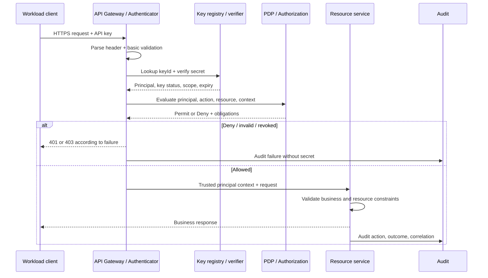
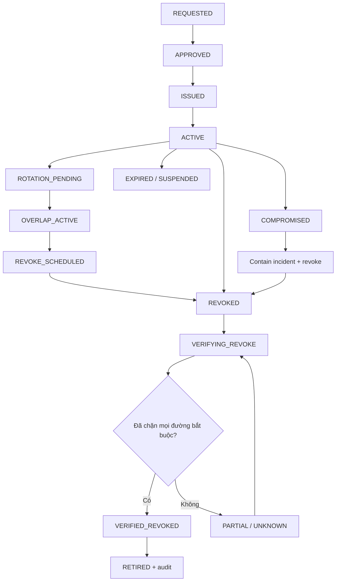

# API key trong IAM: Cấp phát, bảo vệ, sử dụng và thu hồi credential truy cập API

**API key** là một giá trị credential được ứng dụng hoặc dịch vụ gửi kèm yêu cầu API để bên cung cấp dịch vụ có thể **nhận diện và/hoặc xác thực client** theo cơ chế của hệ thống. Thông dụng nhất là **secret API key dạng bearer**: **ai sở hữu giá trị key hợp lệ có thể sử dụng quyền gắn với key**, trừ khi còn các kiểm soát bổ sung như giới hạn nguồn gọi, mTLS, chữ ký yêu cầu hoặc policy tại tài nguyên.

Ví dụ, workload `report-sync-prod` cần ghi dữ liệu tổng hợp vào Reporting API. Hệ thống cấp một API key chỉ có quyền `reports.write` trên tenant `org-17`. Nếu key bị lộ, người sở hữu key có thể cố gửi request dưới danh nghĩa workload đó. Vì vậy, việc cấp key đúng không chỉ là tạo một chuỗi bí mật, mà còn phải quản trị **mục đích, principal sở hữu, nơi lưu, quyền truy cập, thời hạn, mức sử dụng, khả năng thay thế và thu hồi có xác minh**.

Bài thuộc chương **Token và credential** của module `SECURITY_IDENTITY_ACCESS_MANAGEMENT_IDENTITY_LIFECYCLE`. Module tìm hiểu quản lý vòng đời danh tính theo mô hình **Joiner–Mover–Leaver (JML)**: xác minh, tạo tài khoản, cấp quyền, rà soát và thu hồi khi vai trò hoặc quan hệ thay đổi; kết nối **IdP, SSO, SCIM, RBAC/ABAC, tài khoản dịch vụ, kiểm toán và giảm quyền truy cập tồn dư**. Trong ngữ cảnh đó, API key là **credential**, không đồng nhất với human identity hay role và cần vòng đời riêng gắn với workload hoặc chủ thể có trách nhiệm.

Sau bài học, bạn có thể giải thích cơ chế và rủi ro của API key; phân biệt nó với access token, client secret và khóa ký HMAC; thiết kế cấp phát key ngẫu nhiên có đủ entropy; lưu key dưới dạng hash hoặc trong secret manager phù hợp; kiểm soát truyền key, phạm vi quyền và quota; lập quy trình rotation/revocation; xử lý sự cố lộ key; đồng thời đối soát quyền hiệu lực và kiểm toán theo JML.

> **Nguyên tắc quan trọng:** API key là **bằng chứng truy cập theo cơ chế của API**, không phải bằng chứng người dùng cuối đã được phê duyệt thực hiện mọi nghiệp vụ. Authentication bằng API key phải được nối với **authorization** theo action, resource, tenant, trạng thái danh tính và policy hiện hành.

## 1. API key giải quyết nhu cầu nào?

Một API thường cần biết **client nào đang gọi** để:
- Phân biệt ứng dụng A với ứng dụng B.
- Áp quota, giới hạn tốc độ và thống kê sử dụng.
- Quyết định client được gọi endpoint, thao tác hoặc tài nguyên nào.
- Thu hồi quyền khi client không còn hợp lệ.
- Điều tra những request bất thường theo một credential hoặc principal.
- Thu phí/ghi nhận sử dụng theo hợp đồng hoặc sản phẩm nếu có.

Trong một hệ thống đơn giản, API gateway nhận header chứa key, tra bản ghi key và ánh xạ sang client. Ở hệ thống trưởng thành, bước này kết hợp **IAM, role/scope, ABAC, policy engine, audit và credential lifecycle**.

### 1.1. “Biết client nào” khác “client được làm gì”

| Câu hỏi | Lớp xử lý | Ví dụ |
| --- | --- | --- |
| Ai gửi credential? | Credential authentication | Key khớp với `key-7f92` |
| Key thuộc principal nào? | Identity mapping | `report-sync-prod` |
| Principal còn hợp lệ? | Identity/workload lifecycle | Workload ACTIVE, owner còn xác minh được |
| Key còn sử dụng được? | Credential state | ACTIVE, chưa hết hạn, chưa revoke |
| Request này được quyền gì? | Authorization | `reports.write` trên `org-17` |
| Có giới hạn ngữ cảnh? | ABAC/PBAC, network policy | Chỉ production và tenant phù hợp |
| Có vượt tốc độ/quota? | Rate limiting/usage policy | 100 request/phút theo policy minh họa |
| Hành động có hợp lệ nghiệp vụ? | Resource/service PEP | Chỉ ghi báo cáo được phê duyệt |

**Key hợp lệ không có nghĩa mọi endpoint được phép**. Cùng một key có thể chỉ được đọc dữ liệu ở một dự án, không được xóa tài nguyên hay cấp thêm quyền.

## 2. API key là identity, account, token hay credential?

Cần phân biệt rõ:

| Khái niệm | Chức năng | Ví dụ |
| --- | --- | --- |
| **Human identity** | Danh tính của người | Nhân viên `iam-user-1042` |
| **Service/workload identity** | Danh tính ứng dụng/job | `report-sync-prod` |
| **Account/principal** | Đối tượng được target quản lý | `service-principal-883` |
| **API key** | Credential để chứng minh quyền gọi API theo thiết kế | Secret gắn với `keyId=k-008` |
| **Access token** | Credential/ủy quyền truy cập do hệ thống phát hành | OAuth bearer access token |
| **Entitlement/scope** | Permission mà principal/key được phép dùng | `reports.write` |
| **Grant/assignment** | Nguồn cấp permission | Approved request hoặc role |
| **Session/request context** | Thời điểm và môi trường sử dụng | IP, TLS, tenant, request ID |

Một principal có thể giữ **nhiều API key** để tách môi trường, consumer hoặc hỗ trợ rotation. Cũng có hệ thống legacy cấp **một key dùng chung cho nhiều ứng dụng** — tình trạng nên nhận diện là rủi ro cần giảm.

**API key tự nó không phải “người dùng”**. Nếu user Bình yêu cầu backend thực thi thanh toán bằng API key của service, cần xác minh **quyền của Bình và giao dịch**, không coi service account là người phê duyệt độc lập.

### 2.1. API key không có một định dạng chuẩn phổ quát

Có API nhận qua:
- Header riêng như `X-API-Key`.
- Header `Authorization` với scheme do nhà cung cấp định nghĩa.
- Tham số hoặc cơ chế xác thực chuyên biệt của sản phẩm.
- Chữ ký request được tạo từ một secret/key thay vì gửi secret trực tiếp.

**Không suy rằng mọi header `Authorization: Bearer ...` đều chứa OAuth token**, cũng không suy rằng mọi API key đều được truyền như bearer token. Cách sử dụng và đặc tính bảo mật do giao thức/nhà cung cấp định nghĩa.

## 3. Phân biệt API key, OAuth access token và các credential khác

| Loại | Được sử dụng để | Đặc điểm vòng đời | Điểm cần cảnh giác |
| --- | --- | --- | --- |
| **Secret API key** | Xác thực/nhận diện client theo API | Có thể dài hạn hoặc có expiry theo nền tảng | Lộ key có thể bị dùng lại trực tiếp |
| **OAuth access token** | Gọi resource server theo quyền đã được cấp | Thường có hạn, issuer/audience/scope | Token tự chứa có thể còn hiệu lực sau đổi role |
| **OAuth refresh token** | Xin access token mới theo grant | Có chính sách rotation/revocation riêng | Lộ token có thể kéo dài truy cập |
| **OAuth client secret** | Xác thực confidential OAuth client với AS | Có thể rotate/expire | Không nên coi là access token để gọi resource API |
| **ID token (OIDC)** | Truyền thông tin về sự kiện xác thực cho RP | Phụ thuộc OIDC flow | Không dùng thay access token cho API |
| **mTLS certificate/key** | Xác thực kênh hoặc workload | Cert expiry, private key lifecycle | Xác thực không tự cấp mọi quyền nghiệp vụ |
| **HMAC signing secret** | Tạo/kiểm tra MAC cho request | Rotate key và signature verification | Cần canonicalization/timestamp/nonce chống replay |
| **SSH key** | Xác thực tới SSH server | Authorized keys/certificate policy | Không tự quản trị quyền HTTP API |

### 3.1. Khi nào dùng API key, khi nào dùng OAuth?

API key có thể phù hợp khi API cần **client credential đơn giản** và quyền hạn có thể giới hạn rõ; ví dụ tích hợp server-to-server do nhà cung cấp hỗ trợ. OAuth thường hữu ích khi cần **ủy quyền tiêu chuẩn hóa**, token ngắn hạn, nhiều tài nguyên, consent/delegation hoặc policy giữa authorization server và resource server.

Tuy nhiên, **không có quy tắc tuyệt đối API key luôn kém an toàn hơn OAuth**. Một API key có scope hẹp, lưu trong vault, rotation tốt và PEP nghiêm ngặt có thể được quản trị tốt hơn một access token cấu hình quá rộng. Ngược lại, API key dài hạn dùng chung cho mọi dịch vụ là rủi ro cao.

### 3.2. Public/publishable key không giống secret API key

Một số nền tảng có **publishable key** để nhận diện dự án phía client/browser và **secret key** chỉ dùng phía server. Publishable key **không được coi là credential bí mật**; mọi hành động nhạy cảm phải được bảo vệ bởi authorization thực sự phía server.

Không được lấy danh sách cho phép (*allowlist*) domain/referrer làm bằng chứng rằng **secret key có thể nhúng vào JavaScript trình duyệt hoặc ứng dụng di động**. Secret được đóng gói vào client code có thể bị trích xuất.

## 4. API key thường phục vụ những mục đích nào?

| Mục đích | Ví dụ | Điều kiện thiết kế |
| --- | --- | --- |
| Service-to-service | `order-api` gọi `inventory-api` | Principal riêng, action/resource scope |
| SaaS integration | Đồng bộ CRM và helpdesk | Owner, tenant, quyền CRUD chính xác |
| Batch/ETL | Ghi kết quả báo cáo | Dataset, schedule, credential lifecycle |
| CI/CD | Publish artifact hoặc deploy | Tách environment, hạn quyền |
| Monitoring | Đẩy metrics/logs | Key chỉ ghi telemetry theo scope |
| Backup/restore | Ghi bản sao hoặc khôi phục | Tách quyền tạo backup và xóa/restore |
| Partner API | Đối tác gọi endpoint | Scope theo hợp đồng, rate/quota, expiry |
| Automation/robot | Script bảo trì theo job | Không dùng personal key để thay quyền máy |
| Emergency integration | Automation khắc phục sự cố | TTL, kiểm soát bù trừ, hậu kiểm |

**“Dùng cho tích hợp” chưa đủ làm purpose statement.** Cần nêu workload, API, hành động, resource, environment, chủ sở hữu và thời hạn sử dụng.

## 5. Thiết kế chuỗi key: Ngẫu nhiên, không đoán được và có định danh

Với **secret API key dạng bearer**, an toàn phụ thuộc vào việc attacker **không đoán được giá trị bí mật** và server bảo vệ nó suốt vòng đời.

Một thiết kế khả thi:

```text
ak_live_<keyId>.<randomSecret>

ak_live_  : tiền tố nhận diện loại/môi trường, KHÔNG bí mật
<keyId>   : ID công khai dùng tra bản ghi credential
<randomSecret>: chuỗi sinh từ CSPRNG, phải được bảo mật
```

Ví dụ này chỉ **minh họa cấu trúc**, không phải chuẩn API key. Không có giá trị thật nào được cung cấp trong tài liệu.

### 5.1. Độ ngẫu nhiên/entropy

Một secret được sinh từ **32 byte ngẫu nhiên bằng CSPRNG** có tối đa **256 bit entropy**, đủ lớn cho đa số thiết kế secret API key hiện đại. Có thể chọn kích thước khác theo threat model và tiêu chuẩn hệ thống.

Không dùng:
- Username, email, mã nhân viên.
- Timestamp kết hợp counter.
- UUID được tạo theo cách không bảo đảm entropy cho secret.
- `Math.random` hoặc bộ random không phù hợp mục đích mật mã.
- Hash của tên ứng dụng, mật khẩu mặc định hoặc một secret dùng chung.

**Độ dài hiển thị không đồng nghĩa entropy.** Chuỗi base64 dài nhưng tạo từ timestamp dễ đoán vẫn không an toàn.

### 5.2. Key ID không phải secret

`keyId` có thể lưu và hiển thị trong inventory/audit để quản trị. Nhưng nó **không được đủ để xác thực**. Server phải kiểm tra phần secret hoặc bằng chứng mật mã tương ứng.

Nếu dùng prefix để tra nhanh, cần tránh lộ quá nhiều thông tin không cần thiết trong log và tránh coi prefix như phép kiểm tra an toàn đầy đủ.

### 5.3. Ví dụ Java sinh secret

```java
import java.security.SecureRandom;
import java.util.Base64;

public final class ApiKeySecretGenerator {
    private static final SecureRandom RNG = new SecureRandom();

    private ApiKeySecretGenerator() {}

    public static String generateSecret() {
        byte[] bytes = new byte[32]; // 256-bit random secret
        RNG.nextBytes(bytes);

        return Base64.getUrlEncoder()
                .withoutPadding()
                .encodeToString(bytes);
    }
}
```

Đoạn code chỉ minh họa **phần sinh bí mật**. Hệ thống thực còn cần tạo key ID không trùng, liên kết principal và scope, ghi hash, áp hạn sử dụng, audit, chỉ trả secret qua kênh bảo vệ và **không log giá trị trả về**.

## 6. Sinh, cấp phát và hiển thị key lần đầu

Một quy trình cấp key đáng tin nên làm theo thứ tự:

1. Xác minh chủ thể/workload và **owner**.
2. Xác định **purpose**, target, tenant và mức quyền tối thiểu.
3. Kiểm tra approval, SoD, risk tier và chính sách.
4. Sinh secret bằng CSPRNG trong môi trường đáng tin.
5. Lưu **metadata và verifier** để server có thể xác thực, thay vì lưu raw key nếu không bắt buộc.
6. Trả secret cho người/vault được ủy quyền **qua phiên TLS và giao diện bảo vệ**.
7. Ghi audit cấp phát (không có secret).
8. Đặt expiry, rotation/review schedule và cơ chế revoke.
9. Kiểm tra key chỉ gọi được action/resource đã cho phép.
10. Xác nhận principal/owner có kế hoạch thay thế key khi cần.

### 6.1. Chỉ hiển thị một lần

Nhiều dịch vụ hiển thị **secret chỉ tại thời điểm tạo**. Sau đó UI chỉ hiển thị key ID, prefix/last few characters được phép và metadata. Nếu mất, thường tạo key mới rồi revoke key cũ.

**Chỉ hiển thị một lần không tự bảo đảm bí mật chưa bị sao chép**. Client vẫn cần đưa key vào secret manager, giới hạn người xem và không chuyển qua email/chat/log.

### 6.2. Nếu server cần gọi hệ thống ngoài bằng key thì sao?

Có hai mô hình khác nhau:
- **Server nhận key từ client để xác thực:** thường có thể lưu **hash/verifier** thay vì raw key.
- **Ứng dụng là client cần gửi key cho API bên thứ ba:** ứng dụng phải có cách truy xuất secret thật tại runtime; dùng **vault/secret manager có mã hóa, ACL và audit**, không thể chỉ giữ hash để gọi API.

Đừng áp dụng “chỉ hash API key” một cách máy móc cho thành phần cần **sử dụng secret để xác thực outbound**.

## 7. Lưu API key an toàn ở phía server

Với key ngẫu nhiên entropy cao do server **phát hành để xác thực inbound**, có thể lưu bản ghi:

| Trường | Nội dung |
| --- | --- |
| `keyId` | ID không bí mật |
| `principalId` | Workload/client sở hữu |
| `verifierHash` | Hash/HMAC của secret/full key |
| `status` | ACTIVE, REVOKED, EXPIRED |
| `createdAt` | Thời điểm tạo |
| `expiresAt` | Thời điểm hết hạn nếu áp dụng |
| `scopes` | Actions được phép |
| `resourceScopes` | Tenant, project, API resource |
| `lastUsedAt` | Tín hiệu sử dụng cuối cùng, với độ tin cậy |
| `ownerTeamId` | Chủ sở hữu |
| `credentialVersion` | Phiên bản khi rotate/revoke |
| `approvalRef` | Nguồn phê duyệt |
| `rotationGroupId` | Liên kết thế hệ key nếu có |

**Không lưu plaintext API key trong database nếu chỉ cần xác minh**, và không đưa nó vào log, telemetry, metrics label hoặc error response.

### 7.1. Hash cho secret entropy cao

Với key đủ ngẫu nhiên (ví dụ 256 bit), **SHA-256 trên toàn bộ key** có thể là verifier hợp lý vì brute force ngoài mạng không thực tế với entropy này. Một số hệ thống dùng **HMAC với secret phía server** để thêm lớp bảo vệ và quản trị riêng. Cần cân nhắc key ID lookup, database compromise, key hashing migration và khả năng rotate verifier secret.

**Không áp dụng kết luận này cho password do người dùng tự chọn**: password thường có entropy thấp và cần thuật toán password hashing phù hợp (Argon2id/bcrypt/scrypt theo chính sách). API key bí mật do CSPRNG sinh là trường hợp khác.

### 7.2. So sánh hash theo cách hạn chế timing leak

Dùng phép so sánh byte của digest có tính **constant-time** theo API/thư viện, thay vì so sánh chuỗi thông thường nếu threat model cần bảo vệ trước timing leak.

Ví dụ Java đơn giản:

```java
import java.nio.charset.StandardCharsets;
import java.security.MessageDigest;
import java.security.NoSuchAlgorithmException;

public final class ApiKeyVerifier {
    private ApiKeyVerifier() {}

    public static byte[] sha256(String presentedKey) {
        try {
            MessageDigest digest = MessageDigest.getInstance("SHA-256");
            return digest.digest(
                    presentedKey.getBytes(StandardCharsets.UTF_8)
            );
        } catch (NoSuchAlgorithmException e) {
            throw new IllegalStateException("SHA-256 unavailable", e);
        }
    }

    public static boolean matches(
            String presentedKey,
            byte[] storedDigest
    ) {
        byte[] calculated = sha256(presentedKey);
        return MessageDigest.isEqual(calculated, storedDigest);
    }
}
```

**Giới hạn ví dụ:** đây chỉ là hàm kiểm tra digest. Hệ thống thật còn phải **tra đúng keyId**, kiểm tra trạng thái/expiry/scope, chống brute-force, giới hạn kích thước input, không lộ thông tin phân biệt key ID có tồn tại hay không, bảo vệ kênh truyền và áp authorization ở API.

### 7.3. Bảo vệ database/verifier

- Giới hạn quyền đọc/ghi bảng keys.
- Chỉ dịch vụ xác thực được ghi credential state.
- Phân tách quyền cấp key, sửa scopes và thu hồi khi policy yêu cầu.
- Mã hóa at rest và bảo vệ backup theo chính sách.
- Audit thay đổi `status`, principal binding và expiry.
- Tránh để metadata và verifier được xuất hàng loạt không kiểm soát.
- Bảo vệ server-side HMAC/pepper key trong secret manager nếu sử dụng.

## 8. Truyền API key tới server an toàn

Với key secret dạng bearer, cần dùng **HTTPS/TLS** tới endpoint được tin cậy.

Ví dụ một API tự định nghĩa header:

```http
POST /v1/reports HTTP/1.1
Host: api.example.invalid
X-API-Key: <SECRET_FROM_VAULT>
Content-Type: application/json

{"tenantId":"org-17","reportId":"rep-104"}
```

Ví dụ này **không phải key thật** và header `X-API-Key` là tùy chọn triển khai, không phải chuẩn bắt buộc.

### 8.1. Tránh query string và URL

Không truyền key secret kiểu:

```text
https://api.example.invalid/reports?api_key=<SECRET>
```

vì URL có thể xuất hiện trong:
- Access logs và reverse-proxy logs.
- Browser history/referrer.
- Observability/tracing.
- Cache, CDN, monitoring và error reports.
- Chat/ticket khi người dùng dán URL.

Header cũng **không mặc định an toàn nếu hệ thống log headers**. Phải redact/allowlist thông tin được phép ghi và không in raw request trong lỗi production.

### 8.2. Không nhúng secret key vào trình duyệt/mobile client

Static secret nằm trong:
- JavaScript bundle.
- Mobile app binary.
- HTML source.
- Public repository.
- Client-side config tải xuống.

đều có thể bị trích xuất. Nếu client công khai cần gọi một API có quyền nhạy cảm, dùng **backend proxy có authorization phù hợp**, hoặc cơ chế public-client/user delegation do API hỗ trợ. Không lấy CORS/referrer/domain restriction làm ranh giới duy nhất bảo vệ một secret.

### 8.3. Chống chuyển key đến nhầm đích

Client phải:
- Xác minh base URL/hostname và TLS.
- Không tự động chuyển Authorization/key header khi redirect sang host không tin cậy.
- Không gửi key cho logging endpoint, analytics bên thứ ba hoặc webhook không liên quan.
- Giới hạn phạm vi key theo môi trường và resource.
- Dùng allowlisted destination nếu workflow có khả năng gọi URL do dữ liệu đầu vào quyết định.

## 9. Chuỗi xử lý request với API key



Cần phân biệt **authenticator** chứng minh credential với **authorizer** quyết định action. Khi gateway chuyển principal context tới backend, phải bảo vệ khỏi **header spoofing**: backend chỉ tin identity context do gateway được xác thực chuyển qua kết nối tin cậy, không tin header do client tự đặt.

### 9.1. Các trạng thái kiểm tra

Một request có thể bị từ chối vì:
- Không có key.
- Key format sai hoặc quá dài.
- Key ID không tồn tại.
- Verifier không khớp.
- Key bị revoked/disabled.
- Key hết hạn hoặc chưa đến thời gian hiệu lực.
- Principal/workload đã retired/suspended.
- Scope không cho phép action.
- Resource/tenant không khớp.
- ABAC/SoD policy Deny.
- Quota/rate limit vượt giới hạn.

Đừng ghi raw key vào lỗi. Việc thông báo chi tiết cho client tới mức phân biệt key ID có tồn tại có thể tạo **credential enumeration**. Trả response ngắn gọn, audit nội bộ chi tiết bằng event ID an toàn.

## 10. HTTP 401, 403 và 429: Không đánh đồng lỗi

| Tình huống | Mã thường phù hợp | Lưu ý |
| --- | --- | --- |
| Không có/sai/hết hiệu lực credential | `401 Unauthorized` | Cần xử lý phù hợp với authentication scheme của API |
| Đã xác thực nhưng không đủ quyền | `403 Forbidden` | Không tự đổi thành 200 hay grant tự động |
| Vượt rate limit | `429 Too Many Requests` | Có thể dùng `Retry-After` theo policy |
| Tài nguyên không tồn tại/không nên tiết lộ | `404 Not Found` trong một số thiết kế | Không dùng để che lỗi authorization một cách thiếu kiểm soát |
| Backend credential registry lỗi | 5xx hoặc fail closed theo kiến trúc | Không mặc định Permit nếu không kiểm chứng được key |

Không có một HTTP status đủ diễn đạt mọi trạng thái bảo mật. Thiết kế phải nhất quán, tránh tiết lộ thông tin nhạy cảm và hỗ trợ client retry hợp lý.

### 10.1. Retry phải tránh tạo tác dụng kép

Khi gặp lỗi mạng hoặc 429/5xx, client có thể retry. Với request tạo giao dịch, cần **idempotency key** hoặc cơ chế kiểm soát tương đương khi API hỗ trợ; API key xác thực **không tự làm request idempotent**.

## 11. Scope, quyền và tenant isolation

Nếu API key được cấp cho `report-sync-prod`, nên gắn với **chủ thể và hành động chính xác**, không chỉ tên ứng dụng.

Ví dụ:

```yaml
keyId: key-7f92
principalId: report-sync-prod
ownerTeamId: analytics-platform
purpose: Upload approved reports
status: ACTIVE
resourceScopes:
  - reporting-api/org-17
allowedActions:
  - reports.write
expiresAt: "2027-02-01T00:00:00Z"
credentialPolicyRef: api-key-policy-prod-v3
```

**Dữ liệu trên là schema minh họa**, không phải cấu hình được một sản phẩm cụ thể tự động thực thi.

### 11.1. Scope được kiểm ở từng request

Nếu header có key thuộc `org-17` nhưng body chứa `tenantId=org-99`, API phải dựa vào **policy phía server** để từ chối hoặc bỏ qua tenantId không hợp lệ. Không tin giá trị tenant do caller tự đặt.

Các tầng có thể gồm:
- `principalId` và trạng thái account.
- `action=reports.write`.
- `resource.tenantId=org-17`.
- Environment production/staging.
- Kết quả ABAC/PBAC, role và deny.
- Data classification.
- Approval/SoD nghiệp vụ nếu action nhạy cảm.

### 11.2. Một API key không phải chính sách dữ liệu đầy đủ

Một key có quyền gọi `POST /payments/execute` **không đồng nghĩa được duyệt mọi payment**. Backend vẫn phải kiểm tra người tạo, approver, hạn mức, tenant và trạng thái giao dịch khi nghiệp vụ yêu cầu.

## 12. Xây dựng key inventory và ownership

API key nên là thực thể quản trị riêng có thể gắn nhiều credential vào **một principal/workload**.

| Trường inventory | Vì sao cần |
| --- | --- |
| `keyId` | Tra cứu/audit mà không tiết lộ secret |
| `principalId` | Danh tính sở hữu credential |
| `workloadId` | Ứng dụng/job thực sự dùng |
| `ownerTeamId` | Trách nhiệm quản trị |
| `backupOwnerId` | Tiếp quản khi owner thay đổi |
| `purposeId` | Mục đích đã phê duyệt |
| `targetApi` | API/resource server |
| `allowedActions/resourceScopes` | Giới hạn quyền |
| `environment` | Dev/staging/prod |
| `createdAt/expiresAt` | Cửa sổ hiệu lực |
| `lastUsedAt` | Tín hiệu sử dụng, có nguồn và độ tin cậy |
| `status` | ACTIVE, ROTATING, REVOKED, EXPIRED |
| `rotationGroupId` | Các key cùng lineage để rotate |
| `credentialStoreRef` | Vault path hoặc metadata reference cho client |
| `approvalRef` | Bằng chứng phê duyệt |
| `revocationVerifiedAt` | Bằng chứng không còn hiệu lực ở target |

**Không lưu raw key trong inventory**. Nếu API là bên nhận key, có thể lưu hash verifier ở kho xác thực chuyên dụng; nếu client cần gửi key tới provider, lưu secret thật trong vault với quyền truy cập riêng.

### 12.1. Không gắn key lâu dài với một cá nhân tạo ra nó

`createdBy=iam-user-1042` hữu ích cho audit nhưng không phải owner vĩnh viễn. Khi người đó Mover/Leaver, workload có thể vẫn hoạt động. Cần chuyển ownership, đánh giá người đó đã xem key chưa, rotate khi cần và thu hồi quyền của người cũ trên vault/CI/CD.

### 12.2. Mỗi môi trường một credential

Đừng dùng một key cho cả dev và prod. Nếu key dev bị ghi vào debug log hoặc chạy trên máy cá nhân, nó có thể trở thành đường vào production.

Nên tách key theo:
- Environment.
- Workload/service.
- Tenant hoặc resource scope.
- Trust domain.
- Mục đích và mức rủi ro.
- Đơn vị vận hành hoặc đối tác nếu cần quota/thu hồi độc lập.

## 13. Vòng đời API key

Một API key không chỉ có hai trạng thái “hợp lệ/không hợp lệ”. Có thể thiết kế:

| Trạng thái | Ý nghĩa |
| --- | --- |
| `REQUESTED` | Đề nghị cấp key, chưa duyệt |
| `APPROVED` | Scope/purpose và owner đã duyệt |
| `ISSUED` | Secret được sinh và phân phối cho client |
| `ACTIVE` | Được phép xác thực theo policy |
| `ROTATION_PENDING` | Đã lên kế hoạch tạo key thay |
| `OVERLAP_ACTIVE` | Key mới và cũ tạm cùng hợp lệ có kiểm soát |
| `REVOKE_SCHEDULED` | Key cũ có mốc bị thu hồi |
| `REVOKED` | Registry không còn cho xác thực |
| `EXPIRED` | Đã đến hạn expiry |
| `SUSPENDED` | Tạm chặn theo policy/incident |
| `VERIFYING_REVOKE` | Đang đối soát cache/gateway/target |
| `VERIFIED_REVOKED` | Xác minh các đường bắt buộc đã chặn |
| `COMPROMISED` | Đã phát hiện hoặc nghi key bị lộ, mở incident |
| `RETIRED` | Key không dùng nữa, giữ metadata lịch sử theo chính sách |



Đây là state machine **minh họa**. Ở một số hệ thống, `EXPIRED`/`REVOKED` ngay lập tức được kiểm bằng một registry nhất quán; ở hệ thống khác, gateway cache hoặc upstream service có thể trễ nên cần theo dõi riêng.

## 14. Cấp mới API key theo principle of least privilege

Quy trình thực tế:

1. Client/workload được đăng ký với service catalog.
2. Chủ sở hữu xác nhận mục đích và environment.
3. API/resource owner xác nhận resource scope và actions.
4. IAM kiểm tra SoD, abuse risk và credential policy.
5. Sinh key ngẫu nhiên, gắn với principal, hạn sử dụng và version.
6. Chỉ phân phối secret tới hệ thống lưu trữ/consumer được ủy quyền.
7. Kiểm thử:
   - Request hợp lệ trong scope được Permit.
   - Request ngoài scope bị Deny.
   - Key sai/hết hạn bị từ chối.
8. Bật audit, rate limit và cảnh báo.
9. Ghi review/rotation due date, owner và revocation path.

**Không cấp key global admin tạm để “chạy thử cho chắc” rồi quên giảm quyền**. Có thể cấp key staging hoặc hạn quyền JIT với TTL theo policy cho test được duyệt.

### 14.1. Một key dùng cho nhiều tác vụ?

Nếu một key được cả batch và deploy pipeline sử dụng, hai mục đích có thể đòi quyền khác nhau. Việc gộp key gây:
- Blast radius lớn khi key lộ.
- Khó giới hạn action.
- Khó rotation mà không ngắt nhiều consumer.
- Không phân biệt request do workload nào tạo.
- Khó thu hồi độc lập khi một job retired.

Nên cân nhắc **mỗi workload hoặc mục đích một key/principal riêng**, tùy khả năng API và chi phí vận hành.

## 15. Rotation: Thay key mà không để key cũ tồn tại vô hạn

**API key rotation** là quá trình phát hành credential mới, chuyển consumers, thu hồi credential cũ và xác minh hoàn tất.

### 15.1. Quy trình an toàn

1. **Lập inventory:** những service/job nào đang dùng key cũ?
2. Kiểm tra owner, scope và approval còn hợp lệ.
3. Sinh key mới **độc lập về ngẫu nhiên**; không suy từ key cũ.
4. Tạo key mới có permission tối thiểu, cùng hoặc hẹp hơn phạm vi được phê duyệt.
5. Lưu key mới trong vault/secret manager và cập nhật consumer có kiểm soát.
6. Kiểm thử consumer gọi API đúng action/resource.
7. Theo dõi key cũ còn được sử dụng ở đâu.
8. Thu hồi key cũ khi consumers đã chuyển hoặc đến hạn bảo mật bắt buộc.
9. Readback status/gateway và xác minh key cũ **không còn gọi API được**.
10. Ghi audit và cập nhật rotation timestamp/next due.

### 15.2. Khoảng overlap

Một thời gian hai key cùng active có thể giúp thay đổi không gián đoạn. Nhưng **overlap cần ngắn, có lý do, owner và deadline**. Không để trạng thái `OVERLAP_ACTIVE` kéo dài nhiều tháng vì không biết consumer nào chưa chuyển.

Nếu **key đã bị lộ**, không nên kéo dài overlap chỉ để tránh downtime như trong rotation thông thường. Cần containment và thu hồi theo mức rủi ro, phối hợp khôi phục consumer hợp lệ.

### 15.3. Không đổi secret mà giữ nguyên key ID nếu hệ thống không hỗ trợ

Thiết kế rotation phụ thuộc registry. Nên có **key ID/version riêng** cho thế hệ mới để audit biết request sử dụng credential nào. Nếu provider chỉ hỗ trợ một key, cần kế hoạch cutover/maintenance phù hợp, không tự giả định có thể chạy song song.

### 15.4. Ví dụ timeline

```text
Ngày 01 09:00  Tạo key-202 (replacement), key-101 vẫn active.
Ngày 01 09:10  Deploy consumer A dùng key-202.
Ngày 01 09:20  Deploy consumer B dùng key-202.
Ngày 01 09:30  Quan sát key-101 không còn usage (nếu telemetry đủ).
Ngày 01 09:35  Revoke key-101.
Ngày 01 09:36  Readback registry/GW: key-101 REVOKED.
Ngày 01 09:37  Kiểm thử xác thực bằng key-101 bị từ chối.
Ngày 01 09:40  Mark VERIFIED_ROTATED.
```

“Không còn usage” là **tín hiệu hỗ trợ**, không tự chứng minh mọi consumer đã chuyển nếu log không đầy đủ hoặc có job cuối tháng.

## 16. Expiry và tự động chặn key quá hạn

Không phải API nào cũng hỗ trợ expiry giống nhau; hệ thống tự thiết kế key registry nên có chính sách rõ.

- Key có thể được cấp **hạn cố định** cho integration.
- Key một lần hoặc short-lived cho tác vụ ngắn.
- Partner key có thể gắn với thời hạn hợp đồng.
- CI/CD key có thể được thay bằng short-lived federation.
- Emergency key nên có điều kiện kích hoạt và hậu kiểm đặc biệt.

**Không có một TTL chuẩn áp dụng cho mọi môi trường.** Thiết lập dựa trên risk tier, khả năng rotation, tần suất job và khả năng hồi phục.

### 16.1. Kiểm tra expiry theo thời gian đáng tin

Server phải kiểm tra `notBefore`, `expiresAt` và trạng thái key bằng đồng hồ/nguồn thời gian tin cậy; không tin timestamp do client tự gửi để kéo dài hạn.

### 16.2. Expired khác revoked

- **EXPIRED:** key vượt thời hạn hợp lệ.
- **REVOKED:** key bị thu hồi chủ động.
- **SUSPENDED:** key bị tạm khóa.
- **DELETED metadata:** record không còn trong registry; vẫn cần audit/tombstone.

Cả ba trạng thái đầu đều có thể phải từ chối xác thực, nhưng **nguyên nhân và bằng chứng kiểm toán khác nhau**.

## 17. Revocation: Thu hồi key phải có hiệu lực tại nơi nhận request

Quy trình thu hồi:

1. Xác định key ID và principal/workload liên quan.
2. Xác minh người yêu cầu hoặc sự kiện có thẩm quyền.
3. Đặt key không còn hợp lệ ở registry/authorization server/gateway.
4. Xóa/disable secret trong client vault hoặc cập nhật reference nếu cần.
5. Invalidate cache/replica hoặc dùng TTL cache phù hợp với SLA.
6. Kiểm tra các gateway, region và endpoint đang nhận key.
7. Với key có thể đổi thành session/token khác, **xử lý session/token được phát sinh** theo nền tảng.
8. Xác minh request dùng key cũ bị từ chối ở đường quan trọng.
9. Ghi `revocationRequestedAt`, `appliedAt`, `verifiedAt`.
10. Theo dõi finding nếu còn đường truy cập tồn dư.

### 17.1. Đừng nhầm “revoke key” với “revoke tất cả token đã được cấp”

Nếu client dùng API key để **xin một access token thứ cấp**, revoke key không mặc nhiên làm token thứ cấp hết hiệu lực. Cần biết kiến trúc:
- API key trực tiếp dùng mỗi request?
- Key chỉ dùng để bootstrap session?
- Key trao đổi lấy JWT/STS token?
- Backend cache decision bao lâu?

Với quyền nhạy cảm, thu hồi cần xem cả **khả năng tiếp tục truy cập qua token/session trước đó**.

### 17.2. Status từ connector chưa phải bằng chứng cuối

Khi API trả 202 Accepted, request revoke có thể đang xử lý async. Khi timeout, đích có thể đã áp lệnh. Do đó:
- Kiểm tra idempotency.
- Đọc lại trạng thái target.
- Không retry mù quáng hoặc tạo thêm grant.
- Đánh dấu `PENDING_VERIFICATION/UNKNOWN` khi chưa có evidence.

### 17.3. Không xóa lịch sử ngay sau revoke

Giữ metadata cần thiết cho audit: key ID, principal, owner, purpose, scope, thời điểm, lý do và evidence đã chặn. Không giữ secret thô. Thời hạn retention theo chính sách/pháp lý.

## 18. Lộ API key: Nhận diện, containment, rotation và điều tra

Các nguồn lộ thường gặp:
- Public/private Git repository hoặc commit history.
- CI/CD log, test report, exception stack trace.
- Ticket/chat/email hoặc screenshot chia sẻ.
- Browser/mobile bundle.
- Container image/layer hoặc cấu hình deploy.
- Environment dump hoặc crash report.
- Proxy/WAF/API gateway log ghi header.
- Backup hoặc analytics không kiểm soát.
- Máy developer, laptop hoặc build runner bị compromise.

### 18.1. Quy trình ứng phó

1. **Xác định key ID** mà không lan truyền secret qua công cụ mới.
2. Phân loại môi trường, scope và rủi ro (prod/admin/PII/finance).
3. Revoke/chặn key theo ưu tiên; với key rủi ro cao, không trì hoãn vì cutover thông thường.
4. Phát hành key thay có quyền bằng hoặc hẹp hơn mức cần thiết.
5. Cập nhật secret manager và consumers an toàn.
6. Kiểm tra lịch sử request, nguồn IP, user agent, resource, action, outcome và anomalies.
7. Xác minh key cũ bị từ chối; kiểm tra token/session dẫn xuất nếu có.
8. Xử lý nguyên nhân gốc: logging, repo scan, build config, quyền vault, pipeline.
9. Ghi incident, owner, impact, thời gian và remediation evidence.
10. Review grant scope, rotation cadence và quy trình bảo vệ secret.

**Không chỉ xóa dòng chứa secret khỏi commit mới nhất**: key đã có thể bị sao chép qua log, cache, fork hoặc backup. Cần **vô hiệu credential tại hệ thống nhận**, rồi làm sạch bản sao theo quy trình xử lý dữ liệu phù hợp.

### 18.2. Key leak không đồng nghĩa chắc chắn bị lạm dụng

Phát hiện key trong repo là bằng chứng **exposure**. Chưa có log sử dụng bất thường không chứng minh key chưa bị dùng, vì telemetry có thể không đầy đủ. Nên ghi **mức độ chắc chắn và độ phủ log**, không tự kết luận an toàn hoặc kết luận tội phạm.

### 18.3. Redaction

Logs nên ghi `keyId`, `principalId` và correlation ID, **không log full key**. Nếu phải hiển thị một dấu hiệu nhận diện, nên dùng fingerprint/ID không bí mật có kiểm soát, không đưa những đoạn secret dài vào thông báo lỗi.

## 19. Rate limiting, quota và phát hiện abuse

API key thường được dùng làm một chiều trong cơ chế:
- Rate limit theo principal/key/tenant.
- Daily/monthly quota.
- Hạn concurrency.
- Theo dõi chi phí/usage.
- Phát hiện request bất thường theo action/resource.
- Tạm khóa khi có dấu hiệu abuse.
- Phát hiện key được sử dụng đồng thời từ nhiều nơi ngoài mô hình deployment.

### 19.1. Đừng coi rate limit là quyền truy cập

Một key vượt quota có thể bị 429, nhưng khi chưa vượt quota vẫn phải **authorize action** theo scope. Quota không thay thế RBAC/ABAC/SoD.

### 19.2. Giới hạn theo nhiều chiều

Nếu nhiều key cùng thuộc một principal, giới hạn **chỉ theo key** có thể bị lách bằng cách tạo thêm key. Có thể cần áp song song:
- Per key.
- Per principal/workload.
- Per tenant/customer.
- Per API/action có rủi ro.
- Per IP hoặc network khi phù hợp.
- Global safety limits.

Các mức giới hạn phải thiết kế theo nhu cầu và khả năng hạ tầng, không ấn định một số request chuẩn cho mọi dịch vụ.

### 19.3. Key enumeration và brute force

Dù key ngẫu nhiên rất khó đoán, endpoint xác thực vẫn cần:
- Giới hạn kích thước input và request rate.
- Trả lỗi chung cho key không tồn tại/sai.
- Không lộ metadata chủ sở hữu trong response lỗi.
- Phát hiện các key ID bị thử liên tục.
- Kiểm soát log để không ghi secret attacker gửi.
- Bảo vệ dịch vụ lookup/verifier khỏi DoS.

## 20. IP allowlist, referrer và những kiểm soát bù trừ

Một số API cho cấu hình:
- IP allowlist.
- Source network restriction.
- Domain/referrer restriction.
- Hạn thời gian.
- mTLS.
- HMAC request signing.
- Device/workload attestation hoặc policy bổ sung.

**Giới hạn IP không biến bearer key thành bằng chứng danh tính mạnh tuyệt đối**: nhiều workload cùng NAT, IP có thể thay đổi và một attacker trong mạng được phép vẫn có thể sử dụng key.

**Referrer/CORS không nên là kiểm soát duy nhất cho secret key**. Referrer không phải bí mật; CORS chủ yếu là cơ chế trình duyệt, không ngăn mọi client HTTP khác.

Các kiểm soát bù trừ tăng độ an toàn khi được thiết kế phù hợp, nhưng không thay **entropy, secret storage, least privilege, expiry và revocation**.

## 21. API key dạng bearer và HMAC-signed request

**Bearer API key:** secret được gửi để server kiểm tra; ai có secret có thể tái sử dụng, trừ các kiểm soát khác.

**HMAC-signed request:** client dùng secret để tạo message authentication code (MAC) cho dữ liệu request đã được canonicalize. Server tính lại MAC và so sánh. Secret có thể **không cần gửi trực tiếp trên mỗi request**, nhưng server vẫn phải quản trị shared secret.

### 21.1. HMAC giải quyết vấn đề nào?

- Xác nhận message được tạo bởi bên giữ shared secret.
- Phát hiện thay đổi những phần request nằm trong chuỗi dữ liệu được ký.
- Có thể kết hợp timestamp/nonce để giảm replay.

### 21.2. Những điểm dễ sai

| Thiếu sót | Rủi ro |
| --- | --- |
| Không ký body hoặc method/path cần bảo vệ | Thay đổi nội dung ngoài vùng được MAC |
| Canonicalization client/server khác nhau | Lỗi xác minh hoặc bypass |
| Không kiểm tra timestamp | Request cũ có thể bị phát lại |
| Không dùng nonce/idempotency phù hợp | Replay trong cửa sổ thời gian |
| Dùng thuật toán/mode tự chế | Rủi ro mật mã |
| Log signing secret | Mất giá trị của HMAC |
| Không giới hạn action/resource | Request ký đúng vẫn có thể vượt quyền |
| Không version key | Khó rotation và revoke |

**HMAC không tự cung cấp non-repudiation** như chữ ký bất đối xứng có thể làm trong một số bối cảnh, vì hai phía cùng biết secret. Không gọi mọi MAC là chữ ký số.

### 21.3. Pseudocode xác minh HMAC

```text
verifySignedRequest(request):
    keyRecord = lookupByKeyId(request.keyId)
    require(keyRecord is ACTIVE and not expired)

    require(request.timestamp within allowedWindow)
    require(nonceNotPreviouslyAccepted(
        keyRecord.keyId, request.nonce, request.timestamp
    ))

    canonical = canonicalizeExactProtectedFields(
        method, path, query, selectedHeaders, bodyHash,
        timestamp, nonce
    )

    expectedMac = HMAC(keyRecord.secret, canonical)
    require(constantTimeEqual(expectedMac, request.mac))
    atomicallyRecordNonceAsUsed()

    principal = keyRecord.principal
    require(authorize(principal, request.action, request.resource))
    executeRequest()
```

Đây là **giả mã minh họa**. Việc lưu nonce/replay window phải có tính nhất quán và chịu được xử lý song song; canonicalization phải được định nghĩa chính xác, dựa trên thiết kế được đánh giá bảo mật. Không tự xây protocol signing khi có chuẩn/giao thức do provider hỗ trợ.

## 22. Webhook signing secret không nên bị lẫn với API key

Một webhook provider có thể ký payload bằng shared secret để **bên nhận kiểm tra thông điệp**. Đây là hướng xác thực **ngược** so với API key mà client gửi khi gọi API.

| API key | Webhook signing secret |
| --- | --- |
| Consumer dùng credential gọi API | Provider ký event; consumer xác minh |
| Quyết định client được quyền gọi resource | Xác minh nguồn gốc và tính toàn vẹn event |
| Scope/role/quota quan trọng | Canonical payload/timestamp/signature/replay quan trọng |
| Revoke dừng client gọi API | Rotate secret ảnh hưởng bước verify webhook |
| Không tự chứng minh dữ liệu nghiệp vụ đã được duyệt | Verify signature không tự chứng minh event có quyền thay đổi mọi resource |

**Webhook signature hợp lệ không tự cho phép cập nhật user/permission tùy ý**. Event handler cần validate event type, resource ownership, version và policy trước khi tạo thay đổi có tác động.

## 23. API key trong Java/Spring: Các lớp trách nhiệm

Một ứng dụng Java có thể chia kiến trúc:

1. **Ingress filter/gateway:** lấy credential từ header, kiểm tra format/kích thước, không log.
2. **Key authenticator:** tìm key ID và kiểm verifier, expiry, status.
3. **Identity resolver:** ánh xạ key sang principal/workload và trạng thái.
4. **Authorization service/PDP:** quyết định action, resource, tenant và SoD.
5. **Controller/service:** validate input và quy tắc nghiệp vụ.
6. **Audit interceptor:** ghi key ID/principal/action/outcome mà không ghi secret.
7. **Credential registry:** cấp, rotate, revoke và quản trị metadata.
8. **Reconciliation worker:** kiểm tra cache/gateway và trạng thái revoke.

### 23.1. Giả mã request filter

```java
// Pseudocode gần Java: không phải Spring Security filter hoàn chỉnh.
AuthenticationResult authenticateApiKey(String headerValue) {
    String rawKey = parseAndValidateLength(headerValue);

    KeyParts parts = parseKeyIdAndSecret(rawKey);
    KeyRecord record = registry.findById(parts.keyId());

    if (record == null) {
        throw new InvalidCredentialException();
    }

    if (!secureVerifier.matches(rawKey, record.verifier())) {
        throw new InvalidCredentialException();
    }

    if (!record.isActiveNow(clock.instant())) {
        throw new InvalidCredentialException();
    }

    ServicePrincipal principal =
            identityRegistry.findActivePrincipal(record.principalId());

    if (principal == null) {
        throw new InvalidCredentialException();
    }

    return new AuthenticationResult(
            principal.id(),
            record.keyId(),
            record.allowedScopes()
    );
}
```

**Điểm cần bổ sung khi production:**
- Spring Security filter chain phù hợp, response mapping 401/403.
- Kiểm tra header chỉ xuất hiện đúng số lần/đúng format.
- Giới hạn input length trước khi hash/lookup.
- Không giữ key trong log, exception, MDC hoặc tracing baggage.
- Không chấp nhận client tự gửi `principalId` qua header để thay kết quả authentication.
- Không bỏ kiểm tra resource/tenant ở service layer.
- Tránh cache decision vô hạn sau khi key revoked.
- Bảo vệ timing behavior và traffic abuse.

### 23.2. Key authentication không thay thế method authorization

Ví dụ endpoint:

```text
POST /v1/tenants/org-17/reports
```

Sau khi xác thực `report-sync-prod`, authorization vẫn phải kiểm tra:

```text
principal == report-sync-prod
AND key.status == ACTIVE
AND action == reports.write
AND resource.tenantId == org-17
AND workload.environment == production
AND no applicable deny
```

Không tin `tenantId` do body hoặc query tự khai nếu trái policy phía server.

## 24. Quản trị API key trong CI/CD, Kubernetes và secret manager

### 24.1. CI/CD

Không đưa key thật trực tiếp vào:
- Repository, config mẫu hoặc test fixture.
- Build log và shell tracing.
- Artifact, image layer hoặc cache công khai.
- Pull request từ nguồn không tin cậy.
- Chat/ticket để nhờ hỗ trợ pipeline.

Thay vào đó:
- Dùng secret storage của CI hoặc secret manager.
- Hạn chế secret tới protected job/environment.
- Tách key dev/staging/prod.
- Rotate khi runner hoặc log bị compromise.
- Ưu tiên workload federation khi provider hỗ trợ.
- Ghi job run ID và principal để truy vết.

### 24.2. Kubernetes

API key có thể được cung cấp qua secret manager/Secret hoặc CSI driver theo thiết kế. Cần nhớ:
- Một Kubernetes Secret không tự bảo đảm an toàn nếu RBAC cho quá nhiều bên đọc.
- Key có thể lộ trong pod spec, debug output, process env hoặc memory dump.
- Giới hạn ServiceAccount/namespace và quyền đọc secret.
- Không copy key từ production sang development.
- Rotation cần cập nhật workload consumer rồi revoke key cũ.
- Không chỉ xóa Kubernetes Secret nếu upstream API vẫn chấp nhận key.

### 24.3. Workload identity thay API key tĩnh khi có thể

Nếu API hỗ trợ OAuth client credentials, managed identity, federation hoặc short-lived credentials, có thể giảm rủi ro static key. Nhưng chuyển đổi phải có:
- Authentication method mới.
- Permission mapping và trust policy.
- Audience/resource scope.
- Client cutover.
- Revoke key cũ.
- Đối soát effective access và audit.

**Không thay key bằng token ngắn hạn có quyền rộng hơn**; mục tiêu vẫn là quyền tối thiểu và quản trị được.

## 25. JML của người sở hữu API key

Một workload không có hồ sơ HR như nhân viên, nhưng người quản trị/owner lại có **vòng đời Joiner–Mover–Leaver**.

### 25.1. Joiner

Nhân viên mới vào đội có thể được cấp quyền:
- Xem metadata key, không xem raw secret nếu không cần.
- Yêu cầu tạo hoặc rotate key theo quy trình.
- Triển khai workload dùng vault ref.
- Audit usage trong phạm vi trách nhiệm.

**Joiner vào đội không đồng nghĩa được cấp toàn bộ secret đang dùng**. Quyền quản trị credential khác quyền sử dụng credential tại runtime.

### 25.2. Mover

Khi An chuyển từ Platform sang Audit:
- Gỡ quyền của An trên vault và API key administration.
- Chuyển owner/reviewer nếu An từng chịu trách nhiệm.
- Đánh giá key hoặc bản sao secret An từng có thể lấy.
- Rotate theo risk khi cần.
- Kiểm tra account/CI runners còn dùng key cho nhiệm vụ hợp lệ.
- Không tự xóa key của workload production chỉ vì người quản trị chuyển nhóm.

### 25.3. Leaver

Khi An rời tổ chức:
- Disable các account của An theo offboarding.
- Revoke personal API keys/PAT thuộc danh tính An theo policy.
- Tìm service keys mà An từng tạo/quản lý/biết.
- Chuyển ownership workload tới team/backup.
- Rotate/revoke secret có nguy cơ lộ theo đánh giá.
- Gỡ quyền An trên vault, CI/CD, SaaS và target.
- Đối soát credential và quyền truy cập còn tồn dư.

**Một service key không mặc nhiên phải bị xóa khi người tạo nghỉ việc**, nếu workload còn cần. Nhưng key không owner hoặc secret từng bị người cũ biết phải được xử lý có căn cứ, không được giữ vô hạn.

### 25.4. Rehire

Một người quay lại không tự được dùng API key hoặc secret cũ từ lần làm việc trước. Cần xác minh vai trò hiện tại và cấp quyền quản trị theo policy mới.

## 26. Personal API token/key so với service API key

Một số nền tảng cấp **personal access token (PAT)** cho người dùng, có đặc điểm gần API key. Nó thường gắn với **quyền và vòng đời user**.

| Personal key/token | Service key |
| --- | --- |
| Gắn với human account | Gắn với workload/service principal |
| Leaver thường cần revoke theo offboarding | Owner Leaver không tự đồng nghĩa workload retired |
| Quyền có thể phản ánh quyền người cấp | Quyền theo purpose/service scope |
| Dễ bị dùng làm “bot credential” ngoài chuẩn | Phù hợp automation nếu provider hỗ trợ |
| Audit cần phân biệt người và script | Audit cần job/consumer/owner |
| Khó duy trì khi nhân viên đổi vai trò | Quản trị theo service lifecycle riêng |

Nếu hệ thống legacy chỉ hỗ trợ PAT, inventory cần ghi rõ đây là **credential có phụ thuộc human identity**, có kế hoạch thay bằng service principal/credential phù hợp và không cố giữ personal account của Leaver để chạy job.

## 27. API key trong Access Review và Recertification

Review không chỉ hỏi “key còn hoạt động?” mà phải xác nhận:
- Workload có còn tồn tại và được phê duyệt không?
- Key có owner và backup không?
- Purpose có còn hợp lệ không?
- Quyền/action/resource còn tối thiểu không?
- Key đã quá hạn hoặc sắp rotate chưa?
- Có multiple keys không rõ consumer không?
- Có usage bất thường hoặc dormant lâu không?
- Key đã được phân phối tới đâu?
- Có incident hoặc JML event mới không?
- Có phương án revoke và readback không?

| Decision | Khi nào phù hợp | Hành động |
| --- | --- | --- |
| `KEEP` | Key và scope còn phù hợp, owner xác minh | Ghi evidence; không tự gia hạn |
| `MODIFY` | Scope đang quá rộng | Giảm quyền, verify |
| `ROTATE` | Secret cũ/lộ/sắp tới hạn thay | Sinh key mới và revoke cũ |
| `REVOKE` | Không còn purpose hoặc bị compromise | Chặn và xác minh |
| `ESCALATE` | Không rõ owner/consumer | Tạo finding và điều tra |
| `EXCEPTION` | Có căn cứ lệch chuẩn được phê duyệt | Scope, owner, expiry, compensating controls |

**KEEP không phải GRANT**. Snapshot cũ cho thấy key ACTIVE nhưng IAM đã revoke vì Leaver/incident thì reviewer chọn KEEP **không được tự khôi phục** key đó.

## 28. Service identity, IdP, SSO, SCIM và API key

| Thành phần | Có thể liên quan API key thế nào? | Giới hạn |
| --- | --- | --- |
| **IdP** | Quản lý app registration, service principal hoặc tài khoản chủ sở hữu | Không nhất thiết quản lý mọi key của SaaS |
| **SSO** | Xác thực người dùng vào cổng quản lý key | SSO logout không mặc nhiên revoke secret key |
| **SCIM** | Provision/disable user/group ở target có hỗ trợ | Không bảo đảm key của ứng dụng tự mất hiệu lực |
| **OAuth/OIDC** | Token/client authentication, federation/SSO flows | API key không tự trở thành OAuth access token |
| **RBAC** | Gắn principal/key với roles, permission | Role không đủ xác định mọi resource constraints |
| **ABAC/PBAC** | Kiểm tra tenant, environment, action | Chỉ có giá trị nếu được thực thi ở PEP |
| **PAM/JIT** | Bảo vệ key đặc quyền hoặc cấp quyền tạm | Không bảo đảm mọi key/session ngoài PAM đã revoke |
| **Vault/PKI** | Lưu/rotate secret hoặc key metadata | Không thay quyền API phía provider |
| **Audit/IGA** | Inventory, owner, reviews, anomaly, drift | Alert không tự chặn request trái phép |

### 28.1. Disable user không phải luôn disable service key

Nếu An Leaver, IdP có thể khóa human account của An; **service principal/key của workload có thể tiếp tục hoạt động**. Đây có thể là hành vi đúng nếu workload còn cần, nhưng phải chuyển owner và xử lý secret liên quan.

Nếu key là PAT gắn trực tiếp user An, việc disable user có thể hoặc không làm PAT mất hiệu lực ngay tùy provider. **Phải kiểm tra cơ chế của target và xác minh**, không suy một hành vi chung cho mọi dịch vụ.

## 29. Quyền tồn dư sau khi key bị thu hồi

Một key có thể dùng để:
- Gọi API trực tiếp.
- Đổi lấy session cookie.
- Xin access token/JWT.
- Tạo temporary credential khác.
- Khởi tạo job/batch tiếp tục chạy sau request.

Do đó, revoke key có thể **chặn authentication mới** nhưng không tự kết thúc những quyền đã được cấp dẫn xuất.

Ví dụ:

```text
09:00 API key-101 đổi lấy short-lived access token.
09:10 IAM revoke key-101.
09:11 Registry từ chối request dùng key-101.
09:12 Access token được phát lúc 09:00 vẫn còn hiệu lực ở API B.
09:15 API B cần kiểm tra policy/token/session nếu yêu cầu chặn ngay.
```

Một kết quả hoàn tất phải phân biệt:
- `KEY_REVOKED`: key không thể xác thực request mới.
- `TOKEN_REVOKED_OR_EXPIRED`: credential dẫn xuất hết hiệu lực theo cơ chế.
- `EFFECTIVE_ACCESS_DENIED`: action nhạy cảm bị chặn ở resource server.
- `RECONCILIATION_COMPLETE`: các target cần thiết đã được kiểm tra.

**Không tuyên bố “mọi quyền đã thu hồi” khi mới chỉ đổi trạng thái key tại một registry.**

## 30. Caching, phân tán và race condition

API gateway có thể cache kết quả key verification để giảm độ trễ. Nhưng cache sai có thể khiến key revoked **vẫn được chấp nhận**.

### 30.1. Cache phải tôn trọng trạng thái và TTL

Cần xác định:
- Cache key dựa trên ID/verifier an toàn, không log secret.
- Expiry của credential và cache decision.
- Cơ chế invalidation khi revoke/rotate.
- Stale replicas hoặc multi-region propagation.
- Policy version và principal lifecycle state.
- Authorization cache khác authentication cache.
- SLA thu hồi đối với quyền rủi ro cao.

**Không cache “key is valid” vô hạn**. Đặc biệt nếu principal Leaver hoặc bị suspend, decision cũ không được thắng trạng thái mới.

### 30.2. Race condition khi rotation

Giả sử consumer A đang chuyển sang key mới, consumer B chưa chuyển, còn worker tự revoke key cũ. Cần:
- Có phase rõ và rotation window.
- Kiểm tra consumers có owner.
- Tránh revoke nhầm key mới.
- Idempotent operations.
- Readback target.
- Báo `PARTIAL/UNKNOWN` khi chưa đủ bằng chứng.

### 30.3. Sự kiện cũ đến muộn

Một callback `ISSUED` cũ có thể đến sau `REVOKED`. Không để **last-write-wins** làm active lại key đã bị chặn. Sử dụng version/CAS, generation và kiểm tra trạng thái lifecycle hiện hành trước mọi update cấp quyền.

## 31. Quyền API key và Separation of Duties (SoD)

API key có thể cấp quyền máy đủ mạnh để thực hiện nhiều bước trong cùng quy trình.

Ví dụ một automation principal có quyền:
- `invoice.create`.
- `invoice.approve`.
- `payment.execute`.

Nếu cùng một principal có thể tự tạo và duyệt giao dịch, chỉ việc gắn ba scopes vào một key có thể vi phạm **SoD** tùy nghiệp vụ.

Cần xét:
- **Static SoD:** không được giữ tổ hợp permission xung đột.
- **Dynamic SoD:** không kích hoạt hai vai trò xung đột đồng thời trong một phiên/ngữ cảnh.
- **Transaction SoD:** người/actor tạo không được tự duyệt cùng đối tượng.
- **Cross-system SoD:** tạo vendor ở SaaS A, chuyển tiền ở hệ thống B.

**Tách thành hai API key không tự tạo sự độc lập** nếu cùng automation, cùng chủ thể hoặc cùng người có thể dùng cả hai để tự duyệt. Cần independent approval/PEP và audit của human initiator khi thích hợp.

## 32. Tình huống tổng hợp 1 — API key lộ từ CI/CD

Workload `inventory-sync-prod` dùng key có quyền `inventory.update` trên một tenant. Trong một lần build, developer bật verbose HTTP logging và key xuất hiện trong CI logs.

### Tín hiệu

| Dữ liệu | Quan sát |
| --- | --- |
| Key ID | `key-inv-11` |
| Workload | `inventory-sync-prod` |
| Scope | `inventory.update` / tenant A |
| Exposure | CI log có credential |
| Rotation | Key cũ vẫn ACTIVE |
| Usage | Request từ IP lạ cần điều tra |
| Owner | Integration Platform |
| Risk | Có thể sửa dữ liệu tồn kho |

### Quy trình

1. Mở incident và hạn chế việc phát tán log/secret.
2. Revoke key cũ theo mức rủi ro.
3. Sinh key mới độc lập, scope không rộng hơn.
4. Chuyển consumer sang vault/protected CI secret.
5. Kiểm tra key cũ bị Deny.
6. Đối chiếu API logs, request actions và resource outcomes.
7. Sửa cấu hình logging và lọc sensitive headers.
8. Lưu evidence và lịch rotation.

**Không chỉ xóa build log**; key cũ cần bị thu hồi ở provider. Nếu access token dẫn xuất còn hiệu lực, phải xử lý theo cơ chế tương ứng.

## 33. Tình huống tổng hợp 2 — Một key chung cho ba môi trường

Một nhóm dùng `company-analytics-key` ở dev, staging và production. Key có quyền xuất dữ liệu toàn tenant.

Rủi ro:
- Một developer có thể đọc production data qua môi trường thử nghiệm.
- Key có thể bị lộ trong log debug.
- Không biết workload nào đang dùng.
- Rotate làm hỏng cả ba môi trường.
- Không thể thu hồi riêng khi dev bị compromise.

**Thiết kế thay thế:**
- Principal/key tách theo environment.
- Dev chỉ dùng dữ liệu và resource dev.
- Production dùng trust/credential bảo vệ hơn.
- Scope export giới hạn tenant và đối tượng.
- Mỗi key có owner, rotation, telemetry và revocation riêng.
- Audit migration và revoke key chung cũ.

**Tách key mới chỉ là bước đầu**; phải kiểm tra quyền rộng trong API, data resource policies và những token cũ.

## 34. Tình huống tổng hợp 3 — Người tạo key nghỉ việc

An tạo API key cho một nightly job. An Leaver nhưng job vẫn chạy production; key đang ở config của một VM, không trong vault. Manager định xóa key ngay lập tức.

### Phân tích

- Workload vẫn có purpose hợp lệ.
- Credential cũ có thể được An biết.
- Owner hiện không rõ.
- Key stored location không được quản lý tốt.
- Việc xóa ngay có thể làm ngừng báo cáo.

### Phương án có kiểm soát

1. Xác minh job, resource scope và consumers.
2. Chuyển owner sang team đang vận hành.
3. Tạo replacement key và lưu vault.
4. Chuyển job sang key mới, kiểm thử.
5. Revoke key cũ, kiểm tra API từ chối.
6. Gỡ quyền của An trên hệ thống và secret store.
7. Kiểm toán những grant/secret An đã từng sở hữu.
8. Lên lịch review quyền workload.

**Leaver là trigger rà soát và thu hồi quyền người**, không phải căn cứ tự động xóa mọi machine credential đang phục vụ công việc được phê duyệt.

## 35. Tình huống tổng hợp 4 — API key được dùng thay authorization người dùng

Backend `payment-worker` có key với quyền `payments.execute`. Nhân viên Bình được tạo payment nhưng không được tự phê duyệt. Một endpoint frontend cho Bình gọi worker trực tiếp để thanh toán mà không có approval độc lập.

| Lớp | Trạng thái |
| --- | --- |
| Key authentication | Hợp lệ |
| Service permission | `payments.execute` |
| Business approval | Thiếu checker |
| Human initiator | Bình |
| Transaction SoD | Vi phạm nếu Bình tự tạo và kích hoạt thanh toán |
| Kết luận | Key hợp lệ **không hợp thức hóa giao dịch** |

Cần:
- Liên kết trusted initiator và transaction ID.
- Xác minh approval độc lập trước execute.
- Chặn action tại backend/PEP.
- Giới hạn key theo service và resource scope.
- Ghi audit maker/checker/executor.
- Không coi service principal là người phê duyệt độc lập.

## 36. Tình huống tổng hợp 5 — Rotation thành công trên giấy, key cũ vẫn hoạt động

Một API provider lưu trạng thái key ở nhiều gateway region. Key cũ bị marked REVOKED ở control plane nhưng region B còn cache.

```text
10:00  key-101 revoked ở control plane.
10:01  Region A từ chối key-101.
10:02  Region B vẫn chấp nhận key-101.
10:03  Verification đánh dấu PARTIAL.
10:04  Region B cache invalidated.
10:05  Tests ở các region trọng yếu đều từ chối key-101.
10:06  Status VERIFIED_REVOKED.
```

**“Revoke API trả success” và “key không còn hoạt động” là hai kết luận khác nhau** khi hạ tầng phân tán có cache/propagation.

## 37. Pseudocode: Quản trị API key từ cấp đến thu hồi

### 37.1. Cấp API key

```text
issueApiKey(workloadId, requestedScope, actor):
    workload = readApprovedWorkload(workloadId)
    require(workload.active and workload.ownerVerified)
    require(actorMayRequestKey(actor, workload))
    require(requestedScope within approvedPurpose(workload))
    require(noProhibitedSoDOrDeny(workload, requestedScope))

    approvals = getResourceOwnerApprovals(workload, requestedScope)
    require(approvals.validForExactScope)

    rawSecret = CSPRNG(32 bytes)
    keyId = generateUniqueNonSecretIdentifier()
    rawKey = formatWithKeyId(keyId, rawSecret)

    atomicallyStoreRecord(
        keyId = keyId,
        principalId = workload.principalId,
        verifier = secureHashOrHmac(rawKey),
        status = ACTIVE,
        scopes = requestedScope,
        expiry = policyExpiry(),
        version = 1
    )

    auditKeyCreationWithoutSecret(keyId, workload, actor)
    deliverRawKeyOnceThroughApprovedSecureChannel(rawKey)
    neverLog(rawKey)
```

### 37.2. Xác thực và authorize

```text
authorizeRequest(presentedKey, action, resource, context):
    requireTLSAndApprovedIngress()
    requireValidKeyFormatAndInputLength(presentedKey)

    parts = parseCredential(presentedKey)
    record = findKeyById(parts.keyId)
    require(record exists and verifierMatches(presentedKey))
    require(record.status == ACTIVE)
    require(now >= record.notBefore and now < record.expiresAt)

    principal = readCurrentTrustedPrincipal(record.principalId)
    require(principal.active and principal.purposeStillValid)

    decision = PDP.evaluate(
        principal, action, resource,
        record.scopes, context, currentPolicyVersion
    )
    require(decision == PERMIT)

    enforceRateLimitAndBusinessConstraints()
    auditWithoutSecret(record.keyId, principal, action, outcome)
    executeAuthorizedOperation()
```

### 37.3. Thu hồi và xác minh

```text
revokeAndVerifyKey(keyId, reason, actor):
    record = readKey(keyId)
    require(actorAuthorizedOrTrustedLifecycleEvent(actor, record))

    disableKeyAtomicallyWithVersion(keyId)
    publishCacheInvalidation(keyId)
    auditRevocationRequest(keyId, reason)

    targets = relevantGatewaysAndResourceServers(keyId)
    results = verifyKeyRejectedOnMandatoryPaths(targets, keyId)

    if results.allVerified:
        markVerifiedRevoked(keyId, results.evidenceRefs)
    else:
        markPartialOrUnknown(keyId, results)
        assignOwnerAndEscalation()
```

**Giả mã chỉ minh họa tư duy.** Trong thực tế, cần xử lý key có expiry tùy chọn, key đã bị revoke, race conditions, idempotency, hợp đồng API, shared caches, token dẫn xuất, logging an toàn và negative authorization tests không phá hủy.

## 38. Ma trận kiểm thử bảo mật API key

| Tình huống | Kết quả mong đợi |
| --- | --- |
| API key được sinh từ CSPRNG đủ entropy | Không thể đoán thực tế, key độc lập |
| Hai keys cùng một principal | Có ID riêng, status/expiry/revoke riêng |
| Secret xuất hiện trong log | Redact/alert và incident xử lý exposure |
| Key được gửi qua HTTP không mã hóa | Từ chối/không triển khai |
| Key nằm trong query string | Không chấp nhận như cách mặc định cho secret |
| Key được nhúng trong JavaScript | Thiết kế lại luồng, không coi secret an toàn |
| Key ID đúng, secret sai | 401/invalid credential |
| Key ID không tồn tại | Lỗi chung, không lộ owner |
| Header trùng hoặc format quá dài | Từ chối trước xử lý sâu |
| Key đã expired | Từ chối xác thực |
| Key revoked nhưng gateway cache cũ | Bị chặn theo SLA; test propagation |
| Principal retired nhưng key còn ACTIVE | Không Permit theo principal lifecycle |
| Key chỉ tenant A gọi tenant B | Deny theo resource scope |
| Key chỉ read gọi delete | 403/authorization Deny |
| Key hợp lệ nhưng người dùng yêu cầu self-approval | Business SoD Deny |
| Key bị dùng từ workload/nguồn bất thường | Alert/triage theo risk, không kết luận tự động |
| Key vượt rate limit | 429 hoặc throttling theo API policy |
| Tạo nhiều keys để lách quota | Giới hạn per principal/tenant |
| Key mới và cũ cùng active lúc rotation | Overlap có deadline |
| Key cũ còn dùng bởi job hiếm | Inventory/owner follow-up, không tự kết luận sạch |
| Provider chỉ hỗ trợ một key | Có kế hoạch cutover, không giả định overlap |
| Timeout khi revoke | Readback/idempotency trước retry |
| Revoke key nhưng token dẫn xuất vẫn hoạt động | Không báo fully effective revoked |
| Owner Leaver | Chuyển owner và đánh giá secret; revoke personal keys |
| Service key dùng chung dev/prod | Tách environment/credential |
| Client tự gửi header `principalId` | Backend không tin giá trị client |
| Token có issuer hợp lệ nhưng audience sai | API từ chối |
| mTLS certificate hợp lệ nhưng scope không đủ | Authorization Deny |
| HMAC request không ký body | Phát hiện thiếu bảo vệ/thiết kế lỗi |
| HMAC timestamp/nonce bị replay | Từ chối replay |
| Webhook ký đúng nhưng payload vi phạm policy | Event handler không tự thực hiện thao tác trái quyền |
| Database verifier bị dump | Không lộ raw secret; kiểm tra phạm vi sự cố |
| Credential bị rotate nhưng record cũ vẫn active | Chưa VERIFIED_ROTATED |
| Scanner không đọc hết region | UNKNOWN, không kết luận revoke hoàn tất |
| Callback ISSUED cũ đến sau REVOKED | Không re-activate key |
| Negative test có thể gây write/delete | Dùng test an toàn, không thực hiện thao tác phá hủy |

## 39. Checklist triển khai API key cho hệ thống IAM

1. API key là **secret bearer** hay cơ chế ký request? Có hiểu semantics của provider không?
2. Key thuộc **principal/workload nào**, không chỉ tên người đã tạo?
3. Có purpose, owner, backup owner, environment và approval rõ không?
4. Client có thể dùng OAuth/managed identity/federation thay static key không?
5. Nếu cần secret key, có sinh bằng **CSPRNG đủ entropy** không?
6. Có key ID công khai tách khỏi secret và không dùng key ID làm credential không?
7. Với server nhận key, có lưu verifier/hash thay plaintext khi phù hợp không?
8. Với client cần gửi key outbound, có dùng secret manager/vault và ACL không?
9. Có tránh ghi key vào source, image, client bundle, log, ticket, email không?
10. Key có được truyền qua TLS và không nằm trong URL/query không?
11. Gateway/API có giới hạn header length, chống enumeration và abuse không?
12. Có tách authentication key khỏi **authorization action/resource/tenant** không?
13. Có triển khai RBAC/ABAC/PBAC/SoD ở điểm thực thi thích hợp không?
14. Có tách credentials giữa dev, staging và prod không?
15. Scope có nhỏ nhất theo nghiệp vụ, không mặc định global admin không?
16. Có expiry/rotation schedule theo risk tier và dependency inventory không?
17. Rotation có overlap có kiểm soát, owner và deadline không?
18. Revoke có invalidation/cache propagation và readback ở target không?
19. Có kiểm tra session/token dẫn xuất sau revoke nếu kiến trúc có phát hành chúng không?
20. Có audit key ID/principal/action/outcome mà không log secret không?
21. Có rate/quota theo key, principal/tenant và phát hiện misuse không?
22. Có kế hoạch ứng phó khi secret lộ trong CI/log/repo không?
23. JML của owner có kích hoạt chuyển quyền quản trị/rotate/thu hồi key phù hợp không?
24. Có phân biệt personal token của nhân viên với service key độc lập không?
25. Recertification có đánh giá purpose, quyền, expiry, usage và owner không?
26. Có chặn KEEP/regrant từ snapshot cũ sau incident, Mover hoặc Leaver không?
27. Có kiểm thử cả Permit đúng scope và Deny ngoài scope không?
28. Có xác minh key revoked không thể dùng ở các region/API quan trọng không?
29. Có ghi trạng thái PARTIAL/UNKNOWN nếu thiếu dữ liệu thay vì báo thành công giả không?
30. Có thể giải thích **vì sao key này vẫn tồn tại và ai chịu trách nhiệm hôm nay** không?

## 40. Câu hỏi tự kiểm tra

**Câu 1.** API key có phải lúc nào cũng là OAuth access token không?

**Trả lời:** Không. API key là credential do một API/nhà cung cấp định nghĩa; OAuth access token có semantics phát hành/ủy quyền riêng. Một số API dùng token dạng bearer, nhưng không đồng nghĩa mọi bearer credential đều là OAuth token.

**Câu 2.** Một API key có giá trị ngẫu nhiên dài nhưng không có scope có an toàn không?

**Trả lời:** Secret khó đoán là cần thiết, nhưng không đủ. Nếu bị lộ, quyền quá rộng sẽ làm tăng blast radius. Cần least privilege, environment boundary, audit và revoke.

**Câu 3.** Có nên lưu plaintext API key trong database server nếu chỉ cần xác thực inbound không?

**Trả lời:** Thường không. Có thể lưu verifier hash/HMAC cho secret entropy cao, giữ raw key chỉ khi phát hành qua kênh bảo vệ. Nếu ứng dụng cần gửi key outbound, phải lưu secret thật trong vault phù hợp.

**Câu 4.** Tại sao password hashing và API key hashing không hoàn toàn giống nhau?

**Trả lời:** Password do người chọn thường có entropy thấp, cần thuật toán password hashing chống đoán. API key do CSPRNG sinh đủ entropy có thể được xác thực bằng hash/HMAC phù hợp; vẫn phải bảo vệ storage và truy cập.

**Câu 5.** “Key hiển thị một lần” có nghĩa không thể bị lộ nữa?

**Trả lời:** Không. Key có thể được copy vào log, repo, memory, image, ticket hoặc thiết bị client. Cần bảo vệ trong toàn bộ vòng đời.

**Câu 6.** Vì sao không đưa secret API key vào browser hoặc mobile app?

**Trả lời:** Code/assets phía client có thể được trích xuất. Secret cần ở server hoặc thay bằng public-client/delegated flow phù hợp; CORS/referrer không thay thế bảo mật credential.

**Câu 7.** Rotating key khác revoking key thế nào?

**Trả lời:** Rotation là quá trình tạo credential thay, chuyển consumers và **thu hồi key cũ**. Revocation là vô hiệu key. Có thể revoke mà không tạo replacement khi workload đã retired hoặc key compromise.

**Câu 8.** Vì sao revoke key ở control plane chưa chắc làm mọi request bị Deny ngay?

**Trả lời:** Gateway cache, vùng địa lý, session/token dẫn xuất hoặc target policy có thể tiếp tục chấp nhận trong một thời gian. Cần hiểu propagation và kiểm chứng ở đường nhạy cảm.

**Câu 9.** Một nhân viên nghỉ việc, service key do họ tạo vẫn được batch dùng. Có nên xóa service key ngay?

**Trả lời:** Không mặc định. Cần xác minh workload, chuyển owner, đánh giá/rotate secret có thể đã bị biết và thu hồi quyền của người cũ. Nếu purpose kết thúc, mới decommission key có kiểm soát.

**Câu 10.** Backend có app-only API key quyền thanh toán. Có thể bỏ kiểm tra người phê duyệt không?

**Trả lời:** Không. Key chứng minh client, không thay business SoD/authorization của người khởi tạo và người duyệt giao dịch.

**Câu 11.** HMAC request signing có loại bỏ yêu cầu authorization không?

**Trả lời:** Không. MAC có thể chứng minh request được tạo bởi bên giữ secret và bảo vệ các trường được ký. Server vẫn phải kiểm principal, action, resource, tenant và policy.

**Câu 12.** Key ID có phải bí mật như raw API key không?

**Trả lời:** Key ID thường là định danh để tra cứu/audit, không đủ xác thực. Tuy vậy metadata vẫn cần được bảo vệ theo chính sách và tránh làm lộ chi tiết không cần thiết.

**Câu 13.** Không thấy key dùng trong 90 ngày. Có thể tự revoke không?

**Trả lời:** Không nên chỉ dựa vào log. Có thể là disaster recovery hoặc job chạy hiếm. Cần kiểm tra độ phủ telemetry, owner, dependency, quyền và quy trình decommission.

**Câu 14.** Khi nào một key được coi là thu hồi hoàn toàn?

**Trả lời:** Khi registry/target không chấp nhận key theo tiêu chí xác minh; nếu key có thể tạo token/session khác, phải xử lý các đường truy cập dẫn xuất theo rủi ro. Tối thiểu cần phân biệt revoke requested, applied và effective denial.

## Kết luận

**API key là một credential quan trọng để ứng dụng và workload truy cập API, nhưng an toàn không chỉ nằm ở độ bí mật của chuỗi key.** Hệ thống cần sinh secret có đủ entropy, bảo vệ việc cấp phát và lưu trữ, truyền qua TLS, giới hạn quyền theo **action–resource–tenant**, áp quota và giám sát abuse; đồng thời duy trì **owner, purpose, expiry, rotation và revocation có xác minh**. API key không tự thay thế OAuth/OIDC, SSO hay kiểm tra authorization của người dùng cuối. Khi tích hợp với **IdP, SCIM theo khả năng, RBAC/ABAC/PBAC, service identity và kiểm toán**, API key trở thành một phần có thể quản trị của IAM thay vì secret tồn tại vô thời hạn trong cấu hình. Liên kết với **Joiner–Mover–Leaver** giúp chuyển ownership, thu hồi personal credentials, rotate key từng được biết và giảm quyền tồn dư khi con người hoặc workload thay đổi. **Kết quả cuối không phải “đã gửi lệnh revoke”, mà là đã có bằng chứng key và những đường truy cập liên quan không còn được phép sử dụng ngoài chính sách.**
