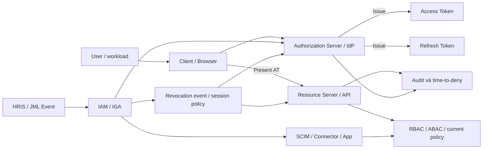
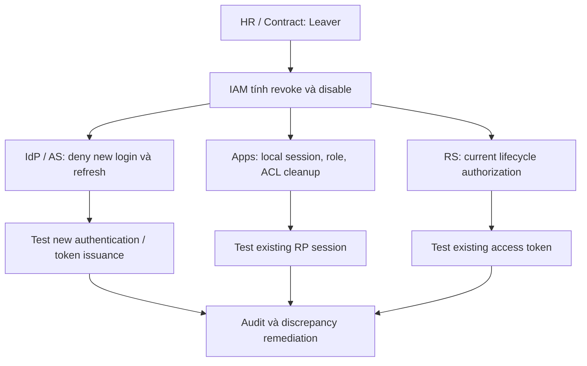
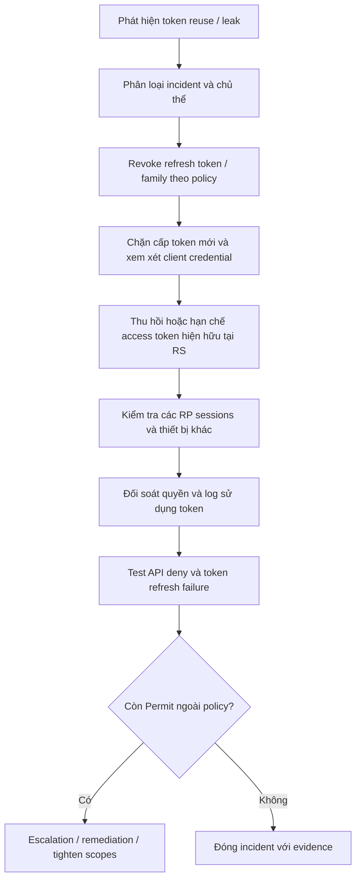

# Token revocation trong IAM: thu hồi token và chấm dứt quyền truy cập

**Token revocation** (*thu hồi token*) là quá trình làm cho token không còn được chấp nhận sử dụng theo chính sách, trước hoặc tại thời điểm vòng đời của nó kết thúc. Đây là cơ chế trọng yếu của **Identity and Access Management (IAM)**: sau khi một người dùng nghỉ việc, bị khóa tài khoản, mất thiết bị, đổi vai trò hoặc một credential bị lộ, hệ thống cần ngăn các token liên quan tiếp tục cấp quyền ngoài ý muốn.

Điểm cần ghi nhớ ngay từ đầu: **thu hồi một refresh token không tự động làm mọi access token đã phát hết hiệu lực**, và **xóa session ở Identity Provider (IdP) không tự động đóng mọi phiên cục bộ của ứng dụng**. Một token có thể được resource server kiểm tra trực tuyến, nhưng cũng có thể là JWT tự chứa được xác minh ngoại tuyến cho đến thời điểm hết hạn. Vì vậy, token revocation là vấn đề **kiến trúc end-to-end**, không chỉ là một lệnh gọi API.

Ví dụ, nhân viên Lan chuyển từ Finance sang Analytics. Lan không còn được phép phê duyệt hóa đơn nhưng còn access token được cấp trước khi đổi vai trò. Nếu ERP chỉ đọc role `invoice-approver` từ JWT cũ mà không kiểm tra chính sách hiện tại, Lan có thể tiếp tục phê duyệt cho tới khi token hết hạn. IAM phải chọn và kiểm thử cơ chế phù hợp để **giảm thời gian quyền tồn dư** xuống mức rủi ro chấp nhận được.

Bài học thuộc chương **Token và credential**, nằm trong module vòng đời danh tính **Joiner–Mover–Leaver (JML)**, với các mối liên hệ **IdP, SSO, OAuth 2.0/OIDC, SCIM, RBAC/ABAC, service/machine identity, kiểm toán và account reconciliation**.

## 1. Token là gì? Phân biệt token với credential và session

| Đối tượng | Dùng để làm gì? | Hệ quả khi cần thu hồi |
| --- | --- | --- |
| **Access token** | Cho client gọi API/resource server theo audience, scope và thời hạn | Phải khiến API từ chối quyền không còn hợp lệ |
| **Refresh token** | Cho client xin access token mới từ authorization server | Cần ngăn cấp token mới; đánh giá các access token đã phát |
| **ID token (OIDC)** | Cho client biết sự kiện xác thực và thông tin về người đăng nhập | Không dùng làm bearer token gọi API |
| **Authorization code** | Giá trị ngắn hạn được đổi lấy token trong authorization flow | Thường chỉ sử dụng một lần; không đồng nghĩa phiên |
| **Session cookie** | Mang session ID hoặc session state của ứng dụng/browser | Logout và invalidation phụ thuộc thiết kế RP |
| **API key / client secret** | Credential xác thực ứng dụng hoặc client | Revoke credential khác với revoke access token đã cấp |
| **Certificate / private key** | Bằng chứng danh tính cho mTLS hoặc client authentication | Thu hồi/rotation cert không chắc tự vô hiệu mọi token |
| **Workload assertion** | Bằng chứng từ một workload issuer để đổi lấy token | Cần quản lý trust binding và token phát sinh |

**Token có thời hạn** không đồng nghĩa **token có thể thu hồi tức thì**. Một access token được ký hợp lệ có thể vẫn vượt qua bước xác minh chữ ký khi issuer đã khóa account, trừ khi resource server thực hiện thêm kiểm tra hiệu lực.

## 2. Các lý do kích hoạt token revocation

Các trigger cần được xác định theo rủi ro, nguồn dữ liệu và SLA:

1. **User logout:** chấm dứt phiên hoặc quyền xin token mới trong phạm vi tính năng được công bố.
2. **Logout all / lost device:** thu hồi các phiên hoặc refresh token liên quan tới thiết bị.
3. **Password reset / MFA reset:** xử lý session/token theo chính sách, đặc biệt khi nghi compromise.
4. **Account disable/lock:** không cho đăng nhập hoặc tiếp tục token grant ngoài chính sách.
5. **Mover:** thu hồi quyền trong token hoặc cập nhật authorization khi người dùng đổi bộ phận.
6. **Leaver:** ngừng truy cập trên các ứng dụng, API và đường SSO liên quan.
7. **Access review/recertification:** reviewer quyết định Revoke một entitlement.
8. **Credential leak:** client secret, API key, refresh token hoặc certificate bị lộ.
9. **Incident response:** phát hiện token theft, bất thường trong cấp token hoặc sử dụng API.
10. **Service/workload retirement:** ngừng identity kỹ thuật, federation trust hoặc hợp đồng đối tác.
11. **Risk-based event:** thay đổi thiết bị, hành vi đáng ngờ hoặc mức đảm bảo xác thực không còn đáp ứng policy.

**Không phải mọi trigger đều yêu cầu vô hiệu toàn bộ token**. Ví dụ logout một thiết bị khác với đóng toàn bộ session; đổi role có thể yêu cầu runtime authorization deny thay vì buộc đăng xuất tất cả ứng dụng.

## 3. Những lớp hệ thống liên quan



**Authorization server (AS)** phát và quản lý token, trong khi **resource server (RS)** quyết định có chấp nhận token khi API được gọi hay không. Hai hệ thống có thể vận hành độc lập, cache dữ liệu khác nhau hoặc không có kênh thông báo revocation trực tiếp.

Để thu hồi có hiệu lực, cần xác định ai là **nguồn trạng thái đáng tin**, đâu là **điểm enforcement**, loại token nào, và thông tin revocation **đến resource server bằng cách nào**.

## 4. Access token tự chứa và token tham chiếu

| Kiến trúc | Cách xác minh phổ biến | Ưu điểm | Thách thức khi revoke |
| --- | --- | --- | --- |
| **JWT tự chứa** | API kiểm chữ ký, issuer, audience, thời gian, claims | Không cần gọi AS cho mọi request | Có thể vẫn hợp lệ tới `exp` |
| **Opaque/reference token** | API gọi introspection hoặc kiểm trạng thái tại gateway | Có thể cập nhật trạng thái tập trung | Phụ thuộc mạng/cache/AS availability |
| **Server-side session ID** | API/app tìm record session trong store | Có thể invalidation record tập trung | Cần đồng bộ store và cache đa vùng |
| **Sender-constrained token** | Token gắn với mTLS/DPoP key | Giảm giá trị token nếu bị sao chép | Không thay thế lifecycle revoke |

**Opaque token không mặc nhiên có introspection**; chỉ khi authorization server và resource server hỗ trợ cơ chế kiểm tra tương ứng. **JWT cũng có thể được revoke sớm** nếu hệ thống bổ sung denylist, versioning hoặc kiểm tra trạng thái online. Token format chỉ là một yếu tố của kiến trúc.

## 5. OAuth 2.0 Token Revocation Endpoint

**RFC 7009** mô tả một token revocation endpoint mà client có thể dùng để yêu cầu authorization server vô hiệu token, khi nhà cung cấp hỗ trợ.

Một request minh họa:

```http
POST /oauth/revoke HTTP/1.1
Host: auth.example.test
Content-Type: application/x-www-form-urlencoded
Authorization: Basic <client-authentication-placeholder>

token=<url-encoded-test-token>&token_type_hint=refresh_token
```

Đây là **ví dụ dạng giao thức**, không phải endpoint thực tế. Client authentication và đường dẫn phụ thuộc cấu hình authorization server; không dùng token thật trong tài liệu hoặc log.

Các lưu ý quan trọng:

- `token` là tham số mang token cần thu hồi; `token_type_hint` giúp server tối ưu việc tra cứu nhưng **không được coi là nguồn xác minh bảo mật duy nhất**.
- Endpoint có thể cho phép revoke refresh token và/hoặc access token tùy hỗ trợ; **không mặc định revoke access token được tất cả hệ thống thực hiện giống nhau**.
- Theo RFC 7009, response thành công thường là **HTTP 200** dù token đã không còn hợp lệ hoặc server không tìm thấy nó, để client không suy ra sự tồn tại token từ response.
- Token type không được hỗ trợ có thể dẫn tới `unsupported_token_type` theo đặc tả.
- Để chặn token bị lộ, client cần bảo vệ kênh TLS, xác thực client khi cần và kiểm soát CSRF/abuse phù hợp cách tích hợp.
- Sau lệnh revoke, phải **kiểm tra tác động thực tế tới token còn hạn ở resource server**, không chỉ kết luận từ HTTP 200.

**Revoke refresh token** thường ngăn việc sử dụng refresh token đó để cấp token mới; hệ quả tới refresh-token family hoặc access token cùng grant phải được xác minh theo chính sách và implementation của authorization server.

## 6. Introspection: xác minh token còn active không?

**RFC 7662** mô tả token introspection: một thành phần được ủy quyền gửi token cho authorization server để lấy metadata, trong đó có trạng thái `active`.

```http
POST /oauth/introspect HTTP/1.1
Host: auth.example.test
Content-Type: application/x-www-form-urlencoded
Authorization: Basic <authorized-resource-server-placeholder>

token=<url-encoded-test-token>
```

Response minh họa khi token không còn active:

```json
{
  "active": false
}
```

**Introspection khác revocation**: một bên yêu cầu **thay đổi trạng thái**, bên kia **hỏi trạng thái hiện tại**. API chỉ nên tin kết quả từ authorization server phù hợp và xác thực bên gọi introspection.

Khi resource server cache introspection result để giảm độ trễ, trạng thái cũ có thể vẫn được dùng sau revocation. Cần đặt TTL/cache invalidation theo rủi ro; không khẳng định introspection tự bảo đảm deny tức thời.

## 7. Thu hồi JWT tự chứa: những chiến lược kiến trúc

| Chiến lược | Cơ chế | Ưu điểm | Hạn chế |
| --- | --- | --- | --- |
| **Access token TTL ngắn** | Token tự hết hạn nhanh | Đơn giản, không cần kho revoke toàn cục | Còn cửa sổ truy cập đến hết hạn |
| **Revoked-token denylist** | RS kiểm `jti`/hash/token ID bị revoke | Chặn token cụ thể trước `exp` | Phải đồng bộ và bảo vệ kho trạng thái |
| **Session/grant version** | Token có version; RS so trạng thái hiện hành | Thu hồi nhóm token theo session | Thêm lookup hoặc cache invalidation |
| **Account/role status check** | RS kiểm user active và entitlement hiện tại | Mover/Leaver mất quyền sớm | Tăng dependency/latency |
| **Event-driven invalidation** | AS/IAM phát event revoke tới RS/gateway | Độ trễ thấp nếu triển khai tốt | Event trễ, mất hoặc lệch thứ tự |
| **Token exchange/gateway** | API gateway kiểm status trước khi trao quyền | Central policy enforcement | Gateway có thể thành điểm phụ thuộc |
| **Sender-constrained token** | Token gắn khóa client | Hạn chế replay token bị trộm | Không thay thế revoke quyền của chủ thể |

Một hệ thống có thể kết hợp **TTL ngắn + refresh token rotation + account state check**. Mức kiểm tra online nên dựa vào **risk assessment và SLO về tính sẵn sàng**, nhất là khi authorization server không sẵn sàng.

**Không dùng `jti` denylist mà không kiểm chữ ký, issuer, audience và expiry**: danh sách revoke là kiểm soát bổ sung chứ không thay thế token validation.

## 8. Thiết kế thời gian thu hồi và “time to deny”

**Time to deny** là khoảng thời gian từ lúc có **quyết định thu hồi có hiệu lực** đến khi resource server **thực sự từ chối** hành động không còn được phép.

```text
T0: HR/IAM xác nhận Leaver
T1: AS khóa refresh/session hoặc thay status
T2: Event/connector đến ứng dụng và API
T3: Cache introspection/role được cập nhật
T4: API thử với token cũ -> DENY

Time to deny = T4 - T0
```

Một access token JWT hết hạn sau 15 phút không đồng nghĩa mọi tài nguyên sẽ từ chối trong 15 phút: cần xét clock skew, long-running request, cache, session state và các đường API khác. Ngược lại resource server có status check có thể từ chối sớm hơn `exp`.

Chỉ số cần tách:

- **Decision latency:** thời gian tạo/quyết định revoke.
- **Issuer update latency:** AS cập nhật trạng thái và chặn token mới.
- **Propagation latency:** event/connector/cache cập nhật.
- **Enforcement latency:** API ngừng Permit.
- **Verification latency:** khi kiểm thử có bằng chứng xác nhận Deny.

Không công bố “revoke hoàn tất” chỉ vì IAM ticket đóng, nhất là đối với tài khoản privileged và nhân viên Leaver.

## 9. Refresh token revocation và rotation

Refresh token thường có vòng đời dài hơn access token, nên cần cơ chế bảo vệ mạnh hơn.

Các trường hợp kiểm thử:

1. Refresh token hợp lệ được đổi lấy access token mới theo policy.
2. Refresh token đã revoke **không thể dùng để xin token mới**.
3. Khi rotation được bật, refresh token cũ không được tái sử dụng ngoài chính sách.
4. Nếu phát hiện **refresh token reuse**, hệ thống thực hiện phản ứng được thiết kế, có thể vô hiệu token family/session.
5. Logout một thiết bị không vô tình thu hồi phiên thiết bị khác nếu tính năng chỉ hứa logout một phiên.
6. Logout all phải xử lý tất cả refresh token/sessions thuộc phạm vi.
7. Account Leaver hoặc client bị disable không tiếp tục nhận token mới.
8. Client bị compromise không được dùng client secret cũ để hồi sinh grant.

**Refresh token rotation và token family invalidation phụ thuộc nhà cung cấp và cấu hình**. Không giả định mọi authorization server luôn thu hồi toàn bộ access token gốc khi một refresh token bị revoke.

## 10. Logout, OIDC và các phiên ứng dụng

Token revocation có liên quan tới logout nhưng **không đồng nghĩa logout**.

| Thành phần | Sau logout cần kiểm chứng |
| --- | --- |
| **IdP SSO session** | Phiên trung tâm còn hay đã chấm dứt theo yêu cầu? |
| **RP/local application session** | Cookie ERP/CRM có còn gọi được API? |
| **Refresh token** | Có xin được access token mới không? |
| **Access token** | Token cũ còn hạn có tiếp tục được RS chấp nhận? |
| **Device sessions** | Logout một thiết bị hay tất cả thiết bị? |
| **Federated RP** | Có nhận và xử lý OIDC/SAML logout event không? |

OIDC có những cơ chế như **RP-Initiated Logout, Front-Channel Logout, Back-Channel Logout** nếu RP/OP hỗ trợ; không giả định mọi ứng dụng tích hợp SSO đều đồng bộ trạng thái logout tức thì.

**Logout IdP không chắc hủy session của ứng dụng đã đăng nhập trước đó**. Trường hợp Leaver cần kiểm tra cả **new login**, **refresh**, **existing RP session** và **existing access token** tại API.

## 11. Token revocation trong Joiner

Ở giai đoạn **Joiner**, account có thể được provision trước ngày bắt đầu. Việc chưa cho phép đăng nhập hoặc chưa cho nhận token có đặc quyền là kiểm soát eligibility, còn revocation xử lý khi một token đã cấp cần bị chặn.

Các bài test có thể gồm:

- Chưa đủ điều kiện/JML chưa active: AS không cấp token ngoài policy.
- Identity proofing hoặc MFA chưa đạt mức yêu cầu: không cấp session đặc quyền.
- Birthright role được duyệt: access token và API chỉ có quyền tương ứng.
- Nếu tài khoản tạo nhầm hoặc phải rollback onboarding: chặn refresh, access token và quyền ở ứng dụng đích.
- Không cho token hoặc session thuộc người khác khi identity correlation sai.
- Account mới có quyền RBAC/ABAC đúng tenant, resource và thời gian hiệu lực.

**Provisioning một tài khoản không đồng nghĩa quyền nhận token hoặc quyền gọi API đã hợp lệ**. Chính sách cấp token và authorization phải kiểm tra trạng thái danh tính hiện hành.

## 12. Token revocation trong Mover

**Mover** thay đổi nhiệm vụ và bộ quyền mong muốn. Thu hồi token cần phối hợp với **deprovision role/group cũ và authorization runtime**.

Ví dụ Lan có role `finance-approver`, rồi chuyển sang `analytics-reader`:

1. HRIS gửi Mover event với thời điểm hiệu lực.
2. IAM tính lại desired entitlements, gỡ Finance và cấp Analytics theo policy.
3. IdP/SCIM/connector cập nhật group/role ở hệ thống đích.
4. Refresh token/session có thể bị vô hiệu hoặc bắt buộc làm mới claims theo rủi ro.
5. RS phải **từ chối `invoice.approve` bằng access token cũ** trong SLA đã xác định.
6. Client xin token mới chỉ nhận quyền Analytics hiện hành.
7. IAM readback role/ACL ở ERP và ghi time to deny.

**Thu hồi token không thay cho thu hồi entitlement**: nếu Lan đăng nhập lại rồi vẫn có role Finance gán trực tiếp trong ERP, vấn đề chưa được xử lý. Ngược lại, gỡ role nhưng không xử lý JWT claim cũ có thể giữ khả năng phê duyệt đến lúc token hết hạn.

## 13. Token revocation trong Leaver

Khi quan hệ nhân sự hoặc hợp đồng **Leaver**, việc chặn truy cập phải được kích hoạt theo sự kiện, **không đợi đợt access review định kỳ**.



Một ma trận xác minh:

| Đường truy cập | Expected result |
| --- | --- |
| Đăng nhập mới tại IdP | Bị từ chối theo trạng thái Leaver |
| Refresh token đã phát | Không cấp token mới |
| Access token còn hạn | API bị chặn theo cơ chế và SLA thu hồi |
| Session ERP/CRM hiện hữu | Không thực hiện được tác vụ bị thu hồi |
| App-local user/role | Được deprovision hoặc runtime deny |
| Account đặc quyền phụ | Không tiếp tục dùng được |
| Partner account/API client | Không còn căn cứ quan hệ thì bị thu hồi riêng |
| Offline/mobile client | Khi kết nối lại không thể thực hiện hành động trái policy |
| Credential độc lập SSO | Được rà soát/revoke nếu còn liên quan |
| Audit | Ghi được bằng chứng deny và quyền tồn dư cần xử lý |

**SCIM `active=false` không phải lệnh thu hồi access token theo OAuth**, cũng không bảo đảm mọi RP session và API key bị chấm dứt. Quy trình Leaver phải liên kết các lớp nhưng không nhập nhằng chúng.

## 14. Account lockout, mật khẩu và MFA

Một lỗi thiết kế phổ biến là cho rằng **password reset** sẽ vô hiệu toàn bộ phiên cũ. Hành vi thực tế phụ thuộc provider, loại session và token:

- Reset password có thể ngăn đăng nhập bằng mật khẩu cũ.
- Refresh token hoặc RP session có thể bị ảnh hưởng theo chính sách cụ thể.
- JWT access token tự chứa có thể vẫn còn hạn nếu resource server không có revocation check.
- MFA reset có thể khiến các session nhạy cảm cần step-up/reauth.
- Lock account thường phải chặn cấp token mới và tác vụ rủi ro, nhưng phải kiểm thử trực tiếp.

Khi nghi ngờ session bị chiếm, nên có **incident runbook** để chặn các đường truy cập phù hợp, kiểm tra nhiều thiết bị và phát hiện token replay. Không dùng quyết định “đã đổi password” làm bằng chứng đủ để đóng incident.

## 15. Revocation cho service và machine identity

Non-human identities không nhất thiết có browser session. Chúng có thể dùng **OAuth client credentials**, managed identity, API key, certificate hoặc workload identity federation.

| Tình huống | Điều cần thu hồi | Điều cần kiểm chứng |
| --- | --- | --- |
| CI/CD runner retired | OAuth client, trust, role, secret | Không phát token mới; API không còn Permit |
| Client secret lộ | Secret tại AS, grant liên quan | Rotation/revoke và token cũ theo policy |
| Workload federation đổi repo | Issuer/subject/audience trust cũ | Assertion cũ không đổi được token |
| Service account ngừng | Account, group, role, ACL, keys | Effective access không còn |
| mTLS certificate bị lộ | Certificate trust/revocation theo nền tảng | Handshake/token issuance bị chặn phù hợp |
| Managed identity đổi project | Principal binding/role scope cũ | Không truy cập được resource project cũ |
| Partner hết hợp đồng | Client/API keys và tenant permissions | Cross-tenant/API deny |

**Revoke client secret thường ngăn xác thực client để xin token mới, không tự hủy mọi access token đã phát**. Với workload federation, bỏ trust binding là cần thiết nhưng access token cấp trước đó vẫn phải được quản trị theo vòng đời riêng.

Một kỹ sư Mover/Leaver có quyền lấy secret phải bị thu hồi **quyền cá nhân vào vault/CI-CD**, trong khi workload hợp lệ vẫn có thể tiếp tục hoạt động dưới owner mới. Không tự xóa production service identity chỉ vì nhân viên tạo nó đã nghỉ.

## 16. RBAC/ABAC và current authorization

Thậm chí khi token hợp lệ về mặt mật mã, quyền trên tài nguyên vẫn phải được xét theo chính sách. Ví dụ:

```text
PERMIT api_action IF
    token.signature_valid
    AND token.issuer == expected_issuer
    AND token.audience CONTAINS expected_api
    AND token.time_constraints_valid
    AND subject.lifecycle_status == "active"
    AND NOT session_or_token_revoked(token, subject)
    AND action IN current_allowed_actions(subject, resource)
    AND request.tenant == resource.tenant
ELSE DENY
```

Đây là **giả mã**, không phải chính sách chạy nguyên trạng. Mỗi hệ thống có thể lựa chọn kiểm tra account/session status online, event invalidation hoặc TTL theo risk model. Một số thông tin từ JWT có thể cũ; phải xác định claims nào được tin trong bao lâu.

**Authorization không chỉ là có token**. Cần kiểm tra audience, scope, role, tenant, resource ownership, ABAC context và SoD khi áp dụng. Token có `admin` claim cũ không được phép trở thành căn cứ vĩnh viễn cho thao tác admin sau khi Mover.

## 17. API và resource server phải xử lý revocation ra sao?

Một RS an toàn nên xác định rõ:

1. **Token validation:** chữ ký/format, issuer, audience, `exp`, `nbf` và các ràng buộc liên quan.
2. **Revocation signal:** introspection, denylist, session generation, status check hoặc TTL đã công bố.
3. **Authorization:** RBAC/ABAC/SoD cho action-resource cụ thể.
4. **Cache policy:** thời gian sống và invalidation của token status/role cache.
5. **Failure mode:** AS/introspection unavailable thì hành vi fail-open/fail-closed thế nào tùy dữ liệu và rủi ro.
6. **Clock skew:** dung sai thời gian nhỏ, có kiểm soát, không kéo dài vô hạn token.
7. **Multi-region:** phân phối trạng thái revoke đến mọi vùng phục vụ.
8. **Long-running access:** streaming/WebSocket/job xử lý thế nào khi quyền bị rút giữa phiên.
9. **Audit:** ghi token reference đã che và correlation ID, không ghi giá trị bearer token.

Đặc biệt, **không chỉ kiểm tra revocation ở API gateway nếu có đường truy cập trực tiếp bỏ qua gateway**. Enforcement phải phù hợp ranh giới tin cậy thật.

## 18. Failure mode và sự nhất quán khi revoke

Revocation thường xảy ra trong hệ thống phân tán, cần tính đến:

| Sự cố | Nguy cơ | Kiểm soát |
| --- | --- | --- |
| Event revoke đến chậm | API tiếp tục Permit | TTL, current-state check, SLA |
| Event duplicate | Lỗi cập nhật state | Idempotent handler |
| Event đến sai thứ tự | Grant cũ ghi đè revoke | Generation/version và fencing |
| Cache introspection chưa hết hạn | Token bị revoke vẫn active trong cache | TTL/invalidations phù hợp |
| AS outage | RS không xác minh trạng thái mới | Failure policy theo rủi ro |
| Clock skew | Token hết hạn được chấp nhận lâu hơn | Đồng bộ thời gian, tolerance giới hạn |
| Multi-region replication lag | Một region còn Permit | Đồng bộ và kiểm thử vùng |
| RP không hỗ trợ logout | Cookie cũ vẫn dùng được | Local session revocation hoặc guard tại API |
| Connector retry grant cũ | Role bị cấp lại | Desired state và reconciliation |
| Role được cấp trực tiếp tại target | IdP revoke không đủ | Readback local entitlement |

**Không luôn có giao dịch nguyên tử giữa HRIS, IdP, authorization server, SCIM connector và mọi ứng dụng**. Cần giám sát sai lệch cho đến khi hành động ở resource server thực sự bị từ chối.

## 19. Token theft, replay và sender constraint

Bearer token bị đánh cắp có thể bị sử dụng bởi người khác trong thời hạn còn hiệu lực. Revocation giúp giảm thiệt hại, nhưng phát hiện sự cố và khả năng vô hiệu sớm rất quan trọng.

Những kiểm soát phối hợp:

- **TLS** và không đặt token vào query string hoặc log.
- **Refresh token rotation** và phản ứng khi thấy reuse.
- **mTLS-bound access token** hoặc **DPoP** khi phù hợp để giảm giá trị token bị sao chép.
- Theo dõi token usage anomalies, client/device context khi hợp lệ.
- **Scope/audience hạn chế** và token lifetime theo rủi ro.
- Kiểm tra authorization hiện hành tại API.
- Thu hồi token/session và credential gốc khi có dấu hiệu lộ.
- Bảo vệ quyền xem nhật ký và không lưu plaintext bearer credential.

**Sender constraint không thay thế revocation**: nếu attacker chiếm cả khóa ràng buộc hoặc workload bị xâm nhập, vẫn cần ngăn token và identity tiếp tục thực thi quyền.

## 20. Ví dụ workflow thu hồi khi phát hiện refresh token bị lộ



Với compromise thực sự, không chỉ thu hồi một token bị biết; cần tìm **nguồn lộ**, các token/credential cùng phiên, hành động đã xảy ra và quyền bị thay đổi. Không đồng nhất “revocation endpoint trả 200” với “đã ngăn được attacker”.

## 21. Kiểm thử token revocation end-to-end

| Test case | Thiết lập | Kết quả mong muốn |
| --- | --- | --- |
| Refresh token revoke | Lấy refresh token test, revoke, thử refresh | AS không cấp token mới bằng token đã revoke |
| Access token revoke được hỗ trợ | Revoke access token test | RS từ chối trong thời hạn công bố |
| JWT tự chứa không có revoke online | Revoke grant/session | Đo TTL/tác dụng policy hiện hành, không khẳng định deny tức thì |
| Logout một thiết bị | Hai phiên cùng user | Phiên mục tiêu chết, phạm vi còn lại đúng tính năng |
| Logout all | Nhiều browser/device | Mọi phiên thuộc phạm vi bị xử lý |
| Leaver | Disable account trong lúc token còn hạn | Không login/refresh; API deny theo SLA |
| Mover | Gỡ role Finance | API Finance deny dù token cũ có role |
| Wrong audience | Token dành cho API A gọi API B | RS từ chối |
| Wrong issuer/signature | Token không hợp lệ | RS từ chối |
| Token expired | Đặt clock kiểm thử | RS từ chối sau hạn với skew cho phép |
| Refresh token reuse | Dùng lại refresh token đã rotate | Phát hiện và phản ứng theo policy |
| Client secret leaked | Revoke secret tại AS | Không dùng secret cũ xin token mới |
| Workload federation retired | Gỡ trust binding | Assertion cũ không đổi được token |
| Introspection cache | Revoke trong lúc cache còn active | Đo độ trễ, đạt SLA và kiểm tra invalidation |
| Multi-region | Token đã revoke gọi nhiều region | Không vùng nào Permit trái policy quá SLA |
| API bypass | Gọi thẳng backend không qua gateway | Backend vẫn enforcement |
| Event out-of-order | Grant cũ đến sau revoke | Quyền không được hồi sinh |

**Cần dùng test identity, test resource và token dành riêng cho môi trường được phép**. Không thu thập access token của người dùng thật hoặc gây gián đoạn production để kiểm thử tùy tiện.

## 22. Pseudocode kiểm thử time-to-deny

```text
test "Leaver access token no longer authorizes protected action":
    user = create_test_user(role="invoice-approver")
    access_token = login_and_get_access_token(user)
    invoice = create_test_invoice()

    assert api.approve(invoice, access_token) == PERMIT

    event_time = iam.mark_leaver(user)
    iam.wait_for_event_processing(timeout=policy.event_timeout)

    result = poll_protected_api_with_old_token(
        action="invoice.approve",
        timeout=policy.revocation_sla
    )

    assert result.final_decision == DENY
    assert result.first_deny_time - event_time <= policy.revocation_sla
    assert authorization_server.refresh(user.old_refresh_token) == DENY

    audit.record_without_raw_token(
        user_id=user.id,
        event="LEAVER",
        observed_first_deny=result.first_deny_time
    )
```

Đây là **giả mã**, không phải code thực thi cho một IAM/AS cụ thể. Bài test thực tế cần tách **thời điểm Leaver có hiệu lực**, **event processing**, **token grant** và **API permission**. Không để polling không giới hạn; không dùng quyền và dữ liệu thật.

Nếu thiết kế không bảo đảm revoke access token tức thời, tiêu chí cần công bố rõ **TTL/cửa sổ rủi ro được chấp nhận**, thay vì viết assertion trái với khả năng nền tảng.

## 23. Reconciliation và quản lý quyền tồn dư

Đối soát cần so **desired identity/entitlements** với **observed access**:

```text
desired = allowed_identity_state + approved_entitlements + valid_sessions
observed = AS grants + RP sessions + RS permissions + token paths

discrepancies = observed_access_outside_desired_state
```

Đây là mô hình logic, không phải phép tính có thể áp dụng máy móc. Đặc biệt, một token có thể hợp lệ về mặt chữ ký nhưng API vẫn Deny theo ABAC, hoặc một phiên có thể tồn tại mà không còn entitlement nhạy cảm.

Cần lưu riêng:

- Token/session đã bị yêu cầu thu hồi.
- Trạng thái issuer/AS đã xử lý.
- RP session đã được chấm dứt hay chưa.
- Role, group, ACL tại ứng dụng đích.
- Kết quả API Permit/Deny sau revocation.
- Khoảng thời gian token vẫn có thể được chấp nhận.
- Owner, SLA, ngoại lệ và remediation chưa hoàn tất.

Một **revocation task completed** chưa đủ để kết luận **access denied everywhere**. Báo cáo nên nêu rõ phạm vi API/ứng dụng đã kiểm chứng và giới hạn còn lại.

## 24. Kiểm toán và quan sát token revocation

Một bản ghi audit hữu ích cần có:

| Trường | Mục đích |
| --- | --- |
| `correlationId` | Liên kết HR/IAM, AS và API |
| `subjectId` / `clientId` | Danh tính người/workload |
| `issuer` / `audience` | Phạm vi token |
| `tokenReference` | Hash/ID đã che, không phải token thô |
| `revocationReason` | Logout, Leaver, compromise, Mover |
| `decisionTime` | Thời điểm chính sách có hiệu lực |
| `issuerUpdateTime` | AS cập nhật trạng thái |
| `resourceDenyTime` | API đầu tiên từ chối |
| `policyVersion` | Quy tắc đã áp dụng |
| `owner` / `status` | Người theo dõi remediation |

Không log access token, refresh token, client secret, cookie, private key hoặc mã khôi phục. Dữ liệu token metadata, địa chỉ IP và thiết bị cũng cần được bảo vệ theo mức nhạy cảm và chính sách lưu giữ.

Các cảnh báo nên ưu tiên: refresh token reuse, yêu cầu cấp token sau Leaver, access token tiếp tục gọi API sau revocation, client bị khóa vẫn có token issuance, token dùng sai audience và revoke failure quá SLA.

## 25. Chỉ số vận hành

| Chỉ số | Diễn giải |
| --- | --- |
| **Revocation request success** | Tỷ lệ thao tác gửi tới AS được chấp nhận |
| **Refresh reuse detection** | Mức phát hiện reuse trái chính sách |
| **Time to deny** | Độ trễ đến khi API thực tế từ chối |
| **Revocation SLA breach** | Số token/quyền vượt thời gian thu hồi cho phép |
| **Residual active token window** | Cửa sổ token còn hiệu lực sau quyết định |
| **Leaver API access attempts** | Hành vi dùng token sau khi chấm dứt quan hệ |
| **Mover stale entitlement attempts** | Truy cập bằng quyền cũ sau đổi nhiệm vụ |
| **RP session revocation coverage** | Mức ứng dụng xử lý session termination |
| **Multi-region consistency lag** | Độ trễ revoke giữa các vùng |
| **Orphan client grants** | OAuth client hoặc workload grant không owner |
| **Verified revocation rate** | Tỷ lệ đã có bằng chứng deny từ target |
| **Token metadata exposure** | Sự cố hoặc vi phạm chính sách logging |

Một tỷ lệ thành công cao của revocation endpoint **không chứng minh API đã từ chối token cũ**. Nên đo trực tiếp **negative authorization outcome** và phân tích theo mức rủi ro của entitlement.

## 26. Những sai lầm thường gặp

| Sai lầm | Hậu quả | Cách phòng tránh |
| --- | --- | --- |
| Coi revoke refresh token là revoke mọi access token | Quyền còn tới expiry | Thiết kế và kiểm chứng access token enforcement |
| Coi SCIM disable là token revoke | RP/API tiếp tục hoạt động | Kiểm thử từng lớp |
| Logout IdP mà quên session RP | Người dùng vẫn truy cập ứng dụng | RP logout/session invalidation |
| Chỉ kiểm chữ ký JWT | Không phản ánh JML hoặc quyền hiện hành | Context authorization, TTL/status |
| Cache introspection quá lâu | RS tiếp tục tin trạng thái cũ | TTL và invalidation theo SLA |
| Revoke ở một region | Region khác còn Permit | Đồng bộ/cross-region tests |
| Dùng ID token cho API | Sai audience/mục đích token | API kiểm access token |
| Ghi token vào log | Rò bearer credential | Redaction và token reference |
| Đổi client secret rồi coi đã xong | Token cũ vẫn sử dụng | Kiểm tra access token và resource |
| Chỉ nhìn HTTP 200 từ revocation | Chưa chắc deny runtime | API negative test |
| Không xử lý event lệch thứ tự | Grant/role hồi sinh | Version, fencing và reconciliation |
| Không kiểm trust workload | Client lấy token mới dù secret cũ bị xóa | Revoke federation subject/binding |

## 27. Checklist triển khai

- [ ] Xác định đúng loại token, issuer, client và audience.
- [ ] Có bản đồ AS, IdP, RP, gateway và resource server.
- [ ] Phân biệt access token, refresh token, ID token, session và client credential.
- [ ] Có trigger rõ cho logout, Mover, Leaver, compromise và workload retirement.
- [ ] Có chính sách chọn revoke scope: token, device, session, grant hay toàn account.
- [ ] Kiểm tra hỗ trợ RFC 7009/introspection hoặc cơ chế tương đương.
- [ ] Access token TTL/cache phù hợp rủi ro và availability.
- [ ] RS kiểm signature, issuer, audience, time và authorization.
- [ ] Có cơ chế đồng bộ trạng thái revocation nếu cần deny sớm.
- [ ] Có quy tắc khi AS/introspection unavailable.
- [ ] SSO logout và RP session invalidation được kiểm thử thực tế.
- [ ] Mover làm quyền cũ bị Deny trong SLA; không chỉ đổi role IdP.
- [ ] Leaver chặn login, refresh, RP session và API path liên quan.
- [ ] Service identity và federation trust được xử lý riêng.
- [ ] Multi-region, cache, retry và event ordering được kiểm thử.
- [ ] Không lưu token hoặc secret vào audit/log.
- [ ] Đo time to deny và verified revocation rate.
- [ ] Exception có owner, deadline, giảm rủi ro và readback.
- [ ] Có negative authorization tests cho các tài nguyên nhạy cảm.

## 28. Câu hỏi tự kiểm tra

**Tình huống A:** Refresh token bị revoke nhưng access token JWT còn hạn vẫn gọi API được. Có phải issuer chắc chắn bị lỗi không? **Không.** Có thể là hành vi của kiến trúc JWT tự chứa. Cần đánh giá TTL, revocation signal và yêu cầu time to deny.

**Tình huống B:** Người dùng Leaver đã bị disable ở IdP nhưng phiên ERP vẫn phê duyệt hóa đơn. Kiểm soát nào còn thiếu? **RP session/authorization enforcement và kiểm chứng thu hồi tại ERP**.

**Tình huống C:** Introspection trả `active=false`, nhưng API vẫn chấp nhận token nhờ cache. Cần xử lý gì? **TTL/cache invalidation và kiểm thử độ trễ để đạt SLA**.

**Tình huống D:** Access token có chữ ký hợp lệ nhưng audience là một API khác. Có nên Permit? **Không.** Resource server phải xác minh audience và quyền phù hợp.

**Tình huống E:** Một CI job bị retire nhưng federated trust subject vẫn được giữ. Có thể phát sinh gì? **Workload có thể tiếp tục xin token mới**, nếu điều kiện trust còn khớp; cần revoke trust và quyền.

**Tình huống F:** Revoke endpoint trả HTTP 200 cho token không tìm thấy. Có nhất thiết bất thường? **Không.** RFC 7009 cho phép phản hồi thành công trong trường hợp token đã không hợp lệ hoặc không tồn tại.

**Tình huống G:** Một quyền bị gỡ sau Mover nhưng token còn role cũ. Có đủ nếu chỉ rotate refresh token? **Không.** Phải bảo đảm authorization tại API phản ánh quyền hiện hành trong thời hạn cho phép.

**Tình huống H:** Thay password sau incident, nhưng access token cũ vẫn dùng được. Có thể đóng incident chỉ nhờ password reset? **Chưa.** Phải đánh giá trạng thái session/token và kiểm chứng Deny tại resource server.

## Ghi nhớ

**Token revocation** không chỉ là gọi một endpoint hoặc xóa session ở IdP: đó là **bảo đảm đường sử dụng token không còn cho phép quyền đã bị thu hồi**. Cần phân biệt **refresh token, access token, ID token, credential và RP session**; hiểu sự khác nhau giữa **JWT tự chứa, token introspection, TTL, denylist và runtime authorization**; đồng thời đo **time to deny** thay vì chỉ ghi success từ connector. Trong vòng đời **Joiner–Mover–Leaver**, token revocation phải phối hợp **IdP/SSO, OAuth/OIDC, SCIM, RBAC/ABAC, service/machine identity, access review, audit và reconciliation** để chặn quyền truy cập tồn dư, đặc biệt sau **Mover, Leaver và sự cố lộ credential**.
