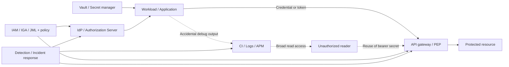
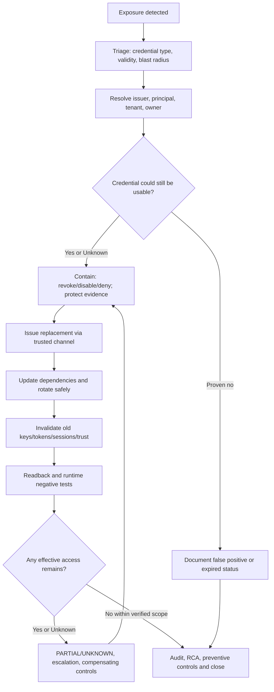
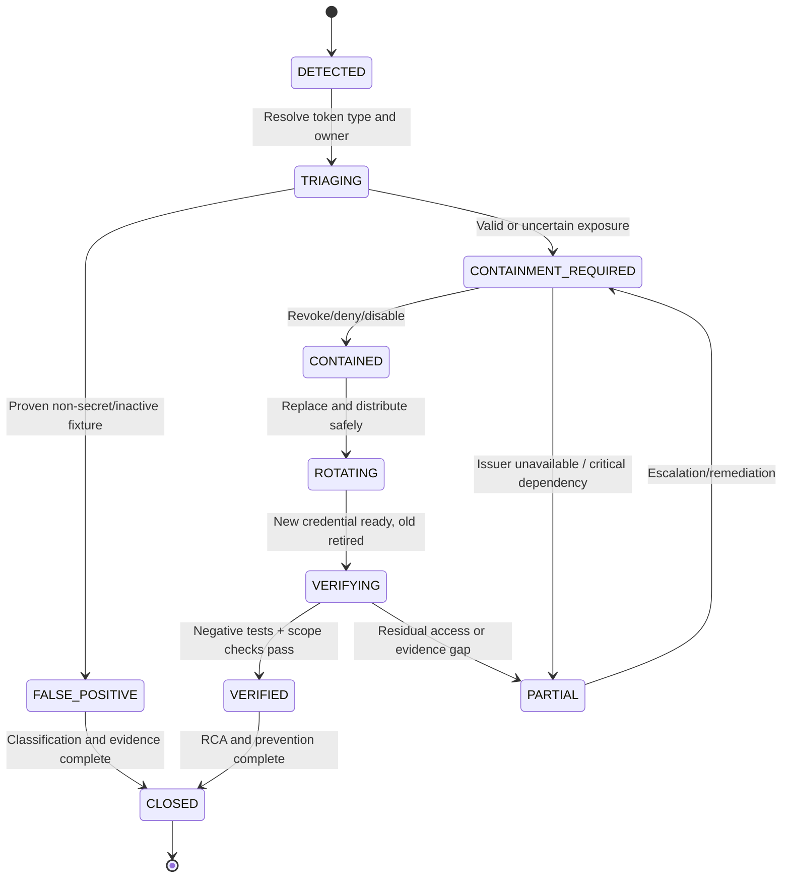

# Credential exposure: Phát hiện và xử lý lộ token, credential trong vòng đời danh tính IAM

## 1. Credential exposure là gì?

**Credential exposure** là tình trạng **thông tin dùng để xác thực hoặc sử dụng một quyền truy cập** bị đặt vào vị trí, kênh truyền, người nhận hoặc phạm vi mà nó **không được phép xuất hiện**. Thông tin có thể là mật khẩu, access token, refresh token, API key, personal access token (PAT), session cookie, private key, client secret, SSH private key, signing key hoặc secret dùng bởi workload.

Ví dụ, một ứng dụng `billing-worker` ghi nguyên giá trị `Authorization: Bearer ...` vào log khi gọi API. Log được gửi tới hệ thống quan sát mà nhiều nhóm có thể xem. Ngay cả khi chưa phát hiện ai sử dụng token, đây đã là **sự kiện lộ credential** cần phân loại và xử lý. Nếu token được dùng từ một principal hoặc môi trường không được phép, sự việc có thể đã tiến tới **credential misuse/compromise**.

Trong module **SECURITY_IDENTITY_ACCESS_MANAGEMENT_IDENTITY_LIFECYCLE**, credential exposure phải được xử lý xuyên suốt **Joiner–Mover–Leaver (JML)**: từ tạo danh tính, cấp quyền và phát credential; qua thay vai trò, thu hẹp phạm vi, rotate và review; tới vô hiệu hóa credential, phiên và quyền khi người dùng, guest hoặc workload ngừng hợp lệ. Các thành phần liên quan gồm **IdP, SSO, SCIM, RBAC/ABAC/PBAC, service accounts, PAM, token issuance, audit và reconciliation**.

Sau bài học này, người đọc có thể phân loại đúng credential bị lộ, đánh giá blast radius, thiết kế giám sát chống lộ secret, ứng phó theo mức rủi ro, rotate hoặc revoke an toàn, xác minh quyền tồn dư và lưu bằng chứng kiểm toán.

> **Nguyên tắc:** nếu một bí mật có thể đã bị bên không có thẩm quyền đọc, **không xem việc xóa nó khỏi file/log là đủ**. Cần coi khả năng sử dụng lại là rủi ro cho đến khi credential bị vô hiệu đúng phạm vi hoặc có căn cứ kỹ thuật chứng minh rủi ro đã được loại bỏ.

## 2. Phân biệt exposure, leakage, compromise và misuse

Những thuật ngữ sau mô tả **các mức thông tin và kết luận khác nhau**.

| Thuật ngữ | Ý nghĩa | Ví dụ | Không nên kết luận quá mức |
| --- | --- | --- | --- |
| **Exposure** | Credential xuất hiện tại nơi không được ủy quyền | API key trong CI log có quyền đọc rộng | Chưa tự chứng minh key đã bị sử dụng |
| **Leakage/disclosure** | Bí mật đã bị tiết lộ ra khỏi ranh giới bảo vệ dự kiến | Token gửi qua chat ngoài phạm vi công ty | Chưa biết người nhận đã khai thác |
| **Suspected compromise** | Có dấu hiệu cho thấy bên khác có thể kiểm soát credential | Private key ở repository công khai | Cần ưu tiên containment dù chưa có log |
| **Confirmed compromise** | Có bằng chứng đáng tin về việc bí mật/credential bị chiếm hoặc kiểm soát trái phép | Bằng chứng truy cập độc lập hoặc sử dụng credential không hợp lệ | Không mặc định biết toàn bộ hành vi xảy ra |
| **Credential misuse** | Credential bị dùng sai mục đích hoặc trái quyền | API key gọi thao tác không nằm trong thay đổi đã phê duyệt | Có thể do chủ sở hữu cấu hình sai, không nhất thiết có attacker |
| **Account compromise** | Account/identity bị bên khác thao túng | Session bị chiếm và API bị gọi thay chủ thể | Một token bị lộ không luôn đồng nghĩa mọi account liên quan đều bị chiếm |
| **Privilege escalation** | Quyền hiệu lực tăng trái chính sách | Dùng service key để cấp role admin | Cần phân tích cả role trực tiếp và đường ủy quyền |
| **Residual access** | Khả năng truy cập còn tồn tại sau quyết định chặn/thu hồi | JWT cũ vẫn được API chấp nhận tới `exp` | Ticket `Resolved` không chứng minh hiệu lực đã kết thúc |

**Mức nghiêm trọng không chỉ phụ thuộc bằng chứng đã có người sử dụng.** Nếu private key ký token cho nhiều hệ thống hoặc cloud credential có quyền quản trị bị đưa lên repository công khai, có thể cần hành động khẩn cấp vì **hậu quả tiềm tàng**, dù chưa có bằng chứng khai thác.

Ngược lại, một chuỗi giống secret nhưng là **giá trị minh họa không được phát hành** có thể là false positive. Phân loại phải dựa vào **issuer, secret inventory, trạng thái còn hiệu lực, scope và nguồn xuất hiện**, không chỉ regex scanner.

## 3. Credential nào có thể bị lộ?

| Loại | Nó được dùng để làm gì? | Tác hại nếu lộ | Cách vô hiệu phụ thuộc |
| --- | --- | --- | --- |
| **Password** | Xác thực người dùng/account | Đăng nhập trái phép, credential reuse | Reset và chặn phiên/token khi cần |
| **Session cookie/opaque session ID** | Mang bearer session của ứng dụng | Chiếm phiên đang active | Revoke server-side session; cookie expiry riêng |
| **OAuth access token** | Gọi resource server với audience/scope | Dùng API trong cửa sổ còn hiệu lực | Revocation/introspection, denylist hoặc TTL/runtime policy |
| **OAuth refresh token** | Nhận access token mới | Duy trì khả năng truy cập dài hơn | Revoke grant/token family theo khả năng AS |
| **OIDC ID token** | Mang assertion xác thực cho RP/client | Lộ thông tin/khả năng replay trong ngữ cảnh xử lý sai | Bảo vệ transaction, nonce, client validation; không coi là API token |
| **API key/PAT** | Xác thực ứng dụng/automation hoặc account tại dịch vụ | Truy cập repo, CI, SaaS và API | Revoke key/PAT ở issuer; thay binding/tích hợp |
| **Client secret** | Xác thực OAuth confidential client | Mạo danh client nếu không có cơ chế ràng buộc bổ sung | Rotate client secret, kiểm grant và token |
| **TLS/SSH private key** | Chứng minh sở hữu khóa/machine hoặc user identity | Mạo danh trong phạm vi trust | Rekey, thay cert/authorized keys và revoke nếu cần |
| **Cloud access key/temporary credential** | Gọi cloud API như principal được cấp quyền | Đọc dữ liệu, deploy, IAM mutation | Disable/revoke, session/policy controls theo provider |
| **Signing key/JWK private key** | Ký JWT, assertion, artifact hoặc credential | Phát token/artifact giả trong trust domain | Key rollover, loại khỏi verifier trust, đánh giá token đã phát |
| **Secret mã hóa/KMS credential** | Mở khóa dữ liệu hoặc gọi decrypt API | Mất bảo mật dữ liệu nếu đi cùng quyền phù hợp | Đổi/thu hồi key, policy và đánh giá dữ liệu bị lộ |
| **Database credential** | Kết nối DB theo account/role | Đọc/sửa dữ liệu, truy cập tenant sai | Rotate/disable user, terminate connection và revoke grants |

**Không phải mọi token là “secret” giống nhau.** Ví dụ **public key, certificate công khai và key ID (`kid`)** thường là dữ liệu công khai hoặc metadata. **Private key, client secret, bearer token và session ID** mới là loại cần bảo mật cao. Một certificate công khai xuất hiện trong source code **không tự là lộ khóa riêng**.

## 4. Mục tiêu bảo vệ: confidentiality, integrity và availability

Credential exposure thường làm suy yếu **bí mật** (*confidentiality*) trước tiên, nhưng tác động rộng hơn:

- **Confidentiality:** attacker có thể đọc báo cáo, hồ sơ nhân sự, token hoặc dữ liệu khách hàng.
- **Integrity:** principal có quyền ghi có thể thay vai trò, transaction, source code hoặc dữ liệu tài chính.
- **Availability:** quyền delete/disable có thể làm gián đoạn service, khóa account hoặc phá hạ tầng.
- **Authenticity:** private key bị lộ có thể cho phép mạo danh workload, ký assertion hoặc artifact.
- **Accountability:** nhiều người dùng chung API key khiến không biết ai thật sự thực hiện hành động.
- **Trust boundary:** credential của tenant A có thể bị dùng để tiếp cận tenant B nếu scope hoặc policy sai.

**Blast radius** phụ thuộc đồng thời vào **principal**, **role/permissions**, **resource scope**, **tenant**, **thời hạn**, **khả năng mint token khác**, **delegation/impersonation**, **khả năng thu hồi** và **nơi credential bị lộ**.

Một token chỉ đọc metrics trong 5 phút và một khóa ký JWT cho nhiều ứng dụng là hai rủi ro rất khác nhau. Phải đánh giá theo **quyền hiệu lực**, không chỉ tên file hoặc độ dài token.

## 5. Những con đường lộ credential phổ biến

| Kênh | Ví dụ | Kiểm soát phòng ngừa |
| --- | --- | --- |
| **Git repository** | Client secret hardcode trong source hoặc history | Pre-commit/CI secret scanning, Vault, code review |
| **CI/CD logs** | Script bật debug và in bearer token | Masking, job scope tối thiểu, giới hạn artifact |
| **Container images** | Secret tồn tại ở một image layer cũ | Build không nhúng secret, build-time secret mount, image scan |
| **Kubernetes manifests/Secrets** | `data` dạng base64 bị commit hoặc log | RBAC, encryption-at-rest, secret manager, admission policy |
| **IaC state/plan** | Secret xuất hiện trong state hoặc output | Encrypt state, giới hạn truy cập, không xuất plaintext |
| **Application logs/APM** | Ghi `Authorization`, cookie hoặc query secret | Structured redaction, headers denylist, sampling an toàn |
| **Error reporting/crash dump** | Dump memory chứa token/session | Restrict collection, scrub và retention |
| **Browser code/storage** | Token trong JavaScript bundle, localStorage bị đọc qua XSS | BFF, CSP/output encoding, token minimization |
| **URL/query parameters** | `?api_key=...` trong URL hoặc redirect | Dùng header/cơ chế phù hợp, không ghi bearer trong URL |
| **Chat/email/ticket** | Dán private key để nhờ kiểm lỗi | Secret-sharing workflow được phê duyệt, redaction |
| **Backups/exports** | Backup DB/log chứa credential còn dùng | Encryption, access control, retention, scan |
| **Endpoint/dev workstation** | Token trong shell history, file cấu hình hoặc clipboard | Endpoint controls, secure storage, short-lived credentials |
| **Reverse proxy** | Debug dump ghi `Set-Cookie`, mTLS identity hoặc headers | Config logging tối thiểu, quyền đọc log hẹp |
| **Cloud metadata/instance identity** | Workload không tin cậy nhận credential của instance | Workload isolation, metadata protections, least privilege |

**Đừng cho rằng “repository private” hoặc “log nội bộ” đồng nghĩa secret an toàn.** Nếu số người/automation có quyền đọc rộng hơn người được phép dùng credential, việc ghi secret ở đó vẫn là exposure theo policy.

### Lộ qua build artifact không dễ thấy

Secret có thể đã bị xóa khỏi source hiện tại nhưng vẫn nằm trong **Git history, build cache, container layer, source map hoặc release archive**. Phải xử lý **credential và nơi phân phối**, chứ không chỉ sửa dòng code ở nhánh mới nhất.

## 6. Ranh giới tin cậy và đường lan khi một secret bị lộ

Một token/secret thường đi qua nhiều hệ thống: secret manager → runtime → API → logs/telemetry. Mỗi bước là nơi cần kiểm soát.



**Nguồn lộ** và **nơi credential có thể sử dụng** là hai câu hỏi khác nhau. Token được in ở hệ thống logs EU có thể có audience là API thanh toán tại tenant VN; data residency, tenant isolation và ai có quyền đọc log đều quan trọng.

### Bearer credential và proof-of-possession

- **Bearer token** thường được chấp nhận dựa trên việc người gọi sở hữu chuỗi token. Nếu chuỗi bị lộ, kẻ khác có thể thử sử dụng trong scope và thời hạn của nó.
- **Sender-constrained hoặc proof-of-possession token** (ví dụ mTLS-bound access token hoặc DPoP theo triển khai phù hợp) có thể yêu cầu thêm bằng chứng sở hữu khóa. Lộ riêng chuỗi token **không mặc định đủ** để sử dụng như bearer token.
- Tuy nhiên nếu **khóa chứng minh sở hữu cũng lộ**, hoặc resource server không thực thi binding đúng, rủi ro vẫn nghiêm trọng.

**Không tự xem token “có JWT signature” là sender-constrained.** JWT ký là cơ chế toàn vẹn/xác thực issuer của token, không ngăn người khác dùng lại nếu token là bearer.

## 7. Kiểm kê và phân loại credential trước khi có sự cố

Khả năng ứng phó phụ thuộc vào việc **có biết credential thuộc về ai, đang cấp quyền gì và có thể tắt bằng cách nào** trước khi sự cố xảy ra hay không.

Một secret/credential inventory nên lưu **metadata, không lưu plaintext**:

| Trường | Mục đích |
| --- | --- |
| `credentialRecordId` | ID quản trị riêng, không phải giá trị secret |
| `credentialType` | ACCESS_TOKEN, API_KEY, CLIENT_SECRET, PRIVATE_KEY… |
| `issuerSystem` / `issuerTenant` | Nơi phát hành và nguồn có thẩm quyền |
| `ownerIdentityId` / `serviceId` | Chủ sở hữu người hoặc workload |
| `accountId` / `principalId` | Account nhận quyền ở target |
| `keyId` / `tokenId` / `jti` khi có | Tương quan và revoke theo contract, không lưu raw bearer |
| `issuedAt` / `expiresAt` | Thời hạn credential |
| `scope` / `audience` / `resourceIds` | Quyền và tài nguyên dự kiến |
| `grantSource` / `roleVersion` | Provenance entitlement và thay đổi policy |
| `storageRef` | Tham chiếu Vault/secret manager, không phải nội dung |
| `lastRotatedAt` / `revocationCapability` | Khả năng xử lý khi lộ |
| `environment` / `riskTier` | Dev/prod và mức ưu tiên |
| `lifecycleGeneration` | Chống dùng nhầm account ở Rehire hoặc service rejoin |

**Không lưu secret một lần nữa trong “secret inventory” chỉ để tiện tra cứu.** Kho inventory cần biết **nơi credential được bảo vệ và cơ chế vô hiệu**. Với nguồn cấp không có API nhận diện key từ fingerprint, có thể lưu key ID hoặc reference được issuer cung cấp thay vì cố giữ một phần token dễ lộ.

## 8. Phân loại mức độ nghiêm trọng dựa trên rủi ro

Một sự kiện credential exposure cần triage **dựa trên tác động và khả năng bị lạm dụng**, không chỉ dựa số lần scanner báo.

| Yếu tố | Nguy cơ thấp hơn | Nguy cơ cao hơn |
| --- | --- | --- |
| **Credential validity** | Đã bị vô hiệu trước khi lộ, được chứng minh | Còn active, không biết hạn |
| **Privilege scope** | Chỉ đọc test data | Admin IAM, secrets, finance payment hoặc prod deploy |
| **Resource exposure** | Sandbox cô lập | Production/customer data, nhiều tenant |
| **Audience** | Token chỉ cho một API có bảo vệ | Credential dùng ở nhiều hệ thống |
| **Lifetime** | Rất ngắn và không refresh | API key/private key dài hạn hoặc refresh token |
| **Exposure channel** | Log kiểm soát chặt, đã thu hồi quyền đọc | Public repo, artifact tải công khai, bên thứ ba không được phép |
| **Evidence of misuse** | Không có tín hiệu trong nguồn audit đáng tin | Gọi API bất thường, privilege change hoặc dữ liệu bị xuất |
| **Revocation capacity** | Có endpoint revoke và runtime kiểm tra | Token self-contained dài hạn, signing key rộng, thiết bị offline |
| **Identity role** | Workload thử nghiệm không có dữ liệu thật | Break-glass, CI/CD production, admin/account owner |
| **Credential pairing** | Token sender-constrained, khóa PoP an toàn | Token và private key tương ứng cùng lộ |

Một ma trận có thể dùng mức **SEV1/SEV2/SEV3** theo quy định tổ chức, nhưng **không có bảng severity cố định áp dụng mọi nơi**. Cần ràng buộc mức độ với **SLA containment, owner/on-call, kênh escalation và bằng chứng cần thu thập**.

**Chưa có audit log chứng minh attacker dùng credential không có nghĩa rủi ro bằng không**: hệ thống có thể thiếu logging, logs đã hết retention hoặc credential được dùng tại endpoint chưa đưa vào monitoring.

## 9. Phát hiện exposure mà không làm lộ secret thêm

Các nguồn phát hiện có thể gồm:

- **Secret scanning** trong commit, pull request, Git history, artifact và container image theo quyền được cấp.
- **DLP/redaction validation** ở log ingestion, APM, trace, support portal và ticket attachment.
- **Issuer/provider alert**: API key mới xuất hiện tại nơi không phù hợp hoặc có sử dụng bất thường.
- **IAM anomaly detection**: principal gọi action/tenant không thường dùng, thay role/trust, token minted ngoài cửa sổ nghiệp vụ.
- **Credential inventory drift**: key không owner, quá tuổi, có grants rộng, chưa rotate theo policy.
- **Security report của bên nhận**: partner thông báo nhận nhầm certificate private key/token.
- **Endpoint posture**: thiết bị người dùng bị mất hoặc phát hiện nơi lưu credential không an toàn.
- **JML reconciliation**: Leaver/service Retired nhưng credential vẫn còn hiệu lực.

**Không xác minh một token bị lộ bằng cách thử gọi API production tùy tiện.** Nếu cần kiểm validity, nên dùng **issuer metadata/introspection hoặc secret inventory** trong phạm vi được ủy quyền, hạn chế tạo side effect và tránh đẩy secret vào tool/log khác.

### False positive và false negative

Một chuỗi trông giống token có thể là **fixture không hoạt động**; ngược lại, token tự sinh không có prefix quen thuộc có thể không bị scanner nhận diện. Kết hợp **pattern, entropy, context và nguồn issuer** phù hợp. **Không sao chép giá trị nghi là secret vào ticket để cả nhóm thảo luận**; sử dụng reference đã che và kênh điều tra bảo mật.

## 10. Lưu bằng chứng ban đầu: tối thiểu nhưng đủ truy nguyên

Khi phát hiện exposure, cần biết **chuyện gì đã xảy ra** mà không tạo thêm bản sao credential.

Một evidence record nên ghi:

1. `incidentId`, `detectionId`, thời gian nguồn và thời gian phát hiện.
2. Kênh phát hiện: Git commit, CI job, log stream, support ticket, artifact, email…
3. **Locator an toàn**: repo/commit ID, log event ID, object/version, không kèm raw secret.
4. Credential type, issuer, **key ID/token reference nếu có**, owner và target principal.
5. Lúc bắt đầu/cửa sổ có khả năng lộ, lượng người/automation có thể đọc được.
6. Tình trạng còn hiệu lực, `expiresAt` và khả năng revoke.
7. Quyền hiệu lực, audience, tenant, resource scope và role/SoD risk.
8. Hành động containment/revoke/rotate và người có thẩm quyền thực hiện.
9. Audit tín hiệu sử dụng bất thường, giới hạn logging và nguồn đối chiếu.
10. Trạng thái cuối, bằng chứng readback/runtime, residual risk, owner/SLA.

**Dùng dữ liệu đã che** như `keyId=key-742` hoặc `fingerprintRef=hash-ref-17`. Ngay cả hash của secret cũng cần xem xét: với password/secret entropy thấp, hash không có bảo vệ có thể giúp suy đoán giá trị. Không đưa một hash thuần của password làm identifier phổ biến.

### Chain of custody

Khi sự kiện có thể cần điều tra chính thức, cần giữ **nguồn bằng chứng, ai thu thập, khi nào, công cụ/phiên bản nào và tính toàn vẹn của artifact**. Lưu raw artifact nhạy cảm, nếu thật sự bắt buộc, trong **kho điều tra riêng với phân quyền và retention nghiêm ngặt**, không gửi qua kênh chat/ticket thông thường.

## 11. Playbook ứng phó từ phát hiện đến xác minh



Các bước **không bắt buộc tuần tự tuyệt đối**. Với credential admin hoặc signing key có khả năng gây hậu quả lớn, **containment có thể phải diễn ra ngay khi xác định đủ đối tượng**; không chờ hoàn tất toàn bộ điều tra rồi mới revoke.

### Cổng quan trọng

- **Triage** phải xác minh credential thuộc đúng issuer/principal trước khi chặn, tránh vô hiệu hóa nhầm service khác.
- **Containment** ưu tiên ngăn sử dụng trái phép nhưng phải biết dependency sản xuất để chuẩn bị cách thay hoặc cách ly.
- **Rotation** phát credential mới và chuyển consumer sang bản mới; **revocation** chặn bản cũ. Hai việc khác nhau.
- **Verification** phải kiểm cả **issuer state** và **resource API/PEP**; không chỉ tin ticket status.
- **Recovery** cần loại nguyên nhân gốc, tránh controller/CI tự phát tán hoặc tái tạo credential cũ.

## 12. Containment ngay: lựa chọn theo loại credential

| Credential bị lộ | Containment thường phù hợp | Điều cần kiểm tra thêm |
| --- | --- | --- |
| API key/PAT | Revoke/disable đúng key ID tại issuer | Consumer nào đang dùng, key khác cùng owner, audit hành vi |
| Session cookie | Revoke server-side session/đổi session generation | RP, IdP, PAM sessions và token độc lập |
| Refresh token | Revoke token/grant/family theo khả năng server | Access tokens đã mint, replay và phạm vi client |
| JWT access token | Revoke/introspection/denylist nếu hỗ trợ, policy deny hoặc TTL | Resource servers nào vẫn chấp nhận token |
| OAuth client secret | Rotate secret, cập nhật client deployment | Existing access/refresh tokens và grant vẫn có thể còn |
| User password | Reset password, chặn login rủi ro, revoke sessions khi cần | MFA recovery, reused password, account changes |
| TLS/mTLS private key | Tạo cặp khóa mới, thay cert, revoke/deny key cũ | CA trust, clients dùng cert cũ, token/role liên quan |
| Signing key | Dừng dùng key cũ, publish/verifier rollover có kiểm soát | Tokens/assertions đã ký, phạm vi trust và key ID |
| Cloud key | Disable/rotate key/principal theo provider | Temporary sessions, resource policies và privilege escalation |
| Database credential | Rotate, giới hạn network, terminate sessions | Connection pools, replicas, các ứng dụng chia sẻ account |

**Không mặc định “tắt toàn bộ account” cho mọi API key lộ** nếu có thể revoke riêng key và giữ service hợp lệ. Nhưng với nghi ngờ account đã bị chiếm hoặc quyền đặc biệt, có thể cần **account-level containment** theo incident severity.

**Thực hiện qua kênh được cấp quyền**, không gửi bearer secret đã lộ vào API debug để kiểm tra một cách thủ công.

## 13. Rotation, revocation, expiration và account disable: khác nhau thế nào?

| Hành động | Tác dụng | Điều không tự bảo đảm |
| --- | --- | --- |
| **Rotate credential** | Tạo/đưa vào dùng credential mới | Credential cũ đã bị vô hiệu nếu không revoke/retire |
| **Revoke token/key** | Issuer hoặc verifier từ chối credential cụ thể | Mọi access đã có từ credential đó bị chặn ngay |
| **Expire** | Credential hết hạn theo policy | Không giải quyết cửa sổ sử dụng trước hạn |
| **Disable account** | Chặn account theo khả năng nền tảng | RP session, JWT và direct grant đều bị đóng tức thì |
| **Revoke session** | Làm phiên ứng dụng/PAM không còn hợp lệ | Refresh token hoặc session tại hệ thống khác bị revoke |
| **Remove role/grant** | Thu hồi entitlement của principal | Credential không còn được chấp nhận tại mọi hệ thống |
| **Rotate signing key** | Dùng khóa mới để ký | Tokens đã ký bằng khóa cũ có bị từ chối hay không |
| **Remove trust binding** | Ngăn principal/workload nhận credential mới qua đường trust | Temporary credentials đã phát hết hiệu lực ngay |

### Trình tự rotate trong production

Nếu ngay lập tức revoke secret duy nhất của một service đang xử lý thanh toán, có thể làm gián đoạn công việc. Với rủi ro được phân loại phù hợp và không có dấu hiệu khai thác khẩn, quy trình có thể **stage new secret → deploy/verify consumers → revoke old secret → negative test**.

**Khi nguy cơ sử dụng trái phép là cấp bách, thứ tự có thể đảo:** revoke/chặn ngay rồi dùng cơ chế khôi phục hoặc credential thay thế được kiểm soát. Mức độ rủi ro quyết định ưu tiên an toàn và khả năng vận hành.

## 14. OAuth access token bị lộ: audience, scope và TTL

**OAuth access token** thường cho phép resource server nhận biết một authorization đã được cấp. Với token dạng **JWT tự chứa**, resource server có thể kiểm chữ ký, issuer, audience, expiry và claims mà **không gọi về issuer ở mỗi request**.

Để đánh giá một access token bị lộ, cần xác định:

- `iss`: token do authorization server nào phát?
- `aud`: token hướng tới resource server nào?
- `exp` / `nbf` / `iat`: cửa sổ hiệu lực?
- `sub`, `client_id`, tenant hoặc principal reference nếu có: actor nào?
- Scope/roles/permissions: được gọi action gì?
- Token có `jti`/reference để revoke hay correlation không?
- Bearer hay **sender-constrained** với mTLS/DPoP?
- Resource server kiểm trạng thái revocation, entitlement version hoặc chỉ kiểm chữ ký đến `exp`?
- Có các token khác cùng grant/client/session không?

**Một JWT `exp` còn 45 phút không bị vô hiệu chỉ vì xóa token khỏi log.** Nếu resource server không hỗ trợ revocation tức thời, có thể dùng **deny policy, token generation/session version, ngắn TTL hoặc chặn principal/resource** tùy hệ thống, đồng thời ghi cửa sổ residual access.

### Không nhầm ID token với access token

**OIDC ID token** được phát để client/RP xác minh sự kiện authentication theo OIDC. Nó **không tự là bearer credential hợp lệ để gọi một API tùy ý**. Nếu ứng dụng nhận ID token như access token mà không kiểm audience/purpose, đó là lỗi thiết kế cần sửa đồng thời với xử lý exposure.

## 15. Refresh token, OAuth grant và token family

**Refresh token** đặc biệt nhạy cảm vì có thể dùng để nhận **access token mới** mà không cần người dùng đăng nhập lại, trong giới hạn và điều kiện issuer. Với **refresh token rotation**, mỗi lần dùng hợp lệ có thể tạo refresh token mới và khiến bản trước không còn hợp lệ theo policy.

Khi refresh token bị lộ:

1. Xác định **issuer, client, grant/session và chủ thể** từ metadata đáng tin.
2. Revoke refresh token, grant hoặc **token family** theo capability; đừng chỉ xóa bản trong client storage.
3. Xác định access tokens đã được cấp từ grant đó và khả năng chúng còn hợp lệ.
4. Kiểm tín hiệu **reuse** hoặc bất thường từ issuance audit.
5. Chặn refresh mới hoặc yêu cầu reauthentication/step-up khi policy cần.
6. Xem xét OAuth client secret, redirect/callback hoặc thiết bị có bị ảnh hưởng không.
7. Đối soát resource API, tenant và role thực tế.
8. Ghi giới hạn nếu authorization server không hỗ trợ revoke theo từng token/grant.

**Không giả định mọi OAuth deployment có refresh-token rotation hoặc reuse detection**. Hãy kiểm khả năng issuer và client type; một số M2M Client Credentials implementations không phát refresh token.

### Trường hợp refresh token nằm trong ứng dụng browser

Nếu SPA lưu refresh token trong môi trường JavaScript, XSS có thể gây lạm dụng. Có thể dùng **BFF giữ token phía server** hoặc mô hình client khác với token rotation/sender constraint phù hợp. Không gọi localStorage là “kho bí mật” chỉ vì không hiển thị trên UI.

## 16. Session cookie bị lộ và session hijacking

**Session cookie** thường là bearer secret của RP. Người có cookie có thể dùng một phiên đang active mà **không biết mật khẩu**, trừ khi hệ thống có ràng buộc, kiểm tra rủi ro và revocation phù hợp.

| Bước | Hành động an toàn |
| --- | --- |
| Xác định phiên | Dùng `sessionRecordId`/lookup key ở server, không paste raw cookie |
| Xác định actor | Identity ID, tenant, app, device metadata đã tin cậy |
| Containment | Revoke session cụ thể hoặc mọi sessions theo mức rủi ro |
| Cookie cleanup | Set-Cookie hết hạn đúng name/path/domain trên client khi có thể |
| Related grants | Kiểm IdP session, refresh token, delegated API access |
| Runtime test | Replay test trong sandbox hoặc kiểm session lookup đã Deny |
| Investigation | Audit các action kể từ mốc lộ, kiểm resource scope |
| Prevention | Secure, HttpOnly, SameSite, CSRF/XSS controls, redaction |

**Chỉ xóa cookie trên browser không làm token đã bị sao chép mất hiệu lực.** Server phải revoke; với signed stateless cookie cần token lifetime ngắn, denylist/session version hoặc cơ chế khác.

### XSS và CSRF

- `HttpOnly` giảm nguy cơ JavaScript đọc trực tiếp session cookie, **nhưng XSS cùng origin vẫn có thể gửi request được xác thực**.
- `SameSite` giảm một số rủi ro CSRF, **không thay thế hoàn toàn CSRF token/Origin checks**.
- Không đưa session ID vào URL, logs hoặc telemetry; các giá trị đó có thể bị sao chép và dùng lại.

## 17. Password và password hash bị lộ: hai bài toán khác nhau

**Mật khẩu plaintext** và **password hash** không có cùng cơ chế rủi ro:

- **Plaintext password bị lộ:** credential có thể được dùng trực tiếp để thử đăng nhập ở ứng dụng đó và những nơi user **tái sử dụng password**.
- **Password hash database bị lộ:** attacker có thể cố đoán password offline tùy thuật toán, salt, cost factor và độ mạnh password. Dữ liệu hash **không phải bản sao plaintext**, nhưng vẫn là tài sản nhạy cảm cần bảo vệ và có thể đòi hành động khẩn.
- **Password reset token bị lộ:** có thể cho phép thay password trong phạm vi, thời gian và cơ chế token; phải revoke token và kiểm thay đổi account.

### Phản ứng nên cân nhắc

1. Phân loại **loại dữ liệu bị lộ** và xác định population account.
2. Bảo vệ dữ liệu điều tra, khóa đường lộ và rà logs/truy cập.
3. Với plaintext/password reuse có nguy cơ cao: reset credential và revoke sessions khi phù hợp.
4. Với hash exposure: đánh giá thuật toán **Argon2id/scrypt/bcrypt/PBKDF2** và cấu hình thực, mức độ password hygiene; thực hiện user notification và reset theo quyết định incident/policy.
5. Kiểm MFA, recovery methods, thiết bị đang tin cậy, session/refresh tokens và account changes.
6. Giảm credential stuffing bằng rate limit, login anomaly detection, password reuse policy và MFA phù hợp.
7. Không log password mới hoặc token reset trong quá trình hỗ trợ.

**Đừng yêu cầu người dùng gửi mật khẩu hiện tại qua email hoặc chat để “xác nhận” sự cố.** Dùng quy trình password reset/phục hồi được xác thực; lưu bằng chứng ở mức metadata.

## 18. API key, PAT và secret của tích hợp SaaS

**API key** và **Personal Access Token (PAT)** thường có tuổi thọ dài, dùng trong CI scripts, cron job, IDE hoặc các tích hợp vendor. Rủi ro lớn khi:

- Key có quyền rộng hơn chức năng của automation.
- Key thuộc **user cá nhân** và bị giữ nguyên sau Mover/Leaver.
- Một key dùng chung cho nhiều services, khó xác định owner và phạm vi sử dụng.
- Key nằm trong pipeline variables nhưng job không tin cậy có thể đọc.
- Token được gửi vào log, request URL, artifact hoặc support ticket.
- Key không có expiry, rotation schedule hoặc inventory.

### Quy trình xử lý

- Xác định **issuer, key ID, chủ thể, permissions và nơi sử dụng**.
- Chặn/revoke key cũ theo severity; nếu có thể, tạo key mới **scoped**.
- Chuyển consumer tới secret manager/reference mới, không chèn key vào source.
- Kiểm mọi job/repository dùng shared key và chuẩn hóa owner.
- Đọc lại issuer để chứng minh key cũ disabled; test trong scope an toàn.
- Đánh giá có cần **migrate sang managed identity hoặc workload federation** để giảm secret tĩnh hay không.

**Không chỉ thay key trong CI variable rồi kết luận xong** nếu PAT cũ vẫn active trong SaaS. Hệ thống issuer phải xác nhận đã revoke credential cũ.

## 19. Private key, certificate, SSH và signing key

Private key bị lộ có thể gây hậu quả sâu hơn bearer token ngắn hạn vì nó cho phép **chứng minh sở hữu identity hoặc tạo chữ ký** trong trust domain.

| Loại khóa | Exposure có thể dẫn đến | Xử lý chính |
| --- | --- | --- |
| **TLS server private key** | Mạo danh endpoint trong những điều kiện trust phù hợp | Rekey, phát cert mới, cập nhật endpoint và revoke cert cũ theo policy |
| **mTLS client private key** | Mạo danh service để gọi API | Rekey, chặn identity/cert cũ ở peer, rà role/token liên quan |
| **SSH private key** | Truy cập host/repo nếu public key còn được trust | Remove authorized key/deploy key, tạo key mới, rà host sessions |
| **JWT signing key** | Ký token giả trong phạm vi key được verifier tin | Dừng trust key cũ có kiểm soát, key rollover, kiểm tokens/issuance |
| **Code-signing key** | Ký artifact giả | Thu hồi/chuyển key, kiểm provenance và các artifact đã phát |
| **CA private key** | Có thể phát certificates giả trong trust domain | Incident PKI nghiêm trọng; CA replacement/trust rollover và điều tra toàn phạm vi |

### Renewal không thay rekey

Một certificate mới **dùng lại private key đã lộ** không loại bỏ khả năng giả mạo. Với nghi ngờ compromise, phải sinh **cặp khóa mới**, phát chứng thư mới, thay ở endpoint, xử lý revocation và trust cũ theo PKI policy.

### Phân biệt chứng thư công khai

Tệp `server.crt` có thể chỉ chứa **public certificate**; tệp `server.key` mới thường chứa private key cần bảo mật. Không tự kết luận “TLS bị lộ khóa riêng” chỉ từ một certificate công khai xuất hiện trong repo. Kiểm **định dạng và nội dung bằng công cụ nội bộ an toàn** mà không phát tán key.

## 20. OAuth client secret và confidential client

Một **OAuth confidential client** có thể dùng client secret, private_key_jwt hoặc mTLS để xác thực với Authorization Server (AS). Khi **client secret bị lộ**, attacker có thể **giả danh client** ở những luồng mà secret là điều kiện đủ, nhưng hậu quả còn phụ thuộc grant type, redirect URI, client policy và những bằng chứng khác.

Kiểm tra:

- `clientId`, tenant/issuer, grants cho phép, token endpoint.
- Có dùng **client credentials** để lấy access token theo application role hay không?
- Secret dùng chung giữa môi trường dev/prod hoặc nhiều ứng dụng?
- AS có hỗ trợ nhiều secret song song để rollover không?
- Những access/refresh tokens hiện có có bị ảnh hưởng khi rotate secret không?
- Những API/resource server nào tin token được phát cho client?
- Có thể chuyển sang private_key_jwt/mTLS/workload identity thay secret tĩnh không?

**Rotate client secret không tự vô hiệu mọi access token hoặc refresh token đã phát.** Nếu token compromise được nghi ngờ, cần xử lý grant/token/session theo AS và resource servers, không chỉ thay client authentication material.

## 21. Cloud temporary credentials và workload federation

**Cloud IAM** và workload federation có thể giảm secret dài hạn, nhưng vẫn tồn tại rủi ro từ temporary credentials hoặc **trust policy cấu hình quá rộng**.

### Cần phân biệt ba đối tượng

1. **Source workload identity:** ví dụ CI job, Kubernetes service account, VM workload.
2. **Federation/trust binding:** ai được dùng issuer, subject, audience và conditions nào để assume principal đích.
3. **Target role/permission policy:** principal được làm action/resource gì khi có token.

Một OIDC assertion được ký đúng mà có `aud` sai hoặc `sub` nằm ngoài allowlist **phải bị từ chối**. Đừng dùng một wildcard cho mọi repository/branch/namespace chỉ để setup federation nhanh.

### Khi temporary credential bị lộ

- Xác định role session và `expiresAt`, issuer, source workload, audience, target.
- Chặn quyền rủi ro bằng policy/resource deny khi cần và có khả năng.
- Nếu trust source đã bị lộ/chiếm, **thu hẹp hoặc disable trust** để không phát thêm credential.
- Kiểm job/pod/process phát credential, artifact và logs có thể chứa secret.
- Reconcile role assignments, resource policies và quyền hiệu lực.
- Theo dõi đến khi mọi token/session liên quan hết hiệu lực hoặc bị chặn theo policy.

**Xóa trust không luôn vô hiệu temporary credentials đã phát.** Cần đánh giá provider có cơ chế revoke session, deny policy hoặc thay role/session generation nào; mô tả giới hạn thay vì hứa “revoke tức thì”.

## 22. Secret manager, KMS và quản lý secret lifecycle

**Secret manager/Vault** giúp kiểm soát việc lưu, cấp và rotate secret, nhưng **không tự sửa việc workload in secret ra log**.

Các nguyên tắc:

| Khả năng | Điều nên có | Sai lầm cần tránh |
| --- | --- | --- |
| **Central storage** | Encryption, audit, access policies | Sao chép secret sang config/file không kiểm soát |
| **Scoped retrieval** | Workload identity chỉ đọc secret cần thiết | `readAllSecrets` cho mọi service |
| **Dynamic credentials** | Credential ngắn hạn/lease cho DB khi hỗ trợ | Xem lease là quyền tồn tại mãi |
| **Rotation** | Cập nhật issuer/target và consumer | Thay Vault value nhưng DB vẫn chấp nhận password cũ |
| **Versioning** | Current/previous version có overlap theo policy | Giữ previous version vô thời hạn |
| **Revocation** | Đóng lease/credential tại source | Chỉ xóa tham chiếu trong Vault |
| **Audit and alerts** | Ai đọc secret nào, từ workload nào | Log trực tiếp secret value |
| **Break-glass** | Quy trình truy cập khẩn có SoD, expiry, hậu kiểm | Account shared admin không có truy nguyên |

### Secret reference không phải bí mật

Các giá trị như `vault://billing/invoice-api/db` là **tham chiếu**, nhưng có thể tiết lộ kiến trúc nội bộ và cần phân quyền khi phù hợp. Chỉ ghi reference trong IaC hoặc log nếu threat model cho phép; tuyệt đối không đánh đồng reference với plaintext password.

### Secret zeroization và bản sao

Xóa Secret ở một nơi **không xóa mọi bản sao** trong Pod memory, log, backup, container layer hay artifact đã phát. Phải khoanh vùng **các đường phân phối có khả năng chứa bản cũ** và áp retention/revocation phù hợp.

## 23. CI/CD, source control và Git history

Credential exposure trong pipeline là một tình huống phổ biến vì **CI có quyền triển khai, đọc registry và gọi cloud APIs**.

### Kiểm soát trước khi phát hành

- **Không hardcode** client secrets, deploy keys, PAT hoặc cloud access keys.
- Secret scanning tại pre-commit và CI, có cách xử lý false positive.
- Giới hạn **job/workflow nào** được nhận secret; pull request từ nguồn không tin cậy không được tự có production secrets.
- Dùng **OIDC workload federation** hoặc managed identity khi khả thi; ràng buộc issuer/subject/audience/environment.
- Không bật `set -x`/debug logging khi command có thể in secret.
- Đừng xuất env vars, HTTP headers hoặc full config vào build logs.
- Kiểm Docker layers, source maps, cached artifacts và state files.
- Code review riêng cho thay đổi IAM trust/permission hoặc secret scope.

### Khi secret đã commit

**Trật tự ưu tiên thường là:** đánh giá rủi ro → **revoke/rotate credential ở issuer** → sửa source/config → đánh giá repo history/artifacts → kiểm credential cũ không dùng được → bổ sung guardrails.

Xóa dòng secret ở commit mới **không xóa bản copy đã nằm trong history, forks, clones, caches hoặc artifacts**. Nếu cần rewrite Git history theo chính sách, đó là **biện pháp giảm sự tồn tại của dữ liệu ở repository**, không thay cho revoke; thực hiện có phối hợp vì có thể làm thay đổi commit hashes và workflow của cộng tác viên.

### Không dán secret vào issue để khắc phục

Một issue kiểu “đây là key bị lộ, hãy xóa giúp tôi” **tạo thêm bản sao**. Dùng incident ID, locator an toàn và liên lạc riêng cho security; chỉ đưa dữ liệu đã che trong ticket thường.

## 24. Logging, tracing, error reporting và dữ liệu nhạy cảm

Logs là một kênh lộ credential thường bị bỏ sót vì nhiều công cụ giám sát tự thu **headers, request bodies, query strings và exceptions**.

| Nguồn telemetry | Dữ liệu cần che | Cách kiểm soát |
| --- | --- | --- |
| HTTP access logs | `Authorization`, cookies, token query params | Header denylist, safe URL logging |
| Error traces | Full request/response payloads | Field allowlist, redaction trước xuất |
| APM spans | OAuth token, database URI có password | Attribute sanitation và sampling |
| CI command output | Env vars, CLI flags có secret | Secret-safe command patterns, mask |
| Support dashboards | Session IDs và reset links | Access control, temporary redacted share |
| Crash dumps | Process memory chứa key/token | Hạn chế tạo, quyền chặt, retention |
| Audit logs | Secret value lẫn metadata sự kiện | Log ID/key reference, không log bearer |
| Proxy/gateway debug | Headers và mTLS client material | Debug có hạn, bảo vệ log và tự xóa theo policy |

**Redaction tốt nhất nên xảy ra trước khi dữ liệu đi vào pipeline telemetry**; che tại giao diện dashboard không loại giá trị khỏi raw archive.

### Mẫu event an toàn

```json
{
  "eventType": "CREDENTIAL_EXPOSURE_DETECTED",
  "incidentId": "inc-2026-117",
  "credentialRecordId": "cred-742",
  "credentialType": "OAUTH_ACCESS_TOKEN",
  "issuerRef": "idp-prod-01",
  "ownerRef": "svc-billing-worker",
  "locationRef": "ci-job-48012/log-line-ref-55",
  "detectedAt": "2026-11-23T02:25:00Z",
  "tokenValueStored": false,
  "initialStatus": "TRIAGE"
}
```

Các ID và mốc trên là **dữ liệu minh họa**; không có bearer token thật trong payload. Với hệ thống có yêu cầu điều tra, lưu source references và bằng chứng toàn vẹn ở kho tách biệt, không phải xuất toàn bộ raw logs cho mọi reviewer.

## 25. IdP/SSO, SCIM và RBAC/ABAC trong xử lý exposure

**IdP** phát hoặc quản lý phiên/credential xác thực; **SSO** kết nối người dùng với các ứng dụng; **SCIM** thường đồng bộ User/Group; **RBAC/ABAC** giới hạn hành động được phép. Exposure có thể ảnh hưởng từng lớp theo cách khác nhau.

| Thành phần | Có thể hỗ trợ | Không tự bảo đảm |
| --- | --- | --- |
| **IdP** | Revoke login sessions, reset authenticator, chặn account | Các ứng dụng SP/RP tự đóng mọi session |
| **OIDC/OAuth AS** | Revoke grant/token, rotate client secret, token policy | Resource server JWT tự vô hiệu nếu chỉ kiểm chữ ký |
| **SSO RP/SP** | Revoke local session/cookie, account access | IdP session và các SaaS sessions cũng bị revoke |
| **SCIM** | Disable User, remove Group membership qua provider | Có endpoint chung để revoke mọi OAuth token |
| **RBAC** | Gỡ role/entitlement gắn principal | Credential được issuer đánh dấu revoked |
| **ABAC/PBAC** | Deny theo tenant, resource, status, risk | PEP luôn đánh giá policy mới nếu cache chưa cập nhật |
| **PAM/PIM** | Terminate privileged session, gỡ eligibility/activation | Những direct cloud/admin grants ngoài PAM biến mất |
| **IGA/Access review** | Tính desired access, xác minh provenance, audit | Quyết định reviewer đồng nghĩa remediation hoàn tất |

**Điểm mấu chốt:** sau khi revoke credential, có thể vẫn còn role; sau khi revoke role, token có thể vẫn còn hiệu lực nếu API không đánh giá lại quyền. Incident response phải xử lý **cả authentication material và authorization state**.

### Ví dụ về SCIM

Nếu một nhân viên Leaver đã bị disable qua SCIM, điều đó giúp chặn user access theo provider policy. Nhưng **không có một API SCIM chuẩn chung “revoke tất cả access tokens trên mọi hệ thống”**. Cần tích hợp logout/session/token revocation riêng và đối soát app/direct grants.

## 26. Credential exposure trong Joiner

Ở giai đoạn **Joiner**, các loại credential mới có thể được tạo trước ngày nhân viên bắt đầu hoặc trước khi workload chính thức hoạt động.

Rủi ro:

- Invitation/reset link có hạn bị gửi nhầm người.
- Initial password bị lưu trong ticket/email nội bộ.
- Client secret được cấp trước ngày release và chia sẻ cho nhiều nhóm.
- Bootstrap admin account còn active sau khi onboarding.
- Thông tin xác minh identity được gửi qua nơi không đúng retention.
- SSO JIT account mapping dựa email chưa chắc là đúng người.
- CI job được cấp production credential trước khi role owner phê duyệt.

**Cách xử lý:** tách invitation/activation transaction khỏi full session, credential có hạn và phạm vi tối thiểu, chứng thực danh tính theo nguồn có thẩm quyền, và ngăn sử dụng trước `effectiveAt`. Nếu onboarding bị hủy, cần **revoke invitation, account, secret, pending grants và token/session có thể đã phát** theo policy.

**Joiner đã xác thực thành công không tự được cấp admin role**; quyền phải được quyết định qua IGA/role catalog và SoD.

## 27. Credential exposure khi Mover và Leaver

**Mover** và **Leaver** thường làm lộ ra những credential lâu năm không có owner rõ hoặc nằm ngoài hệ thống quản lý tập trung.

### Mover

Khi người dùng chuyển vai trò, principal có thể giữ:
- PAT cá nhân cho repository hoặc CI job cũ.
- SSH key/deploy key hoặc API key dùng cho dự án trước.
- Role cloud/DB được cấp trực tiếp.
- Refresh tokens/sessions từ ứng dụng cũ.
- Credential lưu trong password manager chung của đội cũ.

**Chỉ đổi HR manager hoặc gỡ group IdP chưa xử lý tất cả**. Cần inventory, xác nhận quyền hiện hành, thu hồi grant không còn cần, rotate credential chung khi ownership thay đổi và kiểm SoD.

### Leaver

Khi HRIS xác nhận một người đã Leaver, cần xử lý:
1. Disable/chặn đăng nhập mới ở IdP và local systems theo policy.
2. Revoke sessions, refresh tokens, PAT, SSH keys và API keys **gắn với người đó**.
3. Gỡ RBAC/ABAC entitlements, SCIM groups, direct grants và PAM eligibility/active sessions.
4. Chuyển owner của workload/service còn hợp lệ, rà những secrets người đó từng quản lý.
5. Đối soát API/target state, kiểm token/credential tồn dư và ghi SLA.
6. Chặn việc **late provisioning** từ event/queue cũ tái cấp quyền.
7. Với Rehire, dùng lifecycle generation và role policy mới, **không phục hồi credential/token lịch sử**.

**Human owner Leaver khác Service Retired.** Không xóa một production service account chỉ vì người tạo đã nghỉ; nhưng phải bảo đảm service có owner mới, credential custody an toàn và không còn quyền cá nhân của người đã nghỉ.

## 28. Guest, contractor, partner và cross-tenant exposure

Một guest B2B có thể xác thực qua **home IdP** của tổ chức A nhưng truy cập tài nguyên của tổ chức B. Credential exposure có thể xảy ra ở một trong hai bên.

Ví dụ contractor có token cho API của B bị dán vào ticket hỗ trợ của A. Bên quản lý tài nguyên B cần:
- Xác định token issuer, audience và scope tới tenant/resource B.
- Revoke token/guest local sessions hoặc chặn access ở resource server theo khả năng.
- Kiểm contract/sponsor nội bộ của B và thời hạn quyền.
- Phối hợp thông báo qua kênh được phê duyệt, **không gửi lại raw token**.
- Đối soát quyền tại B kể cả nếu home account A vẫn active.
- Kiểm các sự kiện bất thường theo luật/quy trình bảo mật và quyền riêng tư áp dụng.

**Không giả định home IdP có thể revoke mọi RP token hoặc local app sessions ở resource organization.** Mỗi bên phải biết ranh giới trách nhiệm và cách phối hợp.

## 29. Service account và machine identity bị lộ credential

Với **non-human identities (NHI)**, credential exposure thường liên quan đến automation, container, CI/CD, secret manager và federation.

| Vấn đề | Tác động | Cách tiếp cận |
| --- | --- | --- |
| Service account shared giữa nhiều apps | Không thể cô lập lộ theo một workload | Phân tách principal, role, owner |
| API key dài hạn ở container image | Secret bị nhân bản khắp deployments | Revoke và chuyển sang secret manager/federation |
| Kubernetes Secret bị xem ngoài scope | Credentials DB/API bị lộ | RBAC, encryption, audit secret access, rotate nguồn |
| mTLS private key trong debug dump | Có thể mạo danh workload | Rekey, cert renewal/revocation, peer trust checks |
| CI federation trust quá rộng | Job không được duyệt có thể mint credentials | Thu hẹp issuer/subject/audience conditions |
| Workload owner nghỉ việc | Credential custody không rõ | Chuyển owner, review rotation và role |
| Service retired | Controller vẫn tự lấy token mới | Gỡ trust/registration, role và scheduled jobs |
| Secret nằm trong metrics label | Phơi credential qua hệ thống quan sát | Redact tại nguồn, giới hạn telemetry |

Một workload có token **rất ngắn hạn** vẫn có thể rủi ro lớn nếu attacker **có thể liên tục mint token mới** nhờ kiểm soát source issuer/trust. Khi đó, chỉ chờ token hết hạn không giải quyết căn nguyên; cần xử lý **đường phát hành và quyền assume role**.

## 30. PAM, break-glass và privileged credential exposure

Nếu credential liên quan đến **admin account, production deploy, vault root, CI signing hoặc break-glass**, cần đánh giá tác động ở mức **đặc quyền và đường leo thang**, không như token chỉ đọc thông thường.

Câu hỏi cần trả lời:

1. Credential trực tiếp có quyền gì, kể cả grant theo resource policy?
2. Có thể tạo user/service principal, gán role hoặc thay policy không?
3. Có thể đọc secrets để lấy credential mạnh hơn không?
4. Có thể vô hiệu log, alert, backup hoặc kiểm soát SoD không?
5. Có **eligible** và **active** privileged role/session nào đang sống?
6. Có thể dùng credential để mint/assume temporary admin role khác không?
7. Có bypass PAM thông qua direct grant không?
8. Break-glass account có được chia sẻ/key custody đúng quy trình không?
9. Security on-call có thể **terminate session và block resource actions** theo SLA không?
10. Những thay đổi đáng ngờ đã xảy ra trước containment cần được rà soát thế nào?

### Break-glass cần phương án khôi phục

Không phá khả năng ứng cứu bằng cách xóa mọi break-glass credential mà **không có phương án thay thế hợp lệ**. Với nghi ngờ lộ, cần đổi credential/thiết lập tin cậy an toàn, hạn chế số người truy cập và kiểm thử khả năng phục hồi theo playbook, đồng thời audit mọi hành động.

**Không biến một “emergency” reason code do người dùng tự nhập thành quyền admin mới.** Thao tác containment đặc quyền phải qua actor/authority có thẩm quyền và lịch sử kiểm toán độc lập.

## 31. Residual access: vì sao revoke vẫn có thể chưa chặn hết

Trong hệ thống phân tán, trạng thái **“đã revoke” ở issuer** có thể không đồng nghĩa **“mọi request bị từ chối” ở ứng dụng**.

```text
T0  Exposure detected
T1  Incident response decides revoke
T2  IdP/issuer marks credential or grant revoked
T3  RP/target removes sessions, role bindings or cached access
T4  API/PEP no longer permits action with compromised credential
T5  Reconciliation verifies relevant paths and records limitations
```

Khoảng **T2 → T4** có thể tồn tại vì:
- JWT self-contained còn hạn và resource server không introspect.
- Refresh/access tokens hoặc RP sessions độc lập chưa bị revoke.
- Cache role hoặc entitlement chưa invalidated.
- Temporary cloud role sessions còn sống.
- mTLS certificate đã revoke nhưng peer không kiểm CRL/OCSP/deny.
- Resource policy/direct grant vẫn mở quyền dù group đã bị gỡ.
- Multi-region/replica có eventual consistency.
- WebSocket/DB connection cũ còn active.

### Kết luận phải theo phạm vi kiểm chứng

**`REVOKED_AT_ISSUER`**, **`TOKEN_EXPIRED`**, **`ROLE_REMOVED`**, **`SESSION_TERMINATED`** và **`RUNTIME_DENIED`** là những bằng chứng khác nhau. Đừng dùng một cờ `closed=true` làm thay cho tất cả.

Nếu target không cung cấp khả năng readback/runtime test, ghi **`UNKNOWN/PARTIAL`**, owner, deadline và compensating controls theo risk. Không khẳng định “mọi quyền bị chặn” nếu mới kiểm một API endpoint.

## 32. State machine cho xử lý một credential exposure



Đây là **mô hình workflow minh họa**. `CONTAINED` chỉ khẳng định hành động đã được thực thi theo tiêu chí đã định, **không tự đồng nghĩa `VERIFIED`** nếu token cũ vẫn có thể được API chấp nhận.

Các trường trạng thái nên tách:

| Trường | Ví dụ | Điều cần giải thích |
| --- | --- | --- |
| `exposureState` | `CONFIRMED_EXPOSURE` | Bí mật đã đi ra khỏi ranh giới nào? |
| `issuerState` | `REVOKED` | Issuer có từ chối credential mới/cũ không? |
| `rotationState` | `NEW_ACTIVE` | Consumer nào đã chuyển credential mới? |
| `authorizationState` | `PARTIAL` | Còn resource path/role nào Permit không? |
| `investigationState` | `NO_MISUSE_OBSERVED` | Có giới hạn audit nào khiến chưa chắc chắn không? |
| `incidentState` | `VERIFYING` | Còn bước nào cần hoàn tất? |

**`NO_MISUSE_OBSERVED` không tương đương `NO_MISUSE_OCCURRED`**. Câu thứ nhất phản ánh điều đã quan sát trong nguồn log xác định, câu thứ hai là khẳng định rộng hơn thường không đủ bằng chứng.

## 33. Pseudocode triage và khắc phục exposure

Giả mã bên dưới minh họa cách **tách điều tra, containment và verification**, không phải API của một sản phẩm cụ thể.

```text
handleCredentialExposure(detectionEvent):
    require trustedDetectionSource(detectionEvent)
    incident = incidentLedger.createOrGetByCorrelation(detectionEvent.id)

    metadata = secretRegistry.resolveBySafeReference(
        detectionEvent.credentialReference
    )
    if metadata == UNKNOWN:
        incident.mark("IDENTITY_UNRESOLVED")
        escalateToSecurityTriage(incident)
        return BLOCKED_NEEDS_IDENTIFICATION

    require metadata.issuerId and metadata.ownerId
    scope = policyEngine.assessBlastRadius(
        type=metadata.credentialType,
        principal=metadata.principalId,
        tenant=metadata.tenantId,
        effectiveRoles=entitlementGraph.read(metadata.principalId),
        trustBindings=trustRegistry.read(metadata.principalId),
        expiresAt=metadata.expiresAt
    )

    incident.recordSanitizedEvidence(metadata, detectionEvent, scope)
    if verifiedFalsePositiveOrProvenInvalidBeforeExposure(metadata):
        return closeWithEvidence(incident, "FALSE_POSITIVE_OR_NO_LIVE_SECRET")

    incident.mark("CONTAINMENT_REQUIRED")
    securityPolicy.authorizeContainmentActor(incident, scope)

    containment = issuerAdapter.revokeOrBlockByReference(
        metadata.issuerId,
        metadata.credentialRecordId,
        scope
    )
    incident.recordOperationIdAndOutcome(containment)

    if containment.isIncompleteOrUnknown():
        applyApprovedCompensatingControls(scope)
        escalateOwnerWithDeadline(incident)
        incident.mark("PARTIAL")

    replacement = credentialManager.issueScopedReplacement(
        metadata.ownerId, metadata.principalId,
        currentPolicyFor(metadata.principalId)
    )
    dependencyManager.deployReplacementSafely(replacement)
    dependencyManager.verifyConsumers(replacement)

    observed = issuerAndTargetObservers.readCurrentState(
        principal=metadata.principalId,
        includeSessions=true,
        includeRoleBindings=true,
        includeTrustPaths=true
    )
    runtime = authorizedVerifier.runSafeNegativeTests(
        metadata.principalId, scope
    )

    if observed.oldCredentialInvalid() and
       runtime.noUnauthorizedAccessInVerifiedScope():
        incident.mark("VERIFIED")
        require rootCauseAndPreventiveActionsRecorded(incident)
        return closeWithAudit(incident)

    incident.mark("PARTIAL_OR_EVIDENCE_GAP")
    return escalateOwnerWithDeadline(incident)
```

**Lưu ý:** pseudocode giả định các adapter có capability phù hợp, nhưng trong thực tế **issuer, secret manager và target resource có thể không hỗ trợ atomic revocation**. Nếu credential lộ có quyền rất cao, có thể cần **contain trước khi hoàn thành mọi bước inventory** theo incident policy. Và nếu detection chưa có reference tin cậy, phải điều tra an toàn, **không tự động revoke một account theo tên gần giống**.

### Idempotency

Một alert có thể xuất hiện nhiều lần ở CI, Git scan và log scan. Incident correlation/operation IDs giúp **không tạo nhiều lần rotate mâu thuẫn**. Tuy nhiên, nếu cùng một credential tiếp tục bị lộ ở **kênh mới**, cần cập nhật **blast radius, thời điểm lộ và người nhận**; không chỉ im lặng đóng duplicate.

## 34. Kiểm toán, timeline và bằng chứng hiệu lực

Một báo cáo incident tốt phải nối được **credential → principal → quyền → nơi lộ → hành động ứng phó → trạng thái resource thực tế**.

| Nhóm | Dữ liệu cần lưu |
| --- | --- |
| Detection | Incident/detection IDs, firstSeen/lastSeen, detector, source locator |
| Credential | Type, issuer, key ID/reference, version, expiry, không plaintext |
| Identity | Identity/service ID, tenant, owner, lifecycle generation |
| Exposure | Repository/log/artifact, mức độ public, khoảng thời gian, người có quyền đọc |
| Authorization | Role, direct grant, resource scope, ABAC conditions, privilege paths |
| Containment | Actor, reason, issuer operation ID, thời điểm block/revoke |
| Rotation | Secret mới được cấp thế nào, consumer đã chuyển ở đâu |
| Sessions | Access/refresh tokens, RP/IdP/PAM sessions liên quan |
| Target observed | Readback role/policy, credential status, runtime Permit/Deny |
| Investigation | Audit log window, điều được quan sát, limitations |
| Remediation | Root cause, owner, deadline, preventive controls |
| Integrity/privacy | Artifact references, access records, retention, hashes khi áp dụng |

### Timeline minh họa

```text
09:10  CI job accidentally logs OAuth access token
09:13  Scanner detects token-like value and raises incident
09:15  Security confirms issuer, principal, audience and validity
09:16  Containment: token/grant revoked or resource deny applied
09:18  Workload receives replacement token by secure mechanism
09:20  CI logging config fixed; historical log access restricted
09:22  Resource API negative verification within authorized scope
09:25  Audit review starts for possible use since 09:10
10:00  Incident status: VERIFIED or PARTIAL with remaining risks
```

Các mốc là **giả định**, không phải SLA bắt buộc. Với token rất ngắn hạn, việc nó đã hết hạn ở 09:16 có thể giúp giảm rủi ro dùng lại, nhưng vẫn phải kiểm **token khác cùng grant**, refresh token, credential issuer và những hành động đã được thực hiện trước đó.

**Không đưa raw token vào incident report để “chứng minh” sự cố.** Chỉ giữ bản gốc trong kho điều tra được cấp phép khi bắt buộc; phần dùng để học hoặc vận hành nên là dữ liệu đã che.

## 35. Metrics, alerting và kiểm soát sau sự cố

| KPI | Câu hỏi |
| --- | --- |
| **Time to detect (TTD)** | Từ lúc secret xuất hiện đến lúc alert mất bao lâu? |
| **Time to contain (TTC)** | Mất bao lâu để credential không còn được issuer/PEP chấp nhận? |
| **Effective revocation latency** | Mất bao lâu tới khi target runtime Deny? |
| **Live exposed credentials** | Có bao nhiêu credential còn active tại thời điểm phát hiện? |
| **Privileged exposure count** | Những lộ nào liên quan cloud/PAM/signing key/admin? |
| **Unowned credential count** | Có bao nhiêu key/secret không biết owner? |
| **Stale PAT/API key backlog** | Có key dài hạn không rotation/usage evidence? |
| **Hardcoded secret recurrence** | Root cause ở repository/build nào lặp lại? |
| **Secret masking coverage** | Logs/traces/artifacts có che đúng field theo policy không? |
| **Residual access backlog** | Có sự cố `PARTIAL/UNKNOWN` chưa xử lý hết không? |
| **Credential migration progress** | Bao nhiêu workload đã chuyển từ secret tĩnh sang federation/managed identity? |
| **Leaver credential residuals** | Những người đã nghỉ còn PAT/session/SSH key không hợp lệ không? |
| **Incident closure evidence coverage** | Bao nhiêu case có issuer status + target readback + audit? |

Không lấy **số lượng alert** làm mục tiêu độc lập: scanner nhiều false positives có thể làm giảm chất lượng triage. Nên theo dõi **detection precision, time-to-containment và phần truy cập tồn dư thực sự** theo risk tier.

### Cảnh báo cần đúng owner

Nếu service owner đã Leaver hoặc app catalog lỗi thời, alert gửi email cũ không giúp containment. Credential inventory nên có **backup owner, on-call group và đường escalation**. Với admin/signing key, cần Security/PKI/PAM on-call theo incident policy.

## 36. Ma trận kiểm thử an toàn Credential exposure

Chỉ dùng **credential thử nghiệm không có quyền sản xuất**, tài nguyên tổng hợp và issuer sandbox khi thực hành. Không cố thử token đã rò trên API ngoài phạm vi được cấp quyền.

| ID | Kịch bản | Kết quả kỳ vọng |
| --- | --- | --- |
| CE-01 | Một token thử nghiệm xuất hiện trong CI log | Scanner phát hiện và tạo incident không log raw value |
| CE-02 | Chuỗi giả trông như token nhưng không có issuer | Phân loại false positive có evidence, không revoke nhầm |
| CE-03 | Token đã hết hạn trước exposure | Ghi phạm vi/hạn và kiểm không còn grant liên quan |
| CE-04 | Access token active bị lộ | Revoke/deny hoặc chặn trong SLA theo khả năng target |
| CE-05 | JWT còn hạn nhưng không introspect | Residual window được phát hiện/mitigate |
| CE-06 | Refresh token bị lộ | Revoke family/grant theo capability và audit issuance |
| CE-07 | Token sender-constrained lộ nhưng key PoP không lộ | Risk assessment phân biệt bearer và PoP |
| CE-08 | Access token sai audience được gửi API khác | API từ chối |
| CE-09 | ID token được dùng thay access token | Resource server từ chối |
| CE-10 | Session cookie bị lộ | Server-side session revoked, cookie bản sao không dùng được |
| CE-11 | Browser xóa cookie nhưng backend chưa revoke | Test phát hiện residual session |
| CE-12 | User Leaver nhưng RP session vẫn active | JML revocation/PEP Deny theo SLA |
| CE-13 | Mover gỡ role nhưng JWT claim còn stale | Runtime enforcement chặn quyền cũ |
| CE-14 | Rehire cùng email với lifecycle generation mới | Credential/session cũ không hồi sinh |
| CE-15 | User password plaintext trong ticket | Reset/revoke và xóa đường lộ, audit |
| CE-16 | Password hash dump bị lộ | Phân loại khác plaintext, đánh giá hash config và user response |
| CE-17 | OAuth client secret lộ | Rotate ở AS và xác định token/grant còn hiệu lực |
| CE-18 | PAT cá nhân trong CI job | Revoke và chuyển service identity riêng |
| CE-19 | Key bị gỡ khỏi Git HEAD nhưng còn history | Detector phát hiện; revoke được xác minh |
| CE-20 | Secret trong image layer cũ | Image scan và revoke/cleanup artifact |
| CE-21 | Token trong query URL/trace | Redaction + không dùng URL bearer nữa |
| CE-22 | Redaction ở UI nhưng raw log còn secret | Kiểm log storage phát hiện FAIL |
| CE-23 | API key của service dùng chung hai môi trường | Inventory phát hiện coupling và yêu cầu tách |
| CE-24 | Cloud key lộ, temporary sessions còn | Residual access check/deny phù hợp |
| CE-25 | Federation trust wildcard quá rộng | Policy lint/chặn mint ngoài workload dự kiến |
| CE-26 | TLS private key bị lộ | Rekey/cert replace/revocation, không reuse key |
| CE-27 | CA/signing key bị nghi lộ | Escalate trust-wide incident và key rollover |
| CE-28 | Service Retired nhưng controller vẫn mint token | Trust/registration policy chặn |
| CE-29 | Secret manager rotate thành công nhưng DB password cũ còn | Target test báo PARTIAL |
| CE-30 | SCIM disable User nhưng RP token còn | Không báo VERIFIED khi runtime Permit |
| CE-31 | PAM role revoked nhưng privileged session active | Terminate session hoặc ghi residual access |
| CE-32 | Guest home IdP active nhưng hợp đồng tenant B hết | Tài nguyên của B chặn quyền |
| CE-33 | Incident alert phát lại nhiều lần | Idempotent correlation, không rotate mâu thuẫn |
| CE-34 | Credential reference trùng display name khác tenant | Không revoke nhầm principal |
| CE-35 | Target API trả timeout khi revoke | Readback, không mặc định đã thành công/thất bại |
| CE-36 | Key cũ được GitOps tái đưa vào config | Reconciliation phát hiện/tái chặn |
| CE-37 | Hệ thống không có API revoke token | Đánh giá TTL, deny policy, residual SLA |
| CE-38 | Audit báo không có misuse nhưng logging thiếu | Kết luận giới hạn quan sát, không khẳng định không xảy ra |
| CE-39 | Raw secret xuất hiện trong audit evidence | DLP/redaction test FAIL |
| CE-40 | Đã revoke nhưng resource policy khác vẫn Permit | Effective access không VERIFIED |
| CE-41 | Một service key có quyền assume admin | Blast-radius model phát hiện privilege chaining |
| CE-42 | Owner Leaver, workload production còn cần chạy | Ownership chuyển; xử lý credential an toàn, không xóa mù quáng |

**Phân loại test:** `PASS`, `FAIL`, `SKIPPED_UNSUPPORTED` và `BLOCKED_ENVIRONMENT`. Một bài test chỉ xác minh scanner tìm được secret chưa chứng minh **credential đã bị vô hiệu tại issuer và target**. Nên kiểm riêng **detection**, **containment**, **credential replacement**, **authorization/runtime denial** và **audit**.

## 37. Tình huống end-to-end: OAuth token lộ trong CI/CD log

Một công ty vận hành dịch vụ `invoice-sync` ở Kubernetes. Service dùng OAuth access token để gửi kết quả hóa đơn lên API báo cáo nội bộ. Token có audience `reporting-api`, role `report:write` trong tenant VN và hạn ngắn; CI pipeline dùng một client credential riêng để phát token khi chạy integration tests.

### Giai đoạn A — Detection

09:10, một bước CI debug in toàn bộ HTTP request headers, bao gồm `Authorization: Bearer ...`. Log được lưu trong hệ thống quan sát mà các nhóm không liên quan có thể đọc. Secret scanner phát hiện chuỗi token có cấu trúc phù hợp; Security nhận được **detection event** kèm pipeline run ID và log locator, **không gửi raw token trong cảnh báo**.

### Giai đoạn B — Triage

Từ issuer metadata/secret registry và CI context, Security xác định token thuộc `svc-invoice-sync`, audience `reporting-api`, tenant VN, có `exp` trong tương lai. Incident được đánh dấu **credential exposure có khả năng còn hiệu lực**; chưa có đủ bằng chứng nói token đã bị attacker dùng.

Đội điều tra xác định danh sách người/automation có thể đọc log từ mốc 09:10. Không kết luận “nội bộ thì an toàn” vì quyền đọc có thể rộng hơn principal được phép sử dụng token.

### Giai đoạn C — Containment

Authorization Server có cơ chế revoke theo grant/token reference và resource API có thể kiểm trạng thái mới. Security revoke token/grant theo policy và tạm giới hạn role `report:write` nếu cần. Pipeline/CI credential được rà soát và rotate nếu có dấu hiệu nó cũng đã lộ hoặc đường phát token có thể tiếp tục bị lạm dụng.

**Không chỉ xóa dòng log.** Bản sao trong archive, job artifact hoặc telemetry vẫn có thể tồn tại; token cũ cần không còn dùng được theo phạm vi kiểm soát.

### Giai đoạn D — Recovery

Đội Billing sửa HTTP logging để loại `Authorization` trước khi trace, chạy secret-safe pipeline và phát credential/token mới qua cơ chế được quản trị. Nếu có thể chuyển sang workload federation với trust subject hẹp cho job đã duyệt, họ xem xét thay client secret tĩnh. CI tiếp tục chạy kiểm thử nhưng không được cấp quyền admin để “đỡ lỗi”.

### Giai đoạn E — Verification

Từ test identity và sandbox/issuer test endpoint được ủy quyền, hệ thống xác minh:
- Token/grant cũ không còn được chấp nhận theo contract.
- Credential/token mới chỉ Permit action `report:write` đúng tenant.
- Request tương tự ở tenant khác bị Deny.
- RP/IdP/PAM sessions hoặc direct grants liên quan được kiểm khi cần.
- Logs/artifacts mới không còn chứa raw bearer token.
- Những request bất thường sau 09:10 được đối soát trong nguồn audit hiện có.

Nếu token là JWT self-contained không thể revoke tức thì ở một resource server, incident giữ `PARTIAL` cho đến khi TTL/deny mitigation đáp ứng SLA. Nếu không có runtime visibility cho một số API, báo **evidence gap** thay vì ghi `VERIFIED` toàn hệ thống.

### Giai đoạn F — JML về sau

Khi `invoice-sync` đổi owner hoặc chuyển nhiệm vụ, service registry/IGA phải tính `toKeep/toGrant/toRevoke` và rà client credentials. Khi workload retired, cần chặn đường phát token mới, gỡ trust/role và kiểm residual access. Nếu kỹ sư tạo pipeline Leaver, **không xóa workload production mù quáng**, nhưng phải chuyển owner và thu hồi những PAT/credential cá nhân còn được dùng.

**Bài học:** xử lý credential exposure là một **chuỗi kiểm soát liên kết token, issuer, principal, entitlement, nơi lộ và quyền runtime**, chứ không phải một thao tác sửa log.

## 38. Những sai lầm phổ biến

**1. “Xóa secret khỏi repo là đã xử lý.”** Credential cũ có thể vẫn active và nằm trong history, clones, artifacts.

**2. “Chưa có log attacker dùng token thì không cần revoke.”** Nhiều trường hợp không có đủ visibility; đánh giá theo rủi ro.

**3. “Token JWT có chữ ký đúng nên không thể bị lạm dụng.”** Bearer JWT bị đánh cắp vẫn có thể dùng tới khi không còn hợp lệ.

**4. “Rotate API key tức key cũ tự mất hiệu lực.”** Phải kiểm semantics issuer và revoke bản cũ.

**5. “Đổi OAuth client secret làm mọi access token bị vô hiệu.”** Existing token/grant có lifecycle riêng.

**6. “Disable IdP user là toàn bộ RP sessions và API keys hết hiệu lực.”** Cần tích hợp revocation và readback theo app.

**7. “Gỡ SCIM Group là mọi direct grants bị gỡ.”** Role/direct/resource grants có thể vẫn tồn tại.

**8. “Private certificate bị public nghĩa private key bị lộ.”** Phải phân biệt public certificate và private key.

**9. “Certificate mới dùng khóa cũ sẽ xử lý key compromise.”** Phải rekey, đánh giá revocation/trust.

**10. “Secret đã che trên dashboard không còn ở raw log.”** Redaction cần kiểm upstream storage và backups.

**11. “API key chỉ có quyền read nên luôn ít rủi ro.”** Read secrets, financial records hoặc toàn bộ tenant vẫn nguy hiểm.

**12. “Token ngắn hạn loại bỏ rủi ro trust policy rộng.”** Attacker có thể mint token mới liên tục.

**13. “User Leaver thì tắt mọi service do user tạo.”** Chuyển ownership và xử lý credential cá nhân khác với service retirement.

**14. “Một HTTP 200 từ revoke API chứng minh mọi resource đã Deny.”** Cache, token TTL và grants khác có thể còn.

**15. “Có scanner thì không cần đào tạo và chính sách logging.”** Guardrails phải gồm coding, CI, runtime, secret manager và incident playbook.

**16. “Đưa raw secret vào ticket giúp điều tra nhanh.”** Tạo thêm bản sao và mở rộng exposure.

**17. “Khi key lộ, cấp một key admin mới để sửa cho nhanh.”** Có thể làm tăng blast radius; recovery phải giữ least privilege.

**18. “Kết thúc incident là xong dù `PARTIAL` chưa được verify.”** Cần owner, SLA, compensating controls và readback.

## 39. Checklist phòng ngừa và xử lý Credential exposure

1. **Inventory:** mọi password reset token, API key, PAT, client secret, refresh token, session, key/cert và workload credential trong scope có owner/source reference không?
2. **Classification:** đã phân biệt plaintext secret, hashed password, public cert, signed JWT và sender-constrained token chưa?
3. **Issuer mapping:** mỗi credential có issuer/tenant/principal/key ID hoặc reference đủ tin cậy để xử lý đúng không?
4. **Least privilege:** key/token có audience, scope, resource/tenant và TTL nhỏ nhất phù hợp chưa?
5. **Secret storage:** có dùng Vault/secret manager, tránh hardcode, chỉ cho workload cần quyền đọc không?
6. **CI/CD:** có secret scanning, kiểm repo history/artifacts/image layers và chặn secret trên PR không tin cậy không?
7. **Logs:** có redaction trước ingestion đối với Authorization, Cookie, reset link và connection string không?
8. **Browser/mobile:** token storage, HttpOnly cookie, CSP/XSS/CSRF và OS secure storage phù hợp không?
9. **Detection:** có kết hợp scanner, issuer alerts, API anomaly và JML reconciliation không?
10. **False positive:** có xác minh issuer/secret reference mà không phát tán giá trị nghi lộ không?
11. **Severity:** blast radius tính cả admin role, signing capability, trust, token lifespan và resource classification không?
12. **Containment:** có playbook revoke/deny/disable cho từng loại credential, phân cấp on-call rõ không?
13. **Rotation:** có tạo credential mới qua kênh tin cậy và chuyển consumers trước/sau revoke theo severity không?
14. **Revocation:** có xác minh credential cũ đã bị issuer từ chối, không chỉ sửa source/config không?
15. **Access tokens:** có biết token bearer/self-contained/sender-constrained và cách hạn chế residual TTL không?
16. **Refresh tokens:** có revoke token family/grant và kiểm tokens đã mint, không nhầm với client secret không?
17. **Session cookies:** server-side sessions và RP/IdP logout/revocation có được xử lý độc lập không?
18. **Private keys:** khi nghi key lộ có rekey, replace cert/SSH trust/signing key thay vì reuse key không?
19. **Cloud federation:** issuer/subject/audience/trust conditions có hạn chế không thể mint lại quyền từ nguồn không tin cậy không?
20. **PAM:** có kiểm role eligible/active, admin sessions và break-glass khi privileged credential lộ không?
21. **SCIM/RBAC/ABAC:** ngoài disable account/gỡ Group, đã kiểm direct grants và authorization runtime không?
22. **Joiner:** invitation/bootstrap credentials có hạn và bị revoke nếu onboarding bị hủy không?
23. **Mover:** quyền, PAT, SSH keys và shared secrets của team cũ được rà soát/thu hồi không?
24. **Leaver/Rehire:** có gỡ credentials/sessions với lifecycle generation, không tái sử dụng grants lịch sử không?
25. **Service identity:** workload owner, backup owner, retired status và credential/trust revocation được quản lý riêng không?
26. **Guest/B2B:** resource organization có thể revoke local token/entitlement khi sponsor/contract hết hạn không?
27. **Readback:** có kiểm issuer, target role/secret state và hành vi API theo scope được ủy quyền không?
28. **Residual access:** có ghi `PARTIAL/UNKNOWN`, owner, deadline và SLA thay vì tuyên bố xong không?
29. **Forensics:** có giữ source locator/timeline, access list và bằng chứng toàn vẹn mà không sao chép raw token sang ticket không?
30. **Privacy:** incident/audit exports có retention, redaction, phân quyền và quy trình legal hold khi cần không?
31. **Idempotency:** alert/revoke/rotate retry có operation ID và không làm gián đoạn bất ngờ do trùng lặp không?
32. **Metrics:** có đo time-to-detect, time-to-contain, effective revocation latency và privileged residual access không?
33. **Root cause:** sau sự cố đã sửa đường lộ trong code/build/logging, không chỉ rotate không?
34. **Testing:** có test negative paths cho revoked token, wrong audience/tenant, Mover/Leaver, signing key và direct grants không?
35. **Closure:** chỉ đóng `VERIFIED` khi issuer/target/runtime trong phạm vi đã định không còn chấp nhận credential và các rủi ro còn lại được nêu rõ không?

**Credential exposure là vấn đề quản trị toàn bộ vòng đời truy cập, không chỉ là vấn đề giấu một chuỗi bí mật.** Để giảm rủi ro, IAM phải biết **credential do đâu phát, thuộc về principal nào, có quyền gì, được dùng ở đâu, đã bị lộ thế nào và khi nào thực sự không còn hiệu lực**. Khi kết nối **secret management, OAuth/OIDC, IdP/SSO, SCIM, RBAC/ABAC, PAM, service identity và Joiner–Mover–Leaver** với phát hiện an toàn, containment, rotation/revocation, readback và kiểm toán, tổ chức có thể xử lý lộ credential mà không đánh đồng “đã đổi key” với **“đã chặn mọi quyền truy cập không còn hợp lệ”**.
