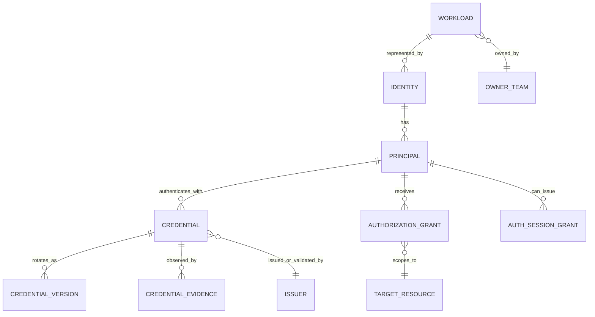
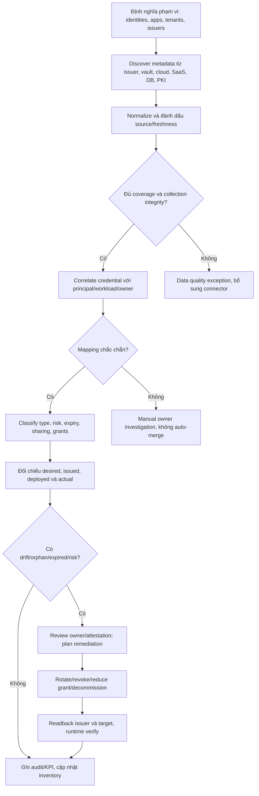
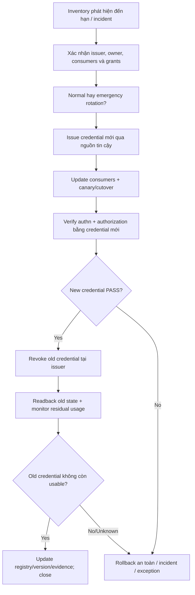
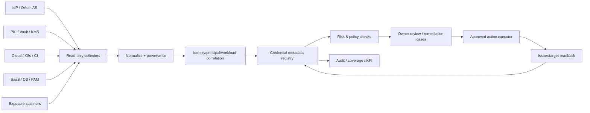

# Kiểm kê credential trong IAM và vòng đời danh tính Joiner–Mover–Leaver

## Mục tiêu học tập

Sau bài học, người học có thể:

1. Giải thích **kiểm kê credential (credential inventory)** là gì, vì sao tổ chức cần biết credential đang tồn tại ở **issuer, nơi lưu giữ và hệ thống đích**, không chỉ ở IAM catalog.
2. Phân biệt **identity, account/principal, credential, token, authentication grant, authorization entitlement, phiên truy cập** để tránh kiểm kê nhầm đối tượng.
3. Nhận diện các loại cần bao phủ: **mật khẩu service, API key, OAuth client secret, refresh token, access token metadata, certificate, private key reference, SSH key, database login, cloud access key, PAM secret, workload federation trust**.
4. Xây dựng **credential registry** có stable ID, owner, purpose, issuer, target, environment, creation/expiry, rotation, revocation, usage, provenance, evidence và risk class mà **không lưu raw secrets**.
5. Thiết kế pipeline **discovery → normalization → correlation → risk classification → attestation → remediation → readback** trên nhiều hệ thống.
6. Phát hiện credential **orphan, stale, shared, long-lived, unrotated, overprivileged, cross-environment** và credential còn hoạt động sau Mover/Leaver/decommission.
7. Liên kết inventory với **IdP, SSO, SCIM, RBAC/ABAC, PAM, KMS/HSM, PKI và secrets manager**, phân biệt metadata với quyền hiệu lực thực tế.
8. Xây dựng policy, pseudocode, checklist, KPI, audit và tình huống thực hành để giảm **quyền truy cập tồn dư**.

## 1. Credential inventory là gì?

**Credential inventory** là quá trình **tìm ra, định danh, phân loại, liên kết trách nhiệm và duy trì trạng thái** của những vật chứng xác thực hoặc truy cập đang được tổ chức phát hành, tin cậy, lưu giữ hay sử dụng.

Một inventory có ích trả lời được:

- **Có credential nào?** API key, client secret, SSH key, certificate, password, token grant, signing key...
- **Ai hoặc cái gì sử dụng?** Nhân viên, service principal, workload, thiết bị, bot, tích hợp SaaS...
- **Credential đó chứng minh danh tính nào?** Identity/principal và target account tương ứng.
- **Ai chịu trách nhiệm?** Business sponsor, technical owner, application owner.
- **Được cấp khi nào, vì sao, còn hạn đến bao giờ?** Issuance, purpose, approval, rotation, expiry.
- **Credential được chấp nhận ở đâu?** Issuer, audience, verifier, cloud account, tenant, API, database.
- **Nó cho phép đến đâu?** Grant/entitlement, RBAC role, ABAC scope, policy hiện hành.
- **Đã từng sử dụng gần đây không?** Nguồn và độ tin cậy của usage evidence.
- **Có thể rotate/revoke thế nào?** Procedure, owner, dependent consumers và target readback.
- **Khi workload hoặc người sở hữu nghỉ/đổi vai trò, những credential nào cần xử lý?**

Một danh sách tên secret trong vault **chưa phải kiểm kê hoàn chỉnh** nếu không biết credential đó được issuer/target nào chấp nhận, gắn với principal nào và có thể còn bản sao ở đâu.

### 1.1. Mục tiêu: khả năng trả lời và hành động

Giả sử có alert một client secret bị lộ trong CI log. Nếu inventory đầy đủ, security team có thể tìm ngay:

```text
Credential ID: CRED-20319
Type: OAUTH_CLIENT_SECRET
Principal: SPN-INVOICE-EXPORT-PROD
Workload: invoice-export
Owner: FINANCE-PLATFORM
Issuer: CORPORATE-AUTH-SERVER
Target audiences: INVOICE-API
Tenant: tenant-vn
Created at: ...
Expires at: ...
Next rotation due: ...
Known consumers: billing-job-prod, billing-worker-prod
Current status: ACTIVE
Risk: HIGH
Runbook: REVOKE-CLIENT-SECRET-V2
```

Họ có thể tìm các grants, thực thi rotation, ngăn token mới, kiểm tra token đã phát và đối soát target. Nếu inventory chỉ ghi `invoice-secret` mà không có liên kết này, xử lý sự cố chậm và dễ bỏ sót quyền tồn dư.

### 1.2. Inventory là control vận hành, không phải bảng Excel “có một lần”

Credential có thể được tạo mới, rotate, copy sang nơi khác, bị xóa ở vault nhưng còn hiệu lực ở issuer, hoặc bị gắn thêm quyền khi workload đổi mục đích. Do đó inventory cần **liên tục cập nhật bằng quan sát nguồn thực tế**, không chỉ nhập thủ công lúc cấp.

```text
Khai báo mong muốn / approvals
              │
              ▼
        Credential Registry
              ▲
              │ reconcile
              ▼
Issuer + PKI + KMS + Vault + Cloud + DB + SaaS + CI/CD
              │
              ▼
       Observed actual state
              │
              ▼
   Risk / owner / scope / expiry
              │
              ▼
   Rotate / Revoke / Attest / Remediate
```

## 2. Phân biệt credential với các đối tượng IAM liên quan

### 2.1. Sáu lớp không được trộn lẫn

| Lớp | Câu hỏi | Ví dụ | Điều inventory cần giữ |
|---|---|---|---|
| **Identity** | Người/workload/thiết bị nào? | `NHI-EXPORT-01` | Stable identity ID, type, lifecycle |
| **Account/principal** | Issuer/target biết chủ thể bằng ID nào? | OAuth client ID, cloud principal | Principal/tenant/issuer ID |
| **Credential** | Chủ thể chứng minh mình bằng gì? | API key, secret, private key | Credential ID/type/status/metadata |
| **Authentication grant/trust** | Issuer tin credential theo điều kiện gì? | OIDC trust binding, client key registration | Trust policy, issuer, subject, audience |
| **Authorization entitlement** | Chủ thể được làm gì? | `invoice.export` role | Grant/role/action/resource/provenance |
| **Token/session** | Vật chứng ngắn hạn nào dùng ở runtime? | OAuth access token, app session | Issuance/revocation/expiry metadata theo nhu cầu |

Một credential hợp lệ có thể xác thực principal nhưng **không tạo ra quyền đọc dữ liệu** nếu target thiếu entitlement. Ngược lại, một account có role rộng có thể còn được truy cập bằng **credential thứ hai** khi credential thứ nhất đã revoke.

### 2.2. Inventory không phải “thu gom mọi token”

Đối với bearer access token thời hạn ngắn, lưu toàn bộ giá trị token vào inventory sẽ tạo thêm bề mặt đánh cắp rất lớn. Thay vào đó thường cần:

- Metadata issuance theo `clientId`, `subjectId`, `audience`, `scope`, `issuedAt`, `expiresAt`.
- Token family hoặc grant/session identifier được bảo vệ khi cần.
- Key ID/issuer version và revocation evidence.
- Tổng hợp metrics, không bắt buộc một row chứa **raw token** cho mỗi API request.
- Audit tham chiếu token bằng định danh an toàn (không cho phép trình token để truy cập).

**Refresh token** là credential nhạy cảm và thường có vòng đời dài hơn access token, nên cần inventory **grant/family/client/session metadata** và trạng thái revoke, không ghi plaintext refresh token để dễ tìm kiếm.

### 2.3. Credential rotation khác deprovision account

Rotate certificate hoặc OAuth client secret có thể giữ nguyên principal/role và thay **chỉ vật chứng xác thực**. Deprovision account thường phải xem toàn bộ:

```text
Identity / workload lifecycle
  → Principal/account state
  → Credential set (multiple secrets, keys, certificates)
  → Trusted issuers and token grants
  → Authorization entitlements
  → Active tokens, sessions and connections
  → Actual target enforcement
```

Inventory phải giúp người vận hành biết **cần chặn lớp nào** để quyền thật sự mất đi.

## 3. Phạm vi kiểm kê những loại credential

### 3.1. Bảng phân loại

| Nhóm | Ví dụ | Inventory nên biết | Không nên lưu |
|---|---|---|---|
| **User password** | Password của account cá nhân | Principal, policy, last changed, credential status nếu nguồn cho phép | Password, password hash lấy từ IdP |
| **Service password** | OS/database service login | Account, owner, vault reference, rotation, usage | Plain password |
| **API key** | SaaS integration key, gateway key | Key ID/prefix an toàn, issuer, scopes, expiry, owner | Raw API key |
| **OAuth client secret** | Confidential client secret | Client ID, credential ID, expiry, issuer, version | Secret value |
| **OAuth access token** | JWT/opaque token | Issuance/revocation/usage metadata, audience, grant family khi cần | Bearer token string |
| **OAuth refresh token** | Refresh-token family | Client, subject, device/session, family, expiry, rotation/reuse state | Raw refresh token |
| **Private key** | Client signing key, TLS key | Public-key fingerprint, key handle, owner, key use | Exported private key |
| **X.509 certificate** | TLS server/client, mTLS | Serial, issuer, SAN, thumbprint, validity, deployment | Private key |
| **SSH key** | Human automation, host keys | Key fingerprint, principal, allowed hosts, owner | SSH private key |
| **Cloud access key** | Static machine key | Key ID, role/principal, age, last-use signal | Secret access key |
| **KMS/HSM key** | Signing/encryption key handle | Key ID, state, aliases, key-use policy, owner | Raw key material |
| **Vault dynamic credential** | Leased DB login | Lease ID/status, target, lifetime, role mapping | Dynamic password |
| **Kubernetes token** | Projected ServiceAccount token | SA, namespace, issuer, audience, TTL, trust mapping | Raw projected token |
| **Workload federation binding** | CI OIDC subject-to-cloud role | Issuer, subject pattern, audience, role, version | Bearer subject token |
| **Device credential** | TPM/mTLS certificate, IoT credential | Device ID, cert/key handle, owner, attestation state | Device private key |
| **Recovery/bootstrap credential** | One-time bootstrap token | Purpose, issuer, consumed/expiry, custody | Token value |
| **PAM credential** | Privileged secret/checkout | Account, vault item, rotation, checkout/audit status | Raw administrator password |

Không phải loại nào cũng có thể được **liệt kê** bằng API. Cần ghi **coverage limitation** thay vì tự kết luận “không có credential” khi nguồn không hỗ trợ inventory.

### 3.2. Các đối tượng liên quan nhưng không phải credential

- **Public key và certificate công khai:** metadata/trust artifact; private key tương ứng mới là bí mật.
- **Key fingerprint:** định danh/nhận diện key, không thay private key.
- **RBAC role hoặc directory group:** là entitlement/assignment, không phải credential xác thực.
- **Account username hoặc client ID:** identifier, không phải proof bí mật.
- **SSO assertion và ID token:** token dùng theo protocol; không mặc định là bearer access token cho API khác.
- **PAM checkout request:** thao tác governance/custody, không tự chứng minh secret đã revoke.
- **Session cookie:** credential dạng bearer cho application session; inventory thường quản lý session metadata/trạng thái, tránh thu raw cookie.

### 3.3. Theo dõi cả credential không cấp từ IAM

Có thể phát sinh:

1. API key tạo trực tiếp trong SaaS portal.
2. SSH key được thêm thủ công vào `authorized_keys`.
3. Certificate cấp bởi PKI khác với CA doanh nghiệp.
4. Local database user và password chưa đăng ký.
5. Cloud service account key do developer download.
6. CI secret biến môi trường do team tự tạo.
7. Personal access token của người dùng được job tự động sử dụng.
8. Credential của đối tác qua federation.
9. Legacy script có tài khoản hard-code.
10. Emergency credential được tạo khi incident.

**Shadow credentials** là một lý do quan trọng cần discovery từ hệ thống đích và nguồn runtime, không chỉ từ approval workflow.

## 4. Kiến trúc dữ liệu credential inventory

Một inventory tốt nên thiết kế **quan hệ** thay vì một bảng cố gắng chứa tất cả bí mật và tất cả quyền.

### 4.1. Sơ đồ thực thể logic



Các quan hệ là mô hình học tập. Có thể **nhiều workload dùng một principal** trong các trường hợp được thiết kế và phê duyệt, nhưng đó cần là quyết định có kiểm soát vì rủi ro blast radius.

### 4.2. Record chính của một credential

| Nhóm trường | Metadata cần thiết |
|---|---|
| Identity | `credentialId`, `credentialType`, `credentialVersion` |
| Principal | `identityId`, `principalId`, `principalType`, `tenantId` |
| Ownership | `ownerTeamId`, `businessSponsorId`, `backupOwner` |
| Business | `workloadId`, `purpose`, `environment`, `riskClass` |
| Trust | `issuerId`, `trustPolicyId`, `audiences`, `publicKeyId` |
| Storage | `vaultItemReference`, `kmsKeyHandle` hoặc `managedIdentityReference` |
| Target | `targetSystemIds`, `resourceScopeRefs` |
| Timeline | `createdAt`, `notBefore`, `expiresAt`, `lastRotationAt`, `nextRotationDueAt` |
| Status | `issuerState`, `inventoryState`, `revokedAt`, `decommissionedAt` |
| Usage | `lastObservedAuthenticationAt`, `usageSource`, `usageCoverage` |
| Governance | `requestId`, `approvalId`, `policyVersion`, `exceptionId` |
| Evidence | `discoverySource`, `observedAt`, `sourceRevision`, `readbackEvidenceRef` |

Một credential có nhiều versions do rotation cần xác định **version nào active**, version nào trong cutover window và version nào đã được target chứng minh không còn dùng được.

### 4.3. JSON record minh họa

```json
{
  "credentialId": "CRED-20319",
  "credentialVersion": 4,
  "credentialType": "OAUTH_CLIENT_SECRET",
  "principal": {
    "identityId": "NHI-INVOICE-EXPORT-PROD",
    "principalId": "OIDC-CLIENT-INVOICE-EXPORT",
    "tenantId": "corp-vn",
    "type": "WORKLOAD"
  },
  "ownership": {
    "technicalOwnerTeamId": "FINANCE-PLATFORM",
    "businessSponsorId": "FINANCE-DATA-OWNER"
  },
  "purpose": "Export approved invoices",
  "environment": "PRODUCTION",
  "issuerId": "CORPORATE-AUTH-SERVER",
  "audiences": ["INVOICE-API"],
  "vaultItemReference": "vault://finance/invoice-export/oidc-client",
  "createdAt": "2026-10-03T01:00:00Z",
  "expiresAt": "2027-01-03T01:00:00Z",
  "nextRotationDueAt": "2026-12-20T01:00:00Z",
  "issuerState": "ACTIVE",
  "lastObservedAuthenticationAt": "2026-11-22T03:30:00Z",
  "usageSource": "AUTH_SERVER_AUDIT",
  "observedAt": "2026-11-23T00:00:00Z",
  "riskClass": "HIGH",
  "approvalReference": "ACCESS-REQ-3811",
  "policyVersion": "credential-governance-v6",
  "rawSecretStoredInInventory": false
}
```

Đây là **schema nội bộ minh họa**, không phải SCIM resource hay OAuth response chuẩn. Không để một trường `vaultItemReference` tự được giải tham chiếu thành secret cho mọi người xem inventory.

### 4.4. Các mối quan hệ 1–n cần hỗ trợ

- Một **service identity** có nhiều principals (cloud/DB/SaaS).
- Một **principal** có nhiều credential active trong rotation overlap.
- Một **credential** có thể được sao chép tới nhiều consumers — cần phát hiện và giảm.
- Một **principal** nhận nhiều grants với provenance khác nhau.
- Một **workload** triển khai nhiều environments với trust riêng.
- Một **token grant** có nhiều access tokens phát theo thời gian.
- Một **certificate** có thể được deploy trên nhiều hosts; cùng cert/key copy rộng là risk cần đánh giá.

Không dùng display name hoặc email làm khóa join duy nhất; nên dùng **issuer + tenant + stable identifier**.

## 5. Từ “declared” đến “actual”: các lớp trạng thái

### 5.1. Năm trạng thái cần so sánh

```text
DECLARED:
  Service registry và người quản lý khẳng định cần credential này.

APPROVED:
  Request/approval/exception cho phép cấp hoặc duy trì credential.

ISSUED:
  Issuer/CA/AS đã tạo và tin credential.

DEPLOYED_OR_USED:
  Credential có trong runtime/vault hoặc có authentication event.

EFFECTIVE:
  Credential + current grant + target policy cho phép action.
```

Một credential có record `DECLARED` nhưng chưa issued không phải một secret đã tồn tại. Một credential được ghi `REVOKED` trong inventory nhưng issuer vẫn nhận nó là **state drift**.

### 5.2. Desired vs actual state

| Inventory/desired | Issuer/target actual | Phân loại |
|---|---|---|
| Credential phải ACTIVE | Issuer ACTIVE, đúng scope | Phù hợp trong phạm vi kiểm chứng |
| Credential đã RETIRED | Issuer ACTIVE | **Orphan/Residual credential** |
| Cần một active key | Issuer còn ba active keys ngoài rotation window | **Excess credentials** |
| Role read-only | API key gắn admin role | **Overprivileged grant** |
| Dev-only | Issuer tin token ở prod | **Cross-environment trust drift** |
| Không dùng password nhân viên | Batch dùng personal token | **Shadow/human credential misuse** |
| Cert hết hạn | Target vẫn cho xác thực | **Verifier/rotation failure** |
| Secret đã rotate | Credential cũ vẫn được sử dụng | **Residual key acceptance** |
| Cred có owner team | Owner đã giải thể hoặc contractor hết hạn | **Unowned/invalid ownership** |
| Credential từ nguồn A | App còn direct credential B | **Coverage gap** |

**Reconciliation** phải nêu rõ nguồn actual và thời gian quan sát; nếu issuer không cho đọc trạng thái active keys, không được kết luận đã verified.

## 6. Nguồn dữ liệu kiểm kê và độ tin cậy

### 6.1. Ma trận nguồn

| Nguồn | Có thể cung cấp | Giới hạn cần ghi |
|---|---|---|
| **IAM/IGA catalog** | Identity, owner, approvals, grants | Không luôn thấy credential tạo thủ công |
| **HRIS/contractor system** | Human owner, start/move/end dates | Không là source of truth mọi workload |
| **Service catalog/CMDB** | Workload purpose, environment, owner team | Có thể stale nếu deploy ngoài quy trình |
| **IdP/Authorization Server** | OAuth clients, secrets metadata, keys, grants, token-family state | Không luôn cho đọc token strings/target sessions |
| **PKI/CA** | Certificate issuance, serial, validity, revocation | Không biết mọi nơi cert được triển khai |
| **KMS/HSM** | Key handles, key state, key usage audit | Không luôn biết mọi client verifier |
| **Vault/secrets manager** | Secret item, versions, rotation, ACL | Không biết bản copy ngoài vault |
| **Cloud IAM** | Access key IDs, principals, roles, last-use signal | Last-used telemetry có delay/giới hạn |
| **Kubernetes** | ServiceAccount, secrets, trust bindings | Không tự liệt kê token runtime đã phát trong mọi triển khai |
| **CI/CD** | Pipeline connections, secret references, OIDC trust configuration | Có thể có biến bí mật không quản trị tập trung |
| **Database** | Users, auth methods, privileges, activity | DB có thể dùng tài khoản chung |
| **SaaS API** | API keys, personal tokens, role assignments | Phụ thuộc provider và scopes của connector |
| **SSH host inventory** | Authorized keys, SSH CA policies | Có thể thiếu offline hosts |
| **PAM** | Managed credentials, checkout, rotation | Credential ngoài PAM vẫn tồn tại |
| **SIEM/API audit** | Credential usage, anomalous access | Không phải mỗi lần không thấy log là không sử dụng |

### 6.2. Source of truth theo thuộc tính

Không có một hệ thống luôn là nguồn đúng cho mọi trường:

- **HRIS:** trạng thái hợp lệ của nhân viên/chủ sở hữu con người.
- **Service catalog:** workload còn tồn tại, business purpose và technical owner.
- **Issuer/CA/AS:** credential được phát và được issuer chấp nhận.
- **Target:** credential/account/role có được target thực tế chấp nhận hay không.
- **IGA:** approval/grant provenance và policy.
- **PAM/vault:** custody, rotation, checkout theo phạm vi quản lý.

Nếu dữ liệu mâu thuẫn, cần **quy tắc ưu tiên và exception**, không tự chọn nguồn thuận tiện nhất để báo xanh.

### 6.3. Thu thập với quyền tối thiểu

Collector inventory thường chỉ cần **read/list metadata**, không nên có quyền export private keys, đọc plaintext secrets hoặc tự tạo credentials mới.

Ví dụ collector cloud cần liệt kê access key IDs/status/last-use nhưng không cần quyền tạo user/admin role. Collector certificate có thể đọc public cert metadata nhưng không cần export private key.

## 7. Quy trình kiểm kê end-to-end



### 7.1. Stage 1: Scoping

Xác định:

1. Những environment/tenant/cloud accounts cần bao phủ.
2. Human/service/workload/device identities nào thuộc phạm vi.
3. Issuer/target nào có API inventory.
4. Credential types nào cần quản trị chặt theo risk.
5. Các nguồn chỉ có dữ liệu on-premises hoặc offline.
6. Những hệ thống chưa có connector hoặc chưa biết credential source.
7. SLA collection, alert và response theo risk.

Mẫu số của coverage phải dựa trên **phạm vi tài sản/hệ thống đáng tin**, không chỉ số API trả về.

### 7.2. Stage 2: Discovery

Thu metadata bằng API read-only có pagination, filter, tenant và quyền giới hạn; lưu timestamp/source version. Có thể bổ sung **secret scanning** trên source code, image, artifacts, ticket hoặc CI logs theo quy định và quyền truy cập phù hợp. Kết quả scan thường chỉ là **dấu hiệu credential exposure**, không phải bằng chứng issuer còn chấp nhận.

### 7.3. Stage 3: Normalize

Chuyển các record khác nhau về schema chung:

```text
CloudAccessKey.KeyId → credential.externalId
PKI.certificateSerial → credential.serial
OAuthClient.credentialKeyId → credential.keyId
Vault.secretVersion → credential.version
Target.ApiKeyId → credential.externalId

Always attach:
  sourceSystemId + sourceTenantId + observedAt + collectorVersion
```

Không ép mọi loại credential phải có field `expiresAt`. Một số key không có expiry và chính điều đó cần được ghi `NO_EXPIRY_SUPPORTED/NOT_CONFIGURED`, không đoán ngày.

### 7.4. Stage 4: Correlation

Liên kết:

```text
Credential
  → Issuer principal
  → IAM identity / target account
  → Service/workload or human
  → Owner/sponsor
  → Granted entitlements and intended consumers
  → Actual target usage
```

Correlation mơ hồ phải tạo **case**. Không tự gán một API key cho người duy nhất có tên email giống khi nhiều tenants hoặc aliases cùng tồn tại.

### 7.5. Stage 5: Review và remediation

Credential thiếu owner, hết hạn, không dùng, shared, admin hoặc ngoài scope cần review. Có thể:

- Gỡ credential thừa.
- Rotate secret/certificate.
- Chuyển sang federation/managed identity.
- Đổi owner và giới hạn ACL.
- Giảm role/scope.
- Chặn personal token dùng cho automation.
- Thu hồi quyền sau Leaver/retire.
- Mở incident nếu nghi compromise.

Không tự xóa credential production chỉ vì “last used” trống; cần phân biệt **không dùng** với **không có telemetry** và dependency rủi ro cao.

### 7.6. Stage 6: Readback và closure

Một lệnh revoke thành công phải được kiểm tra theo capability:

1. Issuer báo credential disabled/revoked.
2. Target hoặc AS không phát token mới qua credential đó.
3. Role/grant không còn theo desired policy.
4. Existing tokens/sessions được xử lý.
5. Negative authorization test hoặc telemetry phù hợp.
6. Record evidence và exception nếu không thể chứng minh.

**Một HTTP 2xx từ connector không tự chứng minh quyền không còn dùng được.**

## 8. Discovery: phát hiện credential từ nhiều nguồn

### 8.1. API-based inventory

Thu thập từ API quản trị hoặc SDK của:

- OAuth clients/credential registrations tại AS.
- Cloud IAM access key listing.
- CA certificate issuance/revocation.
- Vault metadata và secret versions.
- PAM managed account references.
- SaaS API tokens/app integrations.
- DB login/catalog và auth methods.
- Kubernetes ServiceAccounts và projected-token trust configuration.

Nên có **pagination, rate-limit handling, retry có giới hạn, checkpoint và snapshot version**. Nếu connector thiếu permission hoặc API phân trang bị bỏ dở, đánh dấu `PARTIAL` chứ không diễn giải 0 records là 0 credentials.

### 8.2. Secret scanning

Secret scanning có thể phát hiện chuỗi giống credential ở nơi không nên chứa:

- Source repository và lịch sử commit theo phạm vi được cấp phép.
- Container images/build artifacts.
- CI/CD variables/logs.
- Infrastructure-as-code và config files.
- Ticket/chat nội bộ nếu được policy cho phép.
- Lưu trữ backup hoặc file share theo quyền hợp lệ.

Kết quả cần phân loại:

| Kết quả scan | Diễn giải |
|---|---|
| Pattern match | Chưa chắc là credential thật |
| Entropy signal | Có thể là secret, chưa biết issuer |
| Known issuer format + context | Tăng độ tin cậy |
| Match credential ID/key prefix an toàn | Có thể correlation |
| Issuer metadata cho biết key active | Bằng chứng tồn tại mạnh hơn |
| Target authn success được ghi | Bằng chứng đã có tác động ở runtime |
| Issuer không hỗ trợ verify | Phải để `UNKNOWN`, không thử bruteforce |

**Scanner không nên đăng/đẩy raw secret sang inventory, log hoặc hệ thống bên thứ ba không được phê duyệt.** Xử lý exposure cần quy trình incident và data minimization.

### 8.3. Không tự xác thực bằng secret tìm thấy

Một credential bị phát hiện trong file không nên được “kiểm tra” bằng cách tự động đem thử vào production endpoint không có quy trình phê duyệt: có thể làm phát sinh sử dụng trái phép, rate-limit lockout, audit noise hoặc rủi ro dữ liệu.

Ưu tiên **issuer status APIs và metadata**; nếu cần xác minh hiệu lực, phải dùng một quy trình test an toàn có thẩm quyền, account/target rõ và tránh thao tác gây thay đổi dữ liệu.

### 8.4. Thu thập certificate

Certificate thường là dữ liệu công khai nên có thể thu từ:

- CA issuance database.
- TLS endpoints và service inventory.
- Reverse proxies/load balancers.
- Service mesh identity management.
- Cloud certificate managers.
- Ingress/gateway configuration.
- Device enrollment system.

Một certificate public đang lộ ở TLS endpoint **không chứng minh private key còn ở đúng nơi**, cũng không tự chứng minh certificate đó đang được dùng ở tất cả instances.

## 9. Identity correlation và deduplication

### 9.1. Stable identifiers

Một record nên ưu tiên khóa:

```text
Credential:
  sourceSystemId
  + issuerTenantId
  + issuerCredentialId (or serial/keyId stable in that source)

Principal:
  principalIssuerId
  + tenantId
  + immutablePrincipalId

Workload:
  workloadRegistryId
  + environment
  + deployment boundary
```

Tên như `svc-finance` có thể trùng ở nhiều tenant. Email của human owner có thể thay khi Mover hoặc rehire. Không tự hợp nhất bằng display name đơn lẻ.

### 9.2. Public-key fingerprint và secret fingerprint

- **Public key/certificate fingerprint** hỗ trợ tìm certificate/key reuse, với đủ issuer/serial/identity context.
- **Secret fingerprint** nếu cần phát hiện reuse phải được thiết kế **không tiết lộ bí mật**. Hash thuần của secret entropy thấp (đặc biệt password) có thể tạo điều kiện suy đoán ngoại tuyến.
- Có thể dùng cơ chế keyed fingerprint/HMAC trong vùng tin cậy với kiểm soát khóa và retention khi đã đánh giá rủi ro; không lưu raw secret để tính lại tùy ý.
- Không xem fingerprint match là bằng chứng owner chính xác khi credential đã copy ra nhiều nơi.

### 9.3. Nhiều bản sao của một credential

Một OAuth client secret có thể xuất hiện ở ba CI pipelines. Inventory nên lưu **một credential gốc** và các **consumer/deployment references**, để thấy sharing ngoài trust boundary.

```text
CRED-20319
   |
   +-- registered at Authorization Server
   +-- stored in Vault version V4
   +-- consumed by invoice-worker-prod
   +-- consumed by settlement-cron-prod   <-- unexpected
   +-- copied into retired job config      <-- remediation needed
```

Khi rotate, phải xử lý mọi consumer đã biết; với bản copy không kiểm kê được, **revoke tại issuer** là lớp chặn quan trọng.

### 9.4. Trường hợp correlation không chắc chắn

Nếu một credential xuất hiện ở ứng dụng nhưng không có record owner:

```text
credential.ownerStatus = UNKNOWN
credential.correlationStatus = NEEDS_REVIEW
credential.riskClass = based on issuer/privileges/exposure
nextAction = owner investigation or controlled remediation
```

Không gán owner giả để đạt KPI đầy đủ, hoặc tự xóa credential của hệ thống quan trọng mà không có risk assessment.

## 10. Không lưu bí mật thô trong inventory

### 10.1. Điều tuyệt đối cần tránh

Credential inventory thường có quyền xem của audit, security, app owner và vận hành. Nếu nó lưu raw secret, inventory có thể trở thành **kho credential tập trung nguy hiểm**.

Không lưu:

- Plaintext password hoặc secret.
- Raw OAuth access/refresh tokens.
- Authorization/Cookie headers.
- Private keys hoặc SSH private keys.
- OTP/recovery codes.
- Full database connection strings chứa password.
- Signed JWT bearer token nguyên vẹn khi không cần thiết.
- Credential values thu từ Git/CI logs để “đối chiếu cho tiện”.

### 10.2. Thay thế bằng metadata không thể dùng để đăng nhập

| Không nên lưu | Nên lưu |
|---|---|
| `apiKeyValue` | Provider key ID, an toàn prefix nếu policy cho phép |
| `clientSecret` | Credential registration ID, expiry và issuer |
| `privateKeyPem` | KMS handle, public fingerprint, key ID |
| `refreshToken` | Grant/family ID an toàn, lifecycle status |
| `sessionCookie` | Opaque/hardened session reference và revoke epoch |
| `passwordHashFromIdP` | Password policy/last rotation event khi được cung cấp |
| `fullCertificatePrivateKeyBundle` | Public cert serial, issuer, SAN, notAfter |
| `sshPrivateKey` | Public key fingerprint, authorized host/role |
| `vaultSecretPlaintext` | Vault path/reference và version |
| `accessTokenJwtString` | Issuance metadata, audience, scope, expiry |

### 10.3. Public metadata cũng cần phân quyền

Certificate SAN, service names, cloud account IDs, key IDs và vault paths có thể tiết lộ topology, role owners, dữ liệu nghiệp vụ hoặc tài khoản mục tiêu. Không nên công khai inventory cho mọi người chỉ vì không chứa raw secret.

Cần least-privilege **read permissions**, row-level tenancy, audit export và cơ chế che dữ liệu nhạy cảm theo role.

### 10.4. Tại sao không “mã hóa toàn bộ secret trong cùng DB inventory”?

Mã hóa dữ liệu at rest hữu ích nhưng **không tạo ranh giới chức năng** nếu inventory service cũng có khóa giải mã và nhiều người được truy cập. Nếu cần custody của secret, dùng vault/KMS được quản trị riêng, còn inventory chỉ lưu **reference và trạng thái**.

## 11. Ownership và trách nhiệm kiểm kê

### 11.1. Owner không đơn giản là người tạo key

Developer tạo API key rồi chuyển team không còn là người chịu trách nhiệm hợp lệ. Một record cần phân biệt:

| Vai trò | Chịu trách nhiệm |
|---|---|
| **Business sponsor** | Nhu cầu kinh doanh và mục đích |
| **Technical owner/team** | Runtime, deploy, rotation, incident |
| **Application/data owner** | Permission và data scope |
| **Credential issuer owner** | Phát hành/revoke/trust policy |
| **Risk/security owner** | Ngoại lệ, credential nhạy cảm, SoD |
| **Inventory/IGA owner** | Correlation, evidence và reconciliation |
| **Auditor** | Kiểm tra độc lập control, không giữ raw secrets |
| **Backup/on-call owner** | Xử lý khi owner chính vắng mặt |

Account không đại diện một người vẫn phải có **team ownership** và escalation route.

### 11.2. Trạng thái ownership

```text
OWNED:
  Có owner team và business sponsor còn hợp lệ.

OWNER_TRANSFER_PENDING:
  Owner thay đổi, đang chuyển giao và kiểm tra exposure.

UNOWNED:
  Không có owner được xác nhận.

OWNER_CONFLICT:
  Nhiều nguồn khai báo owner khác nhau.

RETIRED_WORKLOAD:
  Service không còn nhưng credential vẫn được issuer chấp nhận.
```

Các trạng thái thuộc mô hình nội bộ, không phải tiêu chuẩn IAM bắt buộc.

### 11.3. Review người sở hữu theo mức rủi ro

Privileged credential, CA signing key, admin API key hoặc credential production có thể cần owner review thường xuyên hơn một certificate test. Nhưng **không có chu kỳ chuẩn duy nhất** cho mọi tổ chức; phải theo policy, risk và yêu cầu tuân thủ áp dụng.

## 12. Joiner–Mover–Leaver và credential inventory

### 12.1. Joiner

Khi người mới nhận công việc, IAM có thể cấp account, MFA credential và quyền vận hành workloads. Inventory cần:

- Gắn tài khoản/credential cá nhân đúng identity đã proofed.
- Không cấp credential trước eligibility/start date nếu policy cấm.
- Không tự trao raw service secrets cho người mới.
- Phân biệt credential cá nhân và quyền được phép **quản trị credential của service**.
- Kiểm tra SoD nếu người đó vừa tạo secret vừa có thể tự cấp admin grants.

### 12.2. Mover: rủi ro credential tồn dư

Một engineer rời team Payments sang CRM có thể không còn entitlement Payments nhưng vẫn:

- Có copy của client secret cũ.
- Có SSH key trong jump host.
- Được phép đọc Vault path cũ.
- Sở hữu personal access token tích hợp CI.
- Có client certificate chưa revoke.
- Có local database login không thuộc IdP.

Inventory phải liên kết người và workload/target mà họ từng quản trị:

```text
HR Mover event
   → Remove human admin/vault/CI permissions
   → Find exposed/exportable credentials managed by person
   → Review ownership and handover
   → Rotate/revoke affected credential set by risk
   → Reconcile issuer, target and runtime access
```

**Không nhất thiết xóa credential của workload vẫn cần**; có thể cần chuyển owner và rotate secrets, đồng thời giữ dịch vụ hoạt động.

### 12.3. Leaver

Khi Leaver có hiệu lực:

1. Disable human accounts/SSO/PAM access.
2. Revoke personal tokens, SSH keys, local accounts và admin sessions.
3. Tra inventory credential do người đó tạo, quản trị, checkout hoặc có thể biết.
4. Xác nhận owner của các workloads còn phục vụ nghiệp vụ.
5. Rotate/revoke shared/exportable credentials theo risk và exposure.
6. Chặn cơ chế nhận credential mới từ identity Leaver.
7. Đối soát app-local API keys/DB users/certificates.
8. Kiểm tra token/session tồn dư ở target.
9. Ghi exception nếu nguồn không hỗ trợ readback/revocation sớm.

Một Leaver event **không tự làm machine credential của service principal độc lập hết hạn**. Mặt khác, giữ credential cá nhân của Leaver vì automation “còn chạy” là anti-pattern; cần chuyển sang service identity phù hợp.

### 12.4. Rehire

Người được tuyển lại có thể có cùng email hoặc stable identity ID nhưng **engagement epoch** mới. Không khôi phục mù old access keys, refresh-token grants, SSH keys hoặc PAM checkouts của giai đoạn công việc cũ.

### 12.5. Contractor và guest

Một contractor có credential để truy cập tài nguyên theo hợp đồng. Inventory cần `sponsor`, `contractValidUntil`/engagement state và target grants. Khi hợp đồng hết, không được để credential tiếp tục active chỉ vì token hoặc certificate còn hạn dài hơn.

## 13. Kiểm kê credential cho service/workload identities

### 13.1. Non-human identity có lifecycle riêng

Một service principal không có HR employee lifecycle theo nghĩa con người. Nguồn điều kiện phù hợp có thể là:

- Service catalog/CMDB.
- Deployment inventory/namespace/cloud resource.
- Owner team, business sponsor, on-call.
- Dependency của hệ thống.
- Credential method/trust issuer.
- Application/data grants.
- Scheduled review và decommission plan.

### 13.2. Một workload có nhiều đường truy cập

```text
invoice-export-prod
   ├─ OAuth confidential client: cert key K1
   ├─ Kubernetes ServiceAccount: billing/invoice-export
   ├─ Cloud IAM principal: data-read-role
   ├─ Database login: reporting_reader
   └─ Legacy SaaS API key: FIN-KEY-19
```

Disable OAuth client không tự revoke database login hay legacy SaaS API key. Inventory phải hỗ trợ **nhiều principal/credential/issuer cho cùng workload**.

### 13.3. Owner Leaver nhưng workload còn chạy

Nếu người từng tạo `nightly-backup` nghỉ việc:

- Không tự xóa backup job trước khi đánh giá business continuity.
- Revoke người đó khỏi CI/vault/PAM.
- Xác định secret nào họ đã export/có thể biết.
- Rotate theo risk và chuyển technical owner.
- Thu hẹp backup grants; ví dụ tách create-backup khỏi delete-backup.
- Đối soát các key cũ tại issuer/target.

### 13.4. Workload retired

```text
Service catalog: RETIRED
Kubernetes deployment: absent
Cloud principal: ACTIVE
OAuth client: ACTIVE
Secret in vault: ACTIVE
SaaS API key: ACTIVE
```

Đây là **credential orphan** rõ ràng. Cần xác định dependency còn sót, lên kế hoạch revoke và chứng minh ở target. Không coi “không thấy workload chạy” là đủ để xác nhận mọi credential đã vô hiệu.

## 14. IdP, SSO, OAuth và token inventory

### 14.1. IdP và Authorization Server

IdP/AS có thể nắm:

- Client registrations, client IDs và service principals.
- Client secrets/key bindings.
- Token endpoint authentication method.
- OAuth grants/consent.
- Refresh-token family/session metadata.
- Trusted issuers/federation mappings.
- Keys signing tokens và rotation schedule.
- Authentication/issuance logs.

Không giả định IdP cung cấp API đọc **mọi active access token**, nhất là JWT tự chứa đã phát. Thiết kế inventory cần phù hợp capability thực tế và có coverage notes.

### 14.2. OIDC và SSO

Phiên đăng nhập SSO là một loại **authentication session**; OIDC ID token không tự là access token cho API bất kỳ. Inventory cần phân biệt:

```text
IdP user/session metadata
  ≠ OAuth refresh token value
  ≠ OAuth access token value
  ≠ RP application cookie
  ≠ service client secret
  ≠ RBAC entitlement
```

Nếu IdP user bị disable, ứng dụng có thể vẫn còn app-local session/JWT. Credential inventory hỗ trợ phát hiện các **grants và tokens/session families** liên quan, nhưng không thay khả năng session revocation ở RP/API.

### 14.3. Access token: metadata chứ không phải bản sao bearer

Với token issuance, inventory/telemetry có thể thống kê:

```json
{
  "eventType": "ACCESS_TOKEN_ISSUED",
  "issuerId": "CORPORATE-AUTH-SERVER",
  "principalId": "OIDC-CLIENT-INVOICE-EXPORT",
  "audience": "INVOICE-API",
  "scopes": ["invoice.read_approved"],
  "issuedAt": "2026-11-22T03:10:00Z",
  "expiresAt": "2026-11-22T03:20:00Z",
  "credentialVersionReference": "CRED-20319-v4",
  "rawTokenStored": false
}
```

Tùy provider, không nhất thiết lấy được mọi trường. Không nên lưu raw token để audit hoặc đối soát.

### 14.4. Refresh token inventory

Trường hữu ích:

- Client/principal/subject.
- Grant/family reference.
- Device/session context khi phù hợp.
- Issued/last rotation/absolute expiry.
- Status active/revoked/expired.
- Reuse detections/alerts.
- Consent/grant/policy references.
- Last refresh metadata.
- Revocation evidence.

Nếu người dùng Leaver hoặc grant bị revoke, refresh-token family cần xử lý theo AS capability. Chặn refresh token mới không tự khiến mọi access JWT cũ bị verifier offline từ chối ngay.

### 14.5. Federation không phải “không có credential”

Workload federation giảm static secret nhưng vẫn có:

- Trusted issuer và keyset/trust bundle.
- Subject/audience/tenant binding.
- Identity token hoặc assertion ngắn hạn.
- Target IAM role/grant.
- Revocation/disable trust policy.
- Runtime identity ownership.

Inventory cần kiểm kê **trust bindings và principal/grant metadata**, không gán nhãn `NO_CREDENTIAL` rồi bỏ qua rủi ro.

## 15. SCIM, Directory, RBAC/ABAC và credential inventory

### 15.1. SCIM 2.0 giải quyết bài toán khác

SCIM có thể quản lý `User` và `Group` ở target hỗ trợ, phục vụ provisioning/deprovisioning. SCIM không cung cấp một **schema inventory chung cho mọi API key, OAuth client secret, private key, cloud access key hoặc certificate**.

Một SCIM `User.active=false` có thể disable account ở target, nhưng không tự chứng minh local token/session, app API key hoặc trust binding đã mất. Cần dùng API/collector chuyên biệt khi cần.

### 15.2. Directory và máy chủ

Directory có thể chứa:

- Human/service account.
- Group membership.
- Account state/password metadata (trong phạm vi được phép).
- Service principal names/delegation configuration.
- Machine/computer accounts và certificate mappings.

Nhưng SSH keys trên host, database credentials hoặc SaaS personal tokens có thể ngoài directory. Không chỉ dùng một LDAP query rồi kết luận inventory đầy đủ.

### 15.3. Authorization phải được nối với credential

Một credential có thể chỉ dùng để **xác thực**, nhưng quyền hiệu lực do:

- RBAC roles và role hierarchy.
- Nested directory groups.
- Direct target entitlements.
- ABAC conditions (tenant, project, data classification).
- PAM/JIT privileged elevation.
- Delegated approvals hoặc temporary grants.
- App-local ACLs.
- Current identity lifecycle.

Ví dụ:

```text
OAuth client secret CRED-20319
  → Client principal OIDC-CLIENT-INVOICE-EXPORT
  → Role FinanceReportReader
  → Actions invoice.read_approved
  → Scope tenant-vn
  → No permission payment.approve
```

Nếu role sau này được mở thêm `payment.approve`, credential không đổi nhưng **blast radius tăng**. Inventory/risk analysis phải cập nhật từ grant source và role definition version.

### 15.4. SoD và credential administration

Một operator có quyền:

1. Tạo OAuth client secret.
2. Thay grant của principal thành global admin.
3. Xóa audit log.

có khả năng bypass governance. Cần tách nhiệm vụ, independent approval, PAM/JIT, policy change control và audit sink độc lập theo risk.

### 15.5. Credential inventory không thay enforcement

Dù credential record có `owner=Team A` và `risk=LOW`, API vẫn phải xác minh token/certificate, principal và resource authorization. Một trường inventory không được client tự khai rồi biến thành `PERMIT`.

## 16. Kiểm kê certificate, PKI và private-key references

### 16.1. Certificate inventory khác secret inventory

X.509 certificate chứa public key và metadata được CA ký. **Certificate không phải private key**, vì vậy có thể thu metadata về certificate từ CA/endpoint mà không thu private key. Inventory nên hỗ trợ:

| Trường | Ý nghĩa |
|---|---|
| `certificateId`/thumbprint | Định danh public certificate |
| `serialNumber` và `issuer` | Định danh trong ngữ cảnh CA |
| `subject` và `subjectAltNames` | Identity/host/service được gắn |
| `notBefore`/`notAfter` | Cửa sổ hiệu lực |
| `keyUsage`/`extendedKeyUsage` | Mục đích dùng (client/server auth, v.v.) |
| `publicKeyAlgorithm` | Thuật toán khóa công khai |
| `privateKeyHandle` | Tham chiếu KMS/HSM/vault, không phải key value |
| `certificateAuthorityId` | CA/trust anchor |
| `revocationState` | Trạng thái và thời điểm kiểm tra |
| `deploymentTargets` | Hosts, ingress, service mesh, clients |
| `ownerTeam`/`businessPurpose` | Trách nhiệm và nhu cầu |
| `renewalDueAt`/`lastObservedUseAt` | Lịch renewal và telemetry |

### 16.2. Certificate được phát không đồng nghĩa đã triển khai

```text
CA:
  New certificate ISSUED, not expired

Vault:
  New certificate bundle SAVED

Load balancer:
  Still presenting old certificate

Monitoring:
  Client handshake still observes old cert
```

Tổ chức **chưa hoàn tất renewal**, dù CA đã phát certificate mới. Cần đối soát issuer, nơi deploy và certificate thực tế được server trình.

### 16.3. Private key và certificate có lifecycle riêng

Một private key có thể được tái sử dụng với nhiều certificate kế tiếp. Nếu policy yêu cầu **đổi key material**, chỉ renew certificate nhưng giữ private key không đáp ứng mục tiêu. Inventory cần lưu public-key fingerprint/key handle để chứng minh key đã thay, không xuất private key.

Rotation **leaf certificate**, rotation **key pair** và rotation **CA/trust anchor** là ba công việc khác nhau, có kế hoạch deployment và risk khác nhau.

### 16.4. Những lớp revocation cần quan sát

- **CA:** Certificate có bị revoke/hết hạn không?
- **Verifier:** Có kiểm tra trust chain, intended usage, SAN, revocation đúng không?
- **Deployment:** Endpoint đang trình certificate nào?
- **Runtime:** TLS session hoặc access token dựa cert cũ còn khả dụng không?
- **Authorization:** Principal còn grants/roles nào sau khi xác thực?

Không giả rằng certificate được CA đánh dấu revoked làm mọi verifier lập tức ngắt kết nối. CRL/OCSP, cache, offline clients và phiên đang tồn tại có thể tạo cửa sổ còn hiệu lực.

### 16.5. SSH credentials

Với SSH, cần phân biệt **SSH client public keys**, **SSH host keys** và **SSH certificates**. Inventory nên biết fingerprint, principal, các host/authorized principals, key validity, owner và điểm tin cậy.

Một human key còn trong `authorized_keys` ở nhiều máy sau Leaver là **residual access**, dù IdP account đã disable. Không chỉ tìm keys trong thư mục home của một host mà bỏ qua bastion, Git server, deployment bots và SSH CA policies.

## 17. Vault, KMS/HSM và federation bindings

### 17.1. Secrets manager là nguồn metadata, không phải bằng chứng đầy đủ

Vault cung cấp item path, secret versions, ACL, rotation schedule và audit events. Nhưng bản secret có thể đã bị **copy ra môi trường ngoài vault**.

```text
Vault secret version
  → Credential registration at issuer
  → Consumer workloads/deployments
  → Target authentication
  → Current grants / effective permissions
```

Nếu vault báo deleted nhưng Authorization Server vẫn chấp nhận old client secret, inventory phải báo **drift** chứ không chuyển thành revoked verified.

### 17.2. Key management inventory

KMS/HSM có thể cung cấp:

- Key handle, owner, purpose (sign/decrypt/encrypt).
- Key creation/rotation state, aliases và versions.
- Key-use policy và principal được phép gọi `Sign`/`Decrypt`.
- Key-use audit/telemetry.
- Trust mapping giữa public key, certificate và verifier.
- Key disabled/revoked evidence.

Một private key **non-exportable** không làm signing service miễn nhiễm: attacker có quyền gọi signer vẫn có thể lạm dụng khóa dù không đọc được key material.

### 17.3. Federation cũng có credential-like trust assets

Workload dùng OIDC federation thay static secret vẫn có:

```text
Issuer:
  https://issuer.example.org

Allowed subject:
  repo:org/invoice-export:environment:production

Audience:
  cloud-token-exchange

Mapped role:
  invoice-export-prod-reader
```

Nếu issuer/subject wildcard rộng, workload khác có thể xin access token/role production. Vì vậy cần kiểm kê **trust policy, allowed audiences/subjects, issuer keys, role mappings, owner và policy versions**.

### 17.4. Không coi vault path là credential ID duy nhất

Một secret có thể bị rename/move, và một path có thể chứa nhiều versions. Nên dùng stable credential ID và source version, tránh coi rename là revoke hoặc một secret mới cùng tên là cùng credential cũ.

## 18. Privileged credentials và PAM

### 18.1. Quyền cao cần độ sâu kiểm kê khác

Các credentials rủi ro cao có thể gồm:

- Domain/cloud administrators.
- Database superusers.
- CA signing keys và certificate issuer accounts.
- Secrets vault root/privileged operators.
- Backup deletion/restore credentials.
- CI/CD production deploy principals.
- IAM role management APIs.
- Break-glass credentials và emergency accounts.

Risk classification phải dựa trên **effective privileges**, không chỉ chuỗi `admin` trong tên credential.

### 18.2. PAM-managed không đồng nghĩa mọi đường truy cập đã được quản lý

PAM có thể onboard một account và rotate password, trong khi account đó vẫn còn:

- SSH key riêng ngoài PAM.
- Local/API credential do team khác tạo.
- Personal access token.
- Cloud access key đã download.
- Active session/token có TTL khác.
- Emergency credentials không có trong vault.

Inventory phải đối soát PAM-managed account với actual keys/roles ở target, không lấy danh sách PAM làm toàn bộ thực tế.

### 18.3. Evidence riêng của PAM

```text
Credential ID
  ├─ PAM vault item
  ├─ Target privileged account
  ├─ Checkout requester and approval
  ├─ Checkout time and expiration
  ├─ Rotation event / post-use controls
  ├─ Privileged session reference (nếu có)
  └─ Target/issuer readback
```

Không sao chép password hoặc session recording nguyên vẹn vào credential inventory; chỉ lưu references tới evidence được bảo vệ.

### 18.4. JIT/JEA vẫn cần inventory

Just-in-Time (JIT) và Just-Enough-Access (JEA) giảm duration/scope, nhưng cần biết:

- Principal nào eligible kích hoạt?
- Ai approve?
- Token/lease nào được phát?
- Quyền expire lúc nào?
- Phiên đặc quyền còn chạy sau expiry không?
- Có kiểm tra SoD và audit thực tế không?

Một PAM lease hết hạn không tự bảo đảm mọi API key ngoài PAM bị revoke.

## 19. Rotation: từ credential inventory tới hành động

### 19.1. Mỗi credential phải có runbook

Một record thực sự có ích phải trả lời:

1. Issuer nào chấp nhận credential và có API revoke?
2. Có bao nhiêu consumers?
3. Có chạy old/new song song được không?
4. Ai approval/owner?
5. Có giới hạn cutover window?
6. Dùng credential mới sẽ được kiểm tra như thế nào?
7. Cách xác minh old credential không còn được issuer chấp nhận?
8. Phản ứng nào áp dụng khi compromise, khác scheduled rotation?

### 19.2. End-to-end rotation



Khi secret bị lộ, tổ chức có thể cần revoke ngay thay vì chờ chuyển đổi êm, theo quyết định có thẩm quyền và mức độ ảnh hưởng.

### 19.3. Overlap window

Một OAuth client trong quá trình cutover có thể có hai credential versions:

```text
Credential family: INVOICE-EXPORT-CLIENT

Version V3:
  state = RETIRING
  issuer still accepts = true
  old consumers = 2
  overlap window ends = 2026-12-03T12:00Z

Version V4:
  state = ACTIVE
  issuer accepts = true
  new consumers = 2

Closure:
  V3 issuer accepts = false
  V3 unexpected usage = none (per observation coverage)
```

Hai active keys không mặc nhiên là lỗi trong overlap được phê duyệt; nhưng không được để old key sống mãi và ghi rotation complete.

### 19.4. Credential expiry khác authorization expiry

Một OAuth client secret có thể còn hiệu lực nhiều tháng trong khi role JIT chỉ có 30 phút. Token có lifetime riêng. Inventory phải giữ **nhiều hạn riêng** và không gia hạn privilege chỉ vì credential được rotate thành công.

### 19.5. Rotation không sửa role quá rộng

Rotate secret làm giảm rủi ro secret cũ nhưng không xóa `*:*` permissions. Phải liên kết credential với RBAC/ABAC grants và có least-privilege review riêng.

## 20. Revocation và readback: thế nào là xong?

### 20.1. Các trạng thái không được gộp

| Status | Điều đã xảy ra |
|---|---|
| `REVOCATION_REQUESTED` | Có yêu cầu thu hồi |
| `ISSUER_APPLIED` | Issuer đã nhận và xử lý lệnh |
| `ISSUER_STATE_VERIFIED` | Issuer báo credential không active |
| `TOKEN_ISSUANCE_BLOCKED` | Credential cũ không còn xin được token mới |
| `TARGET_GRANTS_UPDATED` | Entitlement/role đích đã đổi |
| `TARGET_READBACK_VERIFIED` | State ở target đã được đọc lại |
| `ISSUED_TOKENS_HANDLED` | Token đã phát được xử lý theo policy |
| `EFFECTIVE_ACCESS_DENIED` | Hành động nhạy cảm không còn Permit trong phạm vi test |
| `EXCEPTION_OPEN` | Một hoặc nhiều bước chưa thể xác minh |

Một số provider không cho test old credential một cách an toàn. Khi đó ghi **evidence và limitation thật**, không tạo event verified giả.

### 20.2. Xóa secret ở vault không thu hồi secret ở issuer

```text
Vault:
  Secret item deleted

Authorization Server:
  Client secret registration still ACTIVE

Attacker:
  Has copy from old CI log

Result:
  AS can potentially issue access token.
```

Cần revoke client authentication credential tại issuer, quản lý role/grants và tokens đã phát theo risk. Xóa CI log hoặc Git history không làm bản sao attacker giữ biến mất.

### 20.3. JWT và phiên tồn dư

Disable OAuth client hoặc thu hồi refresh token có thể chặn token mới, nhưng **access JWT đã phát** vẫn có thể được resource server xác thực offline tới `exp` nếu không có cơ chế kiểm tra hiện hành.

Tùy kiến trúc, có thể cần:

- Token TTL ngắn.
- Introspection/current-state authorization.
- Revocation epoch/denylist.
- Sender-constrained token.
- API risk-based check cho role/tenant/lifecycle.
- Invalidate application/PAM sessions.

Inventory nên nối credential revocation với **token/session family và target enforcement** mà không lưu raw bearer token.

### 20.4. Certificate/SSH revocation

PKI revoke một cert nhưng verifier chưa cập nhật CRL/OCSP hoặc connection đã thiết lập có thể còn hiệu lực. SSH key gỡ khỏi một host không chắc đã gỡ ở các hosts khác.

Cần inventory deployment/verifier scope để biết **ở đâu phải readback**; không kết luận mọi nơi từ một API response.

### 20.5. Một principal có nhiều credentials

Thu hồi một key V3 không đồng nghĩa account không còn dùng được nếu key V2/V4 hoặc certificate khác vẫn active. Phải xác định mục tiêu:

- **Credential rotation:** chỉ đổi một đường xác thực.
- **Principal suspension:** chặn tất cả credential của principal theo policy.
- **Account deprovision:** gỡ account/grants và sessions tại target.
- **Workload retirement:** xử lý mọi principal/issuer/target liên quan.

## 21. Orphan, dormant, shadow và shared credentials

### 21.1. Orphan credential

Một credential orphan khi không có owner/workload hợp lệ hoặc workload đã retired mà issuer vẫn chấp nhận. Ví dụ:

- API key của project đã đóng.
- SSH public key thuộc người Leaver.
- OAuth client của service đã xóa deployment.
- DB login không có sponsor.
- Certificate của máy chủ đã decommission.
- Cloud access key không có principal registry correlation.

### 21.2. Dormant không đồng nghĩa orphan

“Không có usage 90 ngày” có thể là credential DR, hệ thống test không ghi log, hoặc key thực sự không dùng nữa. **Last-used evidence có source và giới hạn**; không xóa mù credential production chỉ vì telemetry thiếu.

### 21.3. Quy trình xử lý account không owner

1. Xác minh issuer key vẫn active.
2. Tìm correlation từ service catalog, app, CI refs và target logs.
3. Đánh giá rủi ro privilege/scope/data.
4. Chọn reviewer/risk owner có thẩm quyền.
5. Đánh giá dependency và outage nếu revoke.
6. Áp mitigation tạm thời, owner và deadline.
7. Transfer owner hoặc revoke/decommission.
8. Readback và lưu evidence.

### 21.4. Shared secret tạo blast radius

Một credential dùng chung ba workloads khiến:

- Khó xác định workload thật đã dùng key.
- Một compromise ảnh hưởng nhiều target.
- Owner và approval mơ hồ.
- Rotation bị trì hoãn vì sợ outage.
- Leaver của một người có thể khiến cả hệ thống phải rotate.

Nên tách principals/credentials theo workload hoặc trust boundary khi phù hợp, đồng thời ghi ngoại lệ có thời hạn và compensating controls nếu còn phải dùng chung.

## 22. Kiến trúc thu thập credential metadata

### 22.1. Các thành phần



Collectors nên read-only; một **action executor riêng** được kiểm soát mới được revoke/rotate, tránh một lỗi phân tích inventory tự xóa tài khoản production.

### 22.2. Những yêu cầu với collector

- API pagination đầy đủ, không silently skip pages.
- Per-source/tenant permissions theo least privilege.
- Retry có backoff/giới hạn với 429/5xx.
- Checkpoint khi job bị gián đoạn.
- Idempotent upsert theo stable source ID.
- Event ordering và source revision.
- Snapshot start/end times.
- Data minimization/field allowlist trước khi ingest.
- Không log request/response chứa raw secret.
- Monitoring source freshness/collection failures.
- Dead-letter/error cases có owner.
- Tenant isolation và audit of inventory access.

### 22.3. Event-driven + periodic reconciliation

```text
Event stream:
  Fast signal khi client secret được tạo/revoke.

Periodic inventory snapshot:
  Phát hiện event bị mất hoặc credential tạo ngoài workflow.

Target readback:
  Kiểm chứng remediation thực sự có hiệu lực.
```

Event stream giúp tốc độ; periodic snapshot giúp coverage. Không nên chỉ dùng một trong hai khi yêu cầu quan sát đầy đủ credential rủi ro cao.

### 22.4. Không biến lỗi collector thành inventory rỗng

Nếu API timeout, ghi:

```json
{
  "sourceId": "CRM-SaaS",
  "collectionState": "FAILED",
  "coverageStatus": "UNKNOWN",
  "reason": "CONNECTOR_TIMEOUT",
  "lastSuccessfulSnapshotReference": "CRM-SNAP-20261120"
}
```

Đừng xóa 100 key records vì lần quét mới thất bại rồi báo “0 active API keys”.

## 23. Pseudocode normalize, correlation và risk

### 23.1. Thu metadata có bảo vệ

```text
function collectCredentials(source, tenant):
    verifyReadOnlyCollectorIdentity(source, tenant)
    nextCursor = INITIAL
    records = []

    do:
        page = source.listCredentialMetadata(
            tenant, nextCursor, approvedFieldAllowlist
        )

        if page.error:
            recordCollectionFailure(source, tenant, page.error)
            return INCOMPLETE

        for item in page.items:
            record = normalize(
                sourceId = source.id,
                tenantId = tenant,
                externalCredentialId = item.id,
                credentialType = item.type,
                issuerState = item.state,
                timestamps = item.timestamps,
                principalRef = item.principalRef,
                observedAt = trustedNow()
            )

            records.add(record)

        nextCursor = page.nextCursor
    while nextCursor exists

    commitSnapshotAndCoverageEvidence(records)
    return COMPLETE
```

Pseudocode, không phải API cụ thể của một cloud hoặc vault. **Field allowlist** ngăn ingest raw secret ngay từ nguồn, thay vì thu hết về rồi mới cố xóa dữ liệu nhạy cảm.

### 23.2. Identity correlation

```text
function correlate(record):
    principal = findPrincipalByStableKey(
        record.issuerId, record.tenantId, record.principalRef
    )

    if principal missing:
        openException("UNMATCHED_PRINCIPAL", record.id)
        return UNKNOWN

    beneficiary = authoritativeIdentityOrWorkloadMapping(principal)

    if beneficiary ambiguous:
        openException("AMBIGUOUS_IDENTITY", record.id)
        return NEEDS_REVIEW

    owner = resolveCurrentOwner(beneficiary)

    if owner missing or no longer valid:
        openException("INVALID_OWNER", record.id)

    saveCorrelationWithSourceProvenance(record, principal, beneficiary)
    return CORRELATED
```

Không đoán ownership chỉ từ email giống display name hoặc người cuối cùng sửa file cấu hình.

### 23.3. Risk classification có thể giải thích

```text
function classifyCredentialRisk(credential):
    signals = []

    if credential.hasPrivilegedEffectiveGrant:
        signals.add("PRIVILEGED")

    if credential.isLongLivedWithoutApprovedException:
        signals.add("LONG_LIVED")

    if credential.ownerUnknown:
        signals.add("UNOWNED")

    if credential.sharedAcrossTrustBoundary:
        signals.add("SHARED_CREDENTIAL")

    if credential.workloadRetiredAndIssuerStillActive:
        signals.add("ORPHAN_ACTIVE")

    if credential.exposureEvidenceExists:
        signals.add("POSSIBLE_COMPROMISE")

    if credential.targetStateUnverifiable:
        signals.add("UNKNOWN_COVERAGE")

    if credential.scopeExceedsApprovedPolicy:
        signals.add("EXCESS_PRIVILEGE")

    return riskPolicyWithVersion(signals)
```

Không có một công thức chấm điểm rủi ro chung bắt buộc. Policy cần owner, version, threshold và escalation path.

### 23.4. Lưu lịch sử, không tự xóa

Nếu một credential từng được quan sát nhưng không có trong lần quét mới:

```text
previouslyObserved = true
currentSourceSnapshotComplete = true
presentNow = false
inventoryState = PENDING_REMOVAL_CONFIRMATION
lastSeenAt = previous timestamp
```

Phải xét semantics nguồn và consistency. Nếu snapshot thất bại, **không** chuyển mọi record cũ thành removed. Lưu lịch sử cho incident/audit.

## 24. Data quality, coverage và freshness

### 24.1. Tập chỉ số dữ liệu cần giữ

| Thuộc tính | Câu hỏi cần trả lời |
|---|---|
| **Completeness** | Đã thu đủ issuer/target theo phạm vi chưa? |
| **Freshness** | Dữ liệu được quan sát lúc nào? |
| **Accuracy** | Principal, key ID, owner, tenant có đúng không? |
| **Uniqueness** | Có duplicate record do rename hay path không? |
| **Consistency** | Registry, issuer và target có mâu thuẫn? |
| **Traceability** | Có source/version/timestamp/evidence cho field không? |
| **Credential-type coverage** | API keys, certs, SSH, OAuth, DB được bao phủ? |
| **Environment coverage** | Dev, staging, production, DR có đủ không? |
| **Human/NHI coverage** | Human personal tokens và machine keys có được thấy? |
| **Actionability** | Có người đủ quyền/đúng runbook để revoke? |

### 24.2. “100% có owner” chưa chắc toàn bộ đã được kiểm kê

Ví dụ collector thấy 800 credentials, 790 có owner. Owner coverage trong **tập đã thấy** là 98,75%. Nhưng nếu còn 200 API keys tại SaaS chưa có connector, tổ chức không thể nói owner coverage toàn bộ là 98,75%.

Báo cáo phải tách:

```text
Source coverage:
  Issuers and targets đã thu đầy đủ.

Observed credential owner coverage:
  Record đã thu và có owner hợp lệ.

Unknown/unobservable sources:
  Hệ thống chưa có API/scanner/đủ quyền.

Remediation verified:
  Findings đã xử lý với target readback.
```

### 24.3. Freshness theo risk

Một production signing key hoặc global-admin API key có thể cần near-real-time event signal và kiểm tra metadata thường xuyên hơn certificate public của môi trường lab. Không có một cadence chung cho mọi tổ chức; phải dựa trên risk, capability của nguồn và SLA thu hồi.

### 24.4. Owner mapping là khả năng hành động

Một trường `owner=team-old` dù không rỗng nhưng team đã giải thể và không ai nhận alert thì vẫn là **ownership failure**. Kiểm tra escalation route, backup owner, business sponsor và khả năng chuyển giao.

### 24.5. UNKNOWN không được tô xanh

```text
VERIFIED_ACTIVE
VERIFIED_REVOKED
EXPIRED_BY_POLICY
PENDING_REMEDIATION
UNKNOWN_SOURCE_UNAVAILABLE
UNKNOWN_TARGET_NO_READBACK
CORRELATION_AMBIGUOUS
UNOWNED_NEEDS_REVIEW
```

Các nhãn là ví dụ nội bộ. Điều quan trọng là **UNKNOWN không được tự động quy thành an toàn**, và trạng thái không được vượt quá evidence nguồn.

## 25. Bảo vệ chính hệ thống credential inventory

### 25.1. Inventory cũng là tài sản nhạy cảm

Dù không chứa raw secrets, inventory có thể bộc lộ:

- Tên services, cloud tenants, API topology.
- Danh sách privileged principals.
- Key IDs và rotation schedule.
- Owner/on-call/emergency contacts.
- Những hệ thống thiếu kiểm soát.
- Resource scopes và đường kết nối dữ liệu.

Cần xem inventory là **sensitive operational metadata**, bảo vệ bằng RBAC/ABAC, tenant isolation, log truy cập, retention và export controls.

### 25.2. Phân quyền thành phần

| Thành phần | Có thể làm | Không nên có |
|---|---|---|
| Collector | List/read metadata ở nguồn được cấp | Đọc plaintext secrets, revoke, cấp role admin |
| Correlation worker | Map identity và owner | Tạo target credentials |
| Inventory viewer | Xem metadata theo role/tenant | Đọc toàn bộ vault secret values |
| Risk reviewer | Attest owner/justification và issue | Tự sửa issuer state |
| Remediation executor | Revoke/rotate theo approval và scope | Tự thay approval/evidence |
| Auditor | Xem evidence phù hợp | Sửa/xóa lịch sử kiểm kê |
| Platform admin | Vận hành pipeline | Vô hiệu audit hoặc tự hạ risk rating vô điều kiện |

### 25.3. Chống confused deputy ở collector

Nếu collector có quyền đọc nhiều tenants, user không được thay `tenantId` trên API request để yêu cầu metadata của tenant khác. Backend inventory phải **authorize requester theo tenant và purpose**, không chỉ ẩn dropdown ở giao diện.

### 25.4. Không biến registry thành credential-testing endpoint

Endpoint “Check if this API key works” rất dễ bị dùng để dò secret hoặc hợp thức hóa credential đánh cắp. Nên dùng **issuer status APIs**, metadata và negative tests trong sandbox được cấp phép; không tự mang raw secrets phát hiện trong repo tới production endpoint.

### 25.5. Integrity và change control

Việc sửa owner, giảm risk class hoặc đánh dấu `REVOKED_VERIFIED` phải có:

1. Actor có authority.
2. Reason, approval/policy version.
3. Timestamp tin cậy.
4. Dữ liệu observation gốc không bị ghi đè.
5. Append-only audit hoặc integrity control phù hợp.
6. Bằng chứng readback khi thay trạng thái hiệu lực.
7. Alert hoặc independent review cho privileged credentials.

Không để người đang sở hữu secret không kiểm soát tự chọn `approved=true` và hạ risk mà không có reviewer.

## 26. Audit evidence và điều tra

### 26.1. Các event có ích

```text
CREDENTIAL_DISCOVERED
CREDENTIAL_SOURCE_COLLECTION_COMPLETED
CREDENTIAL_SOURCE_COLLECTION_FAILED
CREDENTIAL_CORRELATED
CREDENTIAL_CORRELATION_FAILED
CREDENTIAL_OWNER_ASSIGNED
CREDENTIAL_OWNER_TRANSFERRED
CREDENTIAL_RISK_CLASSIFIED
CREDENTIAL_OUT_OF_POLICY_DETECTED
CREDENTIAL_ATTESTATION_REQUESTED
CREDENTIAL_ATTESTED_KEEP
CREDENTIAL_ROTATION_STARTED
CREDENTIAL_ROTATION_CUTOVER_VERIFIED
OLD_CREDENTIAL_REVOKE_REQUESTED
CREDENTIAL_REVOKED_AT_ISSUER
CREDENTIAL_TARGET_READBACK_VERIFIED
CREDENTIAL_RESIDUAL_USAGE_DETECTED
CREDENTIAL_ORPHAN_DETECTED
CREDENTIAL_EXCEPTION_OPENED
CREDENTIAL_EXCEPTION_CLOSED
```

### 26.2. JSON audit minh họa

```json
{
  "eventType": "CREDENTIAL_RECONCILIATION_DRIFT_DETECTED",
  "credentialId": "CRED-20319",
  "principalId": "OIDC-CLIENT-INVOICE-EXPORT",
  "issuerId": "CORPORATE-AUTH-SERVER",
  "targetSystem": "INVOICE-API",
  "environment": "PRODUCTION",
  "issuerObservedState": "ACTIVE",
  "desiredState": "REVOKED",
  "workloadLifecycleState": "RETIRED",
  "evidenceSource": "AUTH_SERVER_METADATA",
  "sourceRevision": "rev-205",
  "observedAt": "2026-11-23T00:00:00Z",
  "riskClass": "HIGH",
  "remediationCaseId": "SEC-INC-7031",
  "policyVersion": "credential-governance-v6",
  "rawCredentialStored": false
}
```

Schema chỉ để học, không phải chuẩn SCIM/OAuth/OIDC hay sản phẩm SIEM. Thời điểm và ID là ví dụ giả định.

### 26.3. Bằng chứng mạnh hơn lời khai “revoked”

Một trường do user sửa thành `credential.status=REVOKED` chỉ thể hiện khai báo. Bằng chứng mạnh hơn nối:

- Request/approval.
- Issuer revoke action/response.
- Issuer state readback.
- Target role/grant readback.
- Token/session mitigation.
- Kiểm tra hành động trái chính sách bị từ chối, khi test an toàn khả thi.
- Closure exception với owner.

### 26.4. Retention và privacy

Không có thời hạn retention duy nhất cho mọi ngành và loại credential. Theo chính sách bảo mật, dữ liệu cá nhân, yêu cầu pháp lý, incident và legal hold. **Không giữ raw token/secret** vì muốn auditor có thể “đối chiếu lại”.

## 27. KPI và cảnh báo

### 27.1. Dashboard gắn với mục tiêu kiểm soát

| KPI | Ý nghĩa |
|---|---|
| **Source coverage** | Tỷ lệ issuer/target được thu đầy đủ |
| **Credential count by type** | Tổng credential theo key/password/cert/token grant |
| **Unowned active credentials** | Active records thiếu owner hợp lệ |
| **Orphan active credentials** | Workload retired nhưng key còn active |
| **Long-lived without exception** | Credential vượt age/expiry policy |
| **Rotation due/overdue** | Credential cần hoặc chậm rotate |
| **Old-key residual usage** | Key cũ còn authenticate sau cutover |
| **Expired-but-accepted** | Credential quá hạn nhưng verifier nhận |
| **Privileged credential count** | Credentials liên kết quyền cao |
| **Shared across trust boundaries** | Secrets dùng chung giữa team/tenant/environment |
| **Personal tokens in automation** | Human PAT dùng cho job/service |
| **Cross-environment trust grants** | Dev/staging có đường vào production |
| **Discovery freshness** | Tuổi source observation |
| **Correlation success rate** | Principal→workload→owner được xác minh |
| **Unverified revocation cases** | Thu hồi chưa đủ readback |
| **Incident revoke latency** | Từ alert tới issuer/target deny |
| **Post-Leaver credentials** | Credential liên quan người Leaver chưa xử lý |
| **Evidence completeness** | Có đủ issuer, principal, owner, grants, status và timestamps |

### 27.2. Cảnh báo giàu ngữ cảnh

```text
Alert:
  Credential still active after workload retirement

Credential:
  CRED-20319 (not raw secret)

Principal:
  OIDC-CLIENT-INVOICE-EXPORT

Risk:
  High; token audience INVOICE-API

Evidence:
  Issuer active at T
  Workload retired at T-2d

Owner:
  Finance Platform / IAM Security

Action:
  Assess dependency
  Revoke issuer key and affected grants
  Verify runtime denied or document residual risk
```

Đừng gửi giá trị credential trong alert hoặc ticket để “cho team dễ kiểm tra”.

### 27.3. Finding, exception, incident và outage risk

- **Policy finding:** key quá tuổi nhưng chưa biết bị lộ.
- **Governance exception:** thiếu owner/approval.
- **Security incident:** có dấu hiệu credential compromise hoặc sử dụng trái phép.
- **Operational risk:** certificate hết hạn gây outage.
- **Coverage failure:** collector không thể quét source.

Tách loại tình huống để xử lý tương xứng. Một credential không có last-used log không tự chứng minh compromise; một key high-risk có owner và audit đầy đủ cũng không tự chứng minh an toàn nếu đã bị lộ.

### 27.4. Báo cáo không được vượt độ bao phủ

Nếu chỉ 80% nguồn được quan sát, việc 100% records trong 80% đó có owner **không có nghĩa 100% credentials toàn tổ chức đã được kiểm kê**.

## 28. Runbook sự cố và ngoại lệ

### 28.1. Khi secret lộ trong Git/CI log

1. Không copy raw secret sang chat/ticket hoặc inventory.
2. Xác định loại/issuer/credential ID từ nguồn đáng tin.
3. Correlate principal/workload/owner/target.
4. Kiểm tra issuer state qua metadata API.
5. Xác định grants, privilege, token sessions, exposure timeline.
6. Revoke/rotate credential tại issuer theo severity.
7. Chặn token mới; xử lý token/session hiện hành theo risk.
8. Điều tra target actions, thay đổi grants và credential khác.
9. Xóa/sửa các bản copy được phép xử lý, không xem đây là bước revoke.
10. Readback issuer/target; kiểm thử an toàn khi khả thi.
11. Ghi residual risk và exception có owner.
12. Cập nhật inventory, controls và evidence.

**Xóa secret khỏi commit không thu hồi bản copy đã bị đánh cắp.**

### 28.2. Khi credential mồ côi

1. Xác minh issuer vẫn chấp nhận key.
2. Tìm owner/workload từ catalog, CI, audit và target.
3. Phân loại privilege và blast radius.
4. Đánh giá dependency/recovery nếu revoke.
5. Escalate tới application/data/risk owner.
6. Giới hạn quyền hoặc tăng giám sát nếu cần.
7. Chuyển owner có thẩm quyền hoặc revoke/decommission.
8. Readback và đóng có evidence.

### 28.3. Khi rotation ảnh hưởng production

- Kiểm tra old/new credential versions.
- Xác minh mọi consumer cần thiết đã chuyển.
- Không tự kéo dài old-key overlap vô hạn.
- Dùng rollback/canary có risk approval khi phù hợp.
- Đối soát issuer actual state, session và grants.
- Nếu compromise, ưu tiên chặn key cũ theo incident policy dù có thể gián đoạn.

### 28.4. Khi issuer bị lỗi hoặc không hỗ trợ readback

Inventory phải ghi `UNKNOWN/EXCEPTION`, giữ source timestamp, đánh giá mitigation bổ sung. Không tự “close” chỉ vì revoke request được gửi hoặc mất kết nối.

## 29. Tình huống thực hành: Credential inventory xanh nhưng vẫn có key tồn dư

### 29.1. Bối cảnh

Doanh nghiệp sử dụng HRIS, IdP/SSO, IGA, vault, Kubernetes, OAuth AS, cloud IAM, CRM SaaS, database và CI/CD. Team IAM chỉ kiểm kê secrets trong vault, thấy 120 records có owner và báo 100% compliance.

Tuy nhiên có ba workloads: `invoice-export`, `crm-sync`, `backup-job`. Một phần credentials được tạo ngoài workflow chung.

### 29.2. Timeline

```text
01/11  Inventory từ vault:
       120 records, 100% có owner field.
       Không có báo cáo source coverage.

05/11  Developer An tạo CRM API key trực tiếp tại SaaS.
       Key có quyền export contacts, ngoài vault.

07/11  CI invoice-export dùng chung OAuth client secret
       với backup-job để giảm công cấu hình.

09/11  Vault rotate client secret cũ và cập nhật invoice-export.
       Backup-job giữ bản cũ trong environment config.

10/11  Inventory báo "rotation complete".
       Old secret vẫn ACTIVE tại OAuth AS.

12/11  HR Mover: An chuyển từ Sales sang Finance.
       Quyền vault của An được gỡ, CRM key SaaS còn active.

15/11  Backup project đóng; Kubernetes job bị xóa.
       Cloud principal và DB login vẫn tồn tại.

17/11  Secret scanning thấy client secret cũ trong CI artifact.

18/11  OAuth AS vẫn cấp access token bằng secret cũ.
       API còn role vượt scope job invoice-export.

19/11  Auditor yêu cầu bằng chứng credential đã thu hồi
       sau Mover và backup decommission.

20/11  Dashboard vẫn xanh vì chỉ đếm 120 secrets từ vault.
```

### 29.3. Câu hỏi phân tích

1. Vì sao 100% owner coverage chưa chứng minh source coverage đầy đủ?
2. Còn những issuer/target nào chưa được kiểm kê?
3. CRM API key trực tiếp của An là vấn đề gì?
4. Vì sao vault rotation không tự revoke secret tại AS?
5. Cần biểu diễn credential gốc và các consumers ra sao?
6. Khi backup job bị xóa, những credential/principal nào vẫn có thể hoạt động?
7. Mover của An yêu cầu thay đổi quyền và credential gì?
8. Scanner có nên lưu raw secret trong inventory không?
9. Cần kiểm chứng khả năng xin token mới bằng old secret ra sao cho an toàn?
10. Disable OAuth client có tự làm mọi JWT access token hết hiệu lực không?
11. Những roles/grants nào ảnh hưởng blast radius của secret?
12. Bằng chứng nào cho phép đóng case đúng sự thật?

### 29.4. Hướng giải

**Bước 1 — Sửa coverage.** Thêm metadata collectors hoặc điều tra có kiểm soát tại OAuth AS, SaaS API keys, cloud IAM, DB, CI secret references, Kubernetes, PKI/SSH khi thuộc phạm vi. Báo **source coverage, observed owner coverage và unknown sources** riêng.

**Bước 2 — Xử lý shadow API key.** Correlate CRM key với target principal, An và CRM business owner. Vì An Mover, quyền cá nhân phải được đánh giá và API key có thể cần revoke. Không coi việc gỡ vault group là đã thu hồi credential SaaS.

**Bước 3 — Tách shared client secret.** Invoice-export và backup-job nên có principal/binding riêng phù hợp trust boundary. Định danh mọi consumers trước cutover. Một leak ở backup không nên ảnh hưởng toàn bộ quyền invoice.

**Bước 4 — Revoke tại issuer.** Sau khi migration hợp lệ, revoke old client secret ở OAuth AS, đánh giá access tokens đã phát và readback trạng thái. Khi credential đã bị lộ, có thể cần emergency revoke, không kéo dài overlap vì thuận tiện.

**Bước 5 — Decommission backup.** Xóa deployment Kubernetes không gỡ cloud principal, database login, vault secret hay grants. Inventory nối workload với mọi target để revoke và readback theo từng hệ thống.

**Bước 6 — Evidence.** Ghi credential IDs/versions, issuer status, owner decisions, HR Mover, workload retirement, OAuth issuance metadata, app role readback, token/session handling và exceptions. Không đưa secret vào audit.

**Bước 7 — Cải tiến báo cáo.** Dashboard đo orphan count, old-key residual usage, rotation overdue, source coverage, issuer/target readback và post-Leaver exposure thay vì chỉ đếm tên secret có owner.

### 29.5. Bài tập đúng/sai

1. “Credential inventory cần biết credential thuộc principal nào và issuer nào chấp nhận.”
2. “Một list secret paths trong vault chứng minh mọi API key đã được quản trị.”
3. “Identity, account, credential, grant và token/session có semantics khác nhau.”
4. “Một principal có thể có nhiều active credential versions.”
5. “Nên lưu raw refresh token để audit thuận tiện.”
6. “Có thể theo dõi access-token issuance metadata mà không lưu bearer token string.”
7. “Certificate public và private key phải được bảo vệ như nhau.”
8. “CA cấp certificate mới tự chứng minh endpoint đã triển khai certificate đó.”
9. “Vault xóa secret nhưng AS vẫn có thể chấp nhận bản copy.”
10. “SCIM chuẩn hóa tất cả OAuth client secrets/API keys của mọi SaaS.”
11. “Leaver có thể để lại SSH key, personal token ở target ngoài IdP.”
12. “Mover của owner có thể làm cần rotate secret đã biết.”
13. “Workload retired nhưng client secret còn active là dấu hiệu orphan.”
14. “Không có last-used record chứng minh key không bao giờ được dùng.”
15. “Key fingerprint hỗ trợ correlation nhưng không là bằng chứng owner hợp lệ.”
16. “Source collection failure nên ghi như có 0 keys.”
17. “Rotation chỉ hoàn tất sau khi old credential được xử lý và xác minh.”
18. “Access JWT offline có thể còn được API chấp nhận sau khi client secret revoke.”
19. “Credential risk phụ thuộc grants/roles và resource scope.”
20. “HSM key không export được vẫn có nguy cơ bị lạm dụng qua ký trái phép.”
21. “PAM onboard một account không tự quản lý mọi SSH/API key của account.”
22. “Data quality UNKNOWN không nên xem là healthy.”
23. “Secret scanner có thể có false positives và không tự chứng minh issuer active.”
24. “Một secret dùng chung giữa workloads tăng blast radius.”
25. “Owner coverage cần được báo cùng source coverage.”
26. “Inventory nên tách read-only collectors khỏi remediation action executor.”
27. “Xóa raw secret khỏi Git history tự revoke key ở issuer.”
28. “Một HTTP 2xx có thể cần readback để xác nhận trạng thái target.”
29. “Credential được phê duyệt không tự chứng minh API runtime quyền còn phù hợp.”
30. “Bản ghi owner phải có escalation route có thể hành động.”

**Đáp án:** 1 Đúng; 2 Sai; 3 Đúng; 4 Đúng; 5 Sai; 6 Đúng; 7 Sai; 8 Sai; 9 Đúng; 10 Sai; 11 Đúng; 12 Đúng; 13 Đúng; 14 Sai; 15 Đúng; 16 Sai; 17 Đúng; 18 Đúng; 19 Đúng; 20 Đúng; 21 Đúng; 22 Đúng; 23 Đúng; 24 Đúng; 25 Đúng; 26 Đúng; 27 Sai; 28 Đúng; 29 Đúng; 30 Đúng.

## 30. Checklist triển khai credential inventory

### Trước khi xây dựng

- [ ] Scope issuer, target, tenant, environment, credential types rõ ràng.
- [ ] Phân biệt identity/principal/credential/grant/token/session.
- [ ] Có human lifecycle source và service/workload catalog.
- [ ] Có schema metadata, source provenance và stable identifiers.
- [ ] Read-only collectors, approved field allowlist.
- [ ] Không đưa raw password/token/private key vào inventory.
- [ ] Định nghĩa source-of-truth theo thuộc tính.
- [ ] Có owner, backup owner, sponsor và escalation.
- [ ] Có risk classification và SoD/approval policy.
- [ ] Có kế hoạch rotate/revoke/readback cho từng loại.
- [ ] Có quy trình bảo mật và audit riêng cho registry.

### Khi thu thập và đối soát

- [ ] API pagination hoàn chỉnh, retry/backoff có giới hạn.
- [ ] Source observations có `observedAt` và status.
- [ ] Không xóa record vì connector timeout.
- [ ] Correlation đúng issuer/tenant/stable principal ID.
- [ ] Phát hiện orphan/unowned/shared/long-lived credentials.
- [ ] So desired grant với issuer/target actual state.
- [ ] Nhiều versions và consumers được liên kết.
- [ ] Không coi last-used trống là chắc chắn không dùng.
- [ ] Có alert credential bị lộ hoặc vẫn active sau retire.
- [ ] Coverage unknown được hiển thị minh bạch.

### Khi Mover, Leaver, rotate hoặc decommission

- [ ] Thu hồi quyền cá nhân vào vault/CI/PAM.
- [ ] Chuyển ownership cho người/team đủ trách nhiệm.
- [ ] Đánh giá key có thể đã bị export/lộ.
- [ ] Rotate/revoke credential tại issuer theo risk.
- [ ] Ngăn token issuance mới từ old credential.
- [ ] Xử lý active token/session còn hiệu lực.
- [ ] Gỡ grants/roles/direct target access không còn cần.
- [ ] Readback issuer và target.
- [ ] Không regrant bằng callback/job cũ.
- [ ] Không xóa mù workload thiết yếu chưa có plan.
- [ ] Ghi exception nếu không xác minh được runtime deny.
- [ ] Lưu evidence và không log raw credential.

## 31. Những nguyên tắc cần nhớ

1. **Credential inventory là năng lực biết credential nào tồn tại, của ai, ở đâu và còn hiệu lực hay không**, không đơn giản là list secret names.
2. **Identity, account/principal, credential, token/session và authorization grant là các lớp khác nhau**, cần correlation đúng.
3. **Không lưu raw secrets, password, refresh/access token, cookie hoặc private key**; chỉ lưu metadata/key IDs/issuer/vault references.
4. **Source coverage và owner coverage không đồng nghĩa**; phải báo phần chưa quan sát được.
5. **Một credential có thể có nhiều versions và consumers**, nên quản lý overlap, sharing và bản copy ngoài vault.
6. **IdP/AS, PKI/CA, KMS/HSM, vault, cloud IAM, DB, SaaS, CI/CD và PAM là những nguồn riêng**, không có một connector mặc nhiên đủ.
7. **SCIM và directory provisioning không thay thế kiểm kê mọi OAuth client secrets, API keys, SSH keys hay app-local sessions**.
8. **RBAC/ABAC/SoD và resource scope quyết định blast radius**, nên credential risk không thể tính chỉ từ tuổi key.
9. **Joiner–Mover–Leaver và lifecycle workload cần phối hợp nhưng không đánh đồng**; Leaver của owner không tự chứng minh workload cần xóa.
10. **Shadow credentials, shared secrets, unowned/retired workloads, stale keys và direct grants là findings cần xử lý**.
11. **Certificate công khai và private key khác nhau**; issuance, deployment, trust và custody phải được đối soát.
12. **Xóa secret ở vault hoặc repository không revoke secret ở issuer**, kể cả khi raw value đã bị copy ra ngoài.
13. **Rotation xong khi credential mới hoạt động và credential cũ không còn usable trong phạm vi kiểm chứng**, không chỉ khi key mới được tạo.
14. **JWT/token/session đã phát có thể tiếp tục được nhận sau credential revoke**; cần runtime mitigation và ghi residual window.
15. **Collectors nên chỉ đọc metadata, remediation phải có approval, version guard, audit và readback**.
16. **UNKNOWN/FAILED COLLECTION không được báo thành healthy**; evidence phải hỗ trợ kết luận.
17. **Audit cần nối credential ID, principal, issuer, owner, grants, lifecycle và target state** nhưng không chứa raw secrets.
18. **Mục tiêu cuối là quyền không còn được sử dụng trái chính sách**, thay vì chỉ làm dashboard inventory xanh.

Một chương trình **Kiểm kê credential** trong phần **Token và credential** giúp doanh nghiệp phát hiện những đường xác thực của con người hoặc workload nằm ngoài hệ thống IAM trung tâm, truy được owner và xử lý key tồn dư sau đổi vai trò. Kết hợp với **Joiner–Mover–Leaver, IdP/SSO, SCIM, RBAC/ABAC, PAM, PKI/KMS, kiểm toán và service identities**, inventory góp phần giảm **đặc quyền tích lũy, thông tin xác thực mồ côi và quyền truy cập tồn dư**.


