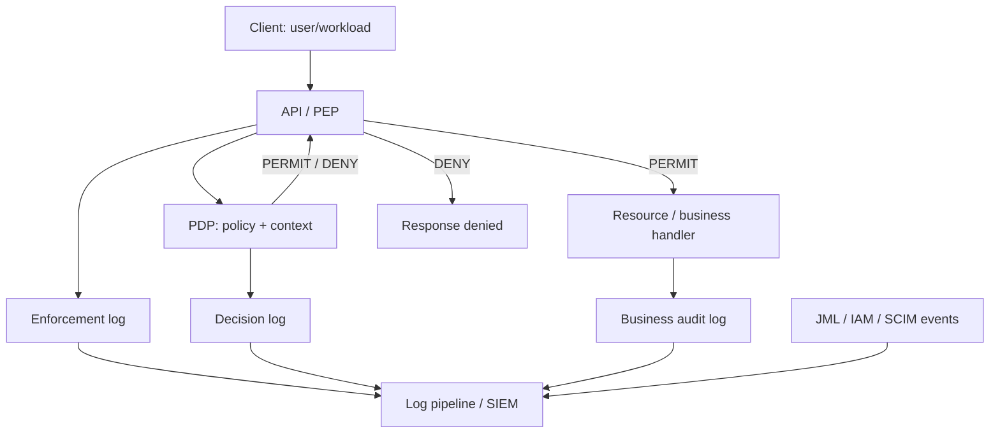
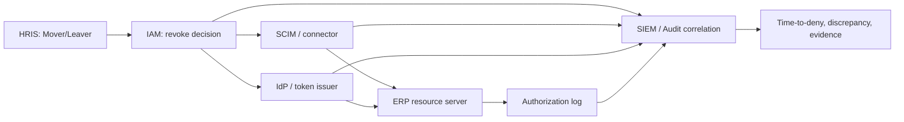

# Authorization log trong Identity logging và quản lý vòng đời danh tính IAM

**Authorization log (nhật ký phân quyền)** là bản ghi có cấu trúc về **quyết định cho phép hoặc từ chối một chủ thể thực hiện hành động trên tài nguyên trong một ngữ cảnh cụ thể**, cùng những thông tin cần thiết để giải thích, truy vết và kiểm tra việc thực thi quyết định. Authorization log giúp trả lời: **ai hoặc workload nào yêu cầu làm gì, trên tài nguyên nào, theo chính sách nào, quyết định ra sao, và hành động có thực sự được thực hiện hay không?**

Ví dụ, người dùng Lan thuộc nhóm `Finance-Approvers` trước khi chuyển sang Analytics. Sau sự kiện **Mover**, yêu cầu `approveInvoice` phải bị từ chối. Nếu chỉ có log “Lan đăng nhập thành công”, kiểm toán viên không biết ERP có chặn hành động phê duyệt hay không. **Authorization log tại API** có thể cho thấy `DENY`, lý do `ROLE_NOT_GRANTED`, tài nguyên đích, thời điểm và phiên bản policy được dùng. Ngược lại, một `PERMIT` bất thường sau Mover là tín hiệu về quyền tồn dư cần điều tra.

Trong module **Identity and Access Management (IAM)** theo **Joiner–Mover–Leaver (JML)**, authorization log liên kết việc xác minh danh tính, cấp quyền, thay đổi vai trò, thu hồi quyền và kiểm toán. Nó cần phối hợp **IdP, SSO, SCIM, RBAC/ABAC, tài khoản dịch vụ, session/token management, access review và reconciliation**. Authorization logging không thay thế enforcement: **log ghi nhận quyết định; Policy Enforcement Point (PEP) phải thực sự chặn hành động trái quyền**.

## 1. Authorization log khác authentication log thế nào?

| Loại log | Câu hỏi chính | Ví dụ sự kiện |
| --- | --- | --- |
| **Authentication log** | Chủ thể có chứng minh được danh tính? | `LOGIN_SUCCESS`, `MFA_FAILED` |
| **Authorization log** | Chủ thể có được thực hiện hành động trên tài nguyên? | `PERMIT invoice.read`, `DENY invoice.approve` |
| **Provisioning log** | Quyền/account được cấp hoặc thu hồi chưa? | `SCIM_PATCH_GROUP_SUCCESS` |
| **Access request/approval log** | Ai đã yêu cầu và phê duyệt quyền? | `APPROVAL_GRANTED` |
| **Session log** | Phiên được tạo, dùng, làm mới hay kết thúc? | `SESSION_REVOKED` |
| **Business audit log** | Thao tác nghiệp vụ đã xảy ra và tác động gì? | `PAYMENT_APPROVED` |
| **Reconciliation log** | Quyền mong muốn khác quyền thực tế ra sao? | `EXCESS_ENTITLEMENT_FOUND` |

Một **authentication success** chỉ có nghĩa danh tính đã vượt qua bước xác thực; không suy ra được quyền đối với mọi API. Tương tự, **authorization Permit** chưa nhất thiết chứng minh giao dịch được commit: hệ thống có thể từ chối do validation, dữ liệu thay đổi hoặc lỗi backend.

**Authorization log và business audit log phải liên kết qua correlation ID** khi cần chứng minh cả quyết định phân quyền lẫn hậu quả thực tế.

## 2. Authorization log xuất hiện ở đâu?

Một kiến trúc có thể ghi log tại:

- **PEP**: API gateway, middleware, service backend hoặc lớp kiểm soát quyền gần tài nguyên.
- **PDP (Policy Decision Point)**: thành phần đánh giá policy và trả kết quả Permit/Deny/Indeterminate/NotApplicable tùy mô hình.
- **Resource server**: nơi kiểm tra access token, scope, tenant, ownership và điều kiện nghiệp vụ.
- **IAM/IGA**: sự kiện cấp/thu hồi quyền liên quan đến authorization.
- **Cloud IAM**: các quyết định chính sách hoặc API access events do nhà cung cấp hỗ trợ.
- **Database**: quyền thực thi truy vấn hoặc hành động dữ liệu nhạy cảm.
- **Application audit layer**: nghiệp vụ hoàn thành, thay đổi state và dấu vết đối tượng.

Một số policy engine chỉ trả quyết định, còn log được phát từ enforcement layer. Nên xác định **nguồn sự thật về hành động có bị chặn hay đã được xử lý** thay vì coi mọi dòng log ở PDP là kết quả thực thi cuối cùng.



**PDP quyết định, PEP thực thi**. Nếu một endpoint bypass PEP hoặc không gọi PDP khi cần, log quyết định có thể thiếu dù hành động vẫn xảy ra.

## 3. Các trường tối thiểu của một bản ghi authorization

Một cấu trúc log dùng ID ổn định, định danh tài nguyên có giới hạn và metadata chính sách rõ ràng:

| Trường | Vai trò | Ví dụ minh họa |
| --- | --- | --- |
| `eventId` | Khóa duy nhất chống nhầm event | `evt-authz-00042` |
| `eventTime` | Thời điểm quyết định theo UTC | `2026-11-23T03:30:00Z` |
| `decision` | Kết quả phân quyền | `DENY` |
| `subjectId` | Identity ổn định | `identity-128` |
| `accountId` | Account kỹ thuật tại ứng dụng | `erp-user-87` |
| `subjectType` | Human, partner, service, workload | `human` |
| `clientId` | Ứng dụng gọi/được ủy quyền | `erp-web-client` |
| `action` | Hành động được yêu cầu | `invoice.approve` |
| `resourceType` | Loại tài nguyên | `invoice` |
| `resourceId` | Khóa hoặc tham chiếu tài nguyên có kiểm soát | `inv-1042` |
| `tenantId` | Ranh giới tenant | `tenant-a` |
| `policyId`, `policyVersion` | Quy tắc dùng để quyết định | `authz-finance/17` |
| `reasonCode` | Lý do dạng mã | `ROLE_REVOKED` |
| `requestId`, `traceId` | Liên kết log giữa dịch vụ | `req-.../trace-...` |
| `enforcementPoint` | Nơi chặn/cho phép | `erp-api` |
| `authContext` | Mức xác thực, loại phiên phù hợp | `mfa-satisfied` |
| `lifecycleContext` | Trạng thái JML liên quan | `mover-effective` |
| `outcome` | Kết quả thực thi nếu có | `BLOCKED` |

Các trường này là **schema minh họa**, không phải chuẩn bắt buộc. `resourceId`, địa chỉ IP và subject ID vẫn có thể là dữ liệu nhạy cảm; phải giới hạn thu thập và truy cập theo chính sách.

**Không ghi access token, refresh token, ID token, session cookie, API key, private key hay mật khẩu vào authorization log.**

## 4. Log mẫu: quyết định và thực thi

```json
{
  "eventId": "evt-authz-00042",
  "eventTime": "2026-11-23T03:30:00Z",
  "requestId": "req-billing-1042",
  "traceId": "trace-demo-17",
  "subject": {
    "id": "identity-128",
    "type": "human",
    "accountId": "erp-user-87"
  },
  "clientId": "erp-web-client",
  "resource": {
    "type": "invoice",
    "id": "inv-1042",
    "tenantId": "tenant-a"
  },
  "action": "invoice.approve",
  "decision": "DENY",
  "reasonCode": "ROLE_REVOKED",
  "policy": {
    "id": "authz-finance",
    "version": "17"
  },
  "enforcementPoint": "erp-api",
  "outcome": "BLOCKED",
  "lifecycleContext": "MOVER"
}
```

Dữ liệu trên **hoàn toàn giả định**; không phải thông tin một người dùng thật. Log mô tả `DENY` tại API và `BLOCKED` ở PEP. Nếu chỉ có `decision=DENY` từ PDP nhưng không biết PEP thực thi thế nào, audit nên đánh dấu **enforcement unverified**, không tự coi request đã bị chặn.

## 5. Decision, reason và kết quả nghiệp vụ

Cần phân biệt ba lớp:

1. **Decision**: chính sách trả Permit/Deny hoặc trạng thái quyết định khác.
2. **Enforcement outcome**: PEP thực hiện chặn/cho phép/chuyển tiếp có đúng không.
3. **Business outcome**: thao tác tài nguyên có hoàn thành, commit hoặc lỗi không.

| Tình huống | Decision | Enforcement | Business outcome |
| --- | --- | --- | --- |
| User không có role đọc | DENY | BLOCKED | Không đọc dữ liệu |
| User có role, đọc thành công | PERMIT | FORWARDED | Read thành công |
| Có role nhưng invoice đã đóng | PERMIT theo IAM, bị business rule từ chối | FORWARDED | Validation failed |
| PDP không phản hồi | ERROR/INDETERMINATE | Fail closed theo policy | Không xử lý |
| PDP DENY nhưng endpoint bypass PEP | DENY | Bypass/vi phạm | Có thể đã thay đổi dữ liệu |

Không bắt buộc có mọi giá trị nêu trên ở mọi PDP. Chọn taxonomy phù hợp, **phân biệt quyết định chính sách với HTTP status**. HTTP 403 có thể là hậu quả authorization Deny, nhưng 401 thường liên quan thiếu/chưa đủ bằng chứng xác thực; cách trả response phụ thuộc kiến trúc và không nên suy ngược lý do chỉ từ status code.

## 6. Mã lý do có cấu trúc và rủi ro rò thông tin

Một danh sách `reasonCode` nhất quán giúp phát hiện xu hướng:

| Mã ví dụ | Ý nghĩa |
| --- | --- |
| `SUBJECT_INACTIVE` | Identity bị disabled hoặc không hợp lệ |
| `ROLE_NOT_GRANTED` | Thiếu role/permission bắt buộc |
| `ROLE_REVOKED` | Quyền đã bị thu hồi theo sự kiện |
| `TENANT_SCOPE_MISMATCH` | Subject và resource khác tenant |
| `RESOURCE_OWNER_MISMATCH` | Quyền sở hữu tài nguyên không phù hợp |
| `SOD_CONFLICT` | Vi phạm phân tách nhiệm vụ |
| `STEP_UP_REQUIRED` | Cần mức xác thực mạnh hơn |
| `POLICY_CONTEXT_MISSING` | Thiếu thuộc tính tin cậy để đánh giá |
| `TOKEN_INVALID` | Token sai issuer/audience/hạn/chữ ký, theo cách phân loại |
| `SESSION_REVOKED` | Session/token bị thu hồi |
| `POLICY_EVALUATION_ERROR` | PDP không thể ra quyết định hợp lệ |

**Không gửi toàn bộ nội dung reason code nội bộ tới client** nếu điều đó làm lộ cấu trúc quyền, trạng thái tài khoản hoặc tài nguyên. Response phía người dùng có thể là thông điệp chung, còn log nội bộ chứa mã nguyên nhân chi tiết và được giới hạn truy cập.

## 7. Identity correlation và vấn đề nhiều account

Một người có thể có account thường, account privileged và account SaaS cục bộ. Một service có thể có nhiều service principal hoặc credential. Khi phân tích, cần phân biệt:

- **Identity ID**: chủ thể ổn định ở IAM/IGA.
- **Account ID**: tài khoản ở ứng dụng/IdP/tenant cụ thể.
- **Client/workload ID**: ứng dụng hoặc tiến trình khởi tạo request.
- **Credential/token reference**: định danh đã che, nếu cần correlation.
- **Actor vs beneficiary**: người thao tác và người được quyền/nhận lợi ích.
- **Delegation/impersonation**: quyền thay mặt ai, căn cứ ủy quyền nào.

Không nên liên kết log chỉ bằng email, username hoặc `displayName` vì có thể đổi tên, trùng hoặc tái sử dụng. Với hành động `on-behalf-of`, phải có đủ dấu vết để phân biệt **end-user, service caller và delegated authority**; không coi mọi request máy–máy là do service owner trực tiếp thao tác.

## 8. Authorization log trong Joiner

**Joiner** đi từ xác minh danh tính, tạo account, cấp quyền ban đầu đến sử dụng quyền. Cần quan sát:

1. Account chưa đến ngày hiệu lực: request bị từ chối đúng.
2. Identity chưa hoàn tất proofing hoặc MFA/step-up: hành động nhạy cảm không được phép.
3. Quyền birthright đã cấp: Permit trong đúng tenant và scope.
4. Permission chưa được duyệt: Deny trước và sau thử truy cập trực tiếp API.
5. Policy gắn thuộc tính `department`, `employmentType` hoặc `project` phải dùng nguồn đáng tin.
6. Một account liên kết nhầm identity phải bị phát hiện trong correlation.

Để kiểm tra provisioning, không chỉ xem `SCIM_CREATE_SUCCESS`; cần chứng minh **authorization thực tế tại target phù hợp desired state**, ví dụ request đọc dữ liệu được Permit còn request quản trị bị Deny.

## 9. Authorization log trong Mover

**Mover** có nguy cơ tích tụ role cũ vì workflow chỉ cấp quyền mới mà quên gỡ quyền trước đó.

Ví dụ:

```text
T0 User Lan có role Finance -> invoice.approve PERMIT
T1 HR cập nhật Lan sang Analytics
T2 IAM/SCIM gỡ entitlement Finance
T3 Lan dùng session/token cũ gọi invoice.approve
T4 ERP API phải DENY trong SLA đã đặt
```

Các bản ghi nên liên kết **Mover event ID, role revoke request, trạng thái connector, quyết định API, policy version và thời điểm Deny đầu tiên**. Nếu tiếp tục có `PERMIT invoice.approve` sau thời điểm quyền cũ phải mất hiệu lực, cần điều tra session claims cũ, role gán trực tiếp, cache hoặc event grant trễ.

**Không kết luận Mover đã sạch quyền vì log IdP group remove thành công.** Quyền cần được xác minh ở nơi thực thi nghiệp vụ.

## 10. Authorization log trong Leaver

Khi quan hệ **Leaver**, cần chặn login mới, phiên đang tồn tại, token và đường truy cập ở ứng dụng theo chính sách, **không đợi recertification định kỳ**.

| Đường kiểm tra | Log cần liên kết |
| --- | --- |
| Đăng nhập mới tại IdP | Authentication denied / account disabled |
| Token refresh | Refresh grant denied hoặc revoked |
| RP/local session | Session invalidation hoặc local authorization Deny |
| Access token còn hạn | Resource server Deny theo time-to-deny SLA |
| Local application role | Deprovision/reconciliation + API Deny |
| Account privileged phụ | Account/identity correlation và Deny |
| Partner API key | Key revoke và API Deny |
| Device/mobile/offline | Deny khi đồng bộ/kết nối lại |
| Workload do người nghỉ quản lý | Thu hồi human custody, không tự phá workload |

Một account bị vô hiệu ở IdP vẫn có thể có session RP hoặc token tự chứa còn hiệu lực. **SCIM `active=false` không chứng minh authorization đã bị chặn tại mọi API**. Authorization log phải đóng góp bằng chứng của **negative authorization test tại hệ thống đích**.

## 11. RBAC, ABAC, PBAC và SoD trong log

### RBAC

Khi chính sách dựa trên role, cần biết **role hiệu lực** và nguồn cấp quyền; chẳng hạn role đến từ direct grant hay nested group. Không nên sao chép toàn bộ danh sách nhóm nhạy cảm vào mọi dòng log; có thể ghi **policy reference, evaluated role và nguồn bằng ID**.

### ABAC/PBAC

Policy có thể xét thuộc tính user, workload, resource và environment: `tenantId`, `classification`, `projectId`, trạng thái JML, thời điểm hoặc trust level.

Cần log **những yếu tố quyết định cần thiết**, phiên bản chính sách và nguồn thuộc tính, nhưng tránh sao chép dữ liệu cá nhân hoặc nội dung resource không liên quan.

### Separation of Duties

Đối với `approvePayment`, user có role approver vẫn có thể bị từ chối nếu chính họ tạo giao dịch. Log cần liên kết:

- Subject/identity thực thi.
- Resource/transaction ID.
- Policy `no-self-approval`.
- Decision `DENY` và reason `SOD_CONFLICT`.
- Correlation tới business audit về người tạo.
- Enforcement outcome tại API.

**Ẩn nút phê duyệt ở UI không thay thế chặn ở backend**; authorization log từ API giúp chứng minh chính sách được thực thi.

## 12. Token, session và authorization log

Authorization log không nên chứa giá trị bearer token, nhưng có thể cần tham chiếu để đối chiếu sự kiện:

| Thông tin | Nên lưu? | Giải thích |
| --- | --- | --- |
| Token thô / cookie phiên | **Không** | Credential có thể bị replay |
| `jti` hoặc token reference được bảo vệ | Có điều kiện | Cần đánh giá khả năng correlation và lộ metadata |
| Issuer/audience | Thường hữu ích | Phân biệt token dùng sai API |
| Client ID / subject ID | Thường cần | Truy vết actor |
| Expiry/issued-at metadata | Có điều kiện | Phân tích stale token và thời gian tồn dư |
| Access token claims đầy đủ | **Không mặc định** | Có thể chứa PII và thông tin nhạy cảm |
| Revocation/session generation | Có điều kiện | Xác định phiên có phải đã bị thu hồi |
| API result | Cần ở phạm vi bảo vệ | Chứng minh Permit/Deny thực tế |

**ID token OIDC không phải access token dùng gọi API**. Nếu thấy log API “đã chấp nhận ID token”, phải xem đó là dấu hiệu cấu hình token validation sai, không phải cách làm bình thường.

## 13. Authorization log cho service và machine identity

Non-human accounts có thể dùng OAuth client credentials, workload federation, managed identity, certificate hoặc API key. Log cần giải thích **workload nào có quyền**, không gán mọi hành động cho một nhân viên từng tạo account.

Các trường hữu ích:
- `principalId` hoặc service identity ID.
- `workloadId`, `environment`, `tenantId`.
- `clientId`, issuer hoặc trust reference.
- `ownerTeamId` theo inventory, không nhất thiết sao chép vào từng event.
- Resource/action, role/scope và kết quả Permit/Deny.
- Reference tới credential metadata, không ghi secret.
- Policy version, trace ID và thời điểm.

Ví dụ một pipeline đã retire nhưng OAuth client vẫn gọi `deploy.production`. Log Permit sau thời điểm retirement là tín hiệu **privilege residue**. Đội IAM phải kiểm tra token đã phát, trust binding, role cloud và nguồn IaC/GitOps có thể tái cấp.

Với partner integration, log nên có **partner ID, tenant, hợp đồng hoặc entitlement scope** ở dạng tham chiếu phù hợp để phát hiện truy cập sau khi hợp đồng hết hạn.

## 14. Correlation end-to-end giữa các hệ thống

Một hành trình có thể gồm:



Các ID liên kết nên được thiết kế có mục đích:

- **Lifecycle event ID**: Joiner/Mover/Leaver từ nguồn có thẩm quyền.
- **Change/request ID**: yêu cầu quyền và quyết định phê duyệt.
- **Provisioning operation ID**: lệnh thực thi SCIM/connector.
- **Trace/request ID**: request ứng dụng.
- **Authorization decision ID**: kết quả PDP/PEP.
- **Business transaction ID**: hành động trên tài nguyên.
- **Incident ID**: điều tra bất thường hoặc sự cố.

Không phải tất cả ID đều truyền trực tiếp qua mọi hệ thống. Có thể xây correlation bằng **identity/resource ID + time window + trace metadata**, nhưng phải ghi **mức độ chắc chắn**; không tùy tiện kết luận hai sự kiện cùng người chỉ vì trùng username.

## 15. Time-to-deny sau thu hồi

**Time-to-deny** đo khoảng thời gian từ quyết định thu hồi có hiệu lực đến khi API thật sự từ chối hành động đã mất quyền.

```text
T0: Quyết định Leaver/Role Revoke có hiệu lực
T1: IAM cập nhật desired state
T2: Connector/IdP hoàn tất thay đổi
T3: Resource server nhận trạng thái mới
T4: Request protected bằng phiên/token cũ -> DENY

time_to_deny = T4 - T0
```

Để tính, cần có sự kiện **PERMIT/DENY hoặc negative test tại điểm thực thi**. Nếu hoàn toàn không có request sau T0, **không thể suy ra T4** chỉ từ sự vắng mặt của log. Khi đó phải thực hiện synthetic/controlled negative authorization test hoặc công bố bằng chứng kiểm chứng khác.

Với JWT tự chứa, cache role hoặc introspection, thời gian từ T0 đến Deny có thể phụ thuộc TTL, invalidation và đồng bộ nhiều vùng. Không được báo “thu hồi tức thì” nếu kiến trúc thực tế có cửa sổ rủi ro.

## 16. Định nghĩa log coverage và sự kiện cần ghi

Không nhất thiết log mọi read request ở mức chi tiết tối đa, vì có thể rất lớn và chứa dữ liệu nhạy cảm. Cần thiết kế coverage theo rủi ro:

| Loại hành động | Khuyến nghị thiết kế |
| --- | --- |
| Cấp, sửa, thu hồi quyền | Log đầy đủ sự kiện quản trị và kết quả |
| Admin/break-glass | Log có độ chi tiết cao, cảnh báo bất thường |
| Truy cập dữ liệu nhạy cảm | Log quyết định và metadata cần thiết |
| Self-approval/SoD | Log Deny và correlation giao dịch |
| Cross-tenant request | Log Deny, tenant scope được che phù hợp |
| Token/session bị revoke | Log lần dùng tiếp theo nếu phát hiện |
| API public rủi ro thấp | Sampling/aggregation theo chính sách, không bỏ rơi yêu cầu audit |
| Read endpoint lưu lượng cao | Điều chỉnh sampling và retention theo phân loại tài nguyên |

**Không lấy sampling làm lý do bỏ hoàn toàn log của hành động đặc quyền hoặc sự kiện bắt buộc kiểm toán.** Một số hạ tầng chỉ ghi failed access, một số ghi cả Permit/Deny: phải biết giới hạn coverage trước khi phân tích.

## 17. Bảo mật và quyền riêng tư của authorization log

Authorization log vừa là bằng chứng bảo mật, vừa có thể tiết lộ:

- Danh tính, tenant và vị trí tài nguyên.
- Vai trò/nhóm nhạy cảm, cấu trúc hệ thống.
- Chính sách phân quyền và lý do từ chối.
- Mối quan hệ giữa người dùng, đối tác và dữ liệu.
- Thời gian hoạt động, địa chỉ nguồn và dấu hiệu thiết bị.

Các nguyên tắc:

1. **Data minimization**: chỉ thu thập trường cần cho audit, phát hiện và điều tra.
2. **Pseudonymization/reference IDs** khi mục đích cho phép.
3. **RBAC/ABAC cho người xem log**, nhất là bản ghi privileged và dữ liệu cá nhân.
4. **Encryption in transit và at rest** theo kiến trúc.
5. **Integrity protection**: log append-only hoặc bảo vệ chống sửa/xóa trái phép khi phù hợp.
6. **Tách quyền vận hành và quyền xóa log** theo SoD.
7. **Retention có chính sách**, không giữ vô hạn và không xóa bằng chứng đang cần điều tra.
8. **Audit access to logs**: ai tìm, xuất hoặc thay đổi cấu hình log.
9. **Không ghi secret**, kể cả khi request thất bại.
10. **Giới hạn phản hồi client** để không lộ lý do nội bộ quá chi tiết.

Cần thiết kế cơ chế redaction **trước khi dữ liệu đi vào log pipeline** nếu có thể. Việc xóa secret sau khi đã bị chuyển tới nhiều nơi là khó bảo đảm triệt để.

## 18. Bảo đảm độ tin cậy của log pipeline

Một quyết định Deny quan trọng nhưng không xuất hiện trong hệ thống tập trung có thể là lỗi pipeline, không phải policy không chạy.

| Vấn đề | Hệ quả | Kiểm soát |
| --- | --- | --- |
| Log bị rơi khi quá tải | Mất bằng chứng | Buffer, retry, monitoring và capacity |
| Event trùng lặp | Đếm sai số lần Deny | Event ID, deduplication |
| Event đến sai thứ tự | Hiểu sai chuỗi JML | Event time và ingestion time |
| Lệch đồng hồ | Sai time-to-deny | Đồng bộ clock, ghi timezone/UTC |
| Pipeline mất kết nối | Không cảnh báo kịp | Health alerts, backlog monitoring |
| Log bị chỉnh sửa | Mất tin cậy kiểm toán | Integrity, quyền độc lập, lưu giữ an toàn |
| Schema thay đổi không tương thích | Parser SIEM bỏ event | Schema version và contract tests |
| Role logging bị tắt | Chỉ còn authentication logs | Coverage tests và telemetry inventory |
| Dữ liệu có PII/secret | Lộ thông tin | Redaction và quyền truy cập |

Ghi cả **event timestamp** và **ingestion timestamp** nếu cần đo độ trễ. Không dùng thời điểm nhận log thay cho thời điểm API thực hiện quyết định khi phân tích chuỗi sự kiện.

## 19. Cảnh báo và phát hiện bất thường

Authorization log giúp tạo các cảnh báo có ngữ cảnh:

- **PERMIT sau Leaver:** tài khoản đã hết quan hệ nhưng vẫn thực thi được hành động nhạy cảm.
- **PERMIT quyền cũ sau Mover:** role tồn dư tại API hoặc JWT/session cache.
- **Nhiều DENY do `TENANT_SCOPE_MISMATCH`**: có thể là lỗi client hoặc thử vượt tenant.
- **DENY do `SOD_CONFLICT`**: nỗ lực tự phê duyệt hoặc workflow sai.
- **Service principal retired vẫn PERMIT**: quyền máy–máy còn hiệu lực.
- **Break-glass không gắn incident**: kích hoạt đặc quyền ngoài quy trình.
- **Gia tăng `POLICY_EVALUATION_ERROR`**: PDP lỗi hoặc thiếu thuộc tính.
- **PERMIT privilege escalation** sau khi role thay đổi.
- **Không thấy authorization log** từ ứng dụng quan trọng dù vẫn có traffic.
- **Token đã revoke tiếp tục được API chấp nhận** vượt cửa sổ quy định.

Một chuỗi Deny nhiều lần **không tự chứng minh hành vi tấn công**: có thể là lỗi tích hợp, cache permission hoặc retry. Cảnh báo cần severity, ngữ cảnh, owner và quy trình triage; hạn chế tạo khối lượng cảnh báo không xử lý được.

## 20. Truy vấn phân tích minh họa

Giả sử hệ thống log tập trung cung cấp bảng `authorization_events` và bảng trạng thái JML `lifecycle_events`. Truy vấn giả lập:

```sql
-- SQL minh họa; cú pháp/kiểu dữ liệu tùy warehouse.
SELECT
    a.subject_id,
    a.resource_type,
    a.action,
    a.event_time,
    a.policy_version
FROM authorization_events AS a
JOIN lifecycle_events AS l
  ON a.subject_id = l.identity_id
WHERE l.event_type = 'LEAVER'
  AND a.decision = 'PERMIT'
  AND a.event_time >= l.effective_at;
```

Truy vấn **chỉ là dấu hiệu điều tra**, chưa chắc là vi phạm: cần phân biệt nhiều Leaver event, tài khoản tái gia nhập, thời điểm hiệu lực và phạm vi quyền của từng action. Trước khi kết luận phải kiểm tra identity correlation, enforcement outcome và kết quả nghiệp vụ.

Ví dụ khác: tỷ lệ Deny theo reason code.

```sql
SELECT reason_code, COUNT(*) AS total_denied
FROM authorization_events
WHERE decision = 'DENY'
GROUP BY reason_code
ORDER BY total_denied DESC;
```

Số lần Deny tăng có thể do kiểm soát hoạt động tốt hoặc do người dùng bị chặn sai. **Không đánh giá chất lượng security chỉ bằng số Deny**.

## 21. Bài kiểm thử authorization log

| Tình huống | Kết quả cần kiểm chứng |
| --- | --- |
| Anonymous gọi API protected | Request bị từ chối và có log phù hợp |
| User đúng role, đúng tenant | Permit được ghi với resource/action đúng |
| User sai tenant | Deny, reason scope mismatch |
| User thiếu role | Deny, không thể bypass PEP |
| SoD tự duyệt giao dịch | Deny với transaction correlation |
| Mover gỡ role nhưng token cũ còn hạn | API Deny đúng SLA; log thể hiện được |
| Leaver với RP session cũ | Không thực hiện hành động; có evidence |
| Token sai audience | RS từ chối, không lộ token trong log |
| Service account retired | Không tiếp tục Permit trái policy |
| PDP outage | Enforcement theo failure policy, log lỗi |
| Log collector outage | Có health monitoring và xử lý backlog |
| Event duplicate | Deduplicate theo event ID, không mất sự kiện |
| Trace qua gateway và service | Correlation ID xuyên lớp |
| Quyền log viewer | Chỉ người được phép mới xem thông tin nhạy cảm |
| Thay policy version | Log phản ánh đúng policy áp dụng |
| API có bypass gateway | Test trực tiếp backend phát hiện lỗ hổng |

Không nên kiểm thử trên dữ liệu nghiệp vụ thật hoặc token của người dùng thật khi có thể dùng **test identity và tài nguyên thử**. Chứng cứ test phải che session ID và bí mật.

## 22. Pseudocode kiểm tra Deny và bản ghi log

```text
test "Mover authorization deny is logged":
    identity = create_test_identity(role="invoice-approver")
    token = issue_test_access_token(identity)
    resource = create_test_invoice(tenant=identity.tenant)

    assert api.approve(resource, token) == PERMIT

    event = iam.apply_mover(identity, new_role="analytics-reader")
    wait_until_policy_propagates(timeout=policy.sla)

    response = api.approve(create_test_invoice(identity.tenant), token)
    assert response == DENY

    logs = search_audit_events(
        identity_id=identity.id,
        event_type="AUTHORIZATION_DECISION",
        action="invoice.approve",
        after=event.effective_at
    )
    assert logs.contains(decision="DENY", outcome="BLOCKED")
    assert logs.do_not_contain_raw_access_token()
```

Đây là **giả mã**. Trong triển khai phải phân biệt token với kết quả API; kiểm thử `PERMIT` đầu tiên có thể tạo thay đổi nghiệp vụ nên cần tài nguyên test riêng và dọn dẹp có kiểm soát.

**Log hiện diện không đủ chứng minh Deny có hiệu lực** nếu PEP vẫn tiếp tục xử lý. Test phải xác minh hành động bị chặn và log có thể đối chiếu với kết quả thực tế.

## 23. Chỉ số vận hành và kiểm toán

| Chỉ số | Giá trị quản trị |
| --- | --- |
| **Authorization log coverage** | Tỷ lệ API/tài nguyên trong scope có log quyết định |
| **PEP enforcement verification rate** | Tỷ lệ Deny được kiểm chứng thật sự bị chặn |
| **Permit-after-Leaver incidents** | Số lần quyền còn được dùng sau Leaver |
| **Mover residual access** | Quyền cũ còn Permit sau thay vai trò |
| **Time to deny** | Độ trễ từ revoke hiệu lực đến API Deny |
| **SoD denial trend** | Phát hiện tự phê duyệt trái chính sách |
| **Cross-tenant deny rate** | Xu hướng request vượt ranh giới tenant |
| **Policy evaluation error rate** | Mức lỗi policy engine |
| **Orphan workload Permit** | Machine account vô chủ vẫn hoạt động |
| **Log pipeline loss/delay** | Sự thiếu hụt và độ trễ của bằng chứng |
| **Schema validation failures** | Event sai định dạng |
| **Privileged event coverage** | Độ bao phủ hành động đặc quyền |
| **Correlation completeness** | Tỷ lệ event liên kết được JML/change/incident |
| **Audit retention compliance** | Lưu giữ theo chính sách và bảo vệ log |

Một dashboard cho thấy **100% SCIM deprovision completed** không có nghĩa **100% API đã Deny**. Authorization log và negative authorization testing giúp kiểm chứng phần thực thi cuối cùng.

## 24. Lỗi phổ biến trong triển khai

| Sai lầm | Hậu quả | Cách sửa |
| --- | --- | --- |
| Gộp authentication và authorization log | Không giải thích Permit/Deny trên tài nguyên | Phân loại event riêng |
| Chỉ ghi HTTP 403, không có action/resource | Khó điều tra lý do | Schema decision/context |
| Chỉ ghi PDP decision | Không biết PEP đã chặn chưa | Enforcement outcome |
| Không có policy version | Không tái dựng quyết định cũ | Policy ID/version |
| Dùng email làm identity correlation | Trộn account sau rename/reuse | Stable subject/account ID |
| Ghi JWT hoặc cookie vào log | Lộ credential có thể bị replay | Redact/token reference |
| Log mọi dữ liệu resource | Rò PII, chi phí lớn | Data minimization |
| Chỉ thu log IdP | Bỏ sót role và phiên SaaS | Instrument tại resource server |
| Thiếu service/client ID | Không xác định workload hoạt động | NHA inventory correlation |
| Không kiểm cache/token stale | Quyền Mover/Leaver tồn dư | Time-to-deny testing |
| Thiếu log pipeline health | Mất event mà không biết | Ingestion monitoring |
| Không tách event time/ingestion time | Sai thứ tự sự cố | Chuẩn hóa thời gian |
| Không log SoD resource context | Không chứng minh self-approval bị chặn | Business transaction ID |
| Dùng số Deny làm KPI duy nhất | Đánh giá sai mức an ninh | Coverage + outcome + remediation |

## 25. Checklist thiết kế Authorization log

- [ ] Xác định rõ các protected API/action/resource cần log.
- [ ] Phân biệt authentication, authorization, provisioning và business audit.
- [ ] Ghi subject ID, account ID, client/workload ID theo ngữ cảnh.
- [ ] Có tenant, action, resource reference và policy version.
- [ ] Có decision, reason code và enforcement outcome.
- [ ] Correlate được JML event, approval, session và business action khi cần.
- [ ] Không log plaintext token, cookie, password, secret hoặc private key.
- [ ] Giới hạn PII, dữ liệu tài nguyên và thông tin nhạy cảm trong log.
- [ ] Phân quyền truy cập, bảo vệ integrity, mã hóa và retention.
- [ ] Có kiểm soát rớt event, duplicate, clock skew và schema version.
- [ ] Theo dõi log pipeline health và khả năng phát hiện thiếu coverage.
- [ ] Có log hành động privileged, break-glass, SoD và cross-tenant theo rủi ro.
- [ ] Test trực tiếp API Deny thay vì chỉ tin vào UI.
- [ ] Có bài test Mover/Leaver dùng token hoặc session cũ.
- [ ] Đo time-to-deny và gắn kết quả vào reconciliation.
- [ ] Có owner và SLA cho các phát hiện Permit bất thường.
- [ ] Báo cáo phân biệt log decision và kết quả nghiệp vụ thực tế.

## 26. Câu hỏi tự kiểm tra

**Tình huống A:** IdP ghi Login Success, nhưng người dùng không có quyền duyệt hóa đơn. Cần xem log nào? **Authorization log tại ERP/API**, không suy quyền từ xác thực thành công.

**Tình huống B:** PDP ghi Deny nhưng API vẫn thực hiện thao tác vì endpoint bypass middleware. Hệ thống đã được bảo vệ chưa? **Chưa.** Cần enforcement tại PEP và kiểm thử nghiệp vụ thực tế.

**Tình huống C:** Người dùng Leaver không còn đăng nhập mới nhưng cookie ERP cũ vẫn gọi API. Chỉ dựa vào SCIM status đã đủ chưa? **Không.** Phải kiểm tra session/token và authorization tại resource server.

**Tình huống D:** Log chứa toàn bộ bearer access token để “dễ debug”. Có nên làm? **Không.** Đây là credential nhạy cảm, cần redaction và reference an toàn.

**Tình huống E:** Không tìm thấy sự kiện Permit sau revoke. Có thể kết luận API đã Deny mọi request không? **Không.** Có thể không có request hoặc mất log; cần kiểm tra coverage và negative test.

**Tình huống F:** Service account đã retired nhưng log có Permit deploy production. Cần kiểm tra gì? **Principal, role, credential, trust, token cũ và IaC/connector có tái cấp**, đồng thời xác nhận enforcement thực tế.

**Tình huống G:** Nhiều Deny do tenant mismatch xuất hiện. Có phải chắc chắn bị tấn công? **Không.** Cần điều tra lỗi tích hợp, người dùng và bối cảnh trước khi kết luận.

## Ghi nhớ

**Authorization log** là bằng chứng về **quyết định và thực thi phân quyền cho từng hành động trên tài nguyên**, không chỉ là log đăng nhập hay log cấp account. Một thiết kế tốt phải ghi **identity/account/workload ID, action, resource, tenant, policy version, Permit/Deny, reason, enforcement outcome và correlation**, đồng thời bảo vệ **secret, quyền riêng tư, integrity và availability của log pipeline**. Kết hợp **Joiner–Mover–Leaver, IdP/SSO, SCIM, RBAC/ABAC, SoD, service identity, session/token revocation, audit và reconciliation** để phát hiện **quyền truy cập tồn dư** và chứng minh **API thực sự từ chối khi quyền đã bị thu hồi**.
