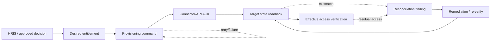
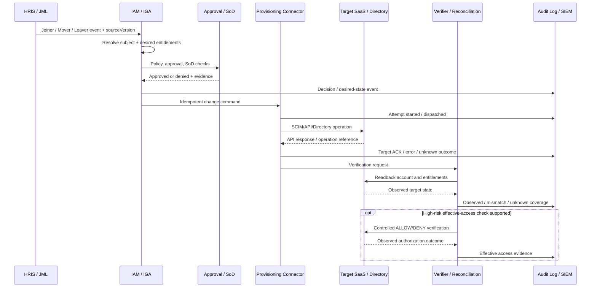
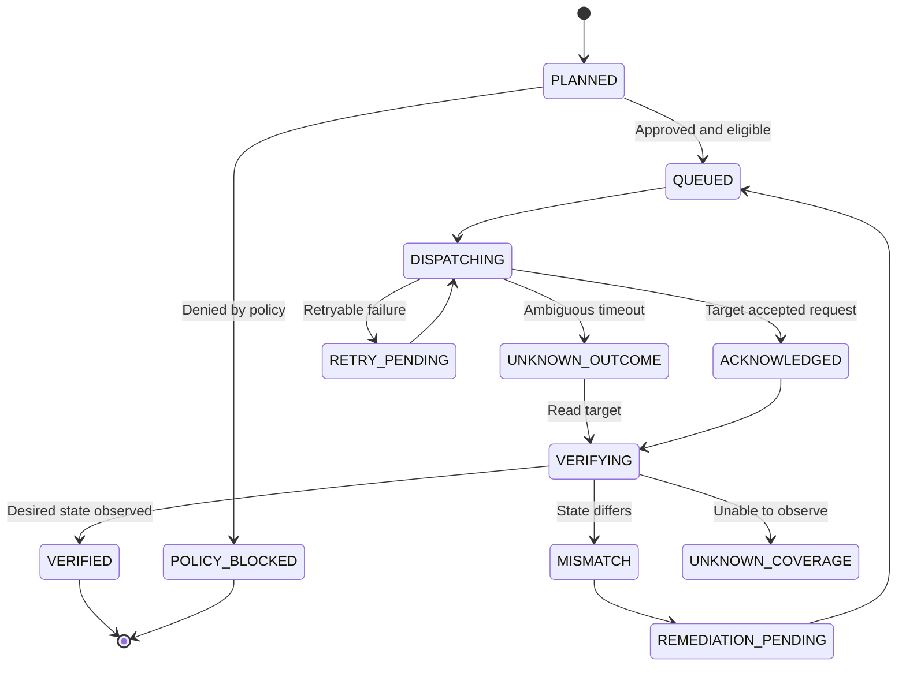
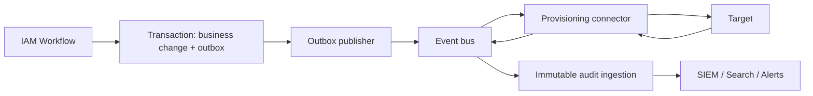

# Provisioning log trong IAM: Ghi nhận, truy vết và xác minh vòng đời cấp – thu hồi quyền

Một nhân viên chuyển từ bộ phận Mua hàng sang Tài chính. Hệ thống IAM ghi “Provisioning SUCCESS” sau khi gửi yêu cầu gỡ nhóm Mua hàng qua SCIM. Nhưng ba ngày sau, nhân viên vẫn duyệt được đơn mua hàng trong ứng dụng SaaS vì **role được gán trực tiếp** không nằm trong nhóm SCIM đã gỡ. Trong báo cáo tuân thủ, chỉ có một dòng “success”; không ai biết quyền nào được yêu cầu thu hồi, connector đã gọi API gì, target đã phản hồi ra sao, và quyền thực tế còn hay mất.

Một tình huống khác: nhân viên **Leaver** đã bị khóa tại IdP, nhưng tài khoản admin phụ, một API key và quyền truy cập local database vẫn còn hoạt động. Nếu nhật ký chỉ ghi “user disabled”, tổ chức có thể tưởng đã hoàn thành offboarding trong khi **quyền truy cập tồn dư** chưa được xử lý.

**Provisioning log** là tập bản ghi có cấu trúc phản ánh **quyết định, yêu cầu, lệnh, kết quả xử lý và bằng chứng xác minh** các thay đổi tài khoản, entitlement và danh tính trong quá trình **provisioning/deprovisioning**. Nó giúp truy vết: **ai hoặc nguồn nào kích hoạt thay đổi, vì sao thay đổi được phê duyệt, hệ thống dự định làm gì, connector đã làm gì, target ghi nhận thế nào, và quyền hiệu lực cuối cùng có đúng như mong muốn không**.

Bài thuộc chương **Identity logging** của mô-đun **Identity Lifecycle** trong **Identity and Access Management (IAM)**. Trọng tâm là cách thiết kế và khai thác **Provisioning log** trong toàn bộ chu trình **Joiner–Mover–Leaver (JML)**, nối **HRIS, IdP, SSO, SCIM, RBAC/ABAC, PAM/PIM, tài khoản dịch vụ, kiểm toán và reconciliation**, để biến hoạt động cấp/thu hồi quyền thành quy trình **có bằng chứng, đo lường được và giảm quyền tồn dư**.

> **Điều phải nhớ:** Một bản ghi `HTTP 200`, `SCIM success` hay `connector job completed` **không tự chứng minh user đã có hoặc đã mất quyền thực tế**. Provisioning log phải phân biệt **ý định → lệnh → phản hồi → trạng thái quan sát → quyền hiệu lực đã xác minh**.

## 1. Provisioning log là gì?

Trong IAM, **provisioning** thường bao gồm tạo/tái kích hoạt account, đồng bộ thuộc tính, gán nhóm/role, cấp entitlement, áp dụng thay đổi phạm vi, cấp credential hoặc cấu hình policy theo nhu cầu được duyệt. **Deprovisioning** bao gồm vô hiệu hóa, gỡ nhóm/quyền, thu hồi khóa/token/session hoặc xóa account theo chính sách và khả năng của target.

Provisioning log mô tả **quá trình thay đổi** chứ không chỉ ảnh chụp user hiện tại.

Ví dụ một quy trình Joiner có thể sinh các sự kiện:

```text
HRIS_EMPLOYEE_ACTIVATED
  -> IDENTITY_LINKED
  -> ENTITLEMENT_DESIRED
  -> ACCESS_REQUEST_APPROVED
  -> PROVISIONING_JOB_CREATED
  -> CONNECTOR_COMMAND_SENT
  -> TARGET_COMMAND_ACCEPTED
  -> TARGET_STATE_OBSERVED
  -> EFFECTIVE_ACCESS_VERIFIED
```

Đây là **tên sự kiện minh họa**, không phải chuẩn chung của SCIM hoặc IAM vendor.

### 1.1. Tại sao cần log?

- **Vận hành:** biết thay đổi đang chờ, thành công, thất bại hay cần thử lại.
- **Bảo mật:** phát hiện quyền được cấp sai, cấp lặp hoặc chưa thu hồi.
- **Điều tra:** tái dựng chuỗi thao tác và người/nguồn gây thay đổi.
- **Kiểm toán:** chứng minh phê duyệt, áp dụng và xác minh kiểm soát.
- **Reconciliation:** so desired state với actual state.
- **JML:** phát hiện account tồn dư khi Mover/Leaver, contractor hết hạn.
- **SLA:** đo độ trễ từ sự kiện HRIS đến khi target thực sự thực thi.
- **Chất lượng connector:** nhận diện API lỗi, mapping sai, partial failure.
- **Governance:** cung cấp evidence cho Access Review, SoD và đặc quyền.

### 1.2. Log không phải chứng nhận tuyệt đối

Một log có thể sai hoặc thiếu vì:

- Source phát sự kiện muộn.
- Event bị trùng/sai thứ tự.
- Connector timeout nhưng target vẫn thực hiện lệnh.
- Target trả ACK trước khi xử lý bất đồng bộ.
- Có direct grant ngoài phạm vi connector.
- Session/token vẫn còn sau khi account bị disable.
- Log pipeline bị mất hoặc bị sửa.
- Quy tắc mapping entitlement chưa đúng.

Vì vậy cần **provenance, correlation, target readback và đánh dấu UNKNOWN** khi không đủ dữ liệu.

## 2. Phân biệt provisioning log với các loại log khác

| Loại log | Câu hỏi chính | Ví dụ |
|---|---|---|
| **Provisioning log** | IAM đã định thay đổi và áp dụng quyền/account như thế nào? | SCIM PATCH, assign role, retry, target readback. |
| **Authentication log** | Ai đăng nhập/đã xác thực ra sao? | SSO success, MFA denied, token issued. |
| **Authorization log** | Một yêu cầu được ALLOW/DENY theo policy nào? | `report.export` bị chặn do thiếu role. |
| **Application audit log** | Ai thao tác lên dữ liệu nghiệp vụ? | Tạo invoice, phê duyệt payment. |
| **HRIS lifecycle log** | Trạng thái nhân sự nào đã thay đổi? | Start date, department, termination. |
| **Access request/approval log** | Ai yêu cầu và ai phê duyệt quyền? | Manager approved Finance role. |
| **PAM/session log** | Đặc quyền nào đã active, phiên nào được mở? | JIT activation, SSH session closed. |
| **Reconciliation log** | Desired/observed/effective có khớp không? | Sai lệch direct SaaS role. |
| **SIEM detection log** | Tín hiệu nào được tổng hợp thành cảnh báo? | Leaver still privileged after SLA. |

Provisioning log có thể **tham chiếu** các log này thông qua correlation ID, nhưng không nên trộn mọi loại sự kiện vào một bản ghi mơ hồ.

### 2.1. Không nhầm “account exists” với “account can access”

Một tài khoản có thể:

- Đã tạo nhưng bị `disabled`.
- Đã `enabled` nhưng không có entitlement cần thiết.
- Bị gỡ nhóm IdP nhưng còn role cục bộ tại SaaS.
- Không đăng nhập được SSO nhưng API key vẫn hoạt động.
- Có role nhưng conditional access/ABAC chặn vì device không compliant.
- Bị disable nhưng session hiện có chưa bị kết thúc.

Provisioning log nên ghi **scope kiểm chứng**: đã thấy account, role assignment, policy hay hành động hiệu lực ở target.

## 3. Năm lớp trạng thái cần lưu và đối chiếu

Một thay đổi IAM có thể đi qua năm lớp:

1. **Intent / decision:** chính sách hoặc người có thẩm quyền xác định thay đổi cần làm.
2. **Command / attempt:** IAM tạo lệnh và connector gửi tới target.
3. **Transport/API result:** target/gateway nhận hoặc trả lỗi cho request.
4. **Observed state:** đọc lại target và thấy account/role/entitlement đã đổi.
5. **Verified effective access:** bằng chứng target/PEP thực sự ALLOW hoặc DENY hành động cần thiết theo quyền mới.



### 3.1. Ma trận chứng cứ

| Mức | Ví dụ bằng chứng | Có thể kết luận? |
|---|---|---|
| **Intent recorded** | Request đã được approve. | Có thẩm quyền thay đổi theo policy được xét. |
| **Command queued** | Job được tạo. | Chưa chứng minh đã gửi. |
| **Command dispatched** | Connector đã gọi endpoint. | Chưa chứng minh target áp dụng. |
| **Target accepted** | API 2xx, operation ID. | Target ghi nhận request; semantics tùy API. |
| **Target observed** | GET/query thấy role/account state mới. | Target hiện báo trạng thái như mong đợi trong phạm vi đọc. |
| **Effective verified** | Đường truy cập thử nghiệm hợp lệ bị DENY/ALLOW theo policy. | Có bằng chứng quyền hiệu lực trên đường đã kiểm. |
| **Coverage unknown** | Không có API đọc role/token/session. | **Chưa đủ bằng chứng** để kết luận hoàn tất. |

Không có một API readback/effective-access test phù hợp mọi target. Điều quan trọng là mô tả rõ **thứ gì đã được quan sát và giới hạn chứng cứ**.

### 3.2. Tránh dùng một boolean `success`

Một record:

```json
{
  "action": "REMOVE_ROLE",
  "success": true
}
```

không trả lời:

- Role nào, của account nào?
- Target/tenant nào?
- Lệnh đã gửi hay target đã áp dụng?
- Ai yêu cầu?
- Có quyền theo đường khác không?
- Revoke session/token chưa?
- Có retry hay rollback không?
- Đã readback khi nào?

Nên dùng **state rõ ngữ nghĩa và evidence references**.

## 4. Những đối tượng và khóa định danh cần có

### 4.1. Các thực thể chính

- **Human identity:** stable person/employee identity ID, không chỉ email.
- **Account:** tài khoản cụ thể trên IdP/directory/SaaS/cloud.
- **Workload/service identity:** principal không phải người với owner team/purpose.
- **Entitlement:** group, role, permission, scope, resource ACL.
- **Target:** connector destination, tenant, subscription, environment.
- **Request:** yêu cầu cấp/gỡ quyền với revision và approval.
- **Policy:** role model/RBAC/ABAC/SoD và policy version.
- **Job:** đơn vị điều phối một thay đổi desired state.
- **Attempt:** mỗi lần gửi lệnh/operation tới target.
- **Result/observation:** phản hồi và trạng thái readback.
- **Actor:** người/hệ thống thực hiện thay đổi.
- **Beneficiary:** identity nhận/gỡ quyền.
- **Reviewer/approver:** người có thẩm quyền xác nhận.
- **Reconciliation finding:** vấn đề còn mở khi kết quả không đạt.

### 4.2. Vì sao cần stable identity?

Một người có thể có:

```text
personId:       person-1045
IdP account:    lan@example.invalid
Finance:        fin-lan
Admin account:  adm-lan
Legacy account: ln1045
```

Khi Leaver, các account phải được liên kết tới **cùng underlying human identity**. Nếu chỉ log email, tổ chức có thể bỏ qua account phụ hoặc nhầm hai người trùng tên/email.

Không tự gộp account khi thiếu nguồn authoritative. Nếu identity correlation chưa tin cậy, log phải ghi **UNRESOLVED_IDENTITY_MAPPING** và chuyển triage.

### 4.3. Tách các vai trò trong log

| Trường | Ý nghĩa |
|---|---|
| `initiatorId` | Người/nguồn khởi tạo request. |
| `requesterId` | Người yêu cầu, có thể khác initiator kỹ thuật. |
| `beneficiaryIdentityId` | Subject nhận hoặc mất quyền. |
| `approverIdentityIds` | Những chủ thể phê duyệt với authority. |
| `executorWorkloadId` | Connector/service account thực hiện API. |
| `targetAccountId` | Account cụ thể được thao tác ở target. |
| `targetPrincipalId` | Principal mà API target hiểu. |
| `ownerTeam` | Nhóm chịu trách nhiệm vận hành/đối soát. |
| `sourceSystem` | HRIS/IAM/IGA/IdP hoặc hệ thống nguồn khác. |

Một lệnh xuất hiện dưới service principal `scim-sync-prod` **không đồng nghĩa bot là người quyết định cấp quyền**. Phải giữ liên kết từ executor đến decision/request/approval.

## 5. Bộ sự kiện provisioning chuẩn hóa

Tên sự kiện tùy tổ chức và sản phẩm. Có thể nhóm:

### 5.1. Nhóm Identity và Account

- `IDENTITY_REGISTERED`: identity được đăng ký.
- `IDENTITY_LINKED`: account được liên kết subject.
- `ACCOUNT_CREATE_REQUESTED`.
- `ACCOUNT_CREATED_OBSERVED`.
- `ACCOUNT_ENABLE_REQUESTED`.
- `ACCOUNT_DISABLE_REQUESTED`.
- `ACCOUNT_DISABLED_OBSERVED`.
- `ACCOUNT_DELETE_REQUESTED`.
- `ACCOUNT_DELETED_OBSERVED`.
- `ACCOUNT_ATTRIBUTE_UPDATE_REQUESTED`.
- `ACCOUNT_ATTRIBUTE_UPDATED_OBSERVED`.

### 5.2. Nhóm Entitlement

- `ENTITLEMENT_GRANT_REQUESTED`.
- `ENTITLEMENT_GRANT_APPROVED`.
- `ENTITLEMENT_GRANT_DISPATCHED`.
- `ENTITLEMENT_GRANTED_OBSERVED`.
- `ENTITLEMENT_REVOKE_REQUESTED`.
- `ENTITLEMENT_REVOKE_DISPATCHED`.
- `ENTITLEMENT_REVOKED_OBSERVED`.
- `ENTITLEMENT_SCOPE_CHANGED_OBSERVED`.
- `ENTITLEMENT_UNKNOWN_COVERAGE`.

### 5.3. Nhóm Connector/Integration

- `PROVISIONING_JOB_CREATED`.
- `PROVISIONING_ATTEMPT_STARTED`.
- `PROVISIONING_COMMAND_SENT`.
- `PROVISIONING_TARGET_ACKNOWLEDGED`.
- `PROVISIONING_RETRY_SCHEDULED`.
- `PROVISIONING_ATTEMPT_FAILED`.
- `PROVISIONING_PARTIAL_SUCCESS`.
- `PROVISIONING_RATE_LIMITED`.
- `PROVISIONING_CONFLICT_DETECTED`.
- `PROVISIONING_JOB_CANCELLED`.
- `PROVISIONING_JOB_VERIFYING`.
- `PROVISIONING_JOB_VERIFIED`.

### 5.4. Nhóm Security và Reconciliation

- `JML_EVENT_APPLIED`.
- `JML_STALE_EVENT_REJECTED`.
- `SOD_CONFLICT_DETECTED`.
- `PAM_PRIVILEGE_REVOKE_REQUESTED`.
- `SESSION_REVOCATION_REQUESTED`.
- `RECONCILIATION_MISMATCH_FOUND`.
- `RESIDUAL_ACCESS_CONFIRMED`.
- `EFFECTIVE_ACCESS_DENIED_VERIFIED`.
- `PROVISIONING_COVERAGE_UNKNOWN`.
- `MANUAL_OVERRIDE_APPLIED`.
- `EXCEPTION_APPROVED_UNTIL`.

### 5.5. Không dùng một event “DONE” bao trùm

Một operation có thể đồng thời:

```text
IdP account disabled = VERIFIED
SaaS group removal   = VERIFIED
SaaS direct role     = STILL_EFFECTIVE
API token revoke     = UNKNOWN
PAM active role      = REVOKE_PENDING
```

Kết luận tổng thể nên là **PARTIAL/OPEN**, không phải SUCCESS, cho đến khi hoàn thành các tiêu chí bắt buộc.

## 6. Event schema: dữ kiện tối thiểu và nguồn bằng chứng

Một event nên có **envelope nhất quán** và payload theo loại thay đổi.

| Nhóm trường | Ví dụ | Mục đích |
|---|---|---|
| Định danh event | `eventId`, `eventType`, `schemaVersion`. | Deduplicate, parsing, audit schema evolution. |
| Correlation | `correlationId`, `causationId`, `requestId`. | Nối quyết định đến target và child jobs. |
| Job/attempt | `jobId`, `operationId`, `attemptNumber`. | Retry/replay, partial status. |
| Identity | `subjectId`, `targetAccountId`, `identityType`. | Liên kết người/workload với account. |
| Actor/authority | `initiatorId`, `approvedBy`, `sourceAuthority`. | Trách nhiệm và phê duyệt. |
| Target | `systemId`, `tenantId`, `environment`. | Tránh sai tenant/env. |
| Change | `operation`, `entitlementId`, `scope`. | Xác định thay đổi chính xác. |
| Temporal | `occurredAt`, `observedAt`, `effectiveAt`. | Phân biệt lúc xảy ra, nhận và hiệu lực. |
| State | `phase`, `outcome`, `reasonCode`. | Biết xử lý tới lớp nào. |
| Version | `sourceVersion`, `policyVersion`, `targetRevision`. | Chống stale event. |
| Evidence | `targetOperationRef`, `readbackRef`, `traceId`. | Tra cứu log hỗ trợ. |
| Quality | `coverage`, `freshness`. | Không báo clean khi thiếu dữ liệu. |

### 6.1. Ví dụ event từ Mover

```json
{
  "schemaVersion": 3,
  "eventId": "evt-20261201-01042",
  "eventType": "ENTITLEMENT_REVOKE_DISPATCHED",
  "correlationId": "jml-mover-person-1045-v42",
  "causationId": "evt-20261201-01041",
  "jobId": "job-7841",
  "attemptId": "attempt-7841-02",
  "attemptNumber": 2,
  "sourceSystem": "iam-orchestrator",
  "sourceAuthority": "hris",
  "subjectId": "person-1045",
  "identityType": "HUMAN",
  "targetSystemId": "procurement-saas",
  "targetTenantId": "corp-vn",
  "targetAccountId": "supplier-user-1045",
  "operation": "REMOVE_ENTITLEMENT",
  "entitlementId": "supplier-maintainer",
  "entitlementScope": { "legalEntityId": "VN01" },
  "sourceVersion": 42,
  "policyVersion": "mover-policy-v5",
  "effectiveAt": "2026-12-01T09:00:00+07:00",
  "occurredAt": "2026-12-01T09:00:12+07:00",
  "observedAt": "2026-12-01T09:00:13+07:00",
  "phase": "DISPATCHED",
  "outcome": "PENDING_TARGET_CONFIRMATION",
  "evidenceRef": "audit/provisioning/job-7841/attempt-02"
}
```

Đây là **schema minh họa**, không phải payload của SCIM hay tài liệu giao thức chính thức. Dữ liệu không chứa password, token hoặc response body nhạy cảm.

### 6.2. Log thời gian phải chính xác về ngữ nghĩa

- `occurredAt`: thời điểm source cho rằng sự kiện xảy ra.
- `observedAt`: thời điểm hệ thống log/consumer ghi nhận.
- `effectiveAt`: thời điểm thay đổi nhân sự/quyền phải có hiệu lực.
- `sentAt`: lúc command thực sự rời connector.
- `acknowledgedAt`: lúc nhận kết quả từ API.
- `verifiedAt`: lúc readback/effective access được xác minh.

Không đồng nhất `acknowledgedAt` với `verifiedAt`. Nên dùng timestamps chuẩn hóa (thường UTC với offset/Instant), lưu timezone nghiệp vụ khi cần và đồng bộ clock giữa các hệ thống. Khi source timestamp không tin cậy, phải ghi provenance và clock uncertainty.

### 6.3. Nhiều đối tượng trong một change

Một Mover có thể phải thay 20 entitlements ở 5 target. Nên có:

```text
Correlation:  person-1045 / MOVER / sourceVersion=42
  Job A: revoke procurement groups
    Op A1: REMOVE group "purchasing-editor"
    Op A2: REMOVE direct role "supplier-maintainer"
  Job B: grant finance role
    Op B1: ADD role "invoice-reviewer"
  Job C: revoke old sessions
    Op C1: APP_SESSION_REVOKE
    Op C2: PAM_ROLE_REVOKE
```

Nếu chỉ ghi một dòng “Mover completed”, việc tìm quyền tồn dư tại từng ứng dụng gần như không thể.

## 7. Correlation ID, causation ID và idempotency key

### 7.1. Ba loại định danh khác nhau

- **Correlation ID:** liên kết các sự kiện thuộc cùng một nghiệp vụ/flow.
- **Causation ID:** tham chiếu sự kiện trực tiếp gây ra event hiện tại.
- **Idempotency key:** giúp xử lý các lần gửi lại cùng **một thao tác có cùng ngữ nghĩa** mà không thực hiện lặp trái ý.

Ví dụ:

```text
correlationId  = leaver-person-1045-version-75
causationId    = hris-event-version-75
jobId          = revoke-finance-erp-person-1045
operationId    = disable-target-account-finance-erp
attemptId      = attempt-3
idempotencyKey = target+account+operation+desiredVersion+scope
```

Công thức idempotency key là **ý tưởng**; production cần tránh lộ PII/secret trong key, canonicalize dữ liệu, kiểm TTL và semantics của endpoint. Không dùng cùng key cho **những operation khác nhau** hoặc cho những phiên bản desired state khác.

### 7.2. Correlation không đủ nếu dữ liệu nhân quả sai

Một trace gồm nhiều sự kiện “success” không chứng minh target đã gỡ quyền đúng account. Cần kiểm:

- `targetAccountId` đúng identity.
- `tenantId` đúng.
- `operation` và entitlement đúng.
- `sourceVersion` không stale.
- `targetRevision`/ETag (nếu có) phù hợp.
- Readback chứng minh **desired state**.
- Không có direct/inherited paths khác vẫn cấp cùng capability.

### 7.3. Request/attempt hierarchy

Một request có thể bị retry:

```text
requestId=req-100
jobId=job-100
operationId=op-100
  attempt 1 -> NETWORK_TIMEOUT (target outcome UNKNOWN)
  attempt 2 -> HTTP 409 (already exists / conflict to inspect)
  attempt 3 -> GET readback: desired state observed
```

Nếu attempt 1 timeout, không thể kết luận target **không** xử lý. Tùy operation, connector cần **read-before-retry** hoặc idempotency support để tránh tạo duplicate account/grants.

## 8. Workflow từ chính sách tới target

### 8.1. Luồng provisioning



### 8.2. Những điểm phải phân định trách nhiệm

| Thành phần | Quyền quyết định/thực thi | Bằng chứng |
|---|---|---|
| HRIS | Thông tin nhân sự có thẩm quyền. | Lifecycle event + version/effectiveAt. |
| IAM/IGA | Desired accounts/entitlements theo policy. | Decision, role calculation. |
| Approval/SoD | Duyệt/deny/exception có thẩm quyền. | Approver/decision/rule version. |
| Connector | Dịch desired change thành target API. | Command, operation, attempt. |
| Target | Áp trạng thái account/permission. | Target response, change event/state. |
| Verifier | So desired với observed/effective. | Snapshot, result, coverage. |
| SIEM/Audit | Ghi nhận và phát hiện rủi ro. | Immutable/referenceable evidence. |
| Target owner | Khắc phục/điều tra direct grant hoặc API gap. | Remediation ticket + re-verification. |

### 8.3. “Log đã gửi” không phải “log đã nhận”

Một event có thể được ghi vào local buffer nhưng chưa tới SIEM do network outage. Hệ thống cần phân biệt:

- Event generated.
- Event persisted at source.
- Event published to transport.
- Event ingested by central log store.
- Event indexed/searchable.
- Alert delivered/acknowledged.

Nếu kiểm toán yêu cầu centralized evidence, chỉ ghi source-side `log.info(...)` chưa chứng minh chuỗi bảo toàn đã hoàn tất.

## 9. Joiner: logging khi tạo danh tính và cấp quyền

### 9.1. Kịch bản Joiner

Một nhân viên mới vào Finance:

1. HRIS thông báo danh tính, start date và manager.
2. IAM xác minh identity mapping.
3. Tính birthright roles theo role, department, location và status.
4. Kiểm SoD, manager/data owner approval khi cần.
5. Tạo account ở IdP, SaaS và directory.
6. Gán nhóm/role đúng scope.
7. Xác minh target account và entitlements.
8. Chỉ mở quyền khi đạt ngày hiệu lực và chính sách.
9. Ghi đầy đủ job/attempt, target readback và exceptions.

### 9.2. Những event bắt buộc

```text
JOINER_RECEIVED
IDENTITY_PROOFED_OR_LINKED
ACCESS_POLICY_EVALUATED
ACCOUNT_CREATE_REQUESTED
ACCOUNT_CREATE_TARGET_ACK
ACCOUNT_CREATED_OBSERVED
GROUP_ASSIGN_REQUESTED
GROUP_ASSIGN_OBSERVED
PROVISIONING_VERIFIED
```

Tên gọi tùy hệ thống; điều quan trọng là **phân biệt điểm kiểm và bằng chứng**.

### 9.3. Tài khoản pre-provisioned trước start date

Một doanh nghiệp có thể tạo account trước để chuẩn bị laptop. Log phải cho biết:

- Account đã tạo ở target.
- Account đang disabled hay chỉ chưa có entitlement.
- Thời điểm activation dự kiến.
- Ai được phép truy cập trước start date (nếu có exception).
- Mã nguồn policy và trạng thái HRIS.
- Verification rằng không có quyền truy cập nghiệp vụ trái policy.

Không suy rằng `ACCOUNT_CREATED` tức là Joiner đã sẵn sàng dùng mọi ứng dụng.

### 9.4. SoD ngay từ Joiner

Nếu role mặc định A và role requestable B tạo xung đột, log cần ghi:

- `SOD_RULE_ID`, rule version.
- Những capabilities bị xung đột.
- Scope/tenant liên quan.
- Decision BLOCK/EXCEPTION/REASSIGNMENT.
- Người phê duyệt exception và hạn.
- Không log dữ liệu nhạy cảm vượt nhu cầu.

Nếu việc cấp bị BLOCK, không được ghi “provisioning failed” như lỗi kỹ thuật connector; đây là **policy-denied outcome** khác với sự cố API.

## 10. Mover: log chuyển vai trò và quyền cũ còn tồn dư

### 10.1. Mover là thay đổi kép

Mover thường cần **gỡ quyền cũ** và **cấp quyền mới**. Nếu hệ thống chỉ log grant mới mà không log revocation cũ, khó phát hiện privilege creep.

```text
Before Mover:
  supplier-maintainer (Procurement SaaS)
  purchasing-reviewer (ERP)

After Mover desired:
  supplier-maintainer -> REVOKED
  purchasing-reviewer -> REVOKED
  invoice-reviewer   -> GRANTED
```

### 10.2. Log transition phải nêu rõ thứ tự

Trong quy trình có xung đột SoD, **grant-before-revoke** có thể tạo khoảng thời gian người dùng sở hữu cả hai quyền. Với quyền rủi ro cao, policy có thể yêu cầu revoke trước rồi cấp; nếu quy trình cần overlap để bàn giao, cần exception được duyệt.

Nhật ký nên lưu:

- Source Mover event/version/effectiveAt.
- Desired state before/after theo phiên bản.
- Planned operations và dependencies.
- Operation start/finish/verify times.
- SoD evaluation của trạng thái chuyển tiếp.
- Các permission direct/inherited còn được quan sát.
- Session/token revocation hoặc authz refresh.
- Exception overlap có owner, scope, TTL.

### 10.3. Bài học từ partial success

Ví dụ:

| Thao tác | Connector | Target observation | Kết luận |
|---|---|---|---|
| Gỡ group Procurement khỏi IdP | 2xx | Group mất. | Verified ở IdP. |
| Gỡ direct role SaaS | Không được connector quản lý. | Role còn. | Residual risk. |
| Cấp role Finance ERP | 2xx | Role có. | Verified ở ERP. |
| Revoke phiên cũ ở SaaS | Không có API hỗ trợ. | Không xác định. | UNKNOWN/expiry bound. |

Một log tổng thể `MOVER_COMPLETE` sẽ gây hiểu nhầm nếu thiếu điều kiện xử lý những dòng chưa đạt.

### 10.4. Mover event đến trễ

```text
Version 40: department=PROCUREMENT, state=ACTIVE
Version 41: department=FINANCE, state=ACTIVE
Version 42: state=TERMINATED

Connector nhận version 42 trước rồi phiên bản 41 phát lại.
```

Nếu version 41 cấp Finance role sau Leaver, có thể tái mở quyền. Log cần ghi **STALE_EVENT_REJECTED**, version và reason; không chỉ bỏ qua im lặng khiến forensic khó tái dựng.

## 11. Leaver: log deprovisioning và xác minh thu hồi

### 11.1. Leaver cần nhiều kết quả độc lập

Khi nhân viên nghỉ việc:

- Disable login IdP và những account cần disable.
- Remove groups/roles ở directory, SaaS, cloud, database.
- Revoke PAM/PIM active và eligible privilege của cá nhân.
- Invalidate các session/application sessions được hệ thống hỗ trợ.
- Revoke refresh tokens/API keys/SSH keys thuộc chủ thể theo policy.
- Xử lý delegated approvals/third-party access.
- Xem lại service credentials người đó từng biết.
- Readback target, đối soát direct grants, local accounts.
- Ghi thời gian thực thi và quyền tồn dư có giới hạn.

### 11.2. Leaver log không được chỉ có `disable user`

Một bản ghi có ích:

```text
personId=person-1045
lifecycleEvent=LEAVER
effectiveAt=2026-12-01T09:00:00+07:00
sourceVersion=42

IdP:
  loginDisabled=VERIFIED
  sessionRevoke=REQUESTED / VERIFIED_ON_SUPPORTED_PATHS

Finance SaaS:
  accountDisabled=OBSERVED
  directRoleRemoval=VERIFIED
  refreshTokenStatus=UNKNOWN

PAM:
  eligibleRoleRemoved=VERIFIED
  activeSessionTerminated=VERIFIED

Legacy Database:
  localAccount=STILL_ACTIVE
  remediationOwner=database-access-team

Overall:
  PARTIAL, SECURITY_FINDING_OPEN
```

Nhật ký này không tiết lộ token, password hoặc dữ liệu cá nhân không cần thiết.

### 11.3. Phân biệt SLA

Các mốc có thể khác:

- Hạn khóa login sau `Leaver effectiveAt`.
- Hạn revoke privileged access.
- Hạn gỡ direct grant.
- Hạn target readback.
- Hạn xác minh session/token không còn usable.
- Hạn closure finding/exception.

Không dùng duy nhất `completedAt` để thay mọi SLA. Rủi ro tăng nếu hệ thống đánh dấu completed khi đã gửi command nhưng chưa xác minh.

### 11.4. Rehire và account reactivation

Nếu người cũ được tuyển lại, cần log:

- Identity correlation và proofing hợp lệ.
- New contract/employment version.
- Desired roles mới, không copy snapshot role cũ.
- Account được tái kích hoạt hay tạo mới, lý do.
- Privileged roles và exceptions phải được review lại.
- Session/token cũ không được tự phục hồi.
- Target readback chứng minh không thừa hưởng entitlement lịch sử.

Một lệnh `active=true` trong SCIM không có nghĩa được phép khôi phục toàn bộ quyền cũ.

## 12. IdP, SSO, SCIM và ranh giới chứng cứ

### 12.1. IdP và SSO

IdP/SSO giúp xác thực người dùng và quản lý một số claims/groups. Provisioning log có thể ghi IdP account/group changes, nhưng:

- SAML/OIDC login success **không phải** xác nhận provisioning hoàn tất.
- Local SaaS roles có thể độc lập với IdP.
- App session có thể còn dù IdP disable.
- OAuth tokens có thể vẫn còn TTL.
- Email/username có thể đổi hoặc tái sử dụng.
- App có thể cho local login ngoài SSO theo cấu hình.

Vì vậy log phải chỉ rõ **IdP-level observed change** thay vì suy rằng tất cả applications đã áp đổi.

### 12.2. SCIM thường cấp những bằng chứng nào?

SCIM có thể thao tác User/Group theo endpoint và schema target hỗ trợ, ví dụ:

- `POST /Users` tạo user.
- `PATCH /Users/{id}` cập nhật các thuộc tính như `active` nếu target triển khai.
- `PATCH /Groups/{id}` cập nhật membership.
- `GET /Users/{id}` hoặc `GET /Groups/{id}` đọc lại trạng thái.

Cần thận trọng:

- Response status và body tùy operation/implementation.
- `204 No Content` có thể là thành công không kèm body; không có nghĩa readback.
- Response có thể phản ánh trạng thái xử lý bất đồng bộ.
- SCIM group membership không chắc ánh xạ 1:1 tới SaaS app role.
- Connector có thể không quản lý direct grants.
- SCIM API không mặc định revoke mọi user session/token.
- ETag/version nếu target hỗ trợ giúp tránh lost update.

### 12.3. Ghi log cho SCIM PATCH

Ví dụ record minh họa, không lưu raw bearer token:

```json
{
  "eventType": "PROVISIONING_TARGET_ACKNOWLEDGED",
  "operation": "SCIM_USER_DISABLE",
  "targetSystem": "example-saas",
  "targetAccountRef": "user-0192",
  "apiMethod": "PATCH",
  "apiRouteTemplate": "/scim/v2/Users/{id}",
  "httpStatus": 204,
  "targetRequestId": "target-req-4432",
  "requestPayloadRef": "redacted/request-job-781",
  "responsePayloadRef": "redacted/response-job-781",
  "phase": "TARGET_ACK",
  "verificationStatus": "PENDING_READBACK",
  "occurredAt": "2026-12-01T09:01:00+07:00"
}
```

Tùy độ nhạy, **không nhất thiết lưu nguyên request/response**. Nếu cần để điều tra, dùng kho bảo vệ tách biệt và có retention/access controls.

### 12.4. Thiếu coverage phải có tên

Nếu SCIM connector chỉ quản lý group nhưng SaaS có direct app roles, coverage có thể là:

```text
coverage:
  accountState: SUPPORTED_AND_OBSERVED
  groupMembership: SUPPORTED_AND_OBSERVED
  directAppRoles: NOT_MANAGED_BY_CONNECTOR
  oauthRefreshTokens: UNKNOWN
  existingSessions: UNKNOWN
```

Không ghi `FULLY_DEPROVISIONED` nếu hai đường cuối còn chưa biết.

## 13. RBAC/ABAC và SoD trong provisioning log

### 13.1. RBAC role assignment

Một event `ROLE_ASSIGNED` cần làm rõ:

- Role ID thực tế, không chỉ display name.
- Resource/tenant/project/legal entity scope.
- Role source: direct, group, inherited, eligible, active.
- Grantor/approver và policy version.
- Validity window nếu là quyền tạm.
- Target response và readback.
- Mapping từ role sang business capabilities nếu dùng SoD.

Tên role `FinanceAdmin` ở hai hệ thống có thể khác quyền. Log cần lưu **target-specific entitlement ID** và capability mapping reference.

### 13.2. ABAC policy và attribute change

ABAC có thể không có một role cấp trực tiếp; thay đổi entitlement có thể do:

- Department đổi.
- Manager/owner đổi.
- Security classification đổi.
- Device posture đổi.
- Tenant hoặc project association đổi.
- Resource policy update.
- Time-based eligibility hết hạn.

Log phải chỉ rõ **source attribute authority** và policy decision. Không cần ghi toàn bộ attributes/PII không liên quan; có thể lưu **hash/version/reference** để truy vết và bảo vệ dữ liệu.

### 13.3. SoD prevention vs detected conflict

Một access request có thể bị policy chặn vì xung đột:

```json
{
  "eventType": "ACCESS_REQUEST_DENIED_BY_POLICY",
  "requestId": "req-1088",
  "beneficiaryId": "person-1045",
  "requestedCapability": "payment.approve",
  "resourceScope": { "legalEntityId": "VN01" },
  "policyType": "SOD",
  "ruleId": "SOD-PROCURE-PAY-001",
  "ruleVersion": "v4",
  "decision": "DENY",
  "reason": "CONFLICT_WITH_EXISTING_CAPABILITY"
}
```

Đây là **policy decision**, không phải connector technical failure. Nếu exception được duyệt, phải lưu **risk owner, scope, TTL, compensating controls**, không chuyển finding thành “không có xung đột”.

### 13.4. Phân biệt phê duyệt và cấp quyền

Một manager approve yêu cầu là một sự kiện quản trị. Connector có thể lỗi sau approval. Ngược lại, một admin có thể cấp direct role mà không qua workflow, tạo **out-of-band grant**.

Provisioning log cần giúp đối soát hai kiểu:

- **Approved but not provisioned** → thiếu quyền, ảnh hưởng vận hành.
- **Provisioned without approved request** → quyền không có thẩm quyền, rủi ro bảo mật.

Cả hai đều là sai lệch nhưng severity thường khác nhau.

## 14. PAM/PIM, session, credential và privileged provisioning

### 14.1. Đặc quyền có nhiều trạng thái

| Lớp | Ví dụ | Khi nào coi verified? |
|---|---|---|
| Eligible role | User được phép yêu cầu activate. | Eligibility hiện hành tại PAM/PIM. |
| Active JIT role | Role nâng quyền được kích hoạt. | Target active grant trong scope/TTL. |
| PAM broker session | SSH/RDP/console qua broker. | Session thực sự mở/đóng. |
| Target-local admin | Local/cloud privilege. | Target role/account state. |
| Credential | Password/key/API token. | Credential validity/revocation theo target. |
| Resource action | Admin API action. | Authorization outcome từ target/PEP. |

Một log `PAM_ROLE_EXPIRED` không chứng minh SSH session cũ đã đóng hoặc cloud API token không còn usable.

### 14.2. Event chain cho JIT privilege

```text
PAM_ACTIVATION_REQUESTED
  -> APPROVED_WITH_TTL
  -> JIT_GRANT_DISPATCHED
  -> TARGET_ROLE_ACTIVE_OBSERVED
  -> SESSION_STARTED
  -> SESSION_ENDED
  -> JIT_REVOKE_DISPATCHED
  -> TARGET_ROLE_REMOVED_OBSERVED
  -> EFFECTIVE_PRIVILEGE_DENIED
```

Với break-glass/emergency access, thêm incident ID, trigger, custody, independent observer, rotation/reseal và review hậu kiểm. Không lưu recovery secret vào log.

### 14.3. Cảnh báo đặc quyền còn tồn dư

Một job Leaver ghi:

```text
IdP disabled: TRUE
PAM eligible removed: TRUE
PAM active role: UNKNOWN
Target admin account: ACTIVE
```

Nên phát alert **LEAVER_PRIVILEGED_RESIDUAL_ACCESS**, không báo job xanh vì hai bước đầu thành công.

## 15. Service accounts và machine identity trong provisioning log

### 15.1. Vì sao khác user lifecycle?

Một service account có thể có:

- Service/workload ID, owner team và purpose.
- Token/certificate/key lifecycle.
- IAM role/cloud policy, audience và tenant scope.
- Deployment pipeline và runtime environment.
- Last-used, expiration, rotation và decommission events.
- Delegated human authorization trong một số workflow.

Không mặc định có HRIS manager hoặc employment status như HUMAN identity.

### 15.2. Những event nên ghi

- `WORKLOAD_IDENTITY_REGISTERED`.
- `SERVICE_PRINCIPAL_CREATED`.
- `SERVICE_PRINCIPAL_ROLE_GRANTED`.
- `CREDENTIAL_ISSUED_REFERENCE`.
- `CREDENTIAL_ROTATION_REQUESTED`.
- `CREDENTIAL_ROTATED_VERIFIED`.
- `WORKLOAD_OWNER_CHANGED`.
- `WORKLOAD_ACCESS_RECONCILED`.
- `SERVICE_PRINCIPAL_DISABLED`.
- `WORKLOAD_DECOMMISSION_VERIFIED`.

### 15.3. Không ghi secret vào log

Các giá trị tuyệt đối không nên log:

- Password/secret hiện tại hoặc mới.
- Raw OAuth access/refresh tokens.
- Raw JWT chứa bearer credential.
- Private keys, SSH keys mật, API keys.
- Session cookies.
- Recovery codes.
- Database connection strings có credential.
- SCIM Authorization header.
- Material đủ để tái tạo chữ ký/xác thực.

Có thể ghi **reference ID, key ID/fingerprint public, issuer/audience, rotation event, hashed lookup reference được bảo vệ** tùy policy.

### 15.4. Owner Leaver nhưng service còn hợp lệ

Khi engineer tạo workload rời công ty:

1. Log `HUMAN_LEAVER` và role/credential revoke cá nhân.
2. Tìm workload/service identities người đó sở hữu/quản trị.
3. Mở task bàn giao owner/team.
4. Kiểm quyền đọc secrets đã từng có; đánh giá rotate/revoke.
5. Không tự xóa workload còn cần thiết nếu chưa có phương án thay thế.
6. Reconcile service principal role, audience, environment.
7. Đóng finding khi chứng minh không còn đường quyền cá nhân tồn dư.

Provisioning log phải phân biệt **human Leaver** với **service decommission** để tránh gián đoạn dịch vụ hợp lệ.

## 16. Trạng thái của provisioning operation và toàn bộ job

Một provisioning job có thể bao gồm nhiều operation độc lập. Vì vậy phải tách **trạng thái từng attempt, từng operation và trạng thái tổng hợp job**.

### 16.1. State machine gợi ý cho operation



Các state chỉ minh họa. Hệ thống có thể dùng tên khác nhưng **không được dùng cùng `SUCCESS` cho “đã gửi” và “đã kiểm target”**.

### 16.2. Phân biệt outcome và phase

Một thiết kế rõ hơn lưu hai trục:

- **Phase:** `PLANNED`, `DISPATCHED`, `ACKNOWLEDGED`, `VERIFYING`, `CLOSED`.
- **Outcome:** `PENDING`, `APPLIED_VERIFIED`, `POLICY_DENIED`, `FAILED_PERMANENT`, `RETRYABLE`, `MISMATCH`, `UNKNOWN`.

Ví dụ một operation có thể ở phase `ACKNOWLEDGED`, outcome `PENDING`; tức API chấp nhận yêu cầu, **chưa xác minh trạng thái quyền**.

### 16.3. Điều kiện kết luận toàn bộ job

Một job chỉ nên được coi **VERIFIED_COMPLETED** khi:

1. Tất cả **operation bắt buộc** đã đạt outcome được policy chấp nhận.
2. Những target cần readback đã được đọc và dữ liệu đủ mới.
3. SoD/security checks cần thiết đạt.
4. Các session/credential/privileged grants thuộc scope đã được xử lý.
5. Không có finding rủi ro cao mở mà policy không cho đóng.
6. Bằng chứng và correlation đầy đủ.
7. Không có missing/untracked target trong **inventory coverage** bắt buộc.

Nếu target không hỗ trợ readback, có thể dùng một trạng thái **APPLIED_UNVERIFIED** hoặc **CLOSED_WITH_APPROVED_EXCEPTION** theo policy, nhưng không gọi đó là xác minh đầy đủ.

### 16.4. Dùng desired-state version để chống trạng thái sai

Mỗi job nên biết nó áp **phiên bản desired state nào**. Khi HRIS/IGA phát bản mới, job cũ không được ghi đè quyền mới:

```text
desiredVersion 10: user thuộc Procurement
desiredVersion 11: user thuộc Finance
desiredVersion 12: user TERMINATED

Job version 10 bị retry muộn:
  -> kiểm current desiredVersion == 12
  -> không gán lại role Procurement
  -> log STALE_OPERATION_REJECTED
```

Nếu target không hỗ trợ conditional write, connector phải kiểm state trước khi thay và reconciliation sau; thừa nhận có thể có race và áp kiểm soát phù hợp.

## 17. Retry, timeout, duplicate events và kết quả bất định

### 17.1. HTTP timeout không chứng minh thao tác thất bại

Ví dụ connector gửi `POST create user`, target tạo account nhưng response bị mất. Connector nhận `NETWORK_TIMEOUT`.

Có ít nhất ba khả năng:

1. Request không tới target.
2. Target nhận nhưng chưa xử lý.
3. Target xử lý thành công, chỉ response bị mất.

Vì vậy `TIMEOUT` phải được log là **UNKNOWN_OUTCOME** nếu chưa có bằng chứng khác, không vội log target failed.

### 17.2. Retry có kiểm soát

Trước retry:

- Nếu target hỗ trợ idempotency key, dùng khóa ổn định cho cùng operation.
- Nếu không, GET/readback account/grant dựa theo **stable target identifier**.
- Kiểm tenant/account mapping.
- Phân biệt network/transient lỗi với lỗi authorization/validation.
- Tôn trọng `Retry-After` và rate limits khi có.
- Dùng backoff/jitter và retry budget.
- Không tạo vô hạn account trùng hoặc vô tình add entitlement hai lần.
- Ghi từng attempt, error class và quyết định retry.

### 17.3. Phân loại lỗi

| Nhóm | Ví dụ | Hành động |
|---|---|---|
| **Transient transport** | Timeout, connection reset. | Readback/idempotent retry, giới hạn số lần. |
| **Rate limiting** | HTTP 429. | Backoff theo policy/Retry-After, không spin. |
| **Service unavailable** | HTTP 503. | Retry giới hạn, alert nếu SLA bị ảnh hưởng. |
| **Authentication failure** | Credential connector expired/invalid. | Rotate/fix connector, không lặp vô hạn cùng credential. |
| **Authorization failure** | Connector thiếu quyền target. | Escalate connector owner. |
| **Validation error** | Sai attribute, schema, target ID. | Sửa mapping/data, không retry nguyên payload. |
| **Conflict/concurrency** | ETag mismatch/HTTP 409 hoặc 412 tùy endpoint. | Read current state, reconcile và quyết định lại. |
| **Target unknown** | Endpoint không trả trạng thái đọc được. | UNKNOWN_COVERAGE, triage. |
| **Policy denied** | SoD/approval/lifecycle không đạt. | Không gửi API, ghi decision. |
| **Target accepted asynchronously** | Job reference trả về nhưng chưa hoàn tất. | Poll/callback rồi readback. |

Lưu ý HTTP status có thể có semantics khác nhau giữa các target; bộ phân loại phải đọc **API contract cụ thể**, không áp đặt bảng cứng cho mọi nhà cung cấp.

### 17.4. At-least-once delivery và idempotent consumer

Nhiều message brokers cung cấp hoặc được cấu hình để phát **ít nhất một lần** trong một số kịch bản. Consumer có thể nhận trùng; một event ID giúp deduplicate **quá trình xử lý log**, còn operation idempotency bảo vệ **thay đổi ở target**.

Không xem deduplicate event đồng nghĩa lệnh API luôn an toàn. Hai nguồn có thể phát hai event IDs khác nhau cho **cùng business change**.

### 17.5. Ordering giữa các loại thay đổi

Ví dụ:

```text
Account create -> Group grant -> App role mapping
Account disable -> Token revoke -> Account delete
```

Thứ tự có thể là dependency quan trọng, nhưng “delete trước revoke” cũng có thể được target hỗ trợ theo cách khác. Job orchestration cần **dependency graph phù hợp API**, log khi một prerequisite chưa đạt, không tự gọi mọi operation song song.

Với sự kiện JML, **state hiện hành** quan trọng hơn thứ tự message được nhận.

## 18. Thiết kế log pipeline bền vững

### 18.1. Sự kiện thay đổi nghiệp vụ và log phải cùng nhất quán

Một lỗi thường gặp:

```text
1. IAM ghi database "requested role grant".
2. Chương trình crash trước khi publish audit event.
3. Connector chạy job nhưng SIEM không có bằng chứng yêu cầu.
```

Giải pháp thường dùng là **transactional outbox**: ghi thay đổi nghiệp vụ và outbox event **trong cùng transaction ở cùng database**; publisher chuyển các event ra broker/log pipeline sau.

### 18.2. Transactional outbox



Outbox giảm rủi ro **commit thành công nhưng event mất**; không tự bảo đảm exactly-once delivery hay target operation đúng. Publisher/consumer vẫn cần idempotency, ordering logic và audit kiểm tra lỗ hổng.

### 18.3. Append-only và điều chỉnh bản ghi

Provisioning audit cần tránh lặng lẽ sửa lịch sử:

```text
Event 101: REMOVE_ROLE command sent.
Event 102: Target ACK.
Event 103: Readback found role still present.
Event 104: Remediation command sent.
Event 105: Target readback role removed.
```

Không viết lại event 102 thành “FAILED” để xóa dấu vết API đã trả ACK; dùng event mới cập nhật **knowledge state**. Materialized view có thể hiển thị **trạng thái mới nhất**, nhưng lịch sử cần tra cứu được.

### 18.4. Schema evolution

Nếu bổ sung `targetTenantId` hoặc `effectiveAccessVerification`, cần:

- `schemaVersion`.
- Backward-compatible parsing khi khả thi.
- Xác định required vs optional fields.
- Migration cho collector/consumer.
- Test với event cũ và event mới.
- Không chuyển unknown field thành phán đoán “success”.
- Data contract với các nhóm sở hữu connector.

### 18.5. Kiểm log ingestion gap

Một log pipeline nên phát hiện:

- Source event sequence thiếu.
- Consumer lag.
- Outbox backlog.
- Failed publish/retry.
- Dead-letter queue tồn lâu.
- Logs đến SIEM muộn.
- Trùng event/duplicate count tăng.
- Schemas không parse được.
- Clock skew bất thường.
- Bất đồng giữa count jobs completed và count events ingested.

**Không thấy log** có thể là **logging outage**, không phải bằng chứng hệ thống không có thay đổi quyền.

## 19. Bảo vệ dữ liệu nhạy cảm trong Provisioning log

### 19.1. Nguyên tắc data minimization

Log chỉ giữ thông tin cần để:

- Chứng minh thẩm quyền và thời điểm thay đổi.
- Liên kết identity/target/operation.
- Tái dựng trạng thái và lỗi.
- Điều tra bảo mật.
- Đo SLA/reconciliation.

Không lưu quá nhiều thuộc tính HRIS/PII hoặc secret chỉ vì API payload có sẵn.

### 19.2. Những trường cần thận trọng

| Dữ liệu | Khuyến nghị |
|---|---|
| Person ID nội bộ | Dùng stable opaque reference, giới hạn quyền xem. |
| Email/username | Ghi khi thực sự cần; tránh làm identity key duy nhất. |
| Full HR attributes | Không dump; chỉ lưu thay đổi cần thiết và source/version. |
| Bank account/national ID | Không log plaintext nếu không cần, dùng references. |
| Password/OTP/secret | Không log giá trị. |
| OAuth access/refresh token | Không log raw bearer material. |
| API Authorization header | Loại bỏ/truncate an toàn trước ingestion. |
| Private key/SSH secret | Không ghi vào request/response logs. |
| SCIM response body | Chọn lọc trường cần, redact sensitive attributes. |
| Full stack trace | Kiểm không chứa payload/credential; lưu theo phân quyền. |
| IP/device/session metadata | Chỉ thu theo policy và yêu cầu điều tra. |
| Reason/approval comment | Có thể chứa PII; cần redaction và retention. |

### 19.3. Log injection và untrusted input

Một username/display name hoặc attribute từ target có thể chứa dấu xuống dòng/ký tự escape hoặc chuỗi giả dạng record khác. Khi ghi text logs:

- Dùng structured JSON serialization.
- Escape/control characters phù hợp.
- Không nối nguyên raw user input vào log line.
- Giới hạn độ dài trường và encoding.
- Tránh làm lộ stack trace/error raw cho client.
- Bảo vệ parsing và SIEM ingestion.

Một log mạo dạng “ADMIN APPROVED” từ display name **không được coi là event có thẩm quyền**.

### 19.4. Redaction ở nhiều lớp

Nên áp:

1. **At source:** không tạo log chứa secret nếu có thể.
2. **Connector adapter:** lọc request/response trước khi log.
3. **Transport/ingestion:** thêm chính sách DLP/masking cho lỗi còn sót.
4. **Storage:** encryption, access control, classification.
5. **Display/export:** che trường theo vai trò và purpose.

Redaction chỉ ở giao diện SIEM không đủ nếu bản raw đã được lưu công khai hoặc gửi tới log aggregator thiếu bảo vệ.

### 19.5. Payload evidence khi điều tra

Có thể cần giữ payload đầy đủ để chứng minh một lỗi mapping. Lựa chọn phù hợp là:

- **Reference tới kho bằng chứng riêng** có encryption và ACL chặt.
- Chỉ những field thiết yếu trong event chính.
- Retention/hold rõ ràng.
- Access được ghi log.
- Kiểm mã hóa/secret scanning.

Không tự động lưu raw SCIM `password`, private attributes hoặc bearer tokens chỉ để debug.

## 20. Tính toàn vẹn, chống sửa và chuỗi bằng chứng

### 20.1. Append-only và tách quyền

Người quản trị provisioning không nên tùy ý xóa/sửa audit về chính hành động cấp quyền của mình. Cần:

- Hạn chế quyền ghi/xóa audit store.
- Tách operational IAM admin khỏi log-retention admin khi policy yêu cầu.
- Centralized collection an toàn.
- Backup/recovery và retention.
- Phát hiện disable logging/agent interruption.
- Alert cho quyền sửa log hoặc policy thay đổi.
- Theo dõi read/export của audit nhạy cảm.

### 20.2. WORM, hash chain, signatures

Tùy risk và quy định, có thể dùng:

- **Write Once Read Many (WORM)** hoặc storage immutability có retention.
- Object/version lock với policy được kiểm soát.
- Hash chain qua các event được tuần tự hóa.
- Digital signatures/batch attestation.
- Timestamping hoặc hệ thống thời gian tin cậy.
- Checksum/integrity verification khi phục hồi.
- Replication và backup tách quyền.

Nhưng **hash chain không tự chứng minh log đã đầy đủ** nếu source bỏ sót sự kiện từ trước khi ghi; log integrity phải kết hợp **coverage, source attestation và đối soát**.

### 20.3. Vấn đề non-repudiation

Một event `executor=connector-bot` cho thấy một service principal đã dùng API, không tự chứng minh **con người nào ra lệnh**. Cần giữ request/approval/JML causality, identity proofing và quyền tương ứng. Phát biểu “không thể chối bỏ” là một kết luận mạnh về **authentication, cryptographic evidence, trust và quy trình**, không nên tự khẳng định chỉ dựa trên dòng log text.

### 20.4. Evidence access và pháp lý

Mỗi tổ chức có quy định lưu trữ/điều tra khác nhau. Một data governance policy cần xác định:

- Loại dữ liệu thuộc diện lưu.
- Mục đích dùng và quyền truy cập.
- Thời hạn lưu/xóa.
- Legal hold nếu có thẩm quyền.
- Khả năng export audit không làm lộ dữ liệu ngoài scope.
- Kiểm tác động tới quyền riêng tư.
- Quy trình incident forensic.

Không có một thời hạn giữ log chung áp dụng cho mọi doanh nghiệp/quốc gia.

## 21. Reconciliation: từ log thao tác tới quyền hiện hữu

### 21.1. Desired vs observed vs effective

```text
Desired state (IAM/IGA policy):
  User phải có những account/roles nào?

Provisioning events:
  Hệ thống đã yêu cầu và gửi operation gì?

Observed target state:
  Target hiện báo role/group/account nào?

Effective authorization:
  Principal hiện thật sự thực hiện action nào?

Audit evidence:
  Có thể chứng minh thay đổi, kết quả và giới hạn coverage?
```

Nếu `Desired=NO_ROLE` nhưng `Observed=ROLE_EXISTS`, đó là mismatch. Nếu observed role đã mất nhưng **API vẫn ALLOW do cached session/other grant**, quyền thực tế chưa được xử lý xong.

### 21.2. Reconciliation finding

```json
{
  "findingId": "iam-recon-0088",
  "subjectId": "person-1045",
  "targetSystem": "procurement-saas",
  "targetAccountRef": "supplier-user-1045",
  "entitlement": "supplier-maintainer",
  "desired": "ABSENT",
  "observed": "PRESENT",
  "findingType": "RESIDUAL_ENTITLEMENT",
  "relatedOperationId": "op-7841",
  "relatedCorrelationId": "jml-mover-person-1045-v42",
  "severity": "HIGH",
  "firstObservedAt": "2026-12-01T09:05:00+07:00",
  "status": "OPEN",
  "remediationOwner": "procurement-access-team"
}
```

Ví dụ giả lập. Finding nên liên kết tới **log decisions, connector attempts, target reads và closure verification**, thay vì chỉ ghi screenshot dashboard.

### 21.3. Các loại kết quả

| Result | Ý nghĩa |
|---|---|
| **MATCH** | Desired/observed phù hợp trong phạm vi và thời điểm đã xét. |
| **MISMATCH** | Target khác desired. |
| **RESIDUAL_ACCESS** | Vẫn có đường quyền sau yêu cầu thu hồi. |
| **DRIFT_OUT_OF_BAND** | Quyền bị thay bên ngoài workflow kiểm soát. |
| **PENDING_CONVERGENCE** | Thay đổi đã ACK, target chưa đồng bộ theo SLA. |
| **UNKNOWN_COVERAGE** | Không thể quan sát đủ target/session/direct grant. |
| **APPROVED_EXCEPTION** | Sai khác được chấp thuận có điều kiện với scope/TTL. |

Nếu một target không hỗ trợ đọc token/session, kết quả không nên là MATCH cho **toàn bộ access**. Báo cáo cần chỉ rõ loại quan sát.

### 21.4. Reconciliation không chỉ theo batch

Có thể chạy:

- Sau mỗi provisioning operation rủi ro cao.
- Khi Mover/Leaver có hiệu lực.
- Sau connector retry/timeout.
- Sau Access Review decision REMOVE.
- Theo lịch định kỳ để tìm drift.
- Sau direct admin change hoặc phát hiện privilege escalation.
- Khi SCIM/target mapping được cập nhật.
- Sau token/secret rotation.

Event-driven scan giảm độ trễ, batch scan bắt drift bỏ sót; runtime authorization check cung cấp evidence khác. **Cả ba cùng bổ sung, không thay thế tuyệt đối**.

## 22. Phát hiện và cảnh báo từ Provisioning log

### 22.1. Những tín hiệu đáng cảnh báo

- Leaver vẫn có privileged entitlement sau SLA.
- Connector thất bại lặp lại ở target nhạy cảm.
- Job retry vượt ngân sách hoặc dead-letter không được xử lý.
- Mover tạo SoD conflict trong giai đoạn chuyển tiếp.
- Direct grant không có approved request.
- Tài khoản mới được enable trước start date.
- Service principal có role admin mới không rõ owner.
- Target đổi group/role mà không có correlationId/authorization.
- Session/token vẫn usable sau disable account.
- SCIM API trả success nhưng target readback mismatch.
- Event JML cũ cố tái cấp quyền sau Leaver.
- Logging pipeline gián đoạn hoặc log bị tắt.
- Operator sửa policy và xóa audit trong cùng flow.
- Reconciliation coverage giảm đột ngột.

### 22.2. Điều kiện alert nên dựa trên ngữ nghĩa

Ví dụ minh họa:

```text
WHEN subject.lifecycleState = TERMINATED
 AND now > leaverEffectiveAt + privilegedRevocationSla
 AND observedEffectivePrivilege = ALLOW
THEN raise HIGH "LEAVER_PRIVILEGED_ACCESS_RESIDUAL"

WHEN provisioningOperation.phase = ACKNOWLEDGED
 AND verificationDeadline < now
 AND verificationOutcome != VERIFIED
THEN raise "TARGET_VERIFICATION_OVERDUE"
```

Những biểu thức này là pseudocode; SLA và severity phải theo policy, không có con số chuẩn chung. Với hành động đặc quyền, đôi khi cần **chặn ngay** chứ không chờ cảnh báo quá hạn.

### 22.3. Tránh alert fatigue

Một thay đổi có thể sinh 100 attempts/reruns và hàng trăm event. Nếu SIEM alert theo từng `HTTP 503`, đội vận hành bị ngập cảnh báo.

Nên tổng hợp theo:

- Job/operation/target.
- Số attempt và retry budget.
- Risk tier.
- Time-to-remediate.
- Có effective access residual hay không.
- Có JML Leaver hoặc SoD conflict không.
- Lần alert cuối và escalation state.

Không suppress hoàn toàn repeated failures nếu vẫn còn residual privilege.

### 22.4. Security vs operations incident

- **Operational failure:** Joiner chậm được cấp tài khoản đọc tài liệu.
- **Security risk:** Leaver vẫn có quyền thanh toán hoặc cloud admin.
- **Policy violation:** quyền được cấp không có phê duyệt.
- **Logging integrity incident:** actor có quyền xóa bằng chứng.
- **Compliance gap:** không chứng minh được target access do coverage UNKNOWN.

Triage phải phản ánh **mức ảnh hưởng**, không chỉ số lượng lỗi.

## 23. Kết nối Access Review và Approval Workflow

### 23.1. Từ quyết định REVIEW tới kết quả thu hồi

Một campaign review có thể kết luận:

```text
Reviewer decision = REVOKE role invoice-approver
DecisionAt = 10:00
RemediationRequestedAt = 10:02
TargetAckAt = 10:03
TargetReadbackAt = 10:04
Session/role effectiveDeniedAt = 10:06
FindingClosedAt = 10:10
```

Chỉ xem `Decision=REVOKE` không chứng minh quyền đã thu hồi. Provisioning log cần nối **review item → remediation job → operation → target evidence → verification**.

### 23.2. Approval binding

Để tránh “duyệt một quyền, cấp một quyền khác”:

- Lưu request revision/version.
- Lưu beneficiary, entitlement, target, scope, TTL của quyết định.
- Khi request thay đổi sau approval, revalidate/reapprove theo policy.
- Connector không được đọc payload mutable chưa được kiểm lại.
- Log policy version và decision reference.
- Log những manual overrides với authority/justification.

Một approval không mặc nhiên hợp lệ cho mọi tenant hoặc mọi privilege level.

### 23.3. Reviewer độc lập

Nếu người đang giữ privileged role có thể tự đánh dấu “remediation verified”, cần SoD hoặc independent verification theo policy. Log phải phân biệt **action executor** và **verifier**, không chỉ một trường `updatedBy`.

## 24. Retention, data lifecycle và khả năng truy vấn

### 24.1. Mô hình lưu trữ nhiều tầng

Có thể phân chia:

- **Operational store:** trạng thái job/attempt, hỗ trợ retry và dashboard.
- **Audit event store:** append-only events, truy vết thời điểm.
- **Central SIEM/search:** correlation, alerts, investigation.
- **Evidence archive:** artifacts chọn lọc có retention dài hơn khi được phép.
- **Metrics store:** các số liệu tổng hợp không cần toàn bộ payload.

Một hệ thống có thể hợp nhất một số lớp, nhưng phải định nghĩa **tính toàn vẹn và quyền truy cập** cho từng mục đích.

### 24.2. Index hữu ích

- `correlationId`.
- `jobId`, `operationId`.
- `subjectId` hoặc stable reference.
- `targetSystemId + targetTenantId`.
- `entitlementId`.
- `eventType + outcome`.
- `occurredAt/observedAt`.
- `sourceVersion`, `policyVersion`.
- `findingId`.
- `targetRequestId`.

Index theo email thường hữu ích để hỗ trợ tìm kiếm, nhưng **email không đủ làm khóa authoritative**.

### 24.3. Retention và privacy

Retention phụ thuộc:

- Rủi ro quyền/nguồn.
- Luật, nghĩa vụ và chính sách nội bộ áp dụng.
- Khả năng điều tra/kiểm toán.
- Chi phí storage và độ cần thiết.
- Quyền riêng tư của nhân viên.
- Yêu cầu xóa/minimize dữ liệu.
- Legal hold được phê duyệt.

Không tự đặt một số tháng/năm làm quy định bắt buộc khi chưa có policy pháp lý và nghiệp vụ.

### 24.4. Truy vấn khi incident

Một truy vấn hữu ích là:

> “Từ lúc nhân viên Leaver có hiệu lực đến khi mọi target bắt đầu từ chối quyền, có những operation nào, retry nào, policy decision nào, và có resource nào vẫn ALLOW hay UNKNOWN?”

Muốn trả lời phải giữ **correlation xuyên nguồn**, không chỉ các dòng “success” trong connector riêng lẻ.

## 25. SQL minh họa phân tích Provisioning log

Ví dụ dùng schema giả định:

```text
provisioning_operations(
    operation_id,
    correlation_id,
    subject_id,
    target_system_id,
    target_account_id,
    entitlement_id,
    desired_state,
    desired_version,
    event_time
)

provisioning_observations(
    observation_id,
    operation_id,
    observation_time,
    observed_state,
    coverage,
    verification_method
)
```

### 25.1. Tìm operation thiếu readback

```sql
SELECT p.operation_id,
       p.subject_id,
       p.target_system_id,
       p.entitlement_id,
       p.desired_state,
       p.event_time
FROM provisioning_operations p
LEFT JOIN provisioning_observations o
  ON o.operation_id = p.operation_id
WHERE o.observation_id IS NULL;
```

Query chỉ tìm **chưa có observation** trong schema mẫu, không xác định SLA hoặc phân biệt job còn chờ hợp lệ. Trong production cần lọc thời gian, loại operation, status và chỉ báo target không hỗ trợ readback.

### 25.2. Tìm quyền được yêu cầu REMOVE nhưng vẫn PRESENT

```sql
SELECT p.subject_id,
       p.target_system_id,
       p.target_account_id,
       p.entitlement_id,
       o.observation_time
FROM provisioning_operations p
JOIN provisioning_observations o
  ON o.operation_id = p.operation_id
WHERE p.desired_state = 'ABSENT'
  AND o.observed_state = 'PRESENT'
  AND o.coverage = 'OBSERVED';
```

Vì một operation có thể có nhiều observations theo thời gian, query đơn giản này **có thể trả lại mismatch cũ dù sau đó đã được xử lý**. Muốn dashboard trạng thái mới nhất cần chọn readback mới nhất theo operation hoặc desired state version và kiểm freshness, không dùng query này để đóng kết luận cuối cùng.

### 25.3. Chọn readback mới nhất theo operation

```sql
WITH ranked AS (
    SELECT o.*,
           ROW_NUMBER() OVER (
               PARTITION BY o.operation_id
               ORDER BY o.observation_time DESC, o.observation_id DESC
           ) AS rn
    FROM provisioning_observations o
)
SELECT p.operation_id,
       p.subject_id,
       p.entitlement_id,
       p.desired_state,
       r.observed_state,
       r.coverage,
       r.observation_time
FROM provisioning_operations p
LEFT JOIN ranked r
  ON r.operation_id = p.operation_id
 AND r.rn = 1
WHERE p.desired_state = 'ABSENT'
  AND (r.observed_state = 'PRESENT'
       OR r.observation_id IS NULL
       OR r.coverage <> 'OBSERVED');
```

Đây vẫn là SQL **minh họa**. Nó chưa giải quyết nhiều operation trên cùng entitlement với desired version mới hơn, resource scope hierarchy, direct/inherited permissions hoặc session/token. Bất đẳng thức SQL với `NULL` cần được xử lý rõ trong schema production.

### 25.4. Không dựa SQL log để suy effective authorization

Nếu SaaS báo `role=PRESENT`, có thể còn cần user state, group inheritance, token audience, policy override và application permissions mới biết ALLOW/DENY. Truy vấn log cho biết **sự kiện và observations**, không thay authorization evaluation.

## 26. Java: thiết kế event envelope và log an toàn

Ví dụ Java dưới đây ưu tiên **structured event**, stable references và trạng thái rõ. Đó là mã minh họa, không phải SDK đầy đủ cho SCIM/HRIS/SIEM.

### 26.1. Event record

```java
import java.time.Instant;

public record ProvisioningEvent(
    int schemaVersion,
    String eventId,
    String correlationId,
    String causationId,
    String operationId,
    String subjectRef,
    String targetSystemId,
    String targetAccountRef,
    String entitlementId,
    String operationType,
    String phase,
    String outcome,
    int attemptNumber,
    Instant occurredAt,
    Instant observedAt,
    String evidenceRef
) {}
```

Trong production, việc lựa chọn nullable/non-null fields, schema validation, identity type, tenant/scope và policy version cần được ràng buộc theo event type.

### 26.2. Tạo event phân biệt transport và verify

```java
import java.time.Clock;
import java.time.Instant;
import java.util.UUID;

public final class ProvisioningEventFactory {
    private final Clock clock;

    public ProvisioningEventFactory(Clock clock) {
        this.clock = clock;
    }

    public ProvisioningEvent targetAcknowledged(
            String correlationId,
            String operationId,
            String subjectRef,
            String targetSystemId,
            String targetAccountRef,
            String entitlementId,
            int attemptNumber,
            String evidenceRef
    ) {
        Instant now = clock.instant();
        return new ProvisioningEvent(
            1,
            UUID.randomUUID().toString(),
            correlationId,
            null,
            operationId,
            subjectRef,
            targetSystemId,
            targetAccountRef,
            entitlementId,
            "REMOVE_ENTITLEMENT",
            "TARGET_ACK",
            "PENDING_READBACK",
            attemptNumber,
            now,
            now,
            evidenceRef
        );
    }
}
```

Hàm này **chỉ tạo event TARGET_ACK**, không gọi API và không tuyên bố entitlement đã gỡ. `UUID.randomUUID()` phù hợp làm ví dụ event ID; idempotency key business/operation nên được thiết kế riêng, không dùng UUID ngẫu nhiên mới cho mỗi retry.

### 26.3. Phân loại kết quả API minh họa

```java
enum ProvisioningOutcome {
    TARGET_ACK_PENDING_VERIFICATION,
    TRANSIENT_FAILURE,
    RATE_LIMITED,
    AUTHENTICATION_FAILURE,
    AUTHORIZATION_FAILURE,
    VALIDATION_FAILURE,
    UNKNOWN_OUTCOME,
    VERIFIED_APPLIED,
    VERIFIED_MISMATCH
}

final class ResponseClassifier {
    ProvisioningOutcome classify(int httpStatus) {
        if (httpStatus == 429) {
            return ProvisioningOutcome.RATE_LIMITED;
        }
        if (httpStatus == 401) {
            return ProvisioningOutcome.AUTHENTICATION_FAILURE;
        }
        if (httpStatus == 403) {
            return ProvisioningOutcome.AUTHORIZATION_FAILURE;
        }
        if (httpStatus >= 500) {
            return ProvisioningOutcome.TRANSIENT_FAILURE;
        }
        if (httpStatus >= 400) {
            return ProvisioningOutcome.VALIDATION_FAILURE;
        }
        return ProvisioningOutcome.TARGET_ACK_PENDING_VERIFICATION;
    }
}
```

Đây là ví dụ tối giản. Một phản hồi `2xx` có thể mang trạng thái bất đồng bộ hoặc không bảo đảm resource state; `409/412` cần xử lý concurrency/ETag theo API contract, không đơn giản là validation. Timeout không có HTTP status phải thành `UNKNOWN_OUTCOME` và readback trước retry khi cần.

### 26.4. Pseudocode thực thi có kiểm soát

```text
handleProvisioning(job):
    current = loadAuthoritativeDesiredState(job.subjectId)

    if job.desiredVersion < current.version:
        appendAuditEvent(STALE_JOB_REJECTED)
        return

    require(job.authorizationDecisionIsCurrent)

    appendOutboxEvent(OPERATION_PLANNED)

    for operation in dependencyOrder(job.operations):
        if operation.currentStateAlreadySatisfiesDesired:
            appendAuditEvent(ALREADY_IN_DESIRED_STATE)
            continue

        persistAttemptStart(operation)
        result = sendIdempotentTargetCommand(operation)

        if result.transportUnknown:
            appendAuditEvent(UNKNOWN_OUTCOME)
            scheduleReadbackBeforeRetry()
            continue

        if result.retryable:
            appendAuditEvent(RETRY_SCHEDULED)
            scheduleBackoff()
            continue

        if result.policyOrPermanentError:
            appendAuditEvent(FAILED_WITH_REASON)
            openFindingIfRequired()
            continue

        appendAuditEvent(TARGET_ACKNOWLEDGED)
        scheduleTargetReadback(operation)

    reconcileRequiredOperations()
    emitOverallStatusWithCoverage()
```

Điểm then chốt là **không gọi target chỉ dựa trên event cũ** khi current lifecycle đã đổi. Ngoài ra, audit/outbox và job state phải được commit đúng theo kiến trúc; nếu log pipeline outage, không được im lặng mất bằng chứng.

### 26.5. Test bằng Clock và synthetic identities

Nên dùng:

- `Clock.fixed(...)` hoặc clock injection để kiểm thời gian/SLA.
- Synthetic stable user/workload IDs.
- Fake connector trả 202/204/409/429/500/timeout.
- Target stub lưu state để kiểm readback.
- Event bus test với duplicate/out-of-order.
- Fake SIEM sink kiểm redaction.
- Concurrent tests cho race giữa retry và Leaver revoke.

Không dùng real password, token hoặc tài khoản production trong fixture.

## 27. KPI và SLA đo hiệu quả logging/provisioning

| KPI | Ý nghĩa | Điều cần tránh |
|---|---|---|
| **Event completeness** | Tỷ lệ operation có event đầu–cuối và correlation. | Chỉ đếm log volume. |
| **Target readback coverage** | Bao nhiêu operations đã có trạng thái target xác minh. | Đồng nhất ACK với verification. |
| **Effective-access verification coverage** | Bao nhiêu quyền nhạy cảm có DENY/ALLOW evidence. | Giả định mọi target hỗ trợ cùng test. |
| **Provisioning lead time** | Từ approved/effectiveAt tới quyền sẵn sàng. | Bỏ qua waiting/partial success. |
| **Deprovisioning completion latency** | Từ revoke effectiveAt tới target đã chặn. | Dùng connector response time thay thực tế. |
| **Leaver residual privilege duration** | Thời gian quyền còn ALLOW sau termination. | Chỉ dựa IdP disable. |
| **Mover overlap time** | Khoảng quyền cũ và mới cùng tồn tại. | Bỏ qua SoD scope. |
| **Retry/unknown rate** | Bao nhiêu target attempts có outcome chưa rõ. | Coi timeout luôn là failure. |
| **Idempotency duplicate prevention** | Số lần duplicate delivery được xử lý đúng. | Coi event dedup là đủ cho target operations. |
| **Outbox/broker lag** | Thời gian event tới audit/SIEM. | Log ở source là tức thời tại SIEM. |
| **Unknown coverage rate** | Bao nhiêu target/access paths thiếu evidence. | Ẩn UNKNOWN để dashboard xanh. |
| **Direct-grant drift** | Quyền ở target ngoài workflow. | Chỉ so IdP groups. |
| **SoD conflict after provisioning** | Conflict xuất hiện sau grant/transition. | Chỉ đếm denied requests. |
| **Approval-binding errors** | Grant khác request scope/revision đã duyệt. | Chỉ nhìn manager approved. |
| **Secret leakage in logs** | Phát hiện credential/PII bị ghi ngoài policy. | Giả định masking ở UI đủ. |
| **Tamper/ingestion alerts** | Lỗi append, log gap, logging disabled. | Coi không có alert là không có sự kiện. |

Các SLA như “khóa Leaver trong bao nhiêu phút” phải được lấy từ chính sách thực của tổ chức và mức độ rủi ro; đây không phải bài áp một con số cố định.

## 28. Ma trận kiểm thử Provisioning log

### 28.1. Event schema, correlation và audit

| ID | Tình huống | Expected |
|---|---|---|
| `PL-01` | Operation tạo account từ Joiner. | Có eventId, request, target, subject, phase. |
| `PL-02` | Một Mover sinh 10 operations. | Tất cả cùng correlationId với causation/job refs riêng. |
| `PL-03` | Connector bot thực thi thay manager. | Log actor/approver/executor phân biệt. |
| `PL-04` | API trả success nhưng chưa readback. | Outcome = pending verification. |
| `PL-05` | Event lặp do broker retry. | Deduplicate event, không mất lịch sử audit cần thiết. |
| `PL-06` | Connector retry cùng operation. | Attempt number tăng, operation identity giữ. |
| `PL-07` | Missing `targetTenantId` cho multi-tenant change. | Validation/error, không cấp mù. |
| `PL-08` | Role display name đổi. | Stable entitlement ID giúp correlation. |
| `PL-09` | Source clock trễ 3 phút. | Tách occurredAt/observedAt và provenance. |
| `PL-10` | Source event schema version cũ. | Parser tương thích hoặc quarantine rõ. |
| `PL-11` | Event chứa newline trong display name. | Structured log không bị injection. |
| `PL-12` | Target response chứa secret/token. | Redacted trước log/ingestion. |

### 28.2. Error, retry, consistency

| ID | Tình huống | Expected |
|---|---|---|
| `PL-13` | POST tạo account thành công nhưng response timeout. | UNKNOWN_OUTCOME, readback trước retry khi cần. |
| `PL-14` | HTTP 429 và Retry-After. | Backoff, log rate limit/retry budget. |
| `PL-15` | HTTP 401 do connector credential expired. | Credential issue alert, không retry vô hạn. |
| `PL-16` | HTTP 403 do thiếu scope. | Escalate owner, phân biệt authz failure. |
| `PL-17` | SCIM PATCH trả 204. | ACK pending target readback, không auto VERIFIED. |
| `PL-18` | ETag/version conflict khi cập nhật. | Reconcile current state, không overwrite mù. |
| `PL-19` | Job bị crash sau DB commit trước event publish. | Outbox vẫn publish được khi phục hồi. |
| `PL-20` | Event publish trùng. | Consumer idempotent. |
| `PL-21` | Request bị rollback/compensate. | Audit ghi cả original, compensation, result. |
| `PL-22` | Một operation fail, các operation khác thành công. | Job PARTIAL, không SUCCESS tổng thể. |
| `PL-23` | Job version 41 tới sau Leaver version 42. | Stale operation rejected, không reopen. |
| `PL-24` | Target chưa đồng bộ sau ACK. | PENDING_CONVERGENCE và verification deadline. |
| `PL-25` | SIEM ingestion outage. | Source/outbox bảo toàn, lag alert, backfill/dedup. |
| `PL-26` | Job có dependency role-before-account. | Không gửi role grant trước khi account hợp lệ. |

### 28.3. JML và effective access

| ID | Tình huống | Expected |
|---|---|---|
| `PL-27` | Joiner account precreated trước start date. | Log account state, verify không access trái policy. |
| `PL-28` | Mover grant role mới, revoke cũ thất bại. | Residual/SoD finding, job PARTIAL. |
| `PL-29` | Leaver bị IdP disable nhưng SaaS direct grant còn. | Finding, không overall verified. |
| `PL-30` | Leaver còn API refresh token. | Residual token/access coverage explicit. |
| `PL-31` | PAM eligible removed, active role vẫn còn. | Privileged residual alert. |
| `PL-32` | Local SaaS session vẫn ALLOW sau disable. | EFFECTIVE_ACCESS_STILL_ALLOWED. |
| `PL-33` | Target không có API xem sessions. | UNKNOWN_COVERAGE, expiry/risk bound. |
| `PL-34` | Account admin phụ chưa linked HR person. | Mapping gap, không xem Leaver complete. |
| `PL-35` | Contractor hết contract nhưng target vẫn ALLOW. | Access finding theo effectiveAt. |
| `PL-36` | Rehire cùng email sau termination. | New identity/lifecycle decision, không restore cũ. |
| `PL-37` | Mover event cũ tới sau Leaver. | Log stale reject, no regrant. |
| `PL-38` | Access Review chọn REMOVE nhưng connector chưa xong. | Decision và execution tách biệt. |
| `PL-39` | SoD policy DENY role mới. | Policy denied event, không technical failure. |
| `PL-40` | Manual direct grant không approved request. | Out-of-band drift finding. |

### 28.4. Workload, privacy, audit integrity

| ID | Tình huống | Expected |
|---|---|---|
| `PL-41` | Engineer Leaver nhưng CI bot cần tiếp tục. | Owner handoff, không xóa workload mù. |
| `PL-42` | Workload key rotated, key cũ còn usable. | Rotation chưa verified. |
| `PL-43` | SCIM Authorization header trong exception. | Redaction và alert leakage. |
| `PL-44` | Admin sửa quyền rồi thử xóa audit. | Tamper control/alert theo policy. |
| `PL-45` | Service principal thiếu owner. | Inventory governance finding. |
| `PL-46` | Logger gửi dữ liệu vào sai tenant. | Chặn cross-tenant exposure. |
| `PL-47` | Retention deletion diễn ra khi legal hold hợp lệ. | Áp hold/access policy đúng. |
| `PL-48` | Audit event đã hash nhưng source thiếu events. | Completeness gap vẫn phát hiện. |
| `PL-49` | Materialized view báo VERIFIED, event append thất bại. | Không coi audit chain hoàn chỉnh. |
| `PL-50` | Connector không trả target readback. | UNKNOWN, không tự MATCH. |

### 28.5. Tiêu chí test PASS

**Một bài test không PASS chỉ vì “có log được sinh ra”.** Cần xác định:

- Correct event type và phase.
- Chính xác identity/account/target/tenant/scope.
- Actor, approval, causation và policy version.
- Timestamps và source provenance.
- Retry/idempotency semantics.
- Secret/PII redaction.
- Durable event ingestion.
- Target readback/effective-access evidence hoặc explicit UNKNOWN.
- Cảnh báo theo SLA/risk tier.
- Không có JML stale operations hồi sinh quyền.

## 29. Case study: Leaver có direct role và token tồn dư

### 29.1. Hạ tầng giả định

Công ty dùng:

- HRIS làm nguồn authoritative cho employment state.
- IdP/SSO quản lý đăng nhập.
- IGA quyết định desired accounts/entitlements.
- SCIM kết nối một SaaS quản lý kế toán.
- SaaS có direct app roles và OAuth tokens riêng.
- PAM quản lý cloud admin.
- SIEM nhận IAM/target logs.

Nhân viên **Hà** thuộc Finance nghỉ việc, hiệu lực lúc 09:00 ngày 01/12/2026.

### 29.2. Timeline và log

```text
09:00:00  HRIS LEAVER effective (version=75)
09:00:05  IAM identity state=TERMINATED
09:00:07  IdP disable request dispatched
09:00:08  IdP account disabled observed
09:00:10  SCIM PATCH active=false dispatched
09:00:11  SaaS HTTP 204 accepted
09:00:13  PAM revoke eligible role dispatched
09:00:17  PAM eligible role absent observed
09:01:00  SaaS account state disabled observed
09:02:00  SaaS direct app role still PRESENT
09:02:10  Refresh token state UNKNOWN
09:02:12  Residual access finding created
09:05:00  Target owner removes direct role
09:05:30  SaaS direct role ABSENT observed
09:07:00  Session/token test supported path DENY
09:10:00  Independent verifier confirms evidence
```

Nếu IGA chỉ nhìn `SCIM 204` lúc 09:00:11 và đánh dấu toàn bộ Leaver complete, sẽ báo cáo sai trong khoảng từ 09:02 tới khi role/token thực sự được xử lý.

### 29.3. Bằng chứng cuối

| Nơi | Desired | Target observed | Effective | Kết luận |
|---|---|---|---|---|
| IdP | Disabled | Disabled | New login DENY. | Verified ở đường login. |
| SaaS account | Disabled | Disabled | App policy cần xác minh. | Observed. |
| SaaS direct role | Absent | Absent sau remediation. | Role path DENY theo test. | Verified ở phạm vi test. |
| SaaS refresh token | Revoked | Đã xử lý bằng cơ chế được hỗ trợ. | Không đổi token mới qua đường đã kiểm. | Verified nếu evidence đủ. |
| PAM eligible | Absent | Absent | Không activate được theo test. | Verified. |
| Target khác chưa có API | Unknown | Unknown | Unknown. | Coverage gap, không tô xanh. |

### 29.4. Root cause

Connector chỉ hỗ trợ account `active` và group membership, không quản lý direct SaaS app roles. Lỗi là **coverage của quy trình deprovisioning**, không nhất thiết là lỗi SCIM.

Remediation lâu dài:

- Bổ sung direct role inventory/connector hoặc compensating process.
- Liên kết target owner và SLA.
- Mở reconciliation scan cho tất cả Leaver.
- Đo thời gian tồn dư theo lớp quyền.
- Kiểm token/session revocation support.
- Chặn direct admin grant trái approval policy.

### 29.5. Bài học

Provisioning log hữu ích khi lưu **mọi lớp kết quả** và quan hệ source → decision → target → verification. Một event “thành công” không được che lấp đường quyền nằm ngoài connector.

## 30. Case study: Mover gây xung đột SoD vì cấp trước, gỡ sau

### 30.1. Bối cảnh

Nhân viên **Nam** chuyển Procurement sang Finance. Policy SoD cấm cùng một human identity có:

```text
vendor.update-bank
payment.approve
trong cùng legal entity VN01
```

Quy trình hiện tại cấp `payment.approve` trước khi gỡ `vendor.update-bank`.

### 30.2. Provisioning logs

```text
10:00  MOVER event version=41
10:01  SoD evaluated desired end state: NO_CONFLICT
10:02  Finance role grant dispatched
10:02  Finance role observed ACTIVE
10:03  Procurement role revoke dispatched
10:03  Connector timeout -> UNKNOWN_OUTCOME
10:04  Reconciliation: Procurement role still ACTIVE
10:04  SoD runtime scan: CONFLICT
10:05  Payment approval restricted pending remediation
10:08  Procurement role removal verified
10:09  SoD conflict no longer present on verified paths
```

Lỗi cốt lõi: SoD engine chỉ kiểm **desired end state**, không kiểm **trạng thái chuyển tiếp và actual role state**.

### 30.3. Các trường cần thêm vào log

- `transitionPlanVersion`.
- Dependency order của grant/revoke.
- Planned before/after capabilities.
- SoD rule version và scope.
- Target grant/revoke observed timestamps.
- Overlap duration.
- Exception approval nếu business bắt buộc overlap.
- Target access DENY/ALLOW evidence trong cửa sổ conflict.
- Remediation owner và closure verifier.

### 30.4. Thiết kế mới

Khi risk cao và nghiệp vụ cho phép:

1. Tính desired/transition SoD trước khi chạy.
2. Revoke quyền Procurement cũ.
3. Readback target xác nhận remove.
4. Chặn token/session mang quyền cũ khi cần.
5. Cấp Finance role.
6. Re-evaluate SoD trên trạng thái thực.
7. Ghi timestamp và correlation cho toàn transition.
8. Nếu revoke không được xác minh, block hoặc escalate Finance grant theo policy.

Nếu cần giữ đồng thời hai quyền để chuyển giao, phải có **ngoại lệ SoD có thời hạn và kiểm soát bù trừ**; không đổi log sang SUCCESS để che rủi ro.

## 31. Playbook xử lý Provisioning log bất thường

### 31.1. Bước 1 — Tìm đúng nghiệp vụ và danh tính

Tra theo:

- Subject stable ID, identity type.
- Target account/system/tenant.
- CorrelationId và HRIS sourceVersion.
- Job/operation ID.
- Entitlement, scope.
- EffectiveAt và thời điểm phát hiện.

Không chỉ tìm bằng email hoặc display name.

### 31.2. Bước 2 — Xác minh thẩm quyền

- Có approval/request hợp lệ không?
- Policy version nào đã quyết định?
- User còn ACTIVE/đúng department/contract không?
- Operation có đang xử lý một desired version cũ không?
- Có SoD conflict hoặc exception không?
- Ai là actual executor và target owner?

### 31.3. Bước 3 — Xác định lớp lỗi

```text
DECISION_ERROR:
  policy/approval/identity mapping sai.

DISPATCH_ERROR:
  connector chưa gửi hoặc gửi sai.

TRANSPORT_UNKNOWN:
  không biết target đã xử lý chưa.

TARGET_ERROR:
  API/auth/schema/permission lỗi.

READBACK_MISMATCH:
  target state không đúng desired.

EFFECTIVE_ACCESS_RESIDUAL:
  action vẫn được phép sau revoke.

LOGGING_GAP:
  thiếu events/evidence cần thiết.
```

### 31.4. Bước 4 — Remediate có kiểm soát

- Với Leaver/privileged residual: ưu tiên chặn quyền hiệu lực theo policy.
- Với timeout: readback trước retry nếu target có thể đã áp lệnh.
- Với sai tenant/account: dừng automation và đánh giá ảnh hưởng.
- Với duplicate grants: làm sạch và sửa idempotency.
- Với event stale: không phát lại quyền, cập nhật consumer logic.
- Với thiếu coverage: mở manual task/owner và phương pháp evidence khác.
- Với secret lộ qua logs: xử lý credential compromise và data exposure theo incident policy.

### 31.5. Bước 5 — Đóng theo bằng chứng

Một finding chỉ được **VERIFIED_RESOLVED** trong phạm vi có:

- Quyết định remediation hợp lệ.
- Operation/audit evidence.
- Target readback đúng desired.
- Effective access check khi policy yêu cầu.
- Không có session/credential đường khác trong scope đã biết.
- Independent verifier nếu SoD/risk yêu cầu.
- UNKNOWN gaps còn mở được ghi và xử lý riêng.

## 32. Những sai lầm thường gặp

| Sai lầm | Hậu quả | Cách xử lý |
|---|---|---|
| Chỉ ghi `success=true`. | Không phân biệt ACK với quyền đã áp. | Phase/outcome/evidence rõ. |
| Chỉ log connector, không log approval. | Không biết ai có thẩm quyền cấp. | Correlation với workflow decision. |
| Chỉ log IdP group. | Bỏ SaaS direct role/account phụ. | Cross-target inventory và readback. |
| Coi SCIM 2xx là đã revoke session. | Quyền còn hiệu lực. | Target-specific session/token checks. |
| Chỉ dùng email làm identity key. | Nhầm account, bỏ sót Leaver. | Stable subject ID và mapping provenance. |
| Retry timeout bằng POST mới vô điều kiện. | Duplicate account/grants. | Idempotency/read-before-retry. |
| Coi HTTP 500 luôn là target không xử lý. | Re-execution có thể sai. | UNKNOWN outcome và reconciliation. |
| Không lưu sourceVersion/effectiveAt. | Event cũ tái cấp quyền sau Leaver. | Version/current-state checks. |
| Ghi raw request body. | PII/token/secret rò rỉ. | Structured selective log + redaction. |
| Chỉ mask ở dashboard. | Raw SIEM/store vẫn có secret. | Source-side minimization. |
| Cho IAM admin xóa audit. | Che dấu thay đổi đặc quyền. | SoD/append-only/tamper alert. |
| Không kiểm ingest thành công. | Log mất khi broker/SIEM lỗi. | Outbox, lag/gap monitoring. |
| Một job SUCCESS dù một target fail. | Sai báo cáo tuân thủ. | Aggregate theo required operations. |
| Gọi status `UNKNOWN` là MATCH. | False assurance. | Coverage explicit. |
| Gỡ role cũ sau cấp role mới không xét SoD. | Toxic overlap. | Transition policy, revoke-first khi cần. |
| Không kiểm quyền thực tế. | Target còn active grants/token. | Reconciliation/effective tests. |
| Đóng Access Review khi manager chọn REMOVE. | Chưa chắc đã thu hồi. | Track remediation/verification. |
| Không ghi exception expiry. | Quyền cao thành thường trực. | Time-box, owner, audit. |
| Dùng human HRIS manager cho bot. | Sai ownership/lifecycle. | Workload owner/team. |
| Dùng log số lượng lớn làm KPI duy nhất. | Không đo completeness/effectiveness. | Coverage và latency KPIs. |
| Log kết quả target bất đồng bộ là completed. | Sai thời điểm quyền hiệu lực. | Poll/readback và phase rõ. |
| Không kiểm direct external admin changes. | Out-of-band grant không phát hiện. | Target drift scan. |
| Không phân biệt grant/credential/session. | Token còn usable dù group bị gỡ. | Đo từng access path. |
| Thay log cũ bằng bản ghi “đã sửa”. | Mất chain forensic. | Append correction/new evidence. |
| Tự coi hash log là đủ. | Source bỏ sót vẫn không phát hiện. | Completeness checks/outbox reconciliation. |

## 33. Bài tập tình huống

### Tình huống A — HTTP 204 nhưng role vẫn active

Connector gọi SCIM `PATCH active=false`, nhận HTTP 204. SaaS vẫn có role `pay-approver` gán trực tiếp.

**Câu hỏi:** Provisioning log nên ghi trạng thái gì?

**Gợi ý:** ACK cho SCIM operation, sau đó readback account/role và ghi mismatch/residual; không kết luận fully deprovisioned.

### Tình huống B — Request timeout, account đã được tạo

Lệnh tạo user tới SaaS timeout. IAM retry POST với ID ngẫu nhiên mới và tạo hai account.

**Câu hỏi:** Thiếu cơ chế gì?

**Gợi ý:** UNKNOWN outcome, idempotency key và read-before-retry bằng stable target identity khi có thể.

### Tình huống C — Mover đến sau Leaver

IAM nhận event phiên bản 52 (Leaver), rồi nhận lại phiên bản 51 (Mover). Connector cấp role Finance theo bản cũ.

**Câu hỏi:** Log và engine cần sửa gì?

**Gợi ý:** authoritative lifecycle current version, stale-event rejection và kiểm desired state trước cấp.

### Tình huống D — SIEM không có bằng chứng

IAM database ghi job completed; máy chủ crash trước khi publish event. Auditor không tìm được log thay đổi.

**Câu hỏi:** Có cách nào giảm rủi ro dual write?

**Gợi ý:** transactional outbox và giám sát publisher/backlog; vẫn cần consumer idempotent.

### Tình huống E — Bot tự quản lý role của nó

Service principal `iam-sync-prod` có khả năng tự cấp role Global Admin cho nó và xóa logging policy.

**Câu hỏi:** Đây có phải chỉ là lỗi logging?

**Gợi ý:** còn là privilege escalation/SoD risk. Cần least privilege, tách quyền policy/audit và giám sát direct changes.

### Tình huống F — User vừa đổi phòng ban, role token stale

IAM gỡ group Support và log VERIFIED ở IdP. Một API vẫn chấp nhận JWT có Support role cho tới lúc hết hạn.

**Câu hỏi:** Gọi là deprovisioned thành công toàn hệ thống được không?

**Gợi ý:** không. Phải phân biệt IdP state với resource server authorization và token residual lifetime.

### Tình huống G — Có hai nhân viên trùng email lịch sử

Một email cũ được tái sử dụng, audit nhập hai user vào cùng một chuỗi bởi dùng email làm khóa.

**Câu hỏi:** Cần khóa gì?

**Gợi ý:** stable immutable identity/account IDs với issuer/tenant context và provenance, xử lý rehire/recycled identity.

### Tình huống H — Workload owner nghỉ việc

Nhân viên tạo CI/CD bot rời công ty. Automation vẫn cần để deploy sản phẩm.

**Câu hỏi:** Deprovisioning log nên ghi gì?

**Gợi ý:** thu hồi human rights, tìm workload owner mới, kiểm secret exposure/rotation và role; không tự xóa bot hợp lệ.

### Tình huống I — Target không có readback API

Một ứng dụng legacy chỉ chấp nhận lệnh disable, không cho truy vấn user/session state.

**Câu hỏi:** Có nên gắn nhãn VERIFIED không?

**Gợi ý:** không khi thiếu bằng chứng phù hợp; dùng APPLIED_UNVERIFIED/UNKNOWN_COVERAGE, manual evidence, TTL/compensating controls và owner.

### Tình huống J — Access Review đã chọn REVOKE

Reviewer duyệt thu hồi vào thứ Hai, nhưng tới thứ Sáu role vẫn có ở target do connector lỗi. Dashboard hiển thị “Review completed”.

**Câu hỏi:** KPI nào cần tách?

**Gợi ý:** decision completion, remediation dispatch, target readback, effective-access revocation và overdue SLA.

## 34. Checklist triển khai Provisioning log

1. Đã xác định **Provisioning log** là lịch sử thay đổi account/entitlement, không nhầm authentication log?
2. Có tách **intent/decision/command/API ACK/observed/effective**?
3. Mỗi event có ID, schema version, event type và timestamp?
4. Có correlationId, causationId, job/operation/attempt references?
5. Có stable underlying human identity ID hoặc workload ID?
6. Có liên kết admin/legacy accounts về người/workload đúng nguồn?
7. Có actor, requester, approver, beneficiary và executor được phân biệt?
8. Có target system, tenant, environment, account, entitlement và scope?
9. Có desired-state sourceVersion, policyVersion và effectiveAt?
10. Có phân biệt source occurredAt, logged/observedAt và verifiedAt?
11. Event names/status có rõ ngữ nghĩa thay vì chỉ `success=true`?
12. Có log cả request **bị policy/SoD DENY** trước connector?
13. Có log access request revision, approval binding và exception expiry?
14. Có log tất cả operation trong job JML nhiều target?
15. Có phát hiện partial success thay vì completed giả?
16. Có retry/backoff/rate-limit và outcome UNKNOWN cho timeout?
17. Có idempotency key và read-before-retry khi phù hợp?
18. Có check JML desired version để không chạy stale Mover sau Leaver?
19. Có kiểm account/role target thực sự đã đổi qua readback?
20. Có effective access verification cho đường quyền high-risk khi khả thi?
21. Có phân biệt `UNKNOWN_COVERAGE` với `MATCH/VERIFIED`?
22. Có đối soát direct/inherited roles và app-local grants ngoài IdP?
23. SCIM ACK có được phân biệt với session/token revocation?
24. Có xử lý user sessions, refresh tokens, PAM JIT và API keys theo policy?
25. Có thể truy vết Joiner trước start date và quyền activation?
26. Có thể đo Mover overlap giữa quyền cũ/mới và SoD conflicts?
27. Có thể chứng minh Leaver privileged access bị revoke đúng SLA?
28. Có xử lý contractor expiry và rehire không tái cấp quyền cũ?
29. Có vòng đời riêng và owner cho service/workload principals?
30. Có logging credential issuance/rotation **không chứa secret**?
31. Có structured logging và bảo vệ log injection?
32. Có che password, token, private key, SCIM Authorization headers?
33. Có data minimization, encryption và RBAC/SoD cho audit logs?
34. Có tamper protection và retention/access policy rõ?
35. Có transactional outbox hoặc cơ chế đảm bảo không mất event sau commit?
36. Có monitor broker lag, ingestion gaps, dead letters và schema errors?
37. Có thể dựng timeline từ HRIS → IAM → connector → target → verifier?
38. Có SIEM alerts cho Leaver residual, unauthorized grant và log tampering?
39. Có owner/priority/SLA cho findings và unknown coverage?
40. Có audit riêng khi manual override hoặc direct target admin grant?
41. Có metrics event completeness và target readback coverage?
42. Có đo revoke-to-effective-deny latency, không chỉ API response time?
43. Có test duplicate, out-of-order, retry timeout và partial failures?
44. Có test SCIM response 2xx nhưng target state khác?
45. Có test tenant mismatch, identity re-use và false account correlation?
46. Có test missing log events/durable ingestion outage?
47. Có test raw secret leakage trong exception/stack trace?
48. Có test direct SaaS grants và sessions còn sau JML?
49. Có independent verification khi role nhạy cảm hoặc SoD yêu cầu?
50. Có thể chứng minh **mỗi quyền đã cấp/thu hồi đều được truy vết tới quyết định hợp lệ và kết quả được xác minh trong phạm vi đã tuyên bố**?

## Kết luận

**Provisioning log** là hạ tầng bằng chứng quan trọng của **Identity Logging**, giúp tổ chức biết **vì sao một tài khoản/quyền được thay đổi, ai quyết định, connector đã thực hiện gì, target trả lời thế nào và trạng thái quyền thực tế có đúng desired state không**. Một hệ thống logging tốt phải tách **decision, command, API acknowledgment, target readback và effective access verification**; dùng **correlation, idempotency, versioned lifecycle events và append-only audit** để đối phó retry, duplicate, partial failure, out-of-order delivery và sai lệch giữa các hệ thống.

Trong **Identity Lifecycle**, **Joiner** cần log từ xác minh danh tính đến account/role sẵn sàng, **Mover** phải truy vết cả cấp quyền mới lẫn gỡ quyền cũ, còn **Leaver** cần bằng chứng thu hồi trên từng target, session, token và privileged account — không thể chỉ dựa một dòng SCIM success hay IdP disabled. **RBAC/ABAC/SoD** cung cấp ngữ nghĩa quyền và policy, **SSO/SCIM** đảm nhận các phần xác thực/provisioning mà hệ thống hỗ trợ, **PAM/PIM** kiểm soát đặc quyền, còn **service/workload identities** có owner và credential lifecycle riêng.

Khi Provisioning log được bảo vệ khỏi rò rỉ secret và sửa trái phép, liên kết với **SIEM/reconciliation**, giữ rõ những khoảng **UNKNOWN_COVERAGE** và chỉ đóng remediation sau **target readback/effective-access evidence**, doanh nghiệp có thể đo thời gian thu hồi thực sự, phát hiện lệch quyền và giảm **quyền truy cập tồn dư** một cách có thể kiểm chứng.

