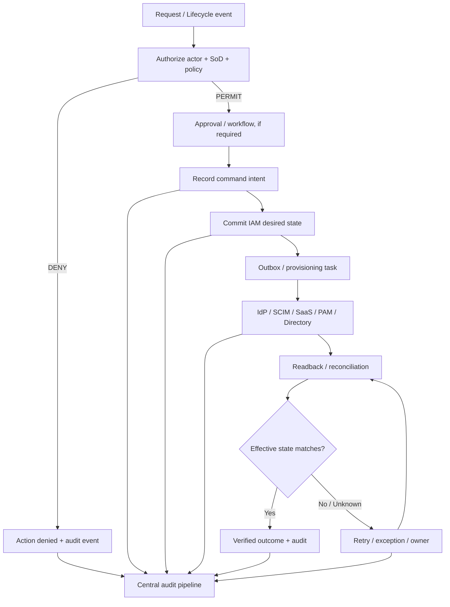
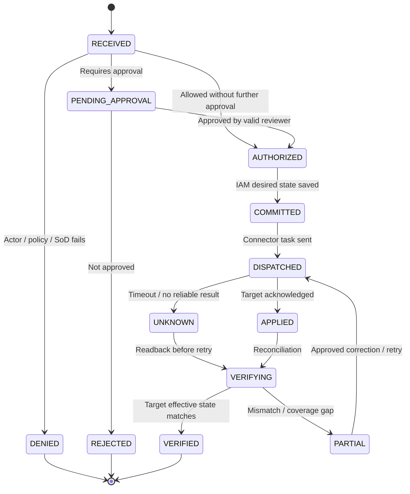
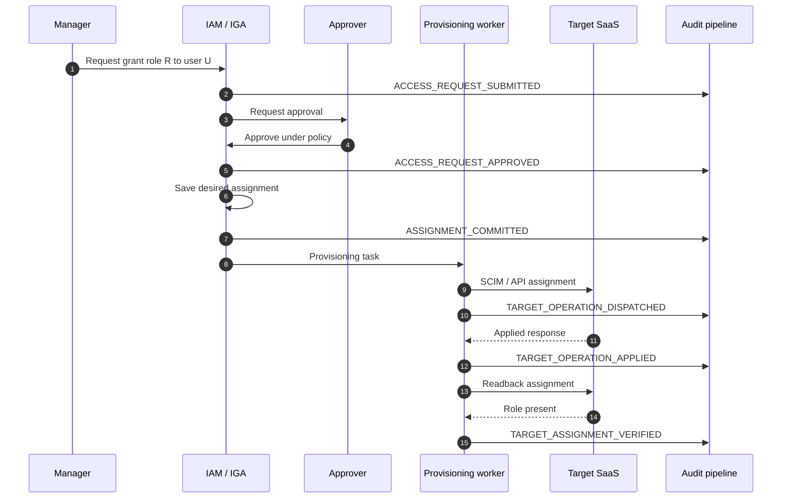
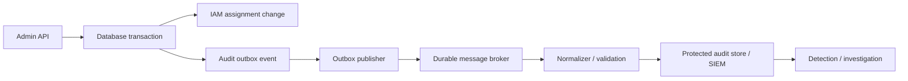
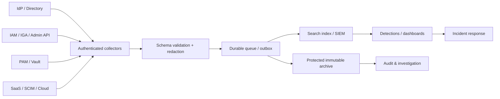

# Admin action log trong quản lý vòng đời danh tính IAM

## 1. Admin action log là gì?

**Admin action log** là bản ghi có cấu trúc về **hành động quản trị** tác động tới danh tính, tài khoản, credential, phiên, nhóm, vai trò, entitlement, policy, ứng dụng hoặc hạ tầng IAM. Mỗi sự kiện cần cho biết **ai hoặc workload nào thực hiện thao tác, thực hiện trên đối tượng nào, theo quyền và phê duyệt gì, lúc nào, kết quả gì, và có thể kiểm chứng tác động ở hệ thống đích hay không**.

Trong **Identity and Access Management (IAM)** theo mô hình **Joiner–Mover–Leaver (JML)**, log quản trị hỗ trợ truy vết từ **tạo và xác minh danh tính, cấp quyền, thay đổi vai trò, access review đến thu hồi quyền** khi nhân viên hoặc owner của dịch vụ thay đổi.

Ví dụ: lúc 09:15, quản trị viên An gỡ role `finance_exporter` của Linh vì Linh đã chuyển bộ phận. Một admin action log đủ giá trị không chỉ ghi:

```text
2026-11-23 09:15 admin removed role
```

Nó phải cho phép trả lời:

- **Actor:** An là ai, đăng nhập bằng phương thức nào, có được ủy quyền không?
- **Target:** Linh là identity nào, account nào, thuộc tenant nào?
- **Change:** role `finance_exporter`, scope dự án/ứng dụng nào bị gỡ?
- **Reason:** dựa trên Mover event, access request hay decision review nào?
- **Policy:** quyền của An và các ràng buộc SoD nào được áp dụng?
- **Outcome:** IAM đã ghi desired state, connector đã xử lý, ứng dụng đích đã thực sự gỡ quyền chưa?
- **Evidence:** mã sự kiện, correlation ID, thời gian, phiên bản policy và kết quả readback.

**Điểm cốt lõi:** *admin action submitted* không đồng nghĩa *admin action authorized*, không đồng nghĩa *change applied*, và cũng không đồng nghĩa *effective access verified*.

## 2. Phân biệt admin action log, audit log, access log và debug log

| Loại log | Trọng tâm | Ví dụ | Có đủ làm bằng chứng thay quyền không? |
|---|---|---|---|
| **Admin action log** | Thay đổi hoặc thao tác quản trị cụ thể | Admin gỡ group của account | Có nếu nối được quyết định, kết quả và readback |
| **Audit log** | Bằng chứng các hoạt động cần truy vết, bao gồm admin action | Ai phê duyệt quyền, ai thay policy | Có thể, tùy tính đầy đủ/toàn vẹn |
| **Authentication log** | Hoạt động xác thực | SSO, MFA success/failure | Không chứng minh role đã bị gỡ |
| **Authorization/decision log** | Quyết định PERMIT/DENY tại PDP/PEP | User có được gọi `invoice:approve`? | Hỗ trợ kiểm chứng quyền hiệu lực |
| **Application access log** | Request tới API/tài nguyên | GET `/reports`, status 200 | Không tự giải thích lý do cấp quyền |
| **Provisioning log** | Ghi thay đổi xuống target | SCIM PATCH, connector retry | Cần kết hợp approval và readback |
| **System/diagnostic log** | Trạng thái kỹ thuật | Timeout, memory, stack trace | Không nên dựa làm audit duy nhất |
| **Security alert** | Tín hiệu nghi ngờ | Privileged escalation bất thường | Phải liên kết nguồn event để điều tra |

Admin action log là **một tập con hoặc một nguồn của hệ thống audit rộng hơn**. Nó cần đủ ổn định để dùng cho truy vết, nhưng không nên ghi **mật khẩu, bearer token, private key, cookie hoặc dữ liệu nghiệp vụ nhạy cảm** chỉ để tăng chi tiết.

### 2.1. Đừng suy từ “HTTP 200”

Một yêu cầu PATCH role trả HTTP 200 có thể là bước xử lý của API IAM, trong khi connector chưa thực thi ở SaaS. Vì vậy cần phân biệt **accepted**, **applied**, **verified** và **partially failed**.

## 3. Tại sao admin action log quan trọng với IAM?

Những rủi ro thường gặp:

1. **Privilege escalation:** quản trị viên tự thêm quyền admin hoặc nâng quyền người thân cận.
2. **Privilege creep:** Mover chỉ được cấp quyền mới, không gỡ quyền cũ.
3. **Orphan accounts:** user Leaver vẫn có tài khoản local hoặc API key.
4. **Policy tampering:** một người tắt MFA, thay SoD rule hoặc giảm yêu cầu phê duyệt.
5. **Credential misuse:** admin tạo OAuth client secret, PAT hoặc khóa máy mới ngoài quy trình.
6. **Hidden delegation:** hành động được thực hiện thông qua `on_behalf_of` hoặc quyền ủy quyền đã hết hạn.
7. **Mass changes:** bulk add users to privileged group hoặc disable nhiều account.
8. **Audit manipulation:** xóa, chỉnh sửa hoặc vô hiệu hóa nguồn log để che hành động.
9. **Replayed provisioning:** job cũ cấp lại role sau khi Leaver đã được xử lý.
10. **Direct target drift:** thay role ngay ở SaaS hoặc directory không đi qua IGA.

Admin action log giúp **phát hiện, điều tra và chứng minh** các hành động này, nhưng **không tự ngăn chúng xảy ra**. Cần kiểm soát quyền quản trị, approval, separation of duties (SoD), authorization enforcement và đối soát bên cạnh logging.

### 3.1. Log cũng là một bề mặt tấn công

Kẻ tấn công có thể nhắm vào pipeline log để **làm đầy hàng đợi, ghi dữ liệu giả, xóa bằng chứng, che hoạt động trong luồng noise hoặc lấy dữ liệu nhạy cảm từ log**. Vì vậy bảo vệ admin action log là một phần của bảo vệ IAM.

## 4. Những hành động nào cần được ghi?

Mỗi tổ chức cần định nghĩa **event catalog**. Những nhóm thường quan trọng:

| Nhóm | Ví dụ hành động admin | Rủi ro |
|---|---|---|
| **Identity** | Create, link, merge, disable, delete identity | Nhầm chủ thể, vượt lifecycle |
| **Account** | Provision, suspend, unlock, reactivate, deprovision | Khôi phục truy cập trái phép |
| **Role/group** | Add/remove member, assign/revoke admin role | Tăng đặc quyền |
| **Permission** | Grant/revoke entitlement, thay resource scope | Quyền ngoài nhu cầu |
| **Policy** | Create/update RBAC/ABAC/PBAC, SoD exceptions | Thay đổi quy tắc quyết định |
| **Authentication** | Reset MFA, disable factor, thay login policy | Chiếm quyền tài khoản |
| **Session/token** | Revoke refresh grants, logout devices, issue client credential | Truy cập tồn dư hoặc giả danh |
| **Directory/IdP** | Thêm group, đổi ownership, federation trust | Ảnh hưởng SSO và ứng dụng |
| **SCIM/provisioning** | Force sync, retry, remap account, bulk update | Sai lệch target |
| **PAM** | Activate emergency admin, checkout secret, change approval | Quyền đặc quyền |
| **Machine/NHA** | Create service account, rotate/revoke key, change owner | Đường truy cập máy–máy |
| **Review/approval** | Approve access, certify role, approve exception | Quyền không có căn cứ |
| **Audit settings** | Disable source, change retention, export evidence | Mất bằng chứng |
| **Tenant/trust** | Add domain, change CA/JWK or federation settings | Ảnh hưởng diện rộng |

### 4.1. Cần log cả hành động thất bại

Một admin cố cấp role `production_admin` nhưng bị SoD chặn là **sự kiện đáng ghi**: có thể là sai thao tác, hiểu nhầm quy trình hoặc dấu hiệu tấn công. Log phải phân biệt **attempted**, **denied**, **executed**, **failed** và **verified**, tránh ghi như thể đã cấp thành công.

## 5. Định danh actor, initiator, approver và executor

Trong IAM, “ai thực hiện” có thể khác “ai yêu cầu” hoặc “ai là người được thay quyền”.

| Vai trò trong event | Ý nghĩa | Ví dụ |
|---|---|---|
| **Initiator / requester** | Khởi tạo yêu cầu | Manager muốn cấp quyền cho Linh |
| **Approver** | Quyết định cho phép hành động | Data Owner xác nhận |
| **Actor** | Principal gửi yêu cầu tới API admin | Quản trị viên An hoặc service account |
| **Executor** | Hệ thống trực tiếp gọi target | `iga-scim-worker` |
| **Beneficiary / target subject** | Người/workload được cấp hoặc gỡ quyền | Identity `I-1042` |
| **Resource owner** | Chủ sở hữu role/dữ liệu | Finance Controller |
| **Delegator** | Người ủy quyền cho actor khi hợp lệ | Trưởng nhóm thay người duyệt |
| **Impersonated identity** | Danh tính bị giả lập trong công cụ hỗ trợ | User được support giả lập có kiểm soát |

### 5.1. Không ghi chung mọi thứ thành “system”

Ví dụ automation thực thi SCIM PATCH phải ghi:

```text
requested_by  = I-2001 (manager)
approved_by   = I-3007 (data owner)
executed_by   = NHA-IGA-SCIM-WORKER
target_id     = I-1042 / saas-account-1042
caused_by     = ACCESS-REQUEST-8821
```

Nếu chỉ có `actor=system`, không thể truy tìm ai là người chịu trách nhiệm cho việc cấp quyền.

### 5.2. Actor ID phải ổn định

Email, display name và directory DN có thể thay đổi hoặc tái sử dụng. Dùng **immutable identity/principal ID + issuer/tenant**, còn tên/email nếu cần chỉ là thông tin hiển thị có thời điểm.

## 6. Phân biệt acting-as, on-behalf-of và impersonation

Quyền quản trị có thể được thực thi qua **delegated administration**, workflow automation hoặc hỗ trợ kỹ thuật.

### 6.1. Delegated administration

Một quản trị viên được ủy quyền quản lý người dùng **trong một business unit hoặc tenant nhất định**. Audit nên ghi:

- Actor có thẩm quyền gì?
- Delegation ID, grantor, hạn và scope?
- Nguồn phê duyệt có còn hợp lệ?
- Resource có thuộc scope ủy quyền không?
- Hành động có vi phạm SoD hay self-approval không?

### 6.2. On-behalf-of

Một service gọi downstream API **thay mặt người dùng** cần lưu cả **workload principal** và **người dùng/workflow được đại diện**. Không suy từ header `X-User` do client tự gửi nếu chưa được bảo vệ/xác thực.

### 6.3. Impersonation

Nếu công cụ support cho phép “đăng nhập dưới dạng user”, audit phải ghi **admin gốc, user được impersonate, lý do, thời hạn, session ID, hành động bị giới hạn và kết thúc**. Không thay thế actor gốc trong log bằng tên user được hỗ trợ rồi mất dấu vết.

**Mục tiêu:** không có thao tác nào của admin hoặc service đặc quyền trở thành **hành động vô chủ**.

## 7. Phân biệt target identity, account và resource

Một người dùng có thể có nhiều account tại nhiều target.

| Định danh | Cần phân biệt |
|---|---|
| `identity_id` | Danh tính logic do IAM quản lý |
| `target_account_id` | Tài khoản cụ thể trong SaaS/LDAP/cloud |
| `tenant_id` | Phạm vi tenant hoặc tổ chức |
| `target_system_id` | Ứng dụng/connector/directory |
| `role_id` | Vai trò kỹ thuật hoặc nghiệp vụ |
| `group_id` | Nhóm directory/IdP/SCIM |
| `resource_id` | Tài nguyên dữ liệu/ứng dụng cụ thể |
| `scope_id` | Project, department, environment hoặc tenant con |
| `service_identity_id` | Principal máy/workload |
| `policy_id` / `policy_version` | Quy định kiểm soát đã áp dụng |

### 7.1. Không dùng tên role đơn thuần

Một role `admin` có thể tồn tại trong nhiều hệ thống/tenant. Cần ghép **target + tenant + role ID + scope** để biết thực sự ai đã được tăng quyền.

### 7.2. Không coi “account deleted” bằng “identity deleted”

Xóa account ở một SaaS không chứng minh mọi account hoặc token của identity ấy đã bị thu hồi. Hệ thống logging cần lưu **phạm vi của từng thao tác**.

## 8. Vòng đời một admin action: yêu cầu tới xác minh



Một nghiệp vụ có thể sinh **nhiều audit events**: attempt, authorization decision, approval, commit, connector dispatch, target applied và readback. Gộp tất cả thành một record “SUCCESS” trước khi target xác nhận sẽ làm mất tính đúng đắn.

## 9. State machine cho admin action



### 9.1. Trạng thái không được tự suy diễn

- `AUTHORIZED`: có quyền thực hiện, **chưa chắc hành động đã ghi vào IAM**.
- `COMMITTED`: desired state được lưu, **chưa chắc target đã thay đổi**.
- `APPLIED`: target/connector báo kết quả, **chưa chắc quyền hiệu lực đã đúng ở mọi đường**.
- `VERIFIED`: có readback hoặc bằng chứng tương đương trong phạm vi công bố.
- `PARTIAL/UNKNOWN`: có việc chưa kết luận; không tự chuyển thành thành công.

### 9.2. Audit event và state transition

Nên ghi **event theo từng chuyển trạng thái**, không chỉ cập nhật một cột `status` duy nhất rồi xóa lịch sử thao tác.

## 10. Thiết kế schema chuẩn cho admin action log

Một bản ghi nên có các nhóm trường:

| Nhóm | Trường gợi ý | Mục đích |
|---|---|---|
| Event | `event_id`, `schema_version`, `event_type` | Định danh và contract |
| Time | `occurred_at`, `recorded_at`, `ingested_at` | Thứ tự và độ trễ |
| Actor | `actor.id`, `actor.type`, `actor.issuer`, `actor.tenant` | Ai ra lệnh |
| Session | `session_ref`, `auth_method`, `mfa_context` | Ngữ cảnh phiên |
| Delegation | `initiator_id`, `approver_id`, `on_behalf_of` | Trách nhiệm |
| Target | `target.identity_id`, `target.account_id`, `target.system_id` | Đích cụ thể |
| Action | `action`, `resource_type`, `resource_id`, `scope` | Thao tác nào |
| Authorization | `decision`, `policy_id`, `policy_version` | Quyền được quyết định ra sao |
| Approval | `request_id`, `approval_id`, `reason_code` | Căn cứ nghiệp vụ |
| Execution | `operation_id`, `connector_id`, `attempt` | Kết quả thực thi |
| Outcome | `stage`, `result`, `error_category` | Trạng thái chính xác |
| Verification | `verified_at`, `evidence_ref`, `coverage` | Đã kiểm chứng gì |
| Correlation | `correlation_id`, `causation_id`, `source_event_id` | Truy vết end-to-end |
| Integrity | `producer_id`, `sequence`, `signature_ref` | Hỗ trợ kiểm tra tính toàn vẹn |

### 10.1. Event ID khác correlation ID

- **Event ID:** duy nhất cho **một sự kiện**.
- **Correlation ID:** gom các sự kiện của **cùng quy trình nghiệp vụ**.
- **Causation ID:** chỉ sự kiện/lệnh làm phát sinh event này.
- **Operation ID:** một thao tác cụ thể tại connector/target.
- **Idempotency key:** ngăn xử lý lặp có hiệu ứng không mong muốn.

Không sử dụng cùng một giá trị cho mọi trường rồi đánh mất cấu trúc nguyên nhân–kết quả.

## 11. Ví dụ JSON: admin thu hồi role sau Mover

```json
{
  "schema_version": "1.0",
  "event_id": "IAM-EVT-2026-1123-00881",
  "event_type": "ROLE_ASSIGNMENT_REVOKE_REQUESTED",
  "occurred_at": "2026-11-23T09:15:00Z",
  "recorded_at": "2026-11-23T09:15:00.100Z",
  "producer": "iam-admin-api",
  "actor": {
    "type": "HUMAN_ADMIN",
    "identity_id": "I-2001",
    "issuer": "corp-idp",
    "tenant_id": "tenant-company",
    "session_ref": "session-ref-77"
  },
  "target": {
    "identity_id": "I-1042",
    "target_system_id": "finance-saas",
    "target_account_id": "finance-user-1042",
    "tenant_id": "tenant-company"
  },
  "change": {
    "resource_type": "ROLE_ASSIGNMENT",
    "role_id": "finance_exporter",
    "scope": "tenant-company/finance",
    "operation": "REVOKE"
  },
  "authorization": {
    "decision": "PERMIT",
    "policy_id": "IAM-ADMIN-RBAC",
    "policy_version": "v8",
    "sod_check": "PASS"
  },
  "business_context": {
    "reason_code": "MOVER_OLD_ROLE",
    "request_id": "AR-8821",
    "source_event_id": "HR-MOVER-551"
  },
  "correlation_id": "CORR-1123-00881",
  "stage": "COMMAND_ACCEPTED",
  "result": "PENDING_PROVISIONING"
}
```

Đây là **schema tự xây để minh họa**. Nó không phải định dạng JSON bắt buộc của một sản phẩm IAM. Không có raw token hoặc password.

### 11.1. Kết quả cuối phải là event khác

Khi connector gỡ role tại SaaS và đọc lại đạt, phát event `ROLE_ASSIGNMENT_REVOKE_VERIFIED` với **cùng correlation ID**, operation/evidence refs và `verified_at`. Đừng sửa event ban đầu thành “đã xảy ra từ trước”.

## 12. Ghi nhận before/after mà không lộ bí mật

Một admin action log có thể cần mô tả **giá trị trước và sau** để biết thay đổi thực sự là gì.

Ví dụ phù hợp:

```json
{
  "event_type": "USER_ACCOUNT_STATUS_CHANGED",
  "target_account_id": "saas-user-1042",
  "change": {
    "field": "active",
    "before": true,
    "after": false
  },
  "reason_code": "HRIS_LEAVER",
  "result": "APPLIED"
}
```

Nhưng không nên ghi:

```text
password.before = oldPassword
password.after  = newPassword
client_secret   = actualSecret
Authorization   = Bearer eyJ...
```

### 12.1. Quy tắc delta logging

- Với role/group: ghi **role ID hoặc group ID được thêm/gỡ** và scope.
- Với policy: ghi **policy ID, version, change category, diff đã được làm sạch**.
- Với email/PII: ghi khi thật sự cần và có quyền truy cập phù hợp.
- Với password/secret/private key/token: chỉ ghi **credential reference/version và action**.
- Với file cấu hình dài: cân nhắc **hash, version và secure artifact reference**, không nhồi toàn bộ cấu hình vào audit.
- Với bulk update: ghi danh sách target ID có kiểm soát hoặc tham chiếu tới manifest được bảo vệ.

**Hash của mật khẩu hoặc secret không nên tự động xuất hiện trong log**; nếu cần định danh phiên bản, dùng ID do credential manager phát hành.

## 13. Ngữ cảnh xác thực của admin

Một thay đổi đặc quyền có thể cần biết **actor được xác thực đến mức nào**, nhưng không được lưu yếu tố bí mật.

Các trường hữu ích:

| Trường | Ý nghĩa |
|---|---|
| `authn_session_ref` | Tham chiếu phiên quản trị |
| `authn_time` | Lúc actor đã xác thực |
| `auth_method_class` | Loại xác thực/phương thức được dùng |
| `mfa_satisfied` | Chính sách MFA đã được đáp ứng ở mức kiểm tra |
| `step_up_performed` | Có step-up cho hành động nhạy cảm không |
| `device_trust_state` | Thông tin trust nếu policy sử dụng |
| `source_ip_context` | IP hoặc vùng mạng trong phạm vi retention/privacy |
| `client_app_id` | Portal, CLI hoặc automation tool |
| `token_issuer` / `token_audience` | Ngữ cảnh token, không phải token raw |

### 13.1. “MFA = true” không giải thích hết rủi ro

Một quyền thay policy IAM có thể yêu cầu **phương thức chống phishing, phiên mới hoặc PAM/JIT activation**. Log cần biết policy đã kiểm tra gì, không khẳng định “có MFA” đồng nghĩa mọi kiểm soát đều đạt.

### 13.2. Không lưu thông tin vượt mục đích

Source IP, user agent, device ID có thể là dữ liệu nhạy cảm. Chỉ thu thập khi có mục tiêu bảo mật/kiểm toán rõ, kiểm soát quyền xem và retention.

## 14. Quản trị role, group và RBAC/ABAC/PBAC

Những thao tác cần được theo dõi:

- Create/update/delete business role hoặc technical role.
- Assign/revoke role đối với một identity.
- Add/remove direct directory/IdP/SCIM group membership.
- Change role–permission mapping.
- Update ABAC attribute source hoặc policy evaluation rules.
- Change policy precedence/deny rules.
- Grant/remove direct entitlement ở ứng dụng.
- Approve SoD exception với thời hạn.
- Change role owner và reviewer.
- Bulk grant/revoke theo manifest được phê duyệt.

### 14.1. Role assignment và role definition khác nhau

**User–Role assignment (UA)** là gán một identity vào role. **Role–Permission assignment (PA)** là cấu hình một role chứa permission gì.

Gỡ role của Linh chỉ ảnh hưởng một grant/scope phù hợp. Gỡ permission `report:export` khỏi role `finance_reader` có thể tác động **tất cả người giữ role**. Admin action log phải ghi **loại thay đổi, role version và blast radius**.

### 14.2. ABAC có thay đổi quyền dù không gỡ group

Một admin sửa thuộc tính `department`, `region` hoặc policy condition có thể làm người dùng nhận quyền khác dù membership không đổi. Audit cần ghi **attribute/policy change có ảnh hưởng tới authorization**, không chỉ đếm SCIM group patches.

## 15. Ghi log hoạt động Joiner

Một quy trình Joiner thường gồm:

1. HRIS xác nhận worker/relationship, effective date.
2. Identity proofing xác nhận chủ thể theo policy.
3. IAM tạo identity/account.
4. IdP/Directory tạo hoặc liên kết đối tượng.
5. RBAC/ABAC tính baseline roles và access request bổ sung.
6. Approver xác nhận quyền đặc biệt khi cần.
7. SCIM/API provisioning tới các ứng dụng.
8. Reconciliation xác minh account và entitlement hiệu lực.

### 15.1. Admin action log cần chứa những gì?

- Ai tạo/duyệt tài khoản, nguồn JML và account ID?
- Role nào được cấp theo chính sách, role nào cần approval?
- Có pre-provision trước effective date không?
- Đã bật account/credential trước thời hạn không?
- Những connector nào áp dụng/không áp dụng thay đổi?
- Có duplicate/orphan target account không?

### 15.2. Không log nội dung identity proofing quá mức

Admin log có thể ghi **proofing status và reference**, nhưng không phải nơi lưu toàn bộ ảnh giấy tờ, số định danh, dữ liệu sinh trắc hoặc thông tin nhạy cảm không cần thiết.

## 16. Ghi log hoạt động Mover

Mover thường đổi **department, manager, project, employment type, tenant hoặc role scope**.

Ví dụ:

```text
Before:
  department=SALES
  role=sales_exporter

After:
  department=FINANCE
  desired_roles={finance_reader}

Actions:
  REVOKE sales_exporter
  GRANT finance_reader
```

Admin action log cần liên kết **HR event → desired-state calculation → approvals → revoke old/grant new → target readback**.

### 16.1. Không chỉ log cấp quyền mới

Nếu chỉ thấy event `finance_reader GRANTED`, auditor chưa biết `sales_exporter` đã bị gỡ. Phải ghi và theo dõi **cả revoke path**.

### 16.2. Multiple assignments

Một người có thể có hai nhiệm vụ hợp lệ. Nếu chỉ một assignment kết thúc, log phải ghi **grant source/scope nào bị gỡ**. Không khẳng định toàn bộ role đã mất khi nguồn khác vẫn cho quyền.

### 16.3. Ngăn stale event

Nếu Mover cũ được retry sau Leaver, event phải phản ánh **stale/superseded action** và current-policy check, không tạo lại quyền rồi chỉ log “retry success”.

## 17. Ghi log hoạt động Leaver và deprovisioning

Khi nguồn có thẩm quyền xác nhận Leaver, cần truy vết việc:

- Disable user/account ở IdP/Directory.
- Thu hồi direct role, group membership và privileged eligibility.
- Disable/deprovision SaaS account qua SCIM/API.
- Revoke refresh grants, PAT, API keys, SSH keys và credentials theo phạm vi.
- Kết thúc PAM session/checkout hoặc credential lease khi cần.
- Chuyển ownership của service account/workload còn hợp lệ.
- Xử lý ứng dụng không có connector và exception.
- Readback các target quan trọng sau thu hồi.

### 17.1. Ví dụ trạng thái cần phân biệt

| Sự kiện | Kết luận hợp lệ |
|---|---|
| `HR_LEAVER_CONFIRMED` | Quan hệ hết hiệu lực theo nguồn |
| `IDP_USER_DISABLED` | IdP account đã bị disable |
| `SCIM_DEPROVISION_DISPATCHED` | Task đã được gửi |
| `SAAS_ACCOUNT_DISABLED_APPLIED` | SaaS báo đã xử lý |
| `SAAS_ACCESS_REVOKED_VERIFIED` | Target readback phù hợp |
| `REFRESH_GRANT_REVOKED` | Không tiếp tục mint token qua grant đó theo AS |
| `SESSION_TERMINATION_PENDING` | Session chưa có bằng chứng kết thúc |
| `OFFBOARDING_PARTIALLY_VERIFIED` | Vẫn tồn tại đường truy cập chưa xác minh |

**Không kết luận Leaver hoàn tất chỉ vì IdP disable trả 200**. Quyền local, token đã cấp và session độc lập có thể tiếp tục tồn tại.

## 18. IdP, SSO, OAuth/OIDC và token admin actions

Những sự kiện quản trị identity provider và token infrastructure đáng quan tâm:

| Hành động | Vì sao quan trọng |
|---|---|
| Tạo/sửa OAuth client registration | Có thể tạo application được quyền gọi API |
| Thêm client secret hoặc public key mới | Có thể giả danh confidential client |
| Đổi OIDC redirect URI/trust settings | Rủi ro token/code redirect sai |
| Tắt hoặc hạ MFA policy | Làm giảm assurance |
| Đổi SAML signing certificate/metadata trust | Ảnh hưởng federation |
| Thêm IdP admin hoặc group superuser | Privilege escalation |
| Revoke refresh token family | Ngăn cấp token mới qua grant |
| Tạo/thu hồi app session | Điều khiển vòng đời phiên |
| Cấu hình token TTL/issuer/audience | Thay cửa sổ rủi ro hoặc trust |
| Bulk logout hoặc disable users | Ảnh hưởng availability diện rộng |

### 18.1. Không log bearer token

Log những thay đổi **token policy, client ID, grant/session references và reason codes**, không lưu raw access token, refresh token hay client secret.

### 18.2. Revoke refresh token khác revoke access token

Một admin gỡ refresh grant sẽ chặn khả năng xin access token mới theo policy AS, nhưng **JWT access token đã phát** có thể còn được Resource API chấp nhận đến khi hết hạn hoặc bị kiểm tra current state/denylist. Audit cần chỉ ra phạm vi đã xác minh.

## 19. SCIM, directory và provisioning log liên kết thế nào?

SCIM thường là lớp **đồng bộ User/Group**, không phải lớp phê duyệt toàn bộ quyền nghiệp vụ.

Ví dụ một connector gỡ thành viên khỏi SCIM Group:

```http
PATCH /scim/v2/Groups/group-finance-report HTTP/1.1
Host: scim.example.org
Authorization: Bearer <redacted-token>
Content-Type: application/scim+json

{
  "schemas": ["urn:ietf:params:scim:api:messages:2.0:PatchOp"],
  "Operations": [
    {
      "op": "remove",
      "path": "members[value eq \"target-user-1042\"]"
    }
  ]
}
```

Đây là ví dụ minh họa, giả định provider hỗ trợ `PATCH` với filter phù hợp. Log admin **không** lưu raw `Authorization` header.

### 19.1. Các sự kiện nên nối

```text
ACCESS_REVIEW_REVOKE_DECIDED
    -> IAM_ROLE_ASSIGNMENT_REMOVED
    -> SCIM_GROUP_MEMBER_REMOVE_DISPATCHED
    -> SCIM_GROUP_MEMBER_REMOVE_APPLIED
    -> SCIM_TARGET_MEMBERSHIP_ABSENT_VERIFIED
```

### 19.2. HTTP success chưa chứng minh effective access

Một số SaaS có **local role/direct grant** ngoài SCIM hoặc session/token vẫn còn. Log nên ghi `verification_scope` và những quyền chưa quan sát được.

### 19.3. LDAP/Directory

Khi admin thay `memberOf`, `group` hoặc account status, cần log **directory entry ID, DN tại thời điểm thao tác, group ID, source directory/forest và scope**. DN có thể đổi; đừng dùng một tên hiển thị làm ID ổn định duy nhất.

## 20. PAM, break-glass và privileged admin actions

Quyền đặc quyền có rủi ro lớn, cần khả năng truy vết chặt hơn.

Các action:

- Thêm hoặc xóa privileged role.
- Đặt tài khoản vào trạng thái **eligible**.
- Kích hoạt quyền **Just-in-Time (JIT)**.
- Yêu cầu/duyệt phiên quản trị.
- Checkout secret hoặc credential từ PAM/Vault.
- Mở/đóng privileged session.
- Dùng break-glass account hoặc emergency access.
- Tắt session recording, approval hoặc alert.
- Thay vault policy, credential rotation policy.
- Thay owner tài khoản đặc quyền.

### 20.1. Eligibility khác activation và session

| Loại record | Điều chứng minh |
|---|---|
| `PRIVILEGED_ELIGIBILITY_GRANTED` | Có thể xin kích hoạt theo điều kiện |
| `PRIVILEGED_ROLE_ACTIVATED` | Role đã được kích hoạt một khoảng thời gian |
| `PAM_SESSION_STARTED` | Có phiên quyền cao được mở |
| `PAM_SESSION_ENDED` | Phiên được kết thúc theo broker |
| `TARGET_PRIVILEGE_VERIFIED_ABSENT` | Quyền hiệu lực đã không còn theo kiểm tra |

Không đánh dấu “quyền admin đã thu hồi” chỉ vì eligible role bị gỡ mà **session đã mở hoặc credential checkout** vẫn còn giá trị.

### 20.2. Break-glass cần phân biệt khẩn cấp và lạm dụng

Event phải ghi **emergency ticket, lý do, người thực hiện, thông báo/alert, phạm vi, thời hạn và hậu kiểm**. Không tạo đường “khẩn cấp” không có audit.

## 21. Non-human accounts, bots và hành động tự động

Nhiều thao tác IAM được thực hiện bởi **service account**, scheduler, CI/CD worker hoặc connector chứ không trực tiếp từ người.

| Principal máy | Ví dụ hành động | Ngữ cảnh cần ghi |
|---|---|---|
| `iga-provisioner` | SCIM create/update/delete | Task ID, policy version, target |
| `hris-sync-bot` | Cập nhật trạng thái nhân sự | Source HR event/version |
| `cert-rotation-agent` | Phát/thu hồi chứng thư | Issuer, serial/key reference |
| `vault-rotation-bot` | Rotate password/API key | Credential ref, old/new version IDs |
| `ci-deploy-service` | Đăng ký OAuth client/role | Pipeline, environment, approved change |
| `reconciliation-worker` | Sửa drift theo policy | Desired/observed diff, auto-remediation policy |

### 21.1. Không gán hành động automation cho “người đã tạo bot”

Kỹ sư An từng tạo `iga-provisioner` nhưng job chạy hôm nay theo service identity riêng. Audit phải ghi **executor workload** và nguồn nghiệp vụ/approval hiện hành, không tự gắn mọi action về An.

### 21.2. Khi owner bot là Leaver

IAM cần log **chuyển owner, thu hồi quyền quản trị cá nhân, credential rotation nếu cần và xác minh service còn mục đích hợp lệ**. Không tự decommission workload production chỉ vì owner con người nghỉ việc.

### 21.3. Không log raw service credential

Đối với API key/client secret/cert, chỉ ghi **credential ID/ref, issuer, key version, action và outcome**. Nếu cần chứng minh private key đã thay, dùng reference/version và bằng chứng issuer, không in private key.

## 22. Tách request, decision, command và observed effect

Một chuỗi IAM thường có bốn lớp:

| Lớp | Nội dung | Ví dụ event |
|---|---|---|
| **Intent/request** | Ai muốn làm gì và vì sao | `ACCESS_REQUEST_SUBMITTED` |
| **Authorization/approval** | Quyết định có cho phép không | `ACCESS_REQUEST_APPROVED` |
| **Execution/command** | Hệ thống cố thực thi | `ROLE_REVOKE_DISPATCHED` |
| **Observed effect** | Target thật sự thay quyền thế nào | `ROLE_ABSENT_VERIFIED` |

### 22.1. Tại sao cần phân lớp?

Một request bị từ chối vì SoD **không nên có event “role granted”**. Một approval đã được duyệt nhưng connector thất bại **không được ghi như permission đã thay**.

### 22.2. Một decision có thể sinh nhiều target operations

Ví dụ quyết định thu hồi `finance_admin` có thể cần gỡ group IdP, SaaS local role, PAM eligibility, refresh grants và session. Những target operations có cùng correlation ID nhưng **event IDs và outcomes độc lập**.

## 23. Correlation end-to-end cho một access request



### 23.1. Một correlation ID xuyên suốt

```text
correlation_id = CORR-2026-000711
request_id     = AR-2026-00122
approval_id    = AP-2026-00413
task_id        = TASK-2026-00885
target_op_id   = SCIM-OP-004812
```

Các IDs này giúp auditor truy vết từ yêu cầu nghiệp vụ tới thay quyền tại hệ thống đích, kể cả khi mỗi thành phần lưu log riêng.

## 24. Event time, processing time và thứ tự sự kiện

Hệ thống IAM phân tán có nhiều đồng hồ và pipeline không đồng bộ.

### 24.1. Các mốc phải phân biệt

- `occurred_at`: thời điểm producer cho rằng hành động xảy ra.
- `recorded_at`: lúc producer ghi event.
- `ingested_at`: lúc collector/SIEM nhận event.
- `applied_at`: lúc target báo thực thi.
- `verified_at`: lúc readback xác minh trạng thái.
- `effective_at`: lúc chính sách/HR event phải có hiệu lực.

**Không dùng `ingested_at` để suy mọi sự kiện thực tế đã xảy ra theo đúng thứ tự nhận.**

### 24.2. Trường hợp out-of-order

```text
09:00 HRIS: user became Leaver
09:01 IAM: revoke role initiated
09:02 SaaS: role removed
09:03 SIEM receives SaaS event
09:05 SIEM receives delayed HRIS event
```

Nếu chỉ sắp theo ingestion order, auditor có thể hiểu nhầm SaaS chủ động gỡ trước Leaver. Cần **source event, effective date, correlation/causation ID và timestamp rõ nghĩa**.

### 24.3. Đồng bộ giờ và chống giả mạo

Các nguồn cần đồng bộ thời gian bằng cơ chế tin cậy phù hợp, ghi timezone nhất quán (ví dụ UTC ISO 8601) và kiểm tra skew. Đồng hồ chính xác **không tự chứng minh actor trung thực**; phải có identity/authentication và integrity controls.

## 25. Transactional outbox và bảo đảm không mất audit event

Một lỗi nghiêm trọng là **thay role thành công trong database nhưng process crash trước khi gửi audit event**.

### 25.1. Mô hình transactional outbox



Với hệ thống cho phép, **lưu state change và outbox event trong cùng transaction** giúp giảm nguy cơ chỉ một trong hai được lưu. Worker ngoài transaction sau đó chuyển event lên pipeline có khả năng retry.

### 25.2. Outbox không cho exactly-once toàn hệ thống

Publisher có thể gửi trùng khi retry, consumer phải **deduplicate bằng event ID** và xử lý idempotent. Nếu broker/store có sự cố, cần lag monitoring, dead-letter handling và replay controls.

### 25.3. Fail-open hay fail-closed khi audit sink lỗi?

Với hành động cực kỳ nhạy cảm, chính sách có thể yêu cầu **không thực hiện thay đổi nếu không thể ghi audit bền vững**. Với một số hoạt động thông thường, có thể chấp nhận event được lưu ở outbox an toàn và gửi sau. Không ngẫu nhiên bỏ log khi SIEM tạm thời mất kết nối.

## 26. Event ID, deduplication và retry

Một connector có thể retry nhiều lần cùng task do timeout.

### 26.1. Phân biệt action logic và attempt

```text
business_action_id = ACT-551
task_id            = TASK-882
attempt_1          = timeout
attempt_2          = target already updated
readback           = verified
```

Log nên cho biết có **hai attempts** nhưng chỉ **một thay đổi nghiệp vụ cần đạt**, tránh báo “hai lần cấp quyền” nếu retry idempotent.

### 26.2. Đặc tính cần có

- `event_id` duy nhất cho mỗi audit event.
- `business_action_id`/`correlation_id` cho thao tác logic.
- `attempt_number` cho lần retry.
- `idempotency_key` cho lệnh tới target nếu hỗ trợ.
- `source_version` và `policy_version` cho kiểm tra thay đổi trạng thái.
- `result` rõ `APPLIED`, `ALREADY_DESIRED`, `FAILED`, `UNKNOWN`.
- Readback trước retry khi target trả timeout không rõ kết quả.

**Không xóa log lần retry thất bại chỉ để báo cáo sạch**. Những attempt đó có giá trị chẩn đoán và phát hiện bất thường.

## 27. Append-only, WORM và chống sửa/xóa log

Bằng chứng audit cần khó bị thay đổi trái phép.

### 27.1. Các lớp kiểm soát

| Lớp | Mục tiêu |
|---|---|
| **Append-only ingestion** | Không cập nhật/xóa event tùy tiện qua API thông thường |
| **RBAC/ABAC cho audit store** | Tách quyền ghi, đọc, export, quản trị retention |
| **Write Once Read Many (WORM)** | Giới hạn khả năng sửa/xóa trong thời hạn đã cấu hình |
| **Object-lock/immutable retention** | Giữ bản bằng chứng trong vùng lưu trữ hỗ trợ |
| **Encryption at rest/in transit** | Giảm lộ nội dung log |
| **Integrity checking** | Phát hiện event bị sửa hoặc thiếu |
| **Independent log sink** | Giảm khả năng actor admin sửa cả hệ thống lẫn bằng chứng |
| **Backup/replication** | Phục hồi khi hỏng thiết bị hoặc sự cố dịch vụ |
| **Audit of audit administration** | Ghi mọi thay đổi retention, exporter, policy và deletion requests |

### 27.2. Không tuyên bố “không thể giả mạo tuyệt đối”

WORM hoặc append-only storage giúp giảm sửa/xóa trực tiếp, nhưng **không tự ngăn producer phát event sai, bỏ sót event từ đầu hoặc admin quyền cao thay cấu hình trước khi log được ghi**. Cần kết hợp nguồn tin cậy, separation of duties, monitoring và đối soát.

### 27.3. Quyền quản trị log phải độc lập

Người có quyền cấp role admin không nên mặc nhiên được **xóa hoặc sửa dấu vết cấp role**. Audit administrators và IAM policy administrators cần được tách quyền theo policy tổ chức.

## 28. Hash chaining, chữ ký và tính toàn vẹn bằng chứng

Khi cần mức bảo đảm cao, một pipeline có thể dùng **hash chain** hoặc ký số cho các lô audit events.

Ví dụ logic:

```text
event_hash_n = SHA256(canonical_event_n)
chain_hash_n = SHA256(chain_hash_(n-1) || event_hash_n)
```

Mỗi event hoặc batch tham chiếu hash trước đó, giúp **phát hiện thay đổi ở chuỗi đã có** nếu có baseline/anchor đáng tin.

### 28.1. Điều kiện để có ý nghĩa

1. Canonical serialization ổn định; thay thứ tự JSON fields không làm sai kiểm tra ngoài ý muốn.
2. Dùng thuật toán mật mã và triển khai đáng tin.
3. Bảo vệ signing/HMAC keys nếu dùng.
4. Anchor chain head/batch digest ở một **hệ thống độc lập** hoặc điểm tin cậy.
5. Quản lý chain rotation, gaps, late events, reprocessing và retention.
6. Lưu kết quả kiểm tra integrity và người thực hiện.
7. Không đưa private signing key vào ứng dụng công khai.

### 28.2. Hash chain không chứng minh nội dung sự kiện đúng

Một producer bị chiếm quyền có thể phát event giả **nhưng được ký hợp lệ**. Integrity chỉ giúp đánh giá nội dung **không bị sửa sau khi ghi theo mô hình trust**, chứ không thay xác thực actor, authorization hoặc reconciliation từ nguồn độc lập.

## 29. PII, secrets và nguyên tắc data minimization

Admin action log có thể chứa dữ liệu nhân sự và cấu trúc hạ tầng nhạy cảm.

### 29.1. Không ghi những gì?

- Password, mật khẩu cũ/mới, PIN, recovery code, OTP.
- OAuth access/refresh token, authorization code, client secret.
- Full `Authorization` header, session cookie, signed assertion.
- Private key, full secret value, vault credential plaintext.
- Ảnh giấy tờ, sinh trắc, thông tin ngân hàng/lương nếu không cần.
- Nội dung dữ liệu doanh nghiệp do API trả về.
- Full request/response body nếu có thể chứa dữ liệu nhạy cảm.

### 29.2. Ghi gì thay thế?

| Thông tin nhạy cảm | Dạng metadata được ưu tiên |
|---|---|
| Raw token | Token/grant/session reference |
| Client secret | Credential ID hoặc key version |
| Private key | Certificate fingerprint/serial + issuer |
| Password change | `PASSWORD_RESET_INITIATED` / `COMPLETED` |
| Full user record | Identity ID + field names/change category |
| Full policy body | Policy ID/version + approved diff ref |
| Request body | Allowed event fields đã chuẩn hóa |
| IP/device data | Chỉ những trường phục vụ security đã phê duyệt |

### 29.3. Redaction sớm

Ưu tiên **allowlist field** ngay từ producer. Nếu ghi raw credential rồi trông chờ SIEM che sau, secret đã có thể bị lộ qua **queue, storage, backup và observability agent**.

## 30. Retention, legal hold và quyền riêng tư

Log quản trị có thể được giữ lâu để kiểm toán, nhưng không thể đặt một thời hạn cố định cho mọi doanh nghiệp.

Những yếu tố cần quyết định:

- Mục đích sử dụng: điều tra, compliance, audit, security detection.
- Mức rủi ro/độ nhạy của hành động.
- Quy định pháp luật/hợp đồng có áp dụng.
- Cần giữ metadata identity sau khi account đã bị xóa.
- Retention của **hot search** và **archive** có thể khác nhau.
- Quyền truy cập/export dữ liệu PII và pseudonymization.
- Legal hold, incident preservation và quyền của cá nhân theo quy định.
- Quá trình xóa hết hạn có audit và tách quyền.
- Backup/replica retention và khả năng thực thi policy.

### 30.1. “Immutable” không đồng nghĩa “giữ vô hạn”

Một thiết kế WORM cần **thời hạn lưu có mục đích và được phê duyệt**. Không lưu vĩnh viễn toàn bộ dữ liệu nhận dạng chỉ vì có công nghệ object lock.

### 30.2. Deletion/retention phải phân biệt dữ liệu nguồn và bằng chứng

Xóa account ở SaaS không nhất thiết xóa ngay event `ACCOUNT_DISABLED` dùng cho audit. Nhưng dữ liệu cần lưu phải được giới hạn và xử lý theo chính sách quyền riêng tư/retention có thẩm quyền.

## 31. Chuẩn hóa event catalog và schema evolution

Hệ thống IAM có thể tích hợp IdP, HRIS, SaaS, SCIM và PAM với tên sự kiện khác nhau.

### 31.1. Canonical action taxonomy

Một hướng tổ chức:

```text
IDENTITY.CREATED
IDENTITY.LINKED
ACCOUNT.PROVISION_REQUESTED
ACCOUNT.DISABLED
ROLE.ASSIGNED
ROLE.REVOKED
GROUP.MEMBER_ADDED
GROUP.MEMBER_REMOVED
POLICY.UPDATED
MFA.FACTOR_RESET
OAUTH.CLIENT_SECRET_CREATED
TOKEN.GRANT_REVOKED
PAM.SESSION_STARTED
PAM.BREAKGLASS_ACTIVATED
AUDIT.CONFIG_CHANGED
```

Đây là **taxonomy gợi ý**, không phải danh sách bắt buộc theo tiêu chuẩn.

### 31.2. Version hóa

- `schema_version` giúp consumers giải mã đúng.
- Không đổi ý nghĩa field `result=SUCCESS` giữa các version mà không thông báo.
- Với enum mới, consumers nên xử lý unknown value an toàn.
- Có test tương thích cho SIEM rules, dashboard và export.
- Lưu raw source event **chỉ trong kho bảo vệ/retention phù hợp** nếu cần đối chứng, không để raw secrets lọt ra.
- Mapping giữa source event code và canonical event type cần version/owner.

### 31.3. Không normalize đến mức mất ngữ nghĩa

SCIM PATCH `remove member`, IdP group removal và PAM role deactivation đều là “revoke” theo nghĩa rộng, nhưng **hiệu ứng và phạm vi khác nhau**. Giữ `source_action`, `target_type` và `verification_type` để điều tra chính xác.

## 32. Thu thập, truyền và lưu trữ admin logs

Một pipeline tham khảo:



### 32.1. Nguyên tắc vận hành

1. Xác thực nguồn log bằng mTLS, workload identity, signed messages hoặc cơ chế tương ứng.
2. Mã hóa khi truyền, hạn chế network access.
3. Validate schema, loại dữ liệu không cho phép.
4. Có khả năng retry và replay với deduplication.
5. Theo dõi queue lag và dropped events.
6. Duy trì archive có kiểm soát tách khỏi search index có thể bị sửa.
7. Có dead-letter queue cho schema/error events cùng owner.
8. Cảnh báo khi nguồn log quan trọng im lặng bất thường.
9. Không để collector có quyền write tới IAM policy nếu không cần.
10. Ghi audit khi thay cấu hình collector, retention hoặc route.

### 32.2. Dữ liệu không đến không có nghĩa hành động không xảy ra

Nếu connector mất mạng, SIEM có thể không thấy các thao tác đã thành công ở target. Phải có cơ chế **backfill, reconciliation và coverage alert**.

## 33. Detection rules cho hành vi quản trị bất thường

Những mẫu hành vi nên được giám sát:

| Mẫu | Tín hiệu | Điều kiện giảm false positive |
|---|---|---|
| **Self-grant admin** | Actor tự cấp role đặc quyền | Kiểm tra quy trình break-glass được duyệt |
| **Mass role assignment** | Nhiều principal được cấp role nhạy cảm | So sánh change window/bulk approval |
| **MFA policy disabled** | Chính sách MFA bị tắt/giảm | Có change ticket, owner và hậu kiểm |
| **Admin secret created** | Thêm client secret/certificate mới | Có approval và client owner hợp lệ |
| **SoD bypass** | Một actor request + approve + execute | Kiểm tra delegation/service workflow |
| **Off-hours privilege change** | Thay quyền ngoài lịch thông thường | Ca trực/khẩn cấp đã được ghi |
| **Audit logging disabled** | Thay sink/filter/retention | Mức cảnh báo cao, bảo vệ độc lập |
| **Bulk account reactivation** | Nhiều user disabled được bật lại | Có lifecycle correction được phê duyệt |
| **Leaver access resurrected** | Role cấp sau Leaver effective date | Kiểm tra stale job vs sanctioned rehire |
| **Unexpected direct grant** | SaaS local role xuất hiện ngoài IGA | Source/owner và target verification |
| **Privileged role not expired** | JIT activation kéo dài quá TTL | Session/lease evidence |
| **Multiple denied admin actions** | Nhiều thay policy bị SoD chặn | Phân biệt lỗi thao tác và probing |

### 33.1. Không kết luận vi phạm chỉ từ một cờ

Một cuộc khôi phục khẩn cấp có thể tạo chuỗi admin actions bất thường nhưng hợp lệ. Detection là **tín hiệu cần điều tra**, không phải phán quyết tự động.

### 33.2. Quyết định xử lý phải dựa trên dữ liệu được kiểm chứng

Khi alert có nguy cơ cao, có thể yêu cầu MFA step-up, chặn session hoặc tạm dừng task theo policy, nhưng phải có owner/escalation và khả năng khôi phục cho hành động hợp lệ.

## 34. Ví dụ truy vấn phân tích trong SIEM

Giả sử hệ thống phân tích có bảng chuẩn hóa `admin_events` với các cột `event_time`, `actor_id`, `target_identity_id`, `action`, `result`, `tenant_id`.

### 34.1. Phát hiện tự cấp role admin

```sql
SELECT event_time, actor_id, target_identity_id, tenant_id, action
FROM admin_events
WHERE action = 'ROLE.ASSIGNED'
  AND target_identity_id = actor_id
  AND role_risk_tier = 'PRIVILEGED'
  AND result IN ('APPLIED', 'VERIFIED');
```

Kết quả chỉ là **ứng viên điều tra**. Một số hệ thống có quản trị viên được phép tự kích hoạt JIT theo approval/PAM; cần nối `approval_id` và policy trước khi đánh giá.

### 34.2. Những thay đổi quyền sau Leaver

```sql
SELECT e.event_time, e.actor_id, e.target_identity_id,
       e.action, e.correlation_id
FROM admin_events e
JOIN identity_relationships r
  ON e.target_identity_id = r.identity_id
WHERE r.relationship_status = 'TERMINATED'
  AND e.event_time >= r.effective_terminated_at
  AND e.action IN ('ROLE.ASSIGNED', 'GROUP.MEMBER_ADDED');
```

**Đây là SQL minh họa** trên schema giả định. Trong thực tế cần xử lý **multiple assignments, rehire, tenant scope, event delay và source version**, không coi mọi kết quả là vi phạm.

### 34.3. Phát hiện admin log source im lặng

Nếu `iam-admin-api` vẫn có traffic/metrics nhưng không gửi audit event trong khoảng bất thường, SIEM nên cảnh báo. Cần so sánh **heartbeats, operation counters và audit ingest counts**, không dùng duy nhất “không có event”.

## 35. Điều tra sự cố từ admin action log

Một quy trình incident response có thể bắt đầu bằng alert “production admin role được cấp ngoài chính sách”.

### 35.1. Các bước điều tra

1. Xác định event ID, correlation ID, source và mức tin cậy của log.
2. Kiểm tra actor, session, MFA, client/IP context và delegation.
3. Xem request/approval/ticket và policy version tại thời điểm thao tác.
4. Xác định target identity/account/tenant/role/scope.
5. Truy nối các event `AUTHORIZED → COMMITTED → DISPATCHED → APPLIED → VERIFIED`.
6. Đối chiếu **trạng thái hiện tại** ở IdP, directory, SaaS, cloud và PAM.
7. Tìm thay đổi khác từ cùng actor/session trước và sau sự kiện.
8. Kiểm tra role grant path, local grants, token/session và credential còn sống.
9. Nếu trái phép, thực hiện containment/revocation theo quy trình sự cố.
10. Preserve evidence với chain of custody, owner và access control.
11. Đánh giá log bị thiếu, sai đồng hồ hay bị can thiệp.
12. Root cause: lỗi approval, SoD, JML, connector hoặc account compromise.
13. Kết thúc khi remediation đã được kiểm chứng theo scope, không chỉ khi alert được đóng.

### 35.2. Chuỗi bằng chứng cần trả lời gì?

**Ai đã ra quyết định?** **Ai thực thi?** **Thao tác đã có hiệu quả ở đâu?** **Khi nào quyền bị thu hồi?** **Còn đường truy cập khác không?** Những câu hỏi này thường đòi dữ liệu từ **nhiều hệ thống**, không chỉ một record.

## 36. Spring Boot/Java: ghi admin audit event đúng lớp

Trong ứng dụng Java/Spring, admin action log nên được ghi ở **lớp nghiệp vụ/command boundary** cùng các quyết định authorization, không chỉ dựa vào HTTP access log của controller.

### 36.1. Mã giả minh họa

```java
// MÃ GIẢ minh họa; các interface không phải SDK có sẵn.
public final class RoleAdminService {
    private final AuthorizationPolicy policy;
    private final RoleRepository roleRepository;
    private final AuditOutbox outbox;

    @Transactional
    public void revokeRole(RevokeRoleCommand command, ActorContext actor) {
        PolicyDecision decision = policy.evaluate(
            actor,
            "ROLE.REVOKE",
            command.targetIdentityId(),
            command.roleId(),
            command.scope()
        );

        // Kết quả DENY cũng phải được audit qua luồng bảo đảm thích hợp.
        if (!decision.isPermitted()) {
            throw new AccessDeniedException("Not authorized");
        }

        roleRepository.revokeDesiredAssignment(
            command.targetIdentityId(),
            command.roleId(),
            command.scope()
        );

        AuditEvent event = AuditEvent.builder()
            .eventType("ROLE.REVOKE_COMMITTED")
            .correlationId(command.correlationId())
            .actorId(actor.identityId())
            .targetId(command.targetIdentityId())
            .resourceId(command.roleId())
            .scope(command.scope())
            .policyVersion(decision.policyVersion())
            .result("PENDING_TARGET_RECONCILIATION")
            .build();

        outbox.append(event); // Cùng transaction với desired-state update.
    }
}
```

### 36.2. Lưu ý về denied event và transaction rollback

Nếu ghi event DENY vào **cùng transaction rồi throw exception khiến rollback**, event cũng có thể bị rollback và mất. Cần thiết kế kênh audit DENY với **durable transaction hoặc cơ chế riêng** phù hợp mức rủi ro, không lấy đoạn mã giả trên làm implementation đầy đủ.

### 36.3. Đừng chỉ dùng annotation log mọi method

AOP có thể hữu ích cho **cross-cutting metadata**, nhưng nếu chỉ log tên method và HTTP 200 sẽ không biết **quyết định nghiệp vụ, nội dung thay role, transaction commit và target readback**. Nên kết hợp domain events với context do service tạo.

## 37. Quản lý log failures và backpressure

Trong thực tế, hệ thống logging có thể gặp:

- Broker unavailable.
- Consumer lag lớn.
- Schema validation lỗi.
- Dead-letter backlog.
- SIEM ingest quota/rate limit.
- Network partition giữa vùng.
- Disk đầy hoặc archive policy lỗi.
- Producer crash trước khi gửi.
- Duplicate delivery.
- Misconfigured timezone hoặc tenant mapping.

### 37.1. Runbook vận hành

| Sự cố | Cần làm |
|---|---|
| Audit outbox backlog | Cảnh báo, kiểm tra publisher và lag, replay có kiểm soát |
| SIEM unavailable | Duy trì event ở durable storage được duyệt, không làm mất nguồn |
| Event schema invalid | Quarantine + owner, không silently drop |
| Duplicate events | Deduplicate theo event ID nhưng giữ attempts hợp lệ |
| Missing critical admin events | Đối chiếu API operation counters và source state |
| Logging accidentally disabled | Cảnh báo high severity và khôi phục qua change control |
| Archive integrity failure | Giữ bằng chứng, điều tra tampering hoặc lỗi lưu trữ |
| Secret found in log | Incident response và credential revoke/rotation |
| Ingestion delay | Ghi lại watermark/lag, phân biệt event vs ingestion time |
| Retention config changed | Audit admin-of-audit và approval theo policy |

### 37.2. Hàng đợi dài không chỉ là lỗi observability

Nếu event quản trị nhạy cảm bị trễ quá lâu, đội an ninh có thể **không phát hiện privilege escalation kịp thời**. Cần SLO ingest/detection theo risk tier.

### 37.3. Khi không thể ghi audit an toàn

Đối với admin action cực kỳ nhạy cảm, chính sách có thể yêu cầu **chặn thao tác** nếu không có đường ghi bằng chứng đáng tin cậy. Với các tác vụ khác, transactional outbox có thể cho phép xử lý và phát log sau. Đây là **quyết định kiến trúc có phê duyệt**, không tự chọn fail-open cho mọi hành động.

## 38. KPI/SLO cho admin action logging

| KPI | Mục tiêu |
|---|---|
| **Critical admin event coverage** | Các loại hành động đặc quyền quan trọng có event hay không |
| **End-to-end correlation coverage** | % action nối được request, approval, target task và verification |
| **Audit ingestion latency** | Độ trễ từ producer đến kho tìm kiếm/giám sát |
| **Event loss/gap rate** | Sự kiện bị thiếu so với counter/source |
| **Schema validity rate** | % event qua validation contract |
| **Tamper evidence verification success** | Kiểm tra hash/signature/archive integrity |
| **Sensitive-data leakage count** | Số event chứa token/secret/PII quá mức |
| **Actor attribution coverage** | % event có principal rõ, không phải “unknown/system” mơ hồ |
| **Privileged event alert latency** | Thời gian từ hành động rủi ro tới cảnh báo |
| **Target verification rate** | % revoke/modify có readback |
| **Leaver residual-access age** | Thời gian quyền còn tồn dư sau Leaver |
| **Unknown target account rate** | Account không map đúng identity |
| **Retry/duplicate rate** | Mức độ thao tác kỹ thuật lặp |
| **Policy-change review coverage** | % thay policy có owner/approval/audit |
| **Audit retention compliance** | Dữ liệu được giữ/xóa theo chính sách |

### 38.1. Không tối ưu bằng số event càng lớn càng tốt

Log quá nhiều request/field rác làm tăng chi phí, noise, privacy risk và khó tìm admin action quan trọng. **Độ phủ, độ chính xác và khả năng điều tra** quan trọng hơn tổng số dòng log.

### 38.2. Đo kiểm chứng quyền, không chỉ log thành công

Tỷ lệ `ROLE.REVOKED` event cao chưa chứng minh quyền đã biến mất ở target. Cần KPI `TARGET_REVOKE_VERIFIED` và danh sách `UNVERIFIED` có owner.

## 39. Ví dụ xuyên suốt: admin gỡ quyền sau Mover và phát hiện tác vụ cũ

Giả sử doanh nghiệp có:

- HRIS phát JML events.
- IAM/IGA quản lý desired roles và access review.
- IdP/Directory cho SSO và group.
- SaaS kế toán dùng SCIM, nhưng cũng hỗ trợ local admin roles.
- PAM quản lý quyền đặc biệt.
- Audit pipeline có outbox, message broker, SIEM và archive được bảo vệ.

### 39.1. Bước 1 — HRIS phát Mover

Linh chuyển từ Sales sang Finance. HR event `HR-MOVER-551` có identity ID ổn định và `effective_at` rõ. IAM tính:

```text
Desired:
  employee_basic
  finance_report_reader

Observed:
  employee_basic
  finance_report_reader
  sales_exporter
```

### 39.2. Bước 2 — Manager/role owner xác nhận

Owner review xác định `sales_exporter` không còn cần, ghi `ACCESS_REVIEW_REVOKE_DECIDED` với reviewer, role/scope, lý do và policy version.

### 39.3. Bước 3 — Admin command và connector

Quản trị viên thực hiện revoke có approval hợp lệ. API tạo event `ROLE.REVOKE_COMMITTED` trong transaction cùng desired-state update. Connector nhận task, gọi SCIM và ghi `TARGET_OPERATION_APPLIED`.

### 39.4. Bước 4 — Phát hiện quyền local còn tồn tại

Reconciliation thấy SCIM group đã mất thành viên nhưng SaaS local role `sales_exporter` vẫn còn. Log:

```json
{
  "event_type": "ROLE_REVOKE_PARTIALLY_VERIFIED",
  "correlation_id": "CORR-MOVER-551",
  "identity_id": "I-1042",
  "target_system": "accounting-saas",
  "expected_role": "sales_exporter",
  "scim_membership": "ABSENT",
  "local_role": "PRESENT",
  "result": "REMEDIATION_REQUIRED",
  "owner": "accounting-app-owner"
}
```

**Không đánh dấu review hoàn tất** ở mức effective access cho đến khi local role được xử lý hoặc có ngoại lệ quản lý.

### 39.5. Bước 5 — Job grant cũ đến sau Leaver

Sau đó HRIS phát Leaver cho một người khác. Một task grant từ trước bị retry. Current-state check phát hiện identity đã TERMINATED, chặn task và log `STALE_GRANT_SUPERSEDED`, không cho quyền cũ sống lại.

### 39.6. Kết luận vận hành

Chỉ cần nối **request, decision, actor, executor, target readback và JML source events**, tổ chức mới biết quyền nào đã thực sự được gỡ và tại sao. Một dòng “admin success” không thể trả lời những câu hỏi này.

## 40. Ma trận kiểm thử admin action log

| Tình huống | Kỳ vọng |
|---|---|
| Admin cấp role thành công | Có actor, target, role, scope, decision, correlation và verified outcome |
| Admin không đủ quyền thử cấp role | DENY event được lưu bền vững |
| SoD chặn self-grant | Audit action attempted + decision denied |
| Admin tự phê duyệt role đặc quyền trái policy | Policy block và alert |
| Delegation hết hạn | Deny, log delegation ref và reason |
| API gọi qua NHA executor | Log requester/approver và service principal riêng |
| Acting-as user trong support | Audit cả admin gốc và user được impersonate |
| IdP admin disable MFA | High-risk event + alert/change context |
| OAuth client secret được tạo | Log credential ref/version, không log value |
| Password reset | Không lưu mật khẩu cũ/mới |
| SCIM PATCH body có token trong Authorization header | Redact trước pipeline |
| HTTP 200 từ connector nhưng target role còn | `APPLIED` không thành `VERIFIED` |
| SaaS local grant nằm ngoài IGA | Reconciliation phát hiện drift |
| User Mover vẫn giữ role cũ | Audit revoke gap/alert |
| User Leaver có grant mới sau effective date | Stale grant detection và alert |
| User có hai assignment hợp lệ | Không log sai revoke toàn bộ scope |
| Service owner Leaver nhưng bot còn active hợp lệ | Ownership handoff, không xóa NHA mù |
| PAM eligible revoked, active session còn | Không kết luận privileged access đã thu hồi |
| Break-glass admin dùng ngoài giờ | Lưu emergency reason/alert/hậu kiểm |
| Ghi outbox rồi producer crash | Event được publish lại không mất |
| Publisher retry tạo duplicate | Dedup bằng event ID |
| Retry SCIM cùng task | Log attempts khác nhau, business action duy nhất |
| Sự kiện đến SIEM sai thứ tự | Truy vết theo occurred/causation/source version |
| Host clock lệch | Có cảnh báo skew, không suy thứ tự sai |
| Admin cố thay audit retention | Event high-risk trong audit-of-audit |
| SIEM down nhưng admin API còn chạy | Durable outbox và ingest backlog alert |
| Audit schema không hợp lệ | Quarantine và thông báo owner |
| Collector không gửi event nhiều giờ | Heartbeat/coverage alert |
| Một admin cố xóa log | Bị hạn chế quyền, immutable evidence kiểm tra |
| Object store bị sửa dữ liệu cũ | Integrity check phát hiện theo trust model |
| Hash chain head không được anchor | Không tuyên bố bảo đảm chống rewrite tuyệt đối |
| Một producer bị chiếm ký log giả | Phải xác minh nguồn/đối soát độc lập |
| Raw refresh token bị log | Security failure, incident response |
| Log chứa thông tin HR quá mức | Data minimization/redaction failure |
| Service ID chỉ là email thay đổi | Mapping identity ổn định để đối chiếu |
| Hai tenant có role cùng tên | Không ghép nhầm resource |
| Retention expiry | Xóa theo chính sách, có audit delete |
| Legal hold | Bảo toàn dữ liệu theo quy trình được duyệt |
| Export audit evidence | Kiểm soát quyền, ghi event export và phạm vi |
| Alert self-grant thuộc break-glass hợp lệ | Điều tra context, không kết luận mù |
| Signed log bị thiếu event ngay từ producer | Coverage reconciliation phát hiện gap |
| Role PA mapping đổi ảnh hưởng hàng trăm user | Log policy/role version và impact analysis |
| Admin API trả accepted nhưng transaction rollback | Không có event committed giả |
| Denied event ghi cùng transaction bị rollback | Test bảo đảm DENY audit không mất |
| Target không hỗ trợ readback | `UNVERIFIED` có owner/exception |
| DR restore audit snapshot cũ | Reconcile missing event ranges và replay có kiểm soát |

## 41. Sai lầm thường gặp khi thiết kế admin logs

| Sai lầm | Hậu quả | Hướng sửa |
|---|---|---|
| Chỉ log HTTP path/status | Không biết actor/role/scope | Domain audit events có schema |
| Gộp requester, approver và executor thành `system` | Mất accountability | Phân biệt các principal |
| Dùng display name/email làm ID | Nhầm người sau rename/rehire | Stable identity/principal IDs |
| Coi `200 OK` là quyền đã gỡ | Quyền tồn dư ở SaaS | Target readback và reconciliation |
| Chỉ log lệnh thành công | Bỏ dấu hiệu probing/SoD deny | Log DENY/FAILED/UNKNOWN |
| Ghi toàn bộ request body | Lộ password/token/PII | Allowlists và redaction sớm |
| Ghi raw secret để debug | Credentials exposure | Credential refs/version |
| Chỉ giữ một trường status cuối | Mất lịch sử transitions | Append event history |
| Không có correlation ID | Không nối JML tới provisioning | Source/causation/correlation IDs |
| Không kiểm soát clock skew | Sai timeline incident | UTC timestamps + source versions |
| SIEM không có event nên tin không có hành động | Bỏ sót log khi connector lỗi | Source reconciliation/heartbeat |
| Logging sink có thể bị cùng admin xóa | Mất bằng chứng | Independent privileges + immutable archive |
| Tin WORM khiến mọi event đều chân thật | Không phát hiện producer bị chiếm | Source authentication/cross-check |
| Hash log nhưng không bảo vệ anchor | Attacker có thể rewrite chain | External anchoring và key governance |
| Log policy change không có version | Không biết rule được dùng lúc action | Policy ID/version |
| Không log role mapping changes | Quyền tăng không qua assignment | UA/PA và ABAC change coverage |
| Xóa bot vì owner Leaver | Gián đoạn workload | Service owner transfer + credential review |
| Không log hành động automation | Không biết source of change | NHA identity + approval context |
| Không test error/rollback path | Event giả hoặc event mất | Transactional outbox và negative tests |
| Giữ toàn bộ raw logs vĩnh viễn | Privacy/security exposure | Retention, minimization và access control |

## 42. Checklist triển khai admin action log

Trước khi đưa IAM admin action logging vào production, cần kiểm tra:

- **Event scope:** mọi hành động admin quan trọng của IdP, IAM/IGA, directory, SCIM, SaaS, PAM và NHA có được bao phủ?
- **Attribution:** có stable actor identity, executor service, initiator, approver và delegation khi cần?
- **Target:** identity/account/role/group/tenant/scope được định danh rõ?
- **Authorization:** log policy version, SoD, PERMIT/DENY và điều kiện đặc quyền?
- **Lifecycle:** có tương quan Joiner, Mover, Leaver, access request/review và service decommission?
- **Stages:** phân biệt request, approval, commit, dispatch, applied, verified?
- **Correlation:** request/approval/task/operation IDs nối được qua hệ thống?
- **Timestamps:** event time, effective time, ingest time, clock skew có cách xử lý?
- **Reliability:** outbox/queue/retry/dedup/lag monitoring, không silently drop?
- **Integrity:** append-only, WORM/immutable archive khi cần, hash/signatures và độc lập admin?
- **Security:** log transport/authentication, read access và audit-of-audit bảo vệ?
- **Secrets:** không có password, key, token, cookie hoặc raw authorization header?
- **Privacy:** có minimization, retention, legal hold và export controls?
- **Monitoring:** privilege self-grant, MFA disable, policy tampering, mass role changes và Leaver access được phát hiện?
- **Verification:** có readback đúng phạm vi và `UNVERIFIED` khi thiếu chứng cứ?
- **Operations:** có runbook khi producer/broker/SIEM lỗi, schema drift hoặc secret leak?
- **QA:** test cả thao tác PERMIT, DENY, rollback, retry, partial failure, stale JML events và compromised log source?
- **Metrics:** theo dõi coverage, detection latency, event loss, verified remediation và residual access?

## 43. Nguyên tắc cần ghi nhớ

**Admin action log là chuỗi bằng chứng có cấu trúc về những thay đổi quản trị danh tính và quyền truy cập — từ người khởi tạo, phê duyệt, executor tới tác động thực tế ở hệ thống đích.** Thiết kế tốt phải phục vụ **accountability, phát hiện lạm dụng, điều tra sự cố, đối soát và kiểm toán**.

Những nguyên tắc cốt lõi:

1. **Ghi actor, initiator, approver và executor riêng:** không ẩn hành động admin dưới tài khoản `system`.
2. **Định danh target ổn định:** identity ID, account ID, tenant, role/group và scope.
3. **Log cả PERMIT/DENY/FAILED:** hành động bị chặn cũng có giá trị bảo mật.
4. **Không đánh đồng các giai đoạn:** requested, approved, committed, applied và verified là các kết quả khác nhau.
5. **Correlate xuyên hệ thống:** HRIS/JML, IAM, IdP, SCIM, SaaS, PAM và audit dùng nguồn sự kiện có thể truy vết.
6. **Phân biệt quyền được gán với quyền hiệu lực:** role local, direct grant, session/token và nested group cần kiểm tra riêng.
7. **Bảo vệ log như tài sản an ninh:** phân quyền, tách admin, lưu bền vững, khả năng chống sửa/xóa và kiểm tra integrity.
8. **Giữ bí mật credential:** log reference/version, không log password, access/refresh token hay private key.
9. **Không gắn WORM/hash với lời hứa chống giả mạo tuyệt đối:** cần nguồn event đáng tin và đối soát độc lập.
10. **Quản lý time và retry:** event ID, correlation, effective time, transaction, outbox và idempotency.
11. **Bảo vệ quyền riêng tư:** chỉ thu thập cần thiết, retention và audit exports theo policy.
12. **Ưu tiên high-risk actions:** thay policy, tự cấp admin, MFA disable, break-glass, secrets và bulk grants.
13. **Kết nối Joiner–Mover–Leaver:** account tạo đúng lúc, role cũ được gỡ và Leaver được thu hồi kịp thời.
14. **Không quên service identities:** bot/CI/connector phải có owner, principal và audit độc lập.
15. **Đo kết quả cuối:** log “REVOKE” chưa đủ nếu target chưa có bằng chứng quyền thực tế đã mất.

**Kết luận:** một admin action log có giá trị khi tổ chức có thể **tái dựng chính xác ai đã làm gì, được phép vì sao, thay đổi được thực hiện ở đâu và quyền truy cập nào còn tồn dư**. Kết hợp **Identity Logging, IAM/IGA, IdP/SSO, SCIM, RBAC/ABAC/PBAC, PAM, tài khoản dịch vụ, quản lý vòng đời Joiner–Mover–Leaver và reconciliation** giúp tăng khả năng phát hiện, kiểm toán và giảm **quyền truy cập tồn dư** trong hệ thống.
